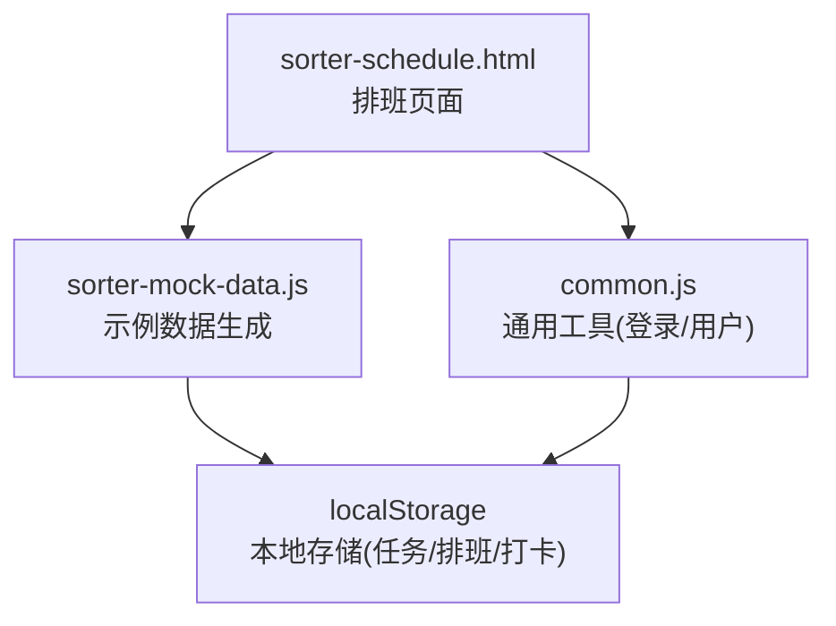
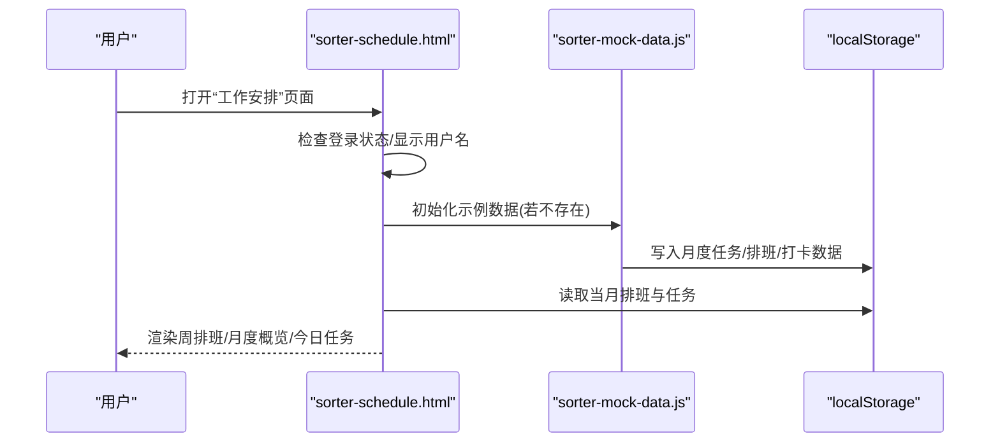
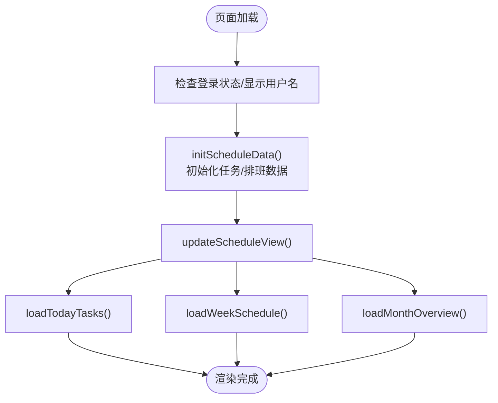
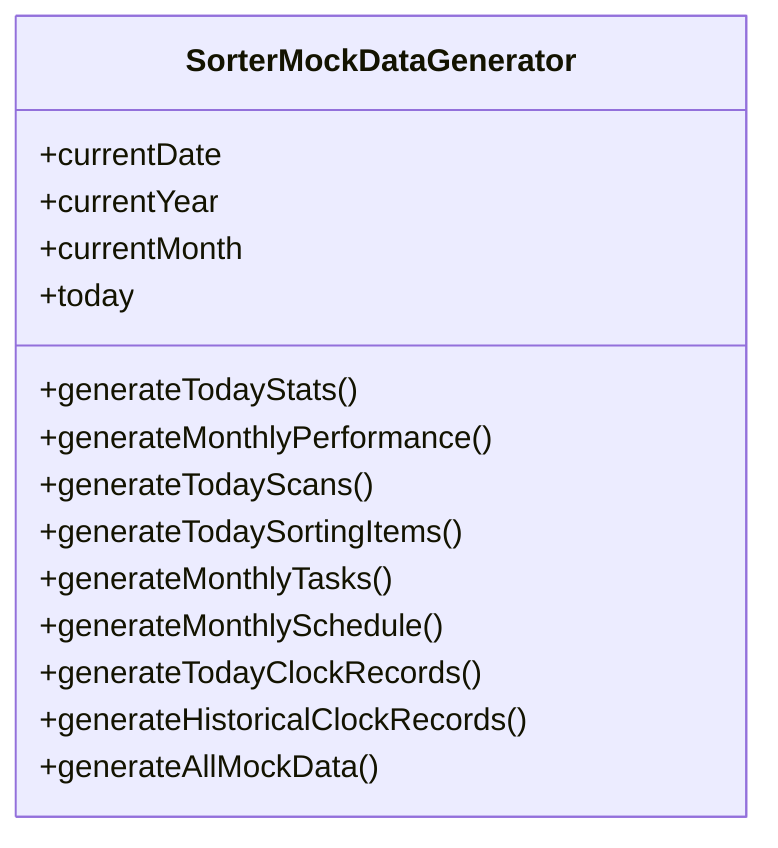
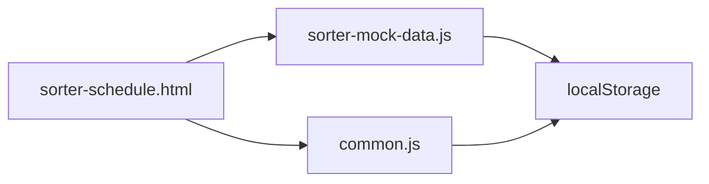

# 排班调度系统

<cite>
**本文引用的文件**   
- [sorter-schedule.html](file://sorter-schedule.html)
- [sorter-mock-data.js](file://sorter-mock-data.js)
- [common.js](file://common.js)
</cite>

## 目录
1. [引言](#引言)
2. [项目结构](#项目结构)
3. [核心组件](#核心组件)
4. [架构总览](#架构总览)
5. [详细组件分析](#详细组件分析)
6. [依赖关系分析](#依赖关系分析)
7. [性能与可扩展性](#性能与可扩展性)
8. [故障排查指南](#故障排查指南)
9. [结论](#结论)
10. [附录：数据模型与接口约定](#附录数据模型与接口约定)

## 引言
本文件面向“分拣员排班调度”子系统的技术实现与业务价值，围绕以下目标展开：
- 智能排班算法原理、班次冲突检测与人员匹配优化机制
- 排班规则灵活配置、节假日调休处理、紧急换班自动化流程
- 排班表可视化展示、变更通知与员工确认机制
- 日历组件、拖拽调整与批量操作支持
- 排班优化目标函数、约束条件求解与多目标权衡策略
- 排班数据统计分析、人力成本控制与效率评估工具

当前仓库提供了分拣员侧的排班页面与示例数据生成逻辑，可作为理解完整智能排班系统的前端入口与数据基线。

## 项目结构
围绕排班调度相关代码，主要涉及以下文件：
- sorter-schedule.html：分拣员“工作安排”页面，包含周/月视图、任务卡片、日期导航等
- sorter-mock-data.js：示例数据生成器，提供月度任务、月度排班、打卡记录等
- common.js：通用工具（登录鉴权、用户信息、按钮样式注入等）

图表来源
- [sorter-schedule.html:549-550](file://sorter-schedule.html#L549-L550)
- [sorter-mock-data.js:345-354](file://sorter-mock-data.js#L345-L354)
- [common.js:135-199](file://common.js#L135-L199)

章节来源
- [sorter-schedule.html:1-120](file://sorter-schedule.html#L1-L120)
- [sorter-mock-data.js:1-10](file://sorter-mock-data.js#L1-L10)
- [common.js:1-20](file://common.js#L1-L20)

## 核心组件
- 排班页面（sorter-schedule.html）
  - 负责渲染周排班表、月度概览、今日任务卡片
  - 通过日期导航切换查看范围
  - 从 localStorage 读取当月排班与任务数据并渲染
- 示例数据生成器（sorter-mock-data.js）
  - 按月份生成任务与排班数据，工作日随机分配早/晚班
  - 提供打卡记录与历史打卡数据
- 通用工具（common.js）
  - 登录状态校验、用户信息显示、统一按钮样式注入

章节来源
- [sorter-schedule.html:551-585](file://sorter-schedule.html#L551-L585)
- [sorter-mock-data.js:213-243](file://sorter-mock-data.js#L213-L243)
- [common.js:176-199](file://common.js#L176-L199)

## 架构总览
排班调度在现有仓库中采用“前端页面 + 本地存储 + 示例数据”的轻量架构：
- 页面层：HTML/CSS/JS 渲染排班视图与交互
- 数据层：localStorage 持久化任务、排班、打卡等数据
- 数据源：示例数据生成器初始化基础数据

图表来源
- [sorter-schedule.html:556-585](file://sorter-schedule.html#L556-L585)
- [sorter-mock-data.js:327-354](file://sorter-mock-data.js#L327-L354)
- [sorter-schedule.html:626-655](file://sorter-schedule.html#L626-L655)

## 详细组件分析

### 排班页面（sorter-schedule.html）
- 功能要点
  - 日期导航：上一天/下一天切换，更新当前日期显示
  - 今日任务：按日期过滤任务列表，展示优先级、时间、地点、状态
  - 周排班：计算本周起止日期，映射到当月排班数据，渲染表格
  - 月度概览：按月份网格展示每日状态（工作/休息），高亮今天
- 关键流程
  - initScheduleData：首次加载时检查并生成示例任务与排班数据
  - updateScheduleView：统一刷新当前日期、今日任务、周排班、月度概览
  - loadWeekSchedule：根据当前周日期查找对应排班项，填充时间与地点映射
  - loadMonthOverview：构建当月日历网格，标记 working/off 状态

图表来源
- [sorter-schedule.html:556-585](file://sorter-schedule.html#L556-L585)
- [sorter-schedule.html:658-671](file://sorter-schedule.html#L658-L671)
- [sorter-schedule.html:679-719](file://sorter-schedule.html#L679-L719)
- [sorter-schedule.html:721-778](file://sorter-schedule.html#L721-L778)
- [sorter-schedule.html:780-800](file://sorter-schedule.html#L780-L800)

章节来源
- [sorter-schedule.html:551-585](file://sorter-schedule.html#L551-L585)
- [sorter-schedule.html:658-778](file://sorter-schedule.html#L658-L778)
- [sorter-schedule.html:780-800](file://sorter-schedule.html#L780-L800)

### 示例数据生成器（sorter-mock-data.js）
- 功能要点
  - generateMonthlyTasks：为当月工作日生成1-3个任务，含优先级、时间段、地点、状态
  - generateMonthlySchedule：为当月工作日随机分配早/晚班，周末休息
  - generateTodayClockRecords/generateHistoricalClockRecords：生成当日与近7日打卡记录
- 数据结构
  - 任务：id、date、title、priority、startTime、endTime、location、status
  - 排班：date、day、dayOfWeek、shift、status
  - 打卡：id、type、time、timestamp、username

图表来源
- [sorter-mock-data.js:4-10](file://sorter-mock-data.js#L4-L10)
- [sorter-mock-data.js:180-243](file://sorter-mock-data.js#L180-L243)
- [sorter-mock-data.js:245-325](file://sorter-mock-data.js#L245-L325)
- [sorter-mock-data.js:327-354](file://sorter-mock-data.js#L327-L354)

章节来源
- [sorter-mock-data.js:180-243](file://sorter-mock-data.js#L180-L243)
- [sorter-mock-data.js:245-325](file://sorter-mock-data.js#L245-L325)
- [sorter-mock-data.js:327-354](file://sorter-mock-data.js#L327-L354)

### 通用工具（common.js）
- 功能要点
  - 登录/登出、角色权限校验
  - 当前用户信息获取与显示
  - 统一按钮样式注入
- 对排班页面的作用
  - 保障访问控制与用户上下文一致性
  - 提升UI一致性与可维护性

章节来源
- [common.js:135-199](file://common.js#L135-L199)
- [common.js:211-270](file://common.js#L211-L270)
- [common.js:52-130](file://common.js#L52-L130)

## 依赖关系分析
- 页面依赖
  - sorter-schedule.html 依赖 common.js 进行登录校验与用户信息显示
  - sorter-schedule.html 依赖 sorter-mock-data.js 生成初始数据
- 数据依赖
  - 所有数据以 localStorage 键名组织，如 sorterTasks_YYYY_MM、sorterSchedule_YYYY_MM、sorterClock_YYYY-MM-DD
- 耦合度
  - 页面与数据解耦：通过键名访问，便于替换后端API
  - 示例数据与页面弱耦合：仅在初始化阶段写入数据

图表来源
- [sorter-schedule.html:549-550](file://sorter-schedule.html#L549-L550)
- [sorter-mock-data.js:345-354](file://sorter-mock-data.js#L345-L354)
- [common.js:135-199](file://common.js#L135-L199)

章节来源
- [sorter-schedule.html:549-550](file://sorter-schedule.html#L549-L550)
- [sorter-mock-data.js:345-354](file://sorter-mock-data.js#L345-L354)
- [common.js:135-199](file://common.js#L135-L199)

## 性能与可扩展性
- 当前实现
  - 使用浏览器本地存储，适合演示与离线场景
  - 数据量较小（按月生成），渲染开销低
- 扩展建议
  - 将示例数据生成器抽象为服务层，支持后端API接入
  - 引入分页与虚拟滚动，应对大规模排班数据
  - 增加缓存策略与增量更新，减少重复渲染

[本节为通用指导，不直接分析具体文件]

## 故障排查指南
- 常见问题
  - 未登录或角色不匹配导致跳转：检查登录状态与角色权限
  - 数据为空：确认示例数据是否已生成（首次进入页面会自动生成）
  - 排班显示异常：核对当月键名是否正确（YYYY_MM）
- 定位方法
  - 控制台日志：查看登录状态、用户信息与数据写入日志
  - 浏览器开发者工具：检查 localStorage 中键值是否存在与格式正确

章节来源
- [common.js:176-199](file://common.js#L176-L199)
- [sorter-schedule.html:556-585](file://sorter-schedule.html#L556-L585)
- [sorter-mock-data.js:345-354](file://sorter-mock-data.js#L345-L354)

## 结论
当前仓库提供了分拣员排班的前端页面与示例数据生成能力，具备基础的周/月视图、任务展示与本地数据持久化。为实现完整的智能排班系统，可在该基础上扩展：
- 算法层：引入优化求解器，实现目标函数与约束条件求解
- 规则引擎：支持灵活配置排班规则、节假日调休与紧急换班
- 交互增强：日历组件、拖拽调整、批量操作与变更确认流
- 数据与分析：统计分析、成本核算与效率评估看板

[本节为总结性内容，不直接分析具体文件]

## 附录：数据模型与接口约定
- 任务数据（sorterTasks_YYYY_MM）
  - 字段：id、date、title、priority、startTime、endTime、location、status
- 排班数据（sorterSchedule_YYYY_MM）
  - 字段：date、day、dayOfWeek、shift、status
- 打卡数据（sorterClock_YYYY-MM-DD）
  - 字段：id、type、time、timestamp、username

章节来源
- [sorter-mock-data.js:180-243](file://sorter-mock-data.js#L180-L243)
- [sorter-mock-data.js:245-325](file://sorter-mock-data.js#L245-L325)