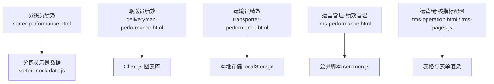
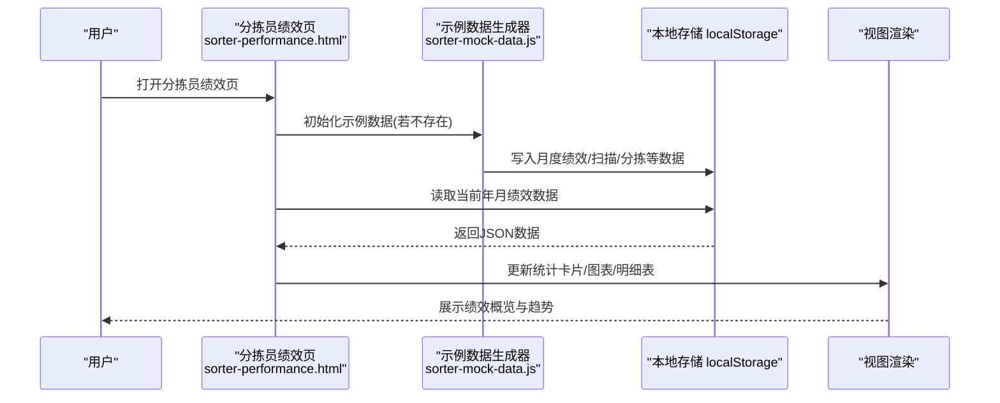
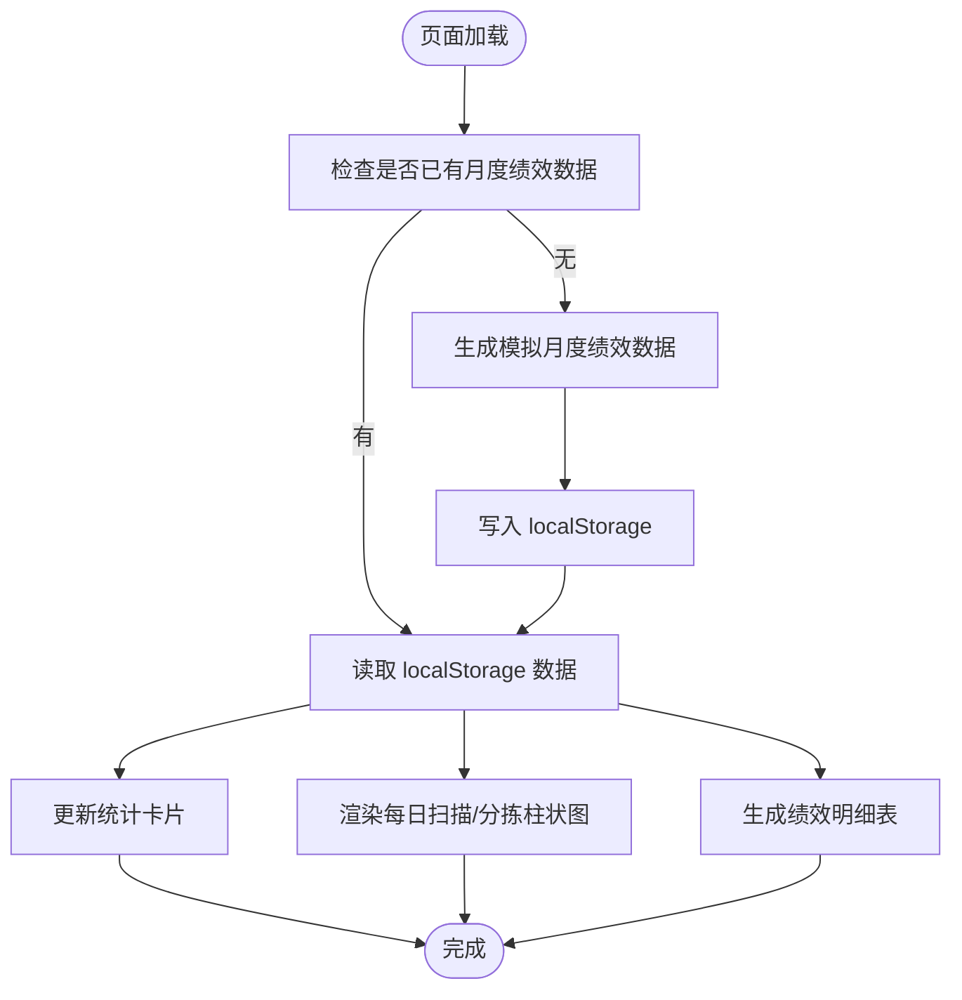
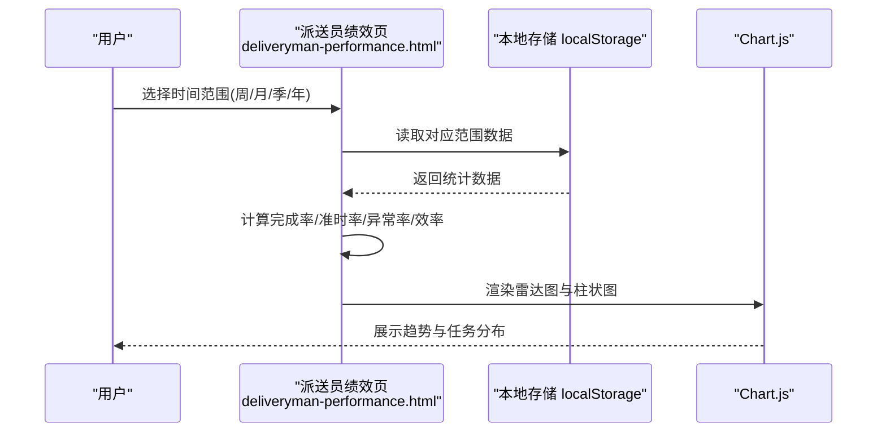
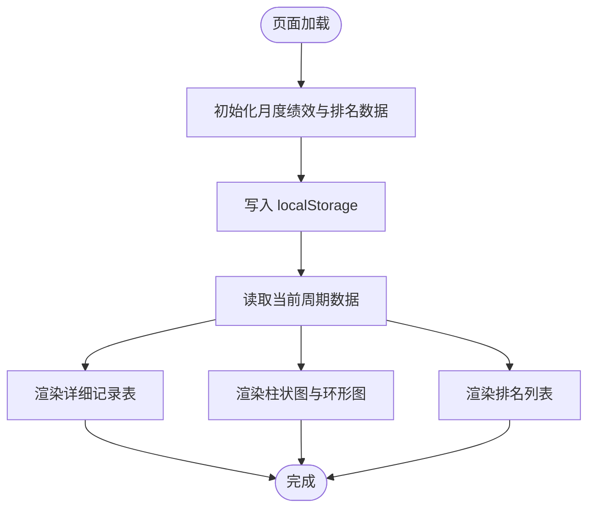
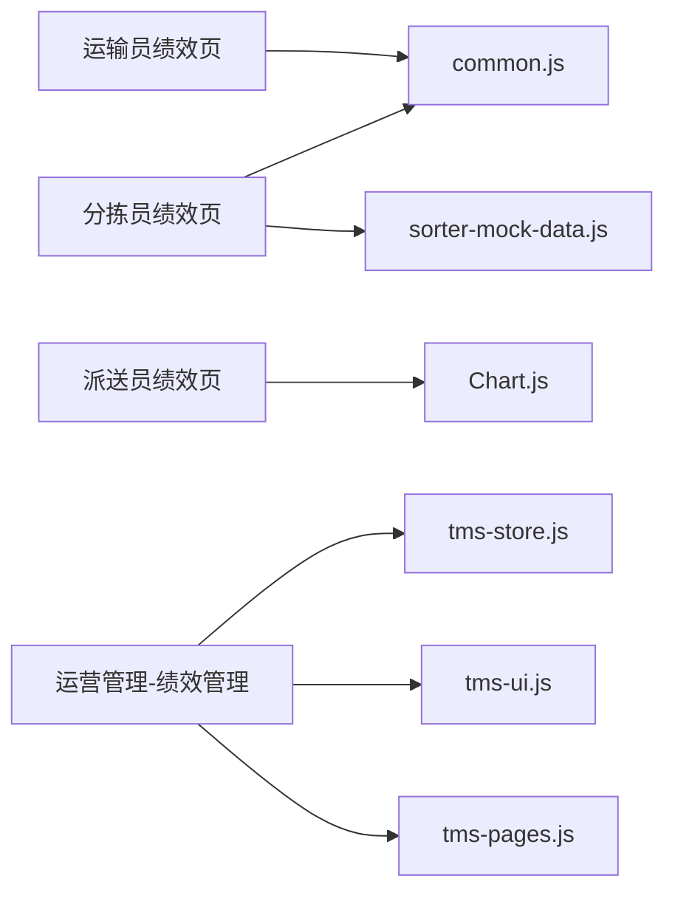

# 绩效评估系统

<cite>
**本文引用的文件**   
- [sorter-performance.html](file://sorter-performance.html)
- [deliveryman-performance.html](file://deliveryman-performance.html)
- [transporter-performance.html](file://transporter-performance.html)
- [tms-performance.html](file://tms-performance.html)
- [sorter-mock-data.js](file://sorter-mock-data.js)
- [tms-pages.js](file://tms-pages.js)
- [tms-operation.html](file://tms-operation.html)
- [common.js](file://common.js)
</cite>

## 目录
1. [引言](#引言)
2. [项目结构](#项目结构)
3. [核心组件](#核心组件)
4. [架构总览](#架构总览)
5. [详细组件分析](#详细组件分析)
6. [依赖关系分析](#依赖关系分析)
7. [性能与实时性考虑](#性能与实时性考虑)
8. [故障诊断与排错指南](#故障诊断与排错指南)
9. [结论与改进建议](#结论与改进建议)
10. [附录：指标与评分模型](#附录指标与评分模型)

## 引言
本文件面向“分拣员绩效评估系统”，围绕以下目标展开：
- 解释分拣员绩效指标的设定算法、权重计算模型与评分标准体系
- 说明KPI数据采集、实时计算与可视化展示的实现方式
- 记录绩效排名的动态更新、历史趋势分析与对比报告生成机制
- 提供统计图表实现、数据聚合算法与报表导出思路
- 解释绩效考核规则配置、自定义指标添加与评估周期管理
- 给出绩效数据分析、问题诊断与改进建议生成的方案
- 确保评估体系公平合理，并以激励为导向

本项目采用前端页面+本地存储（localStorage）的轻量实现，通过模拟数据驱动演示。各角色（分拣员、派送员、运输员）均具备独立的绩效视图；运营管理侧提供统一的绩效管理入口与考核指标配置能力。

## 项目结构
从仓库根目录看，绩效相关的前端页面集中在以下文件：
- 分拣员绩效：sorter-performance.html
- 派送员绩效：deliveryman-performance.html
- 运输员绩效：transporter-performance.html
- 运营管理-绩效管理：tms-performance.html
- 分拣员示例数据：sorter-mock-data.js
- 运营/考核指标配置：tms-operation.html、tms-pages.js
- 公共登录与用户信息：common.js

图示来源
- [sorter-performance.html:338-443](file://sorter-performance.html#L338-L443)
- [deliveryman-performance.html:307-403](file://deliveryman-performance.html#L307-L403)
- [transporter-performance.html:416-559](file://transporter-performance.html#L416-L559)
- [tms-performance.html:262-373](file://tms-performance.html#L262-L373)
- [sorter-mock-data.js:1-361](file://sorter-mock-data.js#L1-L361)
- [tms-operation.html:721-744](file://tms-operation.html#L721-L744)
- [tms-pages.js:1072-1164](file://tms-pages.js#L1072-L1164)

章节来源
- [sorter-performance.html:338-443](file://sorter-performance.html#L338-L443)
- [deliveryman-performance.html:307-403](file://deliveryman-performance.html#L307-L403)
- [transporter-performance.html:416-559](file://transporter-performance.html#L416-L559)
- [tms-performance.html:262-373](file://tms-performance.html#L262-L373)
- [sorter-mock-data.js:1-361](file://sorter-mock-data.js#L1-L361)
- [tms-operation.html:721-744](file://tms-operation.html#L721-L744)
- [tms-pages.js:1072-1164](file://tms-pages.js#L1072-L1164)

## 核心组件
- 分拣员绩效页：提供月度维度绩效概览、每日扫描/分拣量柱状图、明细表与月份切换逻辑，数据来源于本地存储的模拟数据。
- 派送员绩效页：以周/月/季/年为时间范围，使用 Chart.js 绘制雷达图与柱状图，展示任务完成率、准时率、异常率与效率等指标。
- 运输员绩效页：提供筛选器（周期/年份/月份）、统计卡片、月度运输量柱状图、准时率环形图、详细记录表与排名列表。
- 运营管理-绩效管理：统一展示员工绩效列表、趋势标签与审批操作，数据由本地存储维护。
- 分拣员示例数据：集中生成今日统计、月度绩效、扫描记录、分拣项目、任务、排班与打卡等示例数据。
- 运营/考核指标配置：提供考核指标增删改查与等级判定逻辑，支撑自定义指标与权重配置。

章节来源
- [sorter-performance.html:338-443](file://sorter-performance.html#L338-L443)
- [deliveryman-performance.html:307-403](file://deliveryman-performance.html#L307-L403)
- [transporter-performance.html:416-559](file://transporter-performance.html#L416-L559)
- [tms-performance.html:262-373](file://tms-performance.html#L262-L373)
- [sorter-mock-data.js:1-361](file://sorter-mock-data.js#L1-L361)
- [tms-operation.html:721-744](file://tms-operation.html#L721-L744)
- [tms-pages.js:1072-1164](file://tms-pages.js#L1072-L1164)

## 架构总览
整体架构为“多角色前端页面 + 本地存储 + 可选图表库”的轻量模式：
- 数据层：localStorage 作为持久化载体，按角色与周期键名组织数据
- 业务层：各页面脚本负责数据初始化、加载、计算与渲染
- 展示层：HTML/CSS 布局 + 原生JS或Chart.js进行图表渲染
- 管理侧：运营管理页面提供指标配置与绩效审批流程

图示来源
- [sorter-performance.html:444-677](file://sorter-performance.html#L444-L677)
- [sorter-mock-data.js:26-59](file://sorter-mock-data.js#L26-L59)

## 详细组件分析

### 分拣员绩效模块
- 功能要点
  - 月份选择器：支持上/下月切换，动态更新视图
  - 统计卡片：总扫描数、总分拣数、准确率、效率指数
  - 图表：每日扫描量与分拣量柱状图（原生JS实现）
  - 明细表：日期、扫描量、分拣量、准确率、完成率、得分
- 数据流
  - 首次进入时检查并生成模拟月度绩效数据，存入 localStorage
  - 根据当前年月键读取数据，渲染卡片与图表
  - 明细表按日期降序排序展示
- 关键实现路径
  - 初始化与事件绑定：[sorter-performance.html:444-499](file://sorter-performance.html#L444-L499)
  - 生成模拟数据：[sorter-mock-data.js:26-59](file://sorter-mock-data.js#L26-L59)
  - 视图更新与图表渲染：[sorter-performance.html:543-677](file://sorter-performance.html#L543-L677)

图示来源
- [sorter-performance.html:501-677](file://sorter-performance.html#L501-L677)
- [sorter-mock-data.js:26-59](file://sorter-mock-data.js#L26-L59)

章节来源
- [sorter-performance.html:338-443](file://sorter-performance.html#L338-L443)
- [sorter-performance.html:444-677](file://sorter-performance.html#L444-L677)
- [sorter-mock-data.js:26-59](file://sorter-mock-data.js#L26-L59)

### 派送员绩效模块
- 功能要点
  - 时间范围选择：本周/本月/本季度/本年
  - 指标概览：完成任务数、完成率、准时率、绩效评分
  - 图表：雷达图（任务完成率、准时率、服务质量、异常处理、效率）与柱状图（任务分类数量）
  - 详情表：不同时间范围的指标对比与目标值
- 数据流
  - 初始化时写入 localStorage 中 week/month/quarter/year 四个维度的数据
  - 根据所选范围计算完成率、准时率、异常率与效率
  - 使用 Chart.js 渲染雷达图与柱状图
- 关键实现路径
  - 初始化与事件绑定：[deliveryman-performance.html:407-440](file://deliveryman-performance.html#L407-L440)
  - 数据初始化与加载：[deliveryman-performance.html:442-513](file://deliveryman-performance.html#L442-L513)
  - 图表更新与错误处理：[deliveryman-performance.html:576-764](file://deliveryman-performance.html#L576-L764)

图示来源
- [deliveryman-performance.html:442-513](file://deliveryman-performance.html#L442-L513)
- [deliveryman-performance.html:576-764](file://deliveryman-performance.html#L576-L764)

章节来源
- [deliveryman-performance.html:307-403](file://deliveryman-performance.html#L307-L403)
- [deliveryman-performance.html:407-440](file://deliveryman-performance.html#L407-L440)
- [deliveryman-performance.html:442-513](file://deliveryman-performance.html#L442-L513)
- [deliveryman-performance.html:576-764](file://deliveryman-performance.html#L576-L764)

### 运输员绩效模块
- 功能要点
  - 筛选器：统计周期、年份、月份
  - 统计卡片：总运输量、总里程、准时率、客户满意度
  - 图表：月度运输量柱状图、准时率环形图（SVG）
  - 详细记录表：日期、任务、运输量、里程、计划/实际时间、状态、满意度
  - 排名列表：按分数排序展示
- 数据流
  - 初始化时写入 localStorage 中的月度绩效与排名数据
  - 根据当前周期键读取 dailyData 渲染表格
  - 生成静态柱状图与环形图
- 关键实现路径
  - 初始化与事件绑定：[transporter-performance.html:564-593](file://transporter-performance.html#L564-L593)
  - 数据初始化与加载：[transporter-performance.html:595-704](file://transporter-performance.html#L595-L704)
  - 图表与排名渲染：[transporter-performance.html:706-738](file://transporter-performance.html#L706-L738)

图示来源
- [transporter-performance.html:595-738](file://transporter-performance.html#L595-L738)

章节来源
- [transporter-performance.html:416-559](file://transporter-performance.html#L416-L559)
- [transporter-performance.html:564-593](file://transporter-performance.html#L564-L593)
- [transporter-performance.html:595-738](file://transporter-performance.html#L595-L738)

### 运营管理-绩效管理
- 功能要点
  - 展示平均绩效得分、提升/稳定/下降人数
  - 员工绩效列表：包含趋势标签、关键绩效、挑战与改进计划
  - 审批流程：批准/查看详情/编辑
- 数据流
  - 初始化时写入 localStorage 的模拟绩效记录
  - 渲染列表并根据趋势与状态显示标签
- 关键实现路径
  - 页面结构与导航：[tms-performance.html:262-373](file://tms-performance.html#L262-L373)
  - 模拟数据与渲染逻辑：[tms-performance.html:427-630](file://tms-performance.html#L427-L630)

章节来源
- [tms-performance.html:262-373](file://tms-performance.html#L262-L373)
- [tms-performance.html:427-630](file://tms-performance.html#L427-L630)

### 分拣员示例数据生成器
- 功能要点
  - 生成今日统计、月度绩效、扫描记录、分拣项目、任务、排班与打卡记录
  - 将数据写入 localStorage，供各分拣员页面读取
- 关键实现路径
  - 月度绩效数据生成：[sorter-mock-data.js:26-59](file://sorter-mock-data.js#L26-L59)
  - 今日扫描与分拣项目：[sorter-mock-data.js:61-178](file://sorter-mock-data.js#L61-L178)
  - 任务与排班：[sorter-mock-data.js:180-243](file://sorter-mock-data.js#L180-L243)
  - 打卡记录：[sorter-mock-data.js:245-325](file://sorter-mock-data.js#L245-L325)
  - 批量生成入口：[sorter-mock-data.js:327-355](file://sorter-mock-data.js#L327-L355)

章节来源
- [sorter-mock-data.js:1-361](file://sorter-mock-data.js#L1-L361)

### 运营/考核指标配置
- 功能要点
  - 考核指标表格：ID、名称、目标值、权重、周期、状态
  - 新增/编辑/删除指标
  - 考核评级：根据综合得分划分等级（A/B/C/D），并生成评语
- 关键实现路径
  - 指标表格与操作：[tms-operation.html:721-744](file://tms-operation.html#L721-L744)
  - 评级与评语逻辑：[tms-pages.js:1138-1164](file://tms-pages.js#L1138-L1164)

章节来源
- [tms-operation.html:721-744](file://tms-operation.html#L721-L744)
- [tms-pages.js:1138-1164](file://tms-pages.js#L1138-L1164)

## 依赖关系分析
- 页面与脚本依赖
  - sorter-performance.html 依赖 common.js 与 sorter-mock-data.js
  - deliveryman-performance.html 依赖 Chart.js（CDN）
  - transporter-performance.html 依赖 common.js
  - tms-performance.html 依赖 common.js、tms-store.js、tms-ui.js、tms-pages.js
- 数据依赖
  - 所有页面通过 localStorage 键名访问数据，键名包括：
    - sorterPerformance_YYYY_MM
    - deliverymanPerformance
    - transporterPerformance
    - transporterRanking
    - tmsPerformances
- 外部依赖
  - Chart.js（派送员绩效页）
  - 公共样式与UI组件（tms-ui.css、tms-ui.js、tms-pages.js）

图示来源
- [sorter-performance.html:442-443](file://sorter-performance.html#L442-L443)
- [deliveryman-performance.html:10](file://deliveryman-performance.html#L10)
- [transporter-performance.html:563](file://transporter-performance.html#L563)
- [tms-performance.html:375-379](file://tms-performance.html#L375-L379)

章节来源
- [sorter-performance.html:442-443](file://sorter-performance.html#L442-L443)
- [deliveryman-performance.html:10](file://deliveryman-performance.html#L10)
- [transporter-performance.html:563](file://transporter-performance.html#L563)
- [tms-performance.html:375-379](file://tms-performance.html#L375-L379)

## 性能与实时性考虑
- 数据源与缓存
  - 使用 localStorage 作为本地缓存，避免频繁网络请求
  - 建议在真实环境中引入后端API与增量同步策略，减少全量刷新
- 图表渲染
  - 派送员绩效页使用 Chart.js，注意在更新前销毁旧实例以避免内存泄漏
  - 分拣员与运输员页使用原生JS/SVG绘制简单图表，适合轻量场景
- 计算复杂度
  - 月度明细排序与汇总为 O(n log n)，n 为当月天数，通常较小
  - 排名计算为 O(n log n)，n 为参与排名人员数量
- 可扩展性
  - 将指标计算逻辑抽离为独立函数或模块，便于单元测试与复用
  - 引入服务端聚合计算，前端仅做展示与交互

[本节为通用指导，不直接分析具体文件]

## 故障诊断与排错指南
- 常见问题
  - Chart.js 未加载：派送员绩效页会打印错误日志并跳过图表渲染
  - localStorage 数据缺失：页面会显示默认值或空提示
  - 权限校验失败：非管理员访问绩效管理页会被重定向
- 排查步骤
  - 检查浏览器控制台是否有 Chart.js 相关错误
  - 确认 localStorage 中是否存在对应键名（如 sorterPerformance_YYYY_MM）
  - 验证登录状态与角色权限（admin/deliveryman/transporter/sorter）
- 修复建议
  - 确保 CDN 可访问或替换为本地资源
  - 重新运行示例数据生成器以填充缺失数据
  - 修正路由跳转逻辑与权限判断

章节来源
- [deliveryman-performance.html:612-615](file://deliveryman-performance.html#L612-L615)
- [deliveryman-performance.html:699-702](file://deliveryman-performance.html#L699-L702)
- [tms-performance.html:445-450](file://tms-performance.html#L445-L450)

## 结论与改进建议
- 现状总结
  - 系统已具备多角色绩效视图与基础图表展示能力
  - 数据通过 localStorage 模拟，便于演示与快速迭代
  - 运营管理侧提供指标配置与评级逻辑
- 改进方向
  - 引入后端服务与数据库，实现真实数据采集与实时计算
  - 完善权重配置界面，支持动态调整指标权重与阈值
  - 增加报表导出（CSV/PDF）与对比报告自动生成
  - 强化权限控制与审计日志，保障数据安全与合规
  - 优化图表性能，支持大数据量下的流畅交互

[本节为总结与建议，不直接分析具体文件]

## 附录：指标与评分模型

### 分拣员KPI指标与权重模型
- 指标定义
  - 总扫描数：累计扫描包裹数量
  - 总分拣数：累计完成分拣包裹数量
  - 准确率：正确分拣比例（基于异常/错误扫描占比）
  - 效率指数：单位时间内完成的分拣量（结合工作时长）
- 权重建议
  - 准确率：40%
  - 效率指数：30%
  - 总扫描数：15%
  - 总分拣数：15%
- 评分公式（概念）
  - 标准化各指标至 0-100 分
  - 加权求和得到综合得分
  - 等级划分：≥90为A，≥80为B，≥70为C，<70为D

[本节为概念模型，不直接分析具体文件]

### 派送员KPI指标与权重模型
- 指标定义
  - 任务完成率：完成任务数/总任务数
  - 准时率：准时完成任务数/完成任务数
  - 异常率：异常任务数/总任务数
  - 效率：完成任务数/工作小时数
- 权重建议
  - 任务完成率：30%
  - 准时率：30%
  - 异常率：20%
  - 效率：20%
- 评分公式（概念）
  - 同上，标准化后加权求和

[本节为概念模型，不直接分析具体文件]

### 运输员KPI指标与权重模型
- 指标定义
  - 总运输量：累计运输箱数
  - 总里程：累计行驶公里数
  - 准时率：准时到达次数/总运输次数
  - 客户满意度：评价均值
- 权重建议
  - 准时率：40%
  - 客户满意度：30%
  - 总运输量：15%
  - 总里程：15%
- 评分公式（概念）
  - 同上，标准化后加权求和

[本节为概念模型，不直接分析具体文件]

### 数据聚合与报表导出
- 数据聚合
  - 按月/季/年聚合各指标，计算平均值、峰值、环比变化
  - 生成趋势序列用于折线图/面积图
- 报表导出
  - 前端导出：将表格数据转换为CSV下载
  - 后端导出：生成PDF/Excel报告，包含图表与对比分析

[本节为概念实现，不直接分析具体文件]

### 绩效考核规则配置与评估周期管理
- 规则配置
  - 指标名称、目标值、权重、周期、状态（启用/停用）
  - 等级阈值与评语模板
- 评估周期
  - 支持周/月/季/年自定义周期
  - 周期切换时重新计算指标与排名

章节来源
- [tms-operation.html:721-744](file://tms-operation.html#L721-L744)
- [tms-pages.js:1138-1164](file://tms-pages.js#L1138-L1164)