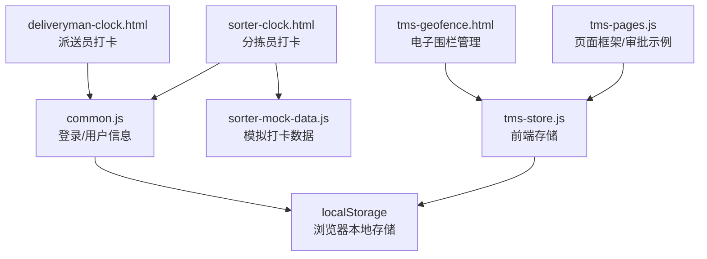
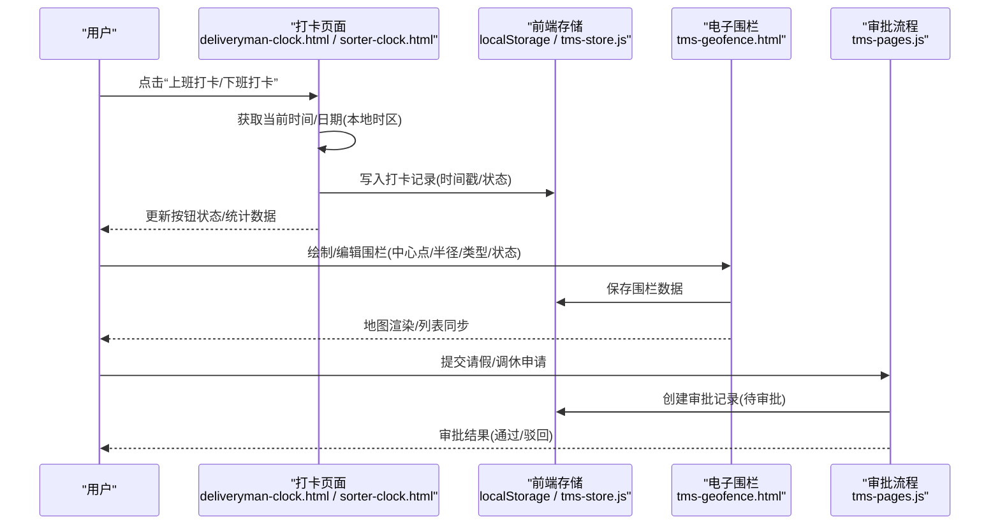
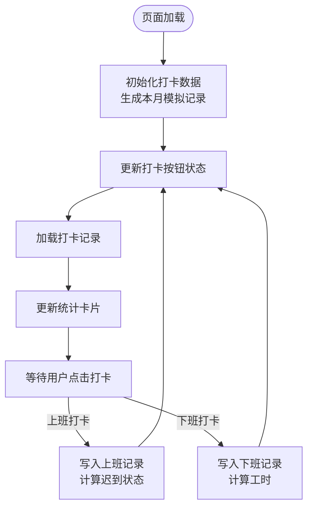
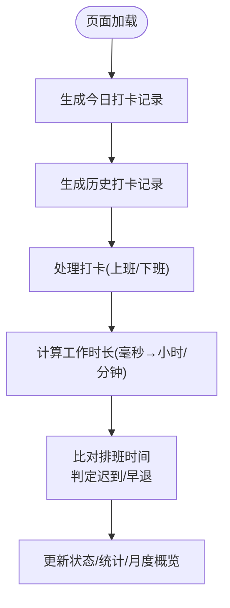
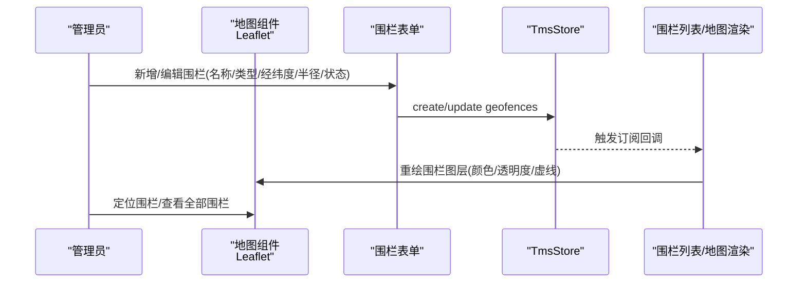
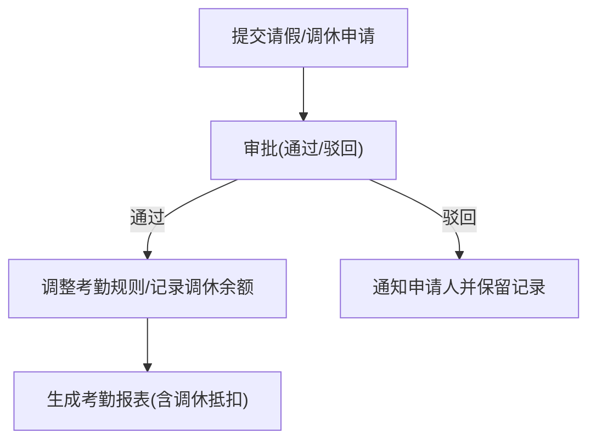
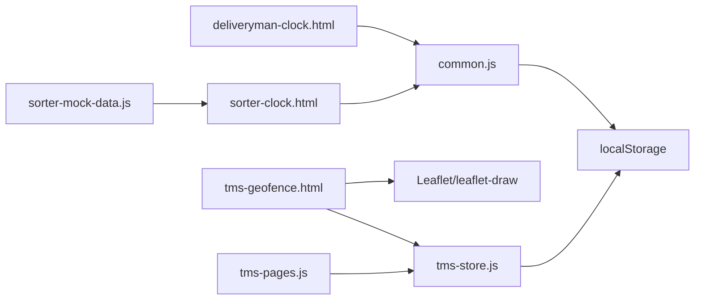

# 考勤打卡系统

<cite>
**本文引用的文件**   
- [deliveryman-clock.html](file://deliveryman-clock.html)
- [sorter-clock.html](file://sorter-clock.html)
- [sorter-mock-data.js](file://sorter-mock-data.js)
- [tms-geofence.html](file://tms-geofence.html)
- [common.js](file://common.js)
- [tms-store.js](file://tms-store.js)
- [tms-pages.js](file://tms-pages.js)
</cite>

## 目录
1. [引言](#引言)
2. [项目结构](#项目结构)
3. [核心组件](#核心组件)
4. [架构总览](#架构总览)
5. [详细组件分析](#详细组件分析)
6. [依赖关系分析](#依赖关系分析)
7. [性能与扩展性](#性能与扩展性)
8. [故障排查指南](#故障排查指南)
9. [结论](#结论)
10. [附录：企业级方案建议](#附录企业级方案建议)

## 引言
本文件面向“考勤打卡系统”的技术实现，围绕以下目标展开：精确记录打卡时间戳、基于电子围栏的地理位置校验、防作弊机制、迟到早退自动识别、请假调休管理流程、考勤统计与工时计算、出勤率报表生成、时间处理与时区本地化、规则灵活配置、异常处理与审批集成、数据备份与隐私安全、以及访问控制。仓库中已包含派送员与分拣员的打卡页面、电子围栏管理、通用登录与权限校验、以及前端存储与页面框架等能力，可作为企业级解决方案的前端原型与参考实现。

## 项目结构
本仓库采用多角色前端页面组织方式，按业务域划分 HTML 页面，并通过 common.js 提供统一的用户会话与基础工具，tms-store.js 提供前端数据存储与订阅机制，tms-pages.js 提供页面路由与渲染。考勤相关能力分布在以下文件：
- 派送员打卡：deliveryman-clock.html
- 分拣员打卡：sorter-clock.html（含历史数据生成）
- 电子围栏：tms-geofence.html
- 通用逻辑：common.js
- 前端存储与数据模型：tms-store.js
- 页面框架与行政审批示例：tms-pages.js

**图表来源**
- [deliveryman-clock.html:453-679](file://deliveryman-clock.html#L453-L679)
- [sorter-clock.html:605-756](file://sorter-clock.html#L605-L756)
- [tms-geofence.html:570-783](file://tms-geofence.html#L570-L783)
- [common.js:135-218](file://common.js#L135-L218)
- [tms-store.js:651-703](file://tms-store.js#L651-L703)
- [tms-pages.js:1044-1097](file://tms-pages.js#L1044-L1097)

**章节来源**
- [deliveryman-clock.html:453-679](file://deliveryman-clock.html#L453-L679)
- [sorter-clock.html:605-756](file://sorter-clock.html#L605-L756)
- [tms-geofence.html:570-783](file://tms-geofence.html#L570-L783)
- [common.js:135-218](file://common.js#L135-L218)
- [tms-store.js:651-703](file://tms-store.js#L651-L703)
- [tms-pages.js:1044-1097](file://tms-pages.js#L1044-L1097)

## 核心组件
- 打卡记录与状态判断
  - 派送员打卡页面维护每日上班/下班打卡，计算工时并标记迟到状态。
  - 分拣员打卡页面记录上班/下班时间戳，计算工作时长，并按排班时间判定迟到与早退。
- 电子围栏与位置校验
  - 电子围栏管理支持在地图上绘制圆形围栏，定义仓储、网点、禁行区域等类型，并与前端存储双向联动。
- 时间与本地化
  - 使用浏览器本地时间进行展示与计算，通过 toLocaleString/toLocaleDateString 进行中文本地化显示。
- 权限与安全
  - 通用登录检查限制页面访问；前端存储用于演示数据持久化。
- 审批流程集成
  - 页面框架提供行政事项审批示例，可作为请假调休审批流程的参考。

**章节来源**
- [deliveryman-clock.html:499-609](file://deliveryman-clock.html#L499-L609)
- [sorter-clock.html:605-756](file://sorter-clock.html#L605-L756)
- [tms-geofence.html:570-783](file://tms-geofence.html#L570-L783)
- [common.js:135-218](file://common.js#L135-L218)
- [tms-pages.js:1044-1097](file://tms-pages.js#L1044-L1097)

## 架构总览
下图展示考勤打卡系统的整体交互：客户端页面发起打卡请求，读取当前时间与用户信息，写入本地存储；电子围栏管理通过地图组件维护地理围栏，供后续位置校验使用；审批流程通过页面框架提供的表单与表格组件完成。

**图表来源**
- [deliveryman-clock.html:499-609](file://deliveryman-clock.html#L499-L609)
- [sorter-clock.html:605-756](file://sorter-clock.html#L605-L756)
- [tms-geofence.html:721-783](file://tms-geofence.html#L721-L783)
- [tms-pages.js:1044-1097](file://tms-pages.js#L1044-L1097)

## 详细组件分析

### 派送员打卡模块
- 功能要点
  - 实时时钟显示与本地化时间格式。
  - 打卡按钮状态机：未打卡→上班打卡→下班打卡→已完成。
  - 迟到判定：以固定阈值（例如 09:00）比较上班时间。
  - 工时计算：下班时间减去上班时间得到小时数。
  - 月度统计：本月出勤天数、迟到次数、总工时、日均工时。
- 关键流程
  - 初始化数据：若本地无记录则生成当月模拟数据。
  - 处理打卡：根据当前状态写入上班或下班记录，计算工时并刷新 UI。
  - 加载记录：按日期倒序展示，并更新统计卡片。

**图表来源**
- [deliveryman-clock.html:499-609](file://deliveryman-clock.html#L499-L609)
- [deliveryman-clock.html:611-679](file://deliveryman-clock.html#L611-L679)

**章节来源**
- [deliveryman-clock.html:484-609](file://deliveryman-clock.html#L484-L609)
- [deliveryman-clock.html:611-679](file://deliveryman-clock.html#L611-L679)

### 分拣员打卡模块
- 功能要点
  - 记录上班/下班打卡的时间戳，并计算当日工作时长（小时+分钟）。
  - 结合排班表判定迟到与早退：以排班规定的上班时间（如 08:30）和下班时间（如 17:30）为基准。
  - 月度统计：工作日计数、迟到次数、早退次数。
- 关键流程
  - 生成今日与历史打卡记录（由 mock 数据辅助）。
  - 计算工作时长：配对上班/下班时间戳累加毫秒差。
  - 迟到早退判定：比较打卡时间与排班时间。

**图表来源**
- [sorter-mock-data.js:266-299](file://sorter-mock-data.js#L266-L299)
- [sorter-clock.html:605-756](file://sorter-clock.html#L605-L756)

**章节来源**
- [sorter-mock-data.js:266-299](file://sorter-mock-data.js#L266-L299)
- [sorter-clock.html:605-756](file://sorter-clock.html#L605-L756)

### 电子围栏与地理位置验证
- 功能要点
  - 使用 Leaflet 地图组件绘制圆形围栏，支持仓储围栏、网点围栏、禁行区域等类型。
  - 围栏数据与 TmsStore 双向联动，支持启用/停用、编辑、删除等操作。
  - 地图视图与围栏列表同步，支持定位到单个围栏或全部围栏。
- 关键流程
  - 初始化地图与 KPI 面板。
  - 渲染围栏图层（颜色/透明度/虚线表示状态）。
  - 打开表单新增/编辑围栏，提交后更新存储并触发订阅刷新。

**图表来源**
- [tms-geofence.html:570-783](file://tms-geofence.html#L570-L783)

**章节来源**
- [tms-geofence.html:570-783](file://tms-geofence.html#L570-L783)

### 时间与本地化处理
- 时间展示
  - 使用 toLocaleTimeString('zh-CN') 与 toLocaleDateString('zh-CN', {...}) 输出中文本地化时间与日期。
- 时间计算
  - 派送员：将字符串时间解析为 Date 对象，计算差值（毫秒）转小时。
  - 分拣员：直接使用时间戳差值计算工作时长，再转换为小时与分钟。
- 时区说明
  - 当前实现基于浏览器本地时区；如需跨时区一致性，应在后端统一使用 UTC 存储并在前端按用户时区转换显示。

**章节来源**
- [deliveryman-clock.html:484-497](file://deliveryman-clock.html#L484-L497)
- [deliveryman-clock.html:591-603](file://deliveryman-clock.html#L591-L603)
- [sorter-clock.html:641-665](file://sorter-clock.html#L641-L665)

### 考勤规则与迟到早退判定
- 迟到判定
  - 派送员：以固定阈值（如 09:00）比较上班时间。
  - 分拣员：以排班时间（如 08:30）比较上班时间。
- 早退判定
  - 分拣员：以排班时间（如 17:30）比较下班时间。
- 规则配置建议
  - 将阈值与排班时间作为可配置项（员工级别/部门级别/岗位级别），存储在 TmsStore 或后端数据库，前端读取后动态应用。

**章节来源**
- [deliveryman-clock.html:578-587](file://deliveryman-clock.html#L578-L587)
- [sorter-clock.html:743-759](file://sorter-clock.html#L743-L759)

### 请假调休与审批流程集成
- 现有能力
  - 页面框架提供行政事项审批示例，包括新建、通过、驳回操作，状态流转清晰。
- 扩展建议
  - 将请假/调休申请纳入同一审批框架，新增字段（开始时间、结束时间、类型、原因），审批通过后联动考勤规则（豁免迟到/早退、计入调休余额）。
  - 审批结果应回写至考勤记录，形成闭环。

**图表来源**
- [tms-pages.js:1044-1097](file://tms-pages.js#L1044-L1097)

**章节来源**
- [tms-pages.js:1044-1097](file://tms-pages.js#L1044-L1097)

### 考勤数据统计与工时计算
- 月度统计
  - 派送员：本月出勤天数、迟到次数、总工时、日均工时。
  - 分拣员：工作日计数、迟到次数、早退次数、工作时长汇总。
- 工时计算
  - 派送员：下班时间减上班时间得到小时数。
  - 分拣员：配对上班/下班时间戳累加毫秒差，转换为小时与分钟。
- 报表生成
  - 前端可导出 CSV/JSON 供后端进一步加工；企业级场景建议在后端聚合多维度指标（部门/岗位/周期）并生成可视化报表。

**章节来源**
- [deliveryman-clock.html:652-673](file://deliveryman-clock.html#L652-L673)
- [sorter-clock.html:641-665](file://sorter-clock.html#L641-L665)
- [sorter-clock.html:732-776](file://sorter-clock.html#L732-L776)

### 防作弊机制
- 现有能力
  - 打卡时间戳来源于浏览器本地时间，存在被篡改风险。
- 强化建议
  - 服务端时间戳权威：所有打卡请求必须携带服务器签发时间戳，客户端时间仅用于展示。
  - 设备指纹与网络环境校验：记录设备 ID、IP、GPS 精度、信号强度等上下文。
  - 多点校验：结合 GPS、基站、Wi-Fi 指纹与电子围栏进行综合判定。
  - 行为风控：检测频繁切换账号、模拟器、虚拟定位等异常模式。

[本节为概念性建议，不直接分析具体文件]

### 地理位置验证与电子围栏联动
- 现有能力
  - 电子围栏管理支持定义圆形围栏及其状态，地图渲染与列表同步。
- 联动建议
  - 打卡时调用浏览器 Geolocation API 获取坐标，计算与最近围栏的距离，若在允许范围内则允许打卡，否则拒绝或标记异常。
  - 对移动中的外勤人员，采用轨迹采样与围栏穿越事件进行持续校验。

**章节来源**
- [tms-geofence.html:721-783](file://tms-geofence.html#L721-L783)

### 安全访问控制与隐私保护
- 访问控制
  - 通用登录检查限制页面访问，角色不匹配时跳转登录页。
- 隐私保护
  - 前端存储仅用于演示；生产环境应避免在 localStorage 中存放敏感个人信息。
  - 对地理位置、设备信息等敏感数据进行脱敏与最小化采集。
- 数据安全
  - 传输层使用 HTTPS；存储层加密敏感字段；定期备份与审计日志。

**章节来源**
- [common.js:135-218](file://common.js#L135-L218)

## 依赖关系分析
- 页面与通用库
  - 各角色页面依赖 common.js 进行登录状态检查与用户信息显示。
- 前端存储
  - 打卡记录与电子围栏数据均通过 localStorage 或 TmsStore 进行持久化与订阅刷新。
- 地图组件
  - 电子围栏页面依赖 Leaflet 与 leaflet-draw 进行地图渲染与绘制。

**图表来源**
- [deliveryman-clock.html:453-679](file://deliveryman-clock.html#L453-L679)
- [sorter-clock.html:605-756](file://sorter-clock.html#L605-L756)
- [tms-geofence.html:570-783](file://tms-geofence.html#L570-L783)
- [common.js:135-218](file://common.js#L135-L218)
- [tms-store.js:651-703](file://tms-store.js#L651-L703)

**章节来源**
- [deliveryman-clock.html:453-679](file://deliveryman-clock.html#L453-L679)
- [sorter-clock.html:605-756](file://sorter-clock.html#L605-L756)
- [tms-geofence.html:570-783](file://tms-geofence.html#L570-L783)
- [common.js:135-218](file://common.js#L135-L218)
- [tms-store.js:651-703](file://tms-store.js#L651-L703)

## 性能与扩展性
- 性能优化
  - 减少不必要的 DOM 重绘：批量更新统计卡片与列表。
  - 使用虚拟滚动或分页加载历史记录，避免一次性渲染大量打卡记录。
  - 地图图层按需渲染，仅在围栏数据变化时重绘。
- 扩展性
  - 将考勤规则、排班时间、阈值参数抽象为配置实体，支持多租户与多部门差异化策略。
  - 引入后端服务进行时间权威、位置校验、风控与报表聚合，前端专注交互与展示。

[本节为通用指导，不直接分析具体文件]

## 故障排查指南
- 打卡按钮状态异常
  - 检查本地存储中是否存在今日记录；确认更新时间戳与日期格式一致。
  - 核对迟到阈值与当前时间的比较逻辑。
- 工时计算错误
  - 确认上下班时间解析正确，避免时区与夏令时影响。
  - 对于跨日班次，需考虑日期边界与次日上班时间。
- 电子围栏无法渲染
  - 检查 Leaflet 资源是否加载成功；确认地图容器尺寸非零。
  - 校验围栏数据的经纬度与半径范围是否符合规范。
- 审批流程无响应
  - 检查表单提交是否正确写入存储；确认状态字段与动作按钮显示条件匹配。

**章节来源**
- [deliveryman-clock.html:535-609](file://deliveryman-clock.html#L535-L609)
- [sorter-clock.html:641-756](file://sorter-clock.html#L641-L756)
- [tms-geofence.html:600-683](file://tms-geofence.html#L600-L683)
- [tms-pages.js:1044-1097](file://tms-pages.js#L1044-L1097)

## 结论
本仓库提供了考勤打卡系统的前端原型与关键能力：打卡时间戳记录、迟到早退判定、工时统计、电子围栏管理与审批流程示例。为实现企业级解决方案，建议在以下方面增强：
- 引入服务端权威时间戳与位置校验，提升防作弊能力。
- 将考勤规则与排班时间配置化，支持多租户与差异化策略。
- 完善请假调休审批闭环，联动考勤规则与报表生成。
- 加强数据安全与隐私保护，实施访问控制、加密与审计。
- 在后端聚合多维指标，生成可视化报表与自动化提醒。

[本节为总结性内容，不直接分析具体文件]

## 附录：企业级方案建议
- 数据模型建议
  - 打卡记录：员工ID、日期、上班时间、下班时间、时间戳、状态、地点、设备信息。
  - 排班计划：员工ID、日期、班次、上班时间、下班时间、工作地点。
  - 电子围栏：名称、类型、中心经纬度、半径、状态、关联部门/岗位。
  - 审批记录：申请类型、申请人、部门、起止时间、状态、审批意见。
- 指标与报表
  - 出勤率、迟到率、早退率、工时利用率、部门/岗位对比、趋势分析。
- 安全与合规
  - 最小化采集原则、数据脱敏、访问审计、备份恢复演练。

[本节为概念性建议，不直接分析具体文件]