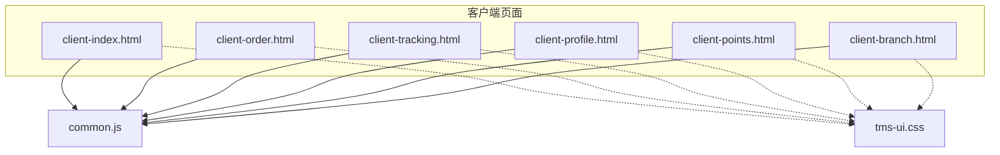
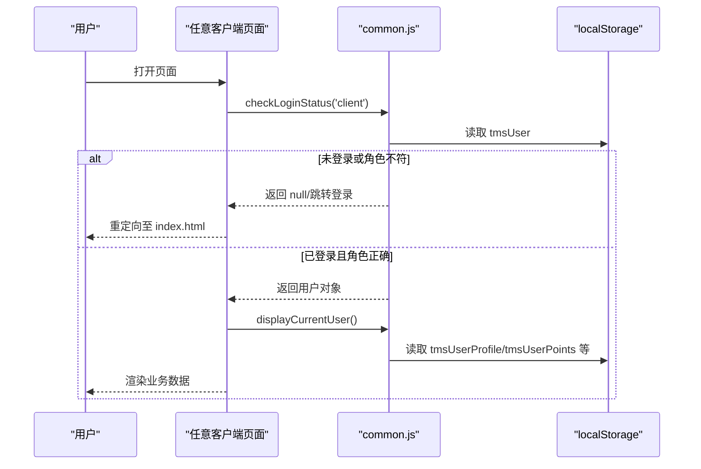
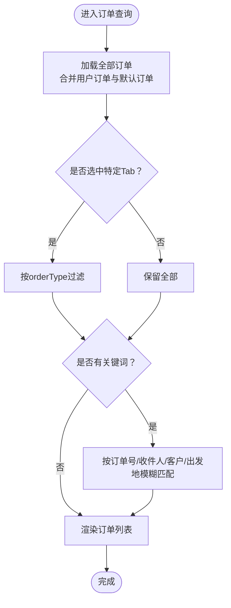
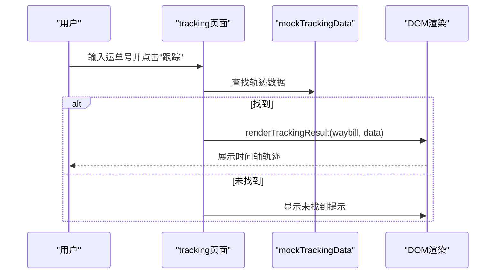
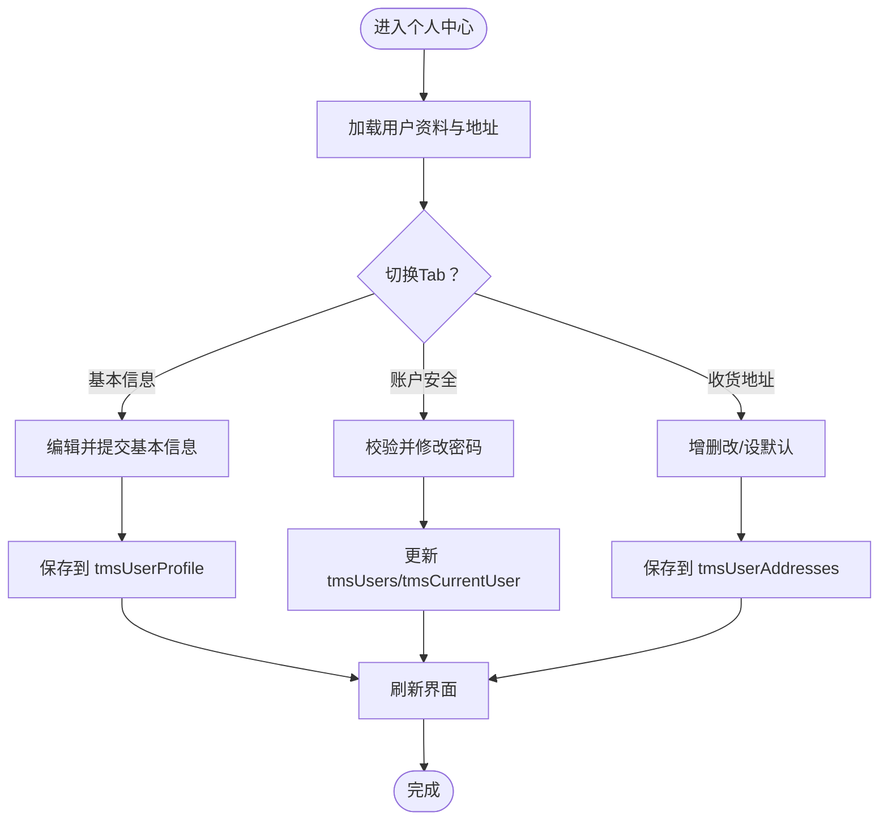
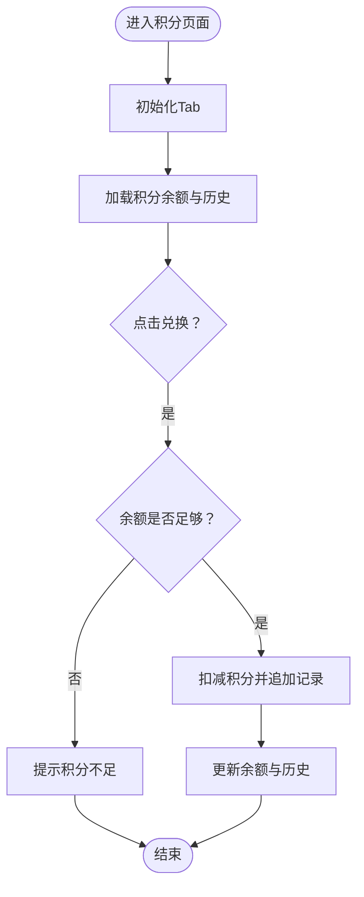
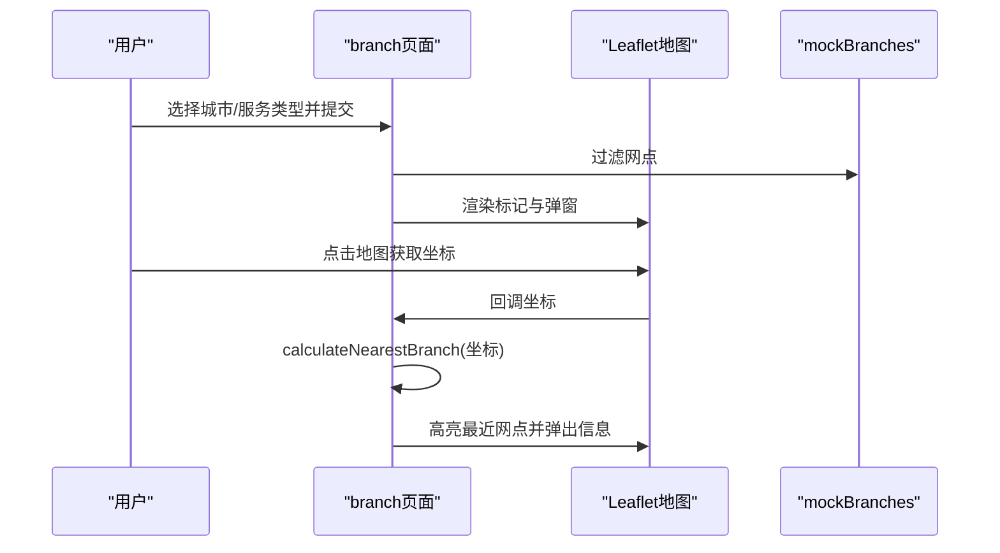
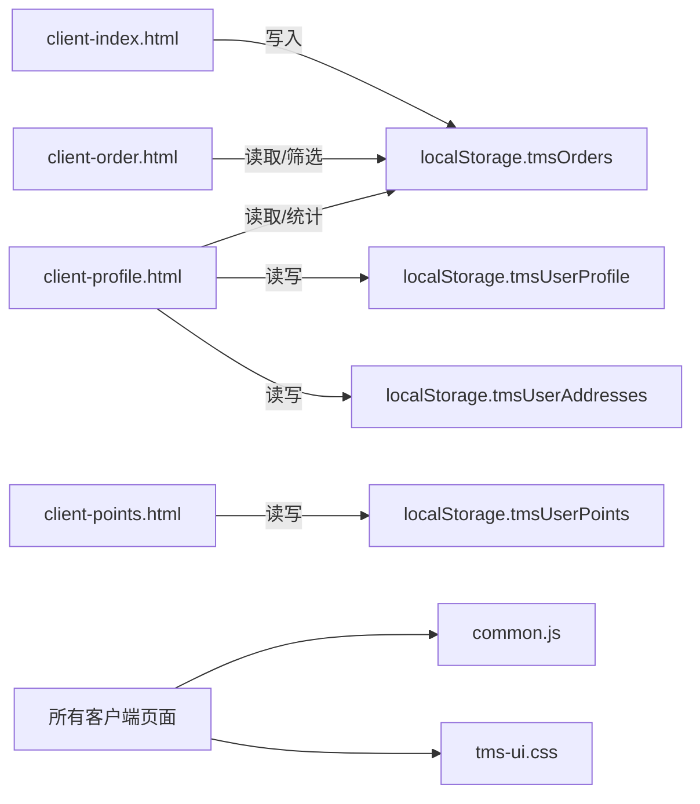

# 客户端界面

<cite>
**本文引用的文件**   
- [client-index.html](file://client-index.html)
- [client-order.html](file://client-order.html)
- [client-tracking.html](file://client-tracking.html)
- [client-profile.html](file://client-profile.html)
- [client-points.html](file://client-points.html)
- [client-branch.html](file://client-branch.html)
- [common.js](file://common.js)
- [tms-ui.css](file://tms-ui.css)
</cite>

## 目录
1. [简介](#简介)
2. [项目结构](#项目结构)
3. [核心组件](#核心组件)
4. [架构总览](#架构总览)
5. [详细组件分析](#详细组件分析)
6. [依赖关系分析](#依赖关系分析)
7. [性能与可维护性](#性能与可维护性)
8. [故障排查指南](#故障排查指南)
9. [结论](#结论)

## 简介
本文件面向终端用户界面，系统性梳理 TMS 系统“客户端”子系统的页面、交互、数据绑定与状态管理。覆盖订单管理、订单跟踪、个人中心、积分系统与网点查询等核心功能；说明页面导航逻辑、事件处理、样式实现、认证与会话保持机制，以及响应式设计与移动端适配策略。同时给出与后端 API 的对接建议与错误处理模式，帮助初学者快速上手，并为高级开发者提供代码级细节参考。

## 项目结构
客户端相关页面采用“单页多 HTML + 公共 JS/CSS”的组织方式：
- 每个业务页面一个独立 HTML，内嵌样式与脚本，便于独立运行和演示。
- 通用能力（登录、鉴权、ID 生成、按钮样式注入）集中在 common.js。
- 共享 UI 样式在 tms-ui.css，使用 tms- 前缀避免冲突。

图表来源
- [client-index.html:351-494](file://client-index.html#L351-L494)
- [client-order.html:310-360](file://client-order.html#L310-L360)
- [client-tracking.html:297-342](file://client-tracking.html#L297-L342)
- [client-profile.html:402-527](file://client-profile.html#L402-L527)
- [client-points.html:354-433](file://client-points.html#L354-L433)
- [client-branch.html:296-376](file://client-branch.html#L296-L376)
- [common.js:135-218](file://common.js#L135-L218)
- [tms-ui.css:1-795](file://tms-ui.css#L1-L795)

章节来源
- [client-index.html:1-765](file://client-index.html#L1-L765)
- [client-order.html:1-1077](file://client-order.html#L1-L1077)
- [client-tracking.html:1-481](file://client-tracking.html#L1-L481)
- [client-profile.html:1-909](file://client-profile.html#L1-L909)
- [client-points.html:1-678](file://client-points.html#L1-L678)
- [client-branch.html:1-774](file://client-branch.html#L1-L774)
- [common.js:1-383](file://common.js#L1-L383)
- [tms-ui.css:1-795](file://tms-ui.css#L1-L795)

## 核心组件
- 认证与会话
  - 登录流程：选择角色后保存用户信息到 localStorage，并跳转到对应角色首页。
  - 权限校验：进入各页面时检查登录态与角色，未登录或角色不匹配则跳转回登录页。
  - 退出登录：清除本地会话并跳转登录页。
- 数据持久化
  - 订单数据：localStorage 中 tmsOrders。
  - 用户资料：localStorage 中 tmsUserProfile。
  - 收货地址：localStorage 中 tmsUserAddresses。
  - 积分数据：localStorage 中 tmsUserPoints。
- 通用工具
  - ID 生成：generateOrderId、generateWaybillNumber。
  - 按钮样式注入：injectButtonStyles。
  - 当前用户展示：displayCurrentUser。

章节来源
- [common.js:22-50](file://common.js#L22-L50)
- [common.js:52-133](file://common.js#L52-L133)
- [common.js:135-218](file://common.js#L135-L218)
- [common.js:272-383](file://common.js#L272-L383)

## 架构总览
客户端界面以“页面 HTML + 内联脚本 + 公共 JS/CSS”的方式组织。所有页面通过 common.js 统一进行认证、鉴权、ID 生成与基础 UI 增强。业务数据默认存储在浏览器 localStorage，用于离线演示与快速验证。

图表来源
- [common.js:176-218](file://common.js#L176-L218)
- [client-index.html:497-519](file://client-index.html#L497-L519)
- [client-order.html:364-396](file://client-order.html#L364-L396)
- [client-tracking.html:345-393](file://client-tracking.html#L345-L393)
- [client-profile.html:532-564](file://client-profile.html#L532-L564)
- [client-points.html:437-459](file://client-points.html#L437-L459)
- [client-branch.html:475-499](file://client-branch.html#L475-L499)

## 详细组件分析

### 订单管理（订单查询）
- 页面职责
  - 支持按订单号搜索。
  - 支持“发货订单/收货订单”Tab 切换。
  - 合并本地用户订单与默认模拟订单，去重并按创建时间倒序排列。
  - 根据 Tab 与关键词过滤渲染列表。
- 关键交互
  - 点击“查询”或回车触发 searchOrders。
  - Tab 切换更新 currentTab 并重新渲染。
- 数据绑定
  - 从 localStorage 读取 tmsOrders。
  - 将 orderType 字段补齐为 shipping/receiving，确保筛选一致。
- 错误处理
  - 空输入提示。
  - 无结果时显示空状态。

图表来源
- [client-order.html:413-483](file://client-order.html#L413-L483)
- [client-order.html:785-800](file://client-order.html#L785-L800)

章节来源
- [client-order.html:310-360](file://client-order.html#L310-L360)
- [client-order.html:364-416](file://client-order.html#L364-L416)
- [client-order.html:418-783](file://client-order.html#L418-L783)
- [client-order.html:785-800](file://client-order.html#L785-L800)

### 货物跟踪
- 页面职责
  - 输入运单号查询轨迹。
  - 展示时间轴形式的跟踪记录，包含类型标签（发货/分拣/运输/配送）。
- 关键交互
  - 点击“跟踪”或回车触发 trackCargo。
  - 默认预填示例运单号并渲染示例轨迹。
- 数据绑定
  - 使用内置 mockTrackingData 映射运单号到轨迹数组。
  - 渲染函数根据 completed 与最后一条标记“当前”。
- 错误处理
  - 未找到轨迹时显示“未找到该运单的跟踪信息”。

图表来源
- [client-tracking.html:345-393](file://client-tracking.html#L345-L393)
- [client-tracking.html:394-431](file://client-tracking.html#L394-L431)
- [client-tracking.html:433-476](file://client-tracking.html#L433-L476)

章节来源
- [client-tracking.html:297-342](file://client-tracking.html#L297-L342)
- [client-tracking.html:345-393](file://client-tracking.html#L345-L393)
- [client-tracking.html:394-476](file://client-tracking.html#L394-L476)

### 个人中心
- 页面职责
  - 个人信息维护（姓名、电话、公司、部门、地址、邮编、身份证）。
  - 账户安全（修改密码）。
  - 收货地址管理（增删改、设为默认）。
  - 订单统计（复用订单数据）。
- 关键交互
  - 表单提交保存个人资料到 localStorage。
  - 修改密码校验一致性后更新用户存储。
  - 地址操作（添加/编辑/删除/设默认）实时更新列表。
- 数据绑定
  - 从 localStorage 读取 tmsUserProfile 与 tmsUserAddresses。
  - 首次访问初始化默认值。
- 错误处理
  - 必填项校验、密码不一致提示。
  - 删除地址时保证至少有一个默认地址。

图表来源
- [client-profile.html:532-564](file://client-profile.html#L532-L564)
- [client-profile.html:566-662](file://client-profile.html#L566-L662)
- [client-profile.html:664-792](file://client-profile.html#L664-L792)

章节来源
- [client-profile.html:402-527](file://client-profile.html#L402-L527)
- [client-profile.html:532-564](file://client-profile.html#L532-L564)
- [client-profile.html:566-792](file://client-profile.html#L566-L792)

### 积分系统
- 页面职责
  - 展示积分余额与历史流水。
  - 积分兑换礼品（扣减余额并记录流水）。
  - 积分规则说明。
- 关键交互
  - Tab 切换（历史/兑换/规则）。
  - 点击“立即兑换”校验余额后扣减积分并刷新界面。
- 数据绑定
  - 从 localStorage 读取 tmsUserPoints。
  - 首次访问初始化默认余额与历史记录。
- 错误处理
  - 积分不足时提示无法兑换。

图表来源
- [client-points.html:437-459](file://client-points.html#L437-L459)
- [client-points.html:481-582](file://client-points.html#L481-L582)
- [client-points.html:584-674](file://client-points.html#L584-L674)

章节来源
- [client-points.html:354-433](file://client-points.html#L354-L433)
- [client-points.html:437-459](file://client-points.html#L437-L459)
- [client-points.html:481-674](file://client-points.html#L481-L674)

### 网点查询
- 页面职责
  - 按城市与服务类型筛选网点。
  - 地图展示网点位置，支持点击地图定位用户位置并计算最近网点。
  - 地址搜索框（模拟地理编码）。
- 关键交互
  - 表单提交触发 searchBranches。
  - 地图点击计算最近网点并高亮标记。
  - 列表中的“在地图上定位”按钮聚焦对应网点。
- 数据绑定
  - 使用 mockBranches 作为网点数据源。
  - 地图使用 Leaflet 渲染标记与弹窗。
- 错误处理
  - 无匹配网点时显示空状态。
  - 地址搜索为空时跳过。

图表来源
- [client-branch.html:381-500](file://client-branch.html#L381-L500)
- [client-branch.html:503-545](file://client-branch.html#L503-L545)
- [client-branch.html:547-625](file://client-branch.html#L547-L625)
- [client-branch.html:627-753](file://client-branch.html#L627-L753)

章节来源
- [client-branch.html:296-376](file://client-branch.html#L296-L376)
- [client-branch.html:381-500](file://client-branch.html#L381-L500)
- [client-branch.html:503-753](file://client-branch.html#L503-L753)

### 首页（仪表盘）
- 页面职责
  - 展示订单统计卡片与折线图。
  - 快捷入口（寄件、跟踪、网点、积分）。
  - 最近订单列表与系统通知。
- 关键交互
  - 初始化模拟订单数据并写入 localStorage。
  - 加载统计与最近订单。
  - 退出登录。
- 数据绑定
  - 从 localStorage 读取 tmsOrders。
  - 使用 Chart.js 绘制近6个月订单趋势。

章节来源
- [client-index.html:351-494](file://client-index.html#L351-L494)
- [client-index.html:497-519](file://client-index.html#L497-L519)
- [client-index.html:521-648](file://client-index.html#L521-L648)
- [client-index.html:650-761](file://client-index.html#L650-L761)

## 依赖关系分析
- 页面与公共库
  - 所有客户端页面均引入 common.js，用于认证、鉴权、ID 生成与基础 UI 增强。
  - 部分页面引入 Chart.js 与 Leaflet 第三方库。
- 数据流
  - 订单数据：client-index 初始化写入 tmsOrders；client-order 合并与筛选；client-profile 统计引用。
  - 用户资料：client-profile 读写 tmsUserProfile。
  - 收货地址：client-profile 读写 tmsUserAddresses。
  - 积分数据：client-points 读写 tmsUserPoints。
- 样式体系
  - 页面内联样式负责布局与组件样式。
  - tms-ui.css 提供统一的按钮、表格、弹窗、Toast 等样式类，供其他模块复用。

图表来源
- [client-index.html:521-648](file://client-index.html#L521-L648)
- [client-order.html:418-783](file://client-order.html#L418-L783)
- [client-profile.html:566-792](file://client-profile.html#L566-L792)
- [client-points.html:481-674](file://client-points.html#L481-L674)
- [common.js:135-218](file://common.js#L135-L218)
- [tms-ui.css:1-795](file://tms-ui.css#L1-L795)

章节来源
- [client-index.html:521-648](file://client-index.html#L521-L648)
- [client-order.html:418-783](file://client-order.html#L418-L783)
- [client-profile.html:566-792](file://client-profile.html#L566-L792)
- [client-points.html:481-674](file://client-points.html#L481-L674)
- [common.js:135-218](file://common.js#L135-L218)
- [tms-ui.css:1-795](file://tms-ui.css#L1-L795)

## 性能与可维护性
- 性能优化建议
  - 大数据量列表分页与虚拟滚动（订单列表、积分历史）。
  - 地图标记聚合与懒加载（网点数量较多时）。
  - 图表按需渲染与销毁（离开页面时释放 Chart.js 实例）。
  - 减少重复 DOM 操作，使用 DocumentFragment 批量插入。
- 可维护性建议
  - 将页面内联脚本抽离为模块，统一事件绑定与数据加载。
  - 将 localStorage 读写封装为数据层，便于替换为后端 API。
  - 统一错误提示组件（Toast），替代 alert。
  - 使用 CSS 变量统一管理主题色与间距。

[本节为通用指导，不直接分析具体文件]

## 故障排查指南
- 登录后仍被重定向到登录页
  - 检查 localStorage 中是否存在 tmsUser，且 role 与页面 requiredRole 匹配。
  - 确认 checkLoginStatus 调用时机与返回值处理。
- 用户名未显示
  - 检查 displayCurrentUser 是否成功找到 #current-role 等元素。
  - 若未找到，会动态创建 span 插入 .user-info。
- 订单列表为空
  - 确认 client-index 是否已初始化 tmsOrders。
  - 检查 client-order 的合并与去重逻辑是否正确。
- 积分兑换失败
  - 检查 tmsUserPoints 是否存在，余额是否足够。
  - 查看兑换后是否更新了余额与历史记录。
- 地图无标记或定位异常
  - 确认 Leaflet 资源加载成功。
  - 检查 mockBranches 是否包含 latlng。
  - 地址搜索需包含城市名才能命中模拟地理编码。

章节来源
- [common.js:176-218](file://common.js#L176-L218)
- [common.js:220-270](file://common.js#L220-L270)
- [client-index.html:521-648](file://client-index.html#L521-L648)
- [client-order.html:418-783](file://client-order.html#L418-L783)
- [client-points.html:481-674](file://client-points.html#L481-L674)
- [client-branch.html:547-753](file://client-branch.html#L547-L753)

## 结论
TMS 客户端界面以轻量化的前端方案实现了完整的订单管理、跟踪、个人中心、积分与网点查询功能。通过 common.js 统一认证与鉴权，结合 localStorage 实现数据持久化，满足演示与快速验证场景。建议在后续迭代中：
- 将 localStorage 数据层替换为后端 API，增加网络请求与错误处理。
- 引入路由与组件化框架，提升可维护性与扩展性。
- 完善响应式与无障碍体验，提升移动端可用性。
- 建立统一的错误提示与日志上报机制，提升用户体验与可观测性。

[本节为总结性内容，不直接分析具体文件]