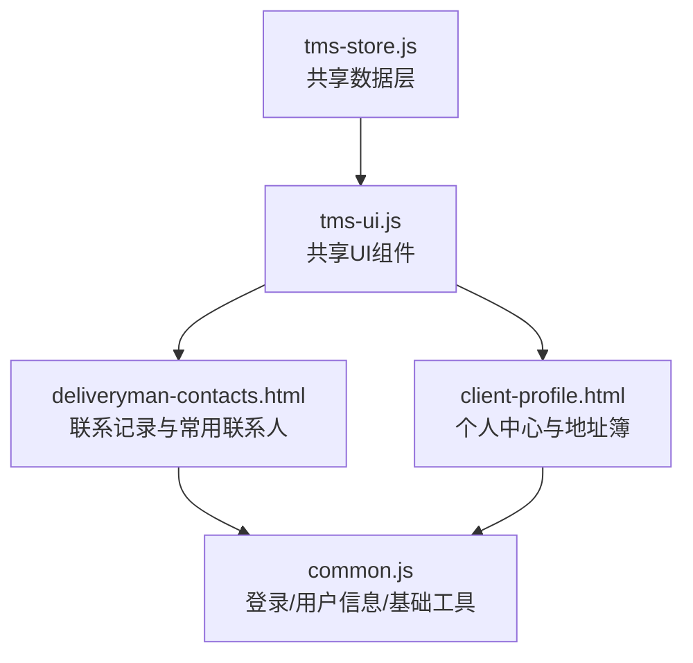
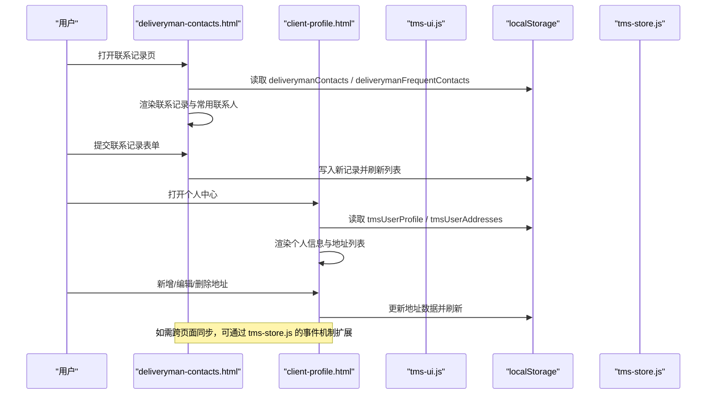
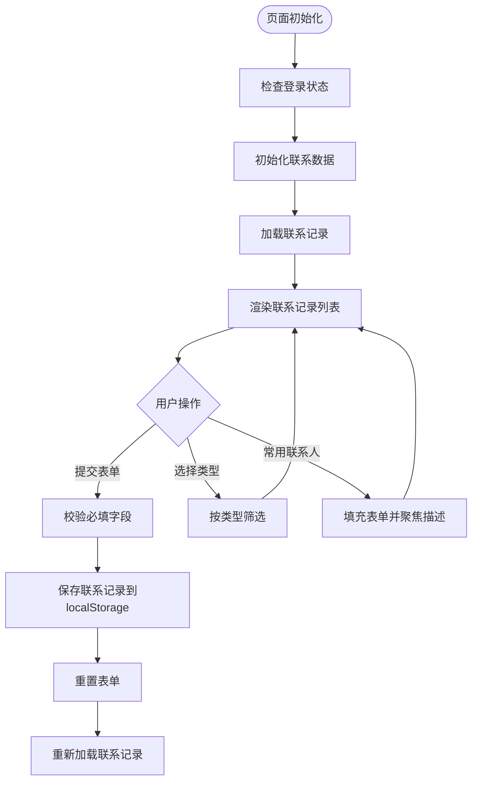
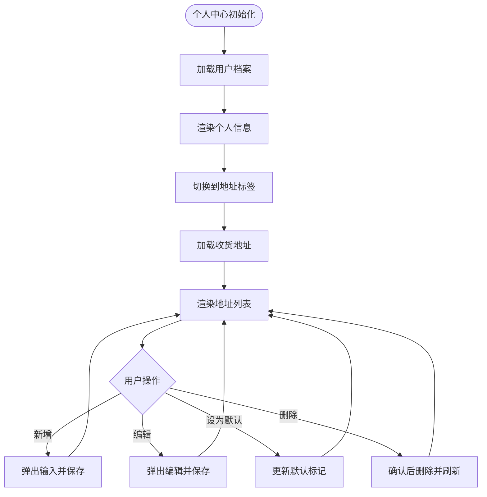
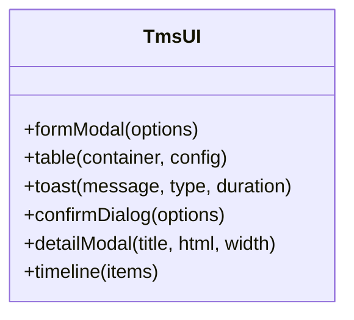
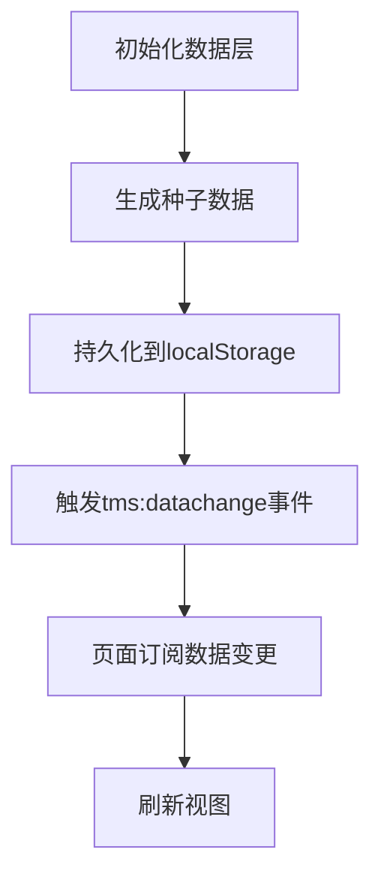
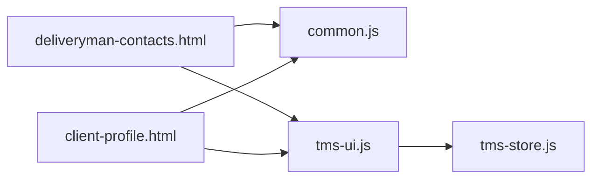

# 客户联系管理

<cite>
**本文引用的文件**   
- [deliveryman-contacts.html](file://deliveryman-contacts.html)
- [client-profile.html](file://client-profile.html)
- [common.js](file://common.js)
- [tms-ui.js](file://tms-ui.js)
- [tms-store.js](file://tms-store.js)
</cite>

## 目录
1. [引言](#引言)
2. [项目结构](#项目结构)
3. [核心组件](#核心组件)
4. [架构总览](#架构总览)
5. [详细组件分析](#详细组件分析)
6. [依赖关系分析](#依赖关系分析)
7. [性能与可扩展性](#性能与可扩展性)
8. [故障排查指南](#故障排查指南)
9. [结论](#结论)
10. [附录：关键流程与代码片段路径](#附录关键流程与代码片段路径)

## 引言
本章节面向“客户联系管理”模块，围绕真实派送场景中与客户沟通的完整闭环进行说明。内容覆盖联系人信息管理（添加、编辑、删除、搜索）、通话记录、短信发送与消息推送的技术实现思路，以及客户偏好设置、地址簿管理、常用联系人、通讯录导入导出、数据同步与隐私保护等能力。同时给出移动设备拨号集成、短信API调用和通知系统的设计方案，并提供可落地的代码片段路径，帮助读者快速定位实现位置。

## 项目结构
该仓库为多页面静态前端应用，采用“页面HTML + 通用JS库 + 共享UI组件 + 共享数据层”的组织方式。与“客户联系管理”直接相关的文件包括：
- 派送员侧的联系记录与常用联系人：deliveryman-contacts.html
- 客户端个人中心与收货地址管理：client-profile.html
- 通用工具与登录/用户信息：common.js
- 共享UI组件（表单弹窗、表格、Toast、确认框等）：tms-ui.js
- 共享数据层（订单、轨迹、异常等种子数据与CRUD能力）：tms-store.js

**图示来源**
- [deliveryman-contacts.html:487-532](file://deliveryman-contacts.html#L487-L532)
- [client-profile.html:531-564](file://client-profile.html#L531-L564)
- [common.js:135-218](file://common.js#L135-L218)
- [tms-ui.js:109-287](file://tms-ui.js#L109-L287)
- [tms-store.js:1-12](file://tms-store.js#L1-L12)

**章节来源**
- [deliveryman-contacts.html:1-744](file://deliveryman-contacts.html#L1-L744)
- [client-profile.html:1-909](file://client-profile.html#L1-L909)
- [common.js:1-383](file://common.js#L1-L383)
- [tms-ui.js:1-783](file://tms-ui.js#L1-L783)
- [tms-store.js:1-800](file://tms-store.js#L1-L800)

## 核心组件
- 联系记录与常用联系人（派送员端）
  - 功能要点：按类型筛选（客户/客服/调度中心），新增联系记录，查看历史，常用联系人快捷操作（拨打电话、快速新建记录）。
  - 存储机制：使用浏览器 localStorage 持久化联系记录与常用联系人。
  - 交互入口：页面初始化时加载数据并渲染列表；表单提交后保存并刷新视图。
- 个人中心与收货地址（客户端）
  - 功能要点：个人信息维护、密码修改、收货地址增删改查与默认地址设置。
  - 存储机制：localStorage 中分别维护 tmsUserProfile 与 tmsUserAddresses。
- 共享UI组件
  - 提供表单弹窗、确认对话框、Toast提示、通用表格（支持搜索/筛选/排序/分页）等能力，便于在联系管理与地址管理中复用。
- 共享数据层
  - 提供统一的增删改查、事件订阅与状态流转能力，可作为后续扩展联系记录与地址数据的后端替代或中间层。

**章节来源**
- [deliveryman-contacts.html:487-744](file://deliveryman-contacts.html#L487-L744)
- [client-profile.html:531-800](file://client-profile.html#L531-L800)
- [tms-ui.js:109-287](file://tms-ui.js#L109-L287)
- [tms-ui.js:303-544](file://tms-ui.js#L303-L544)
- [tms-store.js:1-12](file://tms-store.js#L1-L12)

## 架构总览
下图展示“客户联系管理”在系统中的角色与数据流向：
- 页面层：deliveryman-contacts.html 与 client-profile.html 负责用户交互与本地数据读写。
- 组件层：tms-ui.js 提供统一表单、表格、弹窗与提示能力。
- 数据层：tms-store.js 提供共享数据模型与事件机制，可用于扩展联系记录与地址的数据一致性。
- 通用层：common.js 提供登录校验、用户信息显示等基础能力。

**图示来源**
- [deliveryman-contacts.html:509-532](file://deliveryman-contacts.html#L509-L532)
- [deliveryman-contacts.html:601-704](file://deliveryman-contacts.html#L601-L704)
- [client-profile.html:566-621](file://client-profile.html#L566-L621)
- [client-profile.html:664-792](file://client-profile.html#L664-L792)
- [tms-store.js:232-244](file://tms-store.js#L232-L244)

## 详细组件分析

### 联系记录与常用联系人（派送员端）
- 功能范围
  - 联系记录：按类型筛选、新增记录、查看历史、重置表单。
  - 常用联系人：展示常用联系人卡片，支持“拨打电话”“从常用联系人新建记录”。
- 数据结构
  - 联系记录：包含 id、type、name、phone、time、description、createdAt。
  - 常用联系人：包含 id、type、name、phone、address、notes。
- 交互流程
  - 页面初始化：检查登录状态、显示用户名、设置默认时间、初始化数据、加载记录与常用联系人。
  - 表单提交：校验必填字段，生成新记录并保存到 localStorage，重置表单并刷新列表。
  - 常用联系人：点击“拨打电话”触发模拟拨号；点击“添加记录”填充表单并聚焦描述输入。

**图示来源**
- [deliveryman-contacts.html:487-532](file://deliveryman-contacts.html#L487-L532)
- [deliveryman-contacts.html:534-599](file://deliveryman-contacts.html#L534-L599)
- [deliveryman-contacts.html:601-704](file://deliveryman-contacts.html#L601-L704)
- [deliveryman-contacts.html:717-730](file://deliveryman-contacts.html#L717-L730)

**章节来源**
- [deliveryman-contacts.html:487-744](file://deliveryman-contacts.html#L487-L744)

### 个人中心与收货地址（客户端）
- 功能范围
  - 个人信息维护：姓名、电话、公司、部门、联系地址、邮编、身份证号。
  - 账户安全：当前密码、新密码、确认密码。
  - 收货地址管理：新增、编辑、设为默认、删除地址。
- 数据结构
  - 用户档案：fullName、phone、company、department、address、zipCode、idCard。
  - 收货地址：id、name、phone、province、city、district、detail、isDefault。
- 交互流程
  - 页面初始化：检查登录状态、显示用户名、加载用户信息与地址。
  - 保存个人信息：收集表单值并写入 localStorage。
  - 修改密码：校验必填与一致性，更新用户数据并提示成功。
  - 地址管理：新增/编辑/设默认/删除，更新 localStorage 并刷新列表。

**图示来源**
- [client-profile.html:531-564](file://client-profile.html#L531-L564)
- [client-profile.html:566-621](file://client-profile.html#L566-L621)
- [client-profile.html:664-792](file://client-profile.html#L664-L792)

**章节来源**
- [client-profile.html:531-800](file://client-profile.html#L531-L800)

### 共享UI组件（表单弹窗、表格、Toast）
- 表单弹窗 formModal
  - 支持多种字段类型（text、select、textarea、checkbox），自动校验必填项，支持异步提交与错误提示。
  - 适用于联系记录编辑、地址新增/编辑等场景。
- 通用表格 table
  - 支持搜索、筛选、排序、分页，可绑定 TmsStore 实体数据源，自动响应数据变更。
  - 适用于未来扩展联系记录与地址的列表展示。
- Toast 与确认框
  - 提供轻量提示与二次确认，提升用户体验。

**图示来源**
- [tms-ui.js:109-287](file://tms-ui.js#L109-L287)
- [tms-ui.js:303-544](file://tms-ui.js#L303-L544)
- [tms-ui.js:758-781](file://tms-ui.js#L758-L781)

**章节来源**
- [tms-ui.js:109-287](file://tms-ui.js#L109-L287)
- [tms-ui.js:303-544](file://tms-ui.js#L303-L544)

### 共享数据层（TmsStore）
- 职责
  - 基于 localStorage 的轻量业务数据库，提供增删改查、搜索、筛选、排序、分页。
  - 维护订单全生命周期状态流转，并自动写入扫描、运输、财务等关联记录。
  - 通过 tms:datachange 事件驱动页面刷新。
- 适用性
  - 可将联系记录与地址数据纳入 TmsStore 统一管理，实现跨页面一致性与实时同步。

**图示来源**
- [tms-store.js:1-12](file://tms-store.js#L1-L12)
- [tms-store.js:220-244](file://tms-store.js#L220-L244)

**章节来源**
- [tms-store.js:1-800](file://tms-store.js#L1-L800)

## 依赖关系分析
- 页面与通用库
  - deliveryman-contacts.html 与 client-profile.html 均引入 common.js 用于登录校验与用户信息显示。
  - 两者均可复用 tms-ui.js 提供的表单弹窗、表格与提示组件。
- 数据层与UI层
  - tms-ui.js 的表格组件可绑定 TmsStore 实体数据源，实现数据驱动的列表渲染。
  - TmsStore 通过事件机制通知订阅者，保证界面与数据的一致性。

**图示来源**
- [deliveryman-contacts.html:487-532](file://deliveryman-contacts.html#L487-L532)
- [client-profile.html:531-564](file://client-profile.html#L531-L564)
- [tms-ui.js:303-544](file://tms-ui.js#L303-L544)
- [tms-store.js:232-244](file://tms-store.js#L232-L244)

**章节来源**
- [deliveryman-contacts.html:487-532](file://deliveryman-contacts.html#L487-L532)
- [client-profile.html:531-564](file://client-profile.html#L531-L564)
- [tms-ui.js:303-544](file://tms-ui.js#L303-L544)
- [tms-store.js:232-244](file://tms-store.js#L232-L244)

## 性能与可扩展性
- 性能考虑
  - 当前联系记录与地址数据存储在 localStorage，适合小规模演示数据；当数据量增长时，建议迁移至 IndexedDB 或后端服务。
  - 列表渲染采用原生 DOM 操作，建议在大数据集下引入虚拟滚动或分页优化。
- 可扩展性
  - 将联系记录与地址纳入 TmsStore，可实现跨页面同步与统一查询接口。
  - 使用 tms-ui.js 的表格组件，可快速构建联系记录与地址的管理界面。
  - 通过事件机制（tms:datachange）实现实时更新，避免频繁轮询。

[本节为通用指导，不直接分析具体文件]

## 故障排查指南
- 常见问题
  - 联系记录未保存：检查表单必填字段是否完整，确认 localStorage 写入是否成功。
  - 地址无法显示：确认 tmsUserAddresses 是否存在且格式正确。
  - 登录状态异常：检查 tmsUser 是否存在且角色匹配。
- 调试建议
  - 使用浏览器开发者工具查看 localStorage 中的数据。
  - 在关键函数处添加日志输出，确认执行路径。
  - 若使用 TmsStore，检查 tms:datachange 事件是否正确触发。

**章节来源**
- [deliveryman-contacts.html:669-704](file://deliveryman-contacts.html#L669-L704)
- [client-profile.html:604-621](file://client-profile.html#L604-L621)
- [client-profile.html:719-792](file://client-profile.html#L719-L792)
- [common.js:135-218](file://common.js#L135-L218)

## 结论
本模块以轻量前端实现为核心，结合通用UI组件与共享数据层，提供了联系记录与地址管理的完整能力。通过 localStorage 实现数据持久化，借助 TmsStore 的事件机制可扩展为实时同步。未来可进一步接入移动端拨号、短信API与通知系统，完善真实派送场景下的客户沟通闭环。

[本节为总结性内容，不直接分析具体文件]

## 附录：关键流程与代码片段路径
- 联系记录新增与保存
  - 表单提交与校验：[deliveryman-contacts.html:527-532](file://deliveryman-contacts.html#L527-L532)
  - 保存逻辑与刷新：[deliveryman-contacts.html:669-704](file://deliveryman-contacts.html#L669-L704)
- 常用联系人快速填充
  - 从常用联系人添加记录：[deliveryman-contacts.html:717-730](file://deliveryman-contacts.html#L717-L730)
- 个人中心个人信息保存
  - 保存用户信息：[client-profile.html:604-621](file://client-profile.html#L604-L621)
- 收货地址管理
  - 新增地址：[client-profile.html:719-744](file://client-profile.html#L719-L744)
  - 编辑地址：[client-profile.html:746-769](file://client-profile.html#L746-L769)
  - 设为默认地址：[client-profile.html:771-779](file://client-profile.html#L771-L779)
  - 删除地址：[client-profile.html:781-792](file://client-profile.html#L781-L792)
- 共享UI组件
  - 表单弹窗：[tms-ui.js:165-287](file://tms-ui.js#L165-L287)
  - 通用表格：[tms-ui.js:303-544](file://tms-ui.js#L303-L544)
- 共享数据层
  - 数据持久化与事件触发：[tms-store.js:232-244](file://tms-store.js#L232-L244)