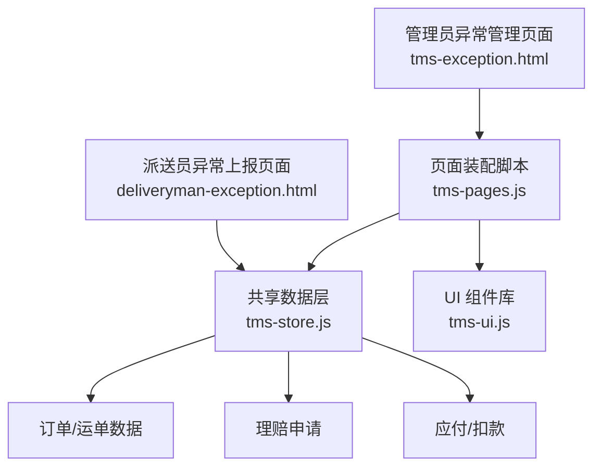
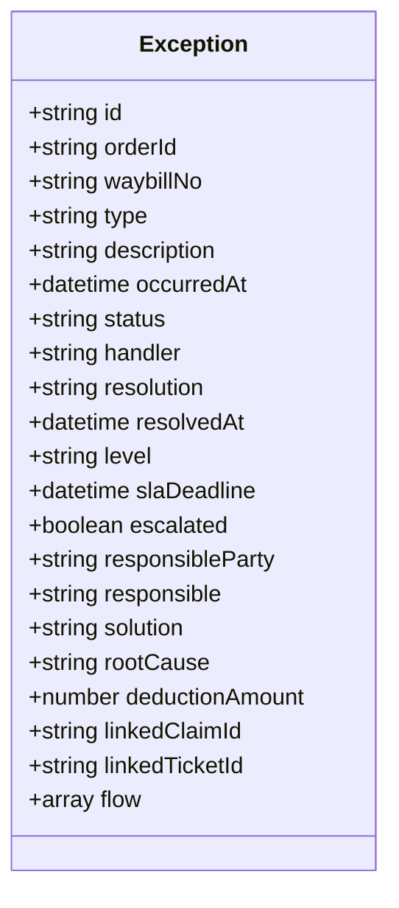
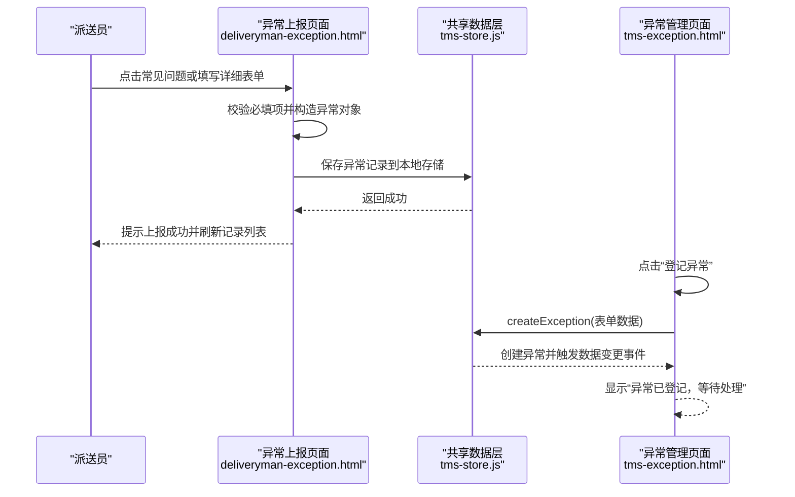
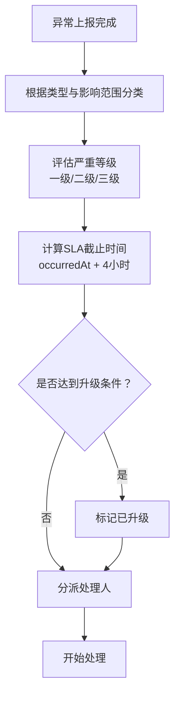
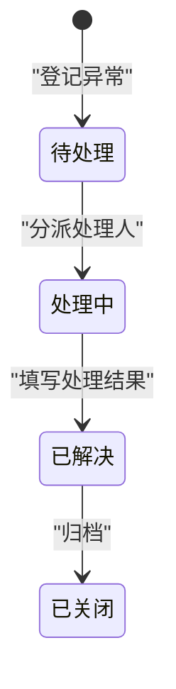
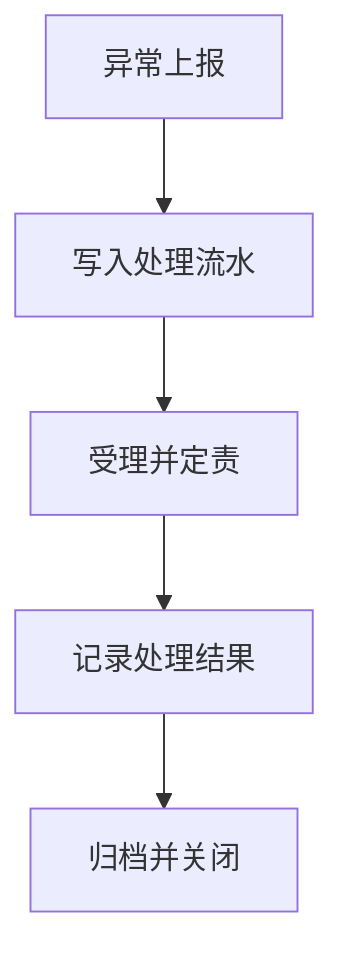
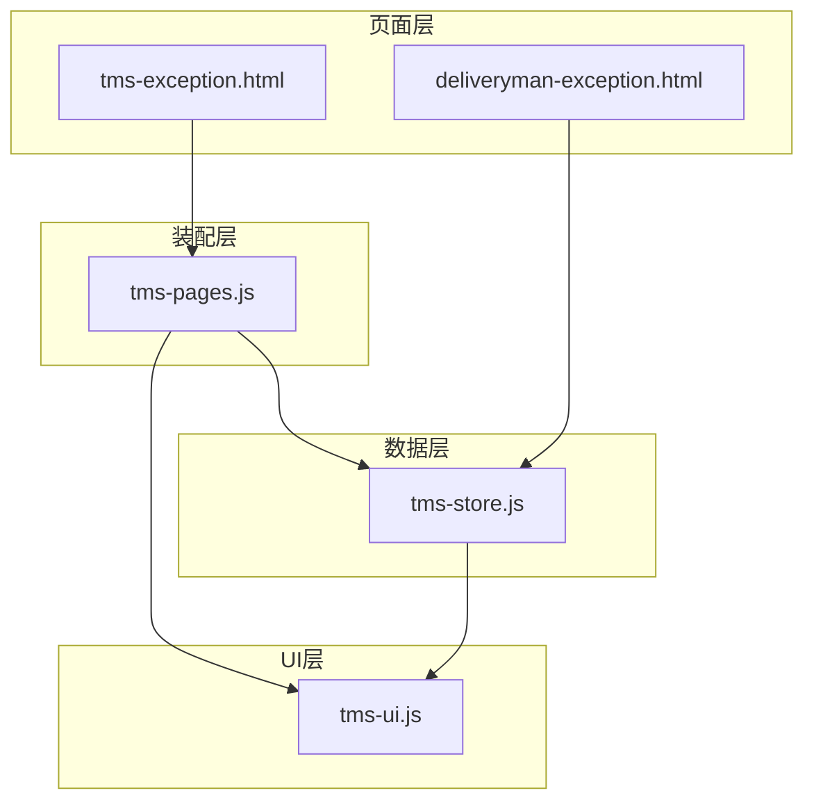

# 异常处理

<cite>
**本文引用的文件**   
- [tms-exception.html](file://tms-exception.html)
- [deliveryman-exception.html](file://deliveryman-exception.html)
- [tms-store.js](file://tms-store.js)
- [tms-ui.js](file://tms-ui.js)
- [tms-pages.js](file://tms-pages.js)
</cite>

## 目录
1. [引言](#引言)
2. [项目结构中的异常模块定位](#项目结构中的异常模块定位)
3. [异常数据模型与类型定义](#异常数据模型与类型定义)
4. [异常情况上报流程](#异常情况上报流程)
5. [异常分类、严重程度与优先级规则](#异常分类严重程度与优先级规则)
6. [异常处理与状态流转](#异常处理与状态流转)
7. [异常跟踪、进度与结果反馈](#异常跟踪进度与结果反馈)
8. [现场取证能力：图片、GPS、时间戳](#现场取证能力图片gps时间戳)
9. [异常解决方案库、知识库与经验分享机制](#异常解决方案库知识库与经验分享机制)
10. [真实派送场景与快速响应机制](#真实派送场景与快速响应机制)
11. [依赖关系与架构总览](#依赖关系与架构总览)
12. [性能与可维护性建议](#性能与可维护性建议)
13. [故障排查指南](#故障排查指南)
14. [结论](#结论)

## 引言
本章节面向“异常处理”这一核心业务域，说明 TMS 运输管理系统中异常情况如何从一线上报、分类定级、分派处理、闭环解决，到联动理赔、扣款与绩效统计的完整链路。文档同时覆盖异常表单提交、状态更新、处理记录管理的具体实现位置，并给出可视化流程图和架构图，帮助运营人员、客服人员和系统开发者理解异常闭环的设计意图与扩展点。

## 项目结构中的异常模块定位
异常处理在系统中由多个页面与共享模块共同构成：
- 派送员端提供“异常上报”入口，支持常见问题一键选择与详细表单填写。
- 管理员端提供“异常管理”列表、登记、分派、解决等运营操作。
- 共享数据层负责异常数据的生成、查询、增删改查以及与其他实体（订单、运单、理赔、应付）的关联。
- UI 组件库提供状态标签、弹窗、表格、时间线等通用能力。
- 页面装配脚本将异常管理页组装为 KPI + 表格 + 操作的统一结构。

**图表来源**
- [deliveryman-exception.html:375-422](file://deliveryman-exception.html#L375-L422)
- [tms-exception.html:377-437](file://tms-exception.html#L377-L437)
- [tms-pages.js:137-248](file://tms-pages.js#L137-L248)
- [tms-store.js:875-916](file://tms-store.js#L875-L916)

**章节来源**
- [deliveryman-exception.html:375-422](file://deliveryman-exception.html#L375-L422)
- [tms-exception.html:377-437](file://tms-exception.html#L377-L437)
- [tms-pages.js:137-248](file://tms-pages.js#L137-L248)
- [tms-store.js:875-916](file://tms-store.js#L875-L916)

## 异常数据模型与类型定义
异常数据在种子数据阶段被批量生成，字段包含异常编号、关联订单、运单号、类型、描述、发生时间、状态、处理人、解决时间、严重等级、SLA 截止时间、升级标记、责任方、责任人、解决方案、根因、扣款金额、关联理赔、关联工单、处理流水等。这些字段支撑了异常的分类、定责、时效监控、财务扣款与闭环审计。

关键要点：
- 异常类型包括延迟送达、货物损坏、信息不符、地址错误、丢件、拒收等。
- 状态使用统一字典：待处理、处理中、已解决、已关闭。
- 严重等级采用一级、二级、三级；SLA 默认按发生时间加 4 小时计算。
- 责任方可能为承运商、网点、司机、仓库、客户；责任人对应具体人员。
- 解决方案包括补发、改派、理赔、退回等；根因包括操作不规范、系统对接异常、天气原因、客户原因、包装不合格等。
- 异常可联动理赔申请与应付扣款，形成业务闭环。

**图表来源**
- [tms-store.js:881-906](file://tms-store.js#L881-L906)

**章节来源**
- [tms-store.js:881-906](file://tms-store.js#L881-L906)
- [tms-store.js:98-120](file://tms-store.js#L98-L120)

## 异常情况上报流程
异常上报分为两类：
- 派送员端快速上报：通过常见问题卡片快速选择异常类型，再补充详细描述、地点和时间。
- 管理员端登记异常：通过“登记异常”按钮弹出表单，选择关联订单、异常类型与描述后创建异常记录。

**图表来源**
- [deliveryman-exception.html:471-589](file://deliveryman-exception.html#L471-L589)
- [tms-pages.js:171-186](file://tms-pages.js#L171-L186)
- [tms-store.js:1740-1759](file://tms-store.js#L1740-L1759)

**章节来源**
- [deliveryman-exception.html:375-422](file://deliveryman-exception.html#L375-L422)
- [deliveryman-exception.html:471-589](file://deliveryman-exception.html#L471-L589)
- [tms-pages.js:171-186](file://tms-pages.js#L171-L186)
- [tms-store.js:1740-1759](file://tms-store.js#L1740-L1759)

## 异常分类、严重程度与优先级规则
异常分类来源于业务场景与种子数据配置：
- 类型：延迟送达、货物损坏、信息不符、地址错误、丢件、拒收。
- 严重等级：一级、二级、三级，用于区分影响范围与处理资源。
- SLA 时效：默认按发生时间加 4 小时作为处理截止时限。
- 升级策略：部分异常在未解决时可能被标记为已升级，以提醒更高权限人员介入。
- 责任划分：责任方与责任人用于后续定责与扣款。

优先级设定建议（结合现有字段与业务语义）：
- 高优先级：涉及客户体验与资金风险，如货物丢失、重大破损、超时未达且影响大客户。
- 中优先级：一般延误、信息不一致、轻微破损。
- 低优先级：地址错误、联系不上收件人等非紧急问题。

**图表来源**
- [tms-store.js:881-906](file://tms-store.js#L881-L906)
- [tms-store.js:593-612](file://tms-store.js#L593-L612)

**章节来源**
- [tms-store.js:881-906](file://tms-store.js#L881-L906)
- [tms-store.js:593-612](file://tms-store.js#L593-L612)

## 异常处理与状态流转
异常状态流转遵循以下路径：
- 待处理：新登记或尚未分派的异常。
- 处理中：已分派处理人并开始处理的异常。
- 已解决：已完成处理并记录解决结果的异常。
- 已关闭：历史归档或不再跟踪的异常。

管理员端提供“查看”“处理”“解决”三个主要动作：
- 查看：展示异常详情、关联订单轨迹、处理结果。
- 处理：弹出分派表单，选择处理人后将状态改为处理中。
- 解决：填写处理结果，可选择联动理赔申请并设置理赔金额。

**图表来源**
- [tms-pages.js:188-246](file://tms-pages.js#L188-L246)
- [tms-store.js:98-120](file://tms-store.js#L98-L120)

**章节来源**
- [tms-pages.js:188-246](file://tms-pages.js#L188-L246)
- [tms-store.js:98-120](file://tms-store.js#L98-L120)

## 异常跟踪、进度与结果反馈
异常跟踪通过“处理流水”字段记录关键节点，例如异常上报、受理并定责等。处理进度可通过状态字段与时间字段组合判断，结果反馈则体现在解决时间与处理结果字段中。管理员端“查看”异常详情时会展示异常描述、处理结果以及关联订单的时间线，便于复盘与审计。

**图表来源**
- [tms-store.js:902-905](file://tms-store.js#L902-L905)
- [tms-pages.js:190-209](file://tms-pages.js#L190-L209)

**章节来源**
- [tms-store.js:902-905](file://tms-store.js#L902-L905)
- [tms-pages.js:190-209](file://tms-pages.js#L190-L209)

## 现场取证能力：图片、GPS、时间戳
当前代码中，异常上报表单包含地点与时间字段，但未直接实现图片上传与 GPS 定位采集。可在现有基础上扩展：
- 图片上传：在表单中增加图片字段，前端使用 File API 读取并压缩图片，后端或本地存储保存图片 URL 或 Base64。
- GPS 定位：调用浏览器 Geolocation API 获取经纬度，并在异常记录中新增 locationLat、locationLng 字段。
- 时间戳：表单已使用 datetime-local 输入，建议在提交时自动填充当前时间，并记录上报时间戳。

建议的数据扩展：
- 新增字段：photos（数组）、locationLat（数字）、locationLng（数字）、reportTimestamp（ISO 时间）。
- 前端校验：限制图片数量与大小，校验经纬度范围。
- 存储策略：图片走对象存储，异常记录仅保存引用。

[本节为扩展建议，不直接分析具体源码文件]

## 异常解决方案库、知识库与经验分享机制
当前系统未提供独立的“解决方案库”或“知识库”模块，但异常记录中包含 solution 与 rootCause 字段，可作为经验沉淀的基础。建议扩展：
- 解决方案库：基于 solution 字段聚合常见处理方式，形成可检索的知识条目。
- 知识库查询：在异常详情页提供“相似异常推荐”，根据类型、根因匹配历史解决方案。
- 经验分享机制：允许处理人在解决异常后贡献经验，经审核后纳入知识库，并关联到相关异常类型。

[本节为概念设计，不直接分析具体源码文件]

## 真实派送场景与快速响应机制
典型派送异常场景包括：
- 地址错误或不详：派送员无法找到收货地址，需联系客户或修正地址。
- 收件人拒收：客户拒绝签收，需协商退货或重新派送。
- 联系不上收件人：多次尝试仍无法联系，需留言或改约。
- 货物破损或少件：发现包裹损坏或数量短缺，需拍照取证并启动理赔。
- 交通堵塞或车辆故障：导致无法按时送达，需调度备用运力或改派。

快速响应机制建议：
- 一键上报：派送员端提供常见问题卡片，减少录入成本。
- 自动预警：对超时未处理的异常进行升级提醒。
- 联动理赔：解决异常时可同步创建理赔申请，缩短赔付周期。
- 扣款与考核：定责后自动生成应付扣款，并计入绩效考核。

**章节来源**
- [deliveryman-exception.html:343-373](file://deliveryman-exception.html#L343-L373)
- [tms-store.js:875-916](file://tms-store.js#L875-L916)

## 依赖关系与架构总览
异常处理模块依赖以下核心组件：
- 页面层：异常管理页面与异常上报页面。
- 装配层：页面装配脚本提供统一的表格、弹窗与操作。
- 数据层：共享数据层提供异常 CRUD、状态流转、关联理赔与扣款。
- UI 层：UI 组件库提供状态标签、时间线、弹窗等通用能力。

**图表来源**
- [tms-exception.html:448-454](file://tms-exception.html#L448-L454)
- [deliveryman-exception.html:426-476](file://deliveryman-exception.html#L426-L476)
- [tms-pages.js:137-248](file://tms-pages.js#L137-L248)
- [tms-store.js:1740-1892](file://tms-store.js#L1740-L1892)
- [tms-ui.js:729-746](file://tms-ui.js#L729-L746)

**章节来源**
- [tms-exception.html:448-454](file://tms-exception.html#L448-L454)
- [deliveryman-exception.html:426-476](file://deliveryman-exception.html#L426-L476)
- [tms-pages.js:137-248](file://tms-pages.js#L137-L248)
- [tms-store.js:1740-1892](file://tms-store.js#L1740-L1892)
- [tms-ui.js:729-746](file://tms-ui.js#L729-L746)

## 性能与可维护性建议
- 分页与筛选：异常列表应支持按状态、类型、处理人筛选，并按发生时间倒序排序，提升运营效率。
- 缓存与去重：避免重复上报相同异常，可通过订单号+类型+时间窗口去重。
- 异步处理：大额图片或 GPS 数据应异步上传，避免阻塞主流程。
- 可扩展性：将异常类型、严重等级、解决方案等配置化，便于业务调整。

[本节为通用建议，不直接分析具体源码文件]

## 故障排查指南
常见问题与排查步骤：
- 异常未显示：检查 localStorage 中是否存在 deliverymanExceptions 或 tmsDB_v3 数据。
- 状态未更新：确认是否调用了 processException 或 resolveException，并检查返回值。
- 理赔未联动：检查 resolveException 是否传入 createClaim 与 claimAmount。
- 扣款未生成：确认异常定责后是否生成 payables 记录。

**章节来源**
- [deliveryman-exception.html:479-589](file://deliveryman-exception.html#L479-L589)
- [tms-store.js:1740-1892](file://tms-store.js#L1740-L1892)
- [tms-store.js:907-916](file://tms-store.js#L907-L916)

## 结论
TMS 系统的异常处理模块通过派送员端与管理员工单的协同，实现了从上报、分类、定级、分派、处理到闭环解决的完整流程。虽然当前版本未内置图片上传与 GPS 定位功能，但数据结构已预留扩展空间。建议在此基础上完善现场取证、知识库与经验分享机制，进一步提升异常处理的自动化水平与运营效率。