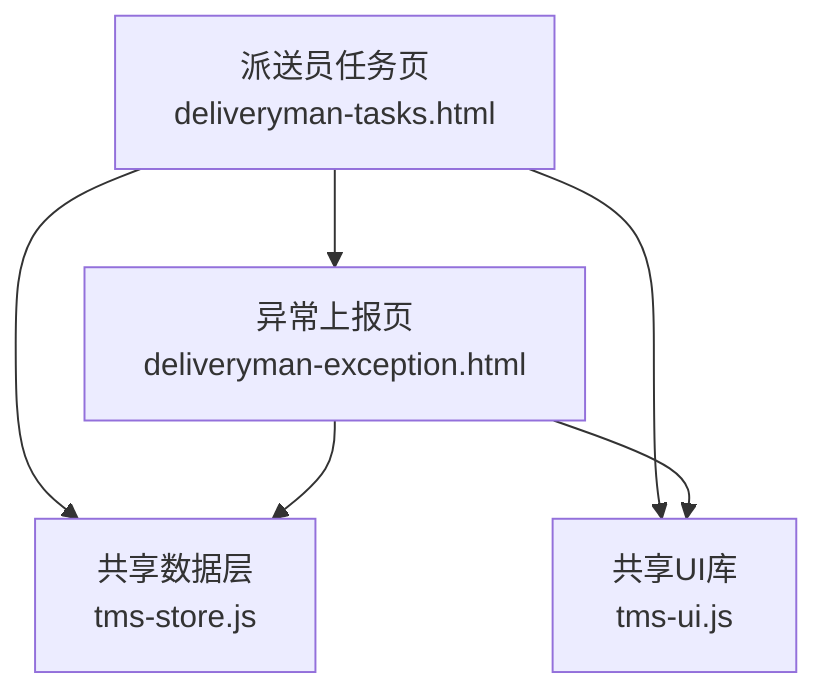
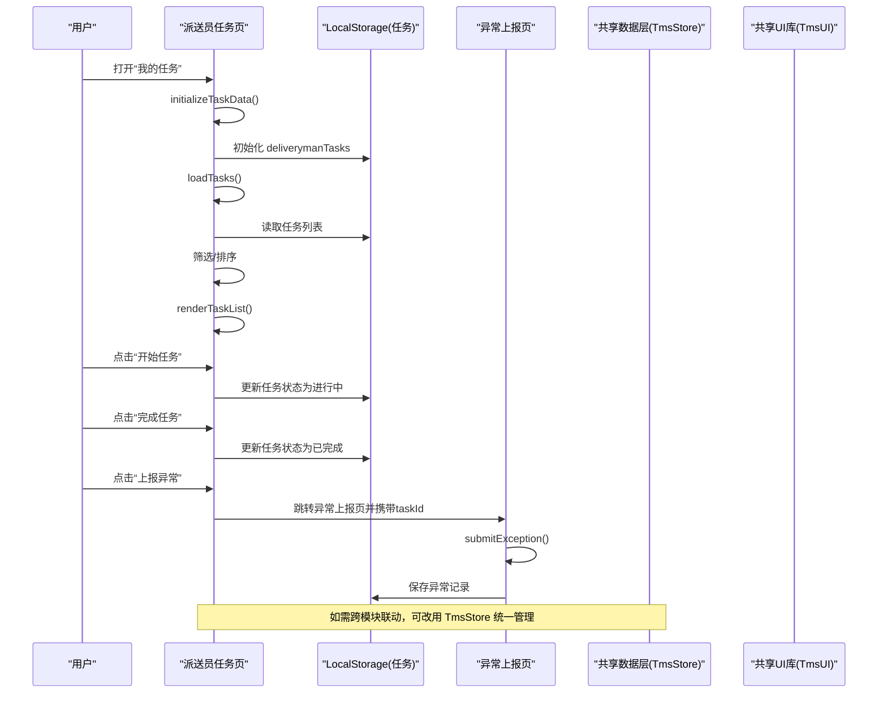
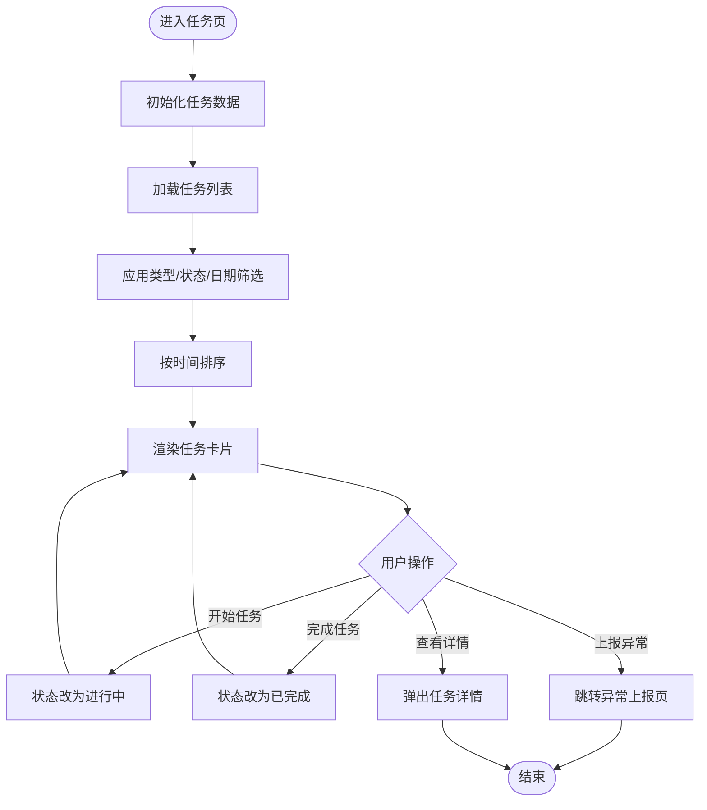
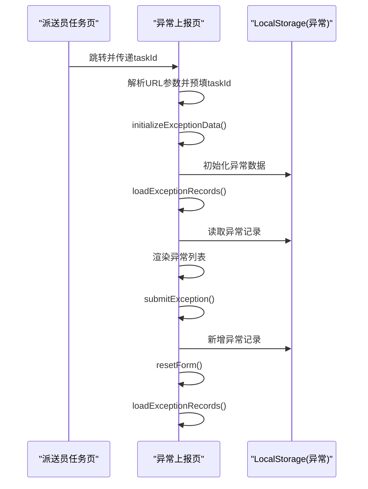
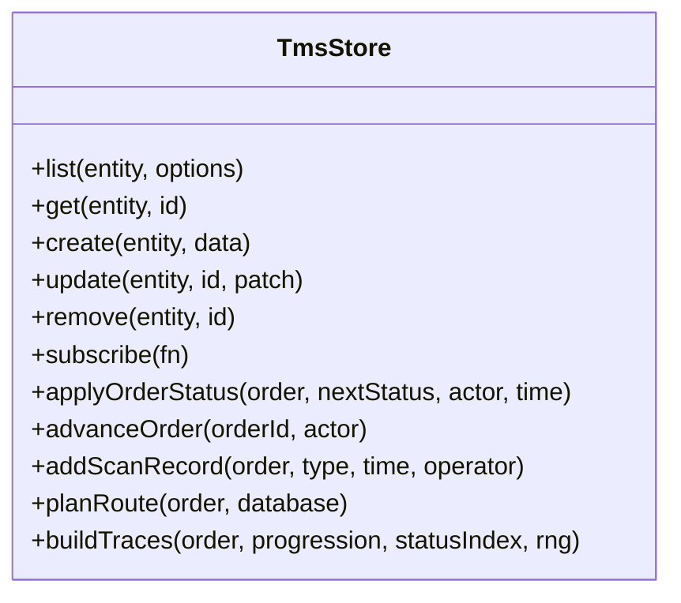
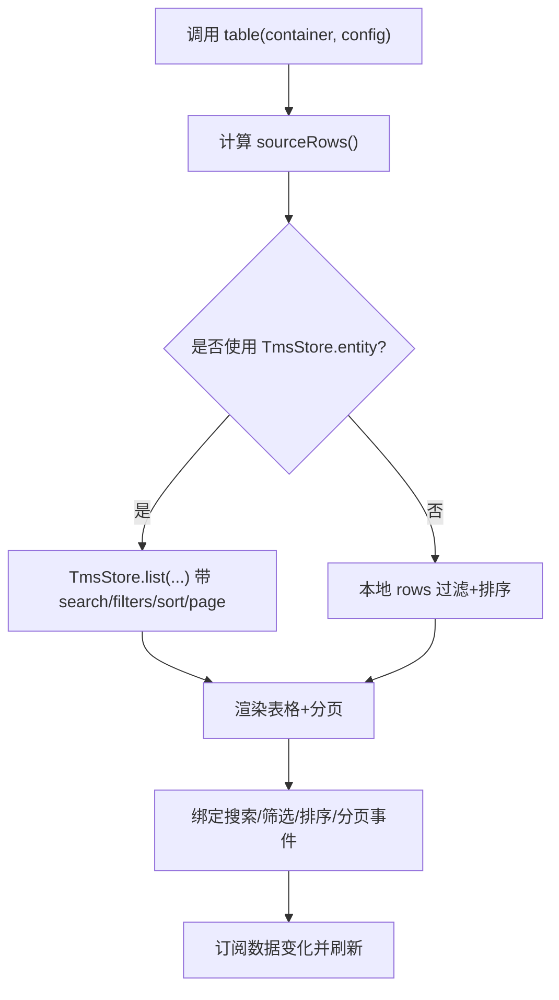
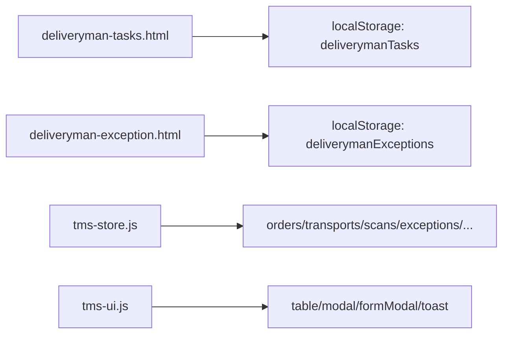

# 派送任务管理

<cite>
**本文引用的文件**   
- [deliveryman-tasks.html](file://deliveryman-tasks.html)
- [deliveryman-exception.html](file://deliveryman-exception.html)
- [tms-store.js](file://tms-store.js)
- [tms-ui.js](file://tms-ui.js)
</cite>

## 目录
1. [引言](#引言)
2. [项目结构](#项目结构)
3. [核心组件](#核心组件)
4. [架构总览](#架构总览)
5. [详细组件分析](#详细组件分析)
6. [依赖关系分析](#依赖关系分析)
7. [性能与扩展建议](#性能与扩展建议)
8. [故障排查指南](#故障排查指南)
9. [结论](#结论)

## 引言
本文件围绕“派送任务管理”展开，聚焦以下目标：
- 完整生命周期：从任务分配、状态跟踪到完成/异常闭环。
- 筛选、搜索与分页：基于本地数据层的统一实现。
- 状态流转机制：待处理、进行中、已完成及异常上报的业务规则与技术实现。
- 智能派单、最优路径与动态调度：结合系统内订单、路由、轨迹与资源能力进行说明。
- 移动端优化、离线缓存与网络异常策略：在现有 localStorage 基础上给出可落地的演进方案。
- 代码示例路径：通过“章节来源”指向具体实现位置，避免直接粘贴代码内容。

## 项目结构
本项目为前端演示型 TMS（运输管理系统），其中与“派送任务管理”直接相关的页面和数据层如下：
- 派送员任务页：负责任务列表展示、类型切换、筛选、排序、开始/完成/异常上报等交互。
- 异常上报页：提供常见问题一键上报与详细表单提交，并维护异常记录。
- 共享数据层：提供统一的增删改查、搜索、筛选、排序、分页、订阅事件以及业务流转方法。
- 共享 UI 库：提供通用表格、弹窗、表单、Toast、图表等组件，支持搜索/筛选/分页/排序。

**图示来源**
- [deliveryman-tasks.html:387-424](file://deliveryman-tasks.html#L387-L424)
- [deliveryman-exception.html:426-476](file://deliveryman-exception.html#L426-L476)
- [tms-store.js:1-12](file://tms-store.js#L1-L12)
- [tms-ui.js:1-6](file://tms-ui.js#L1-L6)

**章节来源**
- [deliveryman-tasks.html:387-424](file://deliveryman-tasks.html#L387-L424)
- [deliveryman-exception.html:426-476](file://deliveryman-exception.html#L426-L476)
- [tms-store.js:1-12](file://tms-store.js#L1-L12)
- [tms-ui.js:1-6](file://tms-ui.js#L1-L6)

## 核心组件
- 派送员任务模块
  - 功能：任务初始化、加载、筛选、排序、渲染、开始/完成/异常上报、查看详情。
  - 关键函数：initializeTaskData、loadTasks、renderTaskList、startTask、completeTask、reportException、viewTaskDetail。
- 异常上报模块
  - 功能：常见问题快速选择、详细表单提交、异常记录列表展示。
  - 关键函数：initializeExceptionData、loadExceptionRecords、submitException、resetForm。
- 共享数据层（TmsStore）
  - 功能：localStorage 轻量数据库、CRUD、搜索/筛选/排序/分页、事件订阅、业务流转（订单阶段推进、扫描记录、轨迹写入、结算等）。
  - 关键方法：list、get、create、update、remove、subscribe、applyOrderStatus、advanceOrder、addScanRecord、planRoute、buildTraces。
- 共享 UI 库（TmsUI）
  - 功能：通用表格 table、弹窗 modal/formModal/confirmDialog、Toast、KPI/图表、状态徽章等。
  - 关键方法：table、modal、formModal、confirm、toast、statusBadge、timeline。

**章节来源**
- [deliveryman-tasks.html:426-636](file://deliveryman-tasks.html#L426-L636)
- [deliveryman-exception.html:478-595](file://deliveryman-exception.html#L478-L595)
- [tms-store.js:1197-1306](file://tms-store.js#L1197-L1306)
- [tms-store.js:1328-1559](file://tms-store.js#L1328-L1559)
- [tms-ui.js:160-287](file://tms-ui.js#L160-L287)
- [tms-ui.js:289-544](file://tms-ui.js#L289-L544)

## 架构总览
派送任务管理的整体流程由“页面交互 → 本地数据持久化 → 可选复用共享数据层/UI 库”构成。当前派送任务页使用独立的 localStorage 键存储任务数据；而系统其他模块（如订单、异常、扫描、财务等）则统一通过 tms-store.js 管理。

**图示来源**
- [deliveryman-tasks.html:426-636](file://deliveryman-tasks.html#L426-L636)
- [deliveryman-exception.html:478-595](file://deliveryman-exception.html#L478-L595)
- [tms-store.js:1197-1306](file://tms-store.js#L1197-L1306)
- [tms-ui.js:289-544](file://tms-ui.js#L289-L544)

## 详细组件分析

### 派送员任务模块
- 生命周期要点
  - 初始化：首次访问生成过去/未来若干天的任务样例，包含收件/派件两类。
  - 加载与渲染：根据类型、状态、日期筛选后按时间排序，再渲染卡片列表。
  - 操作：待处理→进行中→已完成；进行中可上报异常；已完成可查看详情。
- 筛选与排序
  - 类型筛选：全部/收件/派件。
  - 状态筛选：待处理/进行中/已完成。
  - 日期筛选：今天/本周/本月/全部。
  - 排序：按任务时间升序。
- 状态流转
  - pending → in-progress → completed。
  - 进行中可跳转到异常上报页。

**图示来源**
- [deliveryman-tasks.html:426-636](file://deliveryman-tasks.html#L426-L636)

**章节来源**
- [deliveryman-tasks.html:426-636](file://deliveryman-tasks.html#L426-L636)

### 异常上报模块
- 功能要点
  - 常见问题一键上报：地址错误、拒收、联系不上、破损少件、交通/车辆问题。
  - 详细表单：关联任务ID、异常类型、描述、地点、时间。
  - 异常记录：按上报时间倒序展示，支持重置表单。
- 数据流
  - 从 URL 参数获取 taskId，预填表单。
  - 提交时校验必填项，构造异常对象并保存到 localStorage。
  - 重新加载异常记录列表。

**图示来源**
- [deliveryman-exception.html:426-595](file://deliveryman-exception.html#L426-L595)

**章节来源**
- [deliveryman-exception.html:426-595](file://deliveryman-exception.html#L426-L595)

### 共享数据层（TmsStore）
- 职责
  - 提供统一的增删改查、搜索、筛选、排序、分页能力。
  - 维护订单全生命周期状态流转，自动写入扫描、运输、财务等关联记录。
  - 提供各页面所需的统计聚合（KPI、趋势、分布、日报）。
- 关键能力
  - list(entity, options)：支持 filters、search、sort、page、pageSize。
  - create/update/remove：统一 ID 生成、时间戳、持久化与事件触发。
  - subscribe(fn)：数据变更回调，供 UI 组件实时刷新。
  - applyOrderStatus/advanceOrder：订单阶段推进，联动扫描、轨迹、运输、结算。
  - planRoute/buildTraces：路由计划与轨迹明细生成。

**图示来源**
- [tms-store.js:1197-1306](file://tms-store.js#L1197-L1306)
- [tms-store.js:1328-1559](file://tms-store.js#L1328-L1559)
- [tms-store.js:417-460](file://tms-store.js#L417-L460)

**章节来源**
- [tms-store.js:1-12](file://tms-store.js#L1-L12)
- [tms-store.js:1197-1306](file://tms-store.js#L1197-L1306)
- [tms-store.js:1328-1559](file://tms-store.js#L1328-L1559)
- [tms-store.js:417-460](file://tms-store.js#L417-L460)

### 共享 UI 库（TmsUI）
- 通用表格 table
  - 支持 entity 模式（绑定 TmsStore）或 rows 模式（本地数组）。
  - 内置搜索、筛选、排序、分页、工具栏、行点击、动作按钮。
  - 当使用 entity 模式时，自动订阅数据变化并刷新。
- 弹窗与表单
  - modal/formModal/confirmDialog：支持异步提交、错误提示、成功 Toast。
- 状态徽章与时间线
  - statusBadge/timeline：统一状态标签与时间轴展示。

**图示来源**
- [tms-ui.js:289-544](file://tms-ui.js#L289-L544)

**章节来源**
- [tms-ui.js:160-287](file://tms-ui.js#L160-L287)
- [tms-ui.js:289-544](file://tms-ui.js#L289-L544)

## 依赖关系分析
- 页面与数据层
  - 派送员任务页独立使用 localStorage 键 deliverymanTasks，未直接依赖 TmsStore。
  - 异常上报页同样独立使用 deliverymanExceptions。
  - 若需与系统其他模块联动（如订单、异常、扫描、财务），应迁移至 TmsStore 统一管理。
- 页面与 UI 库
  - 派送员任务页与异常上报页未直接使用 TmsUI 的 table/modal 等组件，但可复用其样式与交互模式。
- 数据层内部依赖
  - TmsStore 内部依赖 ORDER_FLOW、STATUS_LABELS、TRACE_NODE_MAP、CITIES/CARRIERS 等字典与常量。
  - 业务流转方法依赖 route、vehicle、scans、finances 等实体集合。

**图示来源**
- [deliveryman-tasks.html:426-636](file://deliveryman-tasks.html#L426-L636)
- [deliveryman-exception.html:478-595](file://deliveryman-exception.html#L478-L595)
- [tms-store.js:1113-1153](file://tms-store.js#L1113-L1153)
- [tms-ui.js:289-544](file://tms-ui.js#L289-L544)

**章节来源**
- [deliveryman-tasks.html:426-636](file://deliveryman-tasks.html#L426-L636)
- [deliveryman-exception.html:478-595](file://deliveryman-exception.html#L478-L595)
- [tms-store.js:1113-1153](file://tms-store.js#L1113-L1153)
- [tms-ui.js:289-544](file://tms-ui.js#L289-L544)

## 性能与扩展建议
- 当前实现特点
  - 派送任务页与异常上报页均使用 localStorage 直接读写，简单可靠，适合小规模演示。
  - TmsStore 提供统一 CRUD 与事件订阅，具备更好的可扩展性与一致性。
- 优化方向
  - 将派送任务与异常数据迁移至 TmsStore，统一使用 list/create/update/remove 与 subscribe，提升跨页面一致性。
  - 对大列表采用虚拟滚动或分页加载，减少 DOM 渲染压力。
  - 搜索与筛选尽量下沉到数据层，避免前端重复过滤。
  - 引入 IndexedDB 替代 localStorage，提升容量与并发稳定性。
  - 增加重试与退避策略，处理网络异常与后端不可用场景。
  - 对高频操作（如开始/完成任务）加入防抖与乐观更新，提升用户体验。

[本节为通用指导，不直接分析具体文件]

## 故障排查指南
- 任务无法显示
  - 检查 localStorage 中是否存在 deliverymanTasks 且格式正确。
  - 确认 initializeTaskData 已执行并生成初始数据。
- 筛选/排序无效
  - 检查 loadTasks 中的筛选条件与排序逻辑是否正确。
  - 确认筛选器事件绑定到 loadTasks。
- 异常上报失败
  - 检查必填字段校验逻辑。
  - 确认 localStorage 中 deliverymanExceptions 存在并可写。
- 与系统其他模块数据不一致
  - 建议迁移至 TmsStore，确保所有页面共享同一数据源。
  - 使用 TmsStore.subscribe 监听数据变化，保证 UI 同步。

**章节来源**
- [deliveryman-tasks.html:426-636](file://deliveryman-tasks.html#L426-L636)
- [deliveryman-exception.html:478-595](file://deliveryman-exception.html#L478-L595)
- [tms-store.js:1197-1306](file://tms-store.js#L1197-L1306)

## 结论
- 派送任务管理在当前仓库中以“页面级 localStorage”方式实现，满足基础的任务分配、状态跟踪、筛选排序与异常上报需求。
- 系统提供了强大的共享数据层与 UI 库，可作为后续扩展的基础设施，支撑更复杂的智能派单、最优路径规划与动态调度。
- 建议在真实场景中逐步迁移至 TmsStore，并结合 IndexedDB、服务端 API、重试与离线缓存策略，构建高可用、高性能的派送任务管理体系。

[本节为总结性内容，不直接分析具体文件]