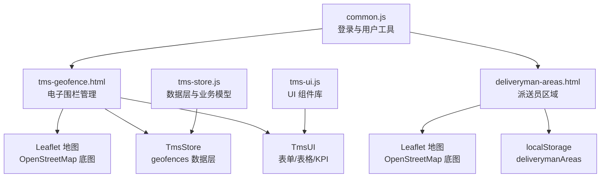
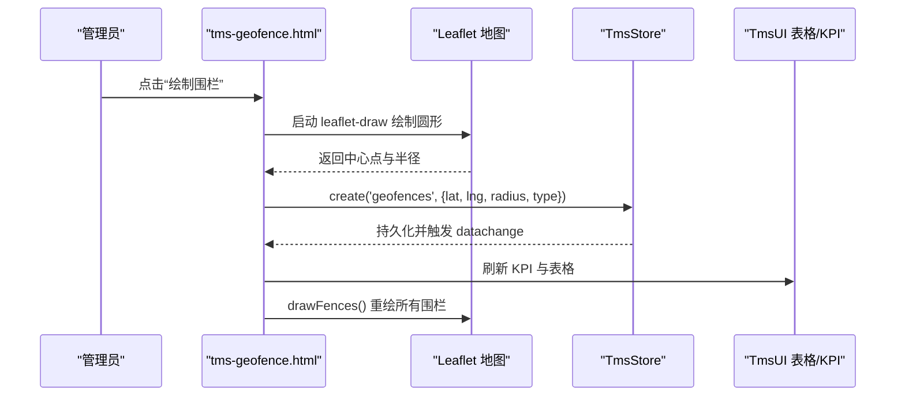
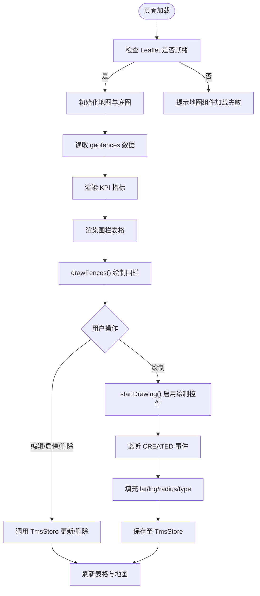
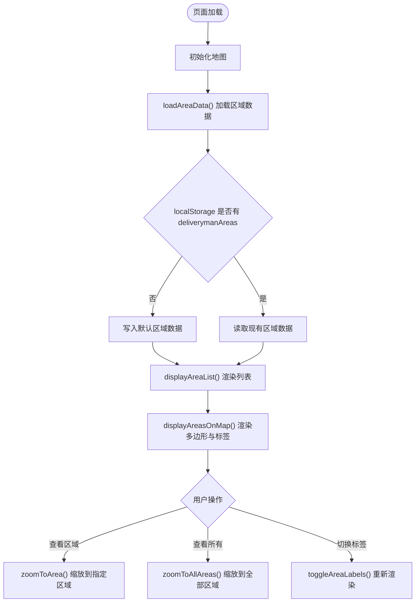
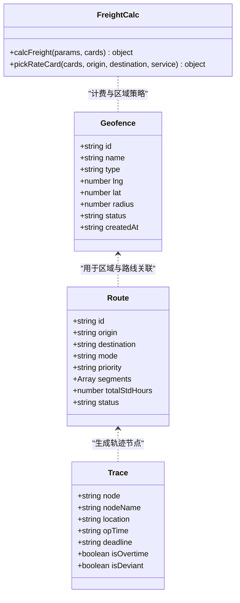
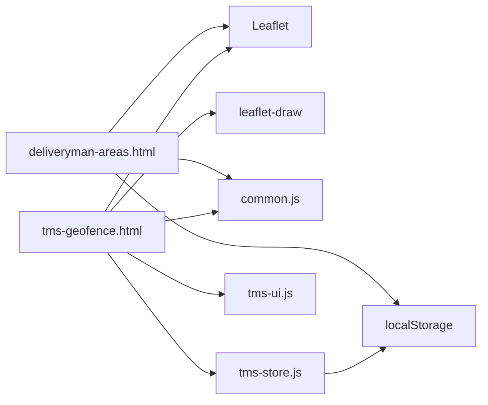

# 派送区域管理

<cite>
**本文引用的文件**   
- [tms-geofence.html](file://tms-geofence.html)
- [deliveryman-areas.html](file://deliveryman-areas.html)
- [tms-store.js](file://tms-store.js)
- [tms-ui.js](file://tms-ui.js)
- [common.js](file://common.js)
</cite>

## 目录
1. [引言](#引言)
2. [项目结构](#项目结构)
3. [核心组件](#核心组件)
4. [架构总览](#架构总览)
5. [详细组件分析](#详细组件分析)
6. [依赖关系分析](#依赖关系分析)
7. [性能与扩展性](#性能与扩展性)
8. [故障排查指南](#故障排查指南)
9. [结论](#结论)

## 引言
本文件围绕“派送区域管理”展开，聚焦地理围栏、区域划分与配送范围管理的实现。系统通过 Leaflet 地图渲染电子围栏与派送区域，结合 TmsStore 本地数据层进行增删改查与状态同步；同时提供表单弹窗、表格筛选、KPI 展示等通用 UI 能力。文档从系统架构、数据处理流程、地图交互、坐标与距离处理、以及真实派送场景中的空间分析需求出发，给出可落地的技术说明与排障建议。

## 项目结构
与派送区域管理直接相关的页面与模块如下：
- tms-geofence.html：管理员端电子围栏管理页，支持绘制圆形围栏、列表管理与地图联动。
- deliveryman-areas.html：派送员端区域查看页，展示多边形区域、标签与缩放控制。
- tms-store.js：共享数据层，内置 geofences 种子数据、路由与轨迹模型，并提供统一 CRUD 与事件订阅。
- tms-ui.js：共享 UI 组件库，提供表单弹窗、表格、KPI、Toast 等能力。
- common.js：通用工具函数，包含登录校验、用户信息展示等基础能力。

图表来源
- [tms-geofence.html:563-568](file://tms-geofence.html#L563-L568)
- [deliveryman-areas.html:322-324](file://deliveryman-areas.html#L322-L324)
- [tms-store.js:573-591](file://tms-store.js#L573-L591)
- [tms-ui.js:758-781](file://tms-ui.js#L758-L781)
- [common.js:176-199](file://common.js#L176-L199)

章节来源
- [tms-geofence.html:563-568](file://tms-geofence.html#L563-L568)
- [deliveryman-areas.html:322-324](file://deliveryman-areas.html#L322-L324)
- [tms-store.js:573-591](file://tms-store.js#L573-L591)
- [tms-ui.js:758-781](file://tms-ui.js#L758-L781)
- [common.js:176-199](file://common.js#L176-L199)

## 核心组件
- 电子围栏管理（tms-geofence.html）
  - 地图初始化与 OpenStreetMap 底图加载。
  - 使用 leaflet-draw 绘制圆形围栏，自动提取中心点与半径。
  - 通过 TmsStore 对 geofences 实体进行创建、更新、启用/停用、删除。
  - 使用 TmsUI.table 渲染围栏列表，支持搜索、筛选、排序与分页。
  - 使用 TmsUI.kpis 展示围栏总数、生效中、仓储围栏、禁行区域等指标。
- 派送员区域（deliveryman-areas.html）
  - 地图初始化与多边形区域渲染。
  - 从 localStorage 读取 deliverymanAreas 默认数据并显示列表与地图标记。
  - 提供“查看所有区域”“重置地图”“显示/隐藏标签”等操作。
- 数据层（tms-store.js）
  - 内置 geofences 种子数据，包含名称、类型、经纬度、半径、状态等字段。
  - 提供统一的 list/update/create/remove 接口与事件订阅机制。
- UI 组件（tms-ui.js）
  - 提供 formModal、table、kpis、toast、initShell 等通用能力。
- 通用工具（common.js）
  - 提供 checkLoginStatus、displayCurrentUser 等登录与用户信息工具。

章节来源
- [tms-geofence.html:600-609](file://tms-geofence.html#L600-L609)
- [tms-geofence.html:723-746](file://tms-geofence.html#L723-L746)
- [tms-geofence.html:748-776](file://tms-geofence.html#L748-L776)
- [tms-geofence.html:633-684](file://tms-geofence.html#L633-L684)
- [tms-geofence.html:611-623](file://tms-geofence.html#L611-L623)
- [deliveryman-areas.html:357-365](file://deliveryman-areas.html#L357-L365)
- [deliveryman-areas.html:454-499](file://deliveryman-areas.html#L454-L499)
- [tms-store.js:573-591](file://tms-store.js#L573-L591)
- [tms-ui.js:165-287](file://tms-ui.js#L165-L287)
- [tms-ui.js:303-544](file://tms-ui.js#L303-L544)
- [tms-ui.js:548-557](file://tms-ui.js#L548-L557)
- [common.js:176-199](file://common.js#L176-L199)

## 架构总览
下图展示了派送区域管理在系统中的整体交互：管理员通过电子围栏页面维护围栏数据，数据变更触发 UI 刷新与地图重绘；派送员端则基于本地存储的区域数据进行可视化展示与交互。

图表来源
- [tms-geofence.html:748-776](file://tms-geofence.html#L748-L776)
- [tms-geofence.html:714-718](file://tms-geofence.html#L714-L718)
- [tms-geofence.html:723-746](file://tms-geofence.html#L723-L746)
- [tms-store.js:232-244](file://tms-store.js#L232-L244)

## 详细组件分析

### 电子围栏管理（tms-geofence.html）
- 地图初始化
  - 检查 Leaflet 是否加载成功，失败时提示错误但保留围栏列表功能。
  - 设置地图中心为北京坐标，添加 OpenStreetMap 瓦片图层。
- 围栏列表与操作
  - 使用 TmsUI.table 绑定 entity='geofences'，支持按类型与状态筛选。
  - 提供启用/停用、编辑、删除等操作，调用 TmsStore.update/remove。
- 地图绘制与联动
  - startDrawing(type) 启用 leaflet-draw 仅允许绘制圆形，限制其他图形。
  - 监听 CREATED 事件，获取 e.layer.getLatLng() 与 getRadius()，填充表单预设值。
  - drawFences() 遍历 geofences 数据，使用 L.circle 渲染，并根据 status 调整透明度与虚线样式。
- KPI 统计
  - renderGeoKpis() 统计围栏总数、生效中、仓储围栏、禁行区域数量，并通过 TmsUI.kpis 展示。

图表来源
- [tms-geofence.html:600-609](file://tms-geofence.html#L600-L609)
- [tms-geofence.html:723-746](file://tms-geofence.html#L723-L746)
- [tms-geofence.html:748-776](file://tms-geofence.html#L748-L776)
- [tms-geofence.html:611-623](file://tms-geofence.html#L611-L623)

章节来源
- [tms-geofence.html:600-609](file://tms-geofence.html#L600-L609)
- [tms-geofence.html:723-746](file://tms-geofence.html#L723-L746)
- [tms-geofence.html:748-776](file://tms-geofence.html#L748-L776)
- [tms-geofence.html:611-623](file://tms-geofence.html#L611-L623)

### 派送员区域（deliveryman-areas.html）
- 地图初始化
  - 设置地图中心为北京坐标，添加 OpenStreetMap 瓦片图层。
- 区域数据加载
  - initializeAreaData() 若 localStorage 无 deliverymanAreas，则写入默认区域数据。
  - loadAreaData() 读取 localStorage 数据，渲染列表与地图多边形。
- 地图渲染与交互
  - displayAreasOnMap() 使用 L.polygon 渲染区域，根据类型设置颜色与透明度。
  - 为每个区域添加弹出信息与自定义标签（L.marker + L.divIcon）。
  - zoomToArea() 与 zoomToAllAreas() 使用 fitBounds 适配视图。
  - toggleAreaLabels() 切换标签显示，重新渲染区域。

图表来源
- [deliveryman-areas.html:357-365](file://deliveryman-areas.html#L357-L365)
- [deliveryman-areas.html:382-433](file://deliveryman-areas.html#L382-L433)
- [deliveryman-areas.html:454-499](file://deliveryman-areas.html#L454-L499)
- [deliveryman-areas.html:514-553](file://deliveryman-areas.html#L514-L553)

章节来源
- [deliveryman-areas.html:357-365](file://deliveryman-areas.html#L357-L365)
- [deliveryman-areas.html:382-433](file://deliveryman-areas.html#L382-L433)
- [deliveryman-areas.html:454-499](file://deliveryman-areas.html#L454-L499)
- [deliveryman-areas.html:514-553](file://deliveryman-areas.html#L514-L553)

### 数据层与业务模型（tms-store.js）
- 电子围栏种子数据
  - fenceCenters 数组定义多个城市围栏的中心点与半径，映射为 geofences 实体。
  - 字段包括 id、name、type、lng、lat、radius、status、createdAt。
- 路由与轨迹模型
  - buildRoutes() 构建多段路由，含标准时效与模式（陆运/空运）。
  - findRoute()/planRoute() 根据起终点匹配路由，生成 planSegments 与 deadline。
  - buildTraces() 根据订单阶段生成轨迹明细，标注超时与偏差。
- 计费引擎
  - calcFreight() 计算首重、续重、燃油附加、偏远附加、保价、到付等费用，并应用客户折扣。

图表来源
- [tms-store.js:573-591](file://tms-store.js#L573-L591)
- [tms-store.js:387-424](file://tms-store.js#L387-L424)
- [tms-store.js:442-460](file://tms-store.js#L442-L460)
- [tms-store.js:332-383](file://tms-store.js#L332-L383)

章节来源
- [tms-store.js:573-591](file://tms-store.js#L573-L591)
- [tms-store.js:387-424](file://tms-store.js#L387-L424)
- [tms-store.js:442-460](file://tms-store.js#L442-L460)
- [tms-store.js:332-383](file://tms-store.js#L332-L383)

### UI 组件与通用工具（tms-ui.js、common.js）
- TmsUI.formModal
  - 动态生成表单字段，支持必填校验、异步提交与错误提示。
  - 电子围栏新增/编辑通过该组件完成，提交后调用 TmsStore.create/update。
- TmsUI.table
  - 支持 entity 绑定、搜索、筛选、排序、分页与行操作。
  - 电子围栏列表通过该组件渲染，支持启用/停用、编辑、删除。
- TmsUI.kpis
  - 将围栏统计指标以卡片形式展示，便于快速掌握全局情况。
- Common.checkLoginStatus
  - 校验用户角色与登录状态，未登录或角色不匹配时跳转登录页。

章节来源
- [tms-ui.js:165-287](file://tms-ui.js#L165-L287)
- [tms-ui.js:303-544](file://tms-ui.js#L303-L544)
- [tms-ui.js:548-557](file://tms-ui.js#L548-L557)
- [common.js:176-199](file://common.js#L176-L199)

## 依赖关系分析
- 页面依赖
  - tms-geofence.html 依赖 Leaflet、leaflet-draw、common.js、tms-store.js、tms-ui.js。
  - deliveryman-areas.html 依赖 Leaflet、common.js。
- 数据依赖
  - tms-store.js 提供 geofences 种子数据与统一 CRUD 接口。
  - deliveryman-areas.html 依赖 localStorage 的 deliverymanAreas 数据。
- UI 依赖
  - tms-ui.js 提供表单、表格、KPI 等组件，被 tms-geofence.html 复用。

图表来源
- [tms-geofence.html:563-568](file://tms-geofence.html#L563-L568)
- [deliveryman-areas.html:322-324](file://deliveryman-areas.html#L322-L324)
- [tms-store.js:232-244](file://tms-store.js#L232-L244)

章节来源
- [tms-geofence.html:563-568](file://tms-geofence.html#L563-L568)
- [deliveryman-areas.html:322-324](file://deliveryman-areas.html#L322-L324)
- [tms-store.js:232-244](file://tms-store.js#L232-L244)

## 性能与扩展性
- 地图渲染优化
  - 避免频繁移除/添加图层：drawFences() 先清空 fenceLayers，再批量添加新图层。
  - 使用 fitBounds 一次性适配所有围栏边界，减少多次缩放。
- 数据层扩展
  - 可在 TmsStore 中增加空间查询方法（如点在圆内判断），供后续配送范围校验使用。
  - 引入后端服务替代 localStorage，提升并发与一致性。
- UI 组件复用
  - 通过 TmsUI.table/formModal/kpis 统一风格与行为，降低重复代码与维护成本。

[本节为通用指导，无需具体文件引用]

## 故障排查指南
- 地图组件加载失败
  - 现象：Leaflet 未加载，提示“地图组件加载失败”。
  - 处理：检查 CDN 链接与网络环境；围栏列表仍可正常使用。
  - 参考位置：[tms-geofence.html:600-609](file://tms-geofence.html#L600-L609)
- 围栏无法绘制
  - 现象：点击“绘制围栏”无响应。
  - 处理：确认 map 已初始化且 drawControl 正确挂载；检查 leaflet-draw 脚本加载。
  - 参考位置：[tms-geofence.html:748-776](file://tms-geofence.html#L748-L776)
- 围栏列表不刷新
  - 现象：新增/编辑围栏后列表未更新。
  - 处理：确认 TmsStore.subscribe 回调已执行；检查 TmsStore.update/create 返回值。
  - 参考位置：[tms-geofence.html:585-589](file://tms-geofence.html#L585-L589)
- 区域标签不显示
  - 现象：派送员区域标签隐藏。
  - 处理：调用 toggleAreaLabels() 切换显示；检查 areaLabels 数组与 L.divIcon 配置。
  - 参考位置：[deliveryman-areas.html:546-553](file://deliveryman-areas.html#L546-L553)

章节来源
- [tms-geofence.html:600-609](file://tms-geofence.html#L600-L609)
- [tms-geofence.html:748-776](file://tms-geofence.html#L748-L776)
- [tms-geofence.html:585-589](file://tms-geofence.html#L585-L589)
- [deliveryman-areas.html:546-553](file://deliveryman-areas.html#L546-L553)

## 结论
本系统通过 Leaflet 地图与 leaflet-draw 实现了电子围栏的可视化绘制与管理，结合 TmsStore 提供稳定的数据层支撑；派送员区域页面则通过多边形渲染与标签展示，满足日常区域查看与导航需求。未来可扩展方向包括：
- 引入后端 API 与空间数据库，支持复杂几何运算与高性能查询。
- 集成交通状况与实时路况，优化路线规划与配送时效。
- 增强费用规则与区域策略联动，实现更精细化的配送定价与服务等级。

[本节为总结性内容，无需具体文件引用]