# 派送员界面

<cite>
**本文引用的文件**   
- [deliveryman-index.html](file://deliveryman-index.html)
- [deliveryman-tasks.html](file://deliveryman-tasks.html)
- [deliveryman-collection.html](file://deliveryman-collection.html)
- [deliveryman-clock.html](file://deliveryman-clock.html)
- [deliveryman-performance.html](file://deliveryman-performance.html)
- [deliveryman-contacts.html](file://deliveryman-contacts.html)
- [deliveryman-exception.html](file://deliveryman-exception.html)
- [deliveryman-areas.html](file://deliveryman-areas.html)
- [common.js](file://common.js)
</cite>

## 目录
1. [引言](#引言)
2. [项目结构](#项目结构)
3. [核心组件](#核心组件)
4. [架构总览](#架构总览)
5. [详细组件分析](#详细组件分析)
6. [依赖关系分析](#依赖关系分析)
7. [性能与移动端优化](#性能与移动端优化)
8. [故障排查指南](#故障排查指南)
9. [结论](#结论)
10. [附录：关键流程与数据模型](#附录关键流程与数据模型)

## 引言
本文件面向TMS系统的“派送员界面”，聚焦末端配送场景下的完整能力说明，包括派送任务、客户联系、区域管理、异常处理、业绩统计、考勤管理与代收货款等模块。文档同时给出移动派送的端到端工作流、签收确认与电子签名的落地方案，智能派单算法、最优路径规划与动态调度机制的设计建议，以及地图服务集成、地址解析与导航的实现要点。此外，还涵盖客户沟通工具、消息推送与通知系统、异常情况上报与解决方案库、移动设备优化、网络异常处理与数据缓存策略，确保覆盖真实派送场景中的复杂情况与用户体验优化。

## 项目结构
派送员相关页面采用多HTML页面+通用JS的轻量前端架构，所有业务数据通过浏览器本地存储（localStorage）进行模拟持久化；地图功能使用Leaflet加载OpenStreetMap底图；图表展示使用Chart.js。

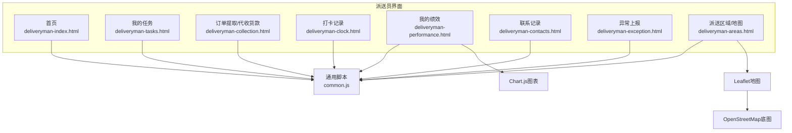

**图示来源**
- [deliveryman-index.html:216-288](file://deliveryman-index.html#L216-L288)
- [deliveryman-tasks.html:311-384](file://deliveryman-tasks.html#L311-L384)
- [deliveryman-collection.html:324-416](file://deliveryman-collection.html#L324-L416)
- [deliveryman-clock.html:350-448](file://deliveryman-clock.html#L350-L448)
- [deliveryman-performance.html:295-402](file://deliveryman-performance.html#L295-L402)
- [deliveryman-contacts.html:388-484](file://deliveryman-contacts.html#L388-L484)
- [deliveryman-exception.html:307-423](file://deliveryman-exception.html#L307-L423)
- [deliveryman-areas.html:262-318](file://deliveryman-areas.html#L262-L318)
- [common.js:135-218](file://common.js#L135-L218)

**章节来源**
- [deliveryman-index.html:216-288](file://deliveryman-index.html#L216-L288)
- [common.js:135-218](file://common.js#L135-L218)

## 核心组件
- 首页仪表盘：汇总今日任务、待处理/进行中/已完成数量、最近异常提醒。
- 我的任务：任务列表、状态切换（待处理/进行中/已完成）、开始/完成/上报异常操作。
- 订单提取/代收货款：订单搜索与筛选、金额统计、确认提取并记录支付信息。
- 打卡记录：上班/下班打卡、工时计算、迟到/缺勤判定与统计。
- 我的绩效：完成率、准时率、异常率、评分雷达图与任务分布柱状图。
- 联系记录：添加联系记录、常用联系人、按类型筛选。
- 异常上报：常见问题一键上报、详细表单提交、异常记录列表。
- 派送区域：基于Leaflet的区域围栏可视化、标签显示控制、区域缩放与详情查看。

**章节来源**
- [deliveryman-index.html:247-288](file://deliveryman-index.html#L247-L288)
- [deliveryman-tasks.html:343-384](file://deliveryman-tasks.html#L343-L384)
- [deliveryman-collection.html:356-416](file://deliveryman-collection.html#L356-L416)
- [deliveryman-clock.html:382-448](file://deliveryman-clock.html#L382-L448)
- [deliveryman-performance.html:327-402](file://deliveryman-performance.html#L327-L402)
- [deliveryman-contacts.html:419-484](file://deliveryman-contacts.html#L419-L484)
- [deliveryman-exception.html:339-423](file://deliveryman-exception.html#L339-L423)
- [deliveryman-areas.html:294-318](file://deliveryman-areas.html#L294-L318)

## 架构总览
派送员界面采用“页面级功能模块 + 通用脚本”的结构。每个页面负责自身的数据初始化、渲染与交互逻辑，并通过common.js提供统一的登录校验、用户信息显示与按钮样式注入。地图与图表分别由Leaflet和Chart.js提供。

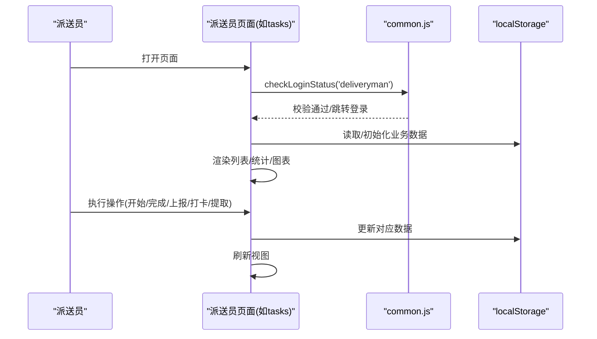

**图示来源**
- [common.js:176-218](file://common.js#L176-L218)
- [deliveryman-tasks.html:388-424](file://deliveryman-tasks.html#L388-L424)
- [deliveryman-clock.html:453-482](file://deliveryman-clock.html#L453-L482)
- [deliveryman-collection.html:421-455](file://deliveryman-collection.html#L421-L455)

## 详细组件分析

### 首页仪表盘
- 功能要点
  - 显示当前用户名与日期。
  - 统计今日任务总数、待处理、进行中、已完成数量。
  - 展示今日任务列表与最近异常记录。
- 数据流
  - 初始化时生成默认任务与异常数据并存入localStorage。
  - 根据时间过滤今日任务，计算各状态数量并渲染。
- 交互
  - 退出登录调用统一logout函数。

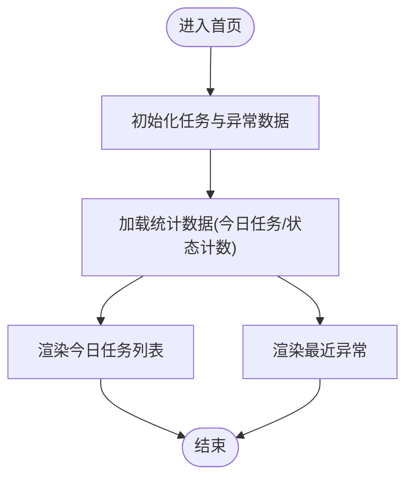

**图示来源**
- [deliveryman-index.html:320-391](file://deliveryman-index.html#L320-L391)
- [deliveryman-index.html:393-455](file://deliveryman-index.html#L393-L455)

**章节来源**
- [deliveryman-index.html:291-318](file://deliveryman-index.html#L291-L318)
- [deliveryman-index.html:320-391](file://deliveryman-index.html#L320-L391)
- [deliveryman-index.html:393-455](file://deliveryman-index.html#L393-L455)

### 我的任务
- 功能要点
  - 支持按任务类型（收件/派件）切换、按状态与日期筛选。
  - 任务卡片展示客户、电话、地址、时间、描述、订单号、重量、件数等。
  - 状态流转：待处理→进行中→已完成；进行中可上报异常。
- 关键流程
  - 开始任务：将状态改为进行中。
  - 完成任务：将状态改为已完成。
  - 上报异常：跳转到异常上报页并携带任务ID。
  - 查看详情：弹窗展示任务详情。

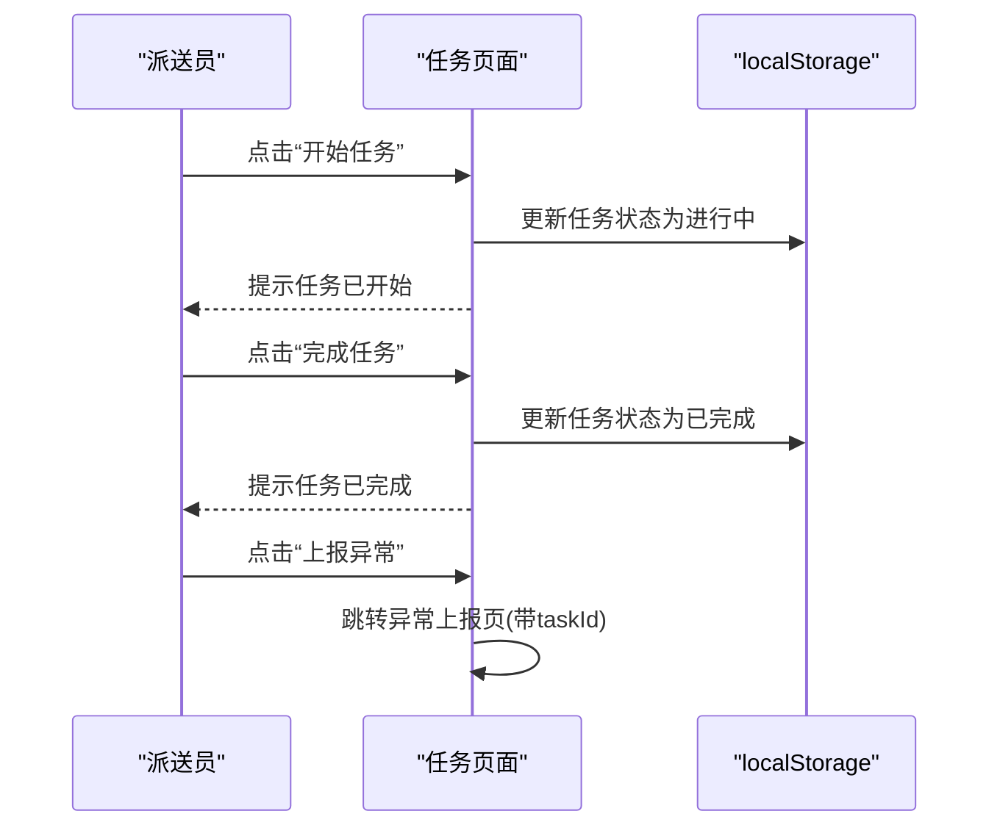

**图示来源**
- [deliveryman-tasks.html:596-636](file://deliveryman-tasks.html#L596-L636)

**章节来源**
- [deliveryman-tasks.html:388-424](file://deliveryman-tasks.html#L388-L424)
- [deliveryman-tasks.html:426-512](file://deliveryman-tasks.html#L426-L512)
- [deliveryman-tasks.html:514-636](file://deliveryman-tasks.html#L514-L636)

### 订单提取/代收货款
- 功能要点
  - 订单搜索（订单号/客户姓名/手机号/地址）。
  - 按状态与日期筛选，统计待提取订单数与金额、已提取订单数与金额。
  - 确认提取：更新订单状态、提取时间、提取人，并记录支付方式与备注。
- 数据模型
  - 订单包含：订单号、客户、电话、地址、金额、下单时间、状态、提取时间、提取人、支付方式、备注。

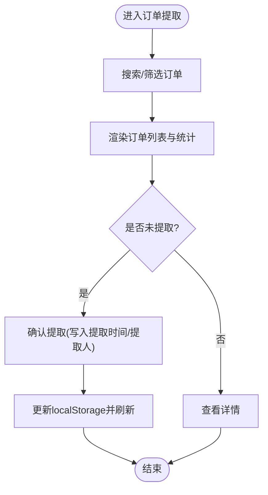

**图示来源**
- [deliveryman-collection.html:457-555](file://deliveryman-collection.html#L457-L555)
- [deliveryman-collection.html:557-677](file://deliveryman-collection.html#L557-L677)

**章节来源**
- [deliveryman-collection.html:421-455](file://deliveryman-collection.html#L421-L455)
- [deliveryman-collection.html:457-555](file://deliveryman-collection.html#L457-L555)
- [deliveryman-collection.html:557-677](file://deliveryman-collection.html#L557-L677)

### 打卡记录
- 功能要点
  - 实时时钟显示、上班/下班打卡按钮状态管理。
  - 迟到判定（以9点为阈值），自动计算工时。
  - 本月出勤天数、迟到次数、总工时、日均工时统计。
- 交互流程
  - 首次进入：若当日无记录则显示“上班打卡”。
  - 已上班未下班：显示“下班打卡”。
  - 已完成打卡：显示“今日已打卡”且禁用。

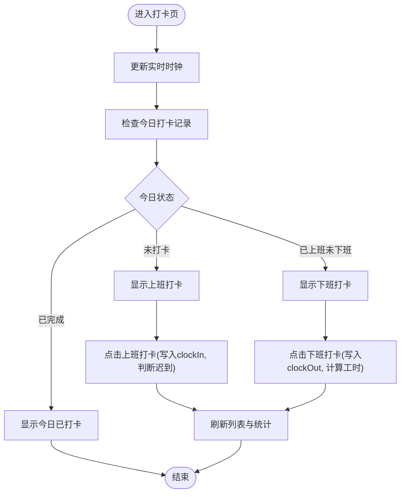

**图示来源**
- [deliveryman-clock.html:453-482](file://deliveryman-clock.html#L453-L482)
- [deliveryman-clock.html:535-609](file://deliveryman-clock.html#L535-L609)
- [deliveryman-clock.html:611-673](file://deliveryman-clock.html#L611-L673)

**章节来源**
- [deliveryman-clock.html:453-482](file://deliveryman-clock.html#L453-L482)
- [deliveryman-clock.html:499-533](file://deliveryman-clock.html#L499-L533)
- [deliveryman-clock.html:535-609](file://deliveryman-clock.html#L535-L609)
- [deliveryman-clock.html:611-673](file://deliveryman-clock.html#L611-L673)

### 我的绩效
- 功能要点
  - 概览指标：总完成任务、完成率、准时率、绩效评分。
  - 时间范围选择：本周/本月/本季度/本年。
  - 图表：雷达图（任务完成率/准时率/服务质量/异常处理/效率）与柱状图（任务数量分布）。
- 数据模型
  - 按时间维度保存totalTasks、completedTasks、onTimeTasks、lateTasks、exceptionTasks、totalHours、performanceScore。

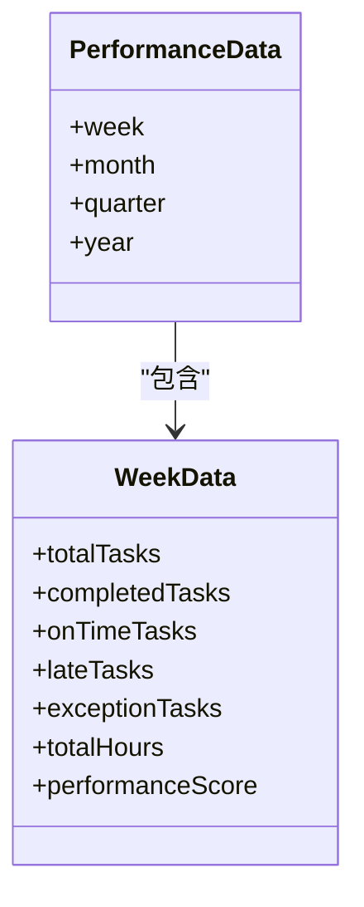

**图示来源**
- [deliveryman-performance.html:442-486](file://deliveryman-performance.html#L442-L486)

**章节来源**
- [deliveryman-performance.html:407-440](file://deliveryman-performance.html#L407-L440)
- [deliveryman-performance.html:442-486](file://deliveryman-performance.html#L442-L486)
- [deliveryman-performance.html:489-561](file://deliveryman-performance.html#L489-L561)
- [deliveryman-performance.html:580-764](file://deliveryman-performance.html#L580-L764)

### 联系记录
- 功能要点
  - 添加联系记录：类型（客户/客服/调度中心）、联系人、电话、时间、内容。
  - 常用联系人：快速拨打电话、从常用联系人填充表单。
  - 按类型筛选记录并按时间倒序展示。
- 交互流程
  - 表单提交后保存到localStorage，重置表单并刷新列表。

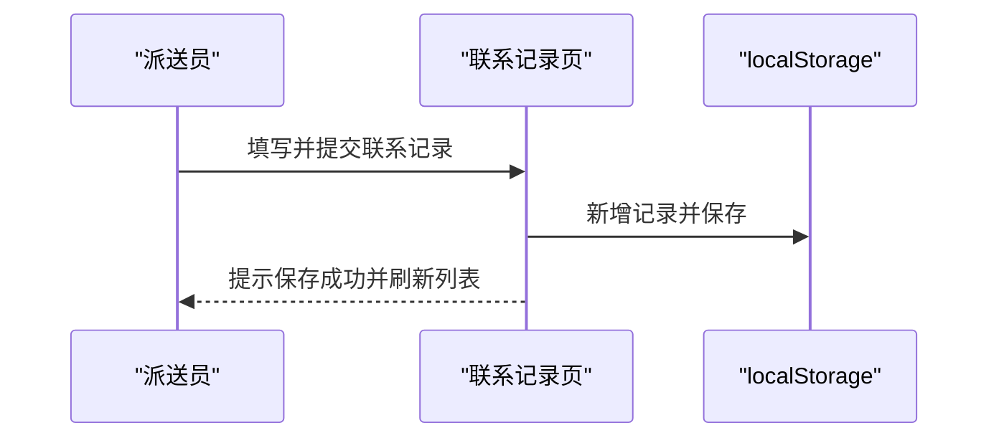

**图示来源**
- [deliveryman-contacts.html:527-532](file://deliveryman-contacts.html#L527-L532)
- [deliveryman-contacts.html:669-704](file://deliveryman-contacts.html#L669-L704)

**章节来源**
- [deliveryman-contacts.html:488-532](file://deliveryman-contacts.html#L488-L532)
- [deliveryman-contacts.html:534-599](file://deliveryman-contacts.html#L534-L599)
- [deliveryman-contacts.html:601-704](file://deliveryman-contacts.html#L601-L704)
- [deliveryman-contacts.html:712-740](file://deliveryman-contacts.html#L712-L740)

### 异常上报
- 功能要点
  - 常见问题一键上报：地址错误/不详、收件人拒收、联系不上收件人、货物破损/少件、交通堵塞/车辆故障。
  - 详细上报表单：关联任务ID、异常类型、描述、地点、时间。
  - 异常记录列表：按上报时间倒序展示，含状态（待处理/已处理）。
- 数据流
  - 从URL参数获取taskId并回填表单。
  - 提交后写入localStorage并刷新列表。

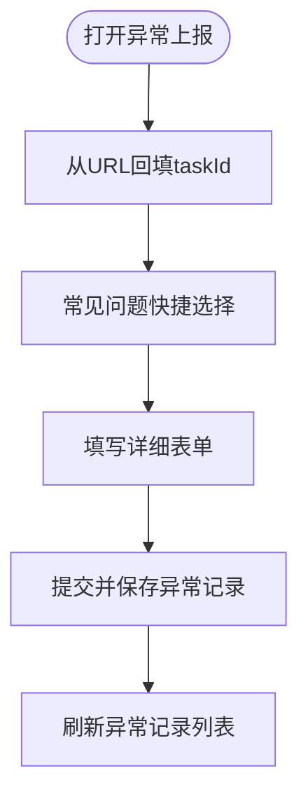

**图示来源**
- [deliveryman-exception.html:448-476](file://deliveryman-exception.html#L448-L476)
- [deliveryman-exception.html:541-589](file://deliveryman-exception.html#L541-L589)

**章节来源**
- [deliveryman-exception.html:428-476](file://deliveryman-exception.html#L428-L476)
- [deliveryman-exception.html:478-505](file://deliveryman-exception.html#L478-L505)
- [deliveryman-exception.html:507-539](file://deliveryman-exception.html#L507-L539)
- [deliveryman-exception.html:541-589](file://deliveryman-exception.html#L541-L589)

### 派送区域（地图）
- 功能要点
  - 使用Leaflet加载OpenStreetMap底图。
  - 在地图上绘制区域多边形、弹出信息、标签显示/隐藏。
  - 支持缩放到单个区域或全部区域、重置地图视图。
- 数据模型
  - 区域包含：id、name、type、coordinates（经纬度数组）、taskCount、address、notes。

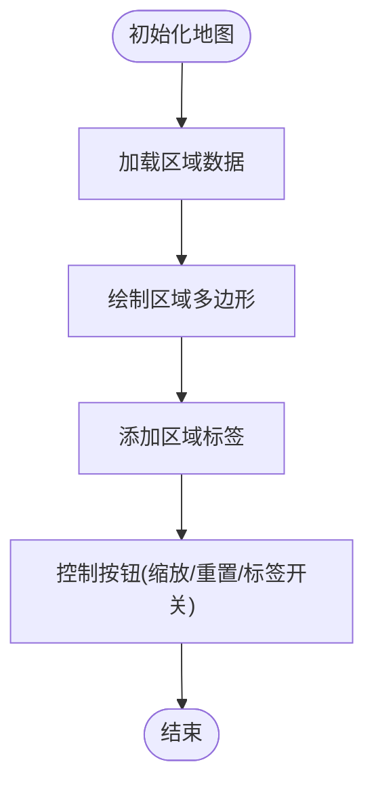

**图示来源**
- [deliveryman-areas.html:356-365](file://deliveryman-areas.html#L356-L365)
- [deliveryman-areas.html:367-433](file://deliveryman-areas.html#L367-L433)
- [deliveryman-areas.html:454-512](file://deliveryman-areas.html#L454-L512)
- [deliveryman-areas.html:514-563](file://deliveryman-areas.html#L514-L563)

**章节来源**
- [deliveryman-areas.html:325-354](file://deliveryman-areas.html#L325-L354)
- [deliveryman-areas.html:356-365](file://deliveryman-areas.html#L356-L365)
- [deliveryman-areas.html:367-433](file://deliveryman-areas.html#L367-L433)
- [deliveryman-areas.html:454-512](file://deliveryman-areas.html#L454-L512)
- [deliveryman-areas.html:514-563](file://deliveryman-areas.html#L514-L563)

## 依赖关系分析
- 页面与通用脚本
  - 所有派送员页面均引入common.js，用于登录校验、用户信息显示与按钮样式注入。
- 第三方库
  - Leaflet与OpenStreetMap：用于地图与区域围栏展示。
  - Chart.js：用于绩效趋势与任务分布图表。
- 数据存储
  - localStorage作为本地数据源，键名包括deliverymanTasks、deliverymanCollections、deliverymanClockRecords、deliverymanPerformance、deliverymanContacts、deliverymanFrequentContacts、deliverymanExceptions、deliverymanAreas等。

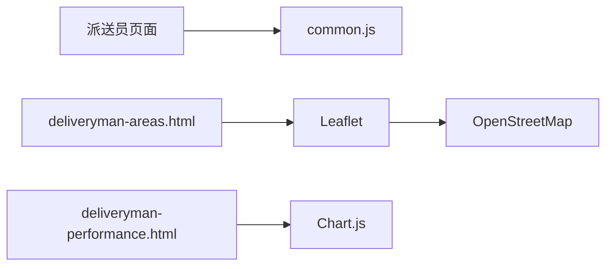

**图示来源**
- [common.js:135-218](file://common.js#L135-L218)
- [deliveryman-areas.html:322-324](file://deliveryman-areas.html#L322-L324)
- [deliveryman-performance.html:10-11](file://deliveryman-performance.html#L10-L11)

**章节来源**
- [common.js:135-218](file://common.js#L135-L218)
- [deliveryman-areas.html:322-324](file://deliveryman-areas.html#L322-L324)
- [deliveryman-performance.html:10-11](file://deliveryman-performance.html#L10-L11)

## 性能与移动端优化
- 首屏与渲染
  - 避免重复初始化：对localStorage数据进行一次性初始化，后续仅读取。
  - 列表渲染采用模板拼接，减少DOM操作次数。
- 地图与图表
  - 地图图层按需创建与销毁，避免内存泄漏。
  - Chart实例在更新前销毁旧实例，防止重复绑定。
- 移动端适配
  - 响应式布局在小屏幕下侧边栏横向滚动，内容区自适应。
  - 大按钮与触控友好的交互元素。
- 网络与离线
  - 地图底图依赖网络，建议在弱网环境下提供离线缓存策略（如预取瓦片或降级为静态图）。
  - 业务数据基于localStorage，天然支持离线可用；需考虑容量限制与数据同步机制。
- 数据缓存策略
  - 对频繁读写的对象（如任务、订单、打卡）进行结构化存储，避免字符串序列化开销过大。
  - 定期清理过期数据（如历史任务、旧异常记录）。

[本节为通用指导，不直接分析具体文件]

## 故障排查指南
- 登录与权限
  - 现象：页面跳转至登录页或提示无权限。
  - 排查：检查localStorage中tmsUser是否存在且role匹配；确认checkLoginStatus调用是否正确。
- 数据未更新
  - 现象：操作后列表未刷新或统计未变化。
  - 排查：确认localStorage键名一致；检查是否在操作后调用刷新函数（如loadTasks/loadOrders/loadClockRecords）。
- 地图不显示
  - 现象：区域地图空白或无法加载。
  - 排查：确认Leaflet与OpenStreetMap资源加载成功；检查地图容器尺寸与CSS。
- 图表不渲染
  - 现象：绩效图表空白或报错。
  - 排查：确认Chart.js已加载；检查canvas元素是否存在；捕获异常日志。

**章节来源**
- [common.js:176-218](file://common.js#L176-L218)
- [deliveryman-performance.html:580-764](file://deliveryman-performance.html#L580-L764)
- [deliveryman-areas.html:356-365](file://deliveryman-areas.html#L356-L365)

## 结论
派送员界面以轻量前端架构实现了末端配送的核心能力：任务管理、代收货款、考勤与绩效、联系与异常、区域地图可视化。通过localStorage实现离线可用，结合Leaflet与Chart.js增强可视化体验。未来可在智能派单、最优路径与动态调度方面扩展后端算法与服务，完善消息推送与通知系统，提升移动端的稳定性与用户体验。

[本节为总结性内容，不直接分析具体文件]

## 附录：关键流程与数据模型

### 移动派送端到端工作流
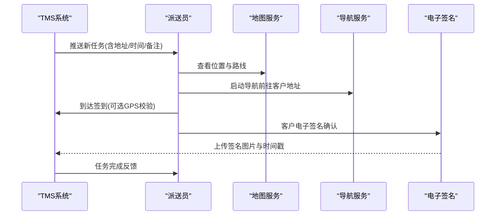

[此图为概念流程图，不映射具体源码文件]

### 签收确认与电子签名实现建议
- 前端采集
  - 使用Canvas绘制签名轨迹，转换为Base64图片。
  - 附加时间戳、GPS坐标、任务ID与派送员ID。
- 后端处理
  - 校验签名完整性与防篡改（哈希校验）。
  - 存储签名图片与元数据，关联订单与任务。
- 用户体验
  - 提供撤销、重绘、放大缩小与导出PDF功能。
  - 弱网环境下先本地缓存，网络恢复后重试上传。

[本节为通用设计建议，不直接分析具体文件]

### 智能派单算法、最优路径规划与动态调度
- 智能派单
  - 输入：任务集合（地址、时间窗、优先级）、派送员集合（位置、负载、技能）。
  - 目标：最小化总里程、最大化准时率、平衡负载。
  - 方法：启发式算法（贪心/遗传/模拟退火）或运筹优化（VRP/TW）。
- 最优路径规划
  - 使用地图API（如高德/百度/Google）计算多点间距离与耗时。
  - 动态调整：实时路况、封路、天气影响。
- 动态调度
  - 事件驱动：新增任务、取消任务、异常上报触发重新派单。
  - 增量优化：局部重排而非全量重算，降低计算成本。

[本节为通用设计建议，不直接分析具体文件]

### 地图服务集成、地址解析与导航
- 地图服务
  - 使用Leaflet加载OpenStreetMap；生产环境可替换为商业地图服务以获得更稳定与丰富的功能。
- 地址解析
  - 将文本地址转为经纬度（Geocoding），用于标记与路径计算。
- 导航
  - 调用导航API生成路线与转向提示；支持步行/驾车模式。
- 围栏与区域
  - 使用多边形表示派送区域，支持点击高亮与详情弹窗。

**章节来源**
- [deliveryman-areas.html:356-365](file://deliveryman-areas.html#L356-L365)
- [deliveryman-areas.html:454-512](file://deliveryman-areas.html#L454-L512)

### 客户沟通工具、消息推送与通知系统
- 沟通工具
  - 内置联系记录与常用联系人，支持一键拨号与快速记录。
- 消息推送
  - 服务端向派送员APP推送新任务、调度变更与异常提醒。
- 通知系统
  - 站内信与系统通知，支持已读/未读状态与优先级。

[本节为通用设计建议，不直接分析具体文件]

### 异常情况处理流程、上报机制与解决方案库
- 处理流程
  - 发现异常→选择类型→填写详情→提交→后台审核→分配处理→闭环归档。
- 上报机制
  - 客户端快速选择常见问题，支持附件（照片/定位）。
- 解决方案库
  - 针对常见异常提供标准SOP与话术，辅助一线人员快速处置。

**章节来源**
- [deliveryman-exception.html:343-413](file://deliveryman-exception.html#L343-L413)
- [deliveryman-exception.html:541-589](file://deliveryman-exception.html#L541-L589)

### 移动设备优化、网络异常处理与数据缓存策略
- 设备优化
  - 触摸友好、字体与按钮尺寸适配小屏；避免过度动画。
- 网络异常
  - 请求失败重试与降级策略；离线模式下允许本地操作并延迟同步。
- 数据缓存
  - 分级缓存：热数据常驻内存，冷数据落盘；设置过期时间与清理策略。
  - 冲突解决：最后写入优先或合并策略，保证数据一致性。

[本节为通用设计建议，不直接分析具体文件]