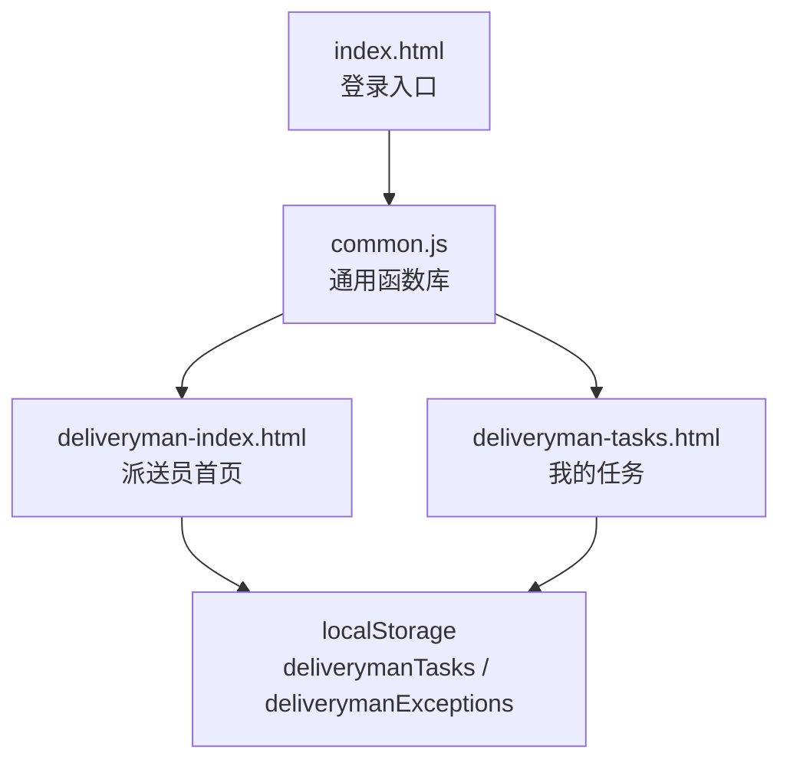
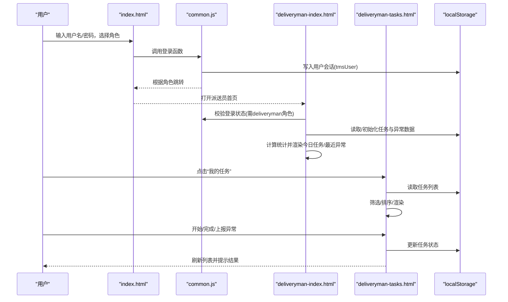
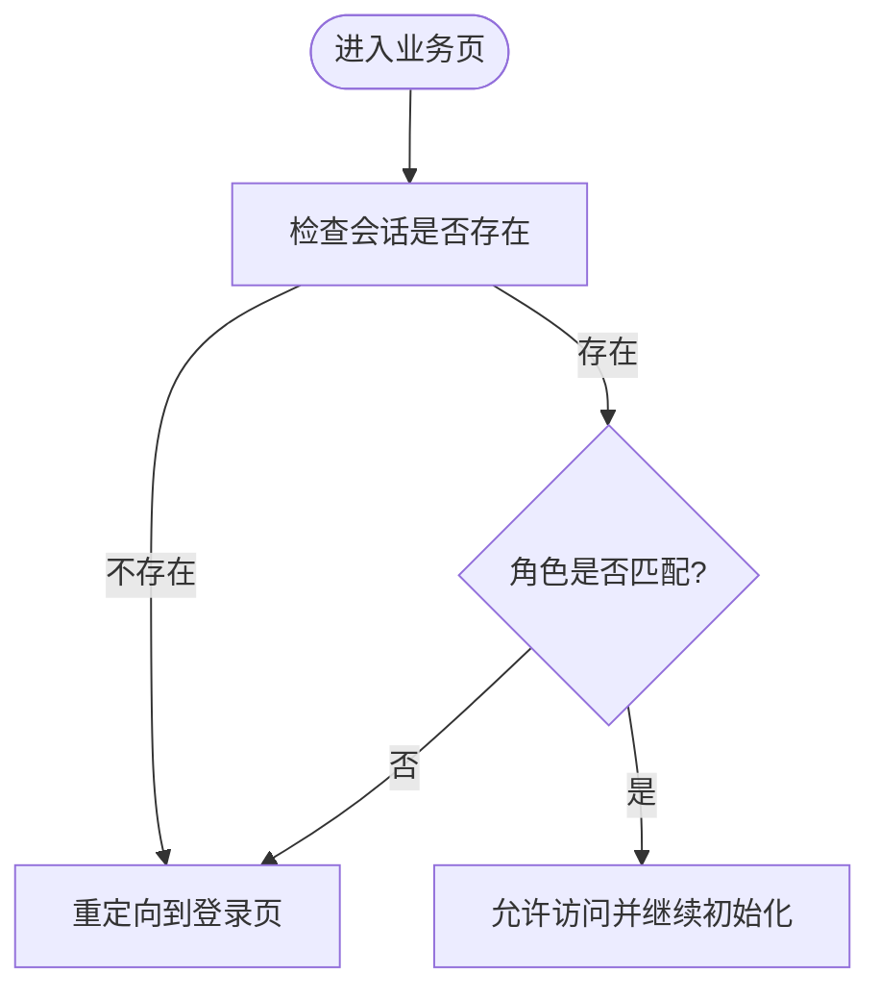
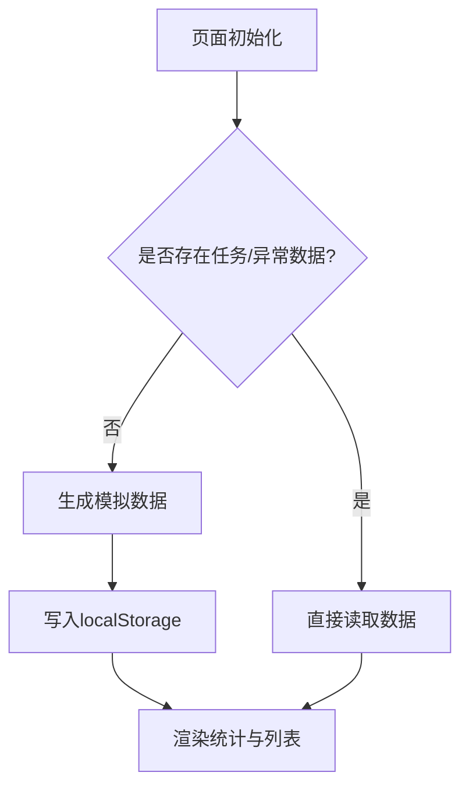
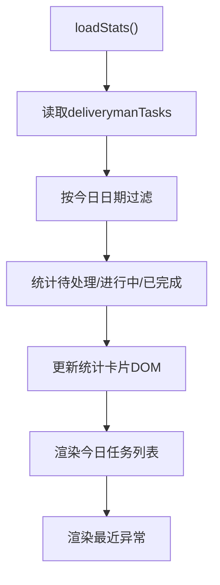
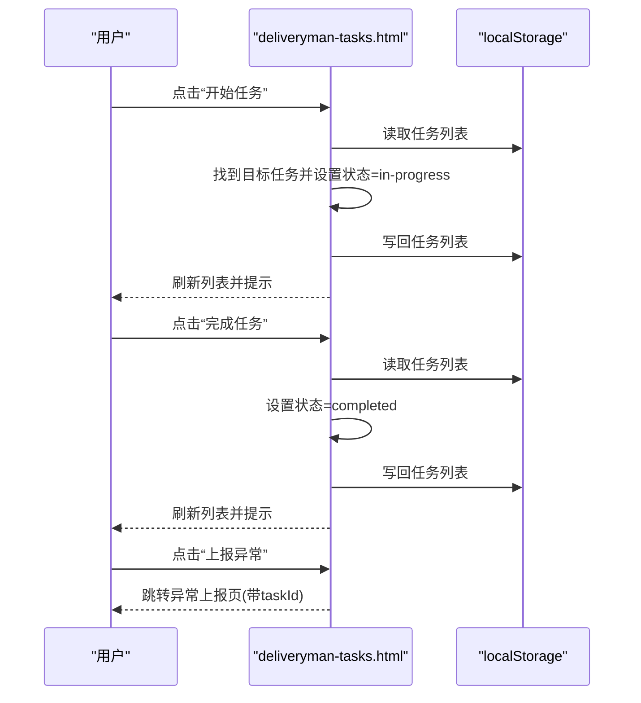
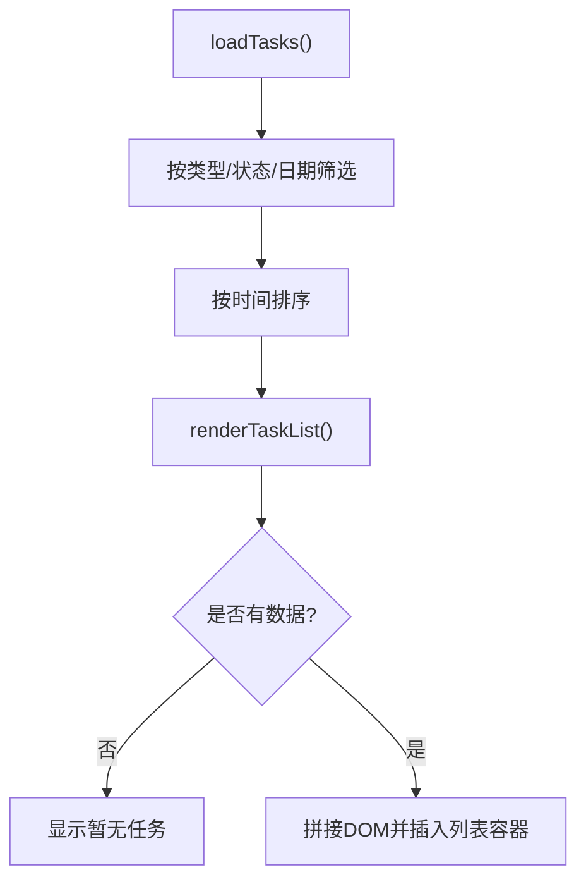
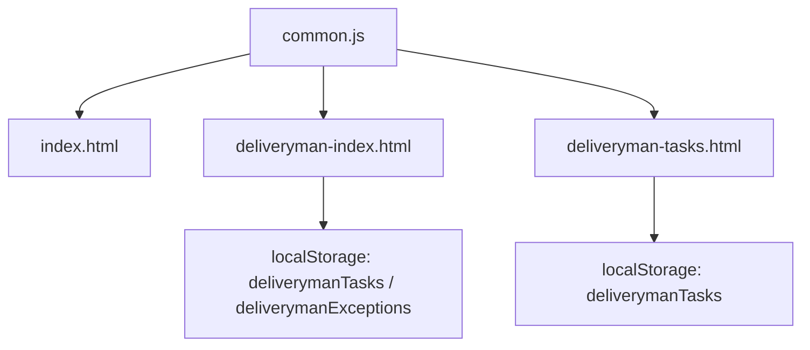

# 派送员首页

<cite>
**本文引用的文件**   
- [deliveryman-index.html](file://deliveryman-index.html)
- [deliveryman-tasks.html](file://deliveryman-tasks.html)
- [common.js](file://common.js)
- [index.html](file://index.html)
</cite>

## 目录
1. [引言](#引言)
2. [项目结构](#项目结构)
3. [核心组件](#核心组件)
4. [架构总览](#架构总览)
5. [详细组件分析](#详细组件分析)
6. [依赖关系分析](#依赖关系分析)
7. [性能与可维护性](#性能与可维护性)
8. [故障排查指南](#故障排查指南)
9. [结论](#结论)

## 引言
本文件面向“派送员首页”的完整技术说明，覆盖以下关键主题：
- 今日任务概览、统计卡片展示、最近异常记录等模块的职责与交互
- 任务状态管理（待处理、进行中、已完成）的实现机制与UI联动
- 用户认证流程、权限控制与会话管理的技术实现
- 数据初始化过程、localStorage存储策略与本地数据同步机制
- 响应式设计与移动端适配方案
- 真实派送场景下的界面交互和数据流转示例

## 项目结构
围绕派送员首页，主要涉及以下文件：
- deliveryman-index.html：派送员首页HTML结构与页面逻辑
- deliveryman-tasks.html：任务列表页，包含任务筛选、状态变更与详情查看
- common.js：通用函数库，提供登录、鉴权、用户信息渲染、按钮样式注入等能力
- index.html：统一登录入口，负责角色选择与登录跳转

图表来源
- [index.html:117-172](file://index.html#L117-L172)
- [common.js:135-209](file://common.js#L135-L209)
- [deliveryman-index.html:291-456](file://deliveryman-index.html#L291-L456)
- [deliveryman-tasks.html:387-637](file://deliveryman-tasks.html#L387-L637)

章节来源
- [index.html:117-172](file://index.html#L117-L172)
- [common.js:135-209](file://common.js#L135-L209)
- [deliveryman-index.html:291-456](file://deliveryman-index.html#L291-L456)
- [deliveryman-tasks.html:387-637](file://deliveryman-tasks.html#L387-L637)

## 核心组件
- 认证与会话
  - 登录：在登录页选择角色后调用通用登录函数，将用户信息写入localStorage并跳转到对应角色首页。
  - 鉴权：各业务页通过检查函数校验当前用户是否存在且具备所需角色，否则重定向至登录页。
  - 会话：使用localStorage持久化用户信息；退出时清除该键值并重定向。
- 首页数据与展示
  - 初始化：首次进入时若未存在任务/异常数据则生成模拟数据并落盘。
  - 统计卡片：按今日日期过滤任务，计算待处理、进行中、已完成数量并更新DOM。
  - 今日任务：渲染当日任务列表，显示类型、客户、地址、时间、描述与状态标签。
  - 最近异常：读取异常列表并渲染最近异常条目。
- 任务管理
  - 筛选：支持按任务类型、状态、日期范围筛选。
  - 状态流转：待处理→进行中→已完成，并在变更后刷新列表。
  - 异常上报：从任务页跳转异常上报页并携带任务ID。
  - 查看详情：弹窗展示任务详细信息。

章节来源
- [common.js:135-209](file://common.js#L135-L209)
- [deliveryman-index.html:320-456](file://deliveryman-index.html#L320-L456)
- [deliveryman-tasks.html:426-637](file://deliveryman-tasks.html#L426-L637)

## 架构总览
下图展示了从登录到首页展示的端到端流程，以及本地数据的读写路径。

图表来源
- [index.html:145-172](file://index.html#L145-L172)
- [common.js:135-209](file://common.js#L135-L209)
- [deliveryman-index.html:291-456](file://deliveryman-index.html#L291-L456)
- [deliveryman-tasks.html:387-637](file://deliveryman-tasks.html#L387-L637)

## 详细组件分析

### 认证与会话管理
- 登录流程
  - 用户在登录页选择角色并点击登录，触发通用登录函数。
  - 函数校验输入与角色选择，将用户对象写入localStorage，并根据角色映射跳转至对应首页。
- 鉴权流程
  - 业务页加载时调用鉴权函数，传入期望角色（如deliveryman）。
  - 若无会话或角色不匹配，弹出提示并重定向至登录页。
- 退出登录
  - 点击退出按钮，确认后将删除会话键并重定向至登录页。

图表来源
- [common.js:176-199](file://common.js#L176-L199)
- [common.js:201-209](file://common.js#L201-L209)
- [deliveryman-index.html:294-301](file://deliveryman-index.html#L294-L301)

章节来源
- [common.js:135-209](file://common.js#L135-L209)
- [index.html:145-172](file://index.html#L145-L172)
- [deliveryman-index.html:294-301](file://deliveryman-index.html#L294-L301)

### 数据初始化与本地存储策略
- 任务数据
  - 首页与任务页均会在首次访问时检测localStorage中是否存在任务数据，若不存在则生成模拟数据并保存。
  - 首页仅生成“今日任务”，任务页生成近一周及未来几天的任务集合，便于筛选演示。
- 异常数据
  - 首页在首次访问时生成若干历史异常记录用于展示“最近异常”。
- 存储键约定
  - tmsUser：用户会话
  - deliverymanTasks：任务数据
  - deliverymanExceptions：异常数据

图表来源
- [deliveryman-index.html:320-367](file://deliveryman-index.html#L320-L367)
- [deliveryman-tasks.html:426-461](file://deliveryman-tasks.html#L426-L461)

章节来源
- [deliveryman-index.html:320-367](file://deliveryman-index.html#L320-L367)
- [deliveryman-tasks.html:426-461](file://deliveryman-tasks.html#L426-L461)

### 今日任务概览与统计卡片
- 统计计算
  - 以当天日期为基准，过滤出今日任务，分别统计待处理、进行中、已完成数量。
  - 将统计结果写入对应DOM节点，形成统计卡片。
- 今日任务列表
  - 渲染今日任务的标题、类型、客户、电话、地址、时间与描述，并以不同颜色标签展示状态。
- 最近异常
  - 读取异常数据并按顺序渲染最近异常条目，包括异常类型、关联任务与日期。

图表来源
- [deliveryman-index.html:369-456](file://deliveryman-index.html#L369-L456)

章节来源
- [deliveryman-index.html:369-456](file://deliveryman-index.html#L369-L456)

### 任务状态管理与UI交互
- 状态定义
  - pending：待处理
  - in-progress：进行中
  - completed：已完成
- UI行为
  - 待处理任务显示“开始任务”按钮，点击后状态变更为进行中。
  - 进行中任务显示“完成任务”和“上报异常”按钮，前者将状态变更为已完成，后者跳转异常上报页。
  - 已完成任务显示“查看详情”按钮，弹窗展示任务详情。
- 数据更新
  - 每次状态变更后，重新序列化任务数组并写回localStorage，随后刷新列表。

图表来源
- [deliveryman-tasks.html:570-637](file://deliveryman-tasks.html#L570-L637)

章节来源
- [deliveryman-tasks.html:570-637](file://deliveryman-tasks.html#L570-L637)

### 任务列表渲染与数据绑定
- 渲染逻辑
  - 根据筛选条件（类型、状态、日期）过滤任务，按时间排序后渲染为DOM。
  - 空数据时显示占位提示。
- 数据绑定
  - 通过模板字符串拼接任务项，动态绑定字段（类型、状态、客户、地址、时间、描述、订单号、重量、件数等）。
  - 根据任务状态动态渲染操作按钮。

图表来源
- [deliveryman-tasks.html:463-584](file://deliveryman-tasks.html#L463-L584)

章节来源
- [deliveryman-tasks.html:463-584](file://deliveryman-tasks.html#L463-L584)

### 响应式设计与移动端适配
- 布局结构
  - 桌面端采用侧边栏+主内容区的两列布局。
  - 移动端通过媒体查询将侧边栏切换为顶部横向滚动导航，主内容区全宽显示。
- 交互优化
  - 任务头与详情行在小屏下改为纵向堆叠，提升可读性。
  - 统一的按钮样式由通用库注入，保证跨页面一致性。

图表来源
- [deliveryman-index.html:188-212](file://deliveryman-index.html#L188-L212)
- [deliveryman-tasks.html:263-307](file://deliveryman-tasks.html#L263-L307)
- [common.js:52-133](file://common.js#L52-L133)

章节来源
- [deliveryman-index.html:188-212](file://deliveryman-index.html#L188-L212)
- [deliveryman-tasks.html:263-307](file://deliveryman-tasks.html#L263-L307)
- [common.js:52-133](file://common.js#L52-L133)

## 依赖关系分析
- 页面脚本依赖
  - 所有业务页均引入common.js，复用登录、鉴权、用户信息显示与按钮样式注入等能力。
- 数据依赖
  - 首页与任务页共享deliverymanTasks键；首页额外依赖deliverymanExceptions键。
- 路由与跳转
  - 登录页根据角色映射跳转至对应首页；任务页通过URL参数传递taskId至异常上报页。

图表来源
- [common.js:365-383](file://common.js#L365-L383)
- [deliveryman-index.html:291-456](file://deliveryman-index.html#L291-L456)
- [deliveryman-tasks.html:387-637](file://deliveryman-tasks.html#L387-L637)

章节来源
- [common.js:365-383](file://common.js#L365-L383)
- [deliveryman-index.html:291-456](file://deliveryman-index.html#L291-L456)
- [deliveryman-tasks.html:387-637](file://deliveryman-tasks.html#L387-L637)

## 性能与可维护性
- 性能要点
  - 本地存储读写频繁，建议对高频读取的数据进行内存缓存，减少重复解析JSON的开销。
  - 列表渲染避免频繁innerHTML替换，可采用增量更新或虚拟列表（当数据量增长时）。
- 可维护性建议
  - 将状态文本映射集中管理，避免多处硬编码。
  - 将localStorage键名与默认数据结构抽离为配置常量，便于扩展与维护。
  - 将鉴权与用户信息显示封装为可复用的模块，减少页面间重复代码。

[本节为通用指导，不涉及具体文件]

## 故障排查指南
- 登录后无法进入派送员首页
  - 检查localStorage中是否存在tmsUser键，且role为deliveryman。
  - 确认checkLoginStatus是否正确返回用户对象。
- 统计卡片数量为0
  - 检查deliverymanTasks是否存在且包含今日日期的任务。
  - 确认loadStats中的日期过滤逻辑与任务time字段格式一致。
- 任务状态未更新
  - 检查startTask/completeTask是否正确修改任务状态并写回localStorage。
  - 确认loadTasks是否在状态变更后被调用以刷新列表。
- 移动端布局错乱
  - 检查媒体查询是否生效，确认侧边栏与内容区在小屏下的样式规则。

章节来源
- [common.js:176-199](file://common.js#L176-L199)
- [deliveryman-index.html:369-456](file://deliveryman-index.html#L369-L456)
- [deliveryman-tasks.html:596-637](file://deliveryman-tasks.html#L596-L637)

## 结论
派送员首页通过简洁的前端架构与localStorage本地存储，实现了认证鉴权、任务概览、统计卡片、最近异常展示与任务状态管理的完整闭环。配合响应式设计与通用函数库，保证了多端一致的体验与良好的可维护性。在实际生产环境中，建议引入服务端API与更完善的权限模型，并对本地数据进行版本化管理与同步策略设计，以提升系统的可靠性与扩展性。