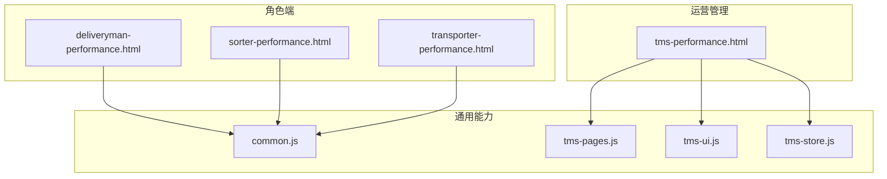
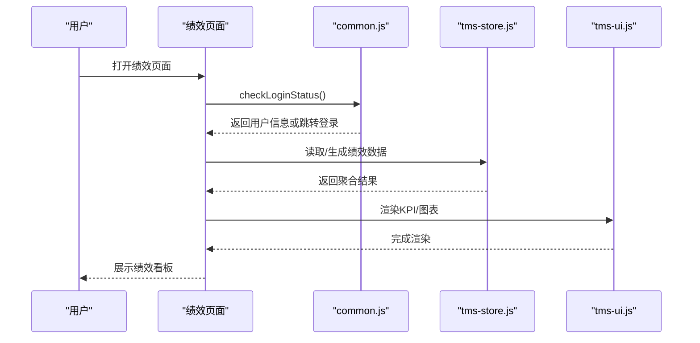
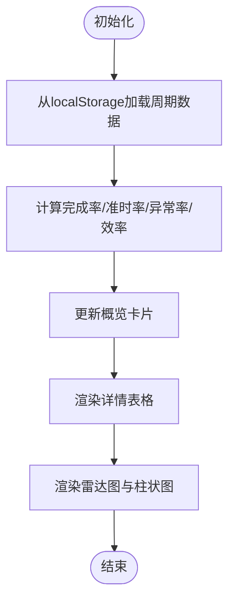
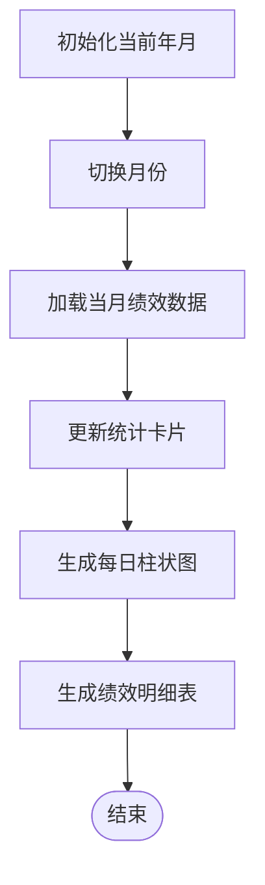
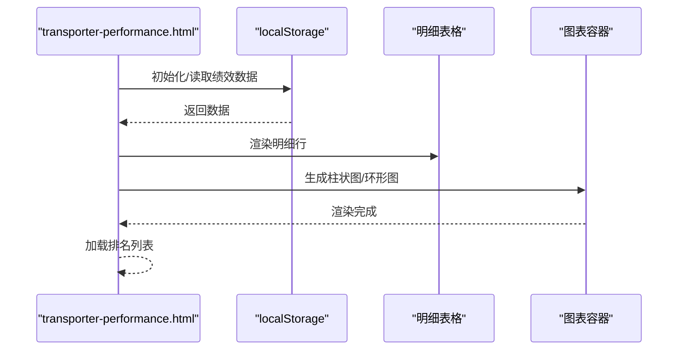
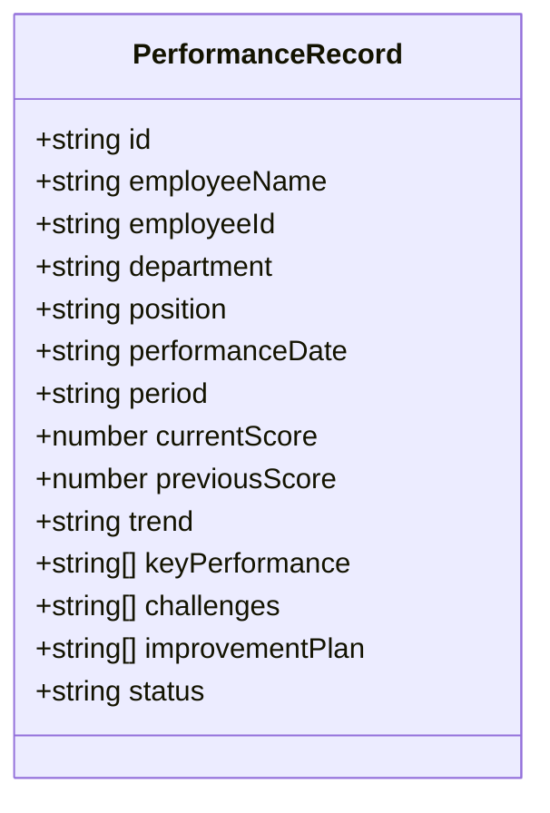
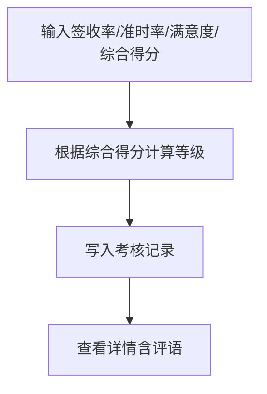
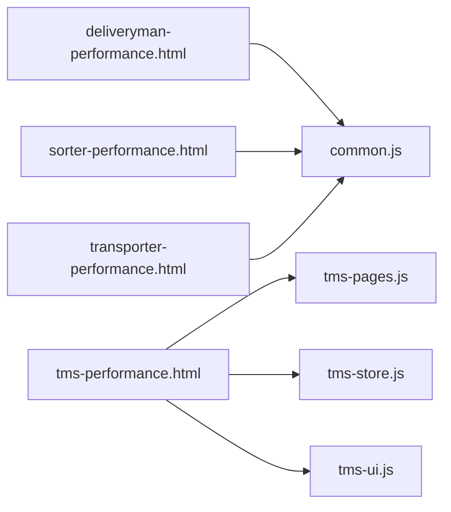
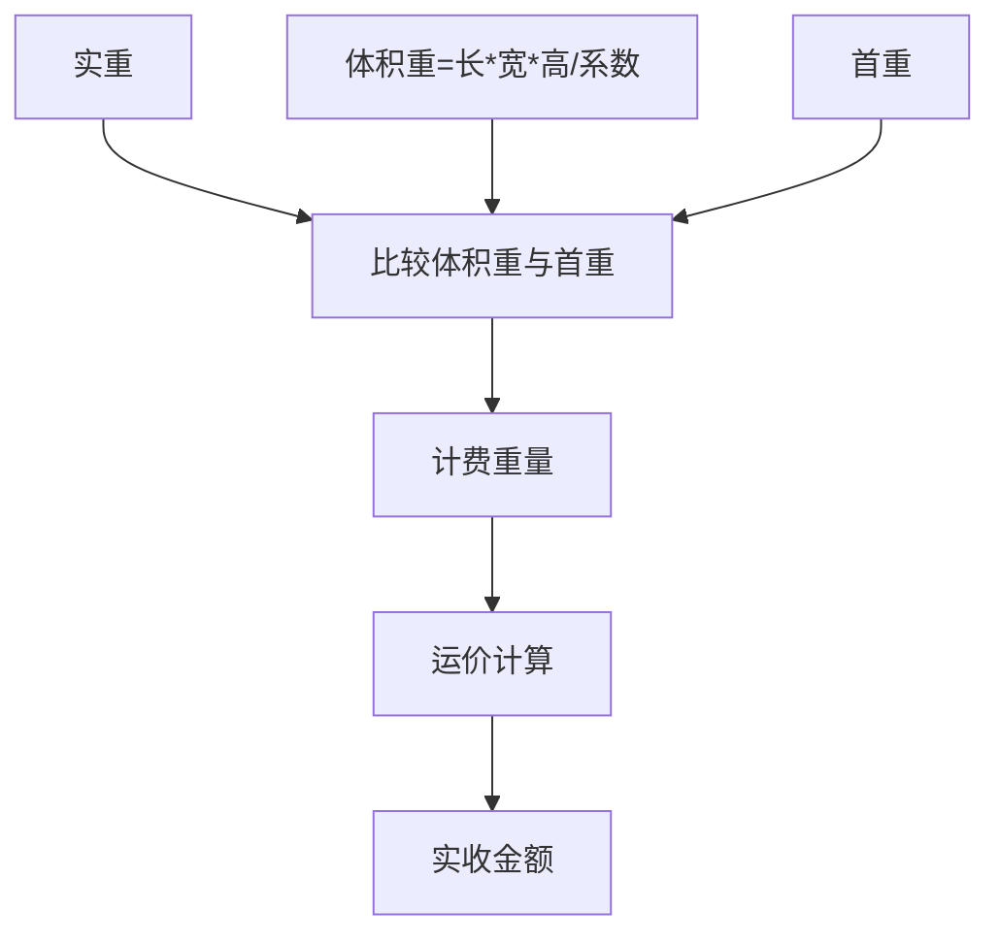

# 绩效统计

<cite>
**本文引用的文件**   
- [deliveryman-performance.html](file://deliveryman-performance.html)
- [tms-performance.html](file://tms-performance.html)
- [sorter-performance.html](file://sorter-performance.html)
- [transporter-performance.html](file://transporter-performance.html)
- [common.js](file://common.js)
- [tms-pages.js](file://tms-pages.js)
- [tms-store.js](file://tms-store.js)
- [tms-ui.js](file://tms-ui.js)
</cite>

## 目录
1. [引言](#引言)
2. [项目结构](#项目结构)
3. [核心组件](#核心组件)
4. [架构总览](#架构总览)
5. [详细组件分析](#详细组件分析)
6. [依赖关系分析](#依赖关系分析)
7. [性能与可扩展性](#性能与可扩展性)
8. [故障排查指南](#故障排查指南)
9. [结论](#结论)
10. [附录：指标口径与计算示例](#附录指标口径与计算示例)

## 引言
本章节聚焦“绩效统计”模块，围绕派送员、分拣员、运输员的绩效考核指标、KPI 计算与业绩评估算法进行系统化说明。文档覆盖以下方面：
- 数据统计维度与时间周期（周/月/季/年）
- 趋势分析与可视化实现
- 收入计算、提成规则与奖金发放的财务逻辑
- 实时数据更新、历史查询与对比分析
- 图表渲染与报表导出方案
- 真实派送场景下的绩效管理实践

## 项目结构
绩效统计相关页面与通用脚本分布如下：
- 角色端绩效页：deliveryman-performance.html、sorter-performance.html、transporter-performance.html
- 运营管理绩效页：tms-performance.html
- 通用工具与登录鉴权：common.js
- 运营页面框架与考核评级：tms-pages.js
- 数据存储与聚合：tms-store.js
- UI 组件与 KPI 卡片：tms-ui.js

**图示来源**
- [deliveryman-performance.html:1-818](file://deliveryman-performance.html#L1-L818)
- [sorter-performance.html:1-681](file://sorter-performance.html#L1-L681)
- [transporter-performance.html:1-753](file://transporter-performance.html#L1-L753)
- [tms-performance.html:1-634](file://tms-performance.html#L1-L634)
- [common.js:1-383](file://common.js#L1-L383)
- [tms-pages.js:1092-1164](file://tms-pages.js#L1092-L1164)
- [tms-store.js:1058-1138](file://tms-store.js#L1058-L1138)
- [tms-ui.js:548-554](file://tms-ui.js#L548-L554)

**章节来源**
- [deliveryman-performance.html:1-818](file://deliveryman-performance.html#L1-L818)
- [sorter-performance.html:1-681](file://sorter-performance.html#L1-L681)
- [transporter-performance.html:1-753](file://transporter-performance.html#L1-L753)
- [tms-performance.html:1-634](file://tms-performance.html#L1-L634)
- [common.js:1-383](file://common.js#L1-L383)
- [tms-pages.js:1092-1164](file://tms-pages.js#L1092-L1164)
- [tms-store.js:1058-1138](file://tms-store.js#L1058-L1138)
- [tms-ui.js:548-554](file://tms-ui.js#L548-L554)

## 核心组件
- 派送员绩效页：提供任务完成率、准时率、异常率、效率等指标；支持周/月/季/年切换；使用 Chart.js 绘制雷达图与柱状图；通过 localStorage 存储模拟数据。
- 分拣员绩效页：展示扫描量、分拣量、准确率、效率指数；按日明细表与简易柱状图；月份导航。
- 运输员绩效页：展示运输量、里程、准时率、满意度；包含月度趋势与环形图；排名列表。
- 运营管理绩效页：员工绩效列表、趋势标签（提升/稳定/下降）、审批流程；基于 tms-pages.js 与 tms-store.js 的数据流。
- 通用库 common.js：登录鉴权、用户信息展示、积分管理等。
- 运营框架 tms-pages.js：考核评级表单与等级映射（A/B/C/D）。
- 存储层 tms-store.js：订单计费重量、体积重、实收金额汇总等。
- UI 组件 tms-ui.js：KPI 卡片渲染。

**章节来源**
- [deliveryman-performance.html:442-513](file://deliveryman-performance.html#L442-L513)
- [deliveryman-performance.html:586-674](file://deliveryman-performance.html#L586-L674)
- [sorter-performance.html:501-594](file://sorter-performance.html#L501-L594)
- [transporter-performance.html:595-753](file://transporter-performance.html#L595-L753)
- [tms-performance.html:459-630](file://tms-performance.html#L459-L630)
- [tms-pages.js:1100-1151](file://tms-pages.js#L1100-L1151)
- [tms-store.js:343-377](file://tms-store.js#L343-L377)
- [tms-store.js:2025-2036](file://tms-store.js#L2025-L2036)
- [tms-ui.js:548-554](file://tms-ui.js#L548-L554)

## 架构总览
绩效统计采用“前端页面 + 本地存储 + 通用UI组件”的轻量架构：
- 页面负责交互与数据绑定
- 通用脚本处理鉴权与基础工具
- 运营框架提供表单、表格与KPI渲染
- 存储层提供聚合与汇总能力

**图示来源**
- [deliveryman-performance.html:407-440](file://deliveryman-performance.html#L407-L440)
- [common.js:176-199](file://common.js#L176-L199)
- [tms-store.js:2025-2036](file://tms-store.js#L2025-L2036)
- [tms-ui.js:548-554](file://tms-ui.js#L548-L554)

## 详细组件分析

### 派送员绩效（deliveryman-performance.html）
- 指标维度
  - 任务完成率 = 完成任务 / 总任务数
  - 准时率 = 准时完成 / 完成任务
  - 迟到率 = 迟到完成 / 完成任务
  - 异常率 = 异常任务 / 总任务数
  - 效率 = 完成任务 / 总工时 × 系数
- 时间周期
  - 周/月/季/年，通过按钮切换并重新加载数据
- 图表
  - 雷达图：当前绩效 vs 目标绩效（任务完成率、准时率、服务质量、异常处理、效率）
  - 柱状图：任务数量分布（总任务、完成、准时、迟到、异常）
- 数据源
  - localStorage 中 deliverymanPerformance 对象，含 week/month/quarter/year 四个周期数据

**图示来源**
- [deliveryman-performance.html:489-513](file://deliveryman-performance.html#L489-L513)
- [deliveryman-performance.html:515-574](file://deliveryman-performance.html#L515-L574)
- [deliveryman-performance.html:586-674](file://deliveryman-performance.html#L586-L674)

**章节来源**
- [deliveryman-performance.html:442-513](file://deliveryman-performance.html#L442-L513)
- [deliveryman-performance.html:515-574](file://deliveryman-performance.html#L515-L574)
- [deliveryman-performance.html:586-674](file://deliveryman-performance.html#L586-L674)

### 分拣员绩效（sorter-performance.html）
- 指标维度
  - 总扫描数、总分拣数、准确率、效率指数
- 时间周期
  - 按月浏览，支持上/下月切换
- 图表
  - 简易柱状图：每日扫描量、每日分拣量
- 明细
  - 日期、扫描量、分拣量、准确率、完成率、绩效得分

**图示来源**
- [sorter-performance.html:501-594](file://sorter-performance.html#L501-L594)
- [sorter-performance.html:596-641](file://sorter-performance.html#L596-L641)
- [sorter-performance.html:643-677](file://sorter-performance.html#L643-L677)

**章节来源**
- [sorter-performance.html:501-594](file://sorter-performance.html#L501-L594)
- [sorter-performance.html:596-641](file://sorter-performance.html#L596-L641)
- [sorter-performance.html:643-677](file://sorter-performance.html#L643-L677)

### 运输员绩效（transporter-performance.html）
- 指标维度
  - 总运输量、总行驶里程、准时率、客户满意度
- 时间周期
  - 本月/本季度/本年/自定义筛选（界面已提供控件）
- 图表
  - 月度运输量柱状图
  - 准时率环形图（SVG）
- 明细
  - 日期、任务、运输量、里程、计划/实际时间、状态、满意度
- 排名
  - 本月绩效排名列表

**图示来源**
- [transporter-performance.html:595-672](file://transporter-performance.html#L595-L672)
- [transporter-performance.html:674-704](file://transporter-performance.html#L674-L704)
- [transporter-performance.html:706-738](file://transporter-performance.html#L706-L738)

**章节来源**
- [transporter-performance.html:595-672](file://transporter-performance.html#L595-L672)
- [transporter-performance.html:674-704](file://transporter-performance.html#L674-L704)
- [transporter-performance.html:706-738](file://transporter-performance.html#L706-L738)

### 运营管理绩效（tms-performance.html）
- 功能要点
  - 平均绩效得分、提升/稳定/下降人数统计
  - 员工绩效列表，含趋势标签与操作（批准/查看详情/编辑）
  - 基于 tms-pages.js 的页面渲染与 tms-store.js 的数据存取
- 数据模型
  - 绩效记录包含：id、姓名、工号、部门、岗位、日期、周期、得分、上期得分、趋势、关键绩效、挑战、改进计划、状态

**图示来源**
- [tms-performance.html:459-549](file://tms-performance.html#L459-L549)

**章节来源**
- [tms-performance.html:459-630](file://tms-performance.html#L459-L630)

### 考核评级（tms-pages.js）
- 字段定义
  - 签收率（%）、准时率（%）、满意度（分）、综合得分（0-100）
- 等级映射
  - score >= 90 → A；>= 80 → B；>= 70 → C；否则 D
- 提交后写入 evaluations 实体

**图示来源**
- [tms-pages.js:1138-1151](file://tms-pages.js#L1138-L1151)

**章节来源**
- [tms-pages.js:1100-1151](file://tms-pages.js#L1100-L1151)

## 依赖关系分析
- 页面依赖 common.js 进行登录校验与用户信息显示
- 运营管理页依赖 tms-pages.js 与 tms-store.js 完成数据读写
- UI 组件 tms-ui.js 提供 KPI 卡片渲染
- 各角色端页面独立维护 localStorage 中的模拟数据，便于演示

**图示来源**
- [deliveryman-performance.html:406-440](file://deliveryman-performance.html#L406-L440)
- [sorter-performance.html:442-499](file://sorter-performance.html#L442-L499)
- [transporter-performance.html:563-593](file://transporter-performance.html#L563-L593)
- [tms-performance.html:375-385](file://tms-performance.html#L375-L385)

**章节来源**
- [deliveryman-performance.html:406-440](file://deliveryman-performance.html#L406-L440)
- [sorter-performance.html:442-499](file://sorter-performance.html#L442-L499)
- [transporter-performance.html:563-593](file://transporter-performance.html#L563-L593)
- [tms-performance.html:375-385](file://tms-performance.html#L375-L385)

## 性能与可扩展性
- 数据持久化
  - 使用 localStorage 存储模拟数据，适合演示与原型验证
  - 建议扩展为后端 API，支持分页、过滤、排序与增量更新
- 图表渲染
  - 派送员页使用 Chart.js，注意销毁旧实例避免内存泄漏
  - 其他页面使用原生 DOM/SVG 实现，简单高效
- 实时性
  - 当前为静态数据刷新；可引入 WebSocket 或轮询机制实现实时指标更新
- 扩展点
  - 在 tms-store.js 中增加聚合函数，统一计算 KPI
  - 在 tms-ui.js 中扩展更多 KPI 卡片类型与主题

[本节为通用指导，不直接分析具体文件]

## 故障排查指南
- 图表未显示
  - 检查 Canvas 元素是否存在与上下文是否可用
  - 确认 Chart.js 已加载且版本兼容
  - 参考错误日志输出位置
- 数据为空
  - 检查 localStorage 键名是否正确（如 deliverymanPerformance、transporterPerformance）
  - 确认初始化逻辑是否执行
- 权限问题
  - 检查 checkLoginStatus 返回的用户角色是否与页面要求一致
- 评分样式异常
  - 检查 getScoreClass 阈值判断逻辑

**章节来源**
- [deliveryman-performance.html:586-674](file://deliveryman-performance.html#L586-L674)
- [common.js:176-199](file://common.js#L176-L199)

## 结论
该绩效统计模块以轻量前端架构实现了多角色的绩效看板与可视化，涵盖任务完成率、准时率、异常率、效率、扫描/分拣量、运输量与里程等核心指标。通过 localStorage 模拟数据与 Chart.js/原生图表结合，快速呈现趋势与明细。后续可引入后端聚合与实时推送，完善收入计算、提成与奖金发放的财务逻辑，并增强报表导出与对比分析能力。

[本节为总结，不直接分析具体文件]

## 附录：指标口径与计算示例

### 指标口径
- 任务完成率 = 完成任务 / 总任务数 × 100%
- 准时率 = 准时完成 / 完成任务 × 100%
- 迟到率 = 迟到完成 / 完成任务 × 100%
- 异常率 = 异常任务 / 总任务数 × 100%
- 效率 = 完成任务 / 总工时 × 系数（页面中为 ×10）
- 分拣准确率 = 正确分拣 / 总分拣 × 100%
- 运输准时率 = 准时任务 / 总任务 × 100%

**章节来源**
- [deliveryman-performance.html:489-513](file://deliveryman-performance.html#L489-L513)
- [deliveryman-performance.html:617-621](file://deliveryman-performance.html#L617-L621)
- [sorter-performance.html:574-594](file://sorter-performance.html#L574-L594)
- [transporter-performance.html:595-672](file://transporter-performance.html#L595-L672)

### 收入计算与财务逻辑
- 计费重量与体积重
  - 体积重 = (长×宽×高)/换算系数
  - 计费重量 = max(实重, 体积重, 首重)
- 实收金额汇总
  - 当日实收金额 = 对财务记录求和

**图示来源**
- [tms-store.js:343-377](file://tms-store.js#L343-L377)
- [tms-store.js:2025-2036](file://tms-store.js#L2025-L2036)

**章节来源**
- [tms-store.js:343-377](file://tms-store.js#L343-L377)
- [tms-store.js:2025-2036](file://tms-store.js#L2025-L2036)

### 提成与奖金发放（设计建议）
- 提成规则（建议）
  - 按完成单量阶梯提成：例如 0-100 单 1元/单，101-300 单 1.5元/单，>300 单 2元/单
  - 质量系数：准时率≥95% 系数1.2，90%-95% 系数1.0，<90% 系数0.8
  - 异常扣减：异常率>3% 每超1%扣减0.5元/单
- 奖金发放（建议）
  - 月度达标奖：综合得分≥90 且准时率≥95% 发放固定奖金
  - 超额奖励：完成量超过目标120% 额外奖励
- 结算流程（建议）
  - 数据采集 → 指标计算 → 提成核算 → 奖金判定 → 审核发布 → 财务入账

[本节为设计建议，不直接分析具体文件]

### 图表与报表导出（实现方案）
- 图表渲染
  - 派送员页：Chart.js 雷达图与柱状图
  - 分拣员页：DOM 柱状图
  - 运输员页：DOM 柱状图与 SVG 环形图
- 报表导出（建议）
  - 将表格数据序列化为 CSV/Excel
  - 使用浏览器下载接口触发文件保存
  - 支持按周期与维度筛选导出

[本节为通用指导，不直接分析具体文件]

### 实时数据更新与历史查询（实现方案）
- 实时更新
  - 引入 WebSocket 推送指标变化
  - 或使用定时轮询拉取最新数据
- 历史查询
  - 后端提供按人员/区域/时间的聚合接口
  - 前端支持多周期对比（周/月/季/年）

[本节为通用指导，不直接分析具体文件]