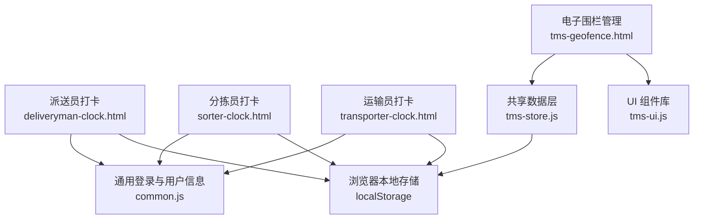
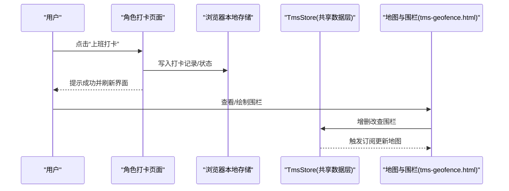
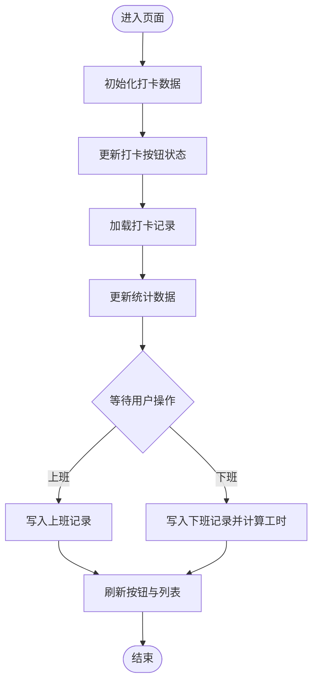
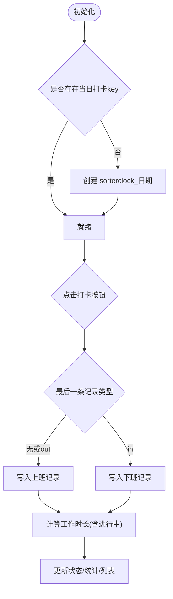
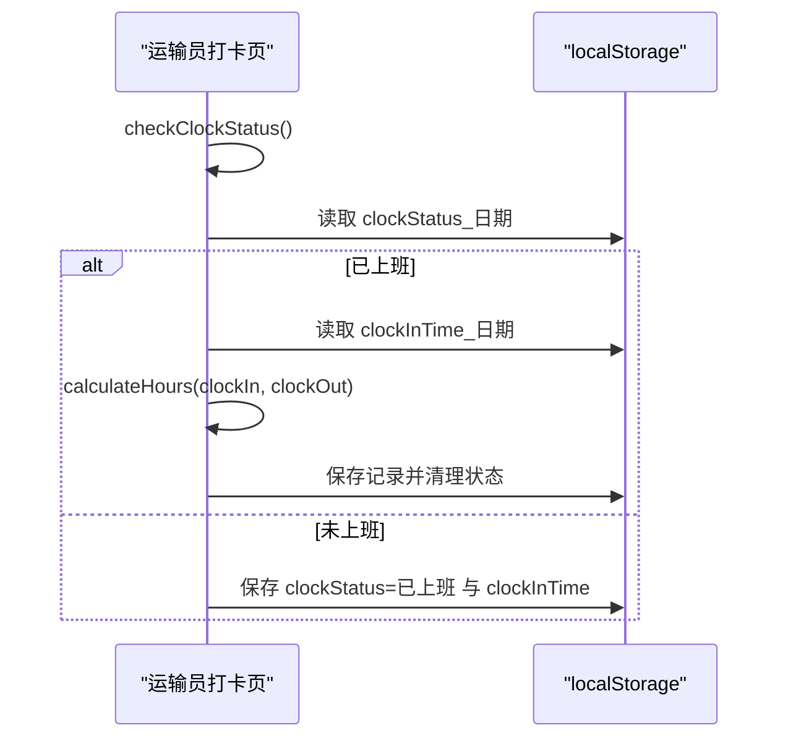
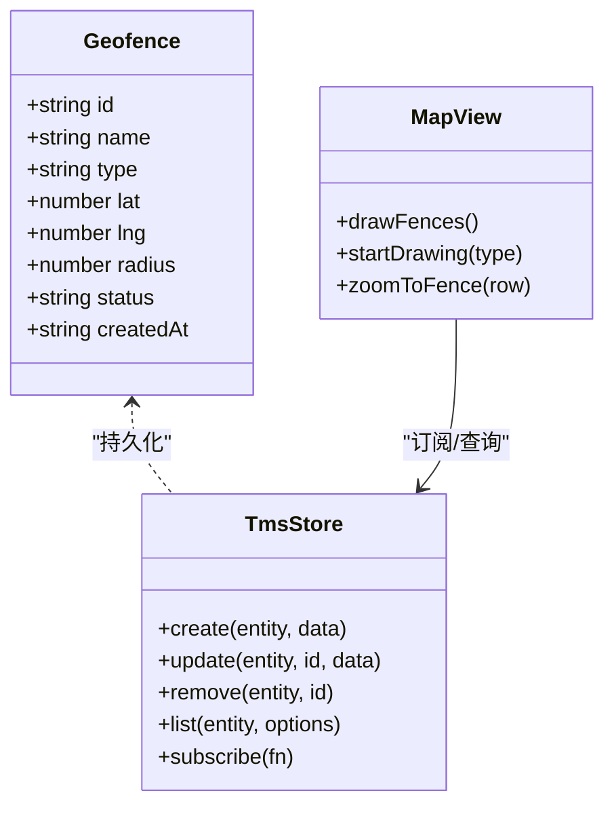
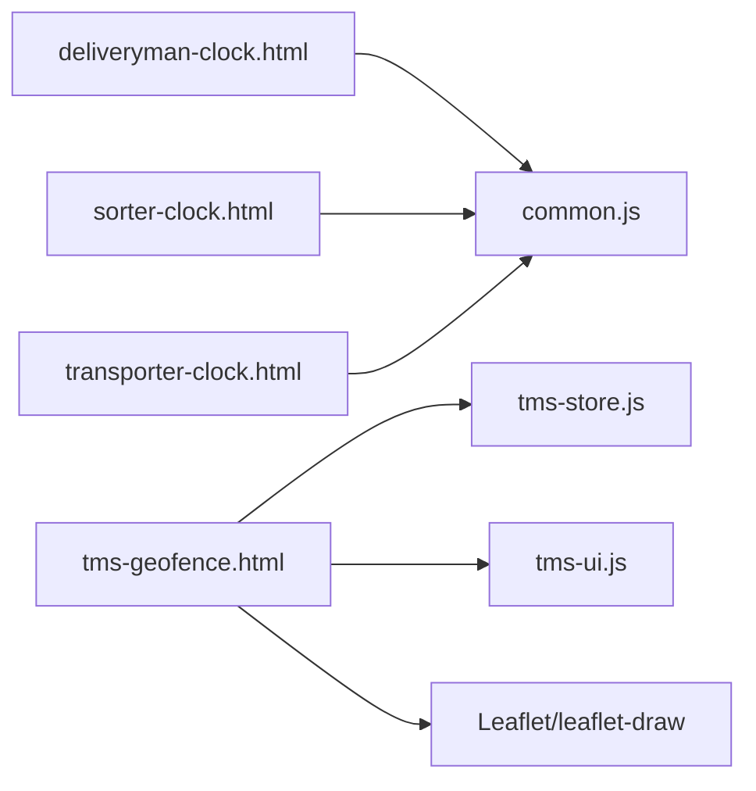

# 考勤管理

<cite>
**本文引用的文件**   
- [deliveryman-clock.html](file://deliveryman-clock.html)
- [sorter-clock.html](file://sorter-clock.html)
- [transporter-clock.html](file://transporter-clock.html)
- [tms-geofence.html](file://tms-geofence.html)
- [common.js](file://common.js)
- [tms-store.js](file://tms-store.js)
- [tms-ui.js](file://tms-ui.js)
</cite>

## 目录
1. [引言](#引言)
2. [项目结构](#项目结构)
3. [核心组件](#核心组件)
4. [架构总览](#架构总览)
5. [详细组件分析](#详细组件分析)
6. [依赖关系分析](#依赖关系分析)
7. [性能与可扩展性](#性能与可扩展性)
8. [故障排查指南](#故障排查指南)
9. [结论](#结论)
10. [附录：API 调用示例与合规要点](#附录api-调用示例与合规要点)

## 引言
本文件围绕“考勤管理”模块，系统梳理派送员、分拣员、运输员的打卡签到与签退记录、工时统计、电子围栏校验、异常检测与报表展示等能力。仓库采用纯前端实现，数据主要落盘在浏览器本地存储；同时提供基于 TmsStore 的共享数据层与地图围栏管理能力，便于扩展为后端服务化方案。文档从业务到技术逐层展开，既适合非技术读者理解流程，也便于开发者定位代码与优化实现。

## 项目结构
考勤相关功能分布在三个角色页面与一个电子围栏管理页面中，并复用通用登录/用户信息与 UI 组件库：
- 派送员打卡页：负责上班/下班打卡、当日状态、月度统计与记录列表。
- 分拣员打卡页：按天维护打卡序列，计算工作时长、迟到早退与加班小时。
- 运输员打卡页：以日期为键保存上下班时间，支持今日/本周/本月记录切换与统计。
- 电子围栏管理页：基于 Leaflet 地图绘制圆形围栏，维护围栏类型、半径、生效状态，并与 TmsStore 双向联动。
- 通用脚本：统一登录态、用户信息展示、UI 组件（表格、弹窗、图表）与共享数据层。

**图示来源**
- [deliveryman-clock.html:453-679](file://deliveryman-clock.html#L453-L679)
- [sorter-clock.html:524-795](file://sorter-clock.html#L524-L795)
- [transporter-clock.html:397-749](file://transporter-clock.html#L397-L749)
- [tms-geofence.html:569-800](file://tms-geofence.html#L569-L800)
- [common.js:135-218](file://common.js#L135-L218)
- [tms-store.js:220-244](file://tms-store.js#L220-L244)
- [tms-ui.js:303-543](file://tms-ui.js#L303-L543)

**章节来源**
- [deliveryman-clock.html:350-449](file://deliveryman-clock.html#L350-L449)
- [sorter-clock.html:417-518](file://sorter-clock.html#L417-L518)
- [transporter-clock.html:302-394](file://transporter-clock.html#L302-L394)
- [tms-geofence.html:522-559](file://tms-geofence.html#L522-L559)

## 核心组件
- 打卡交互与状态机：每个角色页面均维护“未打卡/已上班/已下班”的状态，按钮文案与样式随状态变化。
- 打卡记录存储：
  - 派送员：以数组形式保存在 `deliverymanClockRecords`，每条记录包含日期、上下班时间、状态与工时。
  - 分拣员：以 `sorterClock_${日期}` 为键保存当天打卡序列，区分上班/下班类型。
  - 运输员：以 `clockStatus_${日期}` 与 `clockInTime_${日期}` 标记状态，并以 `clockRecords` 对象聚合每日记录。
- 工时计算：
  - 派送员：根据上下班时间差计算小时数。
  - 分拣员：遍历打卡序列累加 in/out 对的时间差，若最后为 in 则累计至当前时间。
  - 运输员：将 HH:mm:ss 字符串解析为秒数求差后换算为小时。
- 统计指标：
  - 派送员：本月出勤天数、迟到次数、总工时、日均工时。
  - 分拣员：本月工作日、迟到次数、早退次数、加班小时。
  - 运输员：今日/本周/本月工时与出勤天数。
- 电子围栏：通过 Leaflet 绘制圆形围栏，维护中心经纬度与半径，支持启用/停用、编辑与删除，并在地图上可视化。

**章节来源**
- [deliveryman-clock.html:535-673](file://deliveryman-clock.html#L535-L673)
- [sorter-clock.html:586-795](file://sorter-clock.html#L586-L795)
- [transporter-clock.html:484-644](file://transporter-clock.html#L484-L644)
- [tms-geofence.html:611-746](file://tms-geofence.html#L611-L746)

## 架构总览
考勤模块在前端侧由“页面逻辑 + 本地存储 + 共享数据层 + UI 组件”构成。电子围栏作为地理规则源，可与未来后端校验服务对接，用于打卡时的地理位置验证与防作弊。

**图示来源**
- [deliveryman-clock.html:560-609](file://deliveryman-clock.html#L560-L609)
- [sorter-clock.html:586-639](file://sorter-clock.html#L586-L639)
- [transporter-clock.html:499-563](file://transporter-clock.html#L499-L563)
- [tms-geofence.html:577-589](file://tms-geofence.html#L577-L589)
- [tms-store.js:232-244](file://tms-store.js#L232-L244)

## 详细组件分析

### 派送员打卡组件
- 关键职责
  - 初始化当月打卡记录（若无），生成随机上下班时间与迟到判定。
  - 根据今日是否已打卡决定按钮文案与动作。
  - 计算工时并更新统计卡片。
  - 渲染打卡记录列表并按日期倒序。
- 数据结构
  - 记录项：id、date、clockIn、clockOut、status(normal/late)、hours。
- 处理流程
  - 上班打卡：新增记录，设置 status 为 late 或 normal。
  - 下班打卡：回填 clockOut，计算 hours。
  - 统计：筛选本月记录，汇总 totalDays、lateDays、totalHours、avgHours。

**图示来源**
- [deliveryman-clock.html:499-609](file://deliveryman-clock.html#L499-L609)
- [deliveryman-clock.html:611-673](file://deliveryman-clock.html#L611-L673)

**章节来源**
- [deliveryman-clock.html:499-673](file://deliveryman-clock.html#L499-L673)

### 分拣员打卡组件
- 关键职责
  - 按天维护打卡序列，区分上班/下班类型。
  - 计算工作时长（含进行中状态）。
  - 统计迟到、早退与加班小时（默认标准时长 8 小时）。
- 数据结构
  - 当日记录：type(in/out)、time、timestamp、username。
- 处理流程
  - 首次打开初始化当日 key。
  - 点击按钮判断 lastRecord.type 决定上班/下班。
  - 下班时计算工作时长并提示。
  - 统计遍历当月工作日，依据 08:30/17:30 阈值判定迟到/早退。

**图示来源**
- [sorter-clock.html:573-639](file://sorter-clock.html#L573-L639)
- [sorter-clock.html:641-795](file://sorter-clock.html#L641-L795)

**章节来源**
- [sorter-clock.html:573-795](file://sorter-clock.html#L573-L795)

### 运输员打卡组件
- 关键职责
  - 使用 `clockStatus_${日期}` 与 `clockInTime_${日期}` 管理状态。
  - 保存每日记录到 `clockRecords`，支持今日/本周/本月标签切换。
  - 计算工时（HH:mm:ss 差值）。
- 处理流程
  - 检查状态决定按钮文案。
  - 上班：保存状态与上班时间。
  - 下班：读取上班时间，计算工时，清理状态并保存记录。
  - 统计：按日/周/月聚合工时与出勤天数。

**图示来源**
- [transporter-clock.html:484-563](file://transporter-clock.html#L484-L563)
- [transporter-clock.html:565-605](file://transporter-clock.html#L565-L605)

**章节来源**
- [transporter-clock.html:484-644](file://transporter-clock.html#L484-L644)

### 电子围栏与地理位置验证
- 关键职责
  - 在地图上绘制圆形围栏，维护中心经纬度与半径。
  - 支持围栏类型（仓储围栏、网点围栏、禁行区域等）、生效状态。
  - 与 TmsStore 双向联动，变更即刷新地图与 KPI。
- 数据结构
  - 围栏项：id、name、type、lat、lng、radius、status、createdAt。
- 业务流程
  - 初始化地图与围栏表。
  - 监听 TmsStore 变更事件，重绘围栏。
  - 通过表单或地图绘制新增/编辑围栏。
  - 启用/停用控制围栏生效状态。

**图示来源**
- [tms-geofence.html:611-746](file://tms-geofence.html#L611-L746)
- [tms-store.js:232-244](file://tms-store.js#L232-L244)

**章节来源**
- [tms-geofence.html:569-800](file://tms-geofence.html#L569-L800)
- [tms-store.js:220-244](file://tms-store.js#L220-L244)

### 考勤规则配置与审批流程（概念说明）
- 考勤规则配置
  - 建议字段：标准上班时间、标准下班时间、迟到阈值、早退阈值、标准工时、节假日策略、排班模板。
  - 可结合电子围栏定义“有效打卡范围”，不同角色绑定不同围栏类型。
- 请假申请
  - 字段：申请人、类型（事假/病假/年假等）、起止时间、原因、附件。
  - 流程：提交 → 主管审核 → 批准/驳回 → 归档。
- 加班审批
  - 字段：申请人、日期、起止时间、原因、预计工时。
  - 流程：提交 → 主管审核 → 批准/驳回 → 计入加班统计。
- 注意：以上流程在当前仓库中未直接实现，可作为后续扩展方向，与现有打卡与围栏能力集成。

[本节为概念性说明，不直接分析具体文件]

## 依赖关系分析
- 页面与通用脚本
  - 三个打卡页面均引入 common.js，用于登录态检查与用户信息显示。
  - 分拣员页面额外引入 sorter-mock-data.js（用于演示数据）。
- 共享数据层与 UI 组件
  - 电子围栏页面依赖 tms-store.js 与 tms-ui.js，提供数据持久化与 UI 控件。
- 外部依赖
  - 电子围栏页面依赖 Leaflet 与 leaflet-draw 进行地图绘制。

**图示来源**
- [deliveryman-clock.html:452-453](file://deliveryman-clock.html#L452-L453)
- [sorter-clock.html:522-524](file://sorter-clock.html#L522-L524)
- [transporter-clock.html:396-397](file://transporter-clock.html#L396-L397)
- [tms-geofence.html:563-568](file://tms-geofence.html#L563-L568)

**章节来源**
- [deliveryman-clock.html:452-453](file://deliveryman-clock.html#L452-L453)
- [sorter-clock.html:522-524](file://sorter-clock.html#L522-L524)
- [transporter-clock.html:396-397](file://transporter-clock.html#L396-L397)
- [tms-geofence.html:563-568](file://tms-geofence.html#L563-L568)

## 性能与可扩展性
- 本地存储读写
  - 所有打卡记录与状态均使用 localStorage，适合演示与轻量场景；生产环境建议迁移至后端 API 与数据库。
- 计算复杂度
  - 分拣员统计按月遍历工作日与打卡记录，时间复杂度 O(D+R)，D 为工作日数，R 为记录条数；通常规模较小，性能可接受。
- 可扩展点
  - 将打卡 API 抽象为统一接口，支持服务端时间同步、GPS 校验、网络校验与审计日志。
  - 将围栏规则与服务端策略引擎对接，实现动态规则下发与实时校验。
  - 增加报表导出与定时任务，生成日报/周报/月报。

[本节为通用指导，不直接分析具体文件]

## 故障排查指南
- 无法打卡或状态异常
  - 检查 localStorage 中对应 key 是否存在且格式正确。
  - 确认页面是否正确调用 checkLoginStatus 与 displayCurrentUser。
- 统计数值不正确
  - 核对日期过滤逻辑（本月/本周/今日）与时间戳转换。
  - 检查迟到/早退阈值是否与业务规则一致。
- 地图围栏不显示
  - 确认 Leaflet 资源加载成功。
  - 检查 TmsStore 中 geofences 数据是否存在且字段完整。
- 权限问题
  - 确认当前用户角色与页面 requiredRole 匹配。

**章节来源**
- [common.js:176-218](file://common.js#L176-L218)
- [tms-geofence.html:600-609](file://tms-geofence.html#L600-L609)

## 结论
本仓库实现了面向派送员、分拣员、运输员的打卡签到与签退记录、工时统计与基础异常判定，并通过电子围栏页面提供地理位置规则的可视化管理。当前实现以浏览器本地存储为主，具备快速演示与迭代优势；在生产环境中应补充服务端校验、安全加固与报表能力，以满足真实派送场景中的合规要求。

[本节为总结性内容，不直接分析具体文件]

## 附录：API 调用示例与合规要点

### 打卡 API 调用示例（概念）
以下示例描述如何在前端调用统一的打卡接口，涵盖上班与下班两个动作。实际实现需替换为后端 API。

- 上班打卡
  - 请求方法：POST
  - 路径：/api/clock/in
  - 请求体：{ userId, timestamp, location: { lat, lng }, deviceInfo }
  - 响应：{ code, message, data: { recordId, status } }
- 下班打卡
  - 请求方法：POST
  - 路径：/api/clock/out
  - 请求体：{ userId, timestamp, location: { lat, lng }, deviceInfo }
  - 响应：{ code, message, data: { recordId, hours } }

[本节为概念性示例，不直接分析具体文件]

### 考勤数据管理与统计报表（概念）
- 数据管理
  - 建议提供 CRUD 接口：创建/更新/删除/查询打卡记录。
  - 支持分页、筛选（日期范围、状态）、排序（时间）。
- 统计报表
  - 个人维度：出勤天数、迟到次数、早退次数、总工时、加班小时。
  - 组织维度：部门/团队出勤率、异常率、工时分布。
  - 导出：CSV/PDF 报表，支持按周期与角色筛选。

[本节为概念性说明，不直接分析具体文件]

### GPS 定位、网络校验与时间同步的安全保障
- GPS 定位
  - 使用浏览器 Geolocation API 获取坐标，结合围栏半径判断是否在有效范围。
  - 建议附加精度阈值与多次采样取平均，降低漂移影响。
- 网络校验
  - 打卡请求需携带设备指纹、IP、时间戳与签名，防止重放与伪造。
  - 服务端校验 IP 白名单与设备合法性。
- 时间同步
  - 客户端时间不可信，应以服务端时间为基准；必要时引入 NTP 校准。
  - 对异常时间偏移进行告警与拦截。

[本节为概念性说明，不直接分析具体文件]