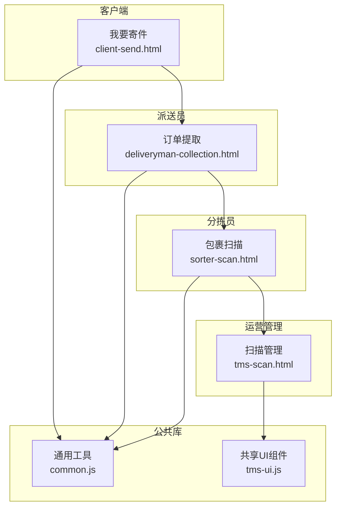
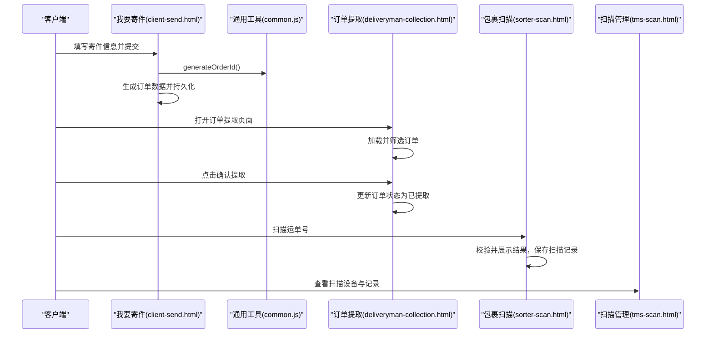
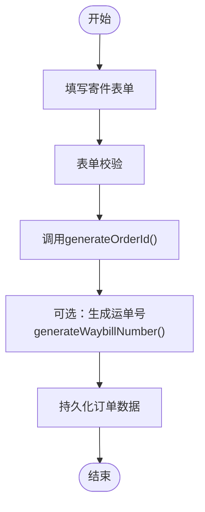
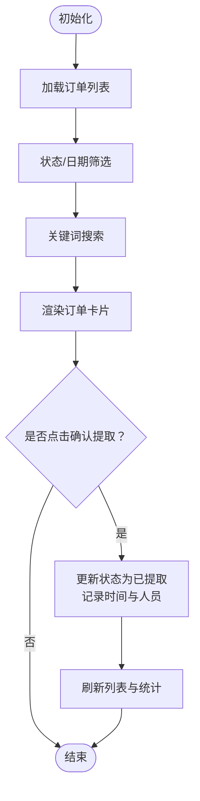
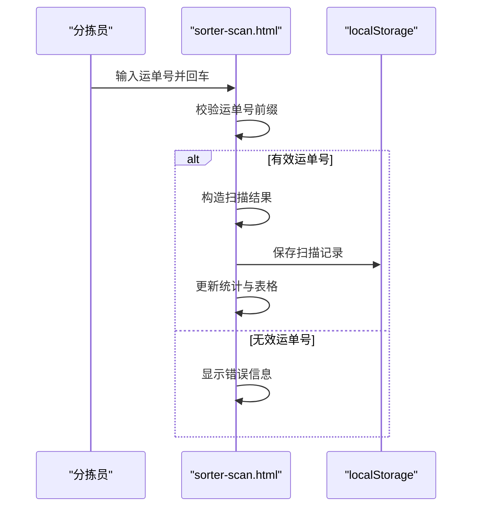
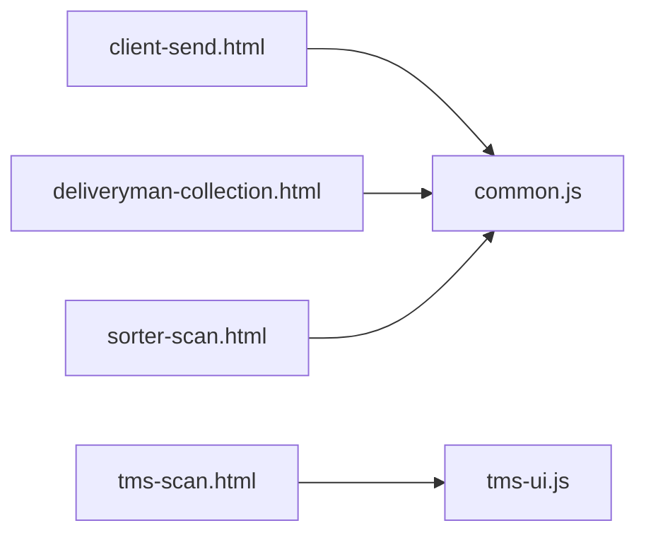

# 订单提取

<cite>
**本文引用的文件**   
- [deliveryman-collection.html](file://deliveryman-collection.html)
- [client-send.html](file://client-send.html)
- [tms-scan.html](file://tms-scan.html)
- [sorter-scan.html](file://sorter-scan.html)
- [common.js](file://common.js)
- [tms-ui.js](file://tms-ui.js)
</cite>

## 目录
1. [引言](#引言)
2. [项目结构](#项目结构)
3. [核心组件](#核心组件)
4. [架构总览](#架构总览)
5. [详细组件分析](#详细组件分析)
6. [依赖关系分析](#依赖关系分析)
7. [性能与效率优化](#性能与效率优化)
8. [故障排查指南](#故障排查指南)
9. [结论](#结论)
10. [附录：关键流程与示例路径](#附录关键流程与示例路径)

## 引言
本文件围绕“订单提取”能力，系统化梳理包裹揽收的完整业务流程，包括扫码识别、信息录入、重量测量、批量揽收、状态管理、条码生成与追踪码绑定、仓储系统对接思路、异常处理，以及移动端扫码集成与OCR/图像处理方案。文档同时给出可落地的代码级参考路径，帮助读者快速定位实现位置并进行二次开发。

## 项目结构
本项目为多角色前端页面集合，订单提取涉及以下关键页面与公共库：
- 派送员侧：订单提取（deliveryman-collection.html）
- 客户端侧：下单与运单号生成（client-send.html）
- 运营侧：扫描管理与设备监控（tms-scan.html）
- 分拣员侧：包裹扫描与记录（sorter-scan.html）
- 公共库：通用工具与UI组件（common.js、tms-ui.js）

图表来源
- [client-send.html:540-564](file://client-send.html#L540-L564)
- [deliveryman-collection.html:458-487](file://deliveryman-collection.html#L458-L487)
- [sorter-scan.html:413-447](file://sorter-scan.html#L413-L447)
- [tms-scan.html:462-595](file://tms-scan.html#L462-L595)
- [common.js:22-50](file://common.js#L22-L50)
- [tms-ui.js:758-781](file://tms-ui.js#L758-L781)

章节来源
- [client-send.html:1-621](file://client-send.html#L1-L621)
- [deliveryman-collection.html:1-681](file://deliveryman-collection.html#L1-L681)
- [tms-scan.html:1-702](file://tms-scan.html#L1-L702)
- [sorter-scan.html:1-589](file://sorter-scan.html#L1-L589)
- [common.js:1-383](file://common.js#L1-L383)
- [tms-ui.js:1-783](file://tms-ui.js#L1-L783)

## 核心组件
- 订单生成与运单号生成：客户端下单时生成订单号并持久化；公共库提供订单号与运单号生成算法。
- 订单提取（揽收）：派送员在订单列表中选择待提取订单，执行确认提取，更新状态与时间戳。
- 包裹扫描：分拣员通过输入框或扫码设备扫描运单号，校验并展示结果，保存扫描记录。
- 扫描管理：运营侧查看扫描设备状态与最近扫描记录，支持查看/编辑操作入口。
- 公共工具与UI：统一按钮样式、登录鉴权、表单弹窗、表格渲染、Toast提示等。

章节来源
- [client-send.html:540-564](file://client-send.html#L540-L564)
- [common.js:22-50](file://common.js#L22-L50)
- [deliveryman-collection.html:635-651](file://deliveryman-collection.html#L635-L651)
- [sorter-scan.html:413-447](file://sorter-scan.html#L413-L447)
- [tms-scan.html:462-595](file://tms-scan.html#L462-L595)
- [tms-ui.js:88-157](file://tms-ui.js#L88-L157)

## 架构总览
订单提取的整体数据流如下：
- 客户下单生成订单号与运单号，存储到本地模拟数据库。
- 派送员进入订单提取页面，加载并筛选订单，执行揽收确认，更新订单状态。
- 分拣员扫描运单号，校验并显示结果，保存扫描记录。
- 运营侧汇总扫描设备与扫描记录，进行统计与审计。

图表来源
- [client-send.html:526-576](file://client-send.html#L526-L576)
- [common.js:22-50](file://common.js#L22-L50)
- [deliveryman-collection.html:490-536](file://deliveryman-collection.html#L490-L536)
- [deliveryman-collection.html:635-651](file://deliveryman-collection.html#L635-L651)
- [sorter-scan.html:413-447](file://sorter-scan.html#L413-L447)
- [tms-scan.html:462-595](file://tms-scan.html#L462-L595)

## 详细组件分析

### 订单生成与运单号生成
- 客户端下单表单收集寄件人、收货人、货物信息与支付方式，提交后生成订单号并保存到本地存储。
- 公共库提供订单号生成规则：HL+发货省份首字母+时间戳+用户ID哈希+随机数；运单号生成规则：WB+订单号哈希+随机数。

图表来源
- [client-send.html:526-576](file://client-send.html#L526-L576)
- [common.js:22-50](file://common.js#L22-L50)

章节来源
- [client-send.html:340-489](file://client-send.html#L340-L489)
- [client-send.html:526-576](file://client-send.html#L526-L576)
- [common.js:22-50](file://common.js#L22-L50)

### 订单提取（揽收）流程
- 订单提取页面初始化统计数据、加载订单列表，支持按状态与日期筛选。
- 搜索功能支持订单号、客户姓名、手机号、地址模糊匹配。
- 确认提取时更新订单状态为已提取，记录提取时间与提取人。

图表来源
- [deliveryman-collection.html:458-487](file://deliveryman-collection.html#L458-L487)
- [deliveryman-collection.html:490-536](file://deliveryman-collection.html#L490-L536)
- [deliveryman-collection.html:538-555](file://deliveryman-collection.html#L538-L555)
- [deliveryman-collection.html:635-651](file://deliveryman-collection.html#L635-L651)

章节来源
- [deliveryman-collection.html:458-487](file://deliveryman-collection.html#L458-L487)
- [deliveryman-collection.html:490-536](file://deliveryman-collection.html#L490-L536)
- [deliveryman-collection.html:538-555](file://deliveryman-collection.html#L538-L555)
- [deliveryman-collection.html:635-651](file://deliveryman-collection.html#L635-L651)

### 包裹扫描与记录
- 分拣员扫描页面支持手动输入运单号，回车触发扫描。
- 扫描逻辑对运单号进行前缀校验，成功后展示结果并保存扫描记录。
- 今日扫描记录以表格形式展示，包含运单号、订单号、扫描时间、类型与状态。

图表来源
- [sorter-scan.html:413-447](file://sorter-scan.html#L413-L447)
- [sorter-scan.html:502-529](file://sorter-scan.html#L502-L529)
- [sorter-scan.html:546-574](file://sorter-scan.html#L546-L574)

章节来源
- [sorter-scan.html:336-376](file://sorter-scan.html#L336-L376)
- [sorter-scan.html:413-447](file://sorter-scan.html#L413-L447)
- [sorter-scan.html:502-529](file://sorter-scan.html#L502-L529)
- [sorter-scan.html:546-574](file://sorter-scan.html#L546-L574)

### 扫描管理与设备监控
- 运营侧扫描管理页面展示扫描设备在线状态、所在网点、最后在线时间与扫描量。
- 最近扫描记录表包含扫描时间、订单号、运单号、扫描类型、位置、设备与人员，并提供查看/编辑操作入口。

章节来源
- [tms-scan.html:462-595](file://tms-scan.html#L462-L595)

### 公共工具与UI组件
- 通用工具提供订单号与运单号生成、登录鉴权、用户信息显示、积分管理等。
- UI组件库提供Toast、Modal、表单弹窗、表格、KPI与图表等能力，供各页面复用。

章节来源
- [common.js:22-50](file://common.js#L22-L50)
- [common.js:135-218](file://common.js#L135-L218)
- [tms-ui.js:88-157](file://tms-ui.js#L88-L157)
- [tms-ui.js:165-287](file://tms-ui.js#L165-L287)
- [tms-ui.js:303-544](file://tms-ui.js#L303-L544)

## 依赖关系分析
- 页面与公共库依赖：
  - client-send.html 依赖 common.js 用于订单号生成与用户信息。
  - deliveryman-collection.html 依赖 common.js 用于登录鉴权与用户信息。
  - sorter-scan.html 依赖 common.js 用于登录鉴权与用户信息。
  - tms-scan.html 依赖 tms-ui.js 用于UI壳与交互组件。
- 数据流向：
  - 客户端下单 -> 本地存储订单数据 -> 派送员提取 -> 分拣员扫描 -> 运营侧统计。

图表来源
- [client-send.html:495-576](file://client-send.html#L495-L576)
- [deliveryman-collection.html:420-455](file://deliveryman-collection.html#L420-L455)
- [sorter-scan.html:381-411](file://sorter-scan.html#L381-L411)
- [tms-scan.html:602-612](file://tms-scan.html#L602-L612)

章节来源
- [client-send.html:495-576](file://client-send.html#L495-L576)
- [deliveryman-collection.html:420-455](file://deliveryman-collection.html#L420-L455)
- [sorter-scan.html:381-411](file://sorter-scan.html#L381-L411)
- [tms-scan.html:602-612](file://tms-scan.html#L602-L612)

## 性能与效率优化
- 批量揽收策略
  - 前端批量选择订单后统一更新状态，减少重复DOM操作与存储写入。
  - 使用防抖与节流优化搜索与筛选事件，避免频繁重绘。
- 扫描效率优化
  - 扫描输入框支持回车触发，减少鼠标操作。
  - 扫描结果自动隐藏，提升连续作业体验。
- 数据持久化优化
  - 将扫描记录与统计信息按日分区存储，降低单次写入体积。
  - 列表渲染采用分页与虚拟滚动（可扩展），提升大数据量下的性能。

[本节为通用指导，不直接分析具体文件]

## 故障排查指南
- 登录与权限问题
  - 检查checkLoginStatus是否正确校验角色，未登录或角色不匹配会跳转登录页。
- 订单号/运单号生成失败
  - 确认generateOrderId与generateWaybillNumber参数正确，省份映射存在。
- 扫描记录未保存
  - 检查localStorage键名与数据结构，确保saveScanRecord逻辑正常执行。
- UI组件异常
  - 确认tms-ui.js已加载，modal/formModal/table等API调用正确。

章节来源
- [common.js:176-218](file://common.js#L176-L218)
- [common.js:22-50](file://common.js#L22-L50)
- [sorter-scan.html:502-529](file://sorter-scan.html#L502-L529)
- [tms-ui.js:109-157](file://tms-ui.js#L109-L157)

## 结论
本仓库实现了从下单、订单提取、包裹扫描到扫描管理的完整链路，并通过公共库与UI组件提升一致性与可维护性。当前实现以本地存储模拟后端，便于演示与快速迭代。后续可结合真实仓储系统接口，完善数据同步、异常处理与移动端扫码/OCR能力，进一步提升效率与用户体验。

[本节为总结，不直接分析具体文件]

## 附录：关键流程与示例路径
- 扫码识别与信息录入
  - 分拣员扫描：[sorter-scan.html:413-447](file://sorter-scan.html#L413-L447)
  - 订单提取列表与确认：[deliveryman-collection.html:490-536](file://deliveryman-collection.html#L490-L536), [deliveryman-collection.html:635-651](file://deliveryman-collection.html#L635-L651)
- 批量揽收机制
  - 建议在前端增加多选与批量提交逻辑，参考现有renderOrderList与collectOrder扩展。
- 包裹状态管理
  - 订单状态字段与更新：[deliveryman-collection.html:635-651](file://deliveryman-collection.html#L635-L651)
- 条码生成与追踪码绑定
  - 订单号与运单号生成：[common.js:22-50](file://common.js#L22-L50)
  - 客户端下单绑定：[client-send.html:540-564](file://client-send.html#L540-L564)
- 仓储系统对接接口（建议）
  - 在client-send.html提交订单后，调用仓储系统API创建入库任务。
  - 在deliveryman-collection.html确认提取后，调用仓储系统API更新出库状态。
  - 在sorter-scan.html扫描后，调用仓储系统API记录扫描轨迹。
- 数据同步机制（建议）
  - 使用消息队列或Webhook通知仓储系统变更。
  - 实现幂等与重试机制，保证数据一致性。
- 异常处理流程（建议）
  - 网络异常：本地缓存失败请求，网络恢复后重试。
  - 业务异常：返回明确错误码与提示信息，支持人工干预。
- 移动设备扫码集成（建议）
  - 使用浏览器摄像头API或原生SDK进行二维码/条形码识别。
  - OCR识别：接入第三方OCR服务，提取面单关键字段。
  - 图像处理：裁剪、去噪、增强对比度以提升识别率。
- 表单验证与数据提交（示例路径）
  - 客户端下单表单与提交：[client-send.html:526-576](file://client-send.html#L526-L576)
  - 通用表单弹窗与校验：[tms-ui.js:165-287](file://tms-ui.js#L165-L287)