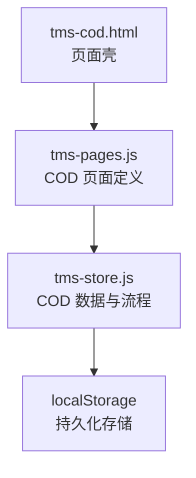
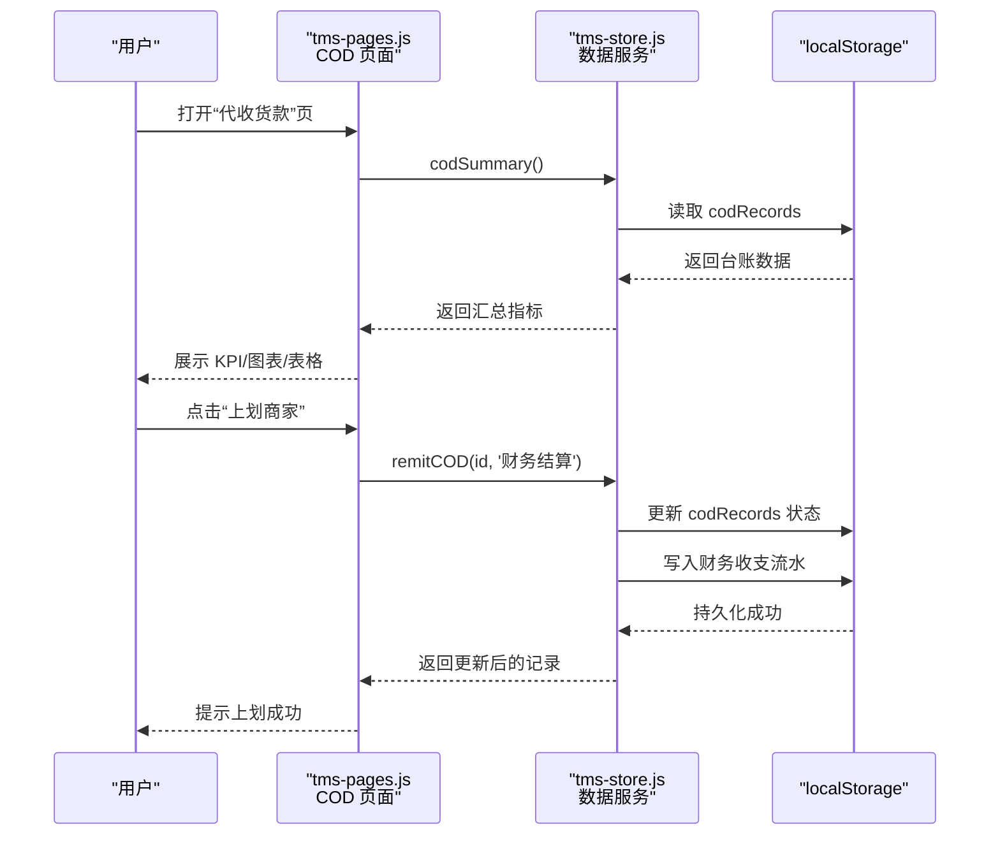
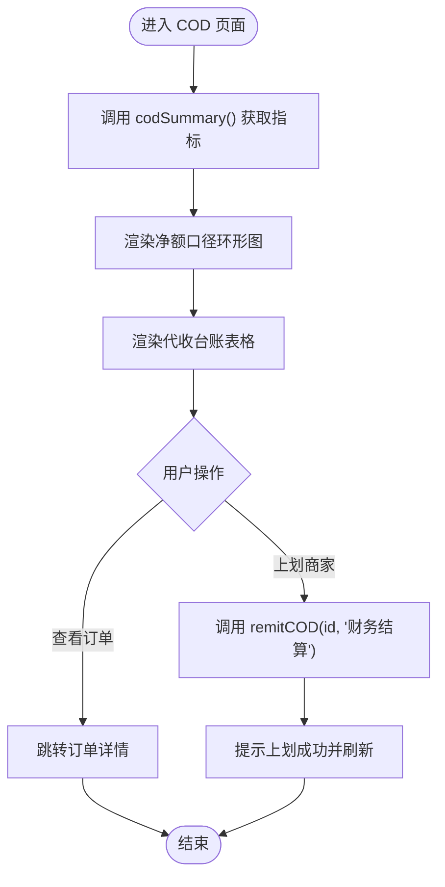
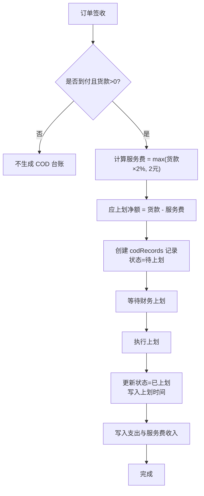
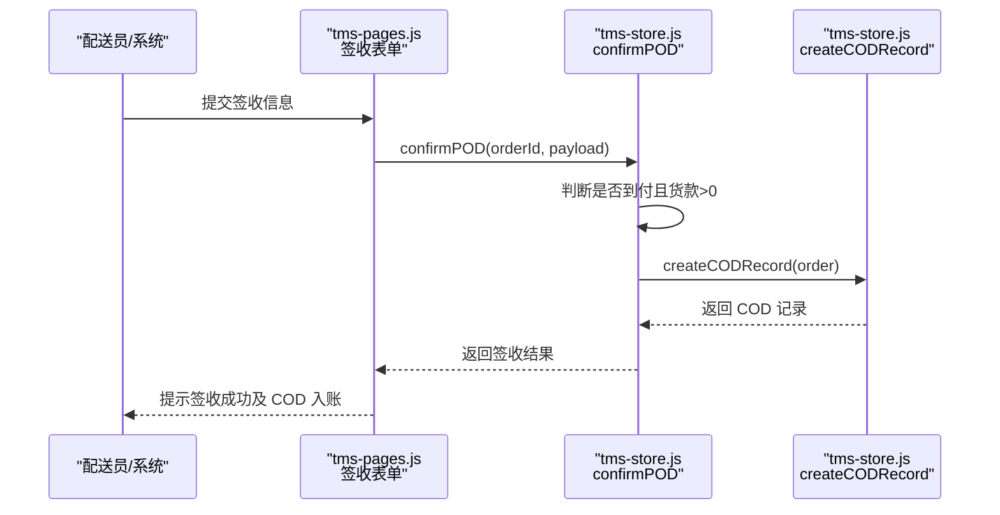
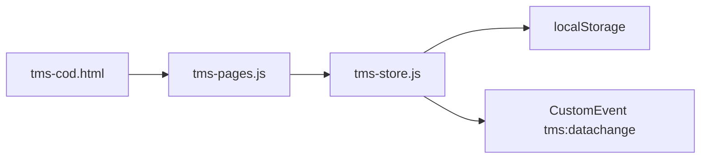

# 货到付款模块

<cite>
**本文引用的文件**   
- [tms-cod.html](file://tms-cod.html)
- [tms-pages.js](file://tms-pages.js)
- [tms-store.js](file://tms-store.js)
</cite>

## 目录
1. [引言](#引言)
2. [项目结构定位](#项目结构定位)
3. [核心组件](#核心组件)
4. [架构总览](#架构总览)
5. [详细组件分析](#详细组件分析)
6. [依赖关系分析](#依赖关系分析)
7. [性能与数据一致性](#性能与数据一致性)
8. [常见问题排查](#常见问题排查)
9. [结论](#结论)

## 引言
本章节聚焦“货到付款”（COD）模块，说明其在 TMS 运输管理系统中的职责、数据来源、业务流程以及与订单、财务等系统的集成点。该模块主要面向运营/财务人员，用于追踪到付件代收货款、计算服务费、生成上划台账，并在完成上划后自动生成支出与服务费收入凭证。

## 项目结构定位
- 页面入口：`tms-cod.html` 是“代收货款”页面的壳页面，负责加载公共样式、侧边栏导航，并通过 `TmsPages.render('cod', ...)` 渲染业务内容。
- 页面逻辑：`tms-pages.js` 中定义了 `cod` 页面配置，包括 KPI、图表、表格列、筛选器、操作按钮等。
- 数据与流程：`tms-store.js` 中维护 COD 台账记录、签收时生成待上划负债、上划时更新状态并写入财务流水，同时提供汇总统计接口供页面展示。

**图示来源**
- [tms-cod.html:258-263](file://tms-cod.html#L258-L263)
- [tms-pages.js:2284-2336](file://tms-pages.js#L2284-L2336)
- [tms-store.js:2060-2131](file://tms-store.js#L2060-L2131)

**章节来源**
- [tms-cod.html:1-268](file://tms-cod.html#L1-L268)

## 核心组件
- 页面层（UI）
  - 标题与副标题：说明 COD 的业务含义与价值。
  - KPI：代收货款总额、待上划、已上划商家、服务费收入。
  - 图表：以净额口径（扣除服务费）展示待上划与已上划占比。
  - 表格：展示代收单号、订单号、商家、收件人、代收货款、服务费、应上划净额、派送员、代收时间、状态。
  - 操作：对未上划记录执行“上划商家”，并跳转查看订单详情。
- 数据层（Store）
  - 常量：服务费率与最低服务费。
  - 数据模型：COD 台账记录字段包含订单号、运单号、商家、收件人、货款本金、服务费、应上划净额、代收时间、派送员、上划状态、上划时间、备注、创建时间。
  - 触发点：到付且含代收货款的订单在签收时生成待上划记录；上划时更新状态并写入财务收支。
  - 汇总：按状态聚合 GMV、待上划、已上划、服务费收入等指标。

**章节来源**
- [tms-pages.js:2284-2336](file://tms-pages.js#L2284-L2336)
- [tms-store.js:183-185](file://tms-store.js#L183-L185)
- [tms-store.js:2060-2131](file://tms-store.js#L2060-L2131)

## 架构总览
COD 模块采用“页面配置 + 数据服务”的轻量架构：
- 页面通过 `define('cod', {...})` 声明 UI 行为。
- 数据通过 `S.codSummary()`、`S.remitCOD(id, operator)` 等方法访问。
- 数据变更会触发全局事件，驱动其他页面刷新（如财务、订单）。

**图示来源**
- [tms-pages.js:2284-2336](file://tms-pages.js#L2284-L2336)
- [tms-store.js:2114-2123](file://tms-store.js#L2114-L2123)
- [tms-store.js:2125-2131](file://tms-store.js#L2125-L2131)

## 详细组件分析

### 页面层：COD 页面定义
- KPI 与图表
  - 调用 `S.codSummary()` 获取汇总数据，展示总额、待上划、已上划、服务费收入。
  - 使用环形图展示“待上划 vs 已上划”的净额口径分布。
- 表格与筛选
  - 实体为 `codRecords`，支持多字段搜索与状态筛选。
  - 默认按代收时间倒序，分页大小 12。
  - 列包含金额格式化、状态徽章、订单链接等。
- 操作
  - “上划商家”仅对未上划记录显示，调用 `S.remitCOD(row.id, '财务结算')`。
  - “查看订单”跳转到订单详情。

**图示来源**
- [tms-pages.js:2284-2336](file://tms-pages.js#L2284-L2336)

**章节来源**
- [tms-pages.js:2284-2336](file://tms-pages.js#L2284-L2336)

### 数据层：COD 台账与流程
- 常量与策略
  - 服务费率：2%。
  - 最低服务费：2 元。
- 数据模型关键字段
  - 订单号、运单号、商家、收件人、货款本金、服务费、应上划净额、代收时间、派送员、上划状态、上划时间、备注、创建时间。
- 触发点
  - 到付且含代收货款的订单在签收时生成待上划记录，服务费按 max(货款×费率, 最低服务费) 计算，净额=货款-服务费。
  - 上划时更新状态为“已上划”，写入支出（上划给商家）与服务费收入两条财务流水。
- 汇总统计
  - 聚合 GMV、待上划、已上划、服务费收入、笔数等指标，供页面 KPI 与图表使用。

**图示来源**
- [tms-store.js:971-984](file://tms-store.js#L971-L984)
- [tms-store.js:2060-2123](file://tms-store.js#L2060-L2123)

**章节来源**
- [tms-store.js:183-185](file://tms-store.js#L183-L185)
- [tms-store.js:971-984](file://tms-store.js#L971-L984)
- [tms-store.js:2060-2123](file://tms-store.js#L2060-L2123)
- [tms-store.js:2125-2131](file://tms-store.js#L2125-L2131)

### 与订单签收流程的集成
- 在订单签收时，若付款方式为“到付”且存在代收货款，则自动创建 COD 台账记录，状态为“待上划”。
- 签收表单中会根据是否存在 COD 给出额外提示，并在提交成功后提示“代收货款已入待上划台账”。

**图示来源**
- [tms-pages.js:2265-2276](file://tms-pages.js#L2265-L2276)
- [tms-store.js:2060-2070](file://tms-store.js#L2060-L2070)

**章节来源**
- [tms-pages.js:2265-2276](file://tms-pages.js#L2265-L2276)
- [tms-store.js:2060-2070](file://tms-store.js#L2060-L2070)

## 依赖关系分析
- 页面依赖
  - `tms-cod.html` 依赖 `common.js`、`tms-store.js`、`tms-ui.js`、`tms-pages.js`。
  - `tms-pages.js` 通过 `S.*` 方法访问 `tms-store.js` 暴露的数据接口。
- 数据依赖
  - COD 台账依赖于订单数据（订单号、运单号、商家、收件人、支付方式、货款金额）。
  - 财务流水依赖于 COD 上划动作，生成支出与服务费收入两类记录。
- 外部依赖
  - 使用 `localStorage` 进行本地持久化。
  - 通过自定义事件 `tms:datachange` 通知其他模块数据变更。

**图示来源**
- [tms-cod.html:254-263](file://tms-cod.html#L254-L263)
- [tms-store.js:239-251](file://tms-store.js#L239-L251)

**章节来源**
- [tms-cod.html:254-263](file://tms-cod.html#L254-L263)
- [tms-store.js:239-251](file://tms-store.js#L239-L251)

## 性能与数据一致性
- 性能
  - COD 汇总统计遍历 `codRecords` 数组，复杂度 O(n)，在当前规模下可接受。
  - 表格分页大小为 12，减少 DOM 渲染压力。
- 数据一致性
  - 所有写操作均通过 `update`/`create` 方法修改数据并调用 `persist()` 写入 `localStorage`。
  - 每次数据变更后触发 `emit()` 派发事件，确保其他页面能同步刷新。
- 建议
  - 若未来数据量增长，可对 `codRecords` 增加索引或缓存常用查询结果。
  - 在上划前可增加二次确认与权限校验，避免误操作。

**章节来源**
- [tms-store.js:239-251](file://tms-store.js#L239-L251)
- [tms-pages.js:2306-2336](file://tms-pages.js#L2306-L2336)

## 常见问题排查
- 问题：COD 台账未生成
  - 检查订单是否为“到付”且货款金额大于 0。
  - 检查签收流程是否正确调用 `confirmPOD`。
- 问题：服务费计算异常
  - 核对服务费率与最低服务费常量。
  - 确认货款本金与服务费计算逻辑是否符合预期。
- 问题：上划后财务流水缺失
  - 检查 `remitCOD` 是否被正确调用。
  - 确认财务流水写入逻辑是否被执行。

**章节来源**
- [tms-store.js:971-984](file://tms-store.js#L971-L984)
- [tms-store.js:2114-2123](file://tms-store.js#L2114-L2123)

## 结论
COD 模块以简洁的页面配置与数据服务实现货到付款全流程管理：从签收时生成待上划台账，到财务上划后自动生成收支凭证，并提供直观的 KPI 与图表辅助决策。整体架构清晰、依赖明确，便于扩展与维护。