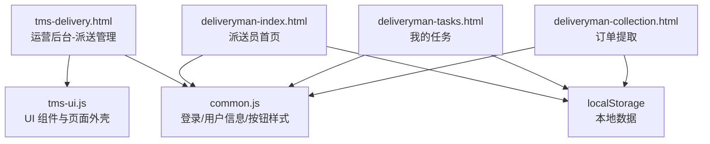
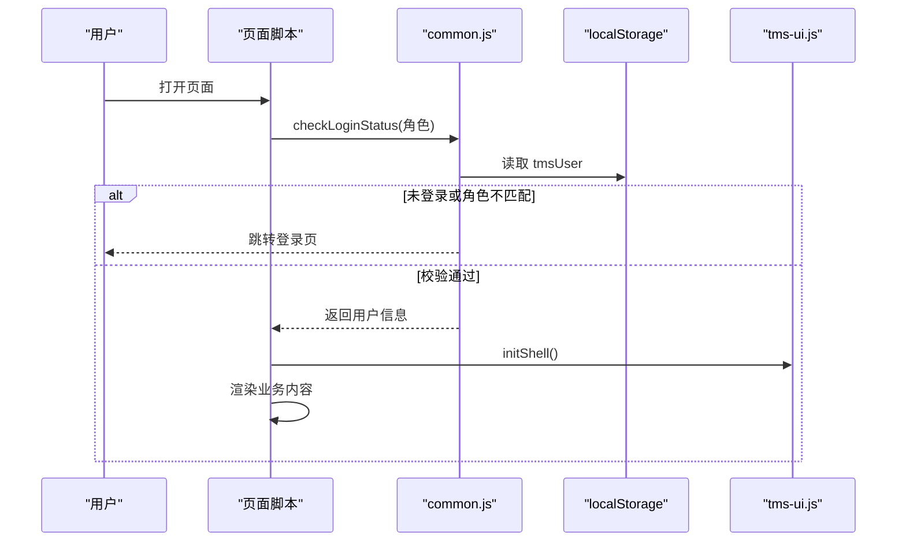
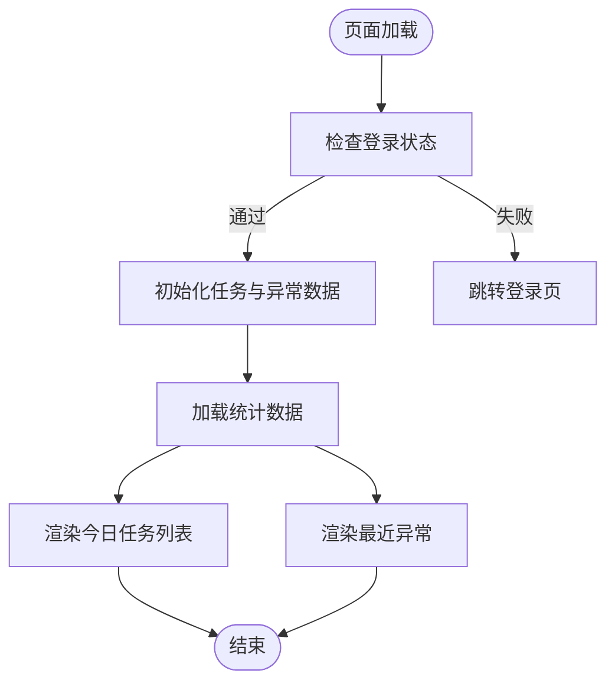
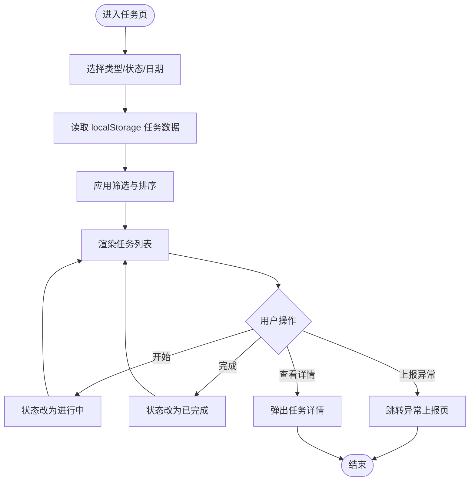
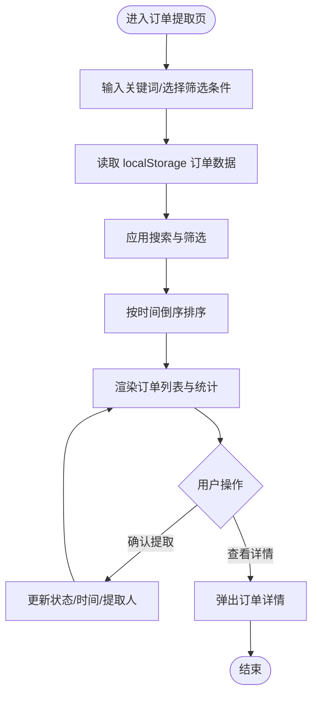
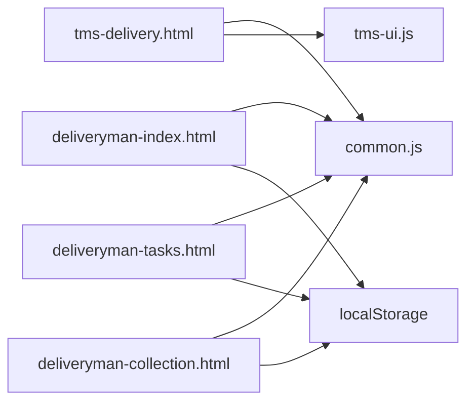

# 配送管理模块

<cite>
**本文引用的文件**   
- [tms-delivery.html](file://tms-delivery.html)
- [deliveryman-index.html](file://deliveryman-index.html)
- [deliveryman-tasks.html](file://deliveryman-tasks.html)
- [deliveryman-collection.html](file://deliveryman-collection.html)
- [common.js](file://common.js)
- [tms-ui.js](file://tms-ui.js)
</cite>

## 目录
1. [引言](#引言)
2. [项目结构](#项目结构)
3. [核心组件](#核心组件)
4. [架构总览](#架构总览)
5. [详细组件分析](#详细组件分析)
6. [依赖关系分析](#依赖关系分析)
7. [性能与可扩展性](#性能与可扩展性)
8. [故障排查指南](#故障排查指南)
9. [结论](#结论)

## 引言
本模块聚焦“配送管理”，覆盖运营后台的派送管理与派送员端任务、订单提取等关键流程。系统采用纯前端静态页面 + localStorage 数据持久化的方式，通过通用登录校验、UI 组件库和页面脚本协作完成交互与展示。该文档从系统架构、组件职责、数据流、处理逻辑、集成点与错误处理等维度进行系统化说明，帮助读者快速理解并扩展配送相关功能。

## 项目结构
围绕配送管理的核心文件包括：
- 运营后台入口与侧边导航：tms-delivery.html
- 派送员首页：deliveryman-index.html
- 派送员任务管理：deliveryman-tasks.html
- 派送员订单提取（代收货款）：deliveryman-collection.html
- 通用工具与登录鉴权：common.js
- 共享 UI 组件与表格/弹窗/图表能力：tms-ui.js

图示来源
- [tms-delivery.html:194-267](file://tms-delivery.html#L194-L267)
- [deliveryman-index.html:216-287](file://deliveryman-index.html#L216-L287)
- [deliveryman-tasks.html:311-383](file://deliveryman-tasks.html#L311-L383)
- [deliveryman-collection.html:324-416](file://deliveryman-collection.html#L324-L416)
- [common.js:135-218](file://common.js#L135-L218)
- [tms-ui.js:706-751](file://tms-ui.js#L706-L751)

章节来源
- [tms-delivery.html:194-267](file://tms-delivery.html#L194-L267)
- [deliveryman-index.html:216-287](file://deliveryman-index.html#L216-L287)
- [deliveryman-tasks.html:311-383](file://deliveryman-tasks.html#L311-L383)
- [deliveryman-collection.html:324-416](file://deliveryman-collection.html#L324-L416)
- [common.js:135-218](file://common.js#L135-L218)
- [tms-ui.js:706-751](file://tms-ui.js#L706-L751)

## 核心组件
- 运营后台派送管理页
  - 提供统一头部、侧边导航与内容区占位，并通过 TmsPages.render('delivery', ...) 渲染派送管理视图。
  - 使用 common.js 的 checkLoginStatus('admin') 做权限校验，使用 tms-ui.js 的 initShell() 初始化壳层。
- 派送员首页
  - 展示欢迎信息、今日统计卡片、今日任务列表与最近异常列表。
  - 使用 localStorage 初始化并维护任务与异常数据。
- 派送员任务管理
  - 支持按任务类型（收件/派件）、状态（待处理/进行中/已完成）、日期（今天/本周/本月/全部）筛选与排序。
  - 支持开始任务、完成任务、上报异常、查看详情等操作。
- 派送员订单提取
  - 支持搜索（订单号/客户/电话/地址）与筛选（状态/日期），展示待提取与已提取订单及金额统计。
  - 支持确认提取、查看详情，更新提取时间与提取人。
- 通用工具
  - 登录/登出、角色校验、当前用户显示、按钮样式注入、ID 生成等。
- UI 组件库
  - Toast、Modal、表单弹窗、通用表格、KPI、SVG 折线/柱状/环形图、页面外壳初始化等。

章节来源
- [tms-delivery.html:258-263](file://tms-delivery.html#L258-L263)
- [deliveryman-index.html:292-318](file://deliveryman-index.html#L292-L318)
- [deliveryman-tasks.html:388-424](file://deliveryman-tasks.html#L388-L424)
- [deliveryman-collection.html:421-455](file://deliveryman-collection.html#L421-L455)
- [common.js:135-218](file://common.js#L135-L218)
- [tms-ui.js:706-751](file://tms-ui.js#L706-L751)

## 架构总览
整体为“多页面 SPA 风格”的前端应用：每个 HTML 页面负责自身布局与业务脚本；common.js 提供统一的登录与用户信息能力；tms-ui.js 提供通用 UI 组件；数据存储在浏览器 localStorage。

图示来源
- [common.js:176-199](file://common.js#L176-L199)
- [tms-ui.js:706-751](file://tms-ui.js#L706-L751)
- [tms-delivery.html:258-263](file://tms-delivery.html#L258-L263)

## 详细组件分析

### 运营后台-派送管理页（tms-delivery.html）
- 作用
  - 作为运营后台的一个功能入口，承载派送管理视图。
  - 通过侧边栏导航与其他运营模块互通。
- 关键点
  - 使用 checkLoginStatus('admin') 限制管理员访问。
  - 调用 TmsUI.initShell() 初始化壳层（高亮当前菜单、绑定退出等）。
  - 通过 TmsPages.render('delivery', container) 将派送管理视图渲染到内容区。
- 可观察行为
  - 若未登录或角色不符，将被重定向至登录页。
  - 登录后自动显示用户名与退出按钮。

章节来源
- [tms-delivery.html:258-263](file://tms-delivery.html#L258-L263)
- [tms-delivery.html:194-267](file://tms-delivery.html#L194-L267)

### 派送员首页（deliveryman-index.html）
- 作用
  - 展示派送员当日工作概览：任务统计、今日任务、最近异常。
- 数据处理
  - 首次加载时初始化 deliverymanTasks 与 deliverymanExceptions 到 localStorage。
  - 根据时间字符串筛选“今日任务”，计算待处理/进行中/已完成数量。
- 交互
  - 点击“退出登录”触发 logout()。
  - 动态显示当前用户名与日期。

图示来源
- [deliveryman-index.html:292-318](file://deliveryman-index.html#L292-L318)
- [deliveryman-index.html:320-367](file://deliveryman-index.html#L320-L367)
- [deliveryman-index.html:369-445](file://deliveryman-index.html#L369-L445)

章节来源
- [deliveryman-index.html:292-455](file://deliveryman-index.html#L292-L455)

### 派送员任务管理（deliveryman-tasks.html）
- 作用
  - 提供任务的全量视图与操作：开始、完成、上报异常、查看详情。
- 筛选与排序
  - 类型筛选：全部/收件/派件。
  - 状态筛选：待处理/进行中/已完成。
  - 日期筛选：今天/本周/本月/全部。
  - 默认按时间升序排序。
- 数据模型（任务）
  - id、type、title、customer、address、phone、time、status、description、orderId、weight、items 等字段。
- 关键流程
  - 开始任务：pending → in-progress。
  - 完成任务：in-progress → completed。
  - 上报异常：跳转到异常上报页并携带 taskId。
  - 查看详情：弹出任务详情。

图示来源
- [deliveryman-tasks.html:426-461](file://deliveryman-tasks.html#L426-L461)
- [deliveryman-tasks.html:463-512](file://deliveryman-tasks.html#L463-L512)
- [deliveryman-tasks.html:514-584](file://deliveryman-tasks.html#L514-L584)
- [deliveryman-tasks.html:596-636](file://deliveryman-tasks.html#L596-L636)

章节来源
- [deliveryman-tasks.html:388-636](file://deliveryman-tasks.html#L388-L636)

### 派送员订单提取（deliveryman-collection.html）
- 作用
  - 提供代收货款订单的提取与查询能力，展示待提取与已提取订单及金额统计。
- 筛选与搜索
  - 支持关键词搜索（订单号/客户/电话/地址）。
  - 支持状态筛选（待提取/已提取）与日期筛选（今天/本周/本月/全部）。
  - 默认按下单时间倒序排列。
- 数据模型（订单）
  - id、orderNumber、customer、phone、address、amount、orderTime、status、collectedTime、collector、paymentMethod、notes 等字段。
- 关键流程
  - 确认提取：uncollected → collected，记录提取时间与提取人。
  - 查看详情：弹出订单详情。

图示来源
- [deliveryman-collection.html:457-488](file://deliveryman-collection.html#L457-L488)
- [deliveryman-collection.html:490-536](file://deliveryman-collection.html#L490-L536)
- [deliveryman-collection.html:538-555](file://deliveryman-collection.html#L538-L555)
- [deliveryman-collection.html:557-619](file://deliveryman-collection.html#L557-L619)
- [deliveryman-collection.html:621-677](file://deliveryman-collection.html#L621-L677)

章节来源
- [deliveryman-collection.html:421-677](file://deliveryman-collection.html#L421-L677)

### 通用工具（common.js）
- 登录与鉴权
  - login：保存用户信息到 localStorage，并根据角色跳转对应首页。
  - checkLoginStatus：校验是否登录与角色是否匹配，否则跳转登录页。
  - logout：清除用户信息并跳转登录页。
- 用户信息
  - getCurrentUser/displayCurrentUser：获取并显示当前用户名。
- 其他
  - injectButtonStyles：注入统一按钮样式。
  - generateOrderId/generateWaybillNumber：订单号与运单号生成规则。

章节来源
- [common.js:135-218](file://common.js#L135-L218)
- [common.js:211-270](file://common.js#L211-L270)
- [common.js:3-50](file://common.js#L3-L50)

### UI 组件库（tms-ui.js）
- 基础能力
  - esc/fmt/statusBadge/badge/uniqueId：转义、格式化、状态标签、唯一 ID。
- 交互组件
  - toast/modal/confirmDialog/formModal：提示、模态框、确认框、表单弹窗。
- 数据展示
  - table：通用表格（搜索/筛选/分页/排序/动作列）。
  - kpis/charts.line/bar/donut：KPI 与 SVG 图表。
  - detailModal/detailGrid/timeline：详情展示。
- 页面外壳
  - initShell：高亮当前菜单、绑定退出、显示用户名、异常角标。

章节来源
- [tms-ui.js:10-84](file://tms-ui.js#L10-L84)
- [tms-ui.js:86-158](file://tms-ui.js#L86-L158)
- [tms-ui.js:160-288](file://tms-ui.js#L160-L288)
- [tms-ui.js:290-545](file://tms-ui.js#L290-L545)
- [tms-ui.js:547-685](file://tms-ui.js#L547-L685)
- [tms-ui.js:687-751](file://tms-ui.js#L687-L751)
- [tms-ui.js:753-787](file://tms-ui.js#L753-L787)

## 依赖关系分析
- 页面与脚本依赖
  - tms-delivery.html 依赖 common.js 与 tms-ui.js，并通过 TmsPages 渲染派送视图。
  - deliveryman-* 系列页面依赖 common.js 进行登录校验与用户信息显示，并使用 localStorage 存储业务数据。
- 数据依赖
  - deliveryman-index.html：deliverymanTasks、deliverymanExceptions
  - deliveryman-tasks.html：deliverymanTasks
  - deliveryman-collection.html：deliverymanCollections
- 外部依赖
  - 无后端接口依赖，所有数据均保存在浏览器 localStorage。

图示来源
- [tms-delivery.html:254-257](file://tms-delivery.html#L254-L257)
- [deliveryman-index.html:291-318](file://deliveryman-index.html#L291-L318)
- [deliveryman-tasks.html:387-424](file://deliveryman-tasks.html#L387-L424)
- [deliveryman-collection.html:420-455](file://deliveryman-collection.html#L420-L455)

章节来源
- [tms-delivery.html:254-257](file://tms-delivery.html#L254-L257)
- [deliveryman-index.html:291-318](file://deliveryman-index.html#L291-L318)
- [deliveryman-tasks.html:387-424](file://deliveryman-tasks.html#L387-L424)
- [deliveryman-collection.html:420-455](file://deliveryman-collection.html#L420-L455)

## 性能与可扩展性
- 性能特征
  - 数据量较小且全量在内存中处理，筛选与排序复杂度为 O(n)，对日常使用影响有限。
  - 列表渲染采用模板拼接，简单直接；当数据量增长时可考虑虚拟滚动或分页。
- 可扩展建议
  - 引入后端 API：将 localStorage 替换为 REST/GraphQL 接口，实现服务端分页与过滤。
  - 统一数据源：抽取 DeliveryStore 模块，集中管理任务与订单数据的增删改查。
  - 组件化：将任务卡片、订单卡片抽象为可复用组件，减少重复代码。
  - 国际化与主题：通过配置对象控制文案与颜色，便于多语言与品牌定制。

[本节为通用指导，无需引用具体文件]

## 故障排查指南
- 无法进入页面或被重定向
  - 现象：打开页面后跳转到登录页。
  - 原因：checkLoginStatus 检测到未登录或角色不匹配。
  - 处理：确认已通过 login 成功登录，且角色与页面要求一致。
  - 参考
    - [common.js:176-199](file://common.js#L176-L199)
- 用户名未显示
  - 现象：顶部用户名区域为空。
  - 原因：displayCurrentUser 未找到对应元素或未正确注入。
  - 处理：检查页面是否存在 #current-username 或 .user-info 容器，确保脚本顺序加载。
  - 参考
    - [common.js:220-270](file://common.js#L220-L270)
- 任务/订单数据为空
  - 现象：列表显示“暂无任务/订单”。
  - 原因：localStorage 中对应键不存在或已被清理。
  - 处理：刷新页面以触发初始化逻辑，或手动在控制台写入测试数据。
  - 参考
    - [deliveryman-index.html:320-367](file://deliveryman-index.html#L320-L367)
    - [deliveryman-tasks.html:426-461](file://deliveryman-tasks.html#L426-L461)
    - [deliveryman-collection.html:457-488](file://deliveryman-collection.html#L457-L488)
- 操作后状态未更新
  - 现象：点击“开始/完成/确认提取”后列表不变。
  - 原因：localStorage 写入失败或后续未重新渲染。
  - 处理：检查浏览器控制台是否有报错，确认 localStorage 可用；必要时刷新页面。
  - 参考
    - [deliveryman-tasks.html:596-636](file://deliveryman-tasks.html#L596-L636)
    - [deliveryman-collection.html:635-677](file://deliveryman-collection.html#L635-L677)

章节来源
- [common.js:176-199](file://common.js#L176-L199)
- [common.js:220-270](file://common.js#L220-L270)
- [deliveryman-index.html:320-367](file://deliveryman-index.html#L320-L367)
- [deliveryman-tasks.html:426-461](file://deliveryman-tasks.html#L426-L461)
- [deliveryman-collection.html:457-488](file://deliveryman-collection.html#L457-L488)
- [deliveryman-tasks.html:596-636](file://deliveryman-tasks.html#L596-L636)
- [deliveryman-collection.html:635-677](file://deliveryman-collection.html#L635-L677)

## 结论
配送管理模块以轻量、易用的前端方案实现了派送员的任务管理与订单提取流程，并通过通用登录与 UI 组件提升了一致性与可维护性。在当前 localStorage 数据模式下，适合演示与小规模场景；如需规模化生产，建议引入后端服务、统一数据层与组件化重构，以提升性能、可维护性与扩展性。