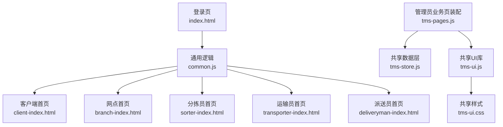
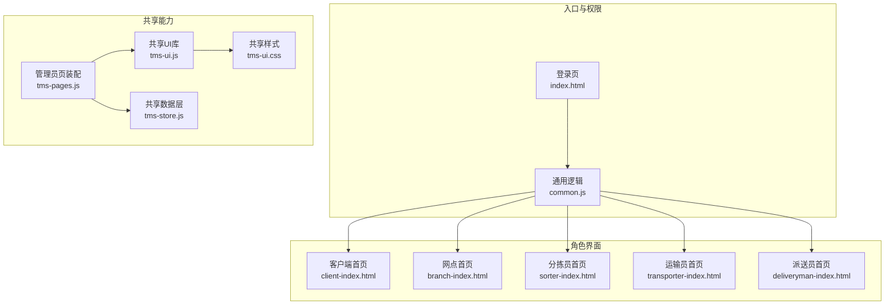
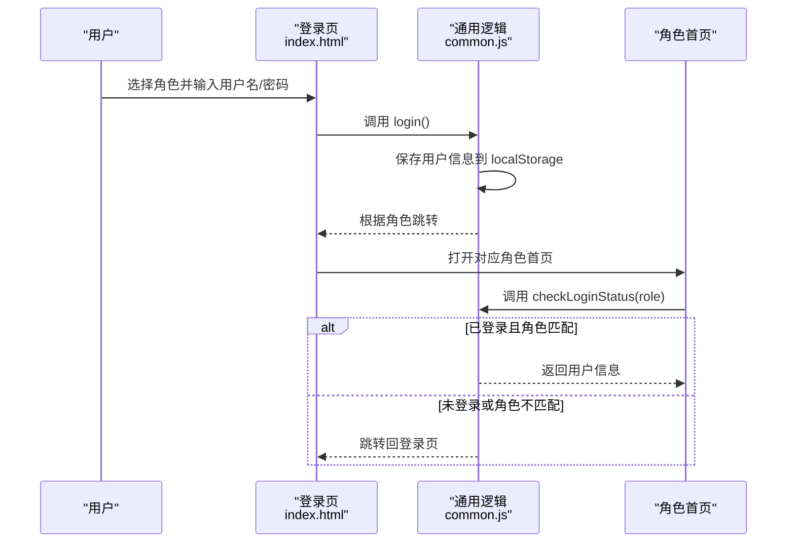
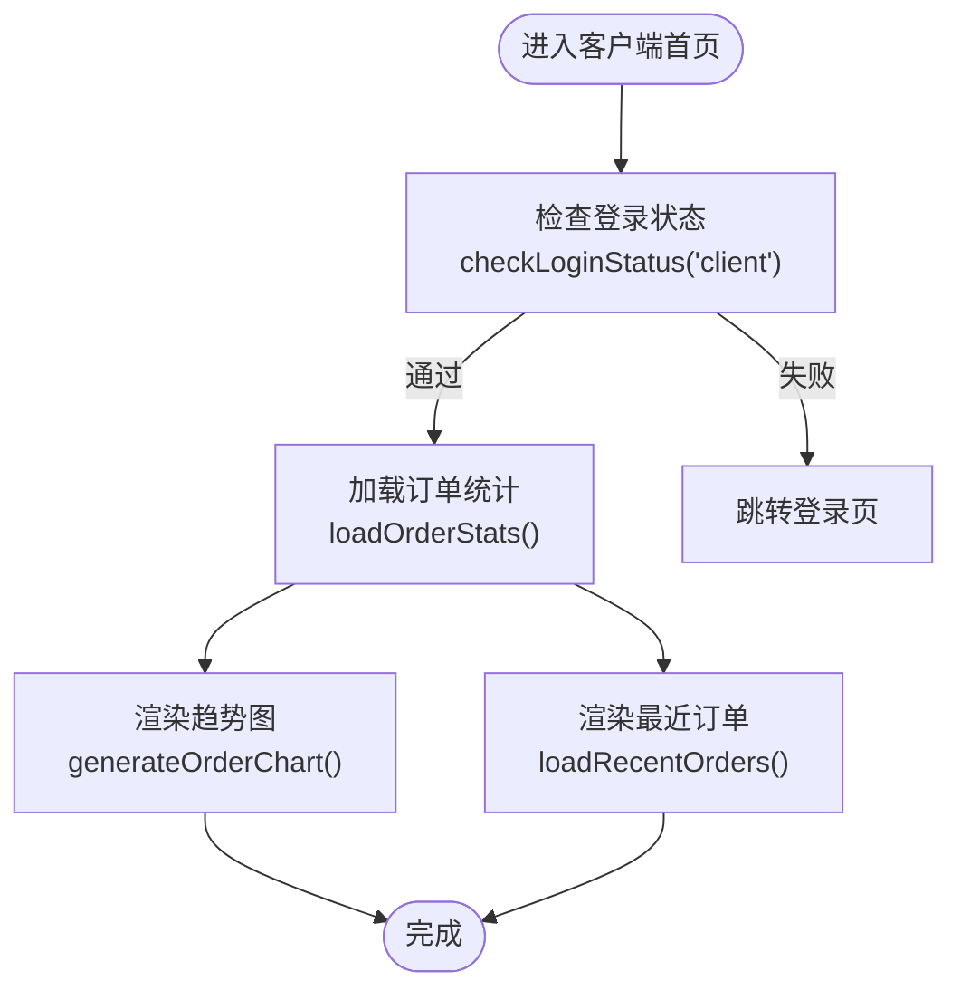
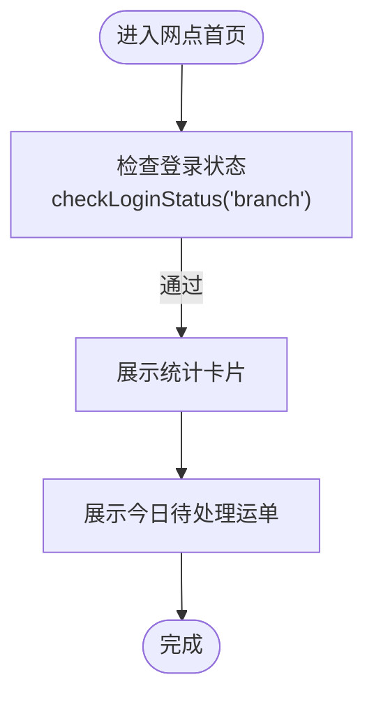
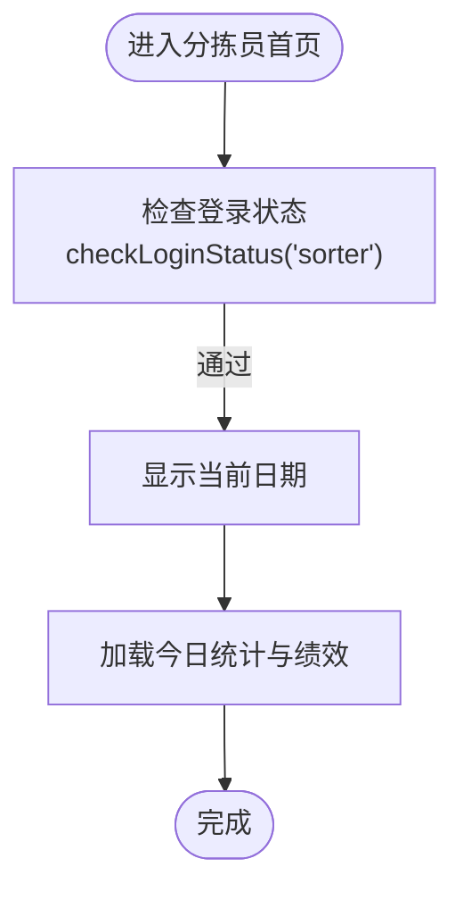
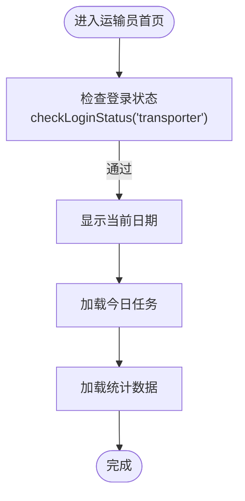
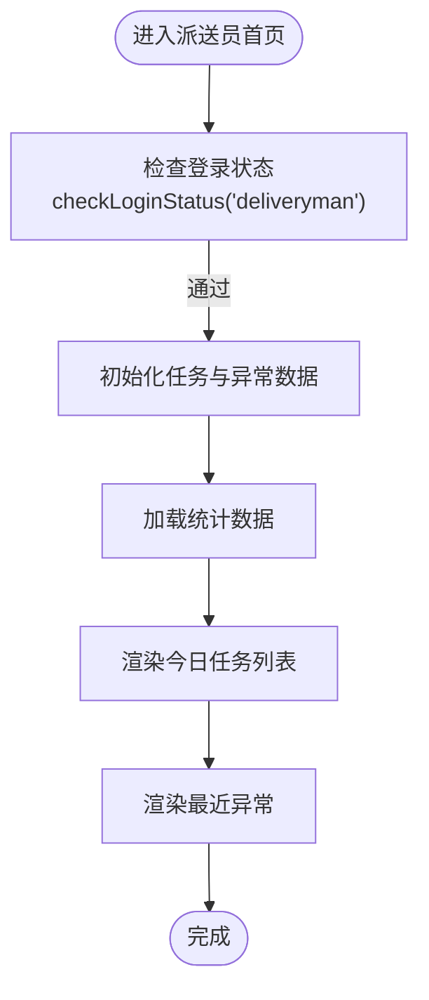
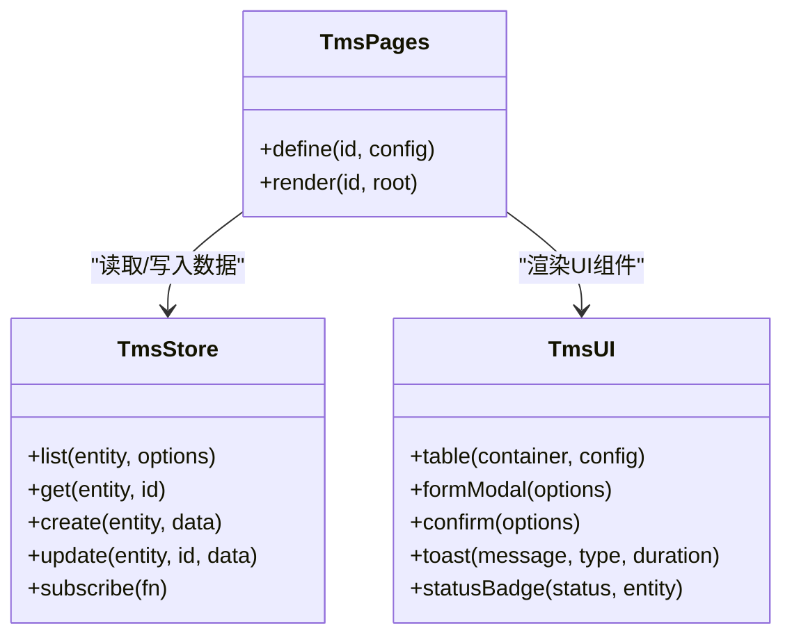
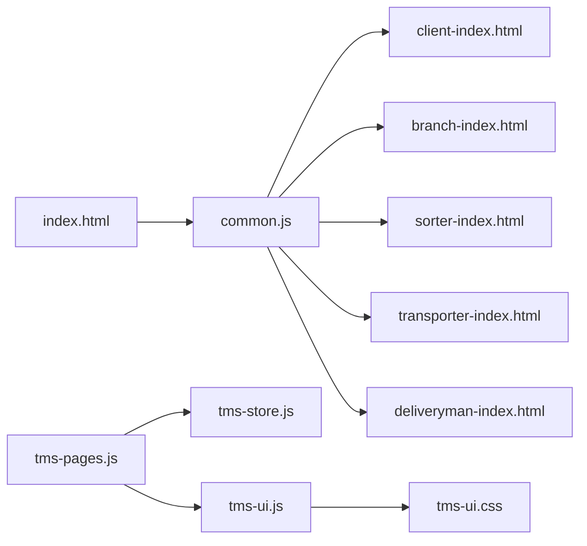

# 用户界面模块

<cite>
**本文引用的文件**   
- [index.html](file://index.html)
- [common.js](file://common.js)
- [tms-ui.js](file://tms-ui.js)
- [tms-ui.css](file://tms-ui.css)
- [tms-pages.js](file://tms-pages.js)
- [tms-store.js](file://tms-store.js)
- [client-index.html](file://client-index.html)
- [branch-index.html](file://branch-index.html)
- [sorter-index.html](file://sorter-index.html)
- [transporter-index.html](file://transporter-index.html)
- [deliveryman-index.html](file://deliveryman-index.html)
</cite>

## 目录
1. [引言](#引言)
2. [项目结构](#项目结构)
3. [核心组件](#核心组件)
4. [架构总览](#架构总览)
5. [详细组件分析](#详细组件分析)
6. [依赖关系分析](#依赖关系分析)
7. [性能与可维护性](#性能与可维护性)
8. [故障排查指南](#故障排查指南)
9. [结论](#结论)
10. [附录：页面导航与权限矩阵](#附录页面导航与权限矩阵)

## 引言
本章节面向 TMS 系统的用户界面模块，聚焦客户端、网点、分拣员、运输员与派送员五大角色的前端实现。文档从系统架构、数据流、交互模式、权限控制、响应式适配与扩展定制等维度展开，既适合初学者快速上手，也为高级开发者提供深入的技术细节与优化建议。

## 项目结构
TMS 的用户界面采用“多角色入口 + 共享 UI 库 + 共享数据层”的结构：
- 登录入口统一在 index.html，按角色分发到各角色首页。
- 通用交互能力（弹窗、表单、表格、图表、Toast）集中在 tms-ui.js，样式集中在 tms-ui.css。
- 管理员端业务页通过 tms-pages.js 装配为统一的 KPI + 图表 + 表格结构，并基于 tms-store.js 提供的本地数据层进行增删改查与状态流转。
- 各角色首页（client/branch/sorter/transporter/deliveryman）各自维护侧边栏导航、统计卡片与快捷操作，并通过 common.js 完成登录态校验与用户信息展示。

**图示来源**
- [index.html:145-173](file://index.html#L145-L173)
- [common.js:135-174](file://common.js#L135-L174)
- [tms-pages.js:87-114](file://tms-pages.js#L87-L114)
- [tms-store.js:215-244](file://tms-store.js#L215-L244)
- [tms-ui.js:756-779](file://tms-ui.js#L756-L779)
- [tms-ui.css:1-10](file://tms-ui.css#L1-L10)

**章节来源**
- [index.html:1-172](file://index.html#L1-L172)
- [common.js:1-383](file://common.js#L1-L383)
- [tms-ui.js:1-781](file://tms-ui.js#L1-L781)
- [tms-ui.css:1-795](file://tms-ui.css#L1-L795)
- [tms-pages.js:1-800](file://tms-pages.js#L1-L800)
- [tms-store.js:1-800](file://tms-store.js#L1-L800)

## 核心组件
- 登录与权限控制
  - 登录流程：选择角色 → 输入用户名密码 → 保存用户信息到 localStorage → 跳转到对应角色首页。
  - 权限校验：各角色首页加载时调用 checkLoginStatus(requiredRole)，未登录或角色不匹配则跳转回登录页。
  - 用户信息显示：displayCurrentUser 自动更新多个可能的用户名显示元素，并在缺失时动态创建。
- 共享 UI 组件
  - 弹窗与确认框：modal、confirmDialog、formModal 支持表单字段、必填校验、异步提交与错误提示。
  - 列表与分页：table 支持搜索、筛选、排序、分页、行点击、工具栏按钮与动作列。
  - 图表与 KPI：lineChart、barChart、donutChart、kpis 用于数据可视化与指标展示。
  - 详情与时间线：detailModal、detailGrid、timeline 用于订单/异常等实体的详情展示。
  - 页面外壳：initShell 高亮当前导航、绑定退出登录、显示当前用户、异常待办角标。
- 共享数据层
  - 本地数据库：基于 localStorage 的轻量业务数据库，提供增删改查、搜索、筛选、排序、分页。
  - 事件机制：数据变更触发 tms:datachange 事件，UI 订阅后刷新。
  - 种子数据：首次访问生成真实感演示数据（订单、运单、运输、异常、扫描等）。
  - 计费引擎与路由轨迹：内置运费计算、体积重、燃油附加、偏远附加、保价、到付折扣；构建多段路由与标准时效。

**章节来源**
- [common.js:135-270](file://common.js#L135-L270)
- [tms-ui.js:84-285](file://tms-ui.js#L84-L285)
- [tms-ui.js:301-542](file://tms-ui.js#L301-L542)
- [tms-ui.js:544-678](file://tms-ui.js#L544-L678)
- [tms-ui.js:680-779](file://tms-ui.js#L680-L779)
- [tms-store.js:215-244](file://tms-store.js#L215-L244)
- [tms-store.js:263-383](file://tms-store.js#L263-L383)
- [tms-store.js:385-460](file://tms-store.js#L385-L460)

## 架构总览
下图展示了用户界面的整体架构与各模块职责：

**图示来源**
- [index.html:145-173](file://index.html#L145-L173)
- [common.js:135-174](file://common.js#L135-L174)
- [tms-ui.js:756-779](file://tms-ui.js#L756-L779)
- [tms-pages.js:87-114](file://tms-pages.js#L87-L114)
- [tms-store.js:215-244](file://tms-store.js#L215-L244)

## 详细组件分析

### 登录与权限控制
- 登录流程
  - 用户在 index.html 中选择角色并输入用户名密码，点击登录或回车触发 login()。
  - login() 将 username 与 role 保存到 localStorage.tmsUser，并根据角色映射跳转到对应首页。
- 权限校验
  - 各角色首页在 DOMContentLoaded 中调用 checkLoginStatus('role')，若未登录或角色不匹配，则弹出提示并跳转回登录页。
- 用户信息显示
  - displayCurrentUser() 会尝试更新多个可能的用户名显示元素，若不存在则动态创建并插入到 user-info 容器中。

**图示来源**
- [index.html:145-173](file://index.html#L145-L173)
- [common.js:135-199](file://common.js#L135-L199)

**章节来源**
- [index.html:145-173](file://index.html#L145-L173)
- [common.js:135-199](file://common.js#L135-L199)

### 客户端界面（客户下单与跟踪）
- 功能特性
  - 订单统计与趋势图：展示总订单数、待处理、运输中、已完成，以及近6个月订单趋势折线图。
  - 快捷功能：我要寄件、货物跟踪、附近网点、我的积分。
  - 最近订单：按创建时间倒序展示最近3条订单。
  - 通知中心：系统升级、新用户奖励、春节优惠、新增网点、积分商城上线等通知。
- 页面导航
  - 侧边栏包含首页、我要寄件、订单查询、货物跟踪、附近网点、个人中心、我的积分。
- 数据与交互
  - 使用 localStorage 存储模拟订单数据，并按 userId 过滤当前用户订单。
  - 使用 Chart.js 渲染订单趋势图。
  - 通过 common.js 的 checkLoginStatus('client') 与 displayCurrentUser() 管理登录态与用户名显示。

**图示来源**
- [client-index.html:497-519](file://client-index.html#L497-L519)
- [client-index.html:650-720](file://client-index.html#L650-L720)
- [client-index.html:722-761](file://client-index.html#L722-L761)

**章节来源**
- [client-index.html:1-765](file://client-index.html#L1-L765)

### 网点管理界面（揽收、分拣、出库、库存、服务、运营、系统）
- 功能特性
  - 首页展示待处理运单、运输中运单、已完成运单与库存商品数量。
  - 今日待处理运单列表，便于网点管理员快速处理。
- 页面导航
  - 侧边栏包含首页、揽收管理、分拣处理、出库管理、库存与资产、服务与售后、运营管理、系统管理。
- 数据与交互
  - 使用 common.js 的 checkLoginStatus('branch') 与 displayCurrentUser() 管理登录态与用户名显示。
  - 静态示例数据展示今日待处理运单。

**图示来源**
- [branch-index.html:267-280](file://branch-index.html#L267-L280)

**章节来源**
- [branch-index.html:1-284](file://branch-index.html#L1-L284)

### 分拣员界面（扫描、分拣、绩效、排班、打卡）
- 功能特性
  - 首页展示今日已扫描、已分拣、异常件与本月绩效。
  - 快捷操作：打卡、扫描、分拣、绩效。
  - 日期显示与统计数据加载。
- 页面导航
  - 侧边栏包含首页、包裹扫描、分拣任务、绩效评估、工作安排、打卡记录。
- 数据与交互
  - 使用 common.js 的 checkLoginStatus('sorter') 与 displayCurrentUser() 管理登录态与用户名显示。
  - 从 localStorage 读取当日统计与月度绩效数据。

**图示来源**
- [sorter-index.html:282-326](file://sorter-index.html#L282-L326)

**章节来源**
- [sorter-index.html:1-330](file://sorter-index.html#L1-L330)

### 运输员界面（装车、发车、排班、路线、绩效、打卡）
- 功能特性
  - 首页展示今日已装车、已发车、里程与本月绩效。
  - 快捷操作：打卡、装车、发车、路线。
  - 今日任务列表与统计数据加载。
- 页面导航
  - 侧边栏包含首页、扫描装车、发车管理、我的排班、发车路线、我的绩效、打卡记录。
- 数据与交互
  - 使用 common.js 的 checkLoginStatus('transporter') 与 displayCurrentUser() 管理登录态与用户名显示。
  - 从 localStorage 读取当日任务与统计数据，若无数据则初始化示例数据。

**图示来源**
- [transporter-index.html:341-458](file://transporter-index.html#L341-L458)

**章节来源**
- [transporter-index.html:1-462](file://transporter-index.html#L1-L462)

### 派送员界面（任务、提取、打卡、绩效、联系、异常、区域）
- 功能特性
  - 首页展示今日任务、待处理、进行中、已完成统计。
  - 今日任务列表与最近异常记录。
  - 快捷导航至任务、提取、打卡、绩效、联系、异常、区域等页面。
- 页面导航
  - 侧边栏包含首页、我的任务、订单提取、打卡记录、我的绩效、联系记录、异常上报、派送区域。
- 数据与交互
  - 使用 common.js 的 checkLoginStatus('deliveryman') 与 displayCurrentUser() 管理登录态与用户名显示。
  - 初始化任务与异常数据并存入 localStorage，随后加载统计与列表。

**图示来源**
- [deliveryman-index.html:292-455](file://deliveryman-index.html#L292-L455)

**章节来源**
- [deliveryman-index.html:1-459](file://deliveryman-index.html#L1-L459)

### 管理员端页面装配（KPI + 图表 + 表格 + CRUD）
- 功能特性
  - 通过 TmsPages.render('<pageId>') 将业务页装配为统一结构：KPI 指标、图表、额外区块、可筛选分页表格。
  - 提供异常管理、运输管理、仓储管理、车辆管理、运力管理、物资管理、客服管理等页面的配置与交互。
- 数据与交互
  - 基于 tms-store.js 的数据层进行增删改查与状态流转。
  - 使用 tms-ui.js 的 table、formModal、confirm、toast、statusBadge 等组件构建交互。

**图示来源**
- [tms-pages.js:87-114](file://tms-pages.js#L87-L114)
- [tms-store.js:215-244](file://tms-store.js#L215-L244)
- [tms-ui.js:301-542](file://tms-ui.js#L301-L542)

**章节来源**
- [tms-pages.js:1-800](file://tms-pages.js#L1-L800)
- [tms-store.js:1-800](file://tms-store.js#L1-L800)
- [tms-ui.js:1-781](file://tms-ui.js#L1-L781)

## 依赖关系分析
- 登录与角色分发
  - index.html 依赖 common.js 的 login() 与角色映射表，跳转到 client/branch/admin/sorter/transporter/deliveryman 首页。
- 角色首页依赖
  - 各角色首页依赖 common.js 的 checkLoginStatus() 与 displayCurrentUser() 进行权限校验与用户信息显示。
- 管理员端依赖
  - tms-pages.js 依赖 tms-store.js 与 tms-ui.js，通过 TmsStore 获取数据，通过 TmsUI 渲染表格、弹窗、图表等。
- 共享样式
  - tms-ui.css 提供统一的按钮、表格、分页、弹窗、表单、图表等样式，避免与页面自有样式冲突。

**图示来源**
- [index.html:145-173](file://index.html#L145-L173)
- [common.js:135-199](file://common.js#L135-L199)
- [tms-pages.js:87-114](file://tms-pages.js#L87-L114)
- [tms-ui.js:756-779](file://tms-ui.js#L756-L779)
- [tms-ui.css:1-10](file://tms-ui.css#L1-L10)

**章节来源**
- [index.html:145-173](file://index.html#L145-L173)
- [common.js:135-199](file://common.js#L135-L199)
- [tms-pages.js:87-114](file://tms-pages.js#L87-L114)
- [tms-ui.js:756-779](file://tms-ui.js#L756-L779)
- [tms-ui.css:1-10](file://tms-ui.css#L1-L10)

## 性能与可维护性
- 性能优化建议
  - 表格渲染：使用 TmsUI.table 的分页与过滤能力，避免一次性渲染大量数据。
  - 数据订阅：利用 TmsStore.subscribe 仅在数据变化时刷新 UI，减少不必要的重绘。
  - 图表渲染：合理设置图表高度与数据点数量，避免移动端性能问题。
- 可维护性建议
  - 样式隔离：所有共享样式以 tms- 前缀命名，避免与页面自有样式冲突。
  - 组件复用：优先使用 TmsUI 的 modal、formModal、table、charts 等组件，减少重复代码。
  - 数据层抽象：通过 TmsStore 统一管理数据，便于扩展后端接口替换本地存储。

[本节为通用指导，不涉及具体文件分析]

## 故障排查指南
- 登录失败或未跳转
  - 检查 localStorage 中是否成功保存 tmsUser。
  - 确认角色映射表是否正确，确保目标首页存在。
- 权限校验失败
  - 检查 checkLoginStatus(requiredRole) 是否被调用，requiredRole 是否与当前角色一致。
  - 若角色不匹配，页面会跳转回登录页并提示“您没有权限访问此页面”。
- 用户信息显示异常
  - 检查 displayCurrentUser() 是否找到用户名显示元素，若未找到会尝试动态创建。
  - 确认 HTML 中存在 #currentUser、#current-username、#current-role 等元素之一。
- 表格或弹窗不显示
  - 确认 TmsUI.table 或 formModal 的容器是否存在。
  - 检查 TmsStore 是否已初始化并包含所需实体数据。

**章节来源**
- [common.js:135-199](file://common.js#L135-L199)
- [common.js:220-270](file://common.js#L220-L270)
- [tms-ui.js:301-542](file://tms-ui.js#L301-L542)
- [tms-ui.js:107-285](file://tms-ui.js#L107-L285)

## 结论
TMS 用户界面模块通过统一的登录与权限控制、共享 UI 组件与数据层，实现了客户端、网点、分拣员、运输员与派送员的多角色界面。各角色首页具备清晰的导航结构与交互模式，管理员端通过页面装配器快速构建业务页。系统在响应式设计与移动端适配方面提供了基础保障，同时具备良好的可扩展性与可维护性。

[本节为总结性内容，不涉及具体文件分析]

## 附录：页面导航与权限矩阵
- 角色与首页映射
  - 客户端：client-index.html
  - 网点：branch-index.html
  - 分拣员：sorter-index.html
  - 运输员：transporter-index.html
  - 派送员：deliveryman-index.html
  - 管理员：tms-index.html（由 tms-pages.js 装配）
- 权限控制
  - 各角色首页在加载时调用 checkLoginStatus(requiredRole)，未登录或角色不匹配则跳转回登录页。
- 页面间跳转关系
  - 登录页 → 角色首页（通过 common.js 的角色映射表）
  - 角色首页 → 子页面（通过侧边栏链接）
  - 管理员端 → 业务页（通过 tms-pages.js 的 define 与 render）

**章节来源**
- [common.js:163-174](file://common.js#L163-L174)
- [tms-pages.js:87-114](file://tms-pages.js#L87-L114)