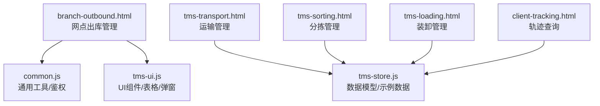
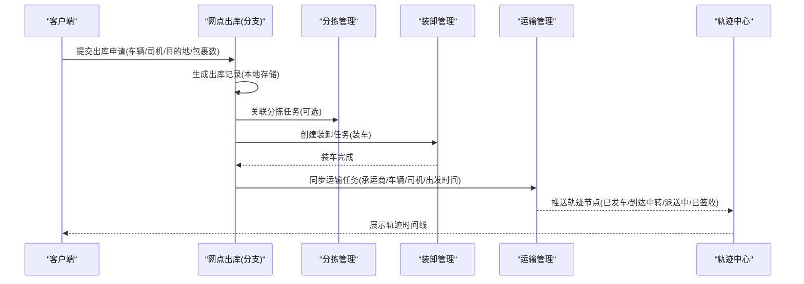
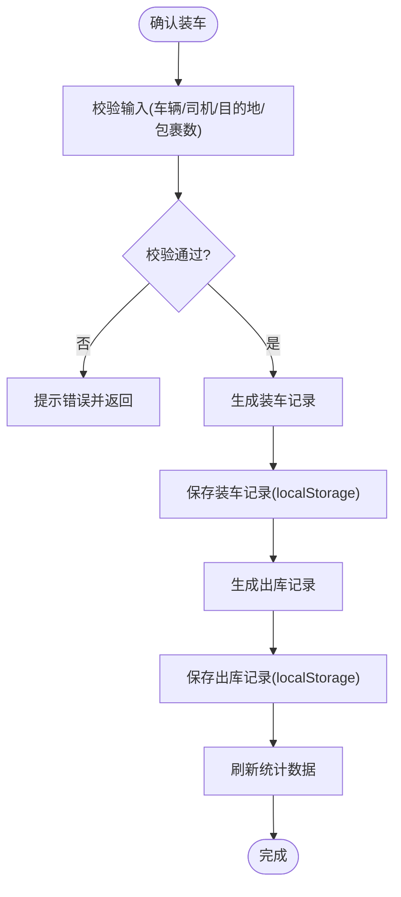
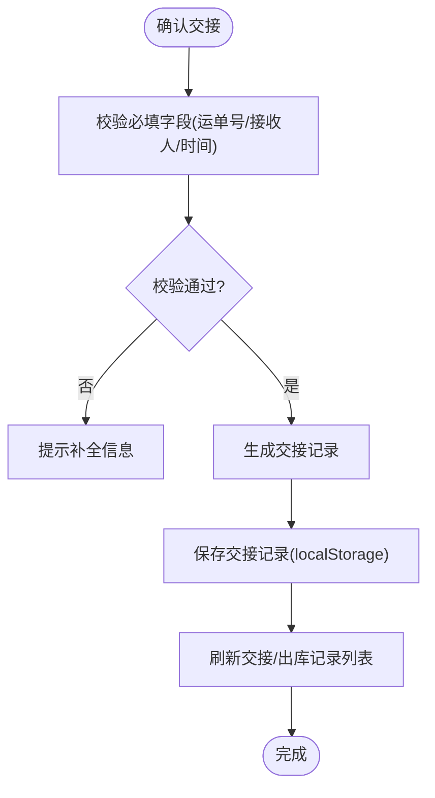
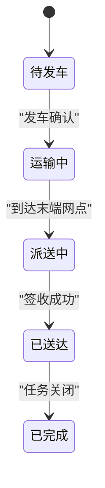
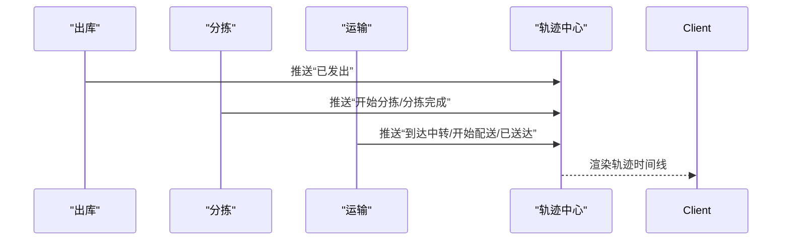
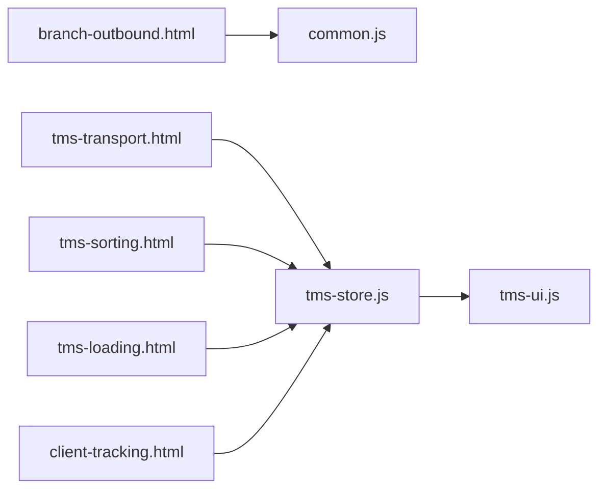

# 出库管理流程

<cite>
**本文引用的文件**   
- [branch-outbound.html](file://branch-outbound.html)
- [tms-transport.html](file://tms-transport.html)
- [tms-sorting.html](file://tms-sorting.html)
- [tms-loading.html](file://tms-loading.html)
- [common.js](file://common.js)
- [tms-ui.js](file://tms-ui.js)
- [tms-store.js](file://tms-store.js)
- [client-tracking.html](file://client-tracking.html)
</cite>

## 目录
1. [引言](#引言)
2. [项目结构](#项目结构)
3. [核心组件](#核心组件)
4. [架构总览](#架构总览)
5. [详细组件分析](#详细组件分析)
6. [依赖关系分析](#依赖关系分析)
7. [性能与效率考量](#性能与效率考量)
8. [故障排查指南](#故障排查指南)
9. [结论](#结论)
10. [附录：关键实现路径索引](#附录关键实现路径索引)

## 引言
本技术文档围绕“网点出库管理流程”展开，覆盖从出库单生成、拣货策略、打包流程到发货确认的完整业务闭环。结合仓库现有前端页面与通用库，梳理出库优先级算法、路径优化与批量处理机制；记录出库质量控制、包装规范检查与标签打印能力；说明与运输系统的对接接口、物流信息同步与轨迹跟踪机制；并给出异常处理、退货与逆向物流的处理思路。同时提供工作流引擎与状态机的概念性设计与可落地的代码级参考位置，帮助读者快速理解与扩展系统。

## 项目结构
本项目为多角色、多页面的前端演示型 TMS（运输管理系统）应用，采用 HTML + JS 的模块化组织方式，通过 common.js 提供通用工具与登录鉴权，tms-ui.js 提供 UI 组件与渲染能力，tms-store.js 提供数据模型与示例数据，各业务页面以独立 HTML 承载界面与交互逻辑。

**图示来源**
- [branch-outbound.html:1-120](file://branch-outbound.html#L1-L120)
- [common.js:135-199](file://common.js#L135-L199)
- [tms-ui.js:701-782](file://tms-ui.js#L701-L782)
- [tms-store.js:482-508](file://tms-store.js#L482-L508)
- [tms-transport.html:301-476](file://tms-transport.html#L301-L476)
- [tms-sorting.html:345-547](file://tms-sorting.html#L345-L547)
- [tms-loading.html:362-564](file://tms-loading.html#L362-L564)
- [client-tracking.html:379-428](file://client-tracking.html#L379-L428)

**章节来源**
- [branch-outbound.html:1-120](file://branch-outbound.html#L1-L120)
- [common.js:135-199](file://common.js#L135-L199)
- [tms-ui.js:701-782](file://tms-ui.js#L701-L782)
- [tms-store.js:482-508](file://tms-store.js#L482-L508)

## 核心组件
- 网点出库管理（branch-outbound.html）
  - 装车发运：选择车辆、司机、目的地，录入包裹数量与备注，确认后写入本地存储并生成出库记录。
  - 交接确认：按运单号进行交接登记，记录接收人、时间与备注。
  - 车辆管理与出库记录：展示车辆状态与历史出库明细。
- 通用工具（common.js）
  - 订单号与运单号生成：HL+省份首字母+时间戳+用户ID哈希+随机数；WB+订单号哈希+随机数。
  - 登录鉴权：checkLoginStatus、displayCurrentUser、logout。
- UI 组件（tms-ui.js）
  - 表单弹窗、确认框、Toast、通用表格、分页、排序、筛选、KPI 与图表等。
- 数据模型（tms-store.js）
  - 示例实体：员工、车辆等，用于支撑运营类页面的数据展示。
- 运输管理（tms-transport.html）
  - 运输任务列表、状态更新、完成操作，体现与出库后的运输衔接。
- 分拣管理（tms-sorting.html）
  - 分拣任务列表、开始/完成/异常处理，体现出库前的分拣准备。
- 装卸管理（tms-loading.html）
  - 装卸任务列表、开始/完成操作，体现装车与卸车作业。
- 轨迹查询（client-tracking.html）
  - 模拟轨迹数据与时间线展示，体现物流信息同步与轨迹跟踪。

**章节来源**
- [branch-outbound.html:408-657](file://branch-outbound.html#L408-L657)
- [common.js:22-50](file://common.js#L22-L50)
- [common.js:135-199](file://common.js#L135-L199)
- [tms-ui.js:109-287](file://tms-ui.js#L109-L287)
- [tms-store.js:482-508](file://tms-store.js#L482-L508)
- [tms-transport.html:381-476](file://tms-transport.html#L381-L476)
- [tms-sorting.html:425-547](file://tms-sorting.html#L425-L547)
- [tms-loading.html:443-564](file://tms-loading.html#L443-L564)
- [client-tracking.html:379-428](file://client-tracking.html#L379-L428)

## 架构总览
出库管理在整体 TMS 中处于“仓储—运输”的关键衔接点。其上游是订单与分拣，下游是运输调度与轨迹跟踪。

**图示来源**
- [branch-outbound.html:831-899](file://branch-outbound.html#L831-L899)
- [tms-sorting.html:425-547](file://tms-sorting.html#L425-L547)
- [tms-loading.html:443-564](file://tms-loading.html#L443-L564)
- [tms-transport.html:381-476](file://tms-transport.html#L381-L476)
- [client-tracking.html:379-428](file://client-tracking.html#L379-L428)

## 详细组件分析

### 出库单生成与装车发运
- 功能要点
  - 选择车辆、司机、目的地，输入包裹数量与备注后确认装车。
  - 将装车记录与出库记录分别写入 localStorage，刷新统计与列表。
- 关键实现路径
  - 表单字段与按钮绑定：[branch-outbound.html:444-478](file://branch-outbound.html#L444-L478)
  - 确认装车逻辑与记录写入：[branch-outbound.html:831-899](file://branch-outbound.html#L831-L899)
  - 统计数据加载与展示：[branch-outbound.html:805-829](file://branch-outbound.html#L805-L829)
- 数据结构
  - 装车记录：id、vehicle、driver、destination、packageCount、notes、loadingTime、status
  - 出库记录：id、vehicle、driver、destination、packageCount、outboundTime、status
- 复杂度与性能
  - 基于数组 push 与 localStorage 序列化，O(n) 写入与读取；适合小规模演示场景。
- 可扩展点
  - 增加校验（如包裹数上限、目的地有效性）、并发控制与事务回滚提示。

**图示来源**
- [branch-outbound.html:831-899](file://branch-outbound.html#L831-L899)
- [branch-outbound.html:805-829](file://branch-outbound.html#L805-L829)

**章节来源**
- [branch-outbound.html:444-478](file://branch-outbound.html#L444-L478)
- [branch-outbound.html:805-829](file://branch-outbound.html#L805-L829)
- [branch-outbound.html:831-899](file://branch-outbound.html#L831-L899)

### 交接确认与出库记录
- 功能要点
  - 按运单号进行交接登记，记录接收人、交接时间与备注。
  - 展示最近交接记录与出库记录列表。
- 关键实现路径
  - 交接表单与确认逻辑：[branch-outbound.html:909-954](file://branch-outbound.html#L909-L954)
  - 交接记录加载与渲染：[branch-outbound.html:956-970](file://branch-outbound.html#L956-L970)
  - 出库记录加载与渲染：[branch-outbound.html:972-988](file://branch-outbound.html#L972-L988)
- 数据结构
  - 交接记录：id、waybillNumber、vehicle、receiver、handoverTime、notes、operator
- 质量与合规
  - 必填项校验（运单号、接收人、时间），避免空值入库。

**图示来源**
- [branch-outbound.html:909-954](file://branch-outbound.html#L909-L954)
- [branch-outbound.html:956-988](file://branch-outbound.html#L956-L988)

**章节来源**
- [branch-outbound.html:909-954](file://branch-outbound.html#L909-L954)
- [branch-outbound.html:956-988](file://branch-outbound.html#L956-L988)

### 拣货策略与路径优化（概念设计）
- 目标
  - 根据订单优先级、目的地聚合、库位距离与批次约束，生成最优拣货顺序与路径。
- 建议算法
  - 优先级评分：时效等级（加急/标准/经济）、客户等级、截止时间。
  - 目的地聚类：按分拨中心或城市分组，减少跨区往返。
  - 库位最短路径：基于仓库分区（如北区/东区）与货架坐标，计算最短行走路径。
  - 批次合并：同目的地包裹合并拣选，提升装载率。
- 实现建议
  - 使用 tms-ui.js 的 table 组件展示拣货任务，支持搜索、筛选与排序。
  - 在 branch-outbound.html 中增加“拣货计划”模块，输出拣货清单与路径图。
- 复杂度
  - 典型为 NP-hard 问题，可采用启发式（贪心、最近邻）或元启发式（遗传、蚁群）近似求解。

[本节为概念设计，不直接分析具体文件]

### 打包流程与包装规范检查
- 功能要点
  - 打包前校验：重量/尺寸限制、易碎品标识、危险品禁运规则。
  - 包装规范：箱型匹配、填充物使用、封箱胶带与标签粘贴位置。
  - 标签打印：运单标签、条码/二维码、收货人信息与目的地路由码。
- 实现建议
  - 在 branch-outbound.html 增加“打包质检”步骤，调用 tms-ui.js 的 formModal 收集包装参数。
  - 使用 common.js 的 generateWaybillNumber 生成运单号并打印标签。
  - 引入 tms-material.html 中的物料库存（纸箱、胶带、标签纸）进行消耗扣减。
- 质量指标
  - 包装合格率、标签准确率、破损率。

[本节为概念设计，不直接分析具体文件]

### 发货确认与运输对接
- 功能要点
  - 装车完成后，向运输系统同步运输任务（承运商、车辆、司机、出发时间、预计到达）。
  - 运输系统维护任务状态（待发车、运输中、已送达、已完成）。
- 关键实现路径
  - 运输任务列表与操作按钮：[tms-transport.html:381-476](file://tms-transport.html#L381-L476)
  - 装卸任务与状态流转：[tms-loading.html:443-564](file://tms-loading.html#L443-L564)
- 接口契约（建议）
  - POST /api/transport/tasks：创建运输任务
  - PUT /api/transport/tasks/{id}/status：更新任务状态
  - GET /api/transport/tasks/{id}：查询任务详情
- 状态机（建议）
  - pending → shipping → delivering → delivered → completed

**图示来源**
- [tms-transport.html:381-476](file://tms-transport.html#L381-L476)
- [tms-loading.html:443-564](file://tms-loading.html#L443-L564)

**章节来源**
- [tms-transport.html:381-476](file://tms-transport.html#L381-L476)
- [tms-loading.html:443-564](file://tms-loading.html#L443-L564)

### 物流信息同步与轨迹跟踪
- 功能要点
  - 轨迹节点包括：已发出、到达中转站、开始分拣、分拣完成、到达网点、开始配送、正在配送、即将送达、已送达。
  - 轨迹时间线展示，便于客户与客服查询。
- 关键实现路径
  - 轨迹数据与渲染：[client-tracking.html:379-428](file://client-tracking.html#L379-L428)
- 同步机制（建议）
  - 事件驱动：每次状态变更触发轨迹事件写入。
  - 消息队列：解耦出库、分拣、运输与轨迹服务。
  - 幂等性：同一轨迹节点重复推送不产生重复记录。

**图示来源**
- [client-tracking.html:379-428](file://client-tracking.html#L379-L428)

**章节来源**
- [client-tracking.html:379-428](file://client-tracking.html#L379-L428)

### 出库质量控制与包装规范检查
- 检查项
  - 重量/尺寸阈值、易碎/冷链/危险品标识、包装完整性、标签正确性。
- 实现建议
  - 在 branch-outbound.html 增加“打包质检”表单，使用 tms-ui.js 的 formModal 收集数据。
  - 对不合格包裹标记异常并进入异常工单流程。
- 指标
  - 包装合格率、标签准确率、破损率、返工率。

[本节为概念设计，不直接分析具体文件]

### 标签打印功能
- 内容
  - 运单号、收件人信息、目的地路由码、条码/二维码。
- 实现建议
  - 使用 common.js 的 generateWaybillNumber 生成运单号。
  - 集成浏览器打印 API 或第三方打印 SDK，输出 PDF/图片。
- 质量
  - 打印成功率、标签清晰度、条码可读率。

[本节为概念设计，不直接分析具体文件]

### 出库异常处理、退货与逆向物流
- 异常类型
  - 错分、漏拣、破损、延误、地址无效、拒收。
- 处理流程
  - 异常登记 → 工单分配 → 处理方案（重拣/补发/退回）→ 结果归档。
- 逆向物流
  - 退货入库 → 质检 → 重新上架或报废 → 退款结算。
- 实现建议
  - 使用 tms-ui.js 的 detailModal 与 timeline 展示异常详情与处理进度。
  - 在 tms-pages.js 中已有异常详情与订单轨迹展示逻辑，可作为参考。

**章节来源**
- [tms-ui.js:682-699](file://tms-ui.js#L682-L699)
- [tms-pages.js:193-211](file://tms-pages.js#L193-L211)

### 出库效率分析、成本核算与绩效评估
- 效率指标
  - 出库时长、拣货路径长度、装载率、交接及时率。
- 成本核算
  - 包材成本、人工工时、运输费用、异常处理成本。
- 绩效评估
  - 个人/班组 KPI：拣货效率、差错率、准时率、客户满意度。
- 实现建议
  - 使用 tms-ui.js 的 kpis 与 charts 组件展示趋势与对比。
  - 结合 tms-store.js 的数据模型扩展出“出库绩效”实体。

[本节为概念设计，不直接分析具体文件]

### 工作流引擎与状态机实现（概念设计）
- 工作流引擎
  - 定义节点（出库申请、拣货、打包、装车、交接、运输、签收）、边（条件转移）、动作（校验、通知、审计）。
  - 使用 tms-ui.js 的 formModal 与 confirmDialog 驱动用户交互。
- 状态机
  - 出库单状态：草稿 → 已审核 → 拣货中 → 打包中 → 已装车 → 已交接 → 已出库 → 已签收 → 已完成。
  - 运输任务状态：待发车 → 运输中 → 派送中 → 已送达 → 已完成。
- 实现建议
  - 在 branch-outbound.html 与 tms-transport.html 中分别维护状态字段，并通过 tms-ui.js 的 statusBadge 渲染。

[本节为概念设计，不直接分析具体文件]

## 依赖关系分析
- 页面依赖
  - branch-outbound.html 依赖 common.js（鉴权/工具）与自身脚本逻辑。
  - tms-transport.html、tms-sorting.html、tms-loading.html 依赖 tms-store.js（数据模型）与 tms-ui.js（UI 组件）。
  - client-tracking.html 依赖 tms-store.js（示例数据）与 tms-ui.js（UI 组件）。
- 数据依赖
  - 出库记录、交接记录、装车记录均存储在 localStorage，页面初始化时读取并渲染。
- 耦合度
  - 页面间耦合较低，主要通过共享脚本与统一 UI 组件协作。
- 潜在循环依赖
  - 当前未见循环依赖；如需扩展，建议使用事件总线或中央 Store 解耦。

**图示来源**
- [branch-outbound.html:662-663](file://branch-outbound.html#L662-L663)
- [tms-transport.html:465-476](file://tms-transport.html#L465-L476)
- [tms-sorting.html:537-547](file://tms-sorting.html#L537-L547)
- [tms-loading.html:554-564](file://tms-loading.html#L554-L564)
- [client-tracking.html:379-428](file://client-tracking.html#L379-L428)

**章节来源**
- [branch-outbound.html:662-663](file://branch-outbound.html#L662-L663)
- [tms-transport.html:465-476](file://tms-transport.html#L465-L476)
- [tms-sorting.html:537-547](file://tms-sorting.html#L537-L547)
- [tms-loading.html:554-564](file://tms-loading.html#L554-L564)
- [client-tracking.html:379-428](file://client-tracking.html#L379-L428)

## 性能与效率考量
- 数据持久化
  - localStorage 适合小规模演示；生产环境应迁移至后端数据库与缓存层。
- 渲染性能
  - 使用 tms-ui.js 的 table 组件内置分页与排序，避免全量 DOM 操作。
- 批处理
  - 批量装车与批量交接可通过数组批量写入与一次性刷新列表。
- 网络与并发
  - 建议引入请求去抖与重试机制，避免重复提交与竞态条件。

[本节为一般性指导，不直接分析具体文件]

## 故障排查指南
- 常见问题
  - 未登录或角色不匹配：检查 checkLoginStatus 返回值与跳转逻辑。
  - 数据为空：确认 localStorage 是否初始化与读取成功。
  - 表单校验失败：检查必填字段与提示信息。
- 定位方法
  - 查看控制台日志（common.js 中多处 console.log）。
  - 使用 tms-ui.js 的 toast 与 modal 反馈错误信息。
- 恢复措施
  - 清理 localStorage 并重新初始化数据。
  - 修正表单校验逻辑与默认值。

**章节来源**
- [common.js:135-199](file://common.js#L135-L199)
- [tms-ui.js:88-105](file://tms-ui.js#L88-L105)
- [tms-ui.js:139-158](file://tms-ui.js#L139-L158)

## 结论
本仓库提供了网点出库管理的完整前端实现骨架，涵盖出库单生成、装车发运、交接确认、运输对接与轨迹跟踪等关键环节。通过 common.js 与 tms-ui.js 的通用能力，可以快速扩展拣货策略、打包质检、标签打印、异常处理与绩效评估等功能。建议在后续迭代中引入后端服务与消息队列，完善状态机与工作流引擎，提升系统的可扩展性与稳定性。

[本节为总结性内容，不直接分析具体文件]

## 附录：关键实现路径索引
- 出库单生成与装车
  - [branch-outbound.html:831-899](file://branch-outbound.html#L831-L899)
- 交接确认与记录
  - [branch-outbound.html:909-988](file://branch-outbound.html#L909-L988)
- 订单号与运单号生成
  - [common.js:22-50](file://common.js#L22-L50)
- 登录鉴权与用户显示
  - [common.js:135-199](file://common.js#L135-L199)
- UI 组件（表单/弹窗/表格）
  - [tms-ui.js:109-287](file://tms-ui.js#L109-L287)
  - [tms-ui.js:303-544](file://tms-ui.js#L303-L544)
- 运输任务与状态
  - [tms-transport.html:381-476](file://tms-transport.html#L381-L476)
- 分拣任务与状态
  - [tms-sorting.html:425-547](file://tms-sorting.html#L425-L547)
- 装卸任务与状态
  - [tms-loading.html:443-564](file://tms-loading.html#L443-L564)
- 轨迹查询与时间线
  - [client-tracking.html:379-428](file://client-tracking.html#L379-L428)
- 数据模型（示例）
  - [tms-store.js:482-508](file://tms-store.js#L482-L508)