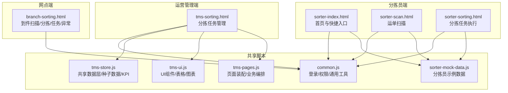
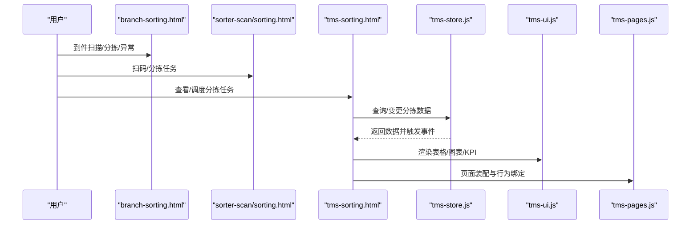
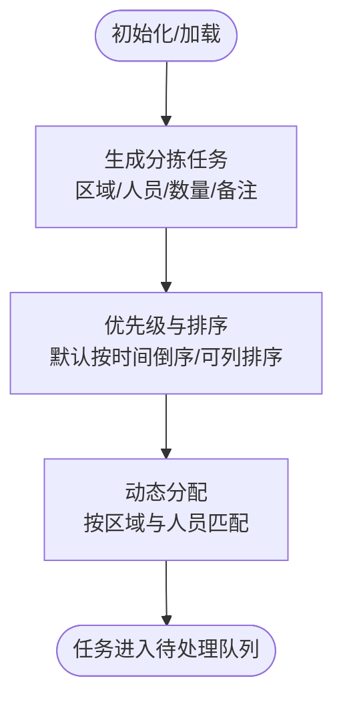
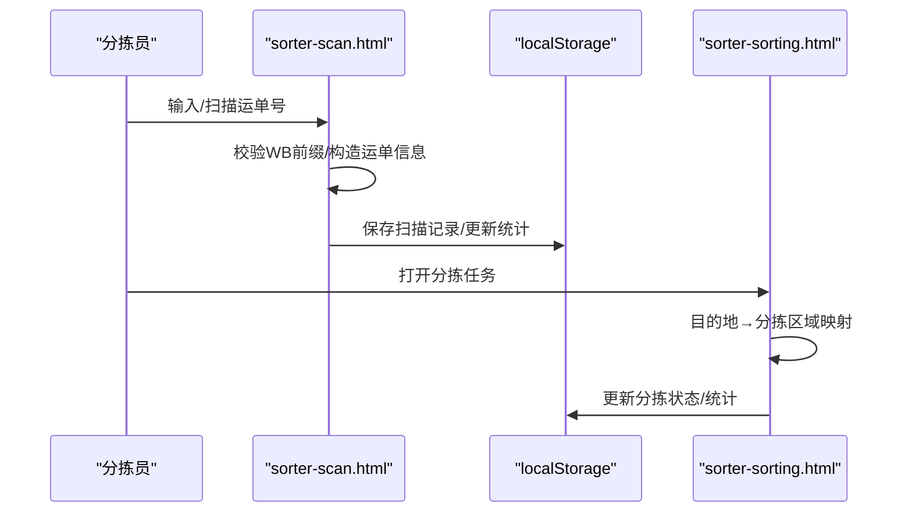
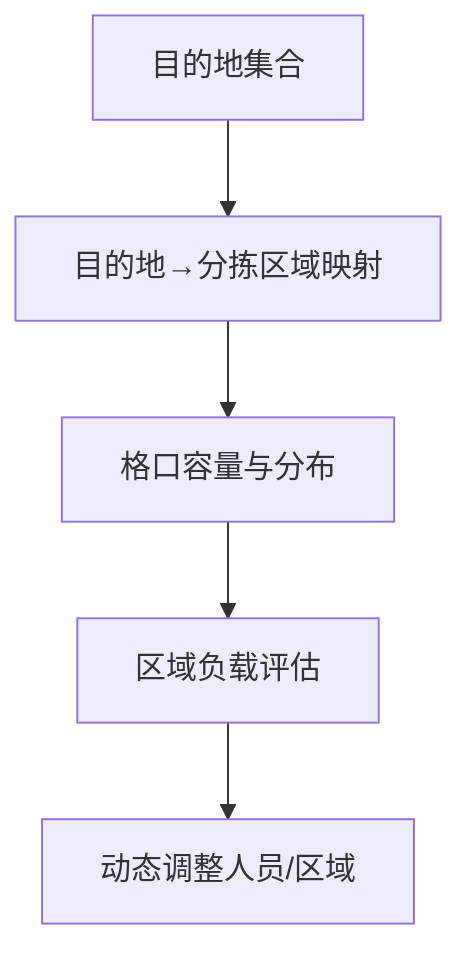
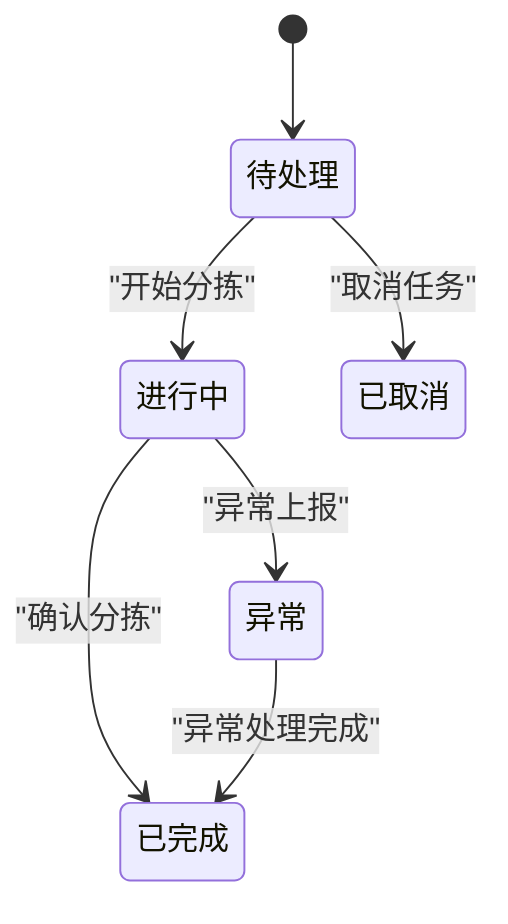
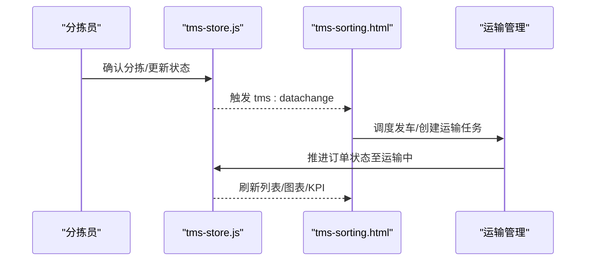
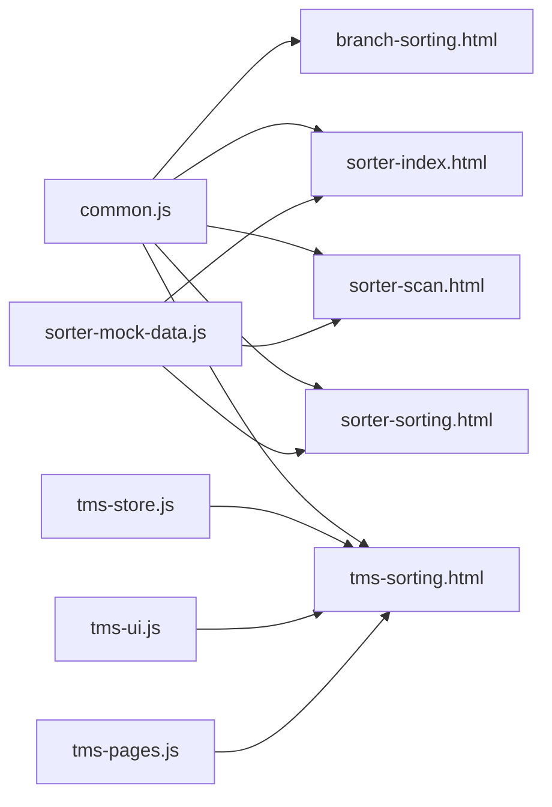
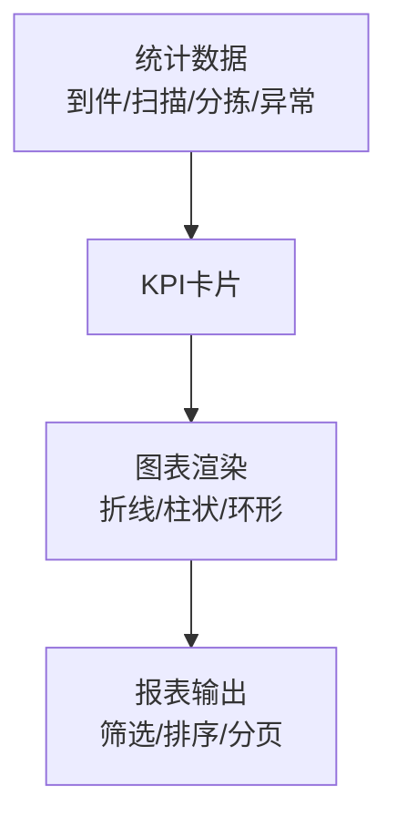

# 分拣处理中心

<cite>
**本文引用的文件**   
- [branch-sorting.html](file://branch-sorting.html)
- [sorter-index.html](file://sorter-index.html)
- [sorter-scan.html](file://sorter-scan.html)
- [sorter-sorting.html](file://sorter-sorting.html)
- [tms-sorting.html](file://tms-sorting.html)
- [common.js](file://common.js)
- [tms-store.js](file://tms-store.js)
- [tms-ui.js](file://tms-ui.js)
- [tms-pages.js](file://tms-pages.js)
- [sorter-mock-data.js](file://sorter-mock-data.js)
</cite>

## 目录
1. [引言](#引言)
2. [项目结构](#项目结构)
3. [核心组件](#核心组件)
4. [架构总览](#架构总览)
5. [详细组件分析](#详细组件分析)
6. [依赖关系分析](#依赖关系分析)
7. [性能与并发策略](#性能与并发策略)
8. [故障恢复与异常处理](#故障恢复与异常处理)
9. [分拣效率监控、KPI与报表](#分拣效率监控kpi与报表)
10. [结论](#结论)

## 引言
本技术文档围绕“分拣处理中心”的实现进行系统化说明，覆盖分拣任务生成算法、优先级排序与动态分配机制；扫描识别、条码解析与自动分类；分拣路径优化、负载均衡与并发处理；状态跟踪、异常检测与自动纠错；以及与运输系统的交接流程、数据同步协议和状态更新机制。同时给出分拣效率监控、KPI统计与报表生成的实现细节与优化建议。

## 项目结构
分拣处理中心由三类前端页面与共享脚本组成：
- 网点侧：到件扫描、包裹分拣、任务分配、异常上报
- 分拣员侧：扫码、分拣任务执行、绩效查看
- 运营/管理侧：分拣任务总览、状态管理与联动

**图示来源**
- [branch-sorting.html:404-604](file://branch-sorting.html#L404-L604)
- [sorter-index.html:214-276](file://sorter-index.html#L214-L276)
- [sorter-scan.html:335-376](file://sorter-scan.html#L335-L376)
- [sorter-sorting.html:412-455](file://sorter-sorting.html#L412-L455)
- [tms-sorting.html:426-532](file://tms-sorting.html#L426-L532)
- [common.js:135-199](file://common.js#L135-L199)
- [tms-store.js:1-12](file://tms-store.js#L1-L12)
- [tms-ui.js:303-544](file://tms-ui.js#L303-L544)
- [tms-pages.js:108-135](file://tms-pages.js#L108-L135)
- [sorter-mock-data.js:1-10](file://sorter-mock-data.js#L1-L10)

**章节来源**
- [branch-sorting.html:404-604](file://branch-sorting.html#L404-L604)
- [sorter-index.html:214-276](file://sorter-index.html#L214-L276)
- [sorter-scan.html:335-376](file://sorter-scan.html#L335-L376)
- [sorter-sorting.html:412-455](file://sorter-sorting.html#L412-L455)
- [tms-sorting.html:426-532](file://tms-sorting.html#L426-L532)
- [common.js:135-199](file://common.js#L135-L199)
- [tms-store.js:1-12](file://tms-store.js#L1-L12)
- [tms-ui.js:303-544](file://tms-ui.js#L303-L544)
- [tms-pages.js:108-135](file://tms-pages.js#L108-L135)
- [sorter-mock-data.js:1-10](file://sorter-mock-data.js#L1-L10)

## 核心组件
- 网点分拣页（branch-sorting.html）
  - 提供到件扫描、包裹分拣、任务分配、异常件处理四大功能模块
  - 使用 localStorage 维护扫描记录、分拣记录、任务列表与异常件
- 分拣员首页（sorter-index.html）
  - 展示今日已扫描/已分拣/异常件等指标，并提供快捷入口
- 分拣员扫描页（sorter-scan.html）
  - 支持扫码或手动输入运单号，校验并保存扫描记录，更新当日统计
- 分拣员分拣页（sorter-sorting.html）
  - 待分拣任务列表、按目的地自动选择分拣区域、确认分拣后更新状态与统计
- 运营管理分拣页（tms-sorting.html）
  - 以表格形式展示分拣任务，支持开始/完成/异常处理等操作
- 共享脚本
  - common.js：登录鉴权、用户信息、订单/运单号生成
  - tms-store.js：基于 localStorage 的共享数据层，含种子数据、路由轨迹、KPI聚合
  - tms-ui.js：通用 UI 组件（表格、弹窗、图表、KPI）
  - tms-pages.js：页面装配器，统一渲染 KPI+图表+表格+CRUD
  - sorter-mock-data.js：为分拣员相关页面生成示例数据

**章节来源**
- [branch-sorting.html:404-604](file://branch-sorting.html#L404-L604)
- [sorter-index.html:214-276](file://sorter-index.html#L214-L276)
- [sorter-scan.html:335-376](file://sorter-scan.html#L335-L376)
- [sorter-sorting.html:412-455](file://sorter-sorting.html#L412-L455)
- [tms-sorting.html:426-532](file://tms-sorting.html#L426-L532)
- [common.js:135-199](file://common.js#L135-L199)
- [tms-store.js:1-12](file://tms-store.js#L1-L12)
- [tms-ui.js:303-544](file://tms-ui.js#L303-L544)
- [tms-pages.js:108-135](file://tms-pages.js#L108-L135)
- [sorter-mock-data.js:1-10](file://sorter-mock-data.js#L1-L10)

## 架构总览
系统采用“多角色前端 + 共享脚本”的轻量架构：
- 各角色页面通过 common.js 做登录鉴权与基础交互
- 运营端通过 tms-store.js/tms-ui.js/tms-pages.js 获得统一的数据层与 UI 能力
- 分拣员端通过 sorter-mock-data.js 快速生成演示数据，便于操作演练

**图示来源**
- [branch-sorting.html:404-604](file://branch-sorting.html#L404-L604)
- [sorter-scan.html:335-376](file://sorter-scan.html#L335-L376)
- [sorter-sorting.html:412-455](file://sorter-sorting.html#L412-L455)
- [tms-sorting.html:426-532](file://tms-sorting.html#L426-L532)
- [tms-store.js:1-12](file://tms-store.js#L1-L12)
- [tms-ui.js:303-544](file://tms-ui.js#L303-L544)
- [tms-pages.js:108-135](file://tms-pages.js#L108-L135)

## 详细组件分析

### 分拣任务生成与优先级排序
- 任务生成
  - 网点侧在初始化时创建分拣任务，包含区域、人员、包裹数量、备注与状态
  - 运营端通过 tms-store.js 的种子数据生成真实感分拣任务，并与订单、运单、轨迹关联
- 优先级与排序
  - 分拣任务默认按时间倒序展示，支持按列排序
  - 分拣员分拣时根据目的地自动映射分拣区域，提升分拣效率

**图示来源**
- [branch-sorting.html:738-765](file://branch-sorting.html#L738-L765)
- [tms-store.js:796-800](file://tms-store.js#L796-L800)
- [tms-pages.js:108-135](file://tms-pages.js#L108-L135)

**章节来源**
- [branch-sorting.html:738-765](file://branch-sorting.html#L738-L765)
- [tms-store.js:796-800](file://tms-store.js#L796-L800)
- [tms-pages.js:108-135](file://tms-pages.js#L108-L135)

### 扫描识别、条码解析与自动分类
- 扫描识别
  - 分拣员扫描页支持扫码或手动输入运单号，校验前缀 WB 并通过模拟逻辑获取运单信息
  - 扫描成功后保存记录至 localStorage，并更新当日统计
- 自动分类
  - 分拣员分拣页根据目的地自动选择分拣区域（如北京→A区），减少人工判断
  - 网点分拣页提供多个分拣格口（北区/南区/东区/西区/中心区/异常件）

**图示来源**
- [sorter-scan.html:414-447](file://sorter-scan.html#L414-L447)
- [sorter-scan.html:503-544](file://sorter-scan.html#L503-L544)
- [sorter-sorting.html:656-668](file://sorter-sorting.html#L656-L668)
- [sorter-sorting.html:682-723](file://sorter-sorting.html#L682-L723)

**章节来源**
- [sorter-scan.html:414-447](file://sorter-scan.html#L414-L447)
- [sorter-scan.html:503-544](file://sorter-scan.html#L503-L544)
- [sorter-sorting.html:656-668](file://sorter-sorting.html#L656-L668)
- [sorter-sorting.html:682-723](file://sorter-sorting.html#L682-L723)

### 分拣路径优化与负载均衡
- 路径优化
  - 通过目的地→分拣区域的映射表，将同向包裹集中到同一格口，减少搬运距离
- 负载均衡
  - 任务分配支持选择区域与人员，可按区域均衡分配工作量
  - 运营端可查看分拣任务状态，必要时调整人员或区域负载

**图示来源**
- [sorter-sorting.html:656-668](file://sorter-sorting.html#L656-L668)
- [branch-sorting.html:521-544](file://branch-sorting.html#L521-L544)

**章节来源**
- [sorter-sorting.html:656-668](file://sorter-sorting.html#L656-L668)
- [branch-sorting.html:521-544](file://branch-sorting.html#L521-L544)

### 分拣状态跟踪、异常检测与自动纠错
- 状态跟踪
  - 分拣任务状态包括待处理/进行中/已完成/已取消，并在表格中可视化
  - 分拣员分拣完成后更新状态与时间戳，支持查看分拣记录
- 异常检测
  - 网点侧提供异常件上报（破损/面单丢失/地址错误/其他），并记录异常类型与描述
  - 运营端对异常任务提供“处理”按钮，进入异常闭环流程
- 自动纠错
  - 扫描失败时提示错误信息；分拣区域未选择时阻止提交

**图示来源**
- [tms-sorting.html:454-530](file://tms-sorting.html#L454-L530)
- [branch-sorting.html:565-603](file://branch-sorting.html#L565-L603)
- [sorter-sorting.html:682-723](file://sorter-sorting.html#L682-L723)

**章节来源**
- [tms-sorting.html:454-530](file://tms-sorting.html#L454-L530)
- [branch-sorting.html:565-603](file://branch-sorting.html#L565-L603)
- [sorter-sorting.html:682-723](file://sorter-sorting.html#L682-L723)

### 与运输系统的交接流程、数据同步协议与状态更新
- 交接流程
  - 分拣完成后，订单状态推进至“已分拣”，随后进入运输阶段
  - 运营端可通过“调度发车”创建运输任务，并联动订单状态推进
- 数据同步协议
  - 共享数据层通过 localStorage 持久化，变更时触发 tms:datachange 事件
  - UI 层订阅事件后刷新表格与图表，保证多页面数据一致
- 状态更新机制
  - 订单状态机包含待入库/已入库/已分拣/运输中/已到达/派送中/已签收
  - 轨迹节点与标准时限用于时效监控与偏差标记

**图示来源**
- [tms-store.js:232-244](file://tms-store.js#L232-L244)
- [tms-store.js:88-120](file://tms-store.js#L88-L120)
- [tms-pages.js:289-318](file://tms-pages.js#L289-L318)

**章节来源**
- [tms-store.js:232-244](file://tms-store.js#L232-L244)
- [tms-store.js:88-120](file://tms-store.js#L88-L120)
- [tms-pages.js:289-318](file://tms-pages.js#L289-L318)

## 依赖关系分析
- 页面依赖
  - 所有角色页面依赖 common.js 进行登录鉴权与用户信息显示
  - 运营端依赖 tms-store.js/tms-ui.js/tms-pages.js 提供数据与 UI 能力
  - 分拣员端依赖 sorter-mock-data.js 生成演示数据
- 数据依赖
  - 分拣任务与订单、运单、轨迹强关联
  - 扫描记录与当日统计、月度绩效关联

**图示来源**
- [common.js:135-199](file://common.js#L135-L199)
- [tms-store.js:1-12](file://tms-store.js#L1-L12)
- [tms-ui.js:303-544](file://tms-ui.js#L303-L544)
- [tms-pages.js:108-135](file://tms-pages.js#L108-L135)
- [sorter-mock-data.js:1-10](file://sorter-mock-data.js#L1-L10)

**章节来源**
- [common.js:135-199](file://common.js#L135-L199)
- [tms-store.js:1-12](file://tms-store.js#L1-L12)
- [tms-ui.js:303-544](file://tms-ui.js#L303-L544)
- [tms-pages.js:108-135](file://tms-pages.js#L108-L135)
- [sorter-mock-data.js:1-10](file://sorter-mock-data.js#L1-L10)

## 性能与并发策略
- 本地存储优化
  - 使用 localStorage 作为轻量数据库，避免频繁网络请求
  - 通过 tms-store.js 的 persist 与 emit 机制批量持久化与事件通知，降低重复渲染
- 列表与分页
  - tms-ui.js 的 table 组件内置搜索、筛选、排序与分页，减少前端计算压力
- 并发控制
  - 当前为单线程浏览器环境，无后台任务；关键操作（如确认分拣）采用同步更新，确保状态一致性
- 渲染优化
  - 表格与图表按需渲染，仅在数据变化时刷新，避免全量重绘

[本节为通用指导，不直接分析具体文件]

## 故障恢复与异常处理
- 扫描失败
  - 分拣员扫描页在输入无效时显示错误信息，并阻止后续流程
- 分拣未完成
  - 未选择分拣区域时阻止提交，提示用户补充必要信息
- 异常件处理
  - 网点侧支持异常上报，运营端提供处理与闭环能力
- 数据一致性
  - 共享数据层变更触发事件，UI 层订阅后刷新，保证多页面数据一致

**章节来源**
- [sorter-scan.html:414-447](file://sorter-scan.html#L414-L447)
- [sorter-sorting.html:682-723](file://sorter-sorting.html#L682-L723)
- [branch-sorting.html:565-603](file://branch-sorting.html#L565-L603)
- [tms-store.js:232-244](file://tms-store.js#L232-L244)

## 分拣效率监控、KPI与报表
- KPI指标
  - 今日到件数、已扫描件数、已分拣件数、异常件数
  - 分拣员绩效：扫描总数、分拣总数、准确率、效率评分
- 报表生成
  - 运营端通过 tms-store.js 的统计聚合与 tms-ui.js 的图表组件生成趋势图、分布图
  - 分拣任务列表支持按状态、时间、区域筛选，导出报表数据
- 监控与预警
  - 低库存物资、运力满载、异常待处理等触发预警
  - 轨迹节点标准时限与偏差标记用于时效监控

**图示来源**
- [branch-sorting.html:408-426](file://branch-sorting.html#L408-L426)
- [sorter-index.html:235-252](file://sorter-index.html#L235-L252)
- [tms-ui.js:548-680](file://tms-ui.js#L548-L680)
- [tms-store.js:462-800](file://tms-store.js#L462-L800)

**章节来源**
- [branch-sorting.html:408-426](file://branch-sorting.html#L408-L426)
- [sorter-index.html:235-252](file://sorter-index.html#L235-L252)
- [tms-ui.js:548-680](file://tms-ui.js#L548-L680)
- [tms-store.js:462-800](file://tms-store.js#L462-L800)

## 结论
分拣处理中心通过多角色前端与共享脚本实现了从扫描识别、自动分类到任务分配、状态跟踪与异常处理的完整闭环。依托 localStorage 的轻量数据层与统一的 UI 组件库，系统在易用性、可维护性与扩展性之间取得平衡。未来可在后端服务化、实时通信与复杂算法（如路径优化、动态调度）方面进一步升级，以提升分拣效率与资源利用率。