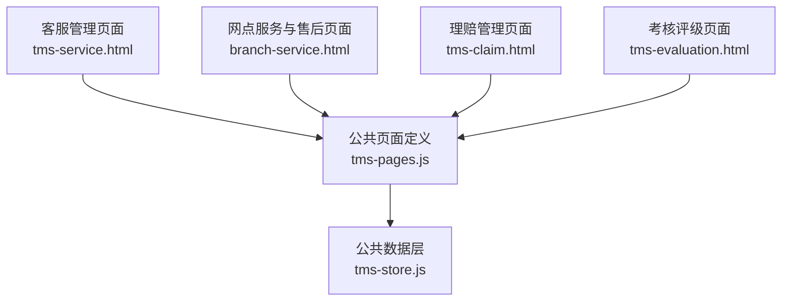
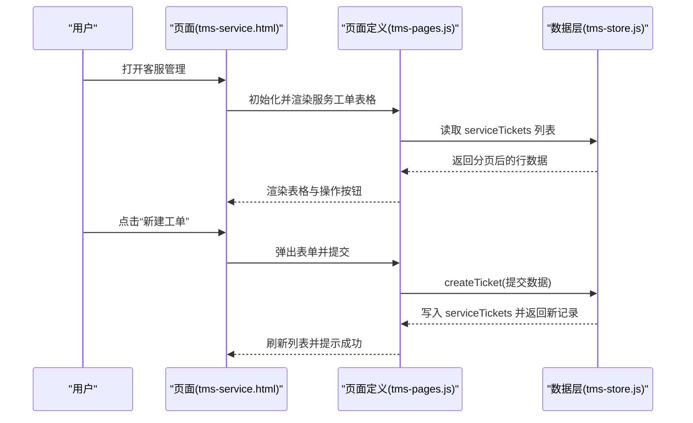
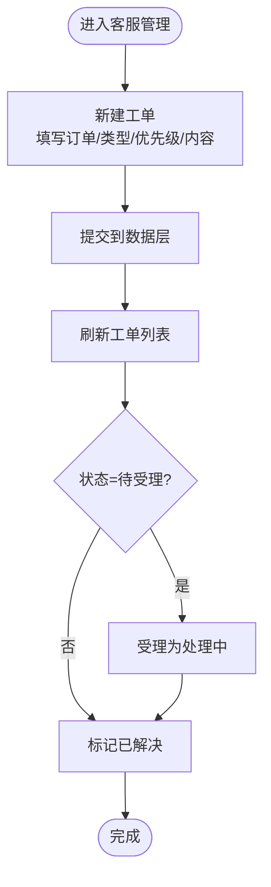
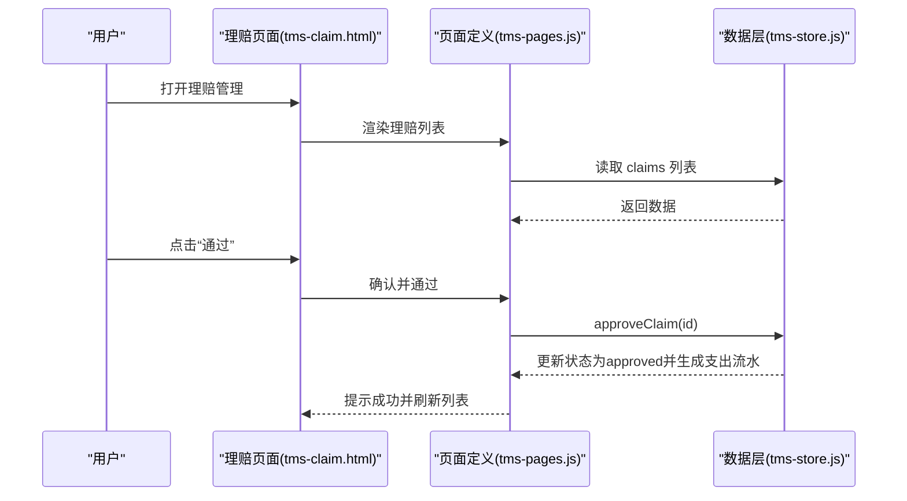
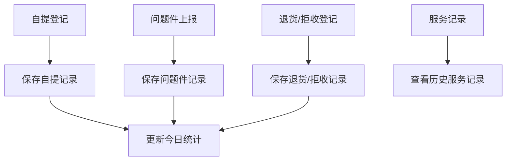
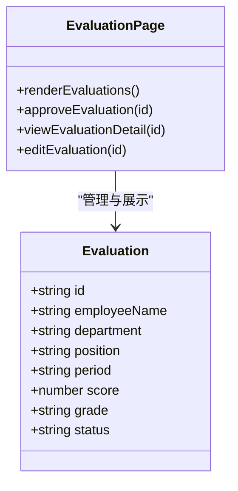
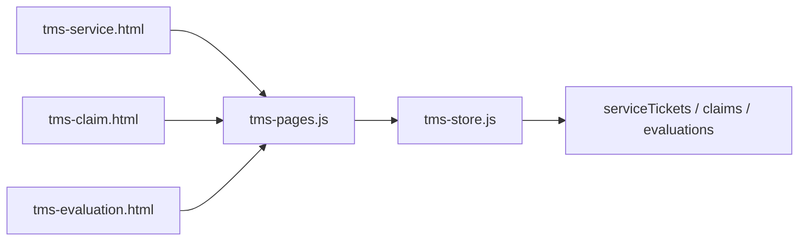
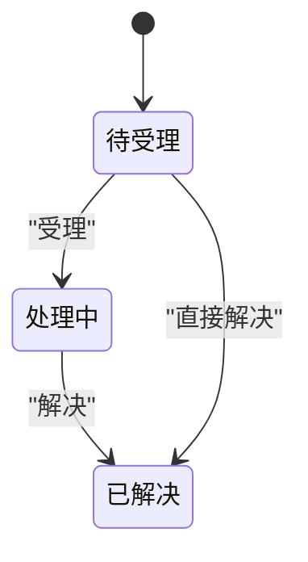
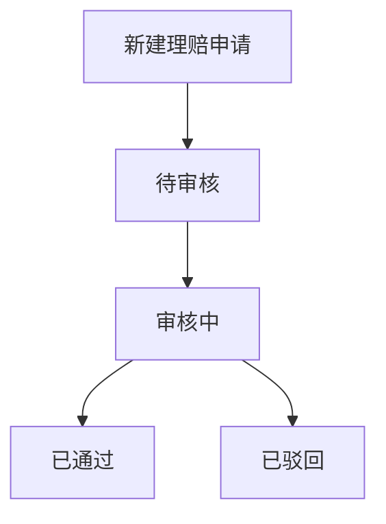

# 客户服务与售后

<cite>
**本文引用的文件**   
- [tms-service.html](file://tms-service.html)
- [branch-service.html](file://branch-service.html)
- [tms-claim.html](file://tms-claim.html)
- [tms-evaluation.html](file://tms-evaluation.html)
- [tms-pages.js](file://tms-pages.js)
- [tms-store.js](file://tms-store.js)
</cite>

## 目录
1. [引言](#引言)
2. [项目结构](#项目结构)
3. [核心组件](#核心组件)
4. [架构总览](#架构总览)
5. [详细组件分析](#详细组件分析)
6. [依赖关系分析](#依赖关系分析)
7. [性能与可扩展性](#性能与可扩展性)
8. [故障排查指南](#故障排查指南)
9. [结论](#结论)
10. [附录：关键流程与状态机](#附录关键流程与状态机)

## 引言
本技术文档围绕“网点客户服务与售后模块”，系统化梳理工单管理、客户咨询处理、投诉解决、SLA与服务监控、满意度评估、售后服务（退换货/拒收）、理赔管理、客户档案与沟通记录、知识库、数据分析与智能路由、自动化工作流与通知机制，以及服务报告生成、绩效考核与持续改进的实现方式。文档以仓库中的客服页面、网点服务页、理赔与考核页面及公共数据层为核心依据，提供代码级流程图、状态机与依赖图，帮助读者快速理解并扩展该模块。

## 项目结构
该模块由以下前端页面与公共脚本组成：
- 客服管理页面：用于创建、受理、处理和关闭服务工单，展示统计与列表。
- 网点服务与售后页面：覆盖自提登记、问题件上报与处理、退货/拒收登记与服务记录。
- 理赔管理页面：审核理赔申请，支持通过/拒绝，联动财务支出流水。
- 考核评级页面：对员工签收率、准时率与满意度进行综合评级。
- 公共页面定义与渲染：集中定义各业务页面的表格、筛选、操作按钮与弹窗表单。
- 公共数据存储与业务流转：提供统一的数据存取、分页排序、实体ID生成与业务方法封装。

**图表来源**
- [tms-service.html:380-385](file://tms-service.html#L380-L385)
- [branch-service.html:646-701](file://branch-service.html#L646-L701)
- [tms-claim.html:386-390](file://tms-claim.html#L386-L390)
- [tms-evaluation.html:386-390](file://tms-evaluation.html#L386-L390)
- [tms-pages.js:744-831](file://tms-pages.js#L744-L831)
- [tms-store.js:1265-1286](file://tms-store.js#L1265-L1286)

**章节来源**
- [tms-service.html:380-385](file://tms-service.html#L380-L385)
- [branch-service.html:646-701](file://branch-service.html#L646-L701)
- [tms-claim.html:386-390](file://tms-claim.html#L386-L390)
- [tms-evaluation.html:386-390](file://tms-evaluation.html#L386-L390)
- [tms-pages.js:744-939](file://tms-pages.js#L744-L939)
- [tms-store.js:1265-1286](file://tms-store.js#L1265-L1286)

## 核心组件
- 服务工单管理：支持新建、受理、解决与详情查看；按优先级与状态过滤；统计待受理/处理中/已解决数量。
- 理赔管理：支持新建理赔申请、审核通过/驳回；通过后自动生成赔付支出流水；统计已通过金额。
- 网点服务与售后：自提登记、问题件上报与处理、退货/拒收登记与服务记录；本地存储模拟数据。
- 考核评级：月度综合评分，等级分布统计，支持批准与编辑。
- 公共数据层：统一的CRUD、分页、排序、搜索、实体ID前缀映射与业务方法（如创建工单、理赔审批）。

**章节来源**
- [tms-pages.js:744-939](file://tms-pages.js#L744-L939)
- [tms-store.js:1265-1286](file://tms-store.js#L1265-L1286)
- [tms-store.js:1936-1940](file://tms-store.js#L1936-L1940)
- [branch-service.html:444-639](file://branch-service.html#L444-L639)

## 架构总览
系统采用“页面 + 公共页面定义 + 公共数据层”的分层结构：
- 页面层：负责用户交互、表单输入与结果展示。
- 页面定义层：集中配置表格列、筛选条件、工具栏按钮与动作回调。
- 数据层：提供持久化存储、分页查询、排序、搜索与业务方法封装。

**图表来源**
- [tms-service.html:380-385](file://tms-service.html#L380-L385)
- [tms-pages.js:778-790](file://tms-pages.js#L778-L790)
- [tms-store.js:1898-1903](file://tms-store.js#L1898-L1903)

## 详细组件分析

### 服务工单管理
- 功能要点
  - 新建工单：关联订单、类型（物流查询/改派申请/投诉建议/延误催件/理赔咨询）、优先级、内容描述。
  - 工单状态：pending（待受理）→ processing（处理中）→ resolved（已解决）。
  - 操作：受理、解决、查看详情；支持按状态与优先级筛选。
  - KPI：待受理、处理中、已解决、总数。
- 实现路径
  - 页面入口调用公共渲染逻辑。
  - 页面定义中注册表格列、筛选、工具栏与动作回调。
  - 数据层提供 createTicket/processTicket/resolveTicket 等方法。

**图表来源**
- [tms-pages.js:778-814](file://tms-pages.js#L778-L814)
- [tms-store.js:1898-1918](file://tms-store.js#L1898-L1918)

**章节来源**
- [tms-pages.js:744-831](file://tms-pages.js#L744-L831)
- [tms-store.js:1898-1918](file://tms-store.js#L1898-L1918)

### 理赔管理
- 功能要点
  - 新建理赔：关联订单、类型（货物破损/丢失/延误赔付/拒收退回）、金额、原因。
  - 审核流程：pending → processing → approved/rejected；通过后生成财务支出流水。
  - KPI：待审核、审核中、已通过、已赔付金额。
- 实现路径
  - 页面定义中注册表格、筛选与操作按钮。
  - 数据层提供 approveClaim 等方法，并在通过时更新财务流水。

**图表来源**
- [tms-claim.html:386-390](file://tms-claim.html#L386-L390)
- [tms-pages.js:882-904](file://tms-pages.js#L882-L904)
- [tms-store.js:1936-1940](file://tms-store.js#L1936-L1940)

**章节来源**
- [tms-pages.js:833-921](file://tms-pages.js#L833-L921)
- [tms-store.js:1936-1940](file://tms-store.js#L1936-L1940)

### 网点服务与售后
- 功能要点
  - 自提登记：运单号、客户姓名、身份证号、联系电话、备注。
  - 问题件处理：问题类型（包裹破损/物品丢失/地址错误/联系失败/其他）、描述、上报人、时间、解决方案。
  - 退货/拒收登记：类型（退货/拒收）、原因（质量问题/发错货/不需要了/其他）、说明、时间。
  - 服务记录：汇总各类服务事件。
- 实现路径
  - 页面内使用 localStorage 维护模拟数据，并提供表单与表格渲染。
  - 提供确认自提、上报问题、处理问题、确认退货等函数。

**图表来源**
- [branch-service.html:444-639](file://branch-service.html#L444-L639)
- [branch-service.html:1152-1182](file://branch-service.html#L1152-L1182)

**章节来源**
- [branch-service.html:444-639](file://branch-service.html#L444-L639)
- [branch-service.html:646-701](file://branch-service.html#L646-L701)
- [branch-service.html:1152-1182](file://branch-service.html#L1152-L1182)

### 考核评级
- 功能要点
  - 月度综合评分：包含签收率、准时率、满意度等指标。
  - 等级分布：优秀/良好/合格/需改进。
  - 操作：批准考核、查看详情、编辑考核。
- 实现路径
  - 页面定义中注册表格、筛选与KPI计算。
  - 数据层提供 evaluations 列表与评分统计。

**图表来源**
- [tms-evaluation.html:464-549](file://tms-evaluation.html#L464-L549)
- [tms-evaluation.html:552-628](file://tms-evaluation.html#L552-L628)

**章节来源**
- [tms-evaluation.html:464-628](file://tms-evaluation.html#L464-L628)

## 依赖关系分析
- 页面与页面定义的耦合
  - tms-service.html、tms-claim.html、tms-evaluation.html 均通过 TmsUI.initShell 与 TmsPages.render 调用公共渲染逻辑。
  - tms-pages.js 集中定义 service、claim、evaluation 等页面的表格、筛选、工具栏与动作回调。
- 页面定义与数据层的耦合
  - 页面定义通过 S.list、S.createTicket、S.approveClaim 等方法访问数据层。
  - 数据层提供统一的 CRUD、分页、排序、搜索与业务方法。
- 数据实体与ID前缀映射
  - serviceTickets、claims、evaluations 等实体在数据层有对应的前缀映射，确保ID唯一性与可读性。

**图表来源**
- [tms-service.html:380-385](file://tms-service.html#L380-L385)
- [tms-claim.html:386-390](file://tms-claim.html#L386-L390)
- [tms-evaluation.html:386-390](file://tms-evaluation.html#L386-L390)
- [tms-pages.js:744-939](file://tms-pages.js#L744-L939)
- [tms-store.js:1265-1286](file://tms-store.js#L1265-L1286)

**章节来源**
- [tms-pages.js:744-939](file://tms-pages.js#L744-L939)
- [tms-store.js:1265-1286](file://tms-store.js#L1265-L1286)

## 性能与可扩展性
- 数据层优化
  - list 方法支持 filters、search、sort、page/pageSize，减少前端渲染压力。
  - 实体ID生成使用计数器与前缀映射，避免冲突与提升可读性。
- 可扩展点
  - 新增业务实体：在数据层增加实体前缀映射与默认字段（createdAt/updatedAt）。
  - 新增页面：在页面定义中注册表格、筛选与动作回调，复用通用UI组件。
  - 异步与批量操作：可引入队列与重试机制，提升高并发场景下的稳定性。

[本节为通用指导，不直接分析具体文件]

## 故障排查指南
- 数据解析异常
  - 理赔页面在解析 localStorage 数据失败时会清理损坏数据并重新初始化。
  - 建议检查 localStorage 中相关键值是否被外部修改或损坏。
- 状态不一致
  - 若工单或理赔状态未更新，检查页面定义的动作回调是否正确调用数据层方法。
  - 确认数据层 update/create 后是否触发持久化与列表刷新。
- 权限与登录
  - 页面入口会校验登录状态与角色，未通过则跳转登录页。
  - 若无法进入页面，检查 common.js 的登录状态与角色判断逻辑。

**章节来源**
- [tms-claim.html:548-556](file://tms-claim.html#L548-L556)
- [tms-pages.js:778-814](file://tms-pages.js#L778-L814)
- [tms-store.js:1289-1296](file://tms-store.js#L1289-L1296)

## 结论
该模块通过清晰的页面分层与公共数据层，实现了客服工单、理赔审核、网点服务与售后、考核评级的完整闭环。页面定义集中管理表格与操作，数据层提供统一CRUD与业务方法，便于扩展与维护。建议在后续迭代中补充SLA监控、满意度调查、知识库与智能路由等高级能力，并引入更完善的日志与告警机制以提升系统的可观测性与稳定性。

[本节为总结性内容，不直接分析具体文件]

## 附录：关键流程与状态机

### 工单状态机

**图表来源**
- [tms-pages.js:794-814](file://tms-pages.js#L794-L814)
- [tms-store.js:1914-1918](file://tms-store.js#L1914-L1918)

### 理赔审核流程

**图表来源**
- [tms-pages.js:882-904](file://tms-pages.js#L882-L904)
- [tms-store.js:1936-1940](file://tms-store.js#L1936-L1940)

### 自动化工作流与通知机制
- 工作流
  - 工单：新建 → 受理 → 解决 → 归档。
  - 理赔：申请 → 审核 → 通过/驳回 → 财务支出流水。
- 通知
  - 当前实现以 UI 提示为主（toast/alert），可在后续引入消息中心与站内信。

**章节来源**
- [tms-pages.js:778-814](file://tms-pages.js#L778-L814)
- [tms-pages.js:882-904](file://tms-pages.js#L882-L904)