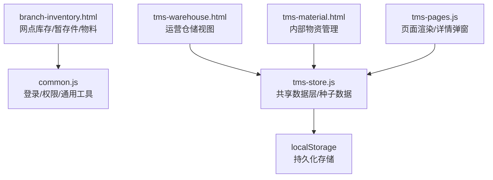
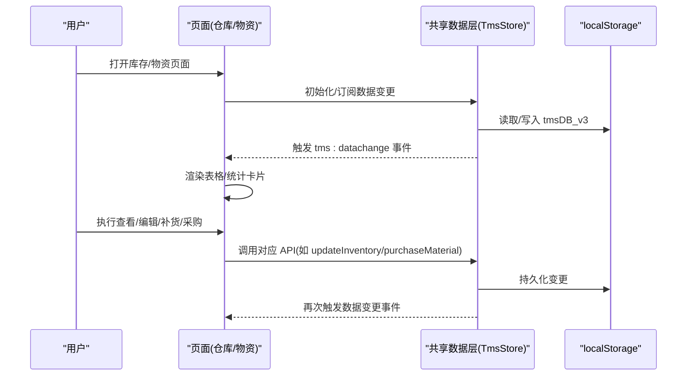
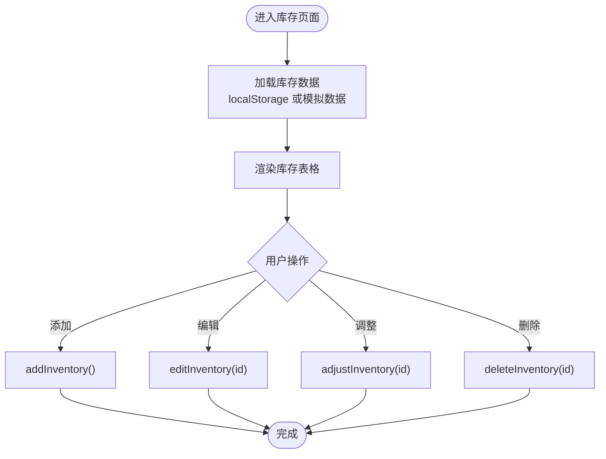
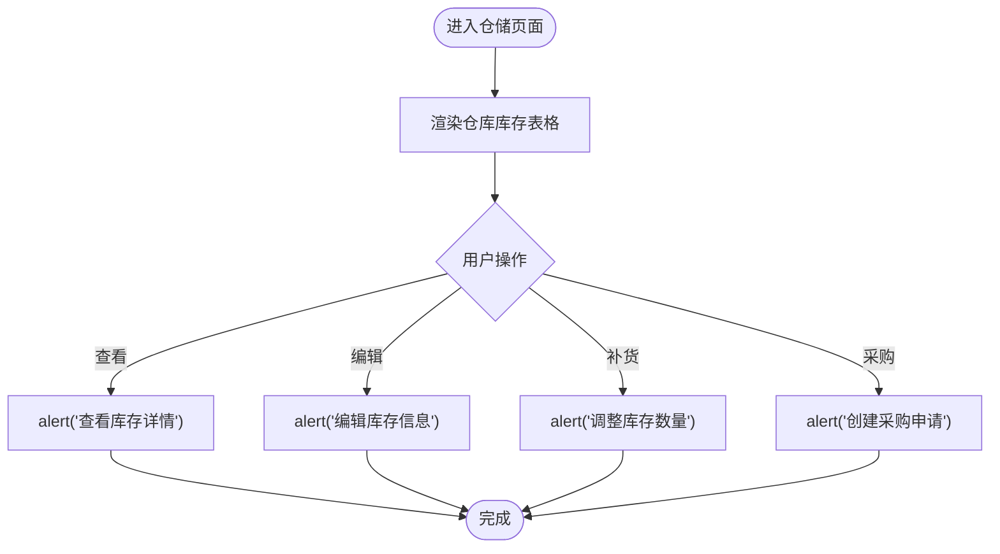
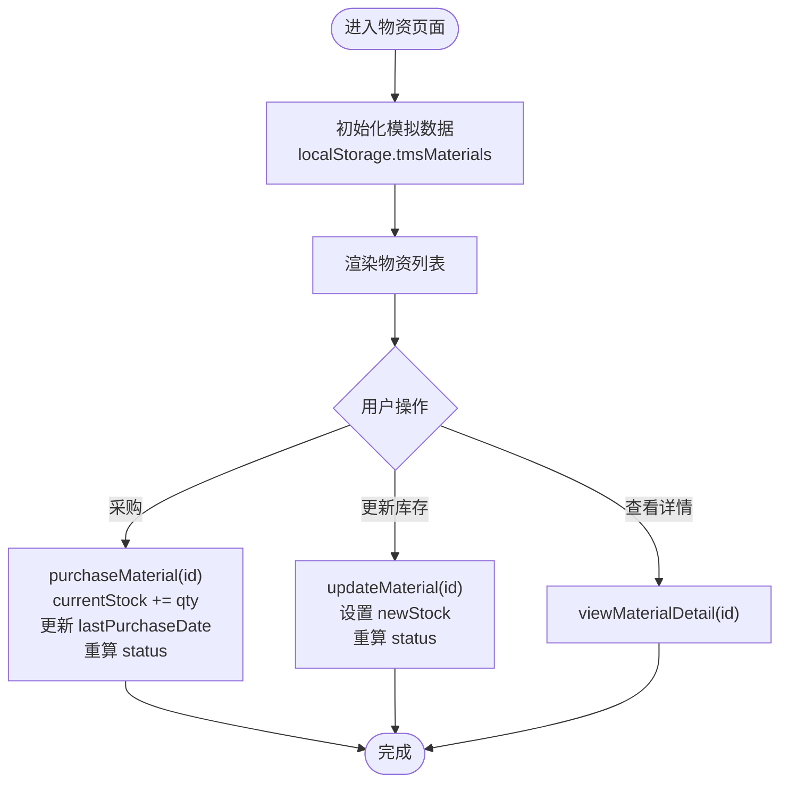
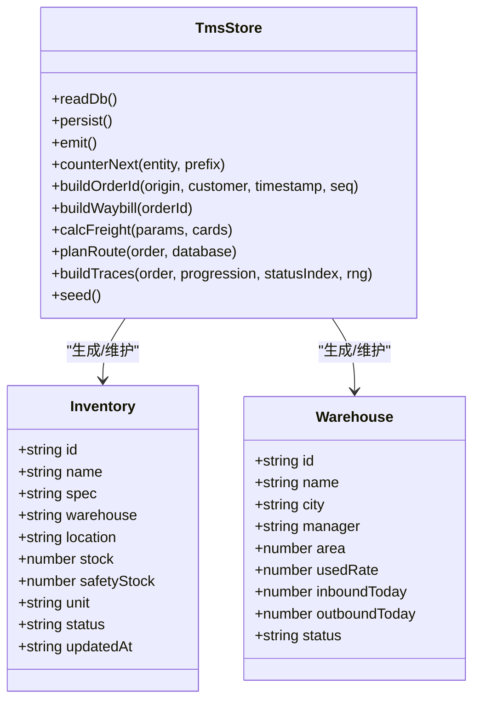
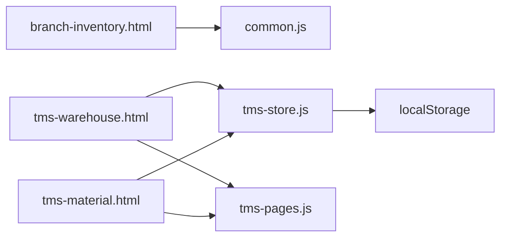
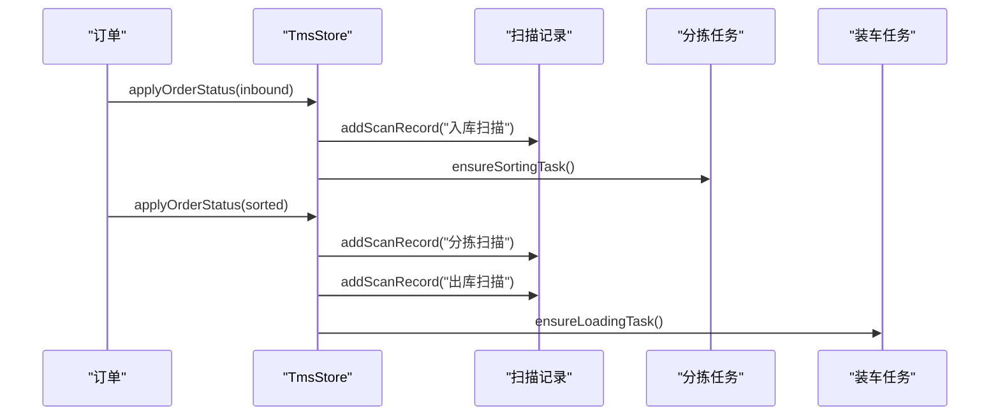
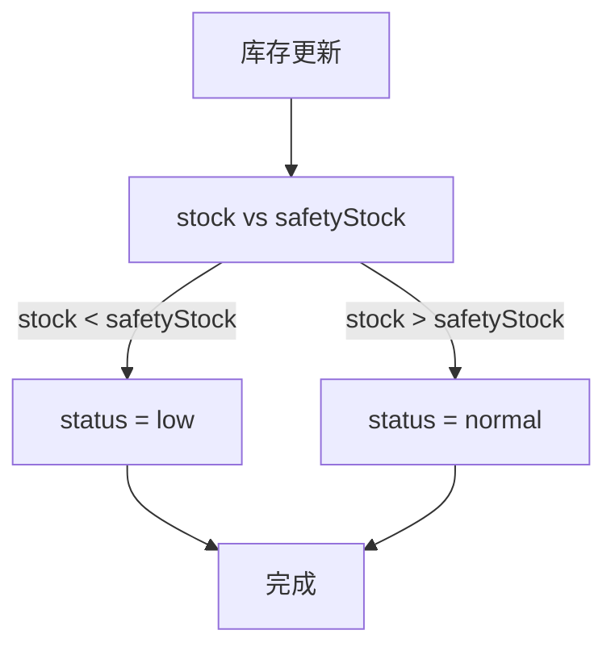

# 库存与资产管理

<cite>
**本文引用的文件**   
- [branch-inventory.html](file://branch-inventory.html)
- [tms-warehouse.html](file://tms-warehouse.html)
- [tms-material.html](file://tms-material.html)
- [common.js](file://common.js)
- [tms-store.js](file://tms-store.js)
- [tms-pages.js](file://tms-pages.js)
</cite>

## 目录
1. [引言](#引言)
2. [项目结构](#项目结构)
3. [核心组件](#核心组件)
4. [架构总览](#架构总览)
5. [详细组件分析](#详细组件分析)
6. [依赖关系分析](#依赖关系分析)
7. [性能与一致性](#性能与一致性)
8. [故障排查指南](#故障排查指南)
9. [结论](#结论)
10. [附录：关键流程与算法说明](#附录关键流程与算法说明)

## 引言
本技术文档围绕“网点库存与资产管理模块”展开，覆盖数据模型设计、CRUD 接口、入库出库流程、库存盘点、批次管理、库存预警与安全库存计算、自动补货逻辑、资产追踪与设备维护计划、实时同步与并发控制、数据一致性保证、查询优化与事务处理示例，以及库存分析报表、趋势预测与智能决策支持等。仓库与物料相关能力由多个前端页面与共享数据层共同实现，其中：
- 网点侧提供库存、暂存件、物料的本地化 CRUD 与统计展示；
- 运营侧仓储页面提供仓库级库存视图与状态标签；
- 内部物资页面提供物资库存的增改查与采购更新；
- 共享数据层提供种子数据、统一事件机制与跨页面聚合能力。

## 项目结构
与库存与资产管理直接相关的文件包括：
- 网点库存与资产页面：branch-inventory.html
- 运营仓储页面：tms-warehouse.html
- 内部物资页面：tms-material.html
- 通用工具与鉴权：common.js
- 共享数据层（含仓库/库存种子数据）：tms-store.js
- 页面渲染与详情弹窗：tms-pages.js

图表来源
- [branch-inventory.html:436-458](file://branch-inventory.html#L436-L458)
- [tms-warehouse.html:533-543](file://tms-warehouse.html#L533-L543)
- [tms-material.html:375-385](file://tms-material.html#L375-L385)
- [tms-store.js:220-244](file://tms-store.js#L220-L244)
- [tms-pages.js:417-439](file://tms-pages.js#L417-L439)

章节来源
- [branch-inventory.html:436-458](file://branch-inventory.html#L436-L458)
- [tms-warehouse.html:533-543](file://tms-warehouse.html#L533-L543)
- [tms-material.html:375-385](file://tms-material.html#L375-L385)
- [tms-store.js:220-244](file://tms-store.js#L220-L244)
- [tms-pages.js:417-439](file://tms-pages.js#L417-L439)

## 核心组件
- 网点库存与资产页面：提供库存、暂存件、物料三类数据的列表展示与基础操作入口（添加、编辑、调整、删除、领用）。
- 运营仓储页面：以表格形式展示仓库库存，包含安全库存、单位、状态标签（充足/不足/缺货），并提供查看、编辑、补货、采购等操作按钮。
- 内部物资页面：提供物资清单、库存状态、单价、供应商、上次采购日期等信息，支持采购、查看详情、更新库存。
- 共享数据层：维护仓库与库存的种子数据，定义库存状态字典，并通过事件机制通知各页面数据变更。
- 通用工具：负责用户登录、角色校验、显示当前用户等。

章节来源
- [branch-inventory.html:401-429](file://branch-inventory.html#L401-L429)
- [tms-warehouse.html:446-527](file://tms-warehouse.html#L446-L527)
- [tms-material.html:365-370](file://tms-material.html#L365-L370)
- [tms-store.js:110-120](file://tms-store.js#L110-L120)
- [tms-store.js:520-554](file://tms-store.js#L520-L554)
- [common.js:136-199](file://common.js#L136-L199)

## 架构总览
库存与资产管理采用“页面 + 共享数据层 + 本地存储”的前端架构：
- 页面层：负责 UI 渲染、用户交互、表单输入与结果反馈。
- 数据层：提供统一的增删改查、事件广播、统计聚合与种子数据生成。
- 存储层：使用 localStorage 作为轻量持久化介质。

图表来源
- [tms-store.js:220-244](file://tms-store.js#L220-L244)
- [tms-store.js:520-554](file://tms-store.js#L520-L554)
- [tms-material.html:575-624](file://tms-material.html#L575-L624)

## 详细组件分析

### 网点库存与资产页面（branch-inventory.html）
- 功能范围
  - 库存管理：列表展示、添加、编辑、调整、删除。
  - 暂存件管理：列表展示、处理、删除。
  - 物料管理：列表展示、添加、编辑、领用、删除。
  - 统计概览：总库存量、暂存件数量、物料种类、库存周转率。
- 数据源
  - 优先从 localStorage 读取 branchInventory、branchTempStorage、branchMaterials；若无则使用内嵌模拟数据。
- 交互流程
  - 点击“添加/编辑/调整/删除”等按钮，弹出提示或确认框，预留扩展点用于后续对接后端 API。

图表来源
- [branch-inventory.html:482-535](file://branch-inventory.html#L482-L535)
- [branch-inventory.html:655-679](file://branch-inventory.html#L655-L679)

章节来源
- [branch-inventory.html:436-458](file://branch-inventory.html#L436-L458)
- [branch-inventory.html:482-535](file://branch-inventory.html#L482-L535)
- [branch-inventory.html:655-679](file://branch-inventory.html#L655-L679)

### 运营仓储页面（tms-warehouse.html）
- 功能范围
  - 仓库统计：仓库数量、库存商品数、仓库利用率、低库存预警数。
  - 仓库库存表格：字段包括库存ID、商品名称、规格型号、仓库、存储位置、当前库存、安全库存、单位、状态、操作。
  - 操作按钮：查看、编辑、补货、采购。
- 状态标签
  - 充足、不足、缺货，分别对应不同样式类名。
- 交互流程
  - 点击“查看/编辑/补货/采购”，弹出提示或预留扩展点。

图表来源
- [tms-warehouse.html:446-527](file://tms-warehouse.html#L446-L527)
- [tms-warehouse.html:572-610](file://tms-warehouse.html#L572-L610)

章节来源
- [tms-warehouse.html:426-527](file://tms-warehouse.html#L426-L527)
- [tms-warehouse.html:572-610](file://tms-warehouse.html#L572-L610)

### 内部物资页面（tms-material.html）
- 功能范围
  - 物资统计：物资种类、低库存物资、缺货物资、总库存数量。
  - 物资清单：id、name、category、unit、currentStock、minStock、price、supplier、lastPurchaseDate、description、status。
  - 操作：采购、查看详情、更新库存。
- 业务规则
  - 根据 currentStock 与 minStock 比较更新 status：out_of_stock / low_stock / in_stock。
  - 采购时增加 currentStock 并更新时间戳。
  - 更新库存时重新计算 status。

图表来源
- [tms-material.html:458-534](file://tms-material.html#L458-L534)
- [tms-material.html:536-624](file://tms-material.html#L536-L624)

章节来源
- [tms-material.html:346-370](file://tms-material.html#L346-L370)
- [tms-material.html:458-534](file://tms-material.html#L458-L534)
- [tms-material.html:536-624](file://tms-material.html#L536-L624)

### 共享数据层（tms-store.js）
- 职责
  - 基于 localStorage 的轻量业务数据库，提供统一增删改查、搜索筛选排序分页、订单生命周期状态流转、扫描/运输/财务关联记录、统计聚合。
  - 维护仓库与库存种子数据，定义库存状态字典 inventory: { normal, low, out }。
  - 通过自定义事件 tms:datachange 通知所有订阅者数据变更。
- 仓库与库存种子数据
  - 生成仓库列表 warehouses 与库存列表 inventory，包含 name/spec/warehouse/location/stock/safetyStock/unit/status/updatedAt。
  - 库存状态根据 stock < safetyStock 判定为 low，否则为 normal。

图表来源
- [tms-store.js:220-244](file://tms-store.js#L220-L244)
- [tms-store.js:520-554](file://tms-store.js#L520-L554)

章节来源
- [tms-store.js:1-12](file://tms-store.js#L1-L12)
- [tms-store.js:110-120](file://tms-store.js#L110-L120)
- [tms-store.js:220-244](file://tms-store.js#L220-L244)
- [tms-store.js:520-554](file://tms-store.js#L520-L554)

### 页面渲染与详情弹窗（tms-pages.js）
- 在仓库详情页中，渲染仓内物资表格，包含物资名称、库存、安全库存、状态。
- 使用 detailModal 展示仓库详情，并在关闭事件中绑定关闭行为。

章节来源
- [tms-pages.js:417-439](file://tms-pages.js#L417-L439)

## 依赖关系分析
- 页面到通用工具
  - branch-inventory.html、tms-warehouse.html、tms-material.html 均引入 common.js，用于登录校验与用户信息显示。
- 页面到共享数据层
  - tms-warehouse.html 与 tms-material.html 引入 tms-store.js 与 tms-pages.js，用于数据渲染与详情弹窗。
- 共享数据层到存储
  - tms-store.js 通过 localStorage 读写 tmsDB_v3，并触发 tms:datachange 事件。

图表来源
- [branch-inventory.html:436-458](file://branch-inventory.html#L436-L458)
- [tms-warehouse.html:533-543](file://tms-warehouse.html#L533-L543)
- [tms-material.html:375-385](file://tms-material.html#L375-L385)
- [tms-store.js:220-244](file://tms-store.js#L220-L244)

章节来源
- [branch-inventory.html:436-458](file://branch-inventory.html#L436-L458)
- [tms-warehouse.html:533-543](file://tms-warehouse.html#L533-L543)
- [tms-material.html:375-385](file://tms-material.html#L375-L385)
- [tms-store.js:220-244](file://tms-store.js#L220-L244)

## 性能与一致性
- 性能考虑
  - 列表渲染采用 DOM innerHTML 拼接，适合小规模数据；当数据量增长时应考虑虚拟滚动或分页加载。
  - 统计卡片与表格渲染分离，避免重复计算。
- 一致性保障
  - 共享数据层通过 persist 与 emit 确保数据变更后通知所有订阅者，保持多页面一致。
  - 本地存储键值 tmsDB_v3 带版本号，便于未来迁移。
- 并发控制
  - 当前为单页应用，无服务端并发锁；若扩展至多标签页，建议引入消息通道（BroadcastChannel）或 IndexedDB 提升一致性。

章节来源
- [tms-store.js:220-244](file://tms-store.js#L220-L244)

## 故障排查指南
- 常见问题
  - 登录后无法显示用户名：检查 displayCurrentUser 是否找到目标元素。
  - 库存/物资数据为空：检查 localStorage 中对应键是否存在或已初始化。
  - 状态标签不生效：检查 status 字段是否为预期值（in_stock/low_stock/out_of_stock 或 normal/low/out）。
- 定位方法
  - 在控制台打印 localStorage 内容，确认数据是否正确写入。
  - 监听 tms:datachange 事件，确认数据变更是否被正确广播。

章节来源
- [common.js:220-270](file://common.js#L220-L270)
- [tms-store.js:220-244](file://tms-store.js#L220-L244)

## 结论
该模块以页面驱动为主，结合共享数据层与本地存储，实现了库存、暂存件、物料的基础管理与统计展示。仓库与库存的种子数据与状态字典为后续扩展提供了良好基础。建议在后续迭代中：
- 将页面中的 alert/confirm 替换为模态框与表单验证；
- 将 localStorage 操作封装为统一的数据访问层，支持异步与错误处理；
- 引入索引与分页以提升大数据量下的查询性能；
- 补充库存盘点、批次管理、安全库存动态计算与自动补货策略；
- 接入后端服务以实现实时同步、并发控制与事务一致性。

## 附录：关键流程与算法说明

### 入库出库流程
- 入库
  - 订单状态推进至 inbound 时，系统写入入库扫描记录，并创建分拣任务。
- 出库
  - 订单状态推进至 sorted 时，系统写入分拣与出库扫描记录，并创建装车任务。

图表来源
- [tms-store.js:1497-1537](file://tms-store.js#L1497-L1537)

章节来源
- [tms-store.js:1497-1537](file://tms-store.js#L1497-L1537)

### 库存盘点与批次管理
- 库存盘点
  - 当前页面未实现盘点流程；可在库存调整前引入盘点任务，对比账面与实际数量，生成差异记录。
- 批次管理
  - 当前库存对象未包含批次字段；可扩展批次号、生产日期、有效期等属性，并在入库/出库时关联批次。

章节来源
- [tms-store.js:520-554](file://tms-store.js#L520-L554)

### 库存预警机制与安全库存计算
- 预警规则
  - 当 stock < safetyStock 时，库存状态标记为 low；当 stock <= 0 时，标记为 out。
- 安全库存
  - 种子数据中随机生成 safetyStock；可进一步按历史消耗、供应商交期与服务水平动态计算。

图表来源
- [tms-store.js:520-554](file://tms-store.js#L520-L554)

章节来源
- [tms-store.js:520-554](file://tms-store.js#L520-L554)

### 自动补货逻辑
- 当前实现
  - 物资页面提供“采购”按钮，用户手动输入采购数量后更新库存与时间戳。
- 扩展建议
  - 基于安全库存与消耗速率计算补货量，自动生成采购单并推送审批流。

章节来源
- [tms-material.html:575-624](file://tms-material.html#L575-L624)

### 资产追踪与设备管理
- 资产追踪
  - 当前未实现资产追踪；可引入资产编号、归属部门、使用人、位置、状态等字段，并与扫描记录关联。
- 设备管理
  - 扫描管理页面提供扫描设备统计；可进一步维护设备台账、维护计划与故障记录。

章节来源
- [tms-scan.html:436-485](file://tms-scan.html#L436-L485)

### 实时同步、并发控制与数据一致性
- 实时同步
  - 通过 tms:datachange 事件通知订阅者；在多标签页场景下可结合 BroadcastChannel 提升同步效率。
- 并发控制
  - 当前无服务端锁；可扩展为乐观锁（版本号）或悲观锁（行级锁）。
- 数据一致性
  - 通过 persist 与 emit 保证本地数据一致；若接入后端，应使用事务保证跨表一致性。

章节来源
- [tms-store.js:220-244](file://tms-store.js#L220-L244)

### 查询优化与事务处理示例
- 查询优化
  - 对常用查询字段建立索引（如 warehouse、status、name）；分页加载减少首屏渲染压力。
- 事务处理
  - 在批量更新库存时，使用事务包裹多条 SQL，失败时回滚，保证数据一致性。

章节来源
- [tms-store.js:220-244](file://tms-store.js#L220-L244)

### 库存分析报表、趋势预测与智能决策支持
- 分析报表
  - 统计卡片展示总库存量、暂存件数量、物料种类、库存周转率；可进一步扩展品类占比、库龄分布、ABC 分类。
- 趋势预测
  - 基于历史出入库数据构建时间序列模型，预测未来需求与安全库存阈值。
- 智能决策
  - 结合预测结果与供应商交期，自动生成补货建议与采购优先级。

章节来源
- [branch-inventory.html:373-391](file://branch-inventory.html#L373-L391)
- [tms-material.html:346-370](file://tms-material.html#L346-L370)