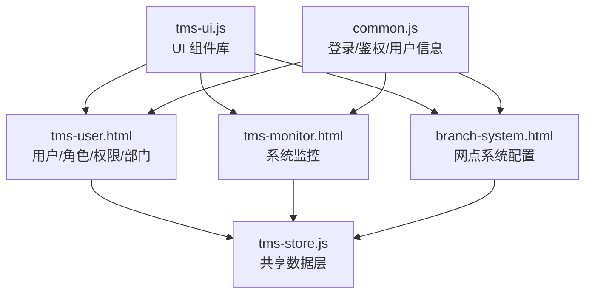
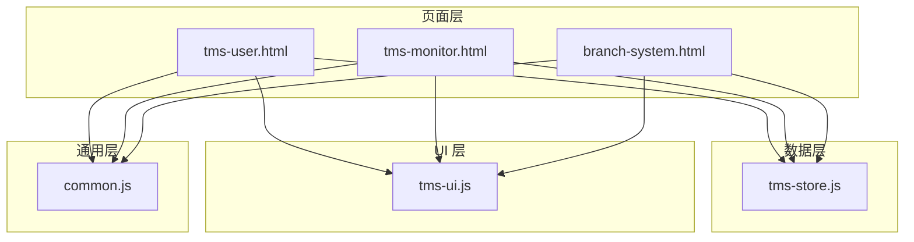
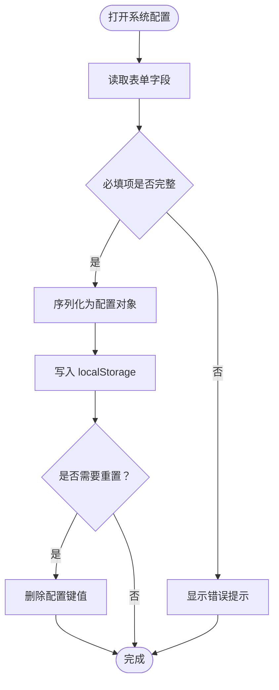
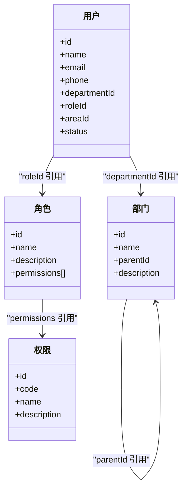
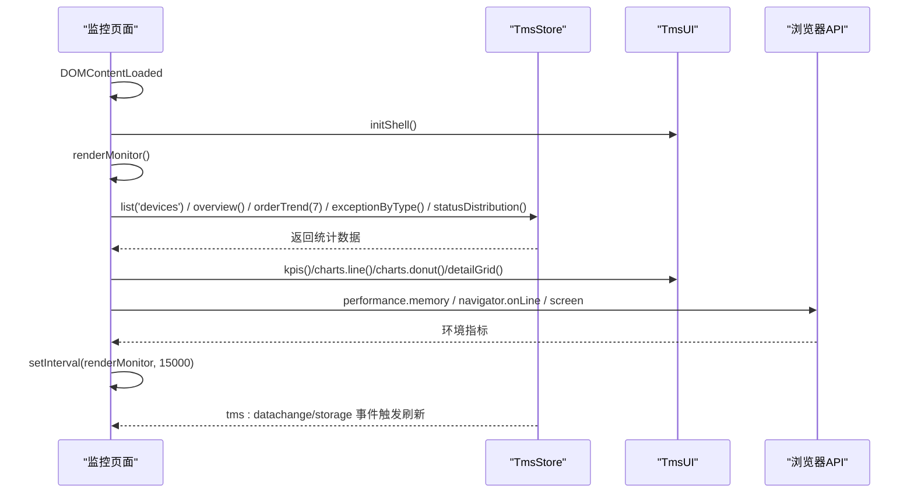
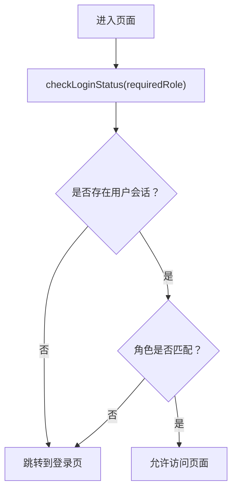
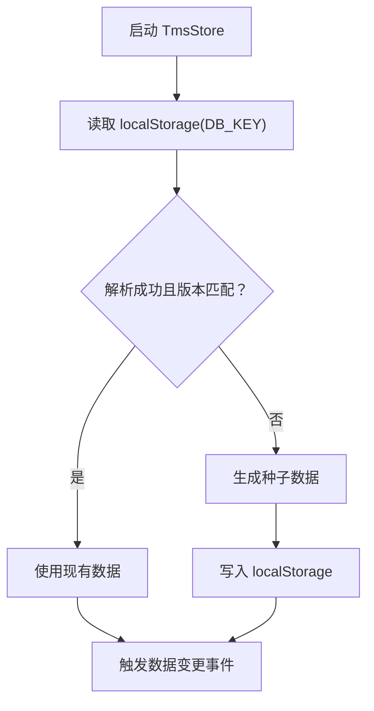
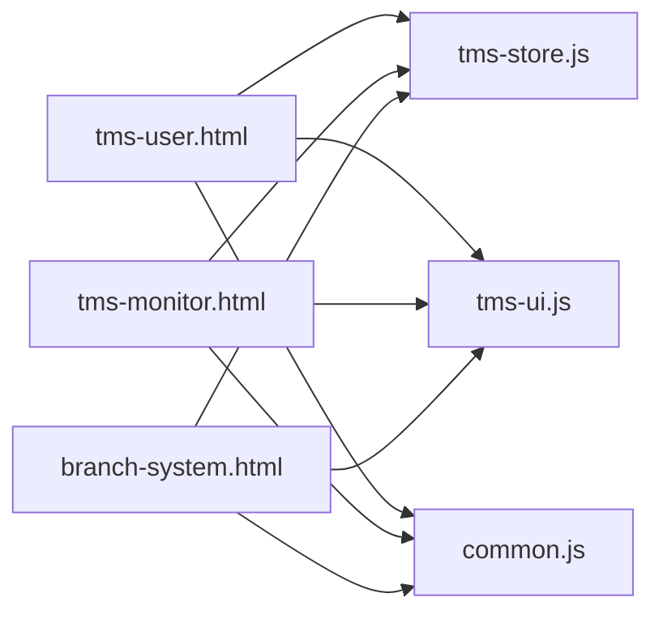

# 系统配置管理

<cite>
**本文引用的文件**   
- [tms-store.js](file://tms-store.js)
- [tms-ui.js](file://tms-ui.js)
- [tms-user.html](file://tms-user.html)
- [tms-monitor.html](file://tms-monitor.html)
- [branch-system.html](file://branch-system.html)
- [common.js](file://common.js)
</cite>

## 目录
1. [引言](#引言)
2. [项目结构](#项目结构)
3. [核心组件](#核心组件)
4. [架构总览](#架构总览)
5. [详细组件分析](#详细组件分析)
6. [依赖关系分析](#依赖关系分析)
7. [性能与容量特性](#性能与容量特性)
8. [故障诊断与排错指南](#故障诊断与排错指南)
9. [结论](#结论)
10. [附录：配置项清单](#附录配置项清单)

## 引言
本技术文档围绕“网点系统配置管理模块”展开，聚焦以下能力：
- 系统参数配置、权限管理与用户角色设置
- 网络配置、数据库连接与第三方服务集成（以本地存储与浏览器环境为主）
- 日志管理、审计追踪与安全策略
- 备份恢复、系统监控与维护工具
- 配置版本管理、热更新与灰度发布机制
- 健康检查、性能监控与故障诊断

本项目采用前端单页应用形态，通过共享数据层与 UI 组件库组织业务逻辑与界面。数据持久化基于浏览器 localStorage，所有页面通过统一的数据层进行增删改查与事件订阅，从而形成一致的“配置即数据”的管理体验。

## 项目结构
仓库为多页面 HTML + JS 的轻量前端工程，关键文件职责如下：
- tms-store.js：共享数据层，负责种子数据生成、CRUD、统计聚合、事件广播与版本控制
- tms-ui.js：共享 UI 组件库，提供表格、表单弹窗、图表、KPI、状态标签等通用能力
- tms-user.html：用户、角色、权限、部门管理的业务页面
- tms-monitor.html：系统监控页面，展示订单趋势、异常分布、设备状态与环境信息
- branch-system.html：网点系统管理页面，包含系统配置、权限矩阵与区域绘制等
- common.js：通用函数库，含登录鉴权、用户信息与积分等基础能力

**图示来源**
- [tms-user.html:527-539](file://tms-user.html#L527-L539)
- [tms-monitor.html:419-436](file://tms-monitor.html#L419-L436)
- [branch-system.html:684-774](file://branch-system.html#L684-L774)
- [tms-store.js:1-12](file://tms-store.js#L1-L12)
- [tms-ui.js:1-6](file://tms-ui.js#L1-L6)
- [common.js:135-199](file://common.js#L135-L199)

**章节来源**
- [tms-store.js:1-12](file://tms-store.js#L1-L12)
- [tms-ui.js:1-6](file://tms-ui.js#L1-L6)
- [tms-user.html:527-539](file://tms-user.html#L527-L539)
- [tms-monitor.html:419-436](file://tms-monitor.html#L419-L436)
- [branch-system.html:684-774](file://branch-system.html#L684-L774)
- [common.js:135-199](file://common.js#L135-L199)

## 核心组件
- 共享数据层（TmsStore）
  - 基于 localStorage 的轻量业务数据库，提供统一的增删改查、搜索、筛选、排序、分页
  - 维护订单全生命周期状态流转，并自动写入扫描、运输、财务等关联记录
  - 提供各页面所需的统计聚合（KPI、趋势、分布、日报）
  - 通过事件机制通知订阅者数据变更
- 共享 UI 组件库（TmsUI）
  - 列表、搜索/筛选/分页、表单弹窗、确认框、Toast、SVG 图表等
  - 统一样式命名空间，避免与页面样式冲突
- 业务页面
  - 用户与权限管理：用户、角色、权限、部门的增删改查与关联校验
  - 系统监控：订单趋势、异常类型分布、队列健康度、设备状态、运行环境
  - 网点系统配置：基本配置、业务配置、系统设置、通知开关、区域绘制

**章节来源**
- [tms-store.js:1-12](file://tms-store.js#L1-L12)
- [tms-ui.js:1-6](file://tms-ui.js#L1-L6)
- [tms-user.html:488-519](file://tms-user.html#L488-L519)
- [tms-monitor.html:370-410](file://tms-monitor.html#L370-L410)
- [branch-system.html:684-774](file://branch-system.html#L684-L774)

## 架构总览
系统采用“页面 + 数据层 + UI 组件”的分层结构：
- 页面层：承载具体业务视图与交互
- 数据层：集中管理实体数据、统计方法与事件广播
- UI 层：提供可复用的界面组件与可视化能力
- 通用层：登录鉴权、用户信息、公共工具

**图示来源**
- [tms-user.html:527-539](file://tms-user.html#L527-L539)
- [tms-monitor.html:419-436](file://tms-monitor.html#L419-L436)
- [branch-system.html:684-774](file://branch-system.html#L684-L774)
- [tms-store.js:1-12](file://tms-store.js#L1-L12)
- [tms-ui.js:1-6](file://tms-ui.js#L1-L6)
- [common.js:135-199](file://common.js#L135-L199)

## 详细组件分析

### 系统参数配置（网点系统配置）
网点系统配置在 branch-system.html 中提供三类配置：
- 基本配置：网点名称、代码、联系人、电话、地址
- 业务配置：营业时间、最大包裹数、仓储费、保价费率
- 系统设置：语言、时区、通知开关（邮件、短信、系统通知）

保存与重置逻辑将配置对象序列化后写入 localStorage，并提供确认提示以避免误操作。

**图示来源**
- [branch-system.html:684-774](file://branch-system.html#L684-L774)
- [branch-system.html:1298-1315](file://branch-system.html#L1298-L1315)

**章节来源**
- [branch-system.html:684-774](file://branch-system.html#L684-L774)
- [branch-system.html:1298-1315](file://branch-system.html#L1298-L1315)

### 权限管理与用户角色设置
tms-user.html 提供用户、角色、权限、部门四个维度的管理：
- 用户：用户名、邮箱、手机号、部门、角色、管理区域、状态
- 角色：名称、描述、权限集合（动态生成复选框）
- 权限：名称、代码、描述
- 部门：名称、上级部门、描述、账号数

删除保护：
- 若角色被用户引用，禁止删除
- 若权限被角色引用，禁止删除
- 若部门下有用户或子部门，禁止删除

**图示来源**
- [tms-user.html:572-644](file://tms-user.html#L572-L644)
- [tms-user.html:646-715](file://tms-user.html#L646-L715)
- [tms-user.html:717-772](file://tms-user.html#L717-L772)
- [tms-user.html:774-800](file://tms-user.html#L774-L800)

**章节来源**
- [tms-user.html:572-644](file://tms-user.html#L572-L644)
- [tms-user.html:646-715](file://tms-user.html#L646-L715)
- [tms-user.html:717-772](file://tms-user.html#L717-L772)
- [tms-user.html:774-800](file://tms-user.html#L774-L800)

### 系统监控与健康检查
tms-monitor.html 提供系统监控面板：
- KPI：在线用户、待作业订单、在途运输、扫描设备在线、待处理异常
- 近 7 日订单趋势：新建订单与签收订单折线图
- 异常类型分布：环形图
- 订单队列健康度：按状态分布的进度条
- 扫描设备状态：在线/维修/离线状态与今日扫描次数
- 运行环境：会话时长、数据库版本、业务库占用、JS 堆内存、CPU 核心、网络状态、屏幕分辨率、浏览器信息

健康检查实现要点：
- 定时刷新：每 15 秒自动更新
- 事件订阅：监听 TmsStore 数据变化与 storage 事件
- 环境探测：使用 performance.memory、navigator.onLine、screen 等 API

**图示来源**
- [tms-monitor.html:419-436](file://tms-monitor.html#L419-L436)
- [tms-monitor.html:447-542](file://tms-monitor.html#L447-L542)
- [tms-store.js:237-244](file://tms-store.js#L237-L244)

**章节来源**
- [tms-monitor.html:419-436](file://tms-monitor.html#L419-L436)
- [tms-monitor.html:447-542](file://tms-monitor.html#L447-L542)

### 安全策略与访问控制
- 登录鉴权：common.js 提供 login/checkLoginStatus/logout/displayCurrentUser 等函数，基于 localStorage 的用户会话
- 页面级权限：checkLoginStatus(requiredRole) 校验当前用户角色，不匹配则跳转登录页
- 功能级权限：通过角色-权限映射控制菜单与按钮可见性（由 TmsStore 中的权限定义驱动）

**图示来源**
- [common.js:135-199](file://common.js#L135-L199)

**章节来源**
- [common.js:135-199](file://common.js#L135-L199)

### 日志管理与审计追踪
- 审计追踪：订单时间线与轨迹明细由 TmsStore 生成，包含节点、地点、截止时间、超时与偏差标记
- 日志输出：TmsStore 在 listener 调用失败时打印错误日志；UI 组件在 Toast 与 Modal 中提供用户反馈
- 运维建议：在生产环境中可将前端日志上报至后端日志系统，结合 ELK 进行集中分析

**章节来源**
- [tms-store.js:442-460](file://tms-store.js#L442-L460)
- [tms-store.js:237-244](file://tms-store.js#L237-L244)
- [tms-ui.js:86-105](file://tms-ui.js#L86-L105)

### 备份恢复与数据迁移
- 数据持久化：TmsStore 使用 DB_KEY 作为 localStorage 键名，并通过 DB_VERSION 进行版本控制
- 首次初始化：当 localStorage 无数据或版本不匹配时，重新生成种子数据
- 备份恢复：可通过导出/导入 localStorage 内容实现备份与恢复；建议在批量变更前先导出快照

**图示来源**
- [tms-store.js:220-235](file://tms-store.js#L220-L235)
- [tms-store.js:237-244](file://tms-store.js#L237-L244)

**章节来源**
- [tms-store.js:220-235](file://tms-store.js#L220-L235)
- [tms-store.js:237-244](file://tms-store.js#L237-L244)

### 配置版本管理、热更新与灰度发布
- 版本管理：TmsStore 通过 DB_VERSION 标识数据结构版本，升级时需迁移或重建数据
- 热更新：前端页面通过 TmsStore.subscribe 订阅数据变更，无需刷新即可更新视图
- 灰度发布：可在网关层或路由层按用户维度分流（参考 tms-architecture.html 中的网关与路由说明），逐步放量新配置

**章节来源**
- [tms-store.js:16-17](file://tms-store.js#L16-L17)
- [tms-store.js:237-244](file://tms-store.js#L237-L244)
- [tms-architecture.html:945-967](file://tms-architecture.html#L945-L967)

## 依赖关系分析
- 页面依赖数据层：tms-user.html、tms-monitor.html、branch-system.html 均通过 window.TmsStore 获取数据
- 页面依赖 UI 组件：通过 window.TmsUI 渲染表格、表单、图表与 KPI
- 通用依赖：common.js 提供登录鉴权与用户信息显示

**图示来源**
- [tms-user.html:527-539](file://tms-user.html#L527-L539)
- [tms-monitor.html:419-436](file://tms-monitor.html#L419-L436)
- [branch-system.html:684-774](file://branch-system.html#L684-L774)
- [tms-store.js:1-12](file://tms-store.js#L1-L12)
- [tms-ui.js:1-6](file://tms-ui.js#L1-L6)
- [common.js:135-199](file://common.js#L135-L199)

**章节来源**
- [tms-user.html:527-539](file://tms-user.html#L527-L539)
- [tms-monitor.html:419-436](file://tms-monitor.html#L419-L436)
- [branch-system.html:684-774](file://branch-system.html#L684-L774)
- [tms-store.js:1-12](file://tms-store.js#L1-L12)
- [tms-ui.js:1-6](file://tms-ui.js#L1-L6)
- [common.js:135-199](file://common.js#L135-L199)

## 性能与容量特性
- 数据层性能
  - 列表查询支持搜索、筛选、排序与分页，减少前端渲染压力
  - 事件订阅仅在必要时重绘，避免频繁 DOM 操作
- 存储容量
  - localStorage 容量有限，需关注业务库占用大小
  - 监控页面提供“业务库占用”指标，便于容量预警
- 运行时性能
  - 监控页面每 15 秒刷新一次，避免高频轮询
  - 图表渲染使用 SVG，降低第三方库依赖

[本节为通用指导，不涉及具体文件分析]

## 故障诊断与排错指南
- 登录问题
  - 现象：无法进入页面或被强制跳转登录
  - 排查：检查 localStorage 中用户会话是否存在，角色是否匹配
  - 参考：common.js 的 checkLoginStatus 与 displayCurrentUser
- 数据不更新
  - 现象：修改数据后页面未刷新
  - 排查：确认 TmsStore 是否正确 emit 事件，页面是否订阅
  - 参考：tms-store.js 的 persist 与 emit
- 配置丢失
  - 现象：系统配置被清空
  - 排查：确认是否执行了重置操作或清理了 localStorage
  - 参考：branch-system.html 的 resetSystemConfig
- 监控指标异常
  - 现象：KPI 或图表为空
  - 排查：检查 TmsStore 相关接口是否返回数据，浏览器 API 是否可用
  - 参考：tms-monitor.html 的 renderMonitor 与 renderEnv

**章节来源**
- [common.js:135-199](file://common.js#L135-L199)
- [tms-store.js:232-244](file://tms-store.js#L232-L244)
- [branch-system.html:1309-1315](file://branch-system.html#L1309-L1315)
- [tms-monitor.html:447-542](file://tms-monitor.html#L447-L542)

## 结论
本配置管理模块以“数据层 + UI 组件 + 页面”的分层架构为基础，实现了系统参数配置、权限与角色管理、系统监控与健康检查等核心能力。通过 localStorage 与事件订阅机制，系统在保持轻量化的同时提供了良好的可扩展性与可维护性。未来可在网关层引入更完善的灰度发布与限流熔断机制，并结合后端日志系统完善审计与告警能力。

[本节为总结性内容，不涉及具体文件分析]

## 附录：配置项清单
- 网点系统配置（branch-system.html）
  - 基本配置：网点名称、网点代码、联系人、联系电话、地址
  - 业务配置：营业时间、最大包裹数、仓储费、保价费率
  - 系统设置：语言、时区、通知开关（邮件、短信、系统通知）
- 用户与权限（tms-user.html）
  - 用户：用户名、邮箱、手机号、部门、角色、管理区域、状态
  - 角色：名称、描述、权限集合
  - 权限：名称、代码、描述
  - 部门：名称、上级部门、描述、账号数
- 系统监控（tms-monitor.html）
  - KPI：在线用户、待作业订单、在途运输、扫描设备在线、待处理异常
  - 趋势与分布：近 7 日订单趋势、异常类型分布
  - 队列健康度：按状态分布的进度条
  - 设备状态：在线/维修/离线与今日扫描次数
  - 运行环境：会话时长、数据库版本、业务库占用、JS 堆内存、CPU 核心、网络状态、屏幕分辨率、浏览器信息

**章节来源**
- [branch-system.html:684-774](file://branch-system.html#L684-L774)
- [tms-user.html:572-772](file://tms-user.html#L572-L772)
- [tms-monitor.html:447-542](file://tms-monitor.html#L447-L542)