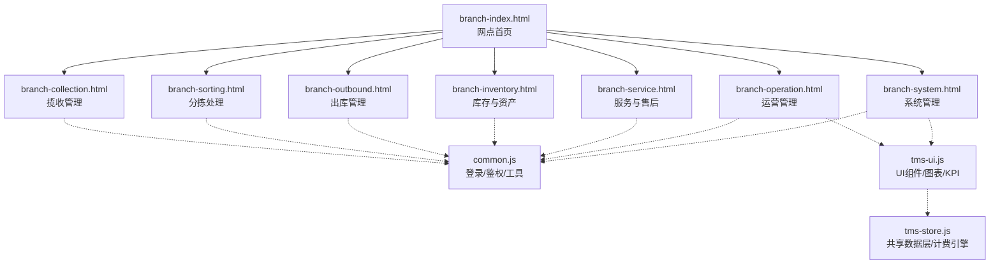
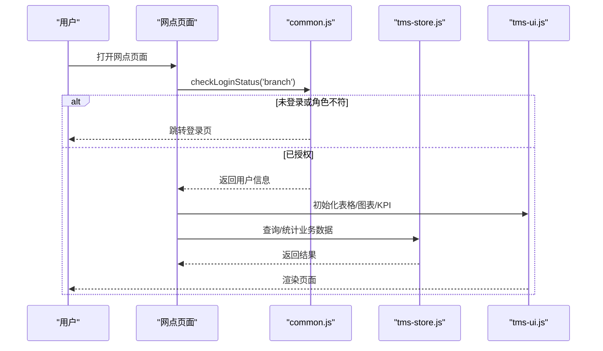
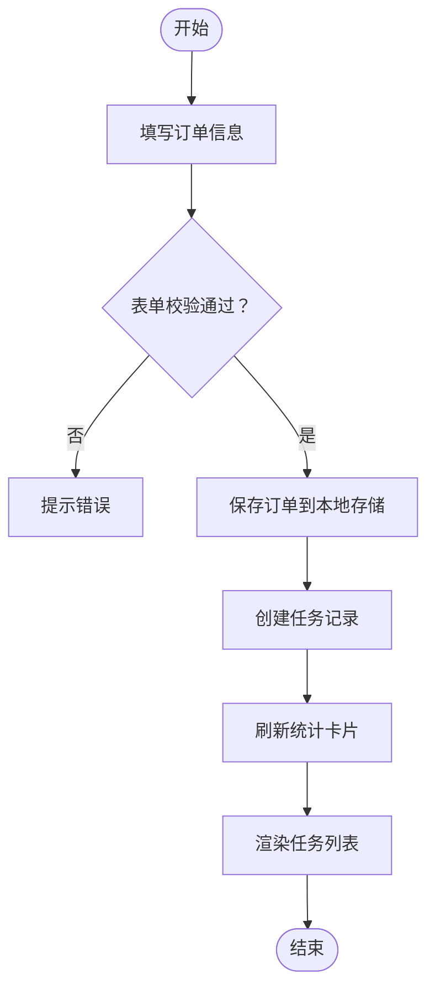
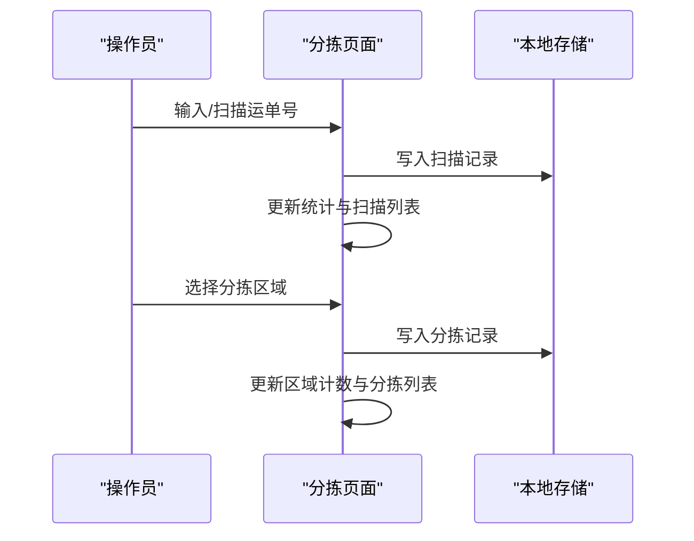
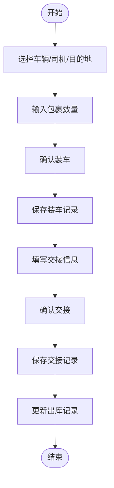
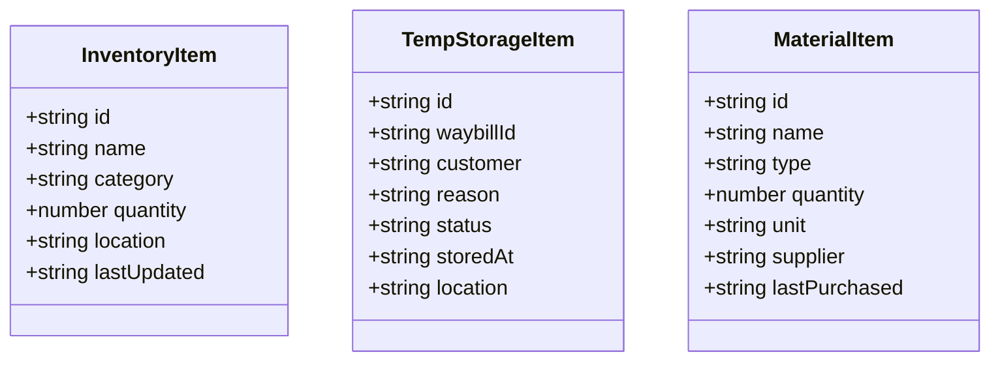
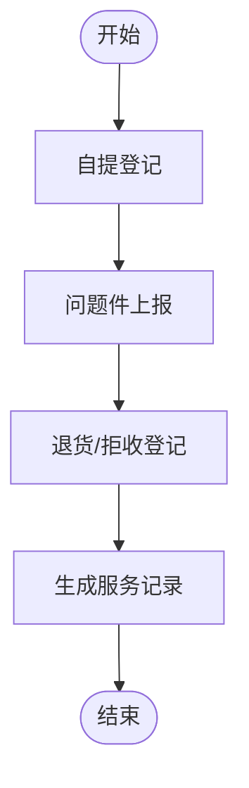
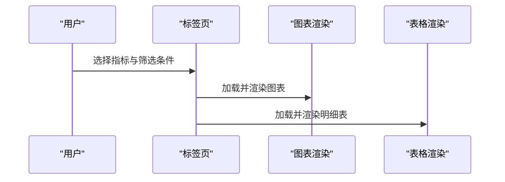
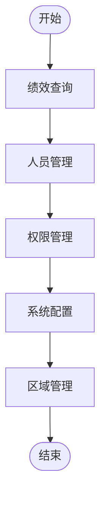
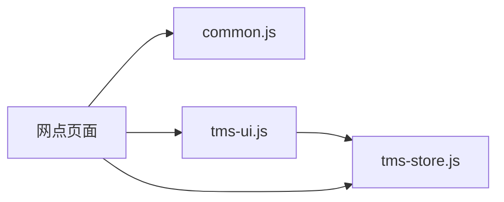

# 网点管理界面

<cite>
**本文引用的文件**   
- [branch-index.html](file://branch-index.html)
- [branch-collection.html](file://branch-collection.html)
- [branch-sorting.html](file://branch-sorting.html)
- [branch-outbound.html](file://branch-outbound.html)
- [branch-inventory.html](file://branch-inventory.html)
- [branch-service.html](file://branch-service.html)
- [branch-operation.html](file://branch-operation.html)
- [branch-system.html](file://branch-system.html)
- [common.js](file://common.js)
- [tms-ui.js](file://tms-ui.js)
- [tms-store.js](file://tms-store.js)
</cite>

## 目录
1. [引言](#引言)
2. [项目结构](#项目结构)
3. [核心组件](#核心组件)
4. [架构总览](#架构总览)
5. [详细组件分析](#详细组件分析)
6. [依赖关系分析](#依赖关系分析)
7. [性能与优化建议](#性能与优化建议)
8. [故障排查指南](#故障排查指南)
9. [结论](#结论)
10. [附录](#附录)

## 引言
本文件面向TMS系统的“网点管理界面”，围绕物流网点的运营管理进行系统化说明，覆盖订单揽收、分拣处理、库存管理、出库操作、客户服务与系统配置等模块。文档从页面结构与交互流程入手，逐步深入到表单验证、批量操作、数据导入导出、权限控制、统计报表与KPI监控的实现方式，并给出与仓储、运输系统集成的接口设计与数据同步机制建议，最后提供性能优化与最佳实践指导。

## 项目结构
网点管理采用多页应用（MPA）组织，每个业务域对应一个HTML页面，并通过通用脚本统一登录、鉴权与用户信息展示；同时引入共享UI组件库与共享数据层，为后续扩展提供基础能力。

**图示来源**
- [branch-index.html:186-200](file://branch-index.html#L186-L200)
- [branch-collection.html:349-361](file://branch-collection.html#L349-L361)
- [branch-sorting.html:387-399](file://branch-sorting.html#L387-L399)
- [branch-outbound.html:391-403](file://branch-outbound.html#L391-L403)
- [branch-inventory.html:352-365](file://branch-inventory.html#L352-L365)
- [branch-service.html:393-405](file://branch-service.html#L393-L405)
- [branch-operation.html:365-377](file://branch-operation.html#L365-L377)
- [branch-system.html:399-411](file://branch-system.html#L399-L411)
- [common.js:135-174](file://common.js#L135-L174)
- [tms-ui.js:756-779](file://tms-ui.js#L756-L779)
- [tms-store.js:1-12](file://tms-store.js#L1-L12)

**章节来源**
- [branch-index.html:186-200](file://branch-index.html#L186-L200)
- [common.js:135-174](file://common.js#L135-L174)

## 核心组件
- 登录与鉴权：通过通用脚本实现角色校验与页面跳转，确保仅授权角色可访问网点功能。
- 共享UI组件：提供表格、弹窗、表单、图表、KPI等通用能力，减少重复代码。
- 共享数据层：基于本地存储的轻量数据库，提供增删改查、搜索筛选、排序分页、状态流转与聚合统计。
- 网点各业务页面：以标签页+表格+表单为主，承载揽收、分拣、出库、库存、服务、运营与系统管理等场景。

**章节来源**
- [common.js:176-199](file://common.js#L176-L199)
- [tms-ui.js:301-542](file://tms-ui.js#L301-L542)
- [tms-store.js:1-12](file://tms-store.js#L1-L12)

## 架构总览
网点管理界面的运行链路如下：
- 用户进入网点入口后，通用脚本检查登录态与角色，未登录或角色不符则跳转至登录页。
- 侧边栏导航切换不同业务页面，页面内使用标签页组织子功能。
- 业务数据优先从本地存储读取，必要时调用共享数据层提供的查询与统计方法。
- UI组件负责渲染列表、弹窗、图表与KPI，数据变更时触发重绘。

**图示来源**
- [common.js:176-199](file://common.js#L176-L199)
- [tms-ui.js:756-779](file://tms-ui.js#L756-L779)
- [tms-store.js:220-244](file://tms-store.js#L220-L244)

## 详细组件分析

### 揽收管理（branch-collection.html）
- 功能范围：订单接收、任务分配、称重计费、条码标签生成与打印。
- 关键交互：
  - 订单表单提交后写入本地存储，并同步生成任务记录。
  - 任务列表支持分配与完成操作，更新任务状态。
  - 称重计费根据重量、体积重、服务类型与服务等级计算费用。
- 表单验证：必填字段校验、数值输入限制、保价金额与费用联动。
- 数据流：
  - 订单数据键：branchOrders
  - 任务数据键：branchTasks

**图示来源**
- [branch-collection.html:591-602](file://branch-collection.html#L591-L602)
- [branch-collection.html:713-758](file://branch-collection.html#L713-L758)

**章节来源**
- [branch-collection.html:398-544](file://branch-collection.html#L398-L544)
- [branch-collection.html:604-758](file://branch-collection.html#L604-L758)

### 分拣处理（branch-sorting.html）
- 功能范围：到件扫描、包裹分拣、任务分配、异常件处理。
- 关键交互：
  - 扫描运单号后记录到件信息，支持回车快速确认。
  - 点击分拣格将包裹归入指定区域，实时更新各区域计数。
  - 任务分配支持按区域与人员派发，并维护任务状态。
  - 异常件上报包含类型、描述与时间戳，支持状态跟踪。
- 数据流：
  - 扫描记录键：scannedPackages
  - 分拣记录键：sortedPackages
  - 分拣任务键：sortingTasks
  - 异常件键：exceptionPackages

**图示来源**
- [branch-sorting.html:674-680](file://branch-sorting.html#L674-L680)
- [branch-sorting.html:683-788](file://branch-sorting.html#L683-L788)

**章节来源**
- [branch-sorting.html:428-604](file://branch-sorting.html#L428-L604)
- [branch-sorting.html:610-788](file://branch-sorting.html#L610-L788)

### 出库管理（branch-outbound.html）
- 功能范围：装车发运、交接确认、车辆管理、出库记录。
- 关键交互：
  - 选择车辆、司机、目的地与包裹数量，确认后生成装车记录。
  - 交接确认录入运单号、接收人、时间与备注，生成交接记录。
  - 车辆管理展示车辆状态与载重，支持编辑。
  - 出库记录汇总装车与交接信息，便于审计。
- 数据流：
  - 装车记录键：loadingRecords
  - 交接记录键：handoverRecords
  - 出库记录键：outboundRecords

**图示来源**
- [branch-outbound.html:441-478](file://branch-outbound.html#L441-L478)
- [branch-outbound.html:518-554](file://branch-outbound.html#L518-L554)
- [branch-outbound.html:716-800](file://branch-outbound.html#L716-L800)

**章节来源**
- [branch-outbound.html:432-657](file://branch-outbound.html#L432-L657)
- [branch-outbound.html:663-800](file://branch-outbound.html#L663-L800)

### 库存与资产（branch-inventory.html）
- 功能范围：库存管理、暂存件管理、物料管理。
- 关键交互：
  - 库存CRUD：添加、编辑、调整、删除。
  - 暂存件登记与处理：原因、状态、位置与时间。
  - 物料领用与采购记录：供应商、单位、最后采购时间。
- 数据流：
  - 库存键：branchInventory
  - 暂存件键：branchTempStorage
  - 物料键：branchMaterials

**图示来源**
- [branch-inventory.html:482-535](file://branch-inventory.html#L482-L535)
- [branch-inventory.html:537-587](file://branch-inventory.html#L537-L587)
- [branch-inventory.html:589-644](file://branch-inventory.html#L589-L644)

**章节来源**
- [branch-inventory.html:393-430](file://branch-inventory.html#L393-L430)
- [branch-inventory.html:437-726](file://branch-inventory.html#L437-L726)

### 服务与售后（branch-service.html）
- 功能范围：客户自提、问题件处理、退货/拒收件、服务记录。
- 关键交互：
  - 自提登记：运单号、客户身份与联系方式核验。
  - 问题件上报与处理：类型、描述、解决方案与状态流转。
  - 退货/拒收登记：类型、原因、详细说明与时间。
  - 服务记录汇总所有服务事件，便于追溯。
- 数据流：
  - 自提记录键：selfPickupRecords
  - 问题件键：issueRecords
  - 退货/拒收键：returnRecords
  - 服务记录键：serviceRecords

**图示来源**
- [branch-service.html:443-493](file://branch-service.html#L443-L493)
- [branch-service.html:495-556](file://branch-service.html#L495-L556)
- [branch-service.html:558-616](file://branch-service.html#L558-L616)

**章节来源**
- [branch-service.html:434-640](file://branch-service.html#L434-L640)
- [branch-service.html:646-800](file://branch-service.html#L646-L800)

### 运营管理（branch-operation.html）
- 功能范围：揽件率、寄件率、漏件率、派送率、错件率、退货率的统计与可视化。
- 关键交互：
  - 标签页切换不同指标，支持员工与时间周期筛选。
  - 图表渲染与表格明细展示，支持查询按钮触发数据加载。
- 数据流：
  - 使用Chart.js绘制趋势图，结合本地模拟数据或后端接口。

**图示来源**
- [branch-operation.html:406-415](file://branch-operation.html#L406-L415)
- [branch-operation.html:716-792](file://branch-operation.html#L716-L792)

**章节来源**
- [branch-operation.html:382-711](file://branch-operation.html#L382-L711)
- [branch-operation.html:716-792](file://branch-operation.html#L716-L792)

### 系统管理（branch-system.html）
- 功能范围：绩效管理、人员管理、区域管理、权限管理、系统配置。
- 关键交互：
  - 绩效查询：按员工与周期筛选，图表与表格展示。
  - 人员管理：添加员工、分配管理区域、维护基本信息。
  - 权限管理：角色与菜单权限勾选，保存权限矩阵。
  - 系统配置：网点基本信息、业务参数、通知设置。
- 数据流：
  - 使用Chart.js与Leaflet地图组件（区域绘制）。

**图示来源**
- [branch-system.html:440-448](file://branch-system.html#L440-L448)
- [branch-system.html:505-568](file://branch-system.html#L505-L568)
- [branch-system.html:570-682](file://branch-system.html#L570-L682)
- [branch-system.html:684-775](file://branch-system.html#L684-L775)
- [branch-system.html:777-800](file://branch-system.html#L777-L800)

**章节来源**
- [branch-system.html:416-775](file://branch-system.html#L416-L775)

## 依赖关系分析
- 页面与通用脚本：
  - 所有网点页面在DOMContentLoaded中调用checkLoginStatus('branch')，并在退出时调用logout()。
  - displayCurrentUser用于显示当前用户名。
- 共享UI组件：
  - tms-ui.js提供表格、弹窗、表单、图表、KPI等能力，供管理员端与部分网点页面复用。
- 共享数据层：
  - tms-store.js提供统一的增删改查、搜索筛选、排序分页、状态流转与聚合统计，支持订阅数据变更事件。

**图示来源**
- [common.js:176-199](file://common.js#L176-L199)
- [tms-ui.js:756-779](file://tms-ui.js#L756-L779)
- [tms-store.js:220-244](file://tms-store.js#L220-L244)

**章节来源**
- [common.js:176-199](file://common.js#L176-L199)
- [tms-ui.js:301-542](file://tms-ui.js#L301-L542)
- [tms-store.js:220-244](file://tms-store.js#L220-L244)

## 性能与优化建议
- 列表渲染优化：
  - 使用虚拟滚动或分页加载，避免一次性渲染大量DOM节点。
  - 对表格列宽与排序进行缓存，减少重复计算。
- 图表渲染优化：
  - 按需加载Chart.js，避免首屏阻塞。
  - 对大数据量折线/柱状图进行采样与降采样。
- 本地存储优化：
  - 合并多次写入，减少localStorage频繁序列化开销。
  - 对热点数据建立内存缓存，降低重复读取成本。
- 交互体验优化：
  - 对耗时操作（如批量导入导出）增加进度反馈与取消机制。
  - 表单校验采用防抖与增量校验，提升输入流畅度。

[本节为通用指导，不直接分析具体文件]

## 故障排查指南
- 登录与鉴权问题：
  - 检查localStorage中是否存在用户信息，以及角色是否匹配所需权限。
  - 若角色不符，页面会跳转到登录页并提示无权限。
- 数据加载失败：
  - 检查本地存储键名是否正确，数据格式是否符合预期。
  - 若使用共享数据层，确认订阅事件是否正常触发。
- 图表不显示：
  - 检查Chart.js是否成功加载，容器尺寸是否有效。
  - 确认传入的数据结构与配置项正确。

**章节来源**
- [common.js:176-199](file://common.js#L176-L199)
- [tms-store.js:220-244](file://tms-store.js#L220-L244)

## 结论
网点管理界面以清晰的页面划分与统一的通用脚本为基础，结合共享UI组件与数据层，实现了揽收、分拣、出库、库存、服务、运营与系统管理的完整闭环。通过标签页与表格的组合，提供了直观的操作入口；通过本地存储与共享数据层，保证了数据的可用性与一致性。未来可在权限细化、批量操作与数据导入导出、以及与仓储/运输系统的API集成方面持续增强，以提升效率与可扩展性。

[本节为总结性内容，不直接分析具体文件]

## 附录

### 表单验证与批量操作要点
- 必填字段校验：在表单提交前进行非空校验，错误时即时提示。
- 数值输入限制：对重量、体积、金额等字段设置min/max/step。
- 批量操作：
  - 批量分配任务：支持多选任务并批量指派给同一人员。
  - 批量出库：按车辆或目的地批量确认装车与交接。
- 数据导入导出：
  - 导入：支持CSV/Excel模板上传，解析后批量写入本地存储或后端接口。
  - 导出：按筛选条件导出数据为CSV/Excel，便于离线分析与归档。

[本节为通用指导，不直接分析具体文件]

### 权限控制与KPI监控
- 权限控制：
  - 基于角色的菜单可见性与操作按钮禁用。
  - 权限矩阵维护角色与各功能模块的关联关系。
- KPI监控：
  - 揽件率、寄件率、漏件率、派送率、错件率、退货率等指标实时统计。
  - 图表与表格联动展示，支持按员工与时间周期筛选。

**章节来源**
- [branch-system.html:570-682](file://branch-system.html#L570-L682)
- [branch-operation.html:406-415](file://branch-operation.html#L406-L415)

### 与仓储/运输系统集成建议
- 接口设计：
  - 入库接口：接收仓库入库通知，更新订单状态为“已入库”。
  - 出库接口：推送装车与交接信息至运输系统，生成运输任务。
  - 轨迹接口：同步轨迹节点与时间，更新订单生命周期。
- 数据同步机制：
  - 采用消息队列或Webhook进行异步同步，保证最终一致性。
  - 冲突解决：以时间戳与版本号为准，避免并发写冲突。

[本节为通用指导，不直接分析具体文件]