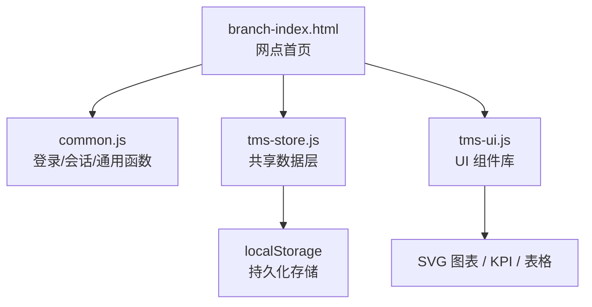
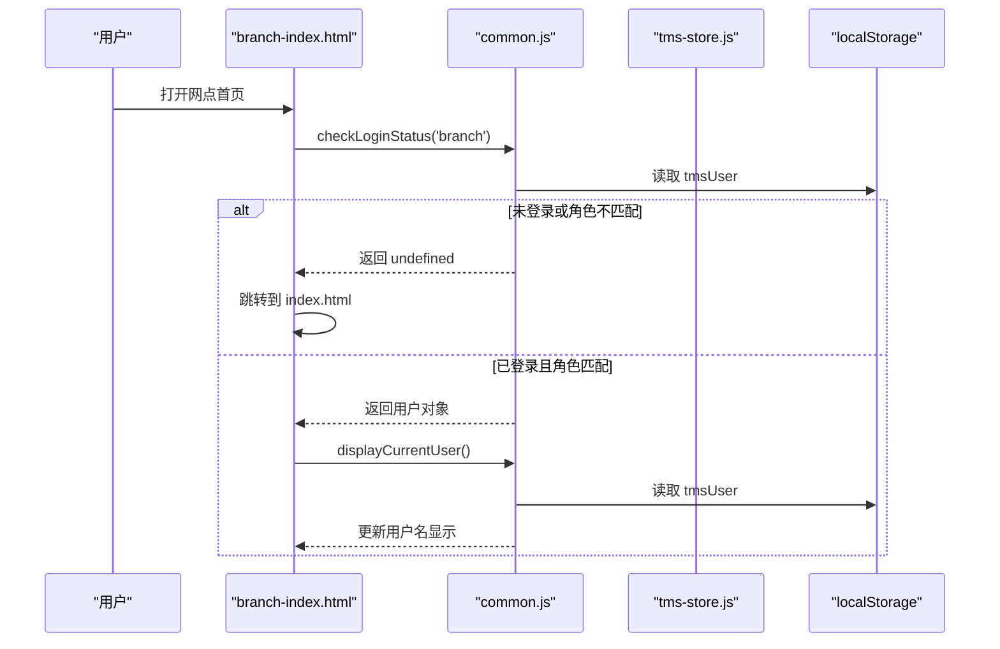
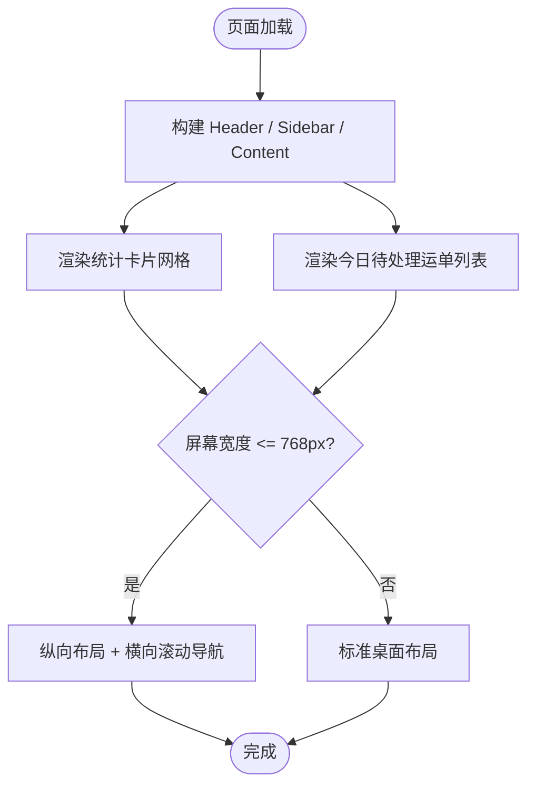
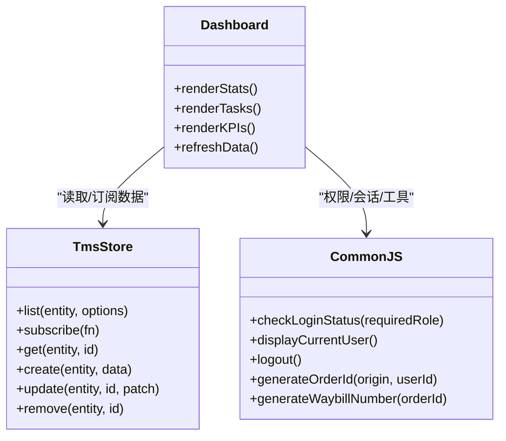
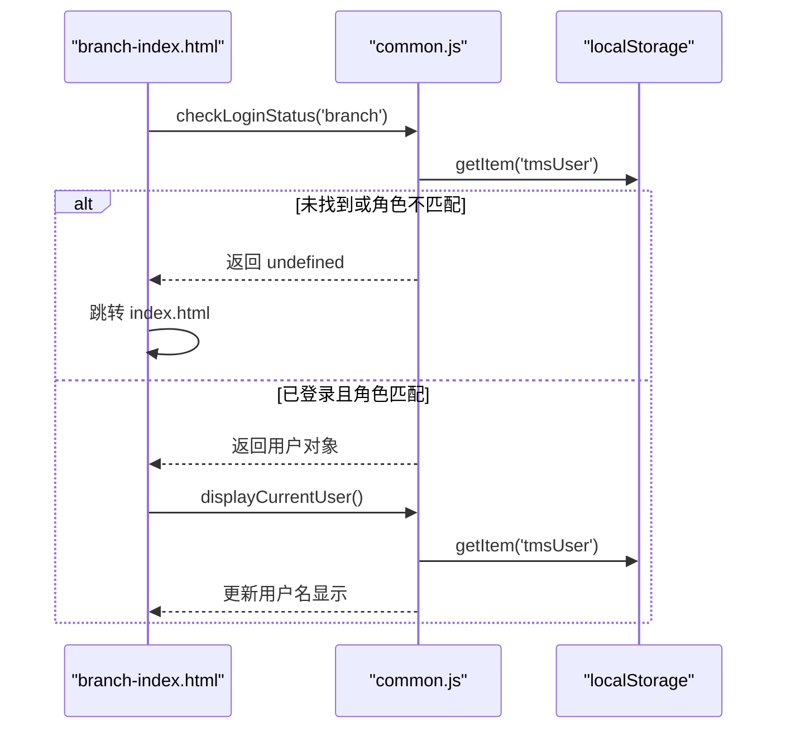
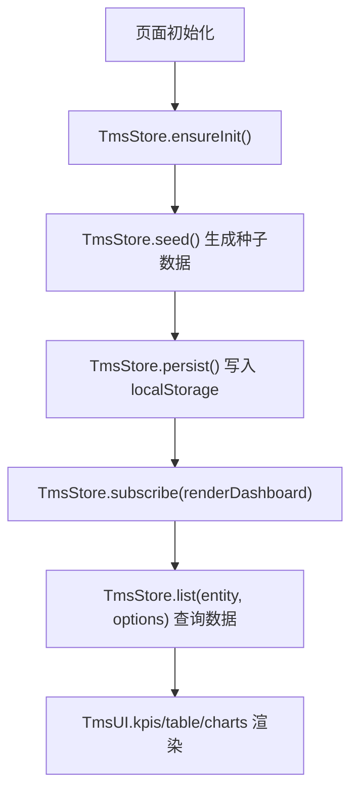
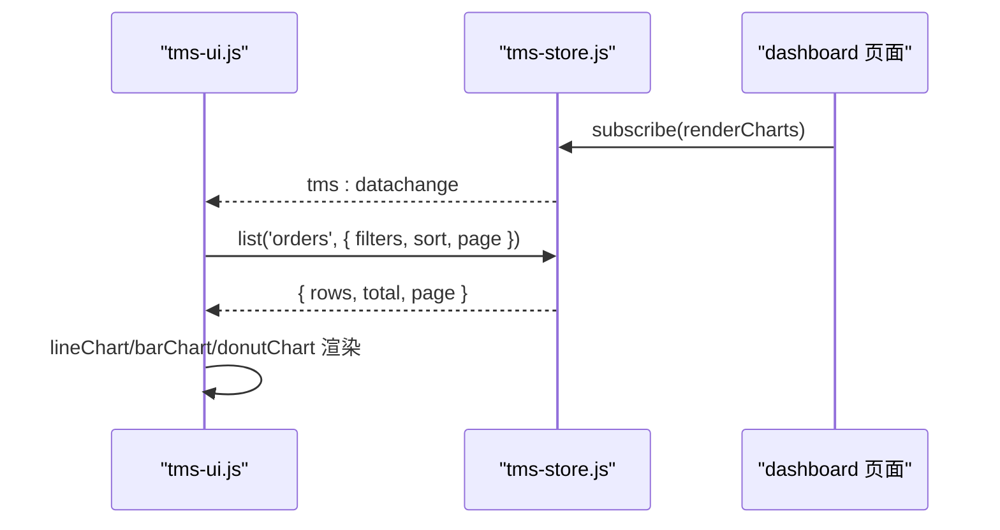

# 网点首页与概览

<cite>
**本文引用的文件**   
- [branch-index.html](file://branch-index.html)
- [common.js](file://common.js)
- [tms-store.js](file://tms-store.js)
- [tms-ui.js](file://tms-ui.js)
</cite>

## 目录
1. [引言](#引言)
2. [项目结构定位](#项目结构定位)
3. [核心组件总览](#核心组件总览)
4. [架构总览](#架构总览)
5. [页面布局与响应式设计](#页面布局与响应式设计)
6. [仪表盘功能详解](#仪表盘功能详解)
7. [权限控制与会话管理](#权限控制与会话管理)
8. [数据层集成：TmsStore 与 CommonJS 工具](#数据层集成tmsstore-与-commonjs-工具)
9. [图表展示机制与刷新策略](#图表展示机制与刷新策略)
10. [性能优化建议](#性能优化建议)
11. [用户体验改进方案](#用户体验改进方案)
12. [故障排查指南](#故障排查指南)
13. [结论](#结论)

## 引言
本文件围绕“网点管理系统”的首页与概览能力展开，重点说明网点管理员仪表盘的统计数据、待处理任务、关键指标监控、页面布局、响应式实现、用户交互逻辑、实时计算与刷新策略，以及权限控制、会话管理和导航系统。文档同时给出如何集成 TmsStore 数据层和 common.js 通用函数的实践路径，并提供性能优化与体验改进建议。

## 项目结构定位
网点首页由独立 HTML 页面承载，配合全局通用脚本提供登录校验、用户信息显示等基础能力；业务数据统一来自共享数据层 TmsStore；UI 组件库 tms-ui.js 提供表格、KPI、图表、弹窗等通用能力。

**图示来源**
- [branch-index.html:1-284](file://branch-index.html#L1-L284)
- [common.js:135-270](file://common.js#L135-L270)
- [tms-store.js:1-12](file://tms-store.js#L1-L12)
- [tms-ui.js:1-10](file://tms-ui.js#L1-L10)

**章节来源**
- [branch-index.html:1-284](file://branch-index.html#L1-L284)
- [common.js:1-383](file://common.js#L1-L383)
- [tms-store.js:1-12](file://tms-store.js#L1-L12)
- [tms-ui.js:1-10](file://tms-ui.js#L1-L10)

## 核心组件总览
- 网点首页（branch-index.html）
  - 顶部导航、侧边栏、主内容区
  - 统计卡片与今日待处理运单列表
  - 登录状态检查、退出登录、当前用户显示
- 通用脚本（common.js）
  - 订单号/运单号生成、按钮样式注入
  - 登录、检查角色、退出、获取/显示当前用户
- 共享数据层（tms-store.js）
  - 基于 localStorage 的种子数据、CRUD、搜索筛选排序分页
  - 订单生命周期流转、扫描/运输/异常/财务关联记录
  - 订阅事件 tms:datachange，供 UI 实时刷新
- UI 组件库（tms-ui.js）
  - Toast、Modal、表单弹窗、通用表格、KPI、折线/柱状/环形图
  - initShell 自动高亮导航、绑定退出、异常角标

**章节来源**
- [branch-index.html:172-284](file://branch-index.html#L172-L284)
- [common.js:135-270](file://common.js#L135-L270)
- [tms-store.js:215-1153](file://tms-store.js#L215-L1153)
- [tms-ui.js:86-287](file://tms-ui.js#L86-L287)

## 架构总览
网点首页采用“页面 + 通用脚本 + 数据层 + UI 组件”的分层结构：
- 视图层：HTML 结构与内联样式
- 交互层：DOM 事件绑定、路由跳转、用户信息渲染
- 数据层：TmsStore 提供数据源与变更事件
- 组件层：tms-ui.js 提供可复用 UI 能力

**图示来源**
- [branch-index.html:267-280](file://branch-index.html#L267-L280)
- [common.js:176-199](file://common.js#L176-L199)
- [common.js:220-270](file://common.js#L220-L270)

## 页面布局与响应式设计
- 布局结构
  - 顶部 header：系统标题、当前角色、退出按钮
  - 左侧 sidebar：网点功能导航（首页、揽收、分拣、出库、库存、服务、运营、系统）
  - 右侧 content：欢迎语、统计卡片网格、今日待处理运单列表
- 响应式策略
  - 使用 CSS Grid 自适应统计卡片列数
  - 在移动端将 main-content 改为纵向排列，sidebar 全宽并横向滚动导航
  - 调整 padding、字号以适配小屏设备

**图示来源**
- [branch-index.html:29-167](file://branch-index.html#L29-L167)
- [branch-index.html:184-262](file://branch-index.html#L184-L262)

**章节来源**
- [branch-index.html:29-167](file://branch-index.html#L29-L167)
- [branch-index.html:184-262](file://branch-index.html#L184-L262)

## 仪表盘功能详解
- 统计数据展示
  - 当前页面包含四张统计卡片：待处理运单、运输中运单、已完成运单、库存商品
  - 这些数值目前为静态展示，后续可通过 TmsStore.list 聚合 orders/transports/inventory 等实体动态计算
- 待处理任务列表
  - 今日待处理运单列表展示运单号、关联订单号与状态标签
  - 可结合 TmsStore 查询 pending/sorted 等状态的订单，按时间排序后渲染
- 关键指标监控
  - 可在 dashboard 区域增加 KPI 组件（如签收率、准时率、异常率），通过 TmsStore 聚合计算并按日/周/月维度展示
  - 图表建议使用 tms-ui.js 提供的 lineChart/barChart/donutChart 进行可视化

**图示来源**
- [tms-store.js:1204-1320](file://tms-store.js#L1204-L1320)
- [common.js:176-270](file://common.js#L176-L270)
- [tms-ui.js:548-680](file://tms-ui.js#L548-L680)

**章节来源**
- [branch-index.html:208-262](file://branch-index.html#L208-L262)
- [tms-store.js:1204-1320](file://tms-store.js#L1204-L1320)
- [tms-ui.js:548-680](file://tms-ui.js#L548-L680)

## 权限控制与会话管理
- 登录流程
  - 用户在登录页选择角色并提交用户名密码
  - common.js 将用户信息写入 localStorage.tmsUser，并根据角色跳转到对应页面
- 页面访问控制
  - branch-index.html 在 DOMContentLoaded 时调用 checkLoginStatus('branch')
  - 若未登录或角色不匹配，则提示无权限并跳转回登录页
- 退出登录
  - 点击退出按钮触发 logout()，清除 localStorage 中的用户信息并跳转登录页
- 当前用户显示
  - displayCurrentUser() 从 localStorage 读取用户信息并更新页面元素

**图示来源**
- [branch-index.html:267-280](file://branch-index.html#L267-L280)
- [common.js:176-199](file://common.js#L176-L199)
- [common.js:220-270](file://common.js#L220-L270)

**章节来源**
- [branch-index.html:267-280](file://branch-index.html#L267-L280)
- [common.js:135-270](file://common.js#L135-L270)

## 数据层集成：TmsStore 与 CommonJS 工具
- 数据查询
  - 使用 TmsStore.list('orders', { filters: { status: 'pending' }, pageSize: 10 }) 获取待处理订单
  - 支持 search、searchFields、filters、sort、page、pageSize 等参数
- 数据订阅
  - 通过 TmsStore.subscribe(callback) 监听 tms:datachange 事件，实现数据变更后自动刷新
- 工具函数
  - generateOrderId/generateWaybillNumber 用于生成订单号和运单号
  - injectButtonStyles 注入统一按钮样式
  - getCurrentUser/displayCurrentUser/logout 管理用户会话

**图示来源**
- [tms-store.js:1187-1195](file://tms-store.js#L1187-L1195)
- [tms-store.js:1204-1320](file://tms-store.js#L1204-L1320)
- [tms-ui.js:548-680](file://tms-ui.js#L548-L680)

**章节来源**
- [tms-store.js:1187-1320](file://tms-store.js#L1187-L1320)
- [common.js:22-50](file://common.js#L22-L50)
- [common.js:52-133](file://common.js#L52-L133)

## 图表展示机制与刷新策略
- 图表类型
  - 折线图：lineChart(labels, series)
  - 柱状图：barChart(labels, series)
  - 环形图：donutChart(data)
- 数据来源
  - 可从 TmsStore.list 聚合 orders/transports/exceptions/finances 等实体
  - 示例：近 7 天订单量趋势、各城市订单分布、异常占比
- 刷新策略
  - 使用 TmsStore.subscribe 监听数据变更，自动重绘图表
  - 支持手动刷新按钮，调用 TmsUI.table.refresh 或图表重新渲染

**图示来源**
- [tms-ui.js:575-680](file://tms-ui.js#L575-L680)
- [tms-store.js:1308-1320](file://tms-store.js#L1308-L1320)

**章节来源**
- [tms-ui.js:575-680](file://tms-ui.js#L575-L680)
- [tms-store.js:1308-1320](file://tms-store.js#L1308-L1320)

## 性能优化建议
- 数据层优化
  - 对频繁查询的实体（orders、transports、exceptions）建立索引字段（如 createdAt、status）
  - 限制返回列表大小，避免一次性渲染过多 DOM
- 前端渲染优化
  - 使用虚拟滚动或分页减少首屏渲染压力
  - 图表数据按需加载，避免重复计算
- 事件与订阅优化
  - 去抖/节流输入框搜索，减少频繁 re-render
  - 合理管理 TmsStore.subscribe 订阅，避免内存泄漏

[本节为通用指导，无需具体文件引用]

## 用户体验改进方案
- 交互增强
  - 为待处理运单添加“快速处理”按钮，直接调用 TmsStore.advanceOrder 推进状态
  - 增加空状态提示与加载骨架屏
- 视觉优化
  - 使用 TmsUI.statusBadge 统一状态标签样式
  - 为关键指标设置颜色阈值（如异常率超阈值变红）
- 可访问性
  - 为按钮和链接添加 aria-label
  - 确保键盘可操作（Tab 导航、Enter 确认）

**章节来源**
- [tms-ui.js:71-80](file://tms-ui.js#L71-L80)
- [tms-store.js:1561-1572](file://tms-store.js#L1561-L1572)

## 故障排查指南
- 常见问题
  - 登录后仍被跳转至登录页：检查 localStorage.tmsUser 是否存在且 role 是否为 'branch'
  - 统计数据不更新：确认 TmsStore.subscribe 是否注册，数据变更后是否触发 tms:datachange
  - 图表不显示：检查 TmsUI.charts 方法是否正确调用，数据格式是否符合要求
- 调试建议
  - 在浏览器控制台查看 console.log 输出（common.js 和 tms-store.js 包含大量日志）
  - 使用 localStorage 面板检查 tmsUser、tmsDB_v3 等键值

**章节来源**
- [common.js:176-199](file://common.js#L176-L199)
- [tms-store.js:232-244](file://tms-store.js#L232-L244)

## 结论
网点首页与概览功能通过清晰的页面结构、统一的权限控制、强大的数据层和可复用的 UI 组件，构建了完整的网点管理员仪表盘。未来可进一步扩展实时数据流、复杂图表分析和高级筛选能力，以提升运营效率与用户体验。