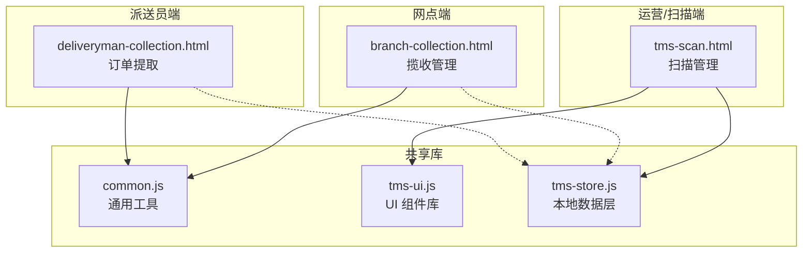
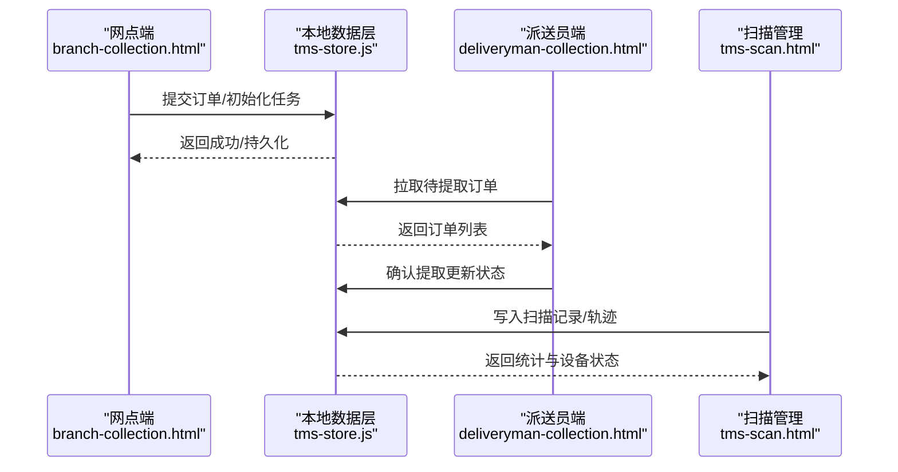
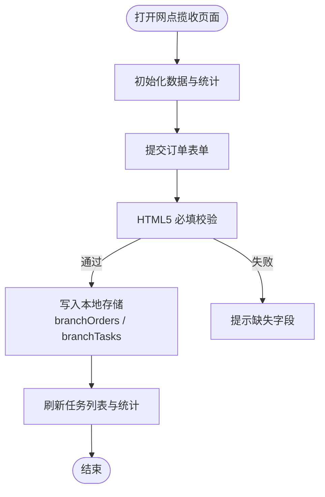
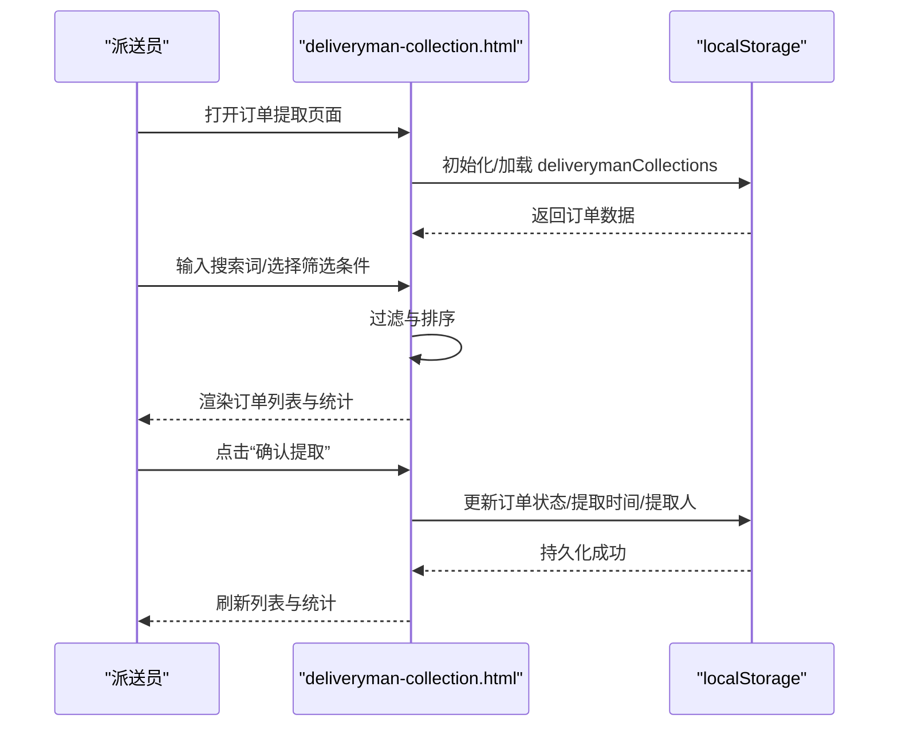
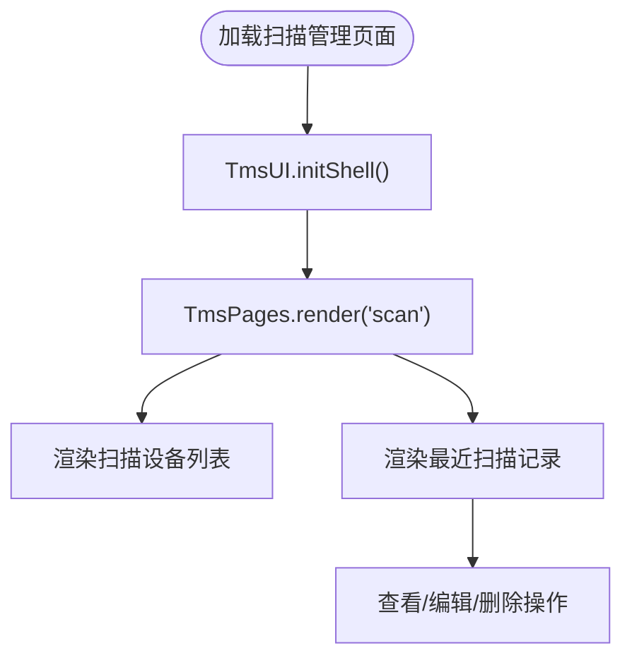
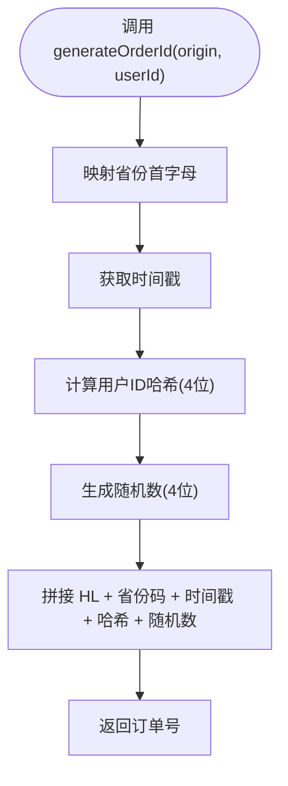
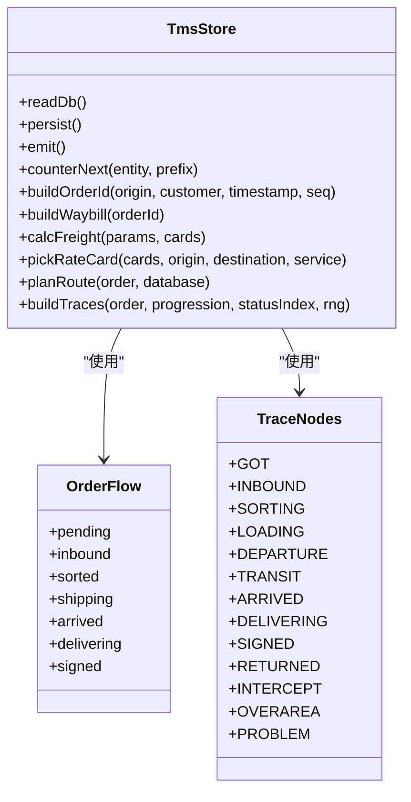
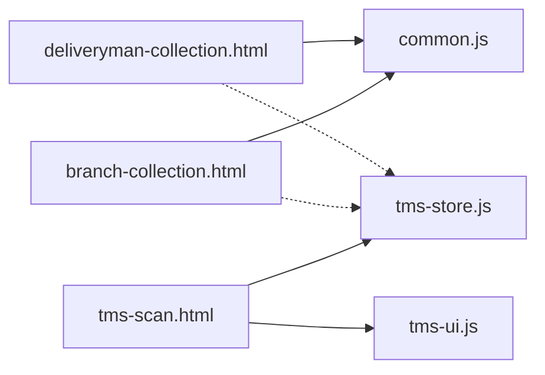

# 订单揽收管理

<cite>
**本文引用的文件**   
- [branch-collection.html](file://branch-collection.html)
- [deliveryman-collection.html](file://deliveryman-collection.html)
- [tms-scan.html](file://tms-scan.html)
- [common.js](file://common.js)
- [tms-ui.js](file://tms-ui.js)
- [tms-store.js](file://tms-store.js)
</cite>

## 目录
1. [引言](#引言)
2. [项目结构](#项目结构)
3. [核心组件](#核心组件)
4. [架构总览](#架构总览)
5. [详细组件分析](#详细组件分析)
6. [依赖关系分析](#依赖关系分析)
7. [性能与优化建议](#性能与优化建议)
8. [故障排查指南](#故障排查指南)
9. [结论](#结论)

## 引言
本技术文档围绕“网点订单揽收管理模块”展开，覆盖揽收任务从创建、分配到执行的全流程，包括批量揽收、扫码录入、地址验证等关键能力。文档同时说明表单验证机制、数据校验规则、错误处理策略，以及揽收状态流转、业务约束和数据一致性保证。此外，还给出与仓储系统的数据同步接口约定、异常处理与重试逻辑的设计建议，并提供批量操作优化、用户体验改进和性能调优方案。

## 项目结构
该仓库采用多页面前端应用组织方式，按角色划分页面：
- 网点端：负责揽收任务的创建、分配、称重计费、条码标签打印等。
- 派送员端：负责接单、确认提取、查看订单详情等。
- 运营/扫描端：提供扫描设备管理与扫描记录查询。
- 共享库：通用工具函数、UI 组件库、本地数据层。

**图表来源**
- [branch-collection.html:333-547](file://branch-collection.html#L333-L547)
- [deliveryman-collection.html:324-418](file://deliveryman-collection.html#L324-L418)
- [tms-scan.html:380-591](file://tms-scan.html#L380-L591)
- [common.js:1-383](file://common.js#L1-L383)
- [tms-ui.js:1-783](file://tms-ui.js#L1-L783)
- [tms-store.js:1-244](file://tms-store.js#L1-L244)

**章节来源**
- [branch-collection.html:333-547](file://branch-collection.html#L333-L547)
- [deliveryman-collection.html:324-418](file://deliveryman-collection.html#L324-L418)
- [tms-scan.html:380-591](file://tms-scan.html#L380-L591)
- [common.js:1-383](file://common.js#L1-L383)
- [tms-ui.js:1-783](file://tms-ui.js#L1-L783)
- [tms-store.js:1-244](file://tms-store.js#L1-L244)

## 核心组件
- 网点揽收管理（branch-collection.html）
  - 订单接收表单：寄件人/收件人信息、包裹类型、重量、保价金额、备注。
  - 任务分配列表：展示待处理任务，支持分配与完成操作。
  - 称重计费：根据实际重量、体积重量、距离、服务类型计算费用。
  - 条码标签：输入订单号生成条码并打印。
- 派送员订单提取（deliveryman-collection.html）
  - 订单搜索与筛选：按状态、日期范围、关键词检索。
  - 订单列表渲染与统计卡片更新。
  - 确认提取：将订单状态由“待提取”改为“已提取”，记录提取时间与人员。
- 扫描管理（tms-scan.html）
  - 扫描设备在线状态展示。
  - 最近扫描记录表格，支持查看、编辑、删除。
- 通用工具（common.js）
  - 用户登录/登出、权限检查、当前用户显示。
  - 订单号与运单号生成算法。
- UI 组件库（tms-ui.js）
  - Toast、Modal、Form Modal、Table、KPI、图表等。
- 本地数据层（tms-store.js）
  - 基于 localStorage 的轻量数据库，提供增删改查、搜索、筛选、排序、分页。
  - 维护订单生命周期、轨迹节点、路由计划、计费引擎等。

**章节来源**
- [branch-collection.html:398-543](file://branch-collection.html#L398-L543)
- [deliveryman-collection.html:421-677](file://deliveryman-collection.html#L421-L677)
- [tms-scan.html:455-591](file://tms-scan.html#L455-L591)
- [common.js:1-383](file://common.js#L1-L383)
- [tms-ui.js:1-783](file://tms-ui.js#L1-L783)
- [tms-store.js:1-244](file://tms-store.js#L1-L244)

## 架构总览
揽收管理涉及三个主要参与方：
- 网点操作员：在网点端创建订单、分配任务、称重计费、打印条码。
- 派送员：在移动端或桌面端接单、确认提取、反馈结果。
- 运营/扫描：通过扫描设备采集节点事件，形成轨迹与统计数据。

**图表来源**
- [branch-collection.html:713-758](file://branch-collection.html#L713-L758)
- [deliveryman-collection.html:635-651](file://deliveryman-collection.html#L635-L651)
- [tms-scan.html:648-692](file://tms-scan.html#L648-L692)
- [tms-store.js:220-244](file://tms-store.js#L220-L244)

## 详细组件分析

### 网点揽收管理（branch-collection.html）
- 功能要点
  - 订单接收表单包含必填字段校验（姓名、电话、地址、重量等）。
  - 任务分配列表支持“分配”“完成”操作，更新任务状态。
  - 称重计费表单支持实际重量、体积重量、距离、服务类型、保价费、总计费用计算。
  - 条码标签支持输入订单号生成预览并打印。
- 数据流
  - 提交订单后，将订单写入本地存储，并同步生成任务记录。
  - 任务列表从本地存储读取并渲染。
- 错误处理
  - 表单提交使用 HTML5 必填校验；未填写时阻止提交。
  - 任务分配使用 prompt 输入，若取消则不执行。
- 扩展点
  - 可接入 tms-store.js 的统一数据层，实现跨页面数据同步与审计。

**图表来源**
- [branch-collection.html:591-602](file://branch-collection.html#L591-L602)
- [branch-collection.html:713-758](file://branch-collection.html#L713-L758)
- [branch-collection.html:760-779](file://branch-collection.html#L760-L779)

**章节来源**
- [branch-collection.html:398-543](file://branch-collection.html#L398-L543)
- [branch-collection.html:591-602](file://branch-collection.html#L591-L602)
- [branch-collection.html:713-758](file://branch-collection.html#L713-L758)
- [branch-collection.html:760-779](file://branch-collection.html#L760-L779)

### 派送员订单提取（deliveryman-collection.html）
- 功能要点
  - 订单搜索：支持订单号、客户姓名、手机号、地址模糊匹配。
  - 筛选器：按状态（待提取/已提取）、日期（今天/本周/本月/全部）过滤。
  - 订单列表：展示订单详情、金额、状态、提取时间、提取人。
  - 确认提取：更新订单状态为“已提取”，记录时间与人员。
- 数据流
  - 从 localStorage 读取 deliverymanCollections 数据。
  - 筛选与排序后渲染列表，并更新统计卡片。
- 错误处理
  - 无订单时显示空状态。
  - 确认提取前校验订单存在性。

**图表来源**
- [deliveryman-collection.html:421-455](file://deliveryman-collection.html#L421-L455)
- [deliveryman-collection.html:490-536](file://deliveryman-collection.html#L490-L536)
- [deliveryman-collection.html:635-651](file://deliveryman-collection.html#L635-L651)

**章节来源**
- [deliveryman-collection.html:421-455](file://deliveryman-collection.html#L421-L455)
- [deliveryman-collection.html:490-536](file://deliveryman-collection.html#L490-L536)
- [deliveryman-collection.html:635-651](file://deliveryman-collection.html#L635-L651)

### 扫描管理（tms-scan.html）
- 功能要点
  - 展示扫描设备在线状态与基本信息。
  - 最近扫描记录表格，支持查看、编辑、删除。
- 数据流
  - 页面通过 TmsUI.initShell 初始化外壳，TmsPages.render('scan') 渲染内容。
  - 扫描记录为静态示例数据，后续可扩展至 tms-store.js。
- 错误处理
  - 查看/编辑/删除操作目前为占位逻辑，可接入真实后端或数据层。

**图表来源**
- [tms-scan.html:601-607](file://tms-scan.html#L601-L607)
- [tms-scan.html:648-692](file://tms-scan.html#L648-L692)

**章节来源**
- [tms-scan.html:455-591](file://tms-scan.html#L455-L591)
- [tms-scan.html:601-607](file://tms-scan.html#L601-L607)
- [tms-scan.html:648-692](file://tms-scan.html#L648-L692)

### 通用工具与编号生成（common.js）
- 功能要点
  - 用户登录/登出、权限检查、当前用户显示。
  - 订单号生成：HL + 省份首字母 + 时间戳 + 用户ID哈希 + 随机数。
  - 运单号生成：WB + 订单号哈希 + 随机数。
- 复杂度
  - hashCode 为 O(n)，n 为字符串长度。
  - generateOrderId/generateWaybillNumber 为常数时间组合。

**图表来源**
- [common.js:22-38](file://common.js#L22-L38)
- [common.js:40-50](file://common.js#L40-L50)

**章节来源**
- [common.js:1-383](file://common.js#L1-L383)

### UI 组件库（tms-ui.js）
- 功能要点
  - Toast 提示、Modal 弹窗、Form Modal 表单弹窗。
  - Table 通用表格（搜索、筛选、分页、排序）。
  - KPI、图表（折线、柱状、环形）。
  - 页面外壳 initShell 与页头 emptyState。
- 适用场景
  - 扫描管理页面使用 TmsUI.initShell 与 TmsPages.render。
  - 其他页面可通过 formModal/table 快速构建交互。

**章节来源**
- [tms-ui.js:1-783](file://tms-ui.js#L1-L783)

### 本地数据层（tms-store.js）
- 功能要点
  - 基于 localStorage 的轻量数据库，版本控制与持久化。
  - 提供统一的事件 tms:datachange 通知订阅者。
  - 维护订单生命周期、轨迹节点、路由计划、计费引擎。
- 关键数据结构
  - ORDER_FLOW：订单阶段索引（待入库→已入库→已分拣→运输中→已到达→派送中→已签收）。
  - TRACE_NODES：轨迹节点字典（揽收、入库、分拣、装车、发车、干线在途、到达、派送、签收、退回、拦截、超区、问题件）。
  - STAGE_NODE：订单阶段到轨迹节点的映射。
- 计费引擎
  - calcFreight：根据起终点、服务等级、重量/体积、保价、付款方式、客户协议折扣计算费用明细。
  - pickRateCard：选择最匹配的运价卡（精确线路+服务 > 精确线路(标准) > 全国+服务 > 全国+标准）。

**图表来源**
- [tms-store.js:88-120](file://tms-store.js#L88-L120)
- [tms-store.js:194-214](file://tms-store.js#L194-L214)
- [tms-store.js:246-261](file://tms-store.js#L246-L261)
- [tms-store.js:332-383](file://tms-store.js#L332-L383)
- [tms-store.js:426-460](file://tms-store.js#L426-L460)

**章节来源**
- [tms-store.js:1-244](file://tms-store.js#L1-L244)
- [tms-store.js:88-120](file://tms-store.js#L88-L120)
- [tms-store.js:194-214](file://tms-store.js#L194-L214)
- [tms-store.js:246-261](file://tms-store.js#L246-L261)
- [tms-store.js:332-383](file://tms-store.js#L332-L383)
- [tms-store.js:426-460](file://tms-store.js#L426-L460)

## 依赖关系分析
- 页面与脚本依赖
  - branch-collection.html 依赖 common.js（用户登录、编号生成）。
  - deliveryman-collection.html 依赖 common.js（用户登录、编号生成）。
  - tms-scan.html 依赖 tms-ui.js（UI 外壳与渲染）。
  - tms-store.js 被扫描管理页面引用，并可被网点/派送员页面扩展使用。
- 数据依赖
  - 网点端使用 localStorage 中的 branchOrders/branchTasks。
  - 派送员端使用 localStorage 中的 deliverymanCollections。
  - 扫描管理页面使用静态示例数据，未来可迁移至 tms-store.js。

**图表来源**
- [branch-collection.html:549-602](file://branch-collection.html#L549-L602)
- [deliveryman-collection.html:420-455](file://deliveryman-collection.html#L420-L455)
- [tms-scan.html:596-607](file://tms-scan.html#L596-L607)

**章节来源**
- [branch-collection.html:549-602](file://branch-collection.html#L549-L602)
- [deliveryman-collection.html:420-455](file://deliveryman-collection.html#L420-L455)
- [tms-scan.html:596-607](file://tms-scan.html#L596-L607)

## 性能与优化建议
- 批量揽收优化
  - 在网点端增加批量导入功能（CSV/Excel），解析后批量写入 branchOrders/branchTasks，减少重复 DOM 操作。
  - 使用 tms-store.js 的事务式写入，确保数据一致性。
- 扫码录入优化
  - 在扫描管理页面集成摄像头扫码 API，实时捕获条码并自动填充订单号。
  - 对高频扫码进行去重与节流，避免重复写入。
- 地址验证优化
  - 在网点端接入地址标准化服务，校验省市区与详细地址格式，提升数据质量。
  - 结合 tms-store.js 的地址字典，快速匹配区域与邮编。
- 用户体验改进
  - 使用 tms-ui.js 的 Form Modal 替代原生 prompt，提供更友好的任务分配界面。
  - 在订单列表中使用虚拟滚动，提升大数据量下的渲染性能。
- 性能调优
  - 对 localStorage 读写进行批处理，减少频繁 I/O。
  - 使用 Web Workers 处理复杂计算（如批量计费、条码生成）。

[本节为通用指导，不涉及具体文件分析]

## 故障排查指南
- 表单验证失败
  - 检查 HTML5 必填字段是否填写完整。
  - 在网点端，确认 submitOrder 函数是否正确触发。
- 数据不一致
  - 检查 localStorage 中 branchOrders/branchTasks/deliverymanCollections 是否同步更新。
  - 使用 tms-store.js 的 persist 与 emit 确保事件通知。
- 扫描记录异常
  - 检查 tms-scan.html 中的查看/编辑/删除逻辑是否接入真实数据源。
  - 确认扫描设备状态与最后在线时间是否正确显示。
- 编号生成冲突
  - 检查 common.js 中的 generateOrderId/generateWaybillNumber 是否产生唯一值。
  - 在高并发场景下，建议使用 tms-store.js 的 counterNext 生成序号。

**章节来源**
- [branch-collection.html:591-602](file://branch-collection.html#L591-L602)
- [deliveryman-collection.html:635-651](file://deliveryman-collection.html#L635-L651)
- [tms-scan.html:648-692](file://tms-scan.html#L648-L692)
- [common.js:22-50](file://common.js#L22-L50)
- [tms-store.js:246-261](file://tms-store.js#L246-L261)

## 结论
网点订单揽收管理模块通过多页面协作与共享库支撑，实现了从订单创建、任务分配到执行的全流程闭环。当前实现以 localStorage 为主，具备基础的数据持久化与交互能力。未来可进一步接入 tms-store.js 的统一数据层，增强数据一致性、审计追踪与跨页面同步。同时，建议引入地址验证、扫码录入、批量操作等高级功能，以提升效率与用户体验。

[本节为总结性内容，不涉及具体文件分析]