# 运营管理分析

<cite>
**本文引用的文件**   
- [tms-operation.html](file://tms-operation.html)
- [tms-ui.js](file://tms-ui.js)
- [tms-store.js](file://tms-store.js)
- [common.js](file://common.js)
- [tms-monitor.html](file://tms-monitor.html)
</cite>

## 目录
1. [引言](#引言)
2. [项目结构](#项目结构)
3. [核心组件](#核心组件)
4. [架构总览](#架构总览)
5. [详细组件分析](#详细组件分析)
6. [依赖关系分析](#依赖关系分析)
7. [性能与优化](#性能与优化)
8. [故障排查指南](#故障排查指南)
9. [结论](#结论)
10. [附录：指标与报表定义](#附录指标与报表定义)

## 引言
本技术文档围绕“网点运营管理分析模块”，系统性说明运营数据的采集、清洗、分析与可视化展示机制，覆盖 KPI 指标体系、报表生成、数据钻取、监控面板、实时数据更新、异常告警、业务分析算法、趋势聚合、智能决策支持、数据导出与多维度分析能力。该模块以共享数据层 TmsStore 为唯一数据源，通过共享 UI 组件库 TmsUI 完成页面渲染与交互，由 tms-operation.html 作为运营管理主入口组织各子功能。

## 项目结构
- 运营管理主页面：tms-operation.html，负责运营概览、派送地址管理、统计分析、考核管理与改单记录等视图组织与交互。
- 共享 UI 组件库：tms-ui.js，提供表格、搜索/筛选/分页、弹窗、确认框、Toast、SVG 图表（折线、柱状、环形）等通用能力。
- 共享数据层：tms-store.js，基于 localStorage 的轻量业务数据库，提供种子数据、CRUD、订单生命周期、轨迹、异常、财务、统计聚合等能力。
- 通用工具：common.js，提供登录、用户信息、按钮样式注入等通用能力。
- 系统监控页：tms-monitor.html，用于系统运行状态与异常类型分布等监控展示。

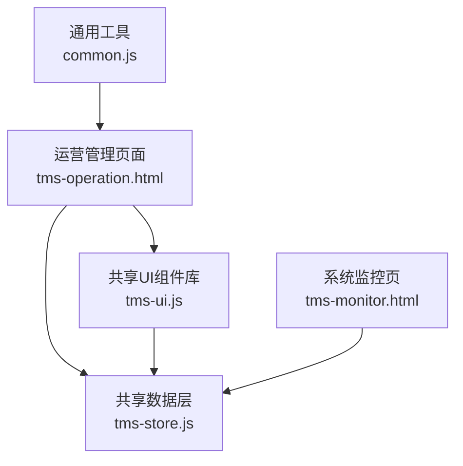

**图示来源**
- [tms-operation.html:513-535](file://tms-operation.html#L513-L535)
- [tms-ui.js:758-781](file://tms-ui.js#L758-L781)
- [tms-store.js:2299-2367](file://tms-store.js#L2299-L2367)
- [common.js:135-270](file://common.js#L135-L270)
- [tms-monitor.html:382-410](file://tms-monitor.html#L382-L410)

**章节来源**
- [tms-operation.html:513-535](file://tms-operation.html#L513-L535)
- [tms-ui.js:758-781](file://tms-ui.js#L758-L781)
- [tms-store.js:2299-2367](file://tms-store.js#L2299-L2367)
- [common.js:135-270](file://common.js#L135-L270)
- [tms-monitor.html:382-410](file://tms-monitor.html#L382-L410)

## 核心组件
- 运营管理页面（tms-operation.html）
  - 运营概览：KPI 卡片、近 7 日签收率折线图、今日作业进度、运营待办。
  - 统计分析：近 7 日运营日报表、签收率、入库扫描率、出库扫描率、派送扫描率、漏拣统计、叉车货统计。
  - 考核管理：考核指标配置、员工考核记录与等级。
  - 改单记录：订单变更原因、内容、操作人与时间。
- 共享 UI 组件库（tms-ui.js）
  - 列表与表格：统一搜索、筛选、排序、分页、工具栏、行操作。
  - 图表：折线图、柱状图、环形图，使用 SVG 绘制。
  - 弹窗与表单：模态框、确认框、表单校验与提交回调。
  - 页面外壳：导航高亮、异常角标、退出登录。
- 共享数据层（tms-store.js）
  - 数据持久化：localStorage 存储与跨标签同步。
  - 业务引擎：订单创建、推进、取消、改单、逆向退货；轨迹与扫描；异常闭环；应收应付与账单。
  - 统计聚合：overview、orderTrend、statusDistribution、exceptionByType、dailyStats、financeSummary、billingSummary 等。
- 通用工具（common.js）
  - 登录流程、角色跳转、用户信息显示、积分相关函数。

**章节来源**
- [tms-operation.html:426-508](file://tms-operation.html#L426-L508)
- [tms-ui.js:289-544](file://tms-ui.js#L289-L544)
- [tms-ui.js:546-680](file://tms-ui.js#L546-L680)
- [tms-store.js:1197-1320](file://tms-store.js#L1197-L1320)
- [tms-store.js:2008-2295](file://tms-store.js#L2008-L2295)
- [common.js:135-270](file://common.js#L135-L270)

## 架构总览
运营管理分析模块采用“页面 + 共享UI + 共享数据”的分层架构：
- 页面层：tms-operation.html 组织视图与交互逻辑，调用 TmsUI 渲染表格与图表，从 TmsStore 获取数据。
- UI 层：tms-ui.js 提供可复用的组件，封装 DOM 操作与事件绑定，屏蔽底层数据差异。
- 数据层：tms-store.js 维护全量业务数据与统计口径，对外暴露 API，触发订阅事件驱动 UI 刷新。

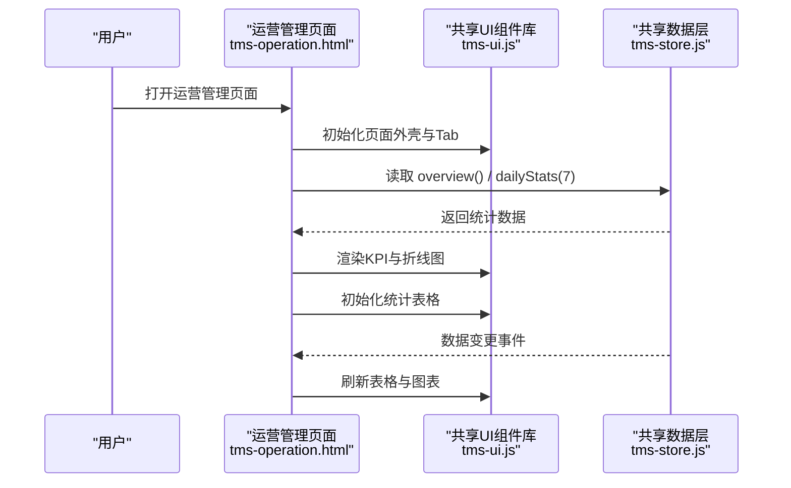

**图示来源**
- [tms-operation.html:513-535](file://tms-operation.html#L513-L535)
- [tms-operation.html:577-618](file://tms-operation.html#L577-L618)
- [tms-ui.js:758-781](file://tms-ui.js#L758-L781)
- [tms-store.js:2015-2044](file://tms-store.js#L2015-L2044)
- [tms-store.js:2108-2156](file://tms-store.js#L2108-L2156)

## 详细组件分析

### 数据采集与清洗
- 数据来源
  - 订单、扫描、分拣、装卸、运输、异常、财务、应收应付、账单、库存、车辆、设备、策略、路由规则、派送地址、时效规则、改单记录、考核指标与评估等。
- 数据生成与一致性
  - 首次访问自动生成真实感种子数据，保证演示环境稳定。
  - 所有数据变更通过 persist() 写入 localStorage，并触发 tms:datachange 事件，跨标签同步。
- 数据清洗与口径
  - 扫描覆盖率按订单去重统计，避免重复计数导致失真。
  - 每日统计限定在当日应作业订单范围内计算比率，确保指标合理。

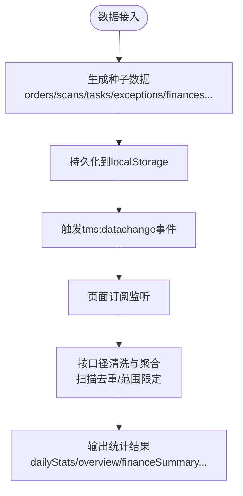

**图示来源**
- [tms-store.js:464-1154](file://tms-store.js#L464-L1154)
- [tms-store.js:232-244](file://tms-store.js#L232-L244)
- [tms-store.js:2095-2156](file://tms-store.js#L2095-L2156)

**章节来源**
- [tms-store.js:464-1154](file://tms-store.js#L464-L1154)
- [tms-store.js:232-244](file://tms-store.js#L232-L244)
- [tms-store.js:2095-2156](file://tms-store.js#L2095-L2156)

### KPI 指标体系
- 运营概览 KPI
  - 今日签收率、入库扫描率、出库扫描率、派送扫描率、改单记录数、待处理异常。
- 统计分析 KPI
  - 近 7 日签收率、入库扫描率、出库扫描率、派送扫描率、漏拣率、叉车作业量与吨位。
- 考核指标
  - 签收率、准时率、异常处理时效、客户满意度、扫描完整率、投诉率等权重配置。

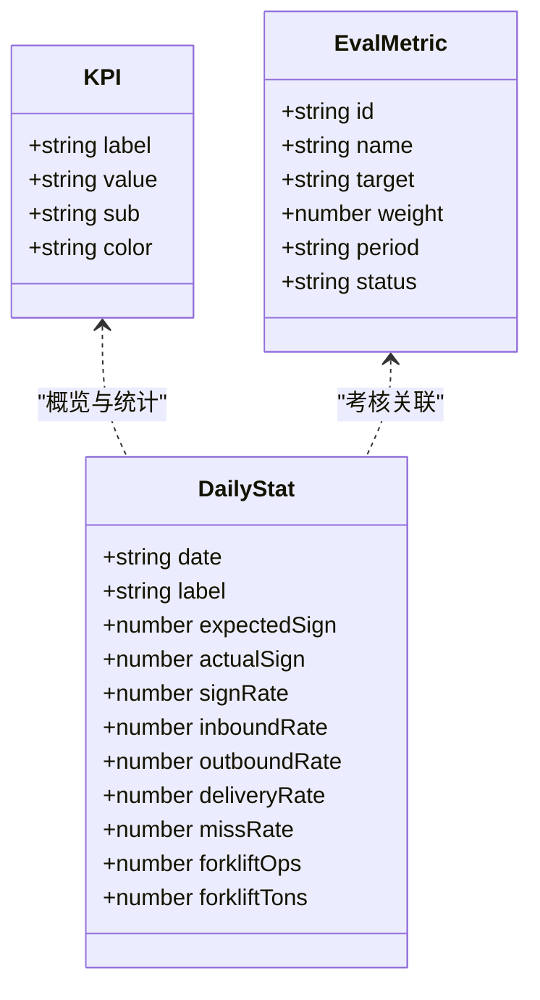

**图示来源**
- [tms-operation.html:586-618](file://tms-operation.html#L586-L618)
- [tms-operation.html:690-711](file://tms-operation.html#L690-L711)
- [tms-store.js:2108-2156](file://tms-store.js#L2108-L2156)
- [tms-store.js:669-678](file://tms-store.js#L669-L678)

**章节来源**
- [tms-operation.html:586-618](file://tms-operation.html#L586-L618)
- [tms-operation.html:690-711](file://tms-operation.html#L690-L711)
- [tms-store.js:2108-2156](file://tms-store.js#L2108-L2156)
- [tms-store.js:669-678](file://tms-store.js#L669-L678)

### 报表生成与数据钻取
- 报表生成
  - 近 7 日运营日报表：包含日期、应签收、实签收、签收率、入库扫描率、出库扫描率、派送扫描率、漏拣率、叉车吨位。
  - 单项指标报表：签收率、入库扫描率、出库扫描率、派送扫描率、漏拣率、叉车作业量。
- 数据钻取
  - 通过 URL hash 定位到具体统计区块，如 #statistics/sign-rate-section，实现快速跳转与聚焦。
  - 表格支持搜索、筛选、排序与分页，便于下钻明细。

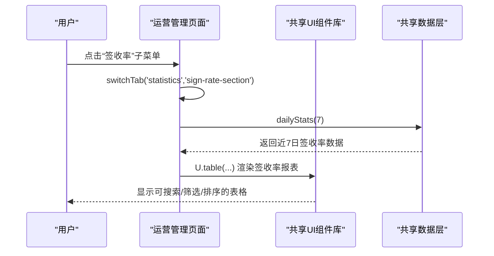

**图示来源**
- [tms-operation.html:545-575](file://tms-operation.html#L545-L575)
- [tms-operation.html:664-688](file://tms-operation.html#L664-L688)
- [tms-ui.js:303-544](file://tms-ui.js#L303-L544)
- [tms-store.js:2108-2156](file://tms-store.js#L2108-L2156)

**章节来源**
- [tms-operation.html:545-575](file://tms-operation.html#L545-L575)
- [tms-operation.html:664-688](file://tms-operation.html#L664-L688)
- [tms-ui.js:303-544](file://tms-ui.js#L303-L544)
- [tms-store.js:2108-2156](file://tms-store.js#L2108-L2156)

### 运营监控面板与实时数据更新
- 监控面板
  - 近 7 日单量趋势、异常类型分布、订单队列健康度、扫描设备状态、运行环境。
- 实时数据更新
  - TmsStore 通过 subscribe() 通知页面数据变化，页面自动刷新 KPI、图表与表格。
  - 刷新按钮触发 renderOperation() 与表格 refresh()，并提示“运营数据已刷新”。

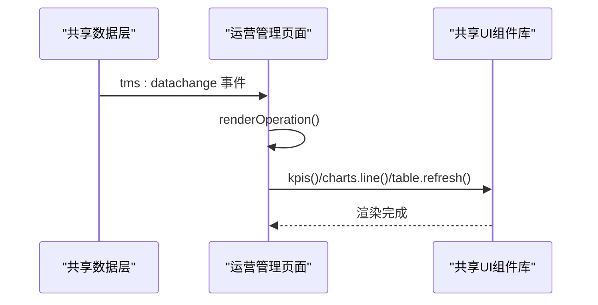

**图示来源**
- [tms-monitor.html:382-410](file://tms-monitor.html#L382-L410)
- [tms-operation.html:527-535](file://tms-operation.html#L527-L535)
- [tms-operation.html:577-618](file://tms-operation.html#L577-L618)
- [tms-store.js:1308-1313](file://tms-store.js#L1308-L1313)

**章节来源**
- [tms-monitor.html:382-410](file://tms-monitor.html#L382-L410)
- [tms-operation.html:527-535](file://tms-operation.html#L527-L535)
- [tms-operation.html:577-618](file://tms-operation.html#L577-L618)
- [tms-store.js:1308-1313](file://tms-store.js#L1308-L1313)

### 异常告警机制
- 轨迹超时检测
  - checkTracesOvertime() 遍历轨迹节点，标记超时并可选自动创建异常工单。
- 异常闭环
  - 受理→定责→扣款→方案/根因→关闭，联动理赔与应付生成。
- 升级机制
  - 超时未处理升级为一级异常，推送至运营主管。

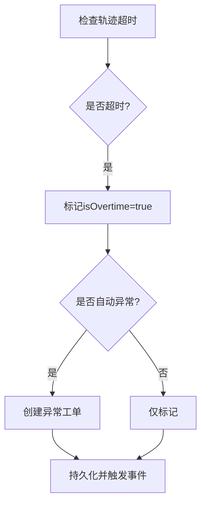

**图示来源**
- [tms-store.js:1880-1896](file://tms-store.js#L1880-L1896)
- [tms-store.js:1740-1837](file://tms-store.js#L1740-L1837)

**章节来源**
- [tms-store.js:1880-1896](file://tms-store.js#L1880-L1896)
- [tms-store.js:1740-1837](file://tms-store.js#L1740-L1837)

### 业务分析算法与趋势聚合
- 计费试算
  - calcFreight() 根据重量/体积/服务等级/客户协议折扣/燃油附加/偏远附加/保价/到付等要素计算运费明细。
- 趋势聚合
  - orderTrend() 按日统计下单与签收数量。
  - financeTrend() 按日统计收入与支出。
  - dailyStats() 按日统计签收率、扫描覆盖率、漏拣率、叉车作业量与吨位。
- 异常与偏差
  - traceOvertimeStats() 统计超时与偏差轨迹，按线路汇总 Top 问题。

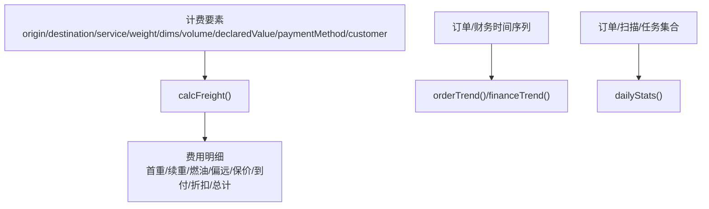

**图示来源**
- [tms-store.js:327-383](file://tms-store.js#L327-L383)
- [tms-store.js:2046-2062](file://tms-store.js#L2046-L2062)
- [tms-store.js:2192-2208](file://tms-store.js#L2192-L2208)
- [tms-store.js:2108-2156](file://tms-store.js#L2108-L2156)
- [tms-store.js:2273-2281](file://tms-store.js#L2273-L2281)

**章节来源**
- [tms-store.js:327-383](file://tms-store.js#L327-L383)
- [tms-store.js:2046-2062](file://tms-store.js#L2046-L2062)
- [tms-store.js:2192-2208](file://tms-store.js#L2192-L2208)
- [tms-store.js:2108-2156](file://tms-store.js#L2108-L2156)
- [tms-store.js:2273-2281](file://tms-store.js#L2273-L2281)

### 智能决策支持与自动化报告
- 智能决策支持
  - 异常自动升级与责任方扣款，联动理赔与应付生成，辅助运营主管决策。
  - 轨迹超时预警自动创建异常，减少人工巡检成本。
- 自动化报告
  - dailyStats() 与 financeTrend() 提供标准化报表数据，供页面直接渲染。
  - billingSummary() 与 payableSummary() 提供应收应付汇总，支持月度对账。

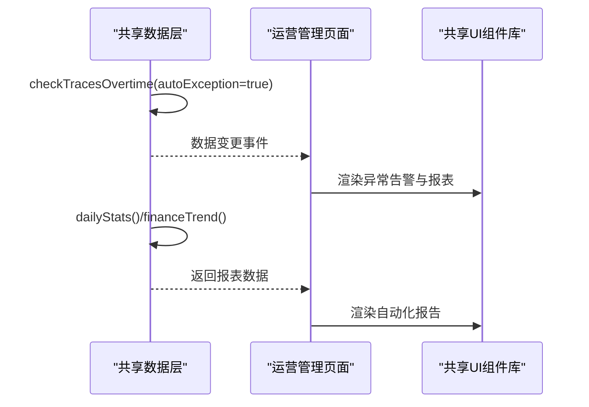

**图示来源**
- [tms-store.js:1880-1896](file://tms-store.js#L1880-L1896)
- [tms-store.js:2108-2156](file://tms-store.js#L2108-L2156)
- [tms-store.js:2192-2208](file://tms-store.js#L2192-L2208)
- [tms-store.js:2229-2261](file://tms-store.js#L2229-L2261)

**章节来源**
- [tms-store.js:1880-1896](file://tms-store.js#L1880-L1896)
- [tms-store.js:2108-2156](file://tms-store.js#L2108-L2156)
- [tms-store.js:2192-2208](file://tms-store.js#L2192-L2208)
- [tms-store.js:2229-2261](file://tms-store.js#L2229-L2261)

### 数据导出、报表定制与多维度分析
- 数据导出
  - 当前仓库未实现后端导出接口，可通过前端复制表格数据或打印页面进行导出。
- 报表定制
  - 通过 U.table() 配置 columns、filters、toolbar、actions，灵活定制报表列与操作。
- 多维度分析
  - 支持按日期、状态、类型、线路等多维度筛选与排序，结合 dailyStats() 与 exceptionByType() 进行多维对比。

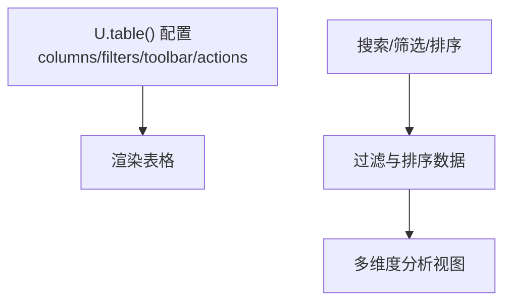

**图示来源**
- [tms-ui.js:303-544](file://tms-ui.js#L303-L544)
- [tms-store.js:2079-2086](file://tms-store.js#L2079-L2086)
- [tms-store.js:2108-2156](file://tms-store.js#L2108-L2156)

**章节来源**
- [tms-ui.js:303-544](file://tms-ui.js#L303-L544)
- [tms-store.js:2079-2086](file://tms-store.js#L2079-L2086)
- [tms-store.js:2108-2156](file://tms-store.js#L2108-L2156)

## 依赖关系分析
- 页面依赖
  - tms-operation.html 依赖 common.js（登录与用户信息）、tms-store.js（数据）、tms-ui.js（UI）。
- UI 依赖
  - tms-ui.js 依赖全局 window.TmsStore 提供数据查询与订阅。
- 数据依赖
  - tms-store.js 内部依赖种子数据、字典、计费引擎、路由规划、轨迹生成、异常闭环、财务与账单等模块。

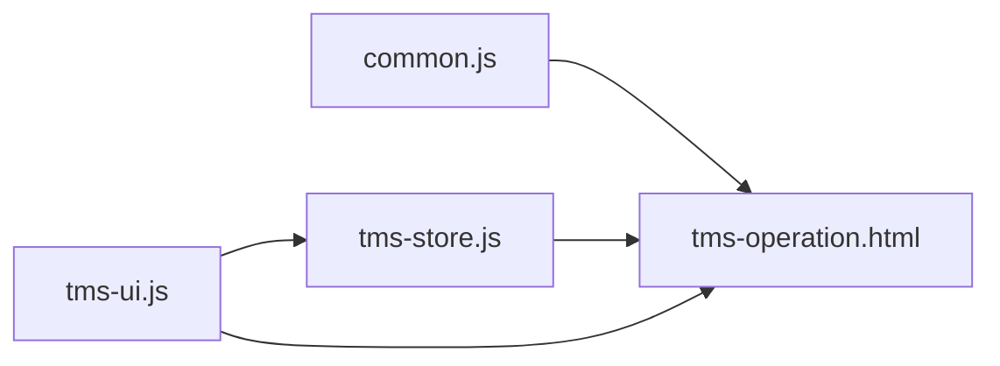

**图示来源**
- [tms-operation.html:513-535](file://tms-operation.html#L513-L535)
- [tms-ui.js:758-781](file://tms-ui.js#L758-L781)
- [tms-store.js:2299-2367](file://tms-store.js#L2299-L2367)

**章节来源**
- [tms-operation.html:513-535](file://tms-operation.html#L513-L535)
- [tms-ui.js:758-781](file://tms-ui.js#L758-L781)
- [tms-store.js:2299-2367](file://tms-store.js#L2299-L2367)

## 性能与优化
- 本地存储与事件驱动
  - 使用 localStorage 存储数据，避免网络请求开销；通过 storage 事件实现跨标签同步。
- 数据去重与范围限定
  - 扫描覆盖率按订单去重统计，避免重复计数；每日统计限定在当日应作业订单范围内，防止指标失真。
- 图表渲染优化
  - SVG 图表按需绘制，避免复杂第三方库开销；niceMax() 与 scale() 简化坐标轴计算。
- 表格性能
  - 表格组件内置防抖搜索与分页，减少频繁重绘；订阅仅在非输入状态下刷新，提升交互体验。

[本节为通用指导，不直接分析具体文件]

## 故障排查指南
- 数据未刷新
  - 检查 TmsStore.subscribe() 是否正确注册；确认 persist() 是否被调用；查看浏览器控制台是否有 listener error。
- 图表为空
  - 检查传入的 labels 与 series.data 是否为空；确认容器元素是否存在。
- 表格无数据
  - 检查 entity 名称是否正确；确认 filters/searchFields 配置是否匹配字段名。
- 异常未升级
  - 检查 checkTracesOvertime() 是否启用 autoException；确认轨迹 deadline 与 isOvertime 标记逻辑。

**章节来源**
- [tms-store.js:237-244](file://tms-store.js#L237-L244)
- [tms-ui.js:559-680](file://tms-ui.js#L559-L680)
- [tms-ui.js:303-544](file://tms-ui.js#L303-L544)
- [tms-store.js:1880-1896](file://tms-store.js#L1880-L1896)

## 结论
运营管理分析模块以共享数据层为核心，结合共享 UI 组件库，实现了运营数据的采集、清洗、分析与可视化展示。通过 KPI 指标体系、报表生成与数据钻取，支撑日常运营监控与决策。异常告警与智能决策支持提升了运营效率与准确性。未来可扩展数据导出、更丰富的预测模型与自动化报告能力，进一步提升智能化水平。

[本节为总结性内容，不直接分析具体文件]

## 附录：指标与报表定义
- 运营概览 KPI
  - 今日签收率、入库扫描率、出库扫描率、派送扫描率、改单记录数、待处理异常。
- 统计分析报表
  - 近 7 日运营日报表：日期、应签收、实签收、签收率、入库扫描率、出库扫描率、派送扫描率、漏拣率、叉车吨位。
  - 单项指标报表：签收率、入库扫描率、出库扫描率、派送扫描率、漏拣率、叉车作业量。
- 考核指标
  - 签收率、准时率、异常处理时效、客户满意度、扫描完整率、投诉率等权重配置。

**章节来源**
- [tms-operation.html:586-618](file://tms-operation.html#L586-L618)
- [tms-operation.html:664-688](file://tms-operation.html#L664-L688)
- [tms-store.js:2108-2156](file://tms-store.js#L2108-L2156)
- [tms-store.js:669-678](file://tms-store.js#L669-L678)