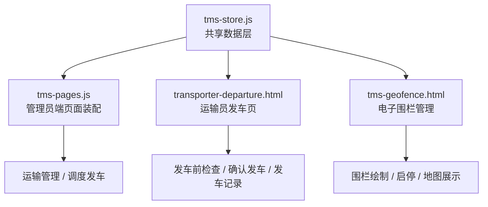
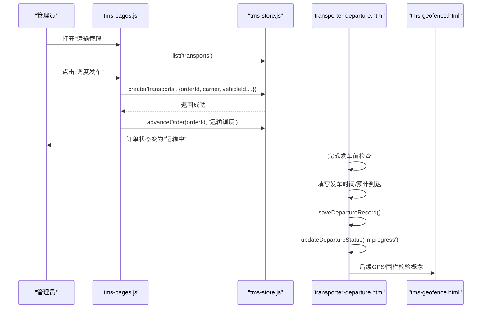
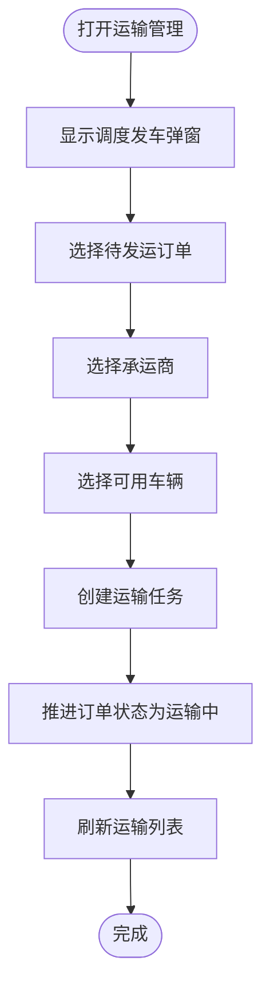
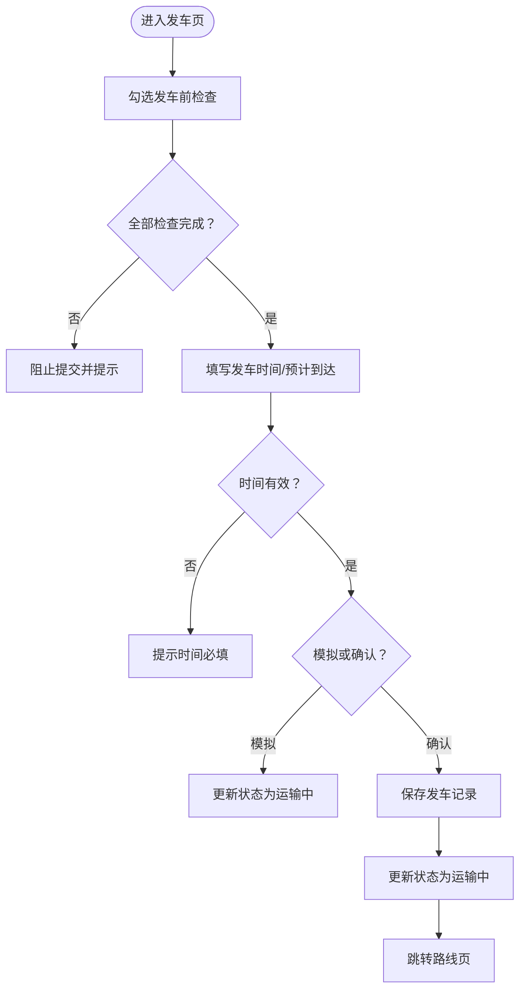
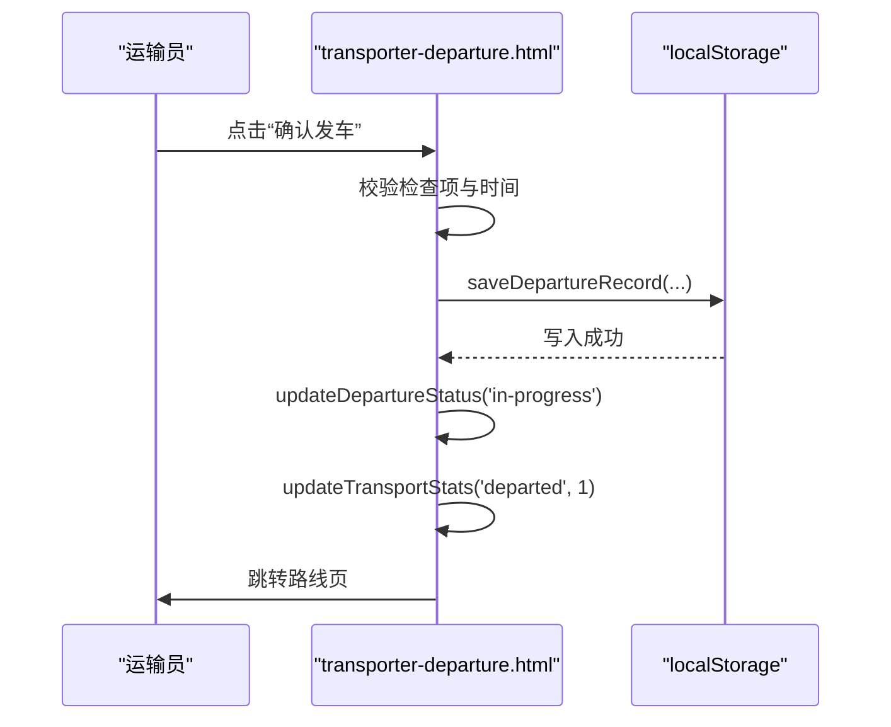
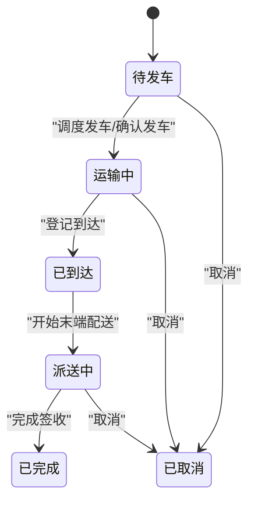
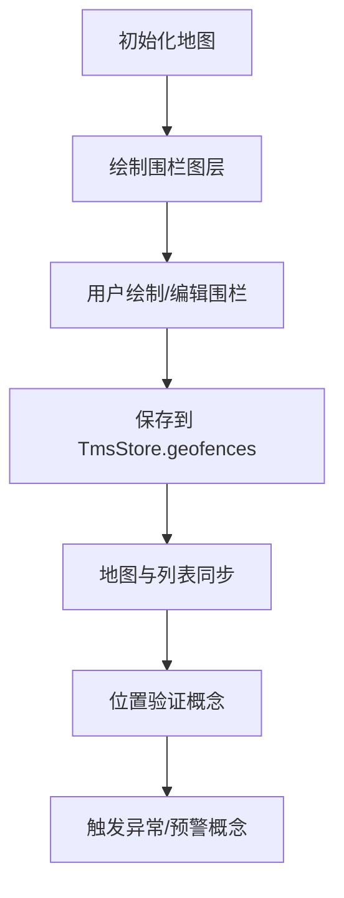
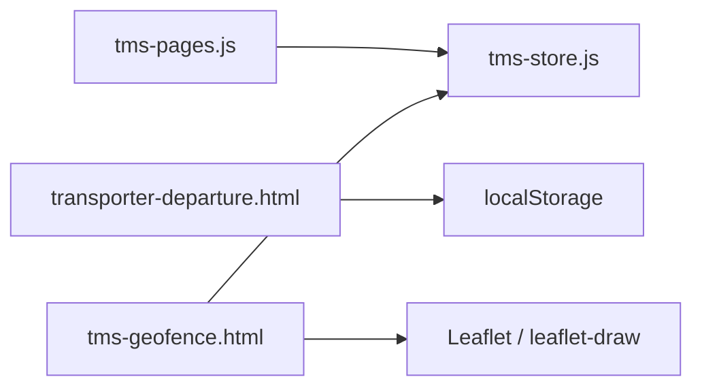

# 发车管理系统

<cite>
**本文引用的文件**   
- [readme](file://readme)
- [tms-store.js](file://tms-store.js)
- [tms-pages.js](file://tms-pages.js)
- [transporter-departure.html](file://transporter-departure.html)
- [tms-geofence.html](file://tms-geofence.html)
</cite>

## 目录
1. [引言](#引言)
2. [项目结构](#项目结构)
3. [核心组件](#核心组件)
4. [架构总览](#架构总览)
5. [详细组件分析](#详细组件分析)
6. [依赖关系分析](#依赖关系分析)
7. [性能与扩展性](#性能与扩展性)
8. [故障排查指南](#故障排查指南)
9. [结论](#结论)
10. [附录：API 调用示例与数据模型](#附录api-调用示例与数据模型)

## 引言
本文件面向“发车管理系统”的调度、确认、记录与位置管控能力，围绕以下目标展开：
- 发车计划查看与调度：从订单到运输任务的创建、承运商与车辆分配、出发与预计到达时间管理。
- 发车条件检查与安全清单：车辆、货物、文件、油量、工具、通讯设备等多维检查项校验。
- 发车状态流转：待发车、运输中、已到达、派送中、已完成、已取消等状态机与联动更新。
- 时间窗口与时效规则：轨迹节点标准时长、SLA 截止、超时与偏差标记。
- GPS 定位与电子围栏：围栏定义、地图绘制、启停控制与业务联动。
- 位置验证机制：基于围栏半径与类型进行在/离域判定，驱动异常与预警。
- 安全检查清单、货物完整性验证与文件签署流程：前端表单校验、本地持久化与可审计记录。
- API 调用示例、数据验证逻辑与异常处理策略：基于 TmsStore 的增删改查与事件订阅。

## 项目结构
仓库为纯前端演示型 TMS（运输管理系统），采用“页面 + 共享数据层 + UI 工具库”的组织方式：
- 共享数据层 tms-store.js：提供 localStorage 驱动的轻量数据库、种子数据、计费引擎、路由与轨迹、电子围栏、运力资源等。
- 管理员端页面装配 tms-pages.js：将各业务页统一装配为 KPI + 图表 + 表格 + CRUD 的结构，包含“运输管理”中的“调度发车”。
- 运输员侧 transporter-departure.html：司机/运输员视角的发车界面，含任务信息、安全清单、发车确认与历史记录。
- 电子围栏 tms-geofence.html：基于 Leaflet 的围栏绘制、列表管理与地图可视化。
- 其他页面：分支网点、分拣、装载、监控、财务、绩效等，作为系统上下文支撑。

图示来源
- [tms-store.js:1-12](file://tms-store.js#L1-L12)
- [tms-pages.js:250-357](file://tms-pages.js#L250-L357)
- [transporter-departure.html:458-611](file://transporter-departure.html#L458-L611)
- [tms-geofence.html:522-558](file://tms-geofence.html#L522-L558)

章节来源
- [tms-store.js:1-12](file://tms-store.js#L1-L12)
- [tms-pages.js:1-12](file://tms-pages.js#L1-L12)
- [transporter-departure.html:1-10](file://transporter-departure.html#L1-L10)
- [tms-geofence.html:1-10](file://tms-geofence.html#L1-L10)

## 核心组件
- 共享数据层（TmsStore）
  - 职责：维护订单、运单、运输、异常、扫描、车辆、仓库、库存、运力、电子围栏、策略、路由、轨迹等实体；提供统一的增删改查、筛选排序分页；触发 tms:datachange 事件。
  - 关键能力：订单生命周期推进、轨迹节点生成、路线规划、计费试算、电子围栏数据初始化。
- 管理员端页面装配（TmsPages）
  - 职责：渲染各业务页，提供“调度发车”弹窗，选择待发运订单、承运商与车辆，创建运输任务并推进订单状态。
- 运输员发车页（transporter-departure.html）
  - 职责：展示运输任务与车辆/货物信息；执行发车前检查清单；填写发车时间与预计到达时间；保存发车记录；更新状态并跳转路线页。
- 电子围栏管理（tms-geofence.html）
  - 职责：基于 Leaflet 绘制圆形围栏；围栏列表增删改查；启用/停用；地图缩放与定位；与 TmsStore.geofences 双向同步。

章节来源
- [tms-store.js:1-12](file://tms-store.js#L1-L12)
- [tms-pages.js:250-357](file://tms-pages.js#L250-L357)
- [transporter-departure.html:458-611](file://transporter-departure.html#L458-L611)
- [tms-geofence.html:522-558](file://tms-geofence.html#L522-L558)

## 架构总览
系统以“数据层 + 页面装配 + 角色页面”的分层架构组织：
- 数据层：localStorage 存储，提供统一 API（create/update/remove/list/get）。
- 页面装配：管理员端通过 TmsPages 统一渲染表格、KPI、图表与操作按钮。
- 角色页面：运输员侧负责发车操作；电子围栏页负责地理围栏管理。

图示来源
- [tms-pages.js:289-317](file://tms-pages.js#L289-L317)
- [transporter-departure.html:676-736](file://transporter-departure.html#L676-L736)
- [tms-geofence.html:577-588](file://tms-geofence.html#L577-L588)

## 详细组件分析

### 发车计划查看与调度
- 管理员端“运输管理”页面提供“调度发车”弹窗：
  - 字段：待发运订单（支持按状态过滤）、承运商、车辆（排除维修中）。
  - 动作：创建运输任务，设置出发时间、预计到达时间、初始进度与状态；推进订单状态至“运输中”。
- 数据流：
  - 读取订单列表 → 用户选择 → 创建运输记录 → 推进订单状态 → 刷新页面。

图示来源
- [tms-pages.js:289-317](file://tms-pages.js#L289-L317)

章节来源
- [tms-pages.js:250-357](file://tms-pages.js#L250-L357)

### 发车条件检查与安全清单
- 运输员发车页提供六项检查：
  - 车辆状况检查、货物装载检查、运输文件检查、油量检查、工具检查、通讯设备检查。
- 校验逻辑：
  - 所有检查项必须勾选；否则阻止模拟发车与确认发车。
  - 发车时间与预计到达时间为必填；未填写则提示错误。
- 结果：
  - 模拟发车：仅更新状态为“运输中”，不写盘。
  - 确认发车：写入发车记录（localStorage），更新状态，跳转路线页。

图示来源
- [transporter-departure.html:540-584](file://transporter-departure.html#L540-L584)
- [transporter-departure.html:676-736](file://transporter-departure.html#L676-L736)

章节来源
- [transporter-departure.html:540-584](file://transporter-departure.html#L540-L584)
- [transporter-departure.html:676-736](file://transporter-departure.html#L676-L736)

### 发车确认与发车记录管理
- 确认发车流程：
  - 校验检查项与时间 → 保存发车记录（id、任务编号、路线、发车/预计到达时间、状态、司机、备注、创建时间）→ 更新状态 → 更新统计 → 跳转路线页。
- 发车记录存储：
  - 使用 localStorage 键 transportDepartureHistory 存储数组；新记录插入头部；加载时渲染表格。
- 状态展示：
  - 根据状态类名切换“待发车/运输中/已完成”标签文本。

图示来源
- [transporter-departure.html:702-736](file://transporter-departure.html#L702-L736)
- [transporter-departure.html:752-778](file://transporter-departure.html#L752-L778)

章节来源
- [transporter-departure.html:702-736](file://transporter-departure.html#L702-L736)
- [transporter-departure.html:752-778](file://transporter-departure.html#L752-L778)

### 发车状态流转与时间窗口管理
- 状态机（运输相关）：
  - 待发车 → 运输中 → 已到达 → 派送中 → 已完成 / 已取消。
- 时间窗口与轨迹：
  - 轨迹节点字典包含标准时长（如发车 2h、干线在途 24h、到达 6h、派送 12h）。
  - 订单阶段索引映射轨迹节点；构建轨迹明细时计算截止时间与超时/偏差标记。
- 路由与计划：
  - 根据起终点匹配路由，生成分段计划与每段截止时间。

图示来源
- [tms-store.js:104-120](file://tms-store.js#L104-L120)
- [tms-store.js:194-213](file://tms-store.js#L194-L213)
- [tms-store.js:426-460](file://tms-store.js#L426-L460)

章节来源
- [tms-store.js:104-120](file://tms-store.js#L104-L120)
- [tms-store.js:194-213](file://tms-store.js#L194-L213)
- [tms-store.js:426-460](file://tms-store.js#L426-L460)

### GPS 定位集成、电子围栏技术与位置验证机制
- 电子围栏数据：
  - 中心经纬度、半径、类型（仓储围栏/网点围栏/禁行区域等）、状态（生效中/已停用）。
- 地图与绘制：
  - 使用 Leaflet 加载地图；支持绘制圆形围栏；围栏列表与地图双向同步；支持启用/停用、编辑、删除、定位。
- 位置验证（概念实现）：
  - 基于围栏半径判断车辆当前位置是否在围栏内；结合围栏类型（如禁行区域）触发异常或预警。
  - 当前代码未直接实现实时位置校验，但提供了围栏数据与地图交互基础，便于扩展。

图示来源
- [tms-geofence.html:600-609](file://tms-geofence.html#L600-L609)
- [tms-geofence.html:723-746](file://tms-geofence.html#L723-L746)
- [tms-geofence.html:748-776](file://tms-geofence.html#L748-L776)

章节来源
- [tms-geofence.html:600-609](file://tms-geofence.html#L600-L609)
- [tms-geofence.html:723-746](file://tms-geofence.html#L723-L746)
- [tms-geofence.html:748-776](file://tms-geofence.html#L748-L776)

### 安全检查清单、货物完整性验证与文件签署流程
- 安全检查清单：
  - 六项检查项在前端强制勾选；未勾选则阻止提交。
- 货物完整性验证：
  - 发车页展示总包裹数、已装车数、总重量、总价值、货物类型；用于核对装车一致性。
- 文件签署流程（概念）：
  - 当前页面未实现电子签名，但可通过扩展表单增加“电子签名/上传附件”字段，并在确认发车时校验附件存在性。

章节来源
- [transporter-departure.html:515-537](file://transporter-departure.html#L515-L537)
- [transporter-departure.html:540-584](file://transporter-departure.html#L540-L584)

## 依赖关系分析
- 模块耦合：
  - tms-pages.js 依赖 tms-store.js 提供的数据接口（list/create/update/advanceOrder）。
  - transporter-departure.html 独立于 tms-store.js，使用 localStorage 管理发车记录。
  - tms-geofence.html 依赖 tms-store.js 的 geofences 实体，并通过 TmsUI 渲染表格与弹窗。
- 外部依赖：
  - Leaflet 与 leaflet-draw 用于电子围栏地图绘制。
- 潜在循环依赖：
  - 无直接循环；页面通过全局对象访问数据层。

图示来源
- [tms-pages.js:1-12](file://tms-pages.js#L1-L12)
- [tms-geofence.html:563-568](file://tms-geofence.html#L563-L568)

章节来源
- [tms-pages.js:1-12](file://tms-pages.js#L1-L12)
- [tms-geofence.html:563-568](file://tms-geofence.html#L563-L568)

## 性能与扩展性
- 性能特性：
  - 基于 localStorage 的轻量数据层，适合演示与小规模场景；大数据量时需考虑分页与缓存优化。
  - 地图绘制与围栏渲染按需更新，避免频繁重绘。
- 扩展建议：
  - 引入后端 API 替换 localStorage，提升并发与一致性。
  - 增加实时 GPS 上报与围栏校验服务，结合 WebSocket 推送异常。
  - 扩展电子签名与附件上传，完善文件签署流程。

[本节为通用指导，不直接分析具体文件]

## 故障排查指南
- 发车提交失败：
  - 检查是否完成所有检查项；确保发车时间与预计到达时间已填写。
  - 参考路径：[transporter-departure.html:676-736](file://transporter-departure.html#L676-L736)
- 发车记录未保存：
  - 检查 localStorage 权限与键名 transportDepartureHistory；确认 saveDepartureRecord 被调用。
  - 参考路径：[transporter-departure.html:752-778](file://transporter-departure.html#L752-L778)
- 地图组件加载失败：
  - 检查 Leaflet CDN 是否可用；若失败，围栏列表仍可正常使用。
  - 参考路径：[tms-geofence.html:600-609](file://tms-geofence.html#L600-L609)
- 调度发车后订单状态未更新：
  - 确认 advanceOrder 调用次数与守卫逻辑；检查 S.advanceOrder 实现。
  - 参考路径：[tms-pages.js:310-315](file://tms-pages.js#L310-L315)

章节来源
- [transporter-departure.html:676-736](file://transporter-departure.html#L676-L736)
- [transporter-departure.html:752-778](file://transporter-departure.html#L752-L778)
- [tms-geofence.html:600-609](file://tms-geofence.html#L600-L609)
- [tms-pages.js:310-315](file://tms-pages.js#L310-L315)

## 结论
本系统以轻量前端架构实现了发车管理的核心闭环：
- 管理员端完成订单到运输任务的调度与状态推进。
- 运输员侧通过严格的安全检查与时间窗口管理，确保发车合规与可追溯。
- 电子围栏提供地理边界管理能力，为后续 GPS 定位与位置验证奠定基础。
建议在真实生产环境中引入后端服务、实时定位与电子签名，以提升可靠性与合规性。

[本节为总结，不直接分析具体文件]

## 附录：API 调用示例与数据模型

### 调度发车（管理员端）
- 入口：运输管理页面 → 点击“调度发车”
- 输入字段：
  - orderId：待发运订单 ID
  - carrier：承运商
  - vehicleId：车辆 ID（非维修中）
- 动作：
  - 创建运输任务：S.create('transports', {...})
  - 推进订单状态：S.advanceOrder(orderId, '运输调度')
- 参考路径：
  - [tms-pages.js:289-317](file://tms-pages.js#L289-L317)

### 确认发车（运输员侧）
- 输入字段：
  - departureTime：发车时间
  - estimatedArrival：预计到达时间
  - driverRemark：司机备注
- 校验：
  - 检查项全部勾选
  - 时间字段非空
- 动作：
  - saveDepartureRecord(departureTime, estimatedArrival, driverRemark)
  - updateDepartureStatus('in-progress')
- 参考路径：
  - [transporter-departure.html:702-736](file://transporter-departure.html#L702-L736)
  - [transporter-departure.html:752-778](file://transporter-departure.html#L752-L778)

### 电子围栏管理
- 新增/编辑围栏：
  - 字段：name、type、lat、lng、radius、status
  - 动作：TmsStore.create('geofences', v) 或 TmsStore.update('geofences', id, v)
- 地图绘制：
  - startDrawing(type) → 监听 L.Draw.Event.CREATED → openFenceForm(null, preset)
- 参考路径：
  - [tms-geofence.html:686-718](file://tms-geofence.html#L686-L718)
  - [tms-geofence.html:748-776](file://tms-geofence.html#L748-L776)

### 数据模型（节选）
- 订单（orders）
  - 关键字段：id、waybillNo、customer、origin、destination、status、createdAt、expectedAt、signedAt、timeline
  - 参考路径：[tms-store.js:739-777](file://tms-store.js#L739-L777)
- 运输任务（transports）
  - 关键字段：id、orderId、waybillNo、origin、destination、carrier、vehicleId、driver、departAt、eta、status、progress
  - 参考路径：[tms-pages.js:302-309](file://tms-pages.js#L302-L309)
- 电子围栏（geofences）
  - 关键字段：id、name、type、lat、lng、radius、status、createdAt
  - 参考路径：[tms-store.js:573-591](file://tms-store.js#L573-L591)
- 轨迹节点（TRACE_NODES）
  - 关键字段：code、name、stdHours
  - 参考路径：[tms-store.js:194-209](file://tms-store.js#L194-L209)

章节来源
- [tms-pages.js:289-317](file://tms-pages.js#L289-L317)
- [transporter-departure.html:702-736](file://transporter-departure.html#L702-L736)
- [tms-geofence.html:686-718](file://tms-geofence.html#L686-L718)
- [tms-store.js:573-591](file://tms-store.js#L573-L591)
- [tms-store.js:194-209](file://tms-store.js#L194-L209)