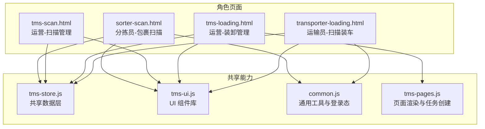
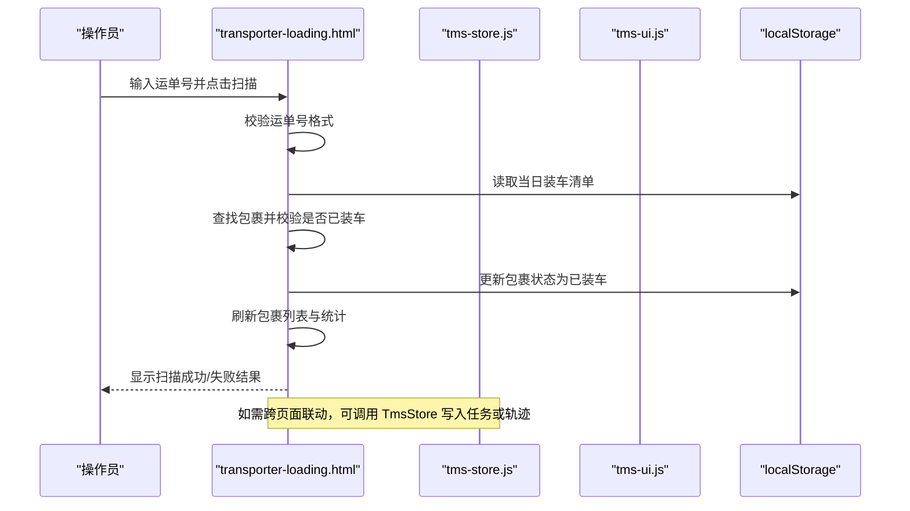
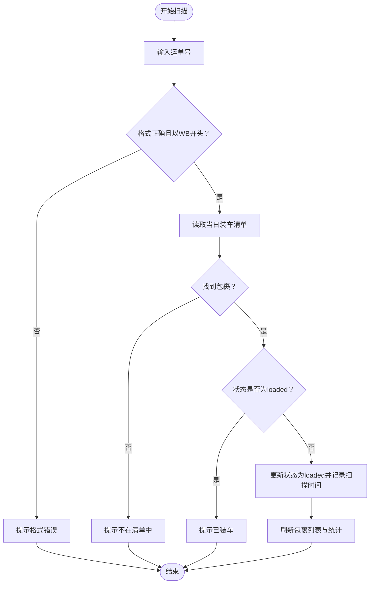
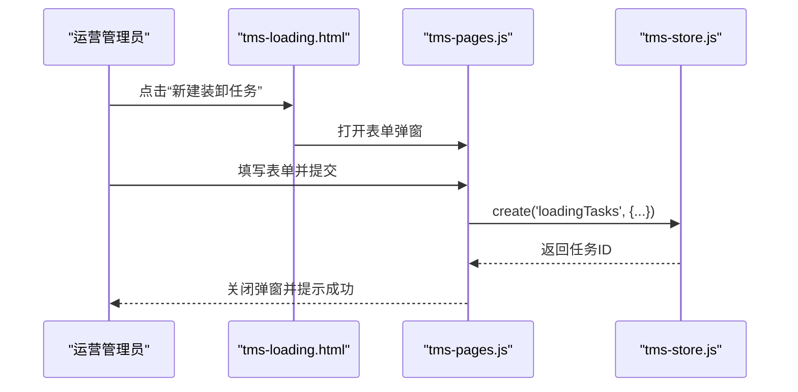
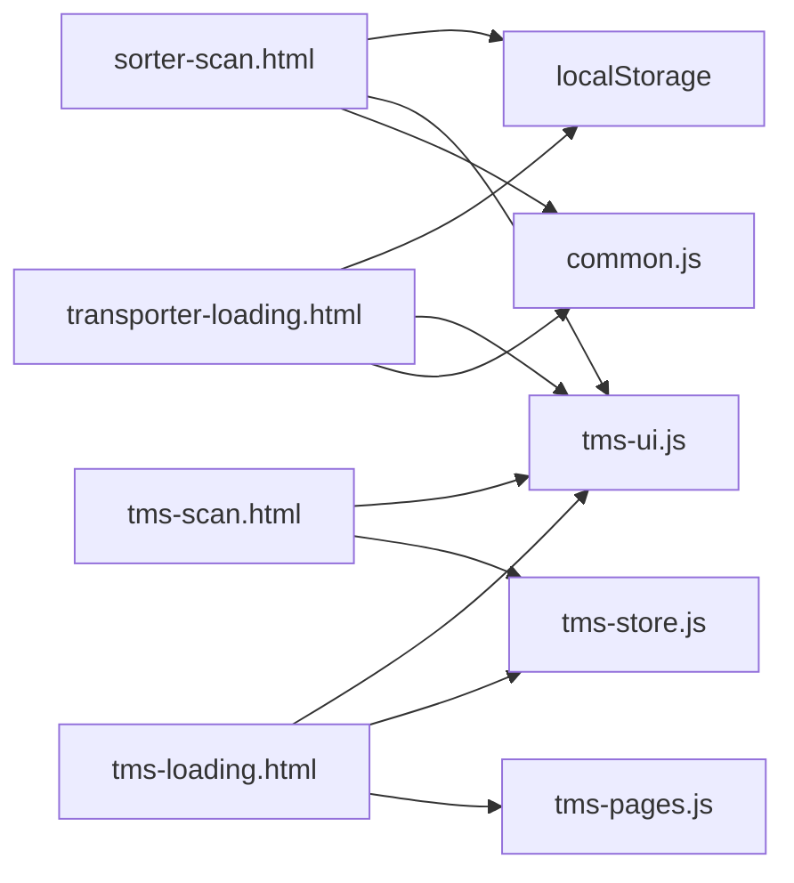

# 扫描装车管理

<cite>
**本文引用的文件**   
- [transporter-loading.html](file://transporter-loading.html)
- [tms-loading.html](file://tms-loading.html)
- [tms-scan.html](file://tms-scan.html)
- [sorter-scan.html](file://sorter-scan.html)
- [tms-store.js](file://tms-store.js)
- [tms-ui.js](file://tms-ui.js)
- [common.js](file://common.js)
- [tms-pages.js](file://tms-pages.js)
</cite>

## 目录
1. [引言](#引言)
2. [项目结构](#项目结构)
3. [核心组件](#核心组件)
4. [架构总览](#架构总览)
5. [详细组件分析](#详细组件分析)
6. [依赖关系分析](#依赖关系分析)
7. [性能与容量优化](#性能与容量优化)
8. [异常处理与质量控制](#异常处理与质量控制)
9. [结论](#结论)
10. [附录：关键流程与接口说明](#附录关键流程与接口说明)

## 引言
本文件面向“扫描装车管理”模块，围绕车辆装载的完整业务流程展开，包括货物扫描、容量检查、装载顺序优化、装载确认等关键环节；同时解释条码/二维码扫描技术实现、货物识别逻辑、装载冲突检测机制，以及与仓储系统的数据对接、同步策略和异常处理方案。文档还给出扫码 API 集成建议、批量处理逻辑与性能优化技巧，并覆盖装载效率统计、错误率监控和质量控制措施。

## 项目结构
仓库采用多页面前端应用组织方式，装卸与扫描相关能力分布在以下页面与脚本中：
- 运输员装车界面：transporter-loading.html
- 运营端装卸管理界面：tms-loading.html
- 运营端扫描管理界面：tms-scan.html
- 分拣员扫描界面：sorter-scan.html
- 共享数据层（订单、运单、轨迹、任务等）：tms-store.js
- 共享 UI 组件库（表格、弹窗、图表等）：tms-ui.js
- 通用工具与登录态：common.js
- 页面路由与渲染：tms-pages.js

**图示来源**
- [transporter-loading.html:433-554](file://transporter-loading.html#L433-L554)
- [tms-loading.html:362-559](file://tms-loading.html#L362-L559)
- [tms-scan.html:380-606](file://tms-scan.html#L380-L606)
- [sorter-scan.html:305-411](file://sorter-scan.html#L305-L411)
- [tms-store.js:1-12](file://tms-store.js#L1-L12)
- [tms-ui.js:1-10](file://tms-ui.js#L1-L10)
- [common.js:135-218](file://common.js#L135-L218)
- [tms-pages.js:1421-1447](file://tms-pages.js#L1421-L1447)

**章节来源**
- [transporter-loading.html:433-554](file://transporter-loading.html#L433-L554)
- [tms-loading.html:362-559](file://tms-loading.html#L362-L559)
- [tms-scan.html:380-606](file://tms-scan.html#L380-L606)
- [sorter-scan.html:305-411](file://sorter-scan.html#L305-L411)
- [tms-store.js:1-12](file://tms-store.js#L1-L12)
- [tms-ui.js:1-10](file://tms-ui.js#L1-L10)
- [common.js:135-218](file://common.js#L135-L218)
- [tms-pages.js:1421-1447](file://tms-pages.js#L1421-L1447)

## 核心组件
- 运输员装车页（transporter-loading.html）
  - 提供扫码输入框、手动输入、扫描结果展示、装车包裹列表、统计面板与操作按钮（重置、核对清单、完成装车）。
  - 使用 localStorage 按日期键存储当日装车包裹清单，支持重复扫描拦截与状态更新。
- 运营装卸管理页（tms-loading.html）
  - 展示装卸任务列表、统计卡片与操作按钮（查看、开始、完成），由 tms-pages.js 驱动任务创建与渲染。
- 运营扫描管理页（tms-scan.html）
  - 展示扫描设备管理与最近扫描记录，用于全局扫描质量与设备在线情况监控。
- 分拣员扫描页（sorter-scan.html）
  - 提供运单扫描入口、扫描结果展示与今日扫描记录，模拟获取运单信息并持久化扫描历史。
- 共享数据层（tms-store.js）
  - 提供订单、运单、轨迹、任务、运力、库存等种子数据与查询能力，维护全生命周期状态流转，并通过事件通知订阅者。
- 共享 UI 组件（tms-ui.js）
  - 提供表单弹窗、确认框、Toast、通用表格、KPI 与图表等能力，统一交互体验。
- 通用工具（common.js）
  - 提供登录态校验、用户信息显示、ID 生成等基础能力。

**章节来源**
- [transporter-loading.html:433-554](file://transporter-loading.html#L433-L554)
- [tms-loading.html:437-559](file://tms-loading.html#L437-L559)
- [tms-scan.html:454-606](file://tms-scan.html#L454-L606)
- [sorter-scan.html:335-411](file://sorter-scan.html#L335-L411)
- [tms-store.js:1-12](file://tms-store.js#L1-L12)
- [tms-ui.js:1-10](file://tms-ui.js#L1-L10)
- [common.js:135-218](file://common.js#L135-L218)

## 架构总览
扫描装车管理的整体架构以“角色页面 + 共享数据层 + UI 组件”为主：
- 角色页面负责采集扫码输入、展示结果与执行装车动作。
- 共享数据层提供业务主数据与任务管理能力，并在数据变更时触发事件。
- UI 组件提供统一的交互与可视化能力。
- 通用工具支撑登录态与基础 ID 生成。

**图示来源**
- [transporter-loading.html:660-711](file://transporter-loading.html#L660-L711)
- [tms-store.js:220-244](file://tms-store.js#L220-L244)
- [tms-ui.js:86-105](file://tms-ui.js#L86-L105)

**章节来源**
- [transporter-loading.html:660-711](file://transporter-loading.html#L660-L711)
- [tms-store.js:220-244](file://tms-store.js#L220-L244)
- [tms-ui.js:86-105](file://tms-ui.js#L86-L105)

## 详细组件分析

### 运输员装车页（transporter-loading.html）
- 功能要点
  - 扫码输入区与手动输入框，支持回车触发扫描。
  - 扫描结果区域展示成功/失败信息，自动隐藏。
  - 装车包裹列表动态渲染，包含运单号、订单号、目的地、包裹信息与状态。
  - 统计面板展示总包裹数、已装车、待装车与装车进度百分比。
  - 操作按钮：重置、核对清单、完成装车。
- 扫描与冲突检测
  - 校验运单号必须以 WB 开头。
  - 从 localStorage 读取当日装车清单，若未找到则提示不在清单中。
  - 若包裹状态已是 loaded，则提示已装车，避免重复装载。
- 数据持久化
  - 使用 key `transporterLoading_${today}` 保存当日装车清单。
  - 每次扫描成功后更新包裹状态与扫描时间，并刷新列表与统计。

**图示来源**
- [transporter-loading.html:660-711](file://transporter-loading.html#L660-L711)

**章节来源**
- [transporter-loading.html:433-554](file://transporter-loading.html#L433-L554)
- [transporter-loading.html:660-711](file://transporter-loading.html#L660-L711)

### 运营装卸管理页（tms-loading.html）
- 功能要点
  - 展示装卸任务统计卡片（任务总数、待处理、进行中、已完成）。
  - 装卸任务列表包含订单号、运单号、作业类型、地点、车辆、人员、计划与实际时间、状态与操作。
  - 通过 tms-pages.js 驱动新建装卸任务与渲染。
- 任务创建
  - 新建装卸任务表单包含关联订单、作业类型、作业地点、车辆、作业人员、计划时间等字段。
  - 提交后调用 TmsStore.create('loadingTasks', ...) 写入任务数据，并设置初始状态 pending。

**图示来源**
- [tms-loading.html:437-559](file://tms-loading.html#L437-L559)
- [tms-pages.js:1421-1447](file://tms-pages.js#L1421-L1447)
- [tms-store.js:220-244](file://tms-store.js#L220-L244)

**章节来源**
- [tms-loading.html:437-559](file://tms-loading.html#L437-L559)
- [tms-pages.js:1421-1447](file://tms-pages.js#L1421-L1447)

### 运营扫描管理页（tms-scan.html）
- 功能要点
  - 展示扫描设备管理卡片（设备编号、型号、所在网点、最后在线时间、扫描量）。
  - 最近扫描记录表包含扫描时间、订单号、运单号、扫描类型、位置、设备与人员。
  - 提供查看、编辑、删除等操作入口（当前为占位逻辑）。
- 监控价值
  - 用于评估扫描准确率与设备在线率，辅助质量控制与排障。

**章节来源**
- [tms-scan.html:454-606](file://tms-scan.html#L454-L606)

### 分拣员扫描页（sorter-scan.html）
- 功能要点
  - 提供运单扫描输入框与扫描按钮，支持回车触发。
  - 扫描成功后展示运单信息（运单号、订单号、始发地、目的地、客户、状态）。
  - 将扫描记录保存到 localStorage（key `sorterScans_${today}`），并更新统计与历史记录表。
- 模拟识别
  - 对以 WB 开头的运单号进行模拟识别，生成订单号与基本信息。

**章节来源**
- [sorter-scan.html:335-411](file://sorter-scan.html#L335-L411)
- [sorter-scan.html:413-529](file://sorter-scan.html#L413-L529)

## 依赖关系分析
- 页面与脚本依赖
  - transporter-loading.html 依赖 common.js（登录态）、tms-ui.js（UI 组件）、localStorage（本地数据）。
  - tms-loading.html 依赖 tms-pages.js（任务创建与渲染）、tms-store.js（数据层）、tms-ui.js（UI 组件）。
  - tms-scan.html 依赖 tms-store.js（数据层）、tms-ui.js（UI 组件）。
  - sorter-scan.html 依赖 common.js（登录态）、tms-ui.js（UI 组件）、localStorage（本地数据）。
- 数据层依赖
  - tms-store.js 提供订单、运单、轨迹、任务、运力、库存等数据模型与查询方法，并通过事件通知订阅者。
- UI 组件依赖
  - tms-ui.js 提供表单弹窗、确认框、Toast、通用表格、KPI 与图表等能力，被多个页面复用。

**图示来源**
- [transporter-loading.html:556-604](file://transporter-loading.html#L556-L604)
- [tms-loading.html:548-559](file://tms-loading.html#L548-L559)
- [tms-scan.html:596-606](file://tms-scan.html#L596-L606)
- [sorter-scan.html:381-411](file://sorter-scan.html#L381-L411)
- [tms-store.js:1-12](file://tms-store.js#L1-L12)
- [tms-ui.js:1-10](file://tms-ui.js#L1-L10)
- [common.js:135-218](file://common.js#L135-L218)

**章节来源**
- [transporter-loading.html:556-604](file://transporter-loading.html#L556-L604)
- [tms-loading.html:548-559](file://tms-loading.html#L548-L559)
- [tms-scan.html:596-606](file://tms-scan.html#L596-L606)
- [sorter-scan.html:381-411](file://sorter-scan.html#L381-L411)
- [tms-store.js:1-12](file://tms-store.js#L1-L12)
- [tms-ui.js:1-10](file://tms-ui.js#L1-L10)
- [common.js:135-218](file://common.js#L135-L218)

## 性能与容量优化
- 本地存储优化
  - 使用按日分桶的 key（如 `transporterLoading_${today}`、`sorterScans_${today}`）减少单次读写数据量，提升加载与检索性能。
  - 在扫描成功后仅更新必要字段（状态与扫描时间），避免整表重写。
- 列表渲染优化
  - 仅在状态变化时刷新包裹列表与统计，减少 DOM 重绘次数。
  - 使用条件判断与最小化更新策略，避免不必要的重渲染。
- 容量检查与装载顺序优化
  - 当前装车页未实现体积/重量与车辆容量的硬约束校验，建议在扫描前增加容量计算与预检逻辑，结合 tms-store.js 中的运力与车辆数据，提前预警超载风险。
  - 装载顺序可按目的地优先级、货物属性（如冷链优先）与路线段进行排序，减少中途卸货与倒载。

[本节为通用指导，不直接分析具体文件]

## 异常处理与质量控制
- 异常处理
  - 扫描失败时统一通过 showScanResult 展示错误信息，并自动隐藏，保证用户体验。
  - 重复扫描与不在清单中的运单号均给出明确提示，防止误操作。
- 质量控制
  - 运营扫描管理页展示扫描准确率与设备在线率，便于监控扫描质量。
  - 建议引入扫描重试机制与人工复核流程，对异常扫描进行标记与跟踪。
- 错误率监控
  - 基于 sorterscan 与 transporter loading 的本地记录，统计失败次数与成功率，形成日报与趋势图。
  - 结合 tms-store.js 的事件机制，可将异常扫描记录同步至全局异常管理模块。

**章节来源**
- [transporter-loading.html:713-743](file://transporter-loading.html#L713-L743)
- [tms-scan.html:454-606](file://tms-scan.html#L454-L606)
- [tms-store.js:220-244](file://tms-store.js#L220-L244)

## 结论
扫描装车管理模块通过角色页面与共享数据层的协作，实现了从扫码输入、冲突检测、状态更新到统计展示的完整闭环。当前实现以本地存储为主，具备快速原型验证能力；在生产环境中建议接入后端 API 与数据库，增强容量校验、装载顺序优化与异常处理能力，同时完善质量监控与报表体系。

[本节为总结性内容，不直接分析具体文件]

## 附录：关键流程与接口说明

### 扫码 API 集成建议
- 硬件扫码枪
  - 多数扫码枪以键盘模式输出文本，可直接监听 input 元素的 change 或 keypress 事件，触发 scanPackage 逻辑。
- 移动端摄像头扫码
  - 可使用浏览器 MediaDevices API 与第三方库（如 jsQR、ZXing）实现二维码/条形码解码，将解码结果填入输入框或直接调用扫描逻辑。
- 后端校验
  - 建议在后端提供运单信息查询接口，前端在扫描后调用接口校验运单有效性、归属任务与状态，避免仅依赖本地数据。

[本节为通用指导，不直接分析具体文件]

### 批量处理逻辑
- 批量导入装车清单
  - 支持 Excel/CSV 导入，解析后批量写入 localStorage 或后端 API，生成当日装车清单。
- 批量扫描
  - 支持连续扫码场景，减少用户交互，提高吞吐率；对重复扫描进行去重与提示。
- 批量完成装车
  - 在核对清单通过后，一键将所有已扫描包裹标记为完成，并生成装车确认单。

[本节为通用指导，不直接分析具体文件]

### 装载冲突检测机制
- 重复装载检测
  - 当前实现通过检查包裹状态是否为 loaded 来避免重复装载。
- 容量冲突检测
  - 建议扩展为在扫描前计算累计重量/体积，并与车辆容量对比，超限时阻止装载并提示调整装载顺序或更换车辆。
- 路线冲突检测
  - 建议根据目的地与路线段进行冲突检测，避免同一车次装载互斥目的地导致的中途倒载。

**章节来源**
- [transporter-loading.html:691-694](file://transporter-loading.html#L691-L694)

### 与仓储系统的接口对接
- 数据同步策略
  - 建议通过 RESTful API 与 WMS 系统进行双向同步：入库扫描、出库扫描、装车确认、发车确认等节点均需回写 WMS。
- 异常处理方案
  - 网络异常时启用本地缓存与重试队列，待网络恢复后自动补传。
  - 数据不一致时提供差异比对与人工干预入口，确保账实相符。

[本节为通用指导，不直接分析具体文件]