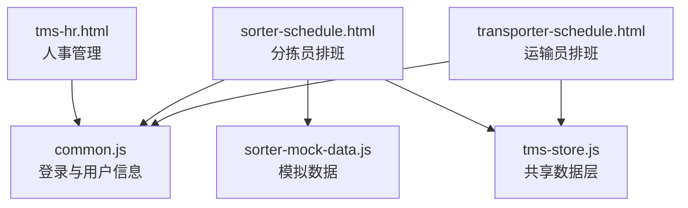
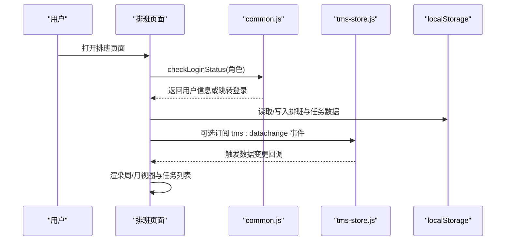
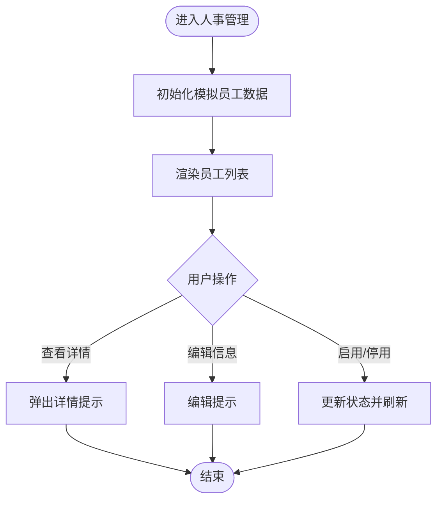
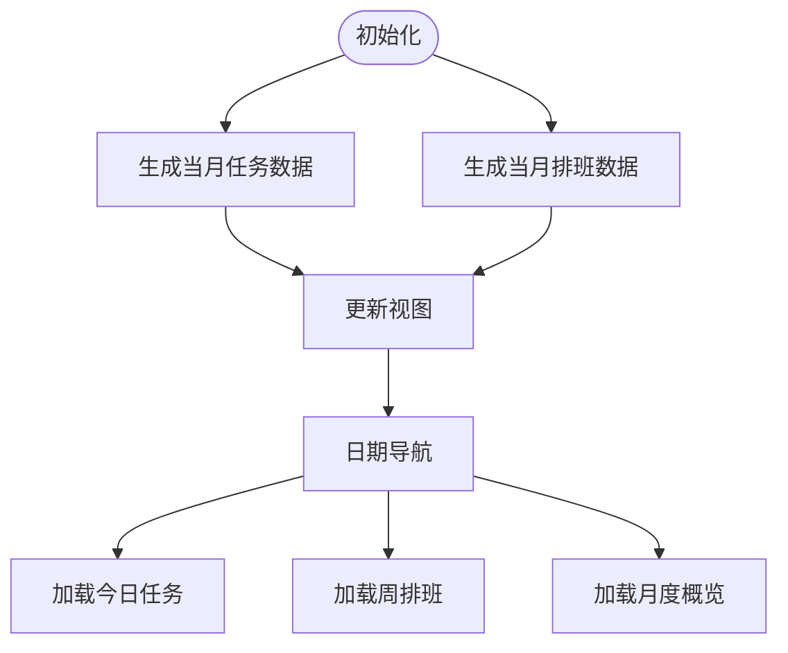
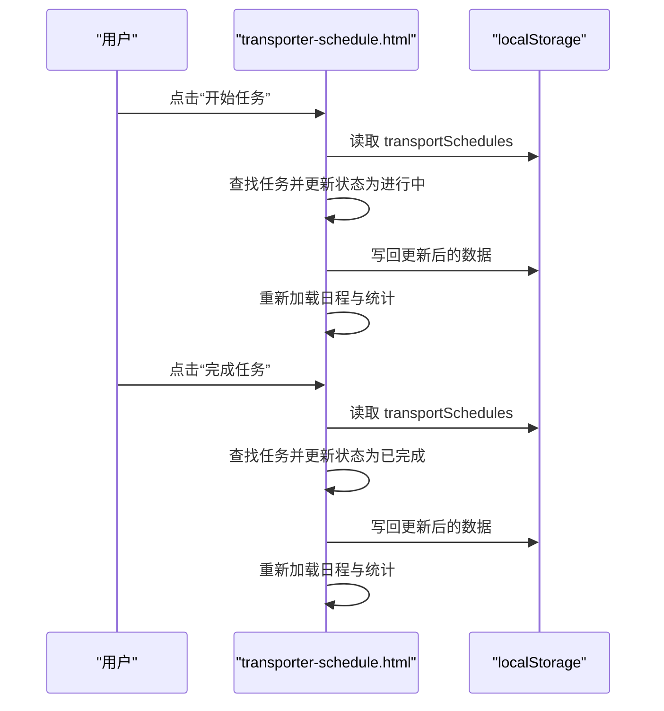
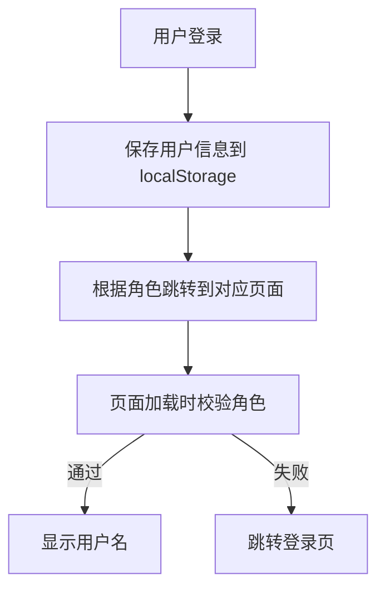
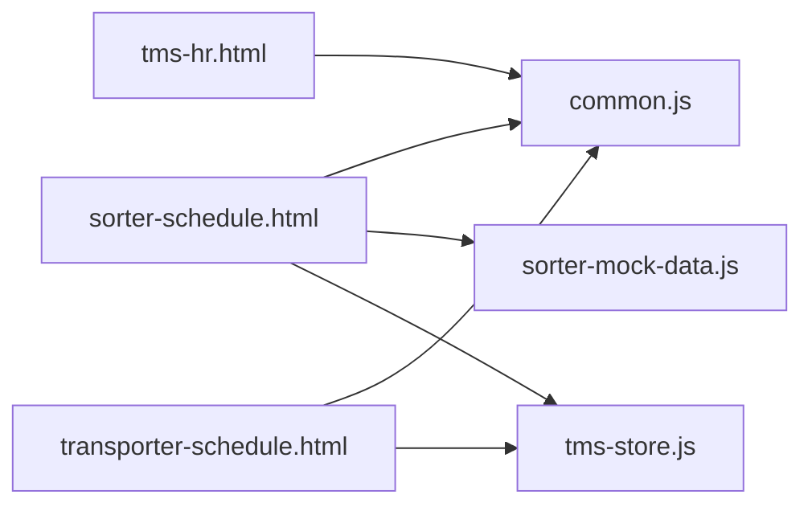

# 排班管理系统

<cite>
**本文引用的文件**   
- [tms-hr.html](file://tms-hr.html)
- [sorter-schedule.html](file://sorter-schedule.html)
- [transporter-schedule.html](file://transporter-schedule.html)
- [common.js](file://common.js)
- [tms-store.js](file://tms-store.js)
- [sorter-mock-data.js](file://sorter-mock-data.js)
</cite>

## 目录
1. [简介](#简介)
2. [项目结构](#项目结构)
3. [核心组件](#核心组件)
4. [架构总览](#架构总览)
5. [详细组件分析](#详细组件分析)
6. [依赖关系分析](#依赖关系分析)
7. [性能与可扩展性](#性能与可扩展性)
8. [故障排查指南](#故障排查指南)
9. [结论](#结论)
10. [附录：数据模型与状态定义](#附录数据模型与状态定义)

## 简介
本排班管理系统面向分拣员与运输员，提供个人排班查看、周/月视图展示、任务日历、打卡关联与基础人事信息联动能力。系统以浏览器本地存储为数据载体，通过通用工具函数与共享数据层完成用户鉴权、页面初始化与演示数据生成。当前实现聚焦“可视化排班”和“基础流程”，尚未包含完整的班次申请、调班审批与冲突检测算法；文档将明确标注已实现与待扩展的能力边界，并给出后续优化建议。

## 项目结构
围绕排班相关的前端页面与脚本如下：
- tms-hr.html：人事管理入口，展示员工统计与列表，作为排班与考勤的HR数据源（模拟）。
- sorter-schedule.html：分拣员“工作安排”页面，含日期导航、今日任务、周排班表、月度概览。
- transporter-schedule.html：运输员“我的排班”页面，含日/周/月视图切换、任务日历与任务操作。
- common.js：登录鉴权、用户信息渲染等通用逻辑。
- tms-store.js：共享数据层，负责种子数据、计费、路由与轨迹等全局业务对象（排班模块可复用其事件机制）。
- sorter-mock-data.js：分拣员侧的模拟数据生成器（任务、排班、打卡）。

**图表来源**
- [tms-hr.html:380-386](file://tms-hr.html#L380-L386)
- [sorter-schedule.html:551-585](file://sorter-schedule.html#L551-L585)
- [transporter-schedule.html:423-449](file://transporter-schedule.html#L423-L449)
- [common.js:136-199](file://common.js#L136-L199)
- [tms-store.js:217-244](file://tms-store.js#L217-L244)
- [sorter-mock-data.js:213-243](file://sorter-mock-data.js#L213-L243)

**章节来源**
- [tms-hr.html:380-386](file://tms-hr.html#L380-L386)
- [sorter-schedule.html:551-585](file://sorter-schedule.html#L551-L585)
- [transporter-schedule.html:423-449](file://transporter-schedule.html#L423-L449)
- [common.js:136-199](file://common.js#L136-L199)
- [tms-store.js:217-244](file://tms-store.js#L217-L244)
- [sorter-mock-data.js:213-243](file://sorter-mock-data.js#L213-L243)

## 核心组件
- 人事管理（HR）：提供员工基本信息与状态，用于排班资源池与考勤校验。
- 分拣员排班：按日/周/月维度展示任务与班次，支持日期导航与月度网格。
- 运输员排班：提供日/周/月视图切换、任务日历与任务状态流转。
- 通用工具：统一登录、权限校验、用户信息显示。
- 共享数据层：提供全局事件与演示数据，便于多页面数据同步与扩展。

**章节来源**
- [tms-hr.html:344-370](file://tms-hr.html#L344-L370)
- [sorter-schedule.html:496-544](file://sorter-schedule.html#L496-L544)
- [transporter-schedule.html:372-418](file://transporter-schedule.html#L372-L418)
- [common.js:136-199](file://common.js#L136-L199)
- [tms-store.js:217-244](file://tms-store.js#L217-L244)

## 架构总览
排班系统采用“页面 + 本地存储 + 通用工具”的轻量架构：
- 页面层：各角色页面负责UI交互与视图渲染。
- 数据层：localStorage持久化排班、任务、打卡等数据；tms-store.js提供全局事件与演示数据。
- 工具层：common.js提供登录鉴权与用户信息渲染。

**图表来源**
- [common.js:176-199](file://common.js#L176-L199)
- [tms-store.js:232-244](file://tms-store.js#L232-L244)
- [sorter-schedule.html:551-585](file://sorter-schedule.html#L551-L585)
- [transporter-schedule.html:423-449](file://transporter-schedule.html#L423-L449)

## 详细组件分析

### 人事管理（HR）
- 功能要点
  - 展示员工总数、在职、休假、离职等统计卡片。
  - 渲染员工列表，支持查看详情、编辑、启用/停用。
  - 使用 localStorage 维护员工数据，初始化为模拟数据。
- 与排班的关系
  - 作为排班资源池的基础数据（员工ID、部门、岗位、状态）。
  - 可与考勤与绩效模块联动，支撑排班规则与考核指标。

**图表来源**
- [tms-hr.html:459-541](file://tms-hr.html#L459-L541)
- [tms-hr.html:544-629](file://tms-hr.html#L544-L629)

**章节来源**
- [tms-hr.html:344-370](file://tms-hr.html#L344-L370)
- [tms-hr.html:459-629](file://tms-hr.html#L459-L629)

### 分拣员排班（工作安排）
- 功能要点
  - 日期导航：上一天/下一天切换。
  - 今日任务：按日期过滤并渲染任务卡片（优先级、时间、地点、状态）。
  - 周排班表：显示本周每天的班次、工作时间、工作地点与状态。
  - 月度概览：按月网格展示工作日/休息日与班次。
- 数据与算法
  - 使用 localStorage 键 `sorterTasks_${year}_${month}` 与 `sorterSchedule_${year}_${month}` 存储任务与排班。
  - 排班生成规则：周一到周五随机分配早班/晚班，周末休息。
  - 视图渲染：根据当前日期计算周起始日，映射班次时间与地点。

**图表来源**
- [sorter-schedule.html:587-656](file://sorter-schedule.html#L587-L656)
- [sorter-schedule.html:659-778](file://sorter-schedule.html#L659-L778)
- [sorter-schedule.html:780-800](file://sorter-schedule.html#L780-L800)

**章节来源**
- [sorter-schedule.html:496-544](file://sorter-schedule.html#L496-L544)
- [sorter-schedule.html:587-800](file://sorter-schedule.html#L587-L800)
- [sorter-mock-data.js:213-243](file://sorter-mock-data.js#L213-L243)

### 运输员排班（我的排班）
- 功能要点
  - 统计卡片：今日/本周/本月任务数与待完成任务数。
  - 视图切换：日视图、周视图、月视图。
  - 任务日历：在日历单元格中显示任务条目。
  - 任务操作：开始任务、完成任务，更新状态并刷新视图。
- 数据与算法
  - 使用 localStorage 键 `transportSchedules` 存储按日期分组的任务数组。
  - 统计计算：遍历所有日期任务，累计不同时间窗口的数量。
  - 视图生成：分别渲染日视图详情、周视图表格、月视图表格。

**图表来源**
- [transporter-schedule.html:580-622](file://transporter-schedule.html#L580-L622)
- [transporter-schedule.html:481-530](file://transporter-schedule.html#L481-L530)

**章节来源**
- [transporter-schedule.html:372-418](file://transporter-schedule.html#L372-L418)
- [transporter-schedule.html:451-530](file://transporter-schedule.html#L451-L530)
- [transporter-schedule.html:624-799](file://transporter-schedule.html#L624-L799)

### 通用工具与鉴权
- 登录流程：选择角色后保存用户信息到 localStorage，并根据角色跳转到对应首页。
- 权限校验：页面加载时检查登录状态与角色匹配，不匹配则跳转登录页。
- 用户信息显示：动态更新页面中的用户名元素，确保各页面一致显示。

**图表来源**
- [common.js:136-174](file://common.js#L136-L174)
- [common.js:176-199](file://common.js#L176-L199)
- [common.js:220-270](file://common.js#L220-L270)

**章节来源**
- [common.js:136-199](file://common.js#L136-L199)
- [common.js:220-270](file://common.js#L220-L270)

### 共享数据层（tms-store.js）
- 职责
  - 提供全局事件 `tms:datachange`，供多页面订阅与响应数据变更。
  - 生成演示数据（订单、运单、运输、异常、扫描等），并提供增删改查与统计聚合。
- 与排班系统的关系
  - 可作为排班数据的扩展载体，未来可将排班、任务、打卡纳入该数据层统一管理。
  - 利用其事件机制实现跨页面通知与提醒。

**章节来源**
- [tms-store.js:1-12](file://tms-store.js#L1-L12)
- [tms-store.js:217-244](file://tms-store.js#L217-L244)

## 依赖关系分析
- 页面依赖
  - sorter-schedule.html 依赖 common.js 进行鉴权与用户信息渲染，依赖 sorter-mock-data.js 生成演示数据。
  - transporter-schedule.html 依赖 common.js 进行鉴权与用户信息渲染。
  - tms-hr.html 依赖 common.js 进行鉴权与用户信息渲染。
- 数据依赖
  - 分拣员排班使用 localStorage 键 `sorterTasks_*` 与 `sorterSchedule_*`。
  - 运输员排班使用 localStorage 键 `transportSchedules`。
  - HR 模块使用 localStorage 键 `tmsEmployees`。
- 事件依赖
  - tms-store.js 暴露 `tms:datachange` 事件，可用于排班通知与提醒扩展。

**图表来源**
- [sorter-schedule.html:549-550](file://sorter-schedule.html#L549-L550)
- [transporter-schedule.html:422-423](file://transporter-schedule.html#L422-L423)
- [tms-hr.html:375-379](file://tms-hr.html#L375-L379)
- [tms-store.js:232-244](file://tms-store.js#L232-L244)

**章节来源**
- [sorter-schedule.html:549-550](file://sorter-schedule.html#L549-L550)
- [transporter-schedule.html:422-423](file://transporter-schedule.html#L422-L423)
- [tms-hr.html:375-379](file://tms-hr.html#L375-L379)
- [tms-store.js:232-244](file://tms-store.js#L232-L244)

## 性能与可扩展性
- 当前实现基于 localStorage，适合演示与小规模场景；大数据量时需迁移至后端服务与数据库。
- 视图渲染采用原生 DOM 操作，建议在大规模数据时使用虚拟滚动或分页加载。
- 建议引入 tms-store.js 的事件机制，实现跨页面通知与提醒，避免轮询。
- 排班算法可扩展：加入约束求解（如最小连续工作天数、最大工时、技能匹配）、冲突检测（同一人员/地点时间重叠）与优化目标（均衡负载、公平轮换）。

[本节为通用指导，不涉及具体文件]

## 故障排查指南
- 登录后无法显示用户名
  - 检查 common.js 中 displayCurrentUser 是否找到对应元素ID，必要时创建用户名元素。
- 排班数据为空
  - 确认 localStorage 中是否存在对应的键（如 `sorterSchedule_*`、`transportSchedules`）。
  - 若首次访问未生成数据，检查初始化逻辑是否执行。
- 视图切换无响应
  - 检查按钮事件绑定是否正确，视图类型参数是否传递正确。
- 任务状态未更新
  - 检查 startTask/completeTask 是否成功更新 localStorage 并重新加载数据。

**章节来源**
- [common.js:220-270](file://common.js#L220-L270)
- [transporter-schedule.html:580-622](file://transporter-schedule.html#L580-L622)
- [sorter-schedule.html:587-656](file://sorter-schedule.html#L587-L656)

## 结论
当前排班管理系统提供了分拣员与运输员的排班可视化与基础任务操作能力，结合人事管理与通用工具实现了基本的用户鉴权与信息展示。尚未实现完整的班次申请、调班审批与冲突检测算法；建议后续引入共享数据层的事件机制与更完善的排班算法，以提升系统的一致性与可扩展性。

[本节为总结，不涉及具体文件]

## 附录：数据模型与状态定义

### 分拣员排班数据模型
- 任务数据键：`sorterTasks_${year}_${month}`
  - 字段示例：id、date、title、priority、startTime、endTime、location、status
- 排班数据键：`sorterSchedule_${year}_${month}`
  - 字段示例：date、day、dayOfWeek、shift、status

**章节来源**
- [sorter-schedule.html:587-656](file://sorter-schedule.html#L587-L656)
- [sorter-mock-data.js:213-243](file://sorter-mock-data.js#L213-L243)

### 运输员排班数据模型
- 任务数据键：`transportSchedules`
  - 结构：按日期分组的任务数组
  - 字段示例：id、title、startTime、endTime、origin、destination、vehicle、status、description

**章节来源**
- [transporter-schedule.html:451-479](file://transporter-schedule.html#L451-L479)

### 人事管理数据模型
- 员工数据键：`tmsEmployees`
  - 字段示例：id、name、department、position、email、phone、hireDate、status、role、description

**章节来源**
- [tms-hr.html:459-541](file://tms-hr.html#L459-L541)

### 状态定义
- 任务状态
  - pending：待开始
  - in-progress/in_progress：进行中
  - completed：已完成
- 排班状态
  - working：上班
  - off：休息
- 员工状态
  - active：在职
  - on_leave：休假
  - inactive/resigned：离职

**章节来源**
- [transporter-schedule.html:570-578](file://transporter-schedule.html#L570-L578)
- [sorter-schedule.html:740-778](file://sorter-schedule.html#L740-L778)
- [tms-hr.html:571-589](file://tms-hr.html#L571-L589)