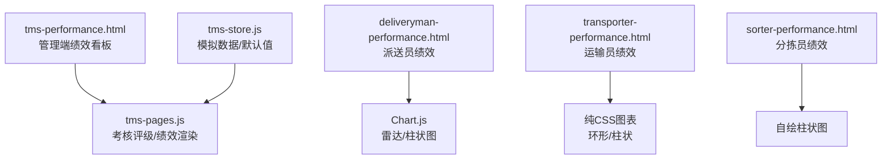
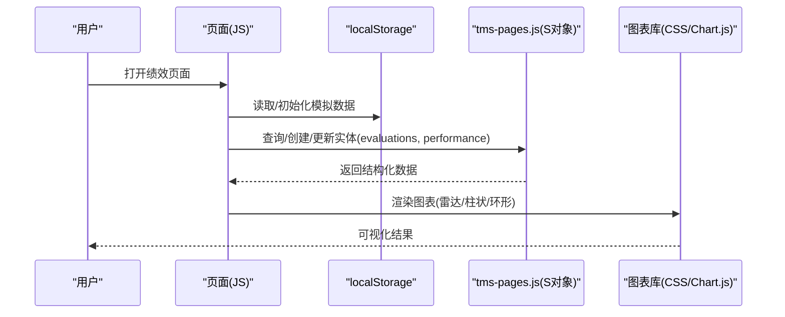
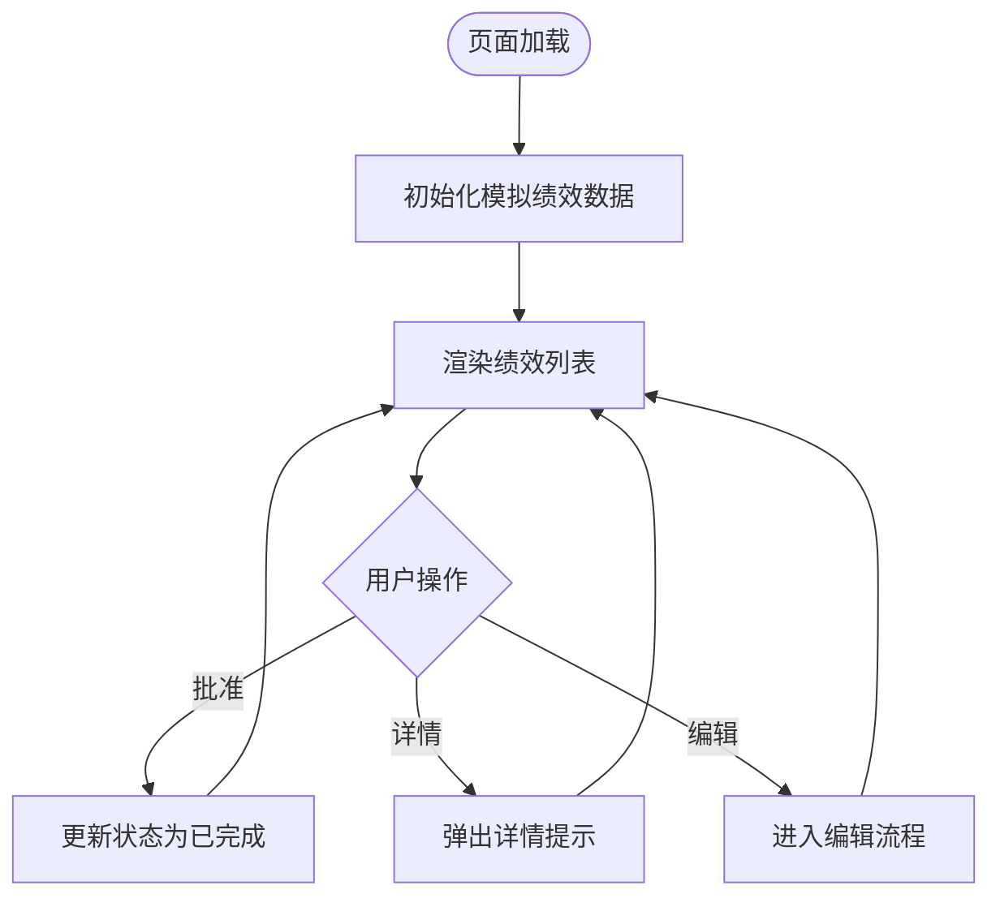
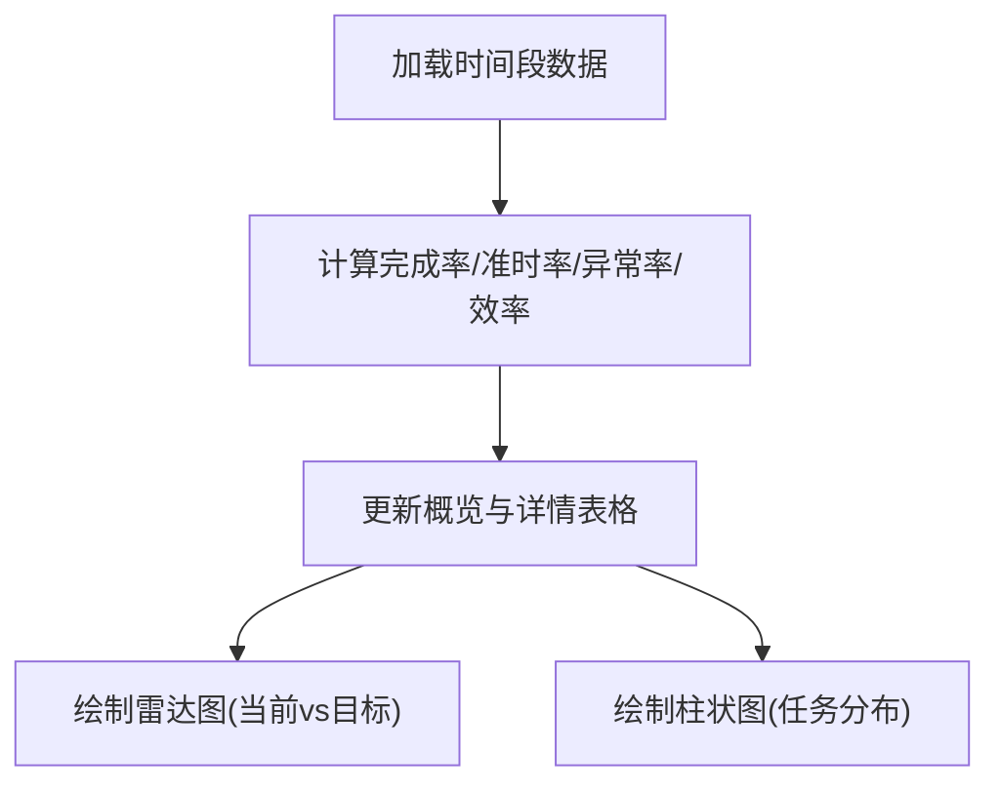
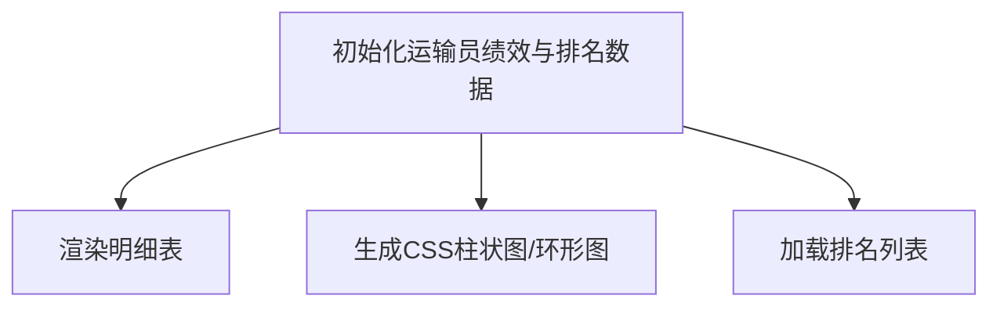
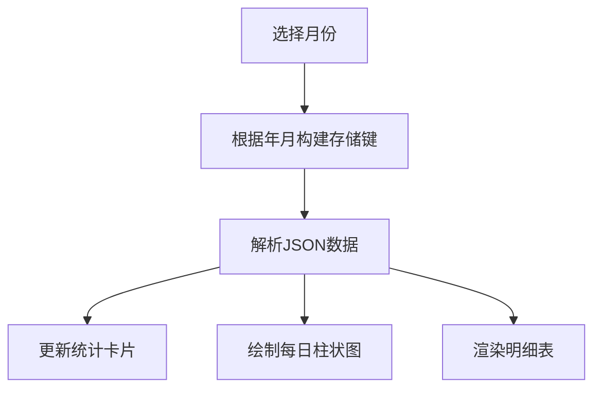
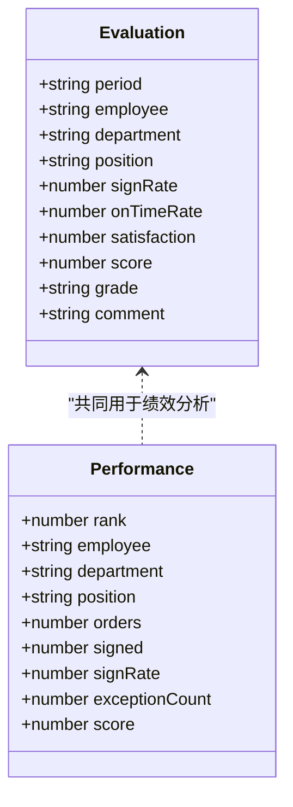
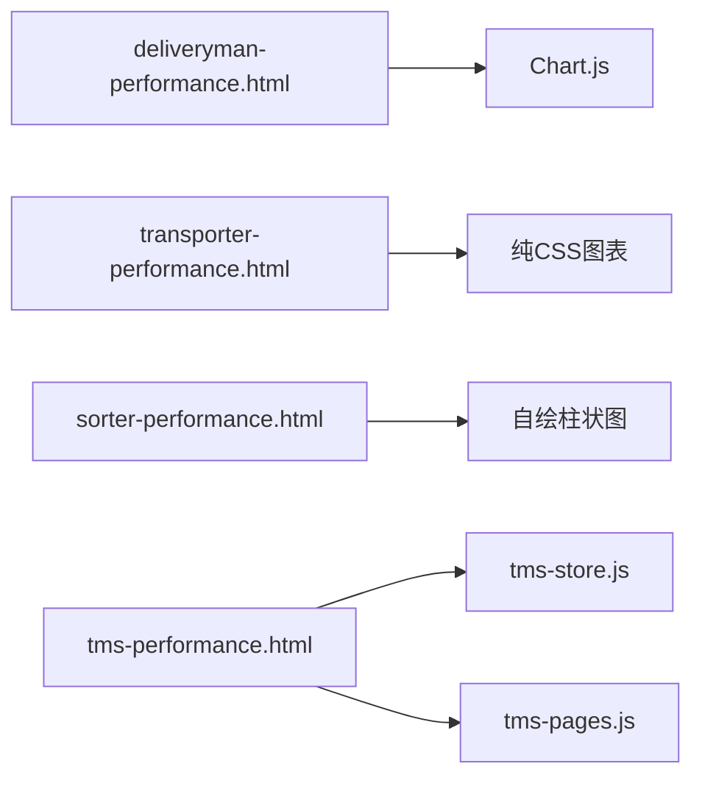

# 绩效统计分析

<cite>
**本文引用的文件**   
- [tms-performance.html](file://tms-performance.html)
- [deliveryman-performance.html](file://deliveryman-performance.html)
- [transporter-performance.html](file://transporter-performance.html)
- [sorter-performance.html](file://sorter-performance.html)
- [tms-pages.js](file://tms-pages.js)
- [tms-store.js](file://tms-store.js)
</cite>

## 目录
1. [引言](#引言)
2. [项目结构](#项目结构)
3. [核心组件](#核心组件)
4. [架构总览](#架构总览)
5. [详细组件分析](#详细组件分析)
6. [依赖关系分析](#依赖关系分析)
7. [性能与可扩展性](#性能与可扩展性)
8. [故障排查指南](#故障排查指南)
9. [结论](#结论)
10. [附录：指标、权重与评分模型](#附录指标权重与评分模型)

## 引言
本文件面向“绩效统计分析”模块，聚焦运输员绩效考核的核心指标与实现方案。文档覆盖以下方面：
- 核心KPI维度：运输里程、准时率、客户满意度、燃油效率（以效率指数替代）、安全评分（以异常率/安全事件替代）等。
- KPI计算方法、权重分配与评分模型逻辑。
- 数据可视化图表、趋势分析与对比报告能力。
- 绩效排名、奖励机制与职业发展路径规划建议。
- 图表库集成方式、数据聚合算法与报表生成技术要点。

## 项目结构
本仓库为前端演示型TMS系统，绩效相关页面与通用逻辑分布如下：
- 管理端绩效看板：tms-performance.html + tms-pages.js（含考核评级与绩效列表）。
- 派送员绩效页：deliveryman-performance.html（Chart.js雷达图与柱状图）。
- 运输员绩效页：transporter-performance.html（纯CSS图表与排名）。
- 分拣员绩效页：sorter-performance.html（自绘柱状图与明细表）。
- 全局存储与模拟数据：tms-store.js（含准时率、满意度等字段初始化）。

**图示来源**
- [tms-performance.html:1-634](file://tms-performance.html#L1-L634)
- [deliveryman-performance.html:1-818](file://deliveryman-performance.html#L1-L818)
- [transporter-performance.html:1-753](file://transporter-performance.html#L1-L753)
- [sorter-performance.html:1-681](file://sorter-performance.html#L1-L681)
- [tms-pages.js:1100-1299](file://tms-pages.js#L1100-L1299)
- [tms-store.js:1040-1060](file://tms-store.js#L1040-L1060)

**章节来源**
- [tms-performance.html:1-634](file://tms-performance.html#L1-L634)
- [deliveryman-performance.html:1-818](file://deliveryman-performance.html#L1-L818)
- [transporter-performance.html:1-753](file://transporter-performance.html#L1-L753)
- [sorter-performance.html:1-681](file://sorter-performance.html#L1-L681)
- [tms-pages.js:1100-1299](file://tms-pages.js#L1100-L1299)
- [tms-store.js:1040-1060](file://tms-store.js#L1040-L1060)

## 核心组件
- 管理端绩效看板（tms-performance.html）
  - 展示平均绩效得分、提升/稳定/下降员工数。
  - 通过localStorage维护模拟绩效记录，支持批准、查看、编辑操作入口。
- 派送员绩效（deliveryman-performance.html）
  - 提供周/月/季/年四个时间维度的任务完成率、准时率、绩效评分。
  - 使用Chart.js绘制雷达图（当前vs目标）与柱状图（任务完成分布）。
- 运输员绩效（transporter-performance.html）
  - 统计总运输量、总行驶里程、准时率、客户满意度。
  - 使用纯CSS实现月度运输量柱状图与准时率环形图；内置本月排名。
- 分拣员绩效（sorter-performance.html）
  - 统计扫描量、分拣量、准确率、效率指数；按日生成趋势图与明细表。
- 通用逻辑（tms-pages.js）
  - 考核评级：签收率、准时率、满意度、综合得分与等级划分（A/B/C/D）。
  - 绩效管理：按员工维度统计单量、签收率、异常数并生成排名。
- 数据存储（tms-store.js）
  - 提供默认字段如准时率、满意度等，供各页面初始化或扩展。

**章节来源**
- [tms-performance.html:346-634](file://tms-performance.html#L346-L634)
- [deliveryman-performance.html:331-818](file://deliveryman-performance.html#L331-L818)
- [transporter-performance.html:480-753](file://transporter-performance.html#L480-L753)
- [sorter-performance.html:382-681](file://sorter-performance.html#L382-L681)
- [tms-pages.js:1100-1299](file://tms-pages.js#L1100-L1299)
- [tms-store.js:1040-1060](file://tms-store.js#L1040-L1060)

## 架构总览
绩效模块采用“页面+脚本+本地存储”的轻量架构：
- 视图层：HTML页面负责布局与交互。
- 逻辑层：内联JS处理数据加载、计算与图表渲染。
- 数据层：localStorage持久化模拟数据；tms-pages.js通过S.list/S.create/S.update进行统一CRUD。
- 图表层：Chart.js（派送员）与纯CSS/自绘（运输员/分拣员）并存。

**图示来源**
- [deliveryman-performance.html:407-818](file://deliveryman-performance.html#L407-L818)
- [transporter-performance.html:564-753](file://transporter-performance.html#L564-L753)
- [sorter-performance.html:444-681](file://sorter-performance.html#L444-L681)
- [tms-pages.js:1100-1299](file://tms-pages.js#L1100-L1299)

## 详细组件分析

### 管理端绩效看板（tms-performance.html）
- 功能要点
  - 顶部统计卡片：平均绩效得分、提升/稳定/下降人数。
  - 绩效列表：基于localStorage渲染，支持批准、查看详情、编辑。
  - 子菜单导航：运营管理下的签收率、入库/出库扫描率、漏拣统计等入口。
- 关键流程
  - 初始化模拟数据 → 渲染列表 → 用户交互（批准/详情/编辑）。

**图示来源**
- [tms-performance.html:428-634](file://tms-performance.html#L428-L634)

**章节来源**
- [tms-performance.html:346-634](file://tms-performance.html#L346-L634)

### 派送员绩效（deliveryman-performance.html）
- 功能要点
  - 概览指标：总完成任务、任务完成率、准时率、绩效评分。
  - 时间范围切换：本周/本月/本季度/本年。
  - 图表：雷达图（任务完成率、准时率、服务质量、异常处理、效率）与柱状图（任务数量分布）。
- 计算逻辑
  - 任务完成率 = 完成任务 / 总任务数 × 100%
  - 准时率 = 准时完成 / 完成任务 × 100%
  - 异常处理 = (1 - 异常任务 / 总任务数) × 100%
  - 效率 = 完成任务 / 总工时 × 系数（示例中×10）

**图示来源**
- [deliveryman-performance.html:489-674](file://deliveryman-performance.html#L489-L674)

**章节来源**
- [deliveryman-performance.html:331-818](file://deliveryman-performance.html#L331-L818)

### 运输员绩效（transporter-performance.html）
- 功能要点
  - 统计卡片：总运输量、总行驶里程(km)、准时率、客户满意度。
  - 图表：纯CSS月度运输量柱状图与准时率环形图。
  - 明细表：日期、任务、运输量、里程、计划/实际时间、状态、满意度。
  - 排名：本月绩效排名展示。
- 数据来源
  - localStorage中的transporterPerformance与transporterRanking。

**图示来源**
- [transporter-performance.html:596-753](file://transporter-performance.html#L596-L753)

**章节来源**
- [transporter-performance.html:480-753](file://transporter-performance.html#L480-L753)

### 分拣员绩效（sorter-performance.html）
- 功能要点
  - 统计卡片：总扫描数、总分拣数、准确率、效率指数。
  - 图表：自绘每日扫描量/分拣量柱状图。
  - 明细表：日期、扫描量、分拣量、准确率、完成率、绩效得分。
- 数据组织
  - 按月键名存储（如sorterPerformance_YYYY_MM），包含dailyDetails数组。

**图示来源**
- [sorter-performance.html:502-677](file://sorter-performance.html#L502-L677)

**章节来源**
- [sorter-performance.html:382-681](file://sorter-performance.html#L382-L681)

### 考核评级与绩效（tms-pages.js）
- 考核评级（evaluation）
  - 指标：签收率、准时率、满意度、综合得分。
  - 等级规则：score≥90→A，≥80→B，≥70→C，否则D。
  - 支持新增考核、查看详情、指标配置（名称/目标值/权重/周期/状态）。
- 绩效管理（performance）
  - 指标：完成单量、签收单量、签收率、异常数、绩效得分。
  - 排名：按score降序，rank升序展示。
  - 图表：bar图展示Top8得分。

**图示来源**
- [tms-pages.js:1100-1299](file://tms-pages.js#L1100-L1299)

**章节来源**
- [tms-pages.js:1100-1299](file://tms-pages.js#L1100-L1299)

## 依赖关系分析
- 页面与脚本
  - deliveryman-performance.html依赖Chart.js（CDN引入）。
  - transporter-performance.html与sorter-performance.html使用纯CSS/自绘图表，无外部依赖。
  - tms-performance.html依赖common.js、tms-store.js、tms-ui.js、tms-pages.js。
- 数据流
  - 各页面优先从localStorage读取/写入模拟数据。
  - tms-pages.js通过S对象对evaluations与performance实体进行CRUD。
  - tms-store.js提供默认字段（如onTimeRate、satisfaction）供初始化。

**图示来源**
- [deliveryman-performance.html:10-11](file://deliveryman-performance.html#L10-L11)
- [tms-performance.html:375-379](file://tms-performance.html#L375-L379)
- [tms-pages.js:1100-1299](file://tms-pages.js#L1100-L1299)
- [tms-store.js:1040-1060](file://tms-store.js#L1040-L1060)

**章节来源**
- [deliveryman-performance.html:10-11](file://deliveryman-performance.html#L10-L11)
- [tms-performance.html:375-379](file://tms-performance.html#L375-L379)
- [tms-pages.js:1100-1299](file://tms-pages.js#L1100-L1299)
- [tms-store.js:1040-1060](file://tms-store.js#L1040-L1060)

## 性能与可扩展性
- 渲染性能
  - Chart.js实例在每次更新前销毁旧实例，避免内存泄漏与重复渲染。
  - 纯CSS图表通过DOM操作直接更新高度与位置，开销较低。
- 数据聚合
  - 建议在服务端或后端API层完成聚合（如按月/周汇总里程、准时率、满意度），前端仅做展示。
- 可扩展点
  - 将localStorage替换为REST/GraphQL接口，支持分页、筛选、排序。
  - 增加权重配置表（evalMetrics）驱动动态评分模型。
  - 引入ECharts/AntV替代Chart.js以获得更丰富的图表类型与交互。

[本节为通用指导，不直接分析具体文件]

## 故障排查指南
- Chart.js未加载
  - 现象：控制台报错“Chart.js未加载”。
  - 排查：确认CDN链接可用，检查网络请求是否被拦截。
  - 参考：deliveryman-performance.html中对Chart存在的检测与错误日志。
- Canvas上下文获取失败
  - 现象：控制台报错“无法获取图表上下文”。
  - 排查：确认canvas元素存在且可见；移动端缩放可能导致尺寸异常。
- 数据为空
  - 现象：表格或图表无数据。
  - 排查：检查localStorage键是否存在；确认初始化函数是否执行。
- 筛选功能未生效
  - 现象：点击“应用筛选”仅弹窗提示。
  - 排查：transporter-performance.html中applyFilters为占位实现，需对接真实数据源。

**章节来源**
- [deliveryman-performance.html:612-674](file://deliveryman-performance.html#L612-L674)
- [transporter-performance.html:740-749](file://transporter-performance.html#L740-L749)

## 结论
本绩效统计分析模块以轻量前端实现为主，覆盖管理端看板与三类岗位（派送员、运输员、分拣员）的绩效展示与分析。核心KPI包括任务完成率、准时率、客户满意度、效率指数（替代燃油效率）、异常率（替代安全评分）等。通过Chart.js与纯CSS图表组合，实现了趋势分析与对比报告的基础能力。后续可引入权重配置与后端聚合，完善评分模型与报表导出能力。

[本节为总结，不直接分析具体文件]

## 附录：指标、权重与评分模型

### 核心KPI定义与计算
- 运输里程
  - 定义：统计周期内累计行驶公里数。
  - 用途：评估运力利用与路线优化效果。
- 准时率
  - 公式：准时完成订单数 / 完成订单总数 × 100%。
  - 参考：deliveryman-performance.html与transporter-performance.html均体现该指标。
- 客户满意度
  - 定义：基于客户评价的均值（如5分制）。
  - 参考：tms-pages.js考核评级中包含满意度字段。
- 燃油效率（以效率指数替代）
  - 近似：完成任务数 / 总工时 × 系数（示例中×10）。
  - 参考：deliveryman-performance.html的效率计算。
- 安全评分（以异常率/安全事件替代）
  - 近似：(1 - 异常任务数 / 总任务数) × 100%。
  - 参考：deliveryman-performance.html的异常处理计算。

### 权重分配建议
- 建议权重（可按业务调整）
  - 准时率：30%
  - 客户满意度：25%
  - 运输里程利用率：15%
  - 燃油效率（效率指数）：15%
  - 安全评分（异常率）：15%
- 综合得分
  - 公式：Σ(单项得分 × 权重)。
  - 等级划分：score≥90→A，≥80→B，≥70→C，否则D（见tms-pages.js）。

### 数据聚合算法
- 时间维度
  - 周/月/季/年：按日期区间过滤原始流水，分组聚合。
- 指标聚合
  - 准时率：sum(on_time) / sum(completed) × 100%。
  - 满意度：mean(satisfaction_score)。
  - 效率指数：sum(completed) / sum(hours) × coefficient。
  - 异常率：sum(exception) / sum(total) × 100%。
- 排名算法
  - 按综合得分降序，同分按准时率或满意度次级排序。

### 报表生成技术
- 前端导出
  - 使用Canvas截图或html2canvas导出图表为图片。
  - 使用SheetJS生成Excel报表（需引入第三方库）。
- 后端导出
  - 服务端聚合数据后生成PDF/Excel，前端仅触发下载。

[本节为方法论说明，不直接分析具体文件]