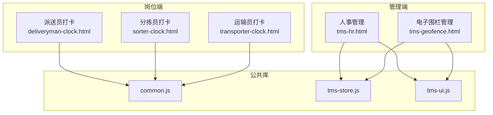
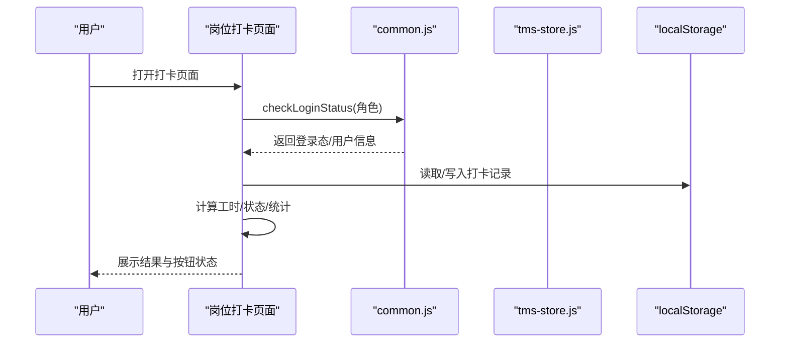
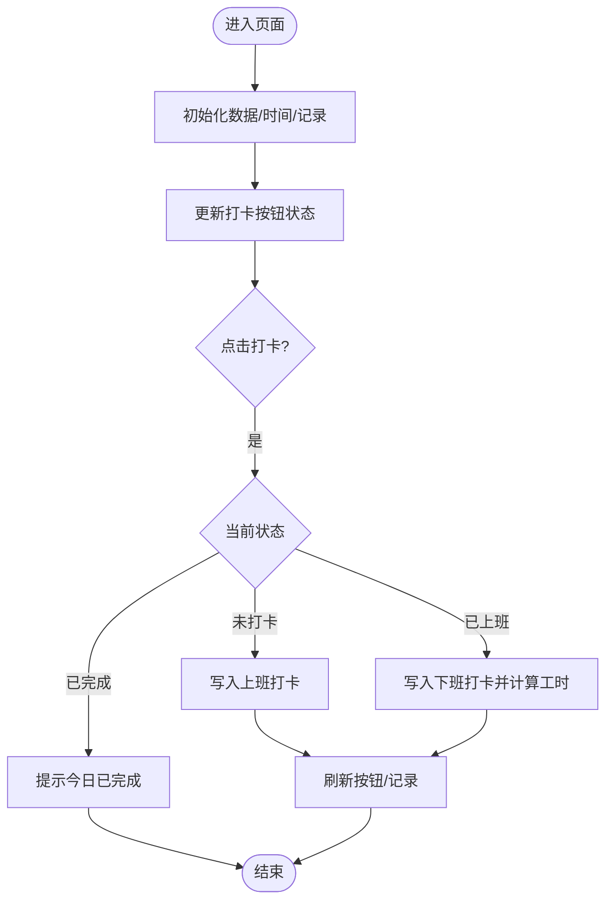
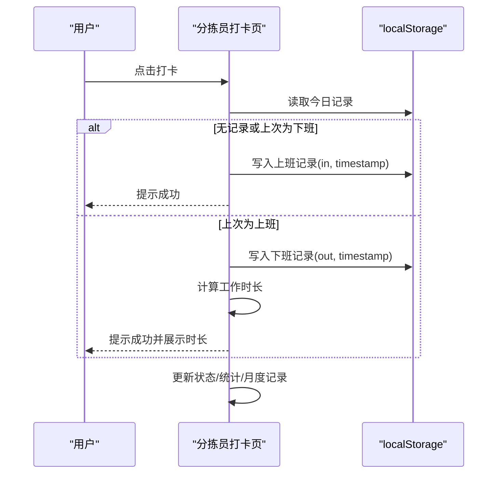
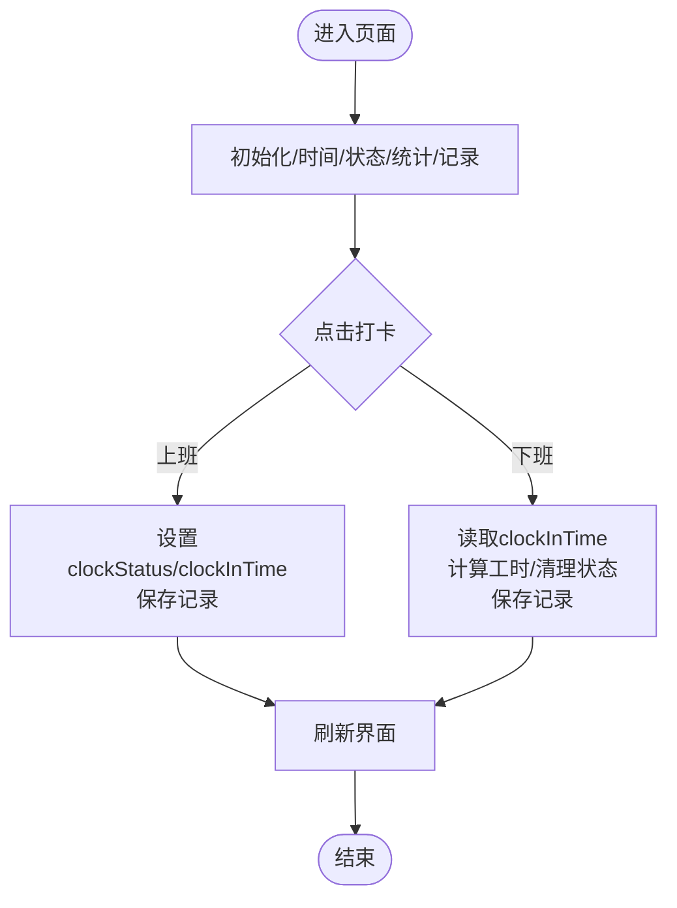
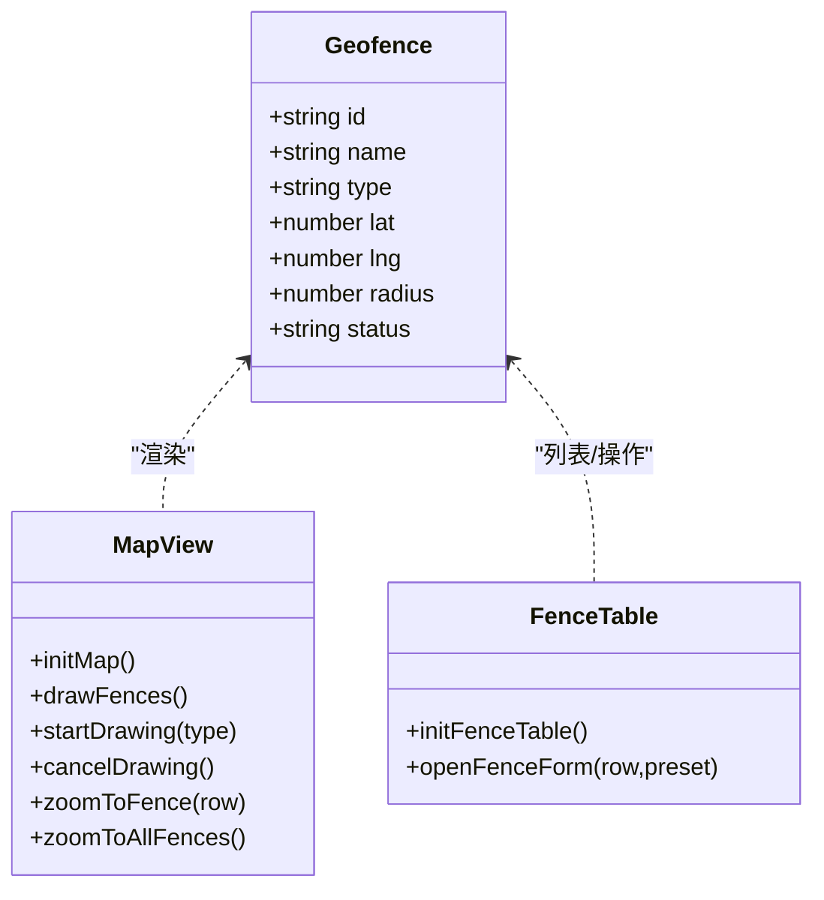
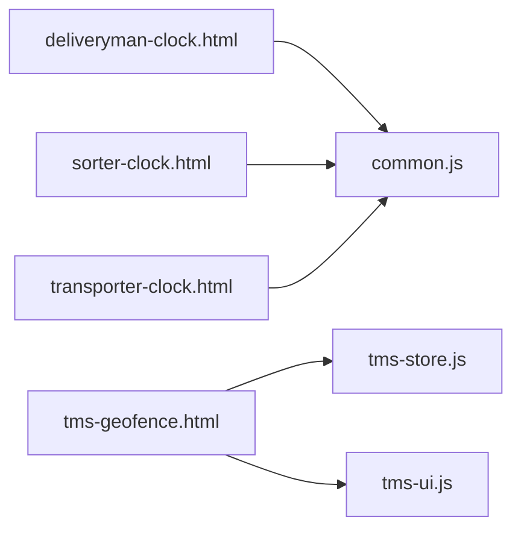
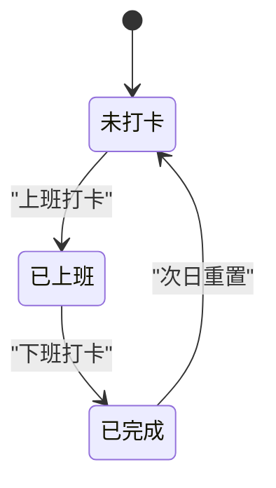

# 考勤打卡管理

<cite>
**本文引用的文件**   
- [deliveryman-clock.html](file://deliveryman-clock.html)
- [sorter-clock.html](file://sorter-clock.html)
- [transporter-clock.html](file://transporter-clock.html)
- [tms-hr.html](file://tms-hr.html)
- [tms-geofence.html](file://tms-geofence.html)
- [common.js](file://common.js)
- [tms-store.js](file://tms-store.js)
- [tms-ui.js](file://tms-ui.js)
</cite>

## 目录
1. [引言](#引言)
2. [项目结构](#项目结构)
3. [核心组件](#核心组件)
4. [架构总览](#架构总览)
5. [详细组件分析](#详细组件分析)
6. [依赖关系分析](#依赖关系分析)
7. [性能与可靠性](#性能与可靠性)
8. [故障排查指南](#故障排查指南)
9. [结论](#结论)
10. [附录：接口与数据模型](#附录接口与数据模型)

## 引言
本模块聚焦于运输管理系统中的“考勤打卡”能力，覆盖三类一线岗位（派送员、分拣员、运输员）的上下班打卡、工时统计、异常判定与报表展示；同时提供电子围栏管理能力，为后续集成GPS定位验证、电子围栏校验与防作弊机制奠定基础。文档从系统架构、数据处理流程、状态机、异常处理与扩展点等维度进行系统化说明，帮助读者快速理解并二次开发。

## 项目结构
围绕考勤打卡的核心页面与支撑库如下：
- 岗位打卡页：deliveryman-clock.html、sorter-clock.html、transporter-clock.html
- 人事与电子围栏：tms-hr.html、tms-geofence.html
- 公共能力：common.js、tms-store.js、tms-ui.js

图表来源
- [deliveryman-clock.html:350-450](file://deliveryman-clock.html#L350-L450)
- [sorter-clock.html:417-518](file://sorter-clock.html#L417-L518)
- [transporter-clock.html:302-394](file://transporter-clock.html#L302-L394)
- [tms-hr.html:262-371](file://tms-hr.html#L262-L371)
- [tms-geofence.html:522-558](file://tms-geofence.html#L522-L558)

章节来源
- [deliveryman-clock.html:350-450](file://deliveryman-clock.html#L350-L450)
- [sorter-clock.html:417-518](file://sorter-clock.html#L417-L518)
- [transporter-clock.html:302-394](file://transporter-clock.html#L302-L394)
- [tms-hr.html:262-371](file://tms-hr.html#L262-L371)
- [tms-geofence.html:522-558](file://tms-geofence.html#L522-L558)

## 核心组件
- 岗位打卡页面
  - 派送员打卡：本地存储打卡记录、当日状态切换、月度统计与迟到判定。
  - 分拣员打卡：按日分桶存储、上班/下班配对计算时长、工作日统计与加班小时。
  - 运输员打卡：按日期保存上下班时间、工时计算、今日/本周/本月视图。
- 人事管理：员工信息维护与状态管理，作为考勤数据的组织主体。
- 电子围栏：基于地图绘制圆形围栏，支持增删改查与启用/停用，为后续定位校验提供规则源。

章节来源
- [deliveryman-clock.html:453-683](file://deliveryman-clock.html#L453-L683)
- [sorter-clock.html:524-847](file://sorter-clock.html#L524-L847)
- [transporter-clock.html:397-753](file://transporter-clock.html#L397-L753)
- [tms-hr.html:380-634](file://tms-hr.html#L380-L634)
- [tms-geofence.html:569-814](file://tms-geofence.html#L569-L814)

## 架构总览
考勤打卡采用“前端页面 + 本地存储 + 共享UI/Store”的轻量架构：
- 页面层：各岗位独立HTML+JS，负责交互、时间显示、状态更新与列表渲染。
- 数据层：使用localStorage或TmsStore持久化打卡与围栏数据。
- 服务层：通过common.js统一登录态检查与用户信息获取；tms-ui.js提供通用UI组件；tms-store.js提供实体CRUD与订阅通知。

图表来源
- [deliveryman-clock.html:453-482](file://deliveryman-clock.html#L453-L482)
- [sorter-clock.html:524-558](file://sorter-clock.html#L524-L558)
- [transporter-clock.html:397-436](file://transporter-clock.html#L397-L436)
- [common.js](file://common.js)

## 详细组件分析

### 派送员打卡（deliveryman-clock.html）
- 功能要点
  - 实时时钟与日期显示。
  - 当日打卡状态自动切换（上班→下班→已完成）。
  - 本地生成并维护当月打卡记录，包含迟到判定与工时计算。
  - 月度统计：出勤天数、迟到次数、总工时、日均工时。
- 关键流程
  - 初始化：检查登录、初始化数据、更新时间、加载记录、绑定事件。
  - 打卡：根据当日是否存在记录决定动作；下班时计算工时。
  - 列表：按日期倒序渲染，展示状态与工时。
  - 统计：筛选当月记录计算指标。

图表来源
- [deliveryman-clock.html:499-609](file://deliveryman-clock.html#L499-L609)

章节来源
- [deliveryman-clock.html:453-683](file://deliveryman-clock.html#L453-L683)

### 分拣员打卡（sorter-clock.html）
- 功能要点
  - 按日分桶存储打卡记录（sorterClock_YYYY-MM-DD）。
  - 上班/下班配对计算工作时长（毫秒→小时分钟）。
  - 工作日统计：迟到、早退、加班小时。
  - 月度记录表格展示。
- 关键流程
  - 初始化：检查登录、初始化时钟、绑定事件、初始化数据、更新状态与统计。
  - 打卡：判断最后一次记录类型决定上班/下班；下班后计算时长。
  - 统计：遍历当月工作日，结合当天记录计算迟到/早退/加班。

图表来源
- [sorter-clock.html:586-639](file://sorter-clock.html#L586-L639)
- [sorter-clock.html:641-665](file://sorter-clock.html#L641-L665)

章节来源
- [sorter-clock.html:524-847](file://sorter-clock.html#L524-L847)

### 运输员打卡（transporter-clock.html）
- 功能要点
  - 以日期为键保存上下班时间与工时。
  - 按钮状态随clockStatus_YYYY-MM-DD变化。
  - 今日/本周/本月三种视图的统计与记录表。
- 关键流程
  - 初始化：检查登录、初始化数据、更新时间、检查状态、加载统计与记录。
  - 打卡：上班写入clockStatus与clockInTime；下班计算工时并清理状态。
  - 统计：按今日/本周/本月聚合hours。

图表来源
- [transporter-clock.html:484-563](file://transporter-clock.html#L484-L563)
- [transporter-clock.html:565-605](file://transporter-clock.html#L565-L605)

章节来源
- [transporter-clock.html:397-753](file://transporter-clock.html#L397-L753)

### 人事管理（tms-hr.html）
- 功能要点
  - 员工信息维护（增删改查）、状态管理（在职/休假/离职）。
  - 作为考勤数据的组织主体，未来可与考勤记录关联。
- 关键点
  - 使用localStorage维护员工数据。
  - 提供查看、编辑、启用/停用操作。

章节来源
- [tms-hr.html:380-634](file://tms-hr.html#L380-L634)

### 电子围栏（tms-geofence.html）
- 功能要点
  - 基于Leaflet地图绘制圆形围栏，支持新增/编辑/删除/启用/停用。
  - 围栏类型：仓储围栏、网点围栏、禁行区域、派送围栏、到货围栏、派送员围栏。
  - 与TmsStore双向联动，KPI面板展示围栏总数、生效中、停用、分类数量。
- 关键点
  - 地图初始化失败降级：仍可正常使用围栏列表。
  - 表单弹窗统一字段：名称、类型、中心经纬度、半径、状态。
  - 地图绘制回调自动填充表单预置值。

图表来源
- [tms-geofence.html:600-684](file://tms-geofence.html#L600-L684)
- [tms-geofence.html:721-814](file://tms-geofence.html#L721-L814)

章节来源
- [tms-geofence.html:569-814](file://tms-geofence.html#L569-L814)

## 依赖关系分析
- common.js
  - 提供checkLoginStatus、displayCurrentUser、logout等通用方法，被各岗位打卡页调用。
- tms-store.js
  - 提供实体CRUD与订阅机制，电子围栏页面通过TmsStore.list/update/create/remove管理围栏数据。
- tms-ui.js
  - 提供UI组件（如KPIS、表格、表单弹窗、Toast），电子围栏页面广泛使用。

图表来源
- [deliveryman-clock.html:452-482](file://deliveryman-clock.html#L452-L482)
- [sorter-clock.html:522-558](file://sorter-clock.html#L522-L558)
- [transporter-clock.html:396-436](file://transporter-clock.html#L396-L436)
- [tms-geofence.html:566-589](file://tms-geofence.html#L566-L589)

章节来源
- [deliveryman-clock.html:452-482](file://deliveryman-clock.html#L452-L482)
- [sorter-clock.html:522-558](file://sorter-clock.html#L522-L558)
- [transporter-clock.html:396-436](file://transporter-clock.html#L396-L436)
- [tms-geofence.html:566-589](file://tms-geofence.html#L566-L589)

## 性能与可靠性
- 本地存储策略
  - 派送员：单Key存储当月全部记录，适合小数据量场景。
  - 分拣员：按日分桶（sorterClock_YYYY-MM-DD），避免单Key过大，利于按月统计。
  - 运输员：按日期对象键存储，便于按日查询与聚合。
- 计算复杂度
  - 工时计算为线性扫描记录数组，O(n)。
  - 月度统计对工作日循环+每日记录查找，整体O(工作日数×平均记录数)。
- 可靠性建议
  - 增加网络请求重试与离线缓存一致性校验。
  - 对时间戳做服务端校验，防止客户端篡改。
  - 对localStorage容量限制做预警与清理策略。

[本节为通用指导，不直接分析具体文件]

## 故障排查指南
- 无法打卡
  - 检查登录态：确认checkLoginStatus返回有效用户。
  - 检查localStorage是否可用或被清空。
  - 核对当日状态key（如clockStatus_YYYY-MM-DD、sorterClock_YYYY-MM-DD）是否正确。
- 工时计算异常
  - 检查上下班时间格式与时区处理。
  - 确认下班打卡前存在上班打卡记录。
- 电子围栏地图不可用
  - 检查Leaflet资源加载是否成功；若失败，仍可使用围栏列表功能。
  - 确认经纬度与半径输入合法。

章节来源
- [deliveryman-clock.html:453-482](file://deliveryman-clock.html#L453-L482)
- [transporter-clock.html:484-517](file://transporter-clock.html#L484-L517)
- [tms-geofence.html:600-609](file://tms-geofence.html#L600-L609)

## 结论
当前考勤打卡模块以轻量前端实现为主，覆盖了三类岗位的打卡、工时统计与基础异常判定；电子围栏模块提供了可视化围栏管理与状态控制，为后续集成GPS定位验证、电子围栏校验与防作弊机制打下良好基础。建议在后续迭代中引入后端API、时间戳签名、位置校验与申诉工单流程，完善考勤闭环。

[本节为总结性内容，不直接分析具体文件]

## 附录：接口与数据模型

### 打卡数据模型（前端本地）
- 派送员记录
  - 字段：id、date、clockIn、clockOut、status、hours
- 分拣员记录
  - 字段：id、type(in/out)、time、timestamp、username
- 运输员记录
  - 字段：date、clockInTime、clockOutTime、hours、status(completed/in_progress)

章节来源
- [deliveryman-clock.html:521-528](file://deliveryman-clock.html#L521-L528)
- [sorter-clock.html:601-625](file://sorter-clock.html#L601-L625)
- [transporter-clock.html:585-592](file://transporter-clock.html#L585-L592)

### 电子围栏数据模型（TmsStore）
- 字段：id、name、type、lat、lng、radius、status
- 类型：仓储围栏、网点围栏、禁行区域、派送围栏、到货围栏、派送员围栏
- 状态：active（生效中）、inactive（已停用）

章节来源
- [tms-geofence.html:699-718](file://tms-geofence.html#L699-L718)
- [tms-geofence.html:633-684](file://tms-geofence.html#L633-L684)

### 考勤状态机（通用）

图表来源
- [deliveryman-clock.html:535-558](file://deliveryman-clock.html#L535-L558)
- [transporter-clock.html:484-517](file://transporter-clock.html#L484-L517)