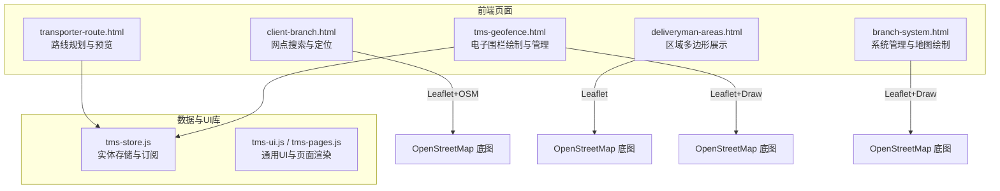
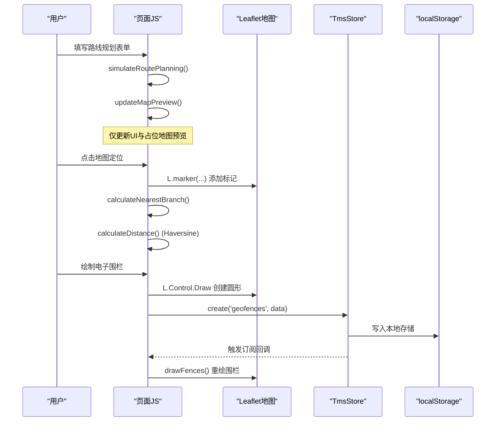
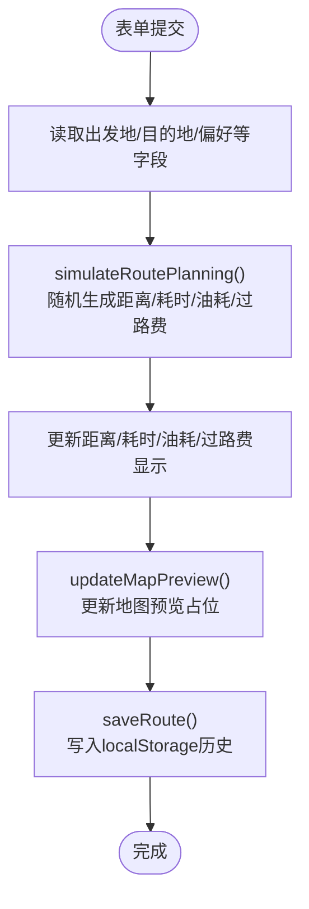
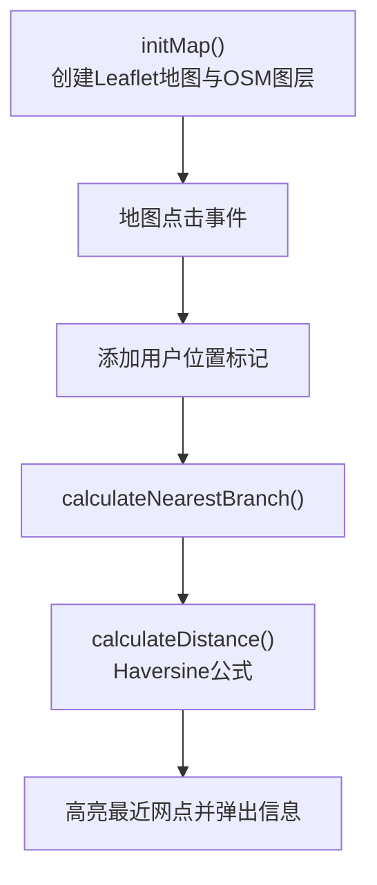
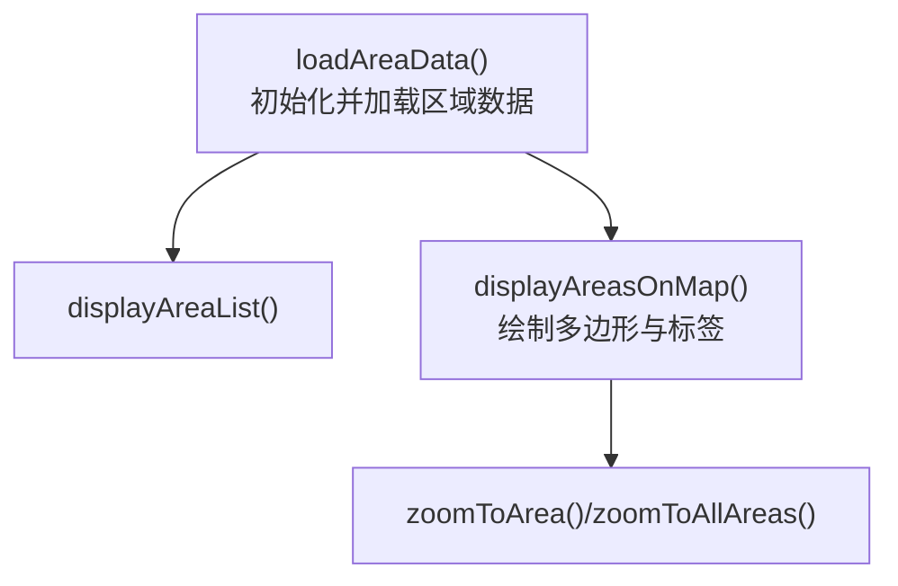
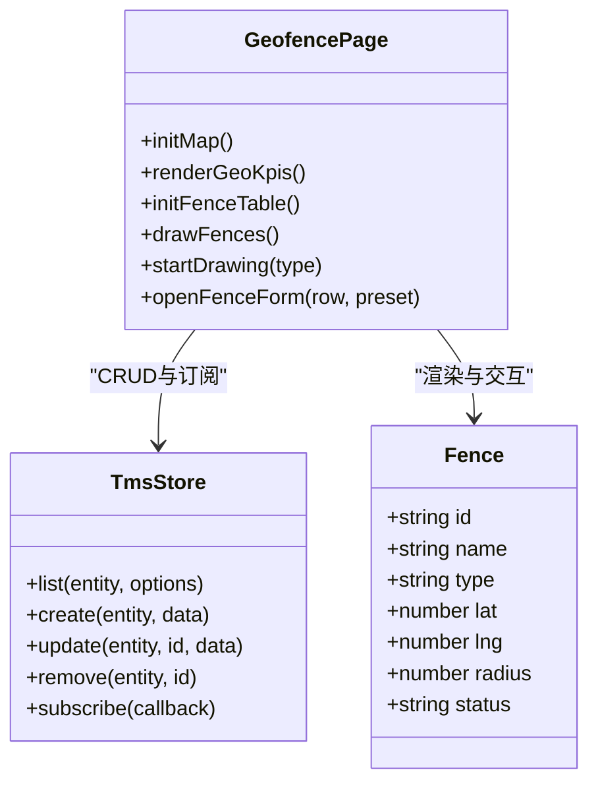
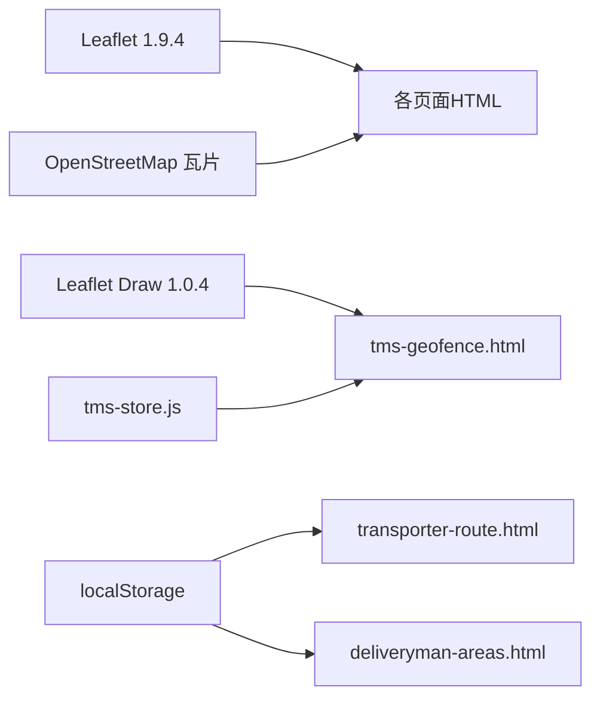

# 路线规划导航

<cite>
**本文引用的文件**   
- [transporter-route.html](file://transporter-route.html)
- [client-branch.html](file://client-branch.html)
- [deliveryman-areas.html](file://deliveryman-areas.html)
- [tms-geofence.html](file://tms-geofence.html)
- [branch-system.html](file://branch-system.html)
- [tms-store.js](file://tms-store.js)
</cite>

## 目录
1. [引言](#引言)
2. [项目结构](#项目结构)
3. [核心组件](#核心组件)
4. [架构总览](#架构总览)
5. [详细组件分析](#详细组件分析)
6. [依赖关系分析](#依赖关系分析)
7. [性能与优化](#性能与优化)
8. [故障排查指南](#故障排查指南)
9. [结论](#结论)
10. [附录：第三方地图集成与示例](#附录第三方地图集成与示例)

## 引言
本模块聚焦于“路线规划导航”能力，涵盖地图集成、路线规划与预览、轨迹追踪与位置更新、路径重计算、电子围栏与区域管理、以及与第三方地图服务（高德/百度）的集成思路。仓库当前以 Leaflet + OpenStreetMap 为基础实现地图可视化与交互，并提供面向运输员、客户端、派送员和运营管理的多角色页面；同时通过 TmsStore 提供数据持久化与订阅机制，支撑围栏等地理要素的增删改查与实时联动。

## 项目结构
围绕路线与导航相关的前端页面与脚本如下：
- 运输员发车路线规划页：提供路线表单、模拟规划、结果展示与本地历史保存
- 客户端网点搜索页：基于 Leaflet 的地图定位、地址搜索、最近网点计算
- 派送员区域页：在地图上绘制并展示派送/收件区域多边形
- 电子围栏管理页：使用 Leaflet Draw 绘制圆形围栏，并与 TmsStore 双向联动
- 系统管理页：包含 Leaflet 地图与绘制工具，用于区域/围栏编辑
- 数据层：TmsStore 提供 routes/geofences 等实体的 CRUD 与订阅通知

图表来源
- [transporter-route.html:438-520](file://transporter-route.html#L438-L520)
- [client-branch.html:547-597](file://client-branch.html#L547-L597)
- [deliveryman-areas.html:356-365](file://deliveryman-areas.html#L356-L365)
- [tms-geofence.html:600-609](file://tms-geofence.html#L600-L609)
- [branch-system.html:1319-1327](file://branch-system.html#L1319-L1327)
- [tms-store.js:418-433](file://tms-store.js#L418-L433)

章节来源
- [transporter-route.html:438-520](file://transporter-route.html#L438-L520)
- [client-branch.html:547-597](file://client-branch.html#L547-L597)
- [deliveryman-areas.html:356-365](file://deliveryman-areas.html#L356-L365)
- [tms-geofence.html:600-609](file://tms-geofence.html#L600-L609)
- [branch-system.html:1319-1327](file://branch-system.html#L1319-L1327)
- [tms-store.js:418-433](file://tms-store.js#L418-L433)

## 核心组件
- 路线规划与预览（运输员）
  - 输入：出发地、目的地、出发时间、车辆、货物类型、路线偏好
  - 输出：距离、耗时、油耗、过路费、地图预览占位
  - 行为：表单提交后调用模拟规划函数，更新指标与地图预览区
- 网点搜索与定位（客户端）
  - 功能：城市筛选、服务类型筛选、地址搜索、点击地图定位、最近网点计算
  - 算法：Haversine 距离公式计算两点球面距离
- 区域多边形展示（派送员）
  - 功能：加载区域数据、在地图上绘制多边形、标签显示、缩放至指定区域
- 电子围栏管理（运营）
  - 功能：新增/编辑/删除围栏、启用/停用、地图绘制圆形围栏、KPI统计、表格管理
  - 数据：与 TmsStore.geofences 双向同步，支持订阅刷新

章节来源
- [transporter-route.html:438-520](file://transporter-route.html#L438-L520)
- [client-branch.html:547-597](file://client-branch.html#L547-L597)
- [deliveryman-areas.html:454-499](file://deliveryman-areas.html#L454-L499)
- [tms-geofence.html:611-683](file://tms-geofence.html#L611-L683)

## 架构总览
整体采用“页面 + 地图SDK + 数据层”的分层结构：
- 页面层：各角色 HTML 页面负责交互与视图渲染
- 地图层：Leaflet + OSM 作为默认地图引擎；可替换为高德/百度地图 SDK
- 数据层：TmsStore 提供实体存储与订阅；localStorage 作为本地持久化
- 业务逻辑：页面内 JS 处理表单、地图事件、计算与状态更新

图表来源
- [transporter-route.html:701-739](file://transporter-route.html#L701-L739)
- [client-branch.html:573-597](file://client-branch.html#L573-L597)
- [client-branch.html:685-753](file://client-branch.html#L685-L753)
- [tms-geofence.html:748-776](file://tms-geofence.html#L748-L776)
- [tms-store.js:418-433](file://tms-store.js#L418-L433)

## 详细组件分析

### 组件A：路线规划与预览（运输员）
- 关键流程
  - 绑定表单提交事件，读取字段
  - 调用模拟规划函数生成距离/耗时/油耗/过路费
  - 更新路线信息卡片与地图预览区域
  - 保存路线到 localStorage 的历史记录
- 复杂度与扩展点
  - 当前为模拟数据，可扩展为真实路线API（高德/百度）
  - 地图预览目前为占位文本，可接入真实路线折线绘制

图表来源
- [transporter-route.html:701-739](file://transporter-route.html#L701-L739)
- [transporter-route.html:761-798](file://transporter-route.html#L761-L798)

章节来源
- [transporter-route.html:438-520](file://transporter-route.html#L438-L520)
- [transporter-route.html:701-739](file://transporter-route.html#L701-L739)
- [transporter-route.html:761-798](file://transporter-route.html#L761-L798)

### 组件B：网点搜索与最近网点计算（客户端）
- 关键流程
  - 初始化 Leaflet 地图，添加 OSM 图层
  - 监听地图点击，添加用户位置标记
  - 根据地址搜索进行模拟地理编码，定位到目标坐标
  - 使用 Haversine 公式计算用户与各网点的距离，找出最近网点并高亮
- 算法要点
  - Haversine 距离：考虑地球半径，按经纬度差值计算球面距离
- 扩展点
  - 将模拟地理编码替换为真实 API（高德/百度）
  - 增加路线折线与导航引导

图表来源
- [client-branch.html:547-597](file://client-branch.html#L547-L597)
- [client-branch.html:685-753](file://client-branch.html#L685-L753)

章节来源
- [client-branch.html:547-597](file://client-branch.html#L547-L597)
- [client-branch.html:685-753](file://client-branch.html#L685-L753)

### 组件C：区域多边形展示（派送员）
- 关键流程
  - 初始化地图与 OSM 图层
  - 从 localStorage 加载区域数据
  - 在地图上绘制多边形，并添加标签
  - 支持缩放至指定区域或所有区域
- 数据结构
  - 区域对象包含 id、name、type、coordinates、taskCount、address、notes
- 扩展点
  - 支持在线编辑多边形（结合 leaflet-draw）
  - 与任务系统联动，动态更新任务数

图表来源
- [deliveryman-areas.html:367-380](file://deliveryman-areas.html#L367-L380)
- [deliveryman-areas.html:454-499](file://deliveryman-areas.html#L454-L499)
- [deliveryman-areas.html:514-538](file://deliveryman-areas.html#L514-L538)

章节来源
- [deliveryman-areas.html:356-365](file://deliveryman-areas.html#L356-L365)
- [deliveryman-areas.html:367-380](file://deliveryman-areas.html#L367-L380)
- [deliveryman-areas.html:454-499](file://deliveryman-areas.html#L454-L499)
- [deliveryman-areas.html:514-538](file://deliveryman-areas.html#L514-L538)

### 组件D：电子围栏管理（运营）
- 关键流程
  - 初始化地图与 OSM 图层
  - 渲染 KPI（总数、生效中、仓储/禁行数量）
  - 表格管理围栏（新增/编辑/删除/启用/停用）
  - 使用 Leaflet Draw 绘制圆形围栏，保存到 TmsStore
  - 订阅 TmsStore 变更，自动重绘围栏
- 数据模型
  - geofences：id、name、type、lat、lng、radius、status
- 扩展点
  - 支持更多形状（矩形、多边形）
  - 与车辆轨迹/订单关联，实现围栏触发告警

图表来源
- [tms-geofence.html:600-609](file://tms-geofence.html#L600-L609)
- [tms-geofence.html:611-683](file://tms-geofence.html#L611-L683)
- [tms-geofence.html:721-776](file://tms-geofence.html#L721-L776)
- [tms-store.js:418-433](file://tms-store.js#L418-L433)

章节来源
- [tms-geofence.html:600-609](file://tms-geofence.html#L600-L609)
- [tms-geofence.html:611-683](file://tms-geofence.html#L611-L683)
- [tms-geofence.html:721-776](file://tms-geofence.html#L721-L776)
- [tms-store.js:418-433](file://tms-store.js#L418-L433)

## 依赖关系分析
- 地图SDK依赖
  - Leaflet 1.9.4 与 OpenStreetMap 瓦片服务
  - Leaflet Draw 1.0.4（用于围栏绘制）
  - 中国边界修正插件（可选）
- 数据依赖
  - TmsStore 提供 routes/geofences 等实体操作
  - localStorage 用于本地缓存（如路线历史、区域数据）
- 页面间耦合
  - transporter-route.html 与 deliveryman-areas.html 均依赖 Leaflet
  - tms-geofence.html 与 branch-system.html 均使用 Leaflet Draw

图表来源
- [client-branch.html:9-13](file://client-branch.html#L9-L13)
- [deliveryman-areas.html:10-11](file://deliveryman-areas.html#L10-L11)
- [tms-geofence.html:10-12](file://tms-geofence.html#L10-L12)
- [branch-system.html:11-16](file://branch-system.html#L11-L16)
- [tms-store.js:418-433](file://tms-store.js#L418-L433)

章节来源
- [client-branch.html:9-13](file://client-branch.html#L9-L13)
- [deliveryman-areas.html:10-11](file://deliveryman-areas.html#L10-L11)
- [tms-geofence.html:10-12](file://tms-geofence.html#L10-L12)
- [branch-system.html:11-16](file://branch-system.html#L11-L16)
- [tms-store.js:418-433](file://tms-store.js#L418-L433)

## 性能与优化
- 地图渲染优化
  - 批量添加标记时使用 FeatureGroup 或 LayerGroup，减少重绘次数
  - 对大量点位使用聚类（Leaflet.markercluster）提升交互性能
- 数据访问优化
  - 使用 TmsStore.list 分页与过滤，避免一次性加载全量数据
  - 对频繁读写的 localStorage 做防抖与缓存策略
- 交互体验优化
  - 地图事件节流（如拖拽、缩放）避免卡顿
  - 表单提交时禁用重复提交，防止重复请求
- 电池与后台优化
  - 降低 GPS 定位频率（如 10s 一次），必要时切换为网络定位
  - 使用 BackgroundGeolocation 或浏览器 Wake Lock API 保持前台运行

[本节为通用指导，不直接分析具体文件]

## 故障排查指南
- 地图未加载
  - 检查 Leaflet CSS/JS 是否引入成功
  - 确认容器元素存在且尺寸非零
- 围栏无法绘制
  - 检查 Leaflet Draw 是否正确引入
  - 查看控制台错误，确认地图实例已初始化
- 数据不同步
  - 检查 TmsStore.subscribe 是否注册
  - 确认 localStorage 权限与配额
- 最近网点计算异常
  - 校验经纬度格式与单位
  - 检查 Haversine 实现与地球半径常量

章节来源
- [tms-geofence.html:600-609](file://tms-geofence.html#L600-L609)
- [tms-geofence.html:748-776](file://tms-geofence.html#L748-L776)
- [client-branch.html:685-753](file://client-branch.html#L685-L753)

## 结论
当前仓库以 Leaflet + OSM 实现了基础的地图可视化、网点定位、区域展示与电子围栏管理；路线规划仍为模拟数据。后续可通过接入高德/百度地图 SDK 增强路线计算、交通状况分析与导航能力，并结合 TmsStore 的数据订阅机制实现更丰富的业务联动与实时性。

[本节为总结性内容，不直接分析具体文件]

## 附录：第三方地图集成与示例
- 高德地图集成要点
  - 引入高德 JS API，配置 Key 与安全密钥
  - 使用 AMap.Map 替代 L.map，AMap.TileLayer 替换 OSM 图层
  - 路线规划调用 AMap.Driving 或 AMap.Routing，获取折线与ETA
  - 轨迹追踪使用 AMap.Marker 与 AMap.Polyline 实时更新
- 百度地图集成要点
  - 引入 BMapGL JS API，配置 AK
  - 使用 BMap.Map 替代 L.map，BMap.TileLayer 替换 OSM 图层
  - 路线规划调用 BMap.Driving 或 BMap.Routing，获取折线与ETA
  - 轨迹追踪使用 BMap.Marker 与 BMap.Polyline 实时更新
- 离线地图支持
  - 预下载瓦片并按层级组织，使用自定义 TileLayer 指向本地资源
  - 结合 Service Worker 缓存瓦片与静态资源，提升离线可用性
- 电池优化策略
  - 降低定位频率，使用 watchPosition 的 enableHighAccuracy 按需开启
  - 使用 requestAnimationFrame 与节流函数控制高频更新
- 导航精度提升方案
  - 融合 GPS、Wi-Fi、基站定位，选择最优源
  - 使用卡尔曼滤波平滑轨迹，剔除跳点
  - 结合道路匹配（Snap to Road）提升轨迹贴合度

[本节为概念性说明，不直接分析具体文件]