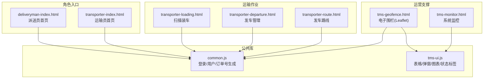
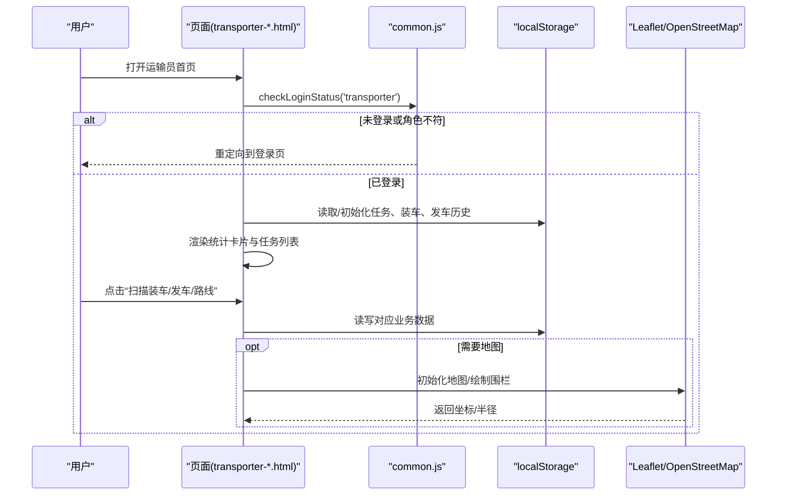
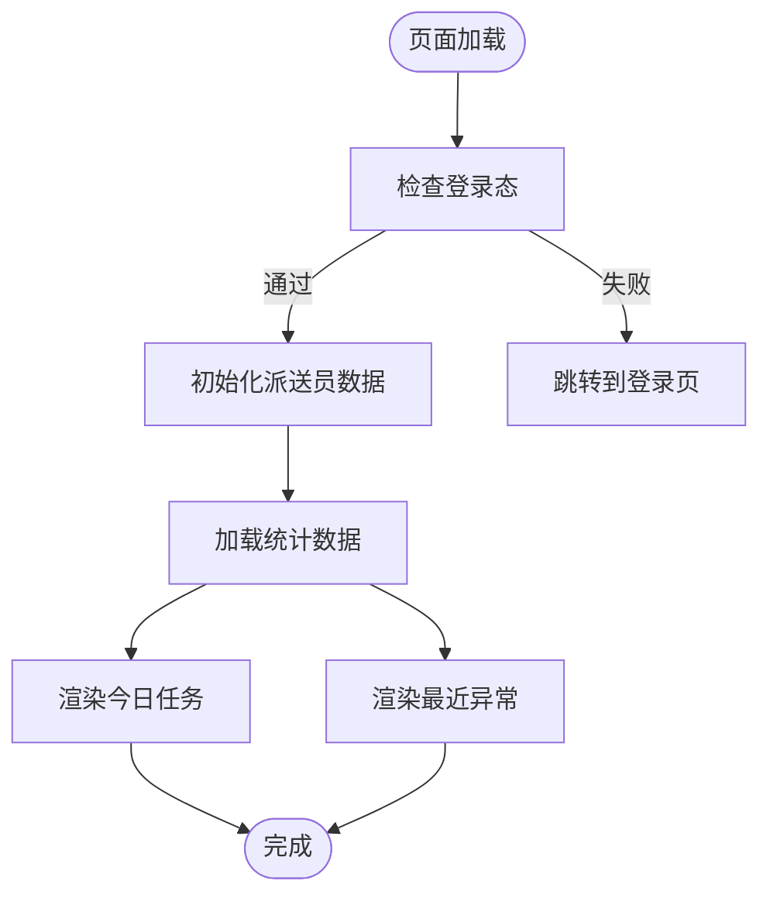
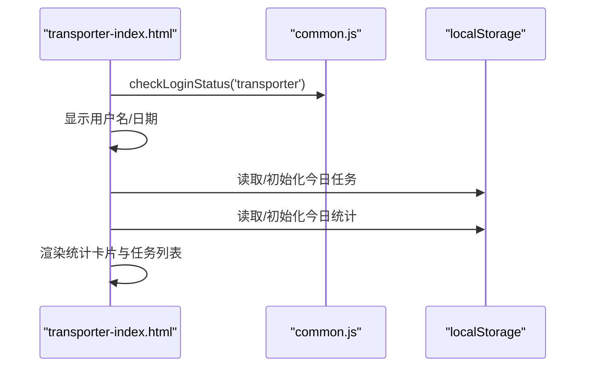
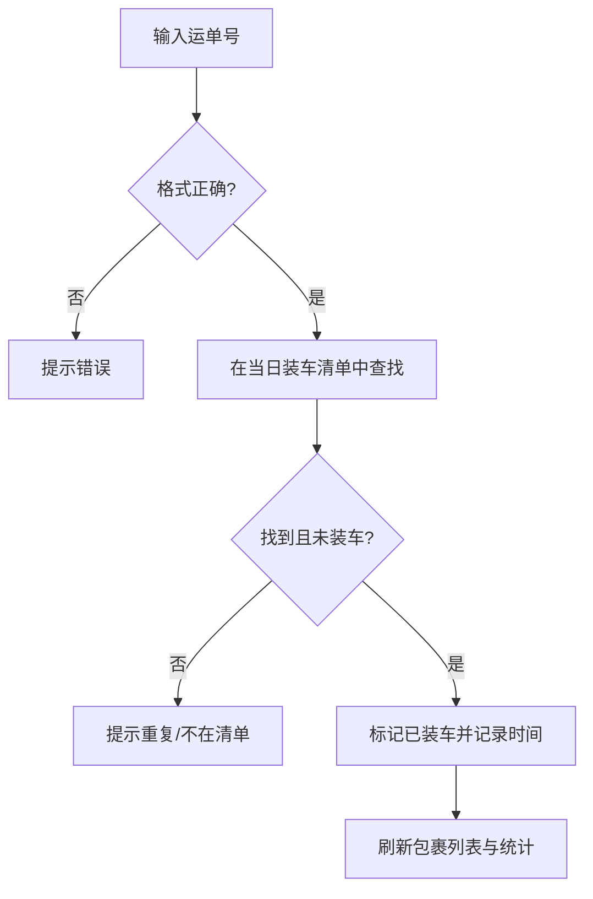
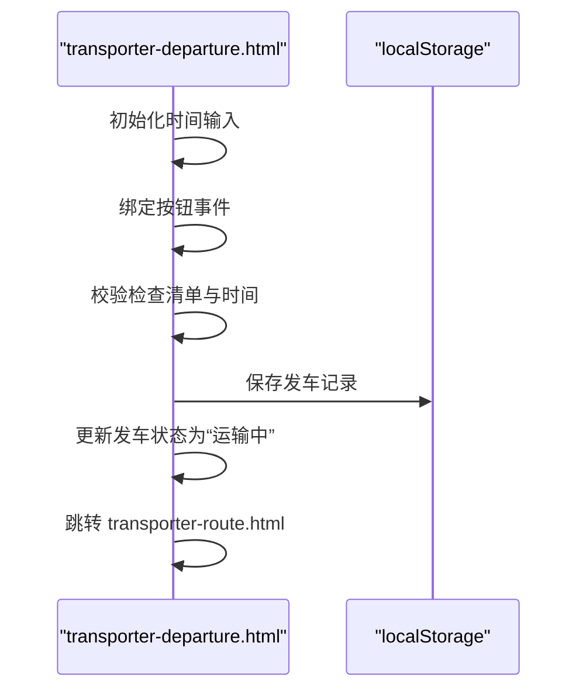
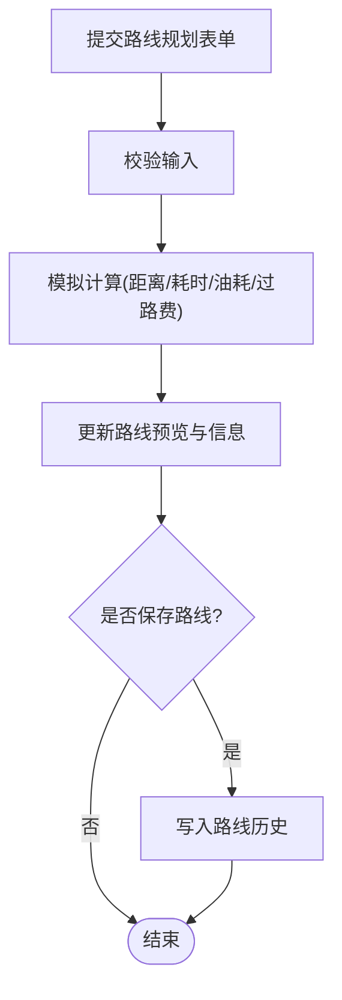
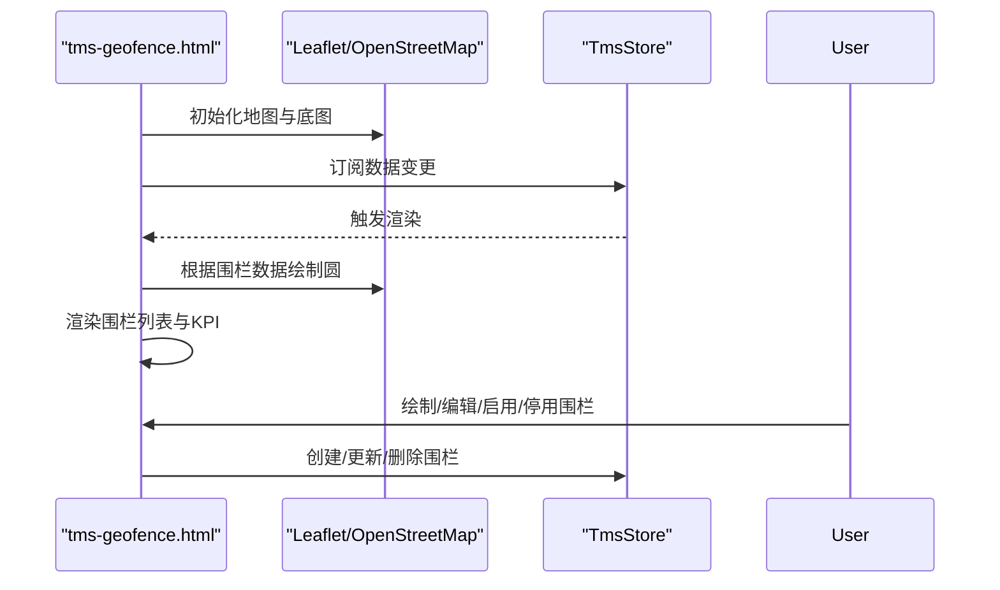
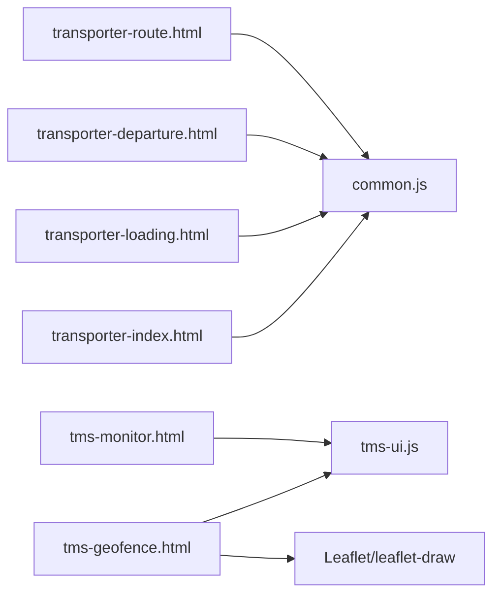

# 运输员界面

<cite>
**本文引用的文件**   
- [deliveryman-index.html](file://deliveryman-index.html)
- [transporter-index.html](file://transporter-index.html)
- [transporter-loading.html](file://transporter-loading.html)
- [transporter-departure.html](file://transporter-departure.html)
- [transporter-route.html](file://transporter-route.html)
- [tms-geofence.html](file://tms-geofence.html)
- [tms-monitor.html](file://tms-monitor.html)
- [tms-ui.js](file://tms-ui.js)
- [common.js](file://common.js)
</cite>

## 目录
1. [引言](#引言)
2. [项目结构](#项目结构)
3. [核心组件](#核心组件)
4. [架构总览](#架构总览)
5. [详细组件分析](#详细组件分析)
6. [依赖关系分析](#依赖关系分析)
7. [性能与移动端适配](#性能与移动端适配)
8. [故障排查指南](#故障排查指南)
9. [结论](#结论)

## 引言
本文件面向“运输员界面”的完整技术文档，覆盖物流运输调度的核心能力：车辆装载、发车管理、路线规划、调度安排、绩效统计与考勤管理等模块；并说明GPS定位集成、实时位置追踪、电子围栏的技术实现思路；记录调度算法、路线优化逻辑与容量分配策略；给出地图API集成、轨迹记录与导航的实现建议；解释车载设备/GPS传感器通信协议与实时数据传输机制；提供交通状况分析、预计到达时间计算与异常预警系统方案；最后补充移动端适配、离线导航支持与电池优化策略。

## 项目结构
仓库采用多页面前端原型组织方式，按角色/业务域拆分HTML页面，配合通用脚本与UI库：
- 角色入口页：派送员首页、运输员首页
- 业务功能页：装车扫描、发车管理、路线规划
- 运营支撑页：电子围栏（Leaflet）、系统监控（指标面板）
- 公共库：通用JS工具、共享UI组件库

图示来源
- [deliveryman-index.html:230-244](file://deliveryman-index.html#L230-L244)
- [transporter-index.html:268-279](file://transporter-index.html#L268-L279)
- [transporter-loading.html:449-459](file://transporter-loading.html#L449-L459)
- [transporter-departure.html:443-454](file://transporter-departure.html#L443-L454)
- [transporter-route.html:411-423](file://transporter-route.html#L411-L423)
- [tms-geofence.html:557-562](file://tms-geofence.html#L557-L562)
- [tms-monitor.html:409-412](file://tms-monitor.html#L409-L412)
- [common.js:135-174](file://common.js#L135-L174)
- [tms-ui.js:758-781](file://tms-ui.js#L758-L781)

章节来源
- [deliveryman-index.html:230-244](file://deliveryman-index.html#L230-L244)
- [transporter-index.html:268-279](file://transporter-index.html#L268-L279)
- [common.js:135-174](file://common.js#L135-L174)
- [tms-ui.js:758-781](file://tms-ui.js#L758-L781)

## 核心组件
- 登录与用户上下文
  - 统一登录流程、角色跳转、当前用户展示与退出登录。
  - 关键函数：login、checkLoginStatus、logout、displayCurrentUser。
- 通用UI组件
  - 表格、搜索/筛选/分页、表单弹窗、确认框、Toast、KPI与SVG图表、状态标签等。
  - 暴露全局对象TmsUI，供各页面复用。
- 数据持久化
  - 基于localStorage的轻量本地存储，用于任务、装车、发车历史、路线历史等。
- 地图与电子围栏
  - 使用Leaflet加载OpenStreetMap瓦片，支持绘制圆形围栏、列表联动、启用/停用控制。

章节来源
- [common.js:135-174](file://common.js#L135-L174)
- [common.js:220-270](file://common.js#L220-L270)
- [tms-ui.js:86-158](file://tms-ui.js#L86-L158)
- [tms-ui.js:303-544](file://tms-ui.js#L303-L544)
- [tms-ui.js:546-680](file://tms-ui.js#L546-L680)
- [tms-ui.js:758-781](file://tms-ui.js#L758-L781)
- [tms-geofence.html:594-603](file://tms-geofence.html#L594-L603)

## 架构总览
运输员界面的端到端交互由“页面层 + 公共库 + 本地存储”构成，部分页面通过Leaflet接入地图服务。

图示来源
- [transporter-index.html:341-364](file://transporter-index.html#L341-L364)
- [common.js:176-199](file://common.js#L176-L199)
- [transporter-loading.html:557-604](file://transporter-loading.html#L557-L604)
- [transporter-departure.html:617-652](file://transporter-departure.html#L617-L652)
- [tms-geofence.html:594-603](file://tms-geofence.html#L594-L603)

## 详细组件分析

### 派送员首页
- 功能要点
  - 显示今日任务、待处理/进行中/已完成统计、最近异常。
  - 侧边栏导航至任务、提取、打卡、绩效、联系记录、异常上报、区域等。
- 数据流
  - 初始化时检查登录态，渲染用户名与日期，从localStorage拉取任务与异常数据并更新统计与列表。
- 交互
  - 退出登录按钮调用统一logout。

图示来源
- [deliveryman-index.html:292-318](file://deliveryman-index.html#L292-L318)
- [deliveryman-index.html:320-367](file://deliveryman-index.html#L320-L367)
- [deliveryman-index.html:369-445](file://deliveryman-index.html#L369-L445)

章节来源
- [deliveryman-index.html:230-244](file://deliveryman-index.html#L230-L244)
- [deliveryman-index.html:292-318](file://deliveryman-index.html#L292-L318)
- [deliveryman-index.html:320-367](file://deliveryman-index.html#L320-L367)
- [deliveryman-index.html:369-445](file://deliveryman-index.html#L369-L445)

### 运输员首页
- 功能要点
  - 快捷入口：打卡、装车、发车、路线。
  - 今日任务与统计：已装车、已发车、里程、本月绩效。
- 数据流
  - 检查登录态后，初始化今日任务与统计，默认值写入localStorage。

图示来源
- [transporter-index.html:341-364](file://transporter-index.html#L341-L364)
- [transporter-index.html:366-458](file://transporter-index.html#L366-L458)
- [common.js:176-199](file://common.js#L176-L199)

章节来源
- [transporter-index.html:268-279](file://transporter-index.html#L268-L279)
- [transporter-index.html:341-364](file://transporter-index.html#L341-L364)
- [transporter-index.html:366-458](file://transporter-index.html#L366-L458)

### 扫描装车
- 功能要点
  - 扫描运单号（支持手动输入），校验格式与清单，标记已装车并记录扫描时间。
  - 实时更新装车进度统计与包裹列表。
- 关键流程
  - 输入校验 → 查找包裹 → 状态更新 → 刷新列表与统计。

图示来源
- [transporter-loading.html:557-604](file://transporter-loading.html#L557-L604)
- [transporter-loading.html:660-711](file://transporter-loading.html#L660-L711)
- [transporter-loading.html:745-789](file://transporter-loading.html#L745-L789)

章节来源
- [transporter-loading.html:449-459](file://transporter-loading.html#L449-L459)
- [transporter-loading.html:557-604](file://transporter-loading.html#L557-L604)
- [transporter-loading.html:660-711](file://transporter-loading.html#L660-L711)
- [transporter-loading.html:745-789](file://transporter-loading.html#L745-L789)

### 发车管理
- 功能要点
  - 任务信息、车辆信息、货物信息汇总。
  - 发车前检查清单（车辆/货物/文件/油量/工具/通讯）。
  - 填写发车时间与预计到达时间，保存发车记录并跳转路线页。
- 关键流程
  - 校验必填项与检查清单 → 保存记录 → 更新状态 → 跳转路线。

图示来源
- [transporter-departure.html:617-652](file://transporter-departure.html#L617-L652)
- [transporter-departure.html:676-736](file://transporter-departure.html#L676-L736)
- [transporter-departure.html:752-778](file://transporter-departure.html#L752-L778)

章节来源
- [transporter-departure.html:443-454](file://transporter-departure.html#L443-L454)
- [transporter-departure.html:617-652](file://transporter-departure.html#L617-L652)
- [transporter-departure.html:676-736](file://transporter-departure.html#L676-L736)
- [transporter-departure.html:752-778](file://transporter-departure.html#L752-L778)

### 发车路线
- 功能要点
  - 路线规划表单（出发地/目的地/时间/车辆/货类/偏好）。
  - 模拟计算距离/耗时/油耗/过路费，更新预览区。
  - 保存路线至历史，支持常用路线与历史查询。
- 关键流程
  - 提交表单 → 模拟计算 → 更新预览 → 可选保存到历史。

图示来源
- [transporter-route.html:562-592](file://transporter-route.html#L562-L592)
- [transporter-route.html:701-739](file://transporter-route.html#L701-L739)
- [transporter-route.html:761-798](file://transporter-route.html#L761-L798)

章节来源
- [transporter-route.html:411-423](file://transporter-route.html#L411-L423)
- [transporter-route.html:562-592](file://transporter-route.html#L562-L592)
- [transporter-route.html:701-739](file://transporter-route.html#L701-L739)
- [transporter-route.html:761-798](file://transporter-route.html#L761-L798)

### 电子围栏（Leaflet）
- 功能要点
  - 使用Leaflet加载OpenStreetMap瓦片，支持绘制圆形围栏。
  - 围栏列表与地图双向联动，支持启用/停用、编辑、删除、定位。
  - KPI面板展示围栏总数、生效中、仓储/禁行数量等。
- 关键流程
  - 初始化地图 → 渲染围栏图层 → 监听Store变更 → 同步列表与地图。

图示来源
- [tms-geofence.html:594-603](file://tms-geofence.html#L594-L603)
- [tms-geofence.html:605-617](file://tms-geofence.html#L605-L617)
- [tms-geofence.html:717-740](file://tms-geofence.html#L717-L740)
- [tms-geofence.html:742-770](file://tms-geofence.html#L742-L770)

章节来源
- [tms-geofence.html:557-562](file://tms-geofence.html#L557-L562)
- [tms-geofence.html:594-603](file://tms-geofence.html#L594-L603)
- [tms-geofence.html:605-617](file://tms-geofence.html#L605-L617)
- [tms-geofence.html:717-740](file://tms-geofence.html#L717-L740)
- [tms-geofence.html:742-770](file://tms-geofence.html#L742-L770)

### 系统监控（参考）
- 功能要点
  - 聚合订单趋势、异常类型分布、队列健康度、设备在线状态与环境信息。
  - 定时刷新与订阅数据源变更。
- 价值
  - 作为后台运行指标看板，便于运维与调度人员掌握系统健康度。

章节来源
- [tms-monitor.html:409-412](file://tms-monitor.html#L409-L412)
- [tms-monitor.html:417-430](file://tms-monitor.html#L417-L430)
- [tms-monitor.html:441-483](file://tms-monitor.html#L441-L483)
- [tms-monitor.html:485-536](file://tms-monitor.html#L485-L536)

## 依赖关系分析
- 页面依赖
  - 所有角色页面依赖 common.js 进行登录态校验与用户信息展示。
  - 运营类页面（如电子围栏、监控）依赖 tms-ui.js 提供的表格、弹窗、图表等能力。
- 外部依赖
  - 电子围栏页面引入 Leaflet 与 leaflet-draw，底图使用 OpenStreetMap。
- 数据依赖
  - 业务数据以 localStorage 键名区分（如 transportLoading_日期、transporterDepartureHistory、routeHistory 等）。

图示来源
- [transporter-index.html:340-364](file://transporter-index.html#L340-L364)
- [transporter-loading.html:556-604](file://transporter-loading.html#L556-L604)
- [transporter-departure.html:616-652](file://transporter-departure.html#L616-L652)
- [transporter-route.html:561-592](file://transporter-route.html#L561-L592)
- [tms-geofence.html:557-562](file://tms-geofence.html#L557-L562)
- [tms-monitor.html:409-412](file://tms-monitor.html#L409-L412)

章节来源
- [common.js:135-174](file://common.js#L135-L174)
- [tms-ui.js:758-781](file://tms-ui.js#L758-L781)
- [tms-geofence.html:557-562](file://tms-geofence.html#L557-L562)

## 性能与移动端适配
- 性能优化建议
  - 列表渲染：对大数据量使用虚拟滚动或分页；避免频繁全量DOM重建。
  - 地图渲染：批量添加图层，减少重绘；按需加载瓦片与矢量数据。
  - 本地存储：合并写入、避免高频小写；定期清理过期数据。
- 移动端适配
  - 响应式布局：侧边栏在小屏下横向滚动或折叠；表单控件增大触控面积。
  - 触摸交互：放大点击区域，提供长按/滑动操作。
  - 网络与离线：缓存静态资源；离线场景降级为本地数据与离线地图切片。
- 电池优化
  - GPS采集：降低采样频率，结合移动阈值触发上报；关闭不必要的后台刷新。
  - 屏幕与动画：减少高帧率动画；在后台时暂停非关键任务。
  - 地图：在非活跃标签页降低刷新频率，必要时暂停瓦片加载。

[本节为通用指导，不直接分析具体文件]

## 故障排查指南
- 登录与权限
  - 现象：进入页面被重定向到登录页。
  - 排查：检查localStorage中的用户信息与角色；确认checkLoginStatus返回值。
- 数据不更新
  - 现象：装车/发车/路线历史无变化。
  - 排查：确认localStorage键名是否正确；检查页面初始化与事件绑定是否执行。
- 地图不可用
  - 现象：电子围栏页面地图空白或报错。
  - 排查：检查Leaflet与leaflet-draw是否成功加载；OpenStreetMap瓦片是否可访问；浏览器控制台是否有跨域或证书错误。
- 表单验证失败
  - 现象：无法提交或保存。
  - 排查：检查必填字段、数值范围与格式校验逻辑；查看表单弹窗的错误提示。

章节来源
- [common.js:176-199](file://common.js#L176-L199)
- [transporter-loading.html:660-711](file://transporter-loading.html#L660-L711)
- [transporter-departure.html:676-736](file://transporter-departure.html#L676-L736)
- [tms-geofence.html:594-603](file://tms-geofence.html#L594-L603)

## 结论
本仓库以多页面原型实现了运输员界面的核心业务流程：从登录鉴权、任务概览，到装车扫描、发车管理与路线规划，并通过Leaflet提供电子围栏可视化能力。整体架构清晰、职责分离，借助common.js与tms-ui.js形成稳定的公共能力层。后续可在现有基础上扩展GPS定位、轨迹回放、ETA计算、异常预警与车载设备通信等高级能力，同时完善移动端体验与离线支持。