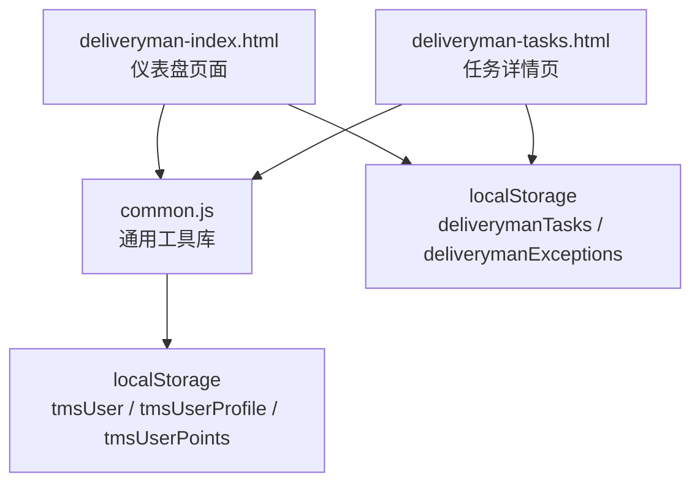
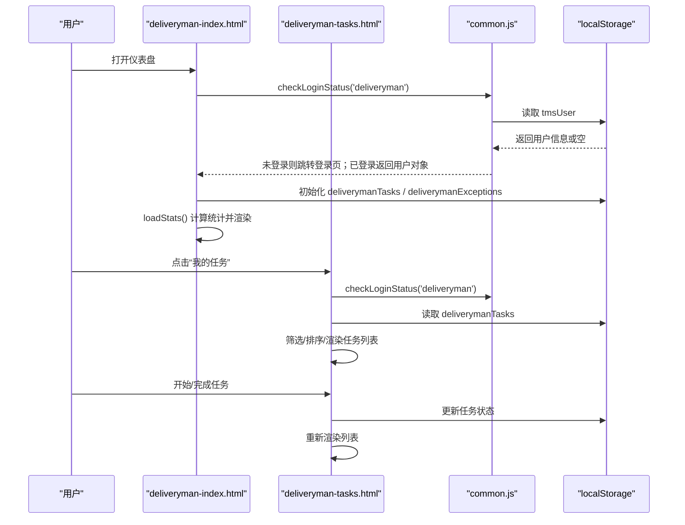
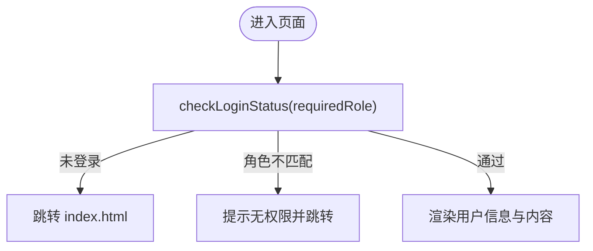
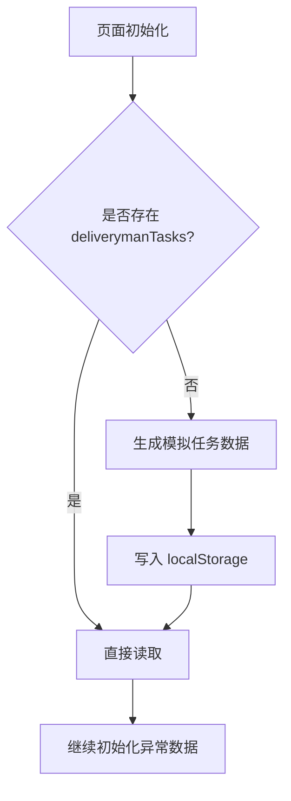
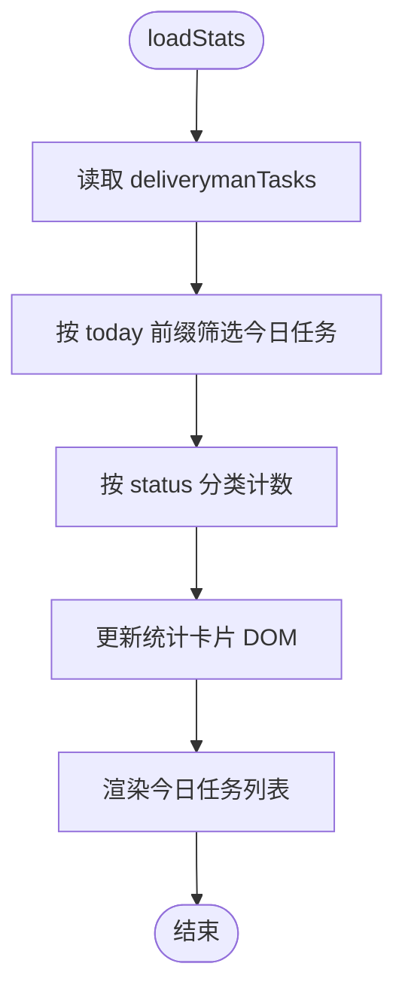
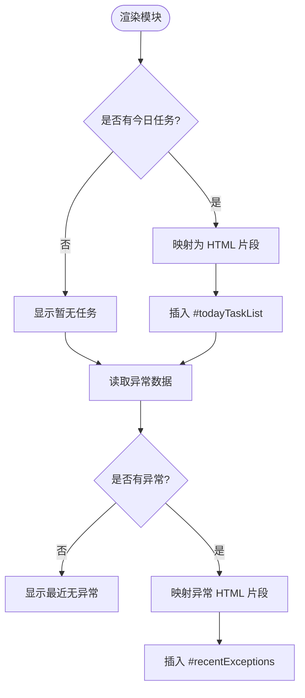
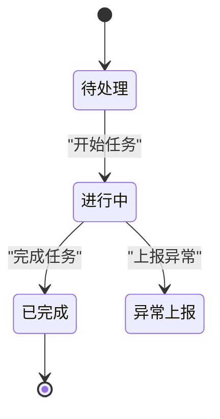
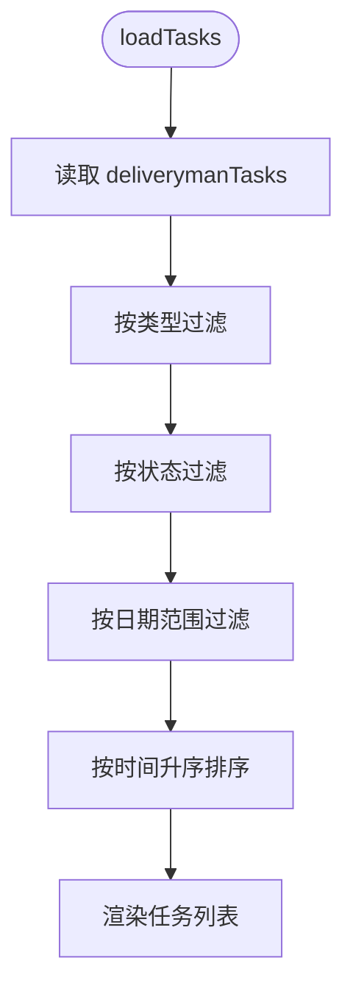
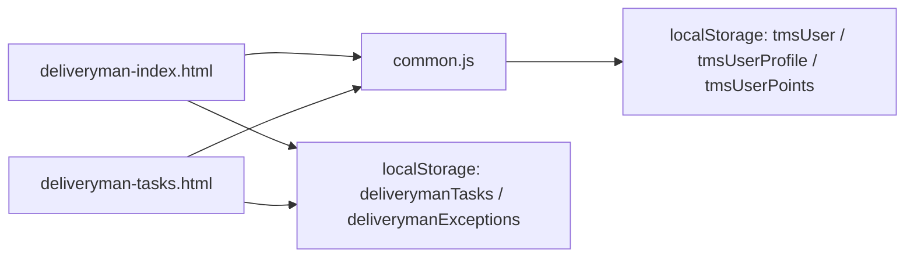

# 运输员首页仪表板

<cite>
**本文引用的文件**   
- [deliveryman-index.html](file://deliveryman-index.html)
- [deliveryman-tasks.html](file://deliveryman-tasks.html)
- [common.js](file://common.js)
</cite>

## 目录
1. [简介](#简介)
2. [项目结构](#项目结构)
3. [核心组件](#核心组件)
4. [架构总览](#架构总览)
5. [详细组件分析](#详细组件分析)
6. [依赖关系分析](#依赖关系分析)
7. [性能与实时性](#性能与实时性)
8. [故障排查指南](#故障排查指南)
9. [结论](#结论)
10. [附录：集成示例与最佳实践](#附录集成示例与最佳实践)

## 简介
本文件为“运输员首页仪表板”的完整技术文档，聚焦以下目标：
- 解释仪表盘的核心功能模块：今日任务展示、统计数据概览、快捷操作入口、用户信息管理。
- 说明任务状态管理（待处理、进行中、已完成）的实现逻辑与数据流。
- 阐述统计数据的计算与更新机制。
- 记录用户认证流程、权限校验与会话管理的技术实现。
- 总结响应式布局设计、移动端适配方案与用户体验优化策略。
- 提供可落地的集成要点：localStorage 数据持久化、事件监听与 DOM 操作的代码片段路径。

## 项目结构
围绕运输员首页仪表板，主要涉及三个文件：
- deliveryman-index.html：仪表盘的页面结构与交互脚本，负责初始化数据、渲染统计卡片与今日任务列表、最近异常列表。
- deliveryman-tasks.html：任务详情页，提供任务筛选、状态切换（开始/完成）、异常上报与详情查看等能力。
- common.js：通用工具库，包含登录、登出、角色校验、当前用户显示、个人信息与积分等公共函数。

图表来源
- [deliveryman-index.html:291-455](file://deliveryman-index.html#L291-L455)
- [deliveryman-tasks.html:387-636](file://deliveryman-tasks.html#L387-L636)
- [common.js:135-218](file://common.js#L135-L218)

章节来源
- [deliveryman-index.html:1-459](file://deliveryman-index.html#L1-L459)
- [deliveryman-tasks.html:1-640](file://deliveryman-tasks.html#L1-L640)
- [common.js:1-383](file://common.js#L1-L383)

## 核心组件
- 顶部导航与用户信息区：显示当前用户名、退出登录按钮。
- 侧边栏导航：快速跳转至“我的任务”“订单提取”“打卡记录”“绩效”“联系记录”“异常上报”“派送区域”。
- 统计卡片：今日任务总数、待处理、进行中、已完成数量。
- 今日任务列表：按时间顺序展示当日任务，含类型、客户、地址、电话、时间与描述。
- 最近异常列表：展示最近的异常记录及其状态。
- 任务详情页：支持按类型/状态/日期筛选，支持开始/完成任务、上报异常、查看详情。

章节来源
- [deliveryman-index.html:216-287](file://deliveryman-index.html#L216-L287)
- [deliveryman-tasks.html:311-383](file://deliveryman-tasks.html#L311-L383)

## 架构总览
仪表盘采用前端直连 localStorage 的数据模型，无后端服务。页面通过 common.js 提供的统一函数进行认证与用户信息展示；业务数据（任务、异常）由各自页面在首次加载时初始化并写入 localStorage，随后按需读取、过滤、排序与渲染。

图表来源
- [deliveryman-index.html:291-455](file://deliveryman-index.html#L291-L455)
- [deliveryman-tasks.html:387-636](file://deliveryman-tasks.html#L387-L636)
- [common.js:176-218](file://common.js#L176-L218)

## 详细组件分析

### 认证与会话管理
- 登录流程：用户在登录页选择角色后，调用 login() 将用户信息（username、role）写入 localStorage 的 tmsUser，并按角色跳转到对应页面。
- 权限校验：各页面在 DOMContentLoaded 中调用 checkLoginStatus(requiredRole)，若未登录或角色不匹配，则提示并跳转回登录页。
- 会话管理：logout() 删除 tmsUser 并跳转登录页；displayCurrentUser() 从 tmsUser 读取并渲染到多个可能的用户名元素位置。

图表来源
- [common.js:135-218](file://common.js#L135-L218)
- [deliveryman-index.html:291-318](file://deliveryman-index.html#L291-L318)
- [deliveryman-tasks.html:387-424](file://deliveryman-tasks.html#L387-L424)

章节来源
- [common.js:135-218](file://common.js#L135-L218)
- [deliveryman-index.html:291-318](file://deliveryman-index.html#L291-L318)
- [deliveryman-tasks.html:387-424](file://deliveryman-tasks.html#L387-L424)

### 数据持久化与初始化
- 任务数据：首次访问时若 localStorage 不存在 deliverymanTasks，则生成若干条模拟任务（包含 id、type、title、customer、address、phone、time、status、description），并写入 storage。
- 异常数据：首次访问时若不存在 deliverymanExceptions，则生成若干条历史异常记录并写入 storage。
- 用户数据：tmsUser、tmsUserProfile、tmsUserPoints 等由 common.js 统一管理。

图表来源
- [deliveryman-index.html:320-367](file://deliveryman-index.html#L320-L367)
- [deliveryman-tasks.html:426-461](file://deliveryman-tasks.html#L426-L461)
- [common.js:272-363](file://common.js#L272-L363)

章节来源
- [deliveryman-index.html:320-367](file://deliveryman-index.html#L320-L367)
- [deliveryman-tasks.html:426-461](file://deliveryman-tasks.html#L426-L461)
- [common.js:272-363](file://common.js#L272-L363)

### 统计数据的计算与更新
- 统计口径：以 deliverymanTasks 为基础，按 time 字段的前缀（YYYY-MM-DD）筛选“今日任务”，再按 status 分类计数（pending/in-progress/completed）。
- 更新时机：页面初始化完成后立即执行 loadStats()，并在任务状态变更时重新渲染。
- 展示元素：totalTasks、pendingTasks、inProgressTasks、completedTasks 四个统计卡片。

图表来源
- [deliveryman-index.html:369-391](file://deliveryman-index.html#L369-L391)

章节来源
- [deliveryman-index.html:369-391](file://deliveryman-index.html#L369-L391)

### 今日任务展示与最近异常
- 今日任务：根据筛选后的今日任务数组，逐条渲染任务项，包括标题、状态标签、类型、客户、地址、电话、时间与描述。
- 最近异常：读取 deliverymanExceptions，渲染异常类型、关联任务标题、日期与处理状态。

图表来源
- [deliveryman-index.html:393-445](file://deliveryman-index.html#L393-L445)

章节来源
- [deliveryman-index.html:393-445](file://deliveryman-index.html#L393-L445)

### 任务状态管理与工作流
- 状态定义：pending（待处理）、in-progress（进行中）、completed（已完成）。
- 状态流转：
  - pending → in-progress：点击“开始任务”触发 startTask(taskId)。
  - in-progress → completed：点击“完成任务”触发 completeTask(taskId)。
  - in-progress → 异常上报：点击“上报异常”跳转异常页面并附带 taskId。
- 数据更新：修改任务状态后写回 localStorage，并重新渲染任务列表。

图表来源
- [deliveryman-tasks.html:570-626](file://deliveryman-tasks.html#L570-L626)

章节来源
- [deliveryman-tasks.html:570-626](file://deliveryman-tasks.html#L570-L626)

### 任务筛选与排序
- 类型筛选：全部任务/收件任务/派件任务。
- 状态筛选：全部/待处理/进行中/已完成。
- 日期筛选：今天/本周/本月/全部。
- 排序规则：按 task.time 升序排列。

图表来源
- [deliveryman-tasks.html:463-512](file://deliveryman-tasks.html#L463-L512)

章节来源
- [deliveryman-tasks.html:463-512](file://deliveryman-tasks.html#L463-L512)

### 用户信息管理与快捷操作
- 用户信息显示：displayCurrentUser() 会尝试更新多个可能的用户名元素 ID，确保在不同页面下都能正确显示。
- 快捷操作：侧边栏提供常用功能的快速跳转链接。
- 个人信息与积分：common.js 提供 saveUserProfile/getUserProfile/updateUserProfile 以及积分相关函数，便于扩展个人设置与积分体系。

章节来源
- [common.js:211-295](file://common.js#L211-L295)
- [deliveryman-index.html:231-244](file://deliveryman-index.html#L231-L244)

## 依赖关系分析
- deliveryman-index.html 依赖 common.js 的认证与用户信息函数，同时读写 localStorage 中的 deliverymanTasks 与 deliverymanExceptions。
- deliveryman-tasks.html 同样依赖 common.js 的认证函数，并读写 deliverymanTasks。
- common.js 暴露全局函数供各页面调用，并通过 localStorage 维护 tmsUser、tmsUserProfile、tmsUserPoints 等键值。

图表来源
- [deliveryman-index.html:291-455](file://deliveryman-index.html#L291-L455)
- [deliveryman-tasks.html:387-636](file://deliveryman-tasks.html#L387-L636)
- [common.js:135-383](file://common.js#L135-L383)

章节来源
- [deliveryman-index.html:291-455](file://deliveryman-index.html#L291-L455)
- [deliveryman-tasks.html:387-636](file://deliveryman-tasks.html#L387-L636)
- [common.js:135-383](file://common.js#L135-L383)

## 性能与实时性
- 数据源：纯前端 localStorage，无网络请求，首屏加载快。
- 计算复杂度：统计与筛选均为 O(n) 线性扫描，n 为任务数量；排序为 O(n log n)。
- 更新频率：仅在用户交互（开始/完成任务、筛选变化）时触发重算与重绘。
- 建议优化：
  - 对频繁读写的 key（如 deliverymanTasks）增加内存缓存，减少重复解析 JSON。
  - 使用 requestAnimationFrame 批量更新 DOM，避免多次回流。
  - 对大数据集引入分页或虚拟滚动（当任务量增长时）。

[本节为通用性能讨论，不涉及具体文件分析]

## 故障排查指南
- 登录后仍被跳转回登录页：
  - 检查 localStorage 中是否存在 tmsUser，且 role 是否为 deliveryman。
  - 确认页面是否调用了 checkLoginStatus('deliveryman')。
- 统计数字为 0：
  - 检查 deliverymanTasks 是否存在且包含今日任务（time 前缀匹配当天）。
  - 确认 loadStats() 是否被执行。
- 任务无法开始/完成：
  - 检查 startTask/completeTask 是否正确找到任务索引并更新状态。
  - 确认 localStorage 写入成功且后续 loadTasks() 被调用。
- 用户名未显示：
  - 检查 displayCurrentUser() 是否能找到对应的用户名元素 ID。
  - 确认 tmsUser 存在且 JSON 可解析。

章节来源
- [common.js:176-218](file://common.js#L176-L218)
- [deliveryman-index.html:369-391](file://deliveryman-index.html#L369-L391)
- [deliveryman-tasks.html:596-626](file://deliveryman-tasks.html#L596-L626)

## 结论
运输员首页仪表板以简洁的前端架构实现了完整的任务看板与基础业务流程：认证与权限控制由 common.js 统一提供，任务与异常数据通过 localStorage 持久化，统计与列表渲染在页面初始化与用户交互时触发。该方案易于部署与维护，适合演示与轻量级场景；随着业务规模增长，可逐步引入服务端 API、缓存层与更完善的权限模型。

[本节为总结性内容，不涉及具体文件分析]

## 附录：集成示例与最佳实践

- 集成 localStorage 数据持久化
  - 初始化任务与异常数据：参考 deliveryman-index.html 的 initializeDeliverymanData 与 deliveryman-tasks.html 的 initializeTaskData。
  - 读取与更新：参考 deliveryman-index.html 的 loadStats 与 deliveryman-tasks.html 的 startTask/completeTask。
  - 用户信息存取：参考 common.js 的 login/logout/displayCurrentUser/saveUserProfile/getUserProfile/updateUserProfile。

- 事件监听与 DOM 操作
  - 页面初始化绑定：DOMContentLoaded 中调用认证、显示用户名、初始化数据与渲染统计。
  - 交互事件：退出登录按钮 click、任务类型切换 click、筛选器 change 等。
  - 动态渲染：通过 innerHTML 拼接任务与异常列表，或使用更安全的方式（如模板引擎）替换。

- 响应式布局与移动端适配
  - 使用 CSS Grid 自适应统计卡片列数。
  - 在小屏幕下侧边栏改为横向滚动导航，内容区全宽显示。
  - 任务详情行在小屏下纵向堆叠，提升可读性。

- 用户体验优化策略
  - 明确的状态标签与颜色区分，帮助用户快速识别任务进度。
  - 提供“开始/完成/上报异常/查看详情”等直观操作入口。
  - 空态提示：无任务或无异常时给出友好文案。

章节来源
- [deliveryman-index.html:291-455](file://deliveryman-index.html#L291-L455)
- [deliveryman-tasks.html:387-636](file://deliveryman-tasks.html#L387-L636)
- [common.js:135-383](file://common.js#L135-L383)