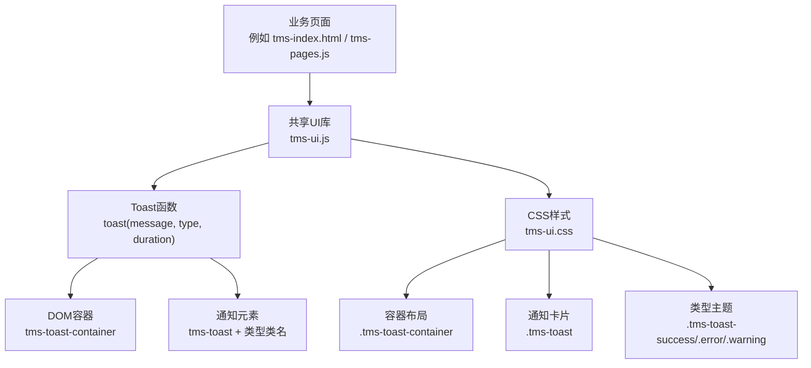
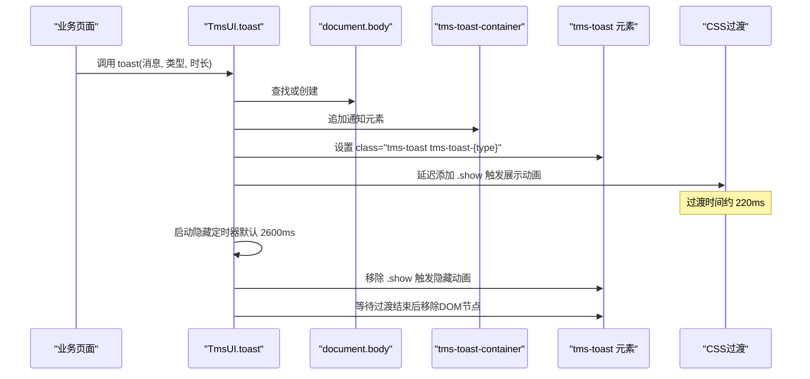
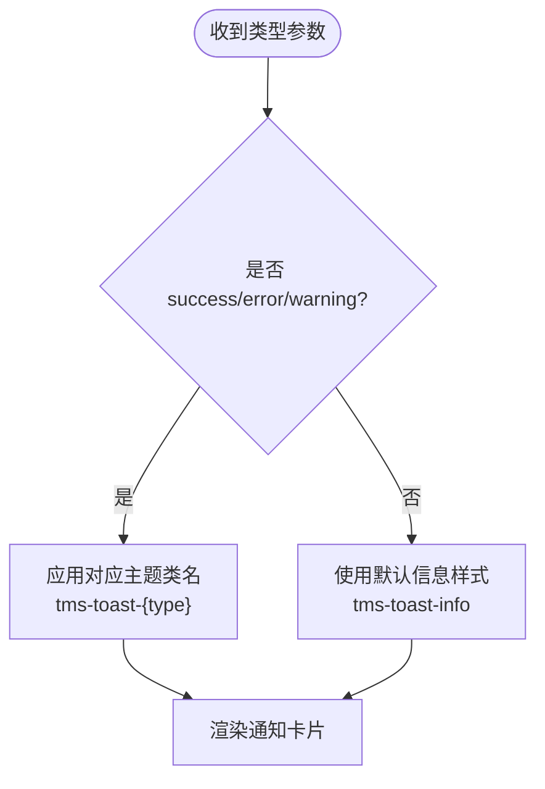
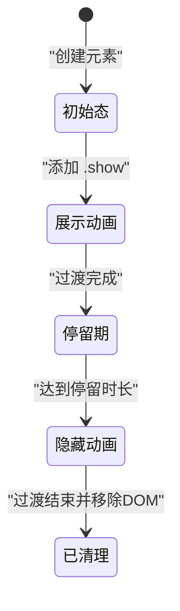
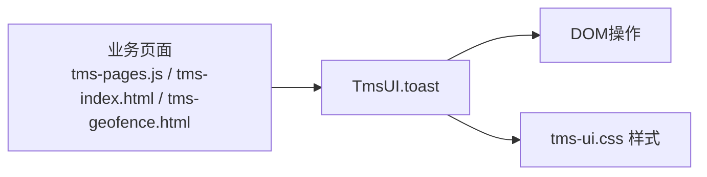

# Toast通知系统

<cite>
**本文引用的文件**   
- [tms-ui.js](file://tms-ui.js)
- [tms-ui.css](file://tms-ui.css)
- [tms-pages.js](file://tms-pages.js)
- [tms-index.html](file://tms-index.html)
- [tms-geofence.html](file://tms-geofence.html)
</cite>

## 目录
1. [简介](#简介)
2. [项目结构](#项目结构)
3. [核心组件](#核心组件)
4. [架构总览](#架构总览)
5. [详细组件分析](#详细组件分析)
6. [依赖关系分析](#依赖关系分析)
7. [性能与可维护性](#性能与可维护性)
8. [故障排查指南](#故障排查指南)
9. [结论](#结论)
10. [附录：使用示例与最佳实践](#附录使用示例与最佳实践)

## 简介
本技术文档聚焦TMS系统中的Toast通知子系统，系统性说明其实现原理、生命周期管理、样式类型、容器与DOM操作、动画机制、自动销毁策略，以及在各业务页面中的调用方式。该Toast能力由共享UI库提供，供各业务页面统一调用，保证一致的交互体验与视觉风格。

## 项目结构
Toast通知系统主要由两部分组成：
- JavaScript逻辑层：负责创建DOM、管理容器、控制显示/隐藏动画、设置自动销毁定时器。
- CSS样式层：定义容器布局、通知卡片外观、不同通知类型的颜色主题与入场动画。

图示来源
- [tms-ui.js:86-105](file://tms-ui.js#L86-L105)
- [tms-ui.css:681-729](file://tms-ui.css#L681-L729)

章节来源
- [tms-ui.js:1-10](file://tms-ui.js#L1-L10)
- [tms-ui.css:1-10](file://tms-ui.css#L1-L10)

## 核心组件
- Toast函数：对外暴露的API，接收消息内容、通知类型和停留时长三个参数。
- 容器管理器：按需创建并复用全局容器，避免重复挂载。
- DOM构建器：为每条通知生成卡片节点，包含指示点与消息文本。
- 动画控制器：通过添加/移除class触发CSS过渡动画。
- 生命周期调度器：基于setTimeout实现显示延迟、隐藏延迟与最终清理。

章节来源
- [tms-ui.js:86-105](file://tms-ui.js#L86-L105)
- [tms-ui.css:681-729](file://tms-ui.css#L681-L729)

## 架构总览
Toast采用“轻量级、无状态”的设计：每次调用独立创建一条通知，不维护全局队列；多条通知通过容器的纵向堆叠自然排列。

图示来源
- [tms-ui.js:88-104](file://tms-ui.js#L88-L104)
- [tms-ui.css:705-714](file://tms-ui.css#L705-L714)

## 详细组件分析

### 1) DOM元素创建与容器管理
- 容器获取与创建：优先查找id为`tms-toast-container`的元素；若不存在则动态创建并插入到`document.body`末尾。
- 容器样式：固定定位在右上角，z-index较高，flex纵向布局，间距均匀，且禁用pointer-events以避免遮挡下层交互。
- 通知元素：每个通知为一个div，包含一个圆点span与消息文本span；消息内容经过转义处理，防止XSS。

章节来源
- [tms-ui.js:88-99](file://tms-ui.js#L88-L99)
- [tms-ui.css:681-691](file://tms-ui.css#L681-L691)

### 2) 通知类型与样式映射
- 类型参数：支持`success`、`error`、`warning`等；未指定时默认为`info`。
- 样式映射：通过类名`tms-toast-{type}`切换左侧边框与指示点颜色。
- 默认信息型：当传入非预定义类型时，仍会渲染为基础信息样式，但不会应用特定主题色。

图示来源
- [tms-ui.js:97-98](file://tms-ui.js#L97-L98)
- [tms-ui.css:724-729](file://tms-ui.css#L724-L729)

章节来源
- [tms-ui.js:97-98](file://tms-ui.js#L97-L98)
- [tms-ui.css:724-729](file://tms-ui.css#L724-L729)

### 3) 动画效果与过渡
- 展示动画：在元素插入后短暂延迟（约10ms）添加`.show`类，触发从右侧滑入与淡入的过渡。
- 隐藏动画：到达停留时间后移除`.show`类，触发滑出与淡出的过渡。
- 过渡时长：CSS中定义过渡时间为约220ms，JS在移除`.show`后再延迟约220ms执行DOM移除，确保动画完整播放。

图示来源
- [tms-ui.js:100-104](file://tms-ui.js#L100-L104)
- [tms-ui.css:705-714](file://tms-ui.css#L705-L714)

章节来源
- [tms-ui.js:100-104](file://tms-ui.js#L100-L104)
- [tms-ui.css:705-714](file://tms-ui.css#L705-L714)

### 4) 生命周期管理与内存清理
- 显示阶段：创建元素→插入容器→延迟添加`.show`。
- 停留阶段：根据duration保持可见，默认2600ms。
- 隐藏阶段：移除`.show`→等待过渡结束→调用`el.remove()`释放DOM。
- 内存清理：通过remove()彻底移除节点，避免内存泄漏；容器被复用，不会因多次调用而累积。

章节来源
- [tms-ui.js:100-104](file://tms-ui.js#L100-L104)

### 5) 通知队列机制与重叠处理
- 当前实现：无显式队列；每次调用直接追加到容器末尾。
- 重叠处理：容器使用纵向flex布局，多通知按顺序堆叠，不会出现水平重叠。
- 用户交互：容器禁用pointer-events，避免通知遮挡下层控件的点击事件。
- 扩展建议：如需限制同时显示数量或实现滑动关闭，可在容器层增加计数与交互逻辑。

章节来源
- [tms-ui.css:681-691](file://tms-ui.css#L681-L691)
- [tms-ui.js:88-99](file://tms-ui.js#L88-L99)

### 6) 配置选项与行为说明
- message：必填，字符串，会被转义后渲染。
- type：可选，字符串，推荐值`success`、`error`、`warning`；未指定时使用默认信息样式。
- duration：可选，数字毫秒；未指定时默认2600ms。
- 位置控制：由CSS固定定位在右上角；如需调整位置，需修改容器样式。
- 样式定制：可通过新增类型类名与对应CSS扩展新主题。

章节来源
- [tms-ui.js:88-104](file://tms-ui.js#L88-L104)
- [tms-ui.css:681-729](file://tms-ui.css#L681-L729)

## 依赖关系分析
- TmsUI.toast作为对外API，被多个业务页面与模块调用。
- 样式依赖tms-ui.css中定义的容器与通知类名。
- 业务侧调用示例包括表单保存成功提示、异常登记反馈、围栏操作反馈等。

图示来源
- [tms-ui.js:758-781](file://tms-ui.js#L758-L781)
- [tms-pages.js:42-42](file://tms-pages.js#L42-L42)
- [tms-index.html:450-450](file://tms-index.html#L450-L450)
- [tms-geofence.html:602-602](file://tms-geofence.html#L602-L602)

章节来源
- [tms-ui.js:758-781](file://tms-ui.js#L758-L781)
- [tms-pages.js:42-42](file://tms-pages.js#L42-L42)
- [tms-index.html:450-450](file://tms-index.html#L450-L450)
- [tms-geofence.html:602-602](file://tms-geofence.html#L602-L602)

## 性能与可维护性
- 性能特性：
  - 轻量DOM操作，仅创建必要节点。
  - 使用CSS过渡而非JS动画，减少主线程压力。
  - 容器复用，避免重复挂载开销。
- 可维护性：
  - 类型与样式解耦，便于扩展新主题。
  - 生命周期清晰，定时器与DOM清理分离。
- 优化建议：
  - 如需批量通知，可增加去重与合并逻辑，避免频繁抖动。
  - 可引入IntersectionObserver监听可视区域，提前清理不可见通知。
  - 对超长消息进行截断与省略号处理，提升可读性。

[本节为通用指导，不直接分析具体文件]

## 故障排查指南
- 通知不显示：
  - 检查是否引入了tms-ui.js与tms-ui.css。
  - 确认调用路径正确：`TmsUI.toast(...)`或`U.toast(...)`。
- 样式不生效：
  - 检查CSS是否加载，类名是否正确（如`tms-toast-success`）。
  - 确认未被其他样式覆盖。
- 动画卡顿：
  - 检查是否存在大量同时显示的通知导致布局抖动。
  - 考虑限制最大显示数量或缩短停留时长。
- 内存泄漏：
  - 确认通知在隐藏动画结束后被移除。
  - 避免手动保留对通知元素的引用。

章节来源
- [tms-ui.js:88-104](file://tms-ui.js#L88-L104)
- [tms-ui.css:681-729](file://tms-ui.css#L681-L729)

## 结论
TMS的Toast通知系统以简洁、稳定的方式提供了统一的反馈能力。它通过最小化的DOM操作与CSS过渡实现流畅的用户体验，并通过类型化样式满足常见业务场景。对于更复杂的交互需求，可在现有基础上扩展队列、交互与主题能力。

[本节为总结性内容，不直接分析具体文件]

## 附录：使用示例与最佳实践

### 基础用法
- 在业务逻辑中调用`TmsUI.toast`或`U.toast`，传入消息内容与类型。
- 典型场景：表单保存成功、数据刷新完成、操作结果反馈。

章节来源
- [tms-ui.js:758-781](file://tms-ui.js#L758-L781)
- [tms-index.html:450-450](file://tms-index.html#L450-L450)

### 批量通知
- 当前实现不支持队列与去重；如需批量提示，建议在业务层控制频率与数量。
- 建议：将高频操作合并为一次汇总提示，减少抖动与干扰。

章节来源
- [tms-ui.js:88-104](file://tms-ui.js#L88-L104)

### 用户反馈与错误处理
- 成功反馈：使用`success`类型，传达操作成功。
- 错误警告：使用`error`类型，提示失败原因。
- 一般提醒：使用默认信息样式或`info`类型，用于中性提示。

章节来源
- [tms-ui.js:97-98](file://tms-ui.js#L97-L98)
- [tms-ui.css:724-729](file://tms-ui.css#L724-L729)

### 常见调用位置
- 订单与任务相关操作：在`tms-pages.js`中多处调用Toast反馈操作结果。
- 地图围栏操作：在`tms-geofence.html`中用于地图组件加载失败、围栏启用/停用等反馈。
- 运营监控与指标：在`tms-index.html`中用于数据刷新反馈。

章节来源
- [tms-pages.js:42-42](file://tms-pages.js#L42-L42)
- [tms-geofence.html:602-602](file://tms-geofence.html#L602-L602)
- [tms-index.html:450-450](file://tms-index.html#L450-L450)