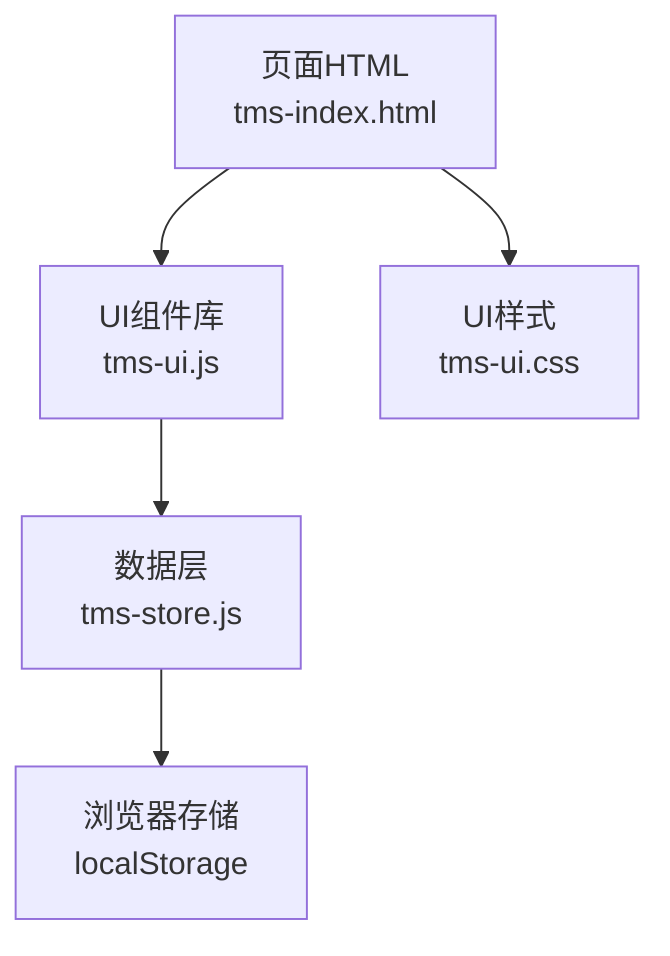
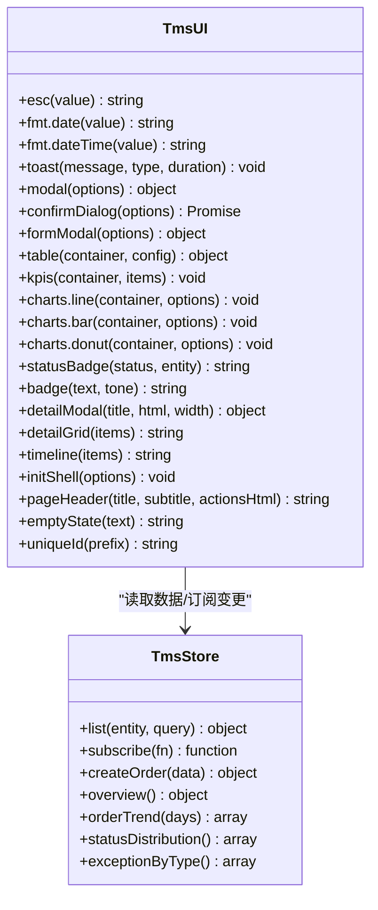
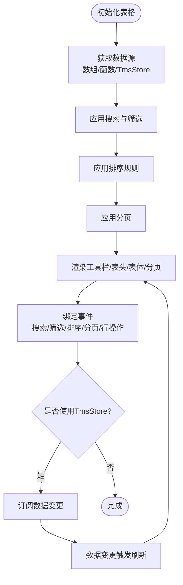
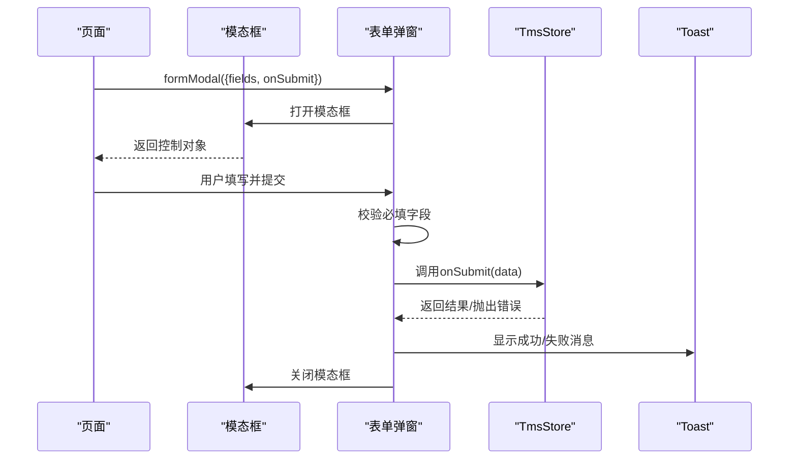
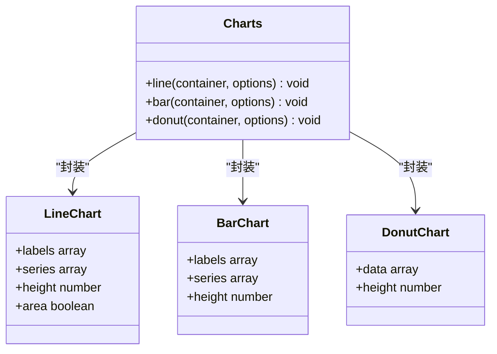
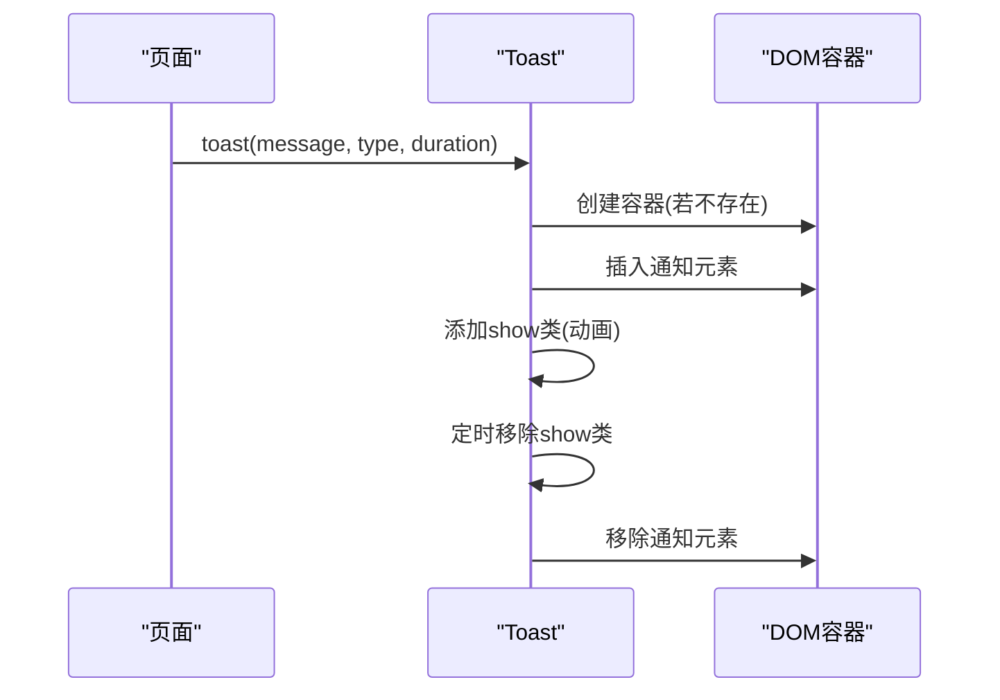
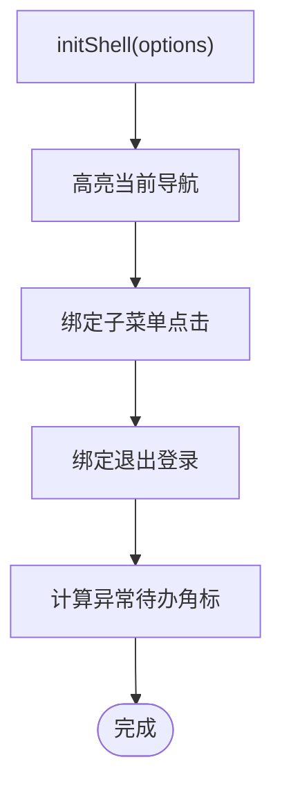
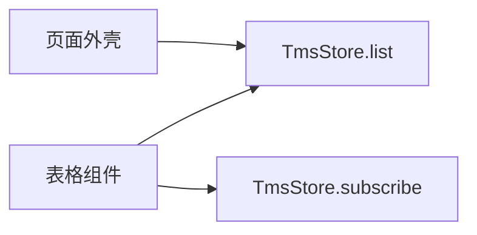
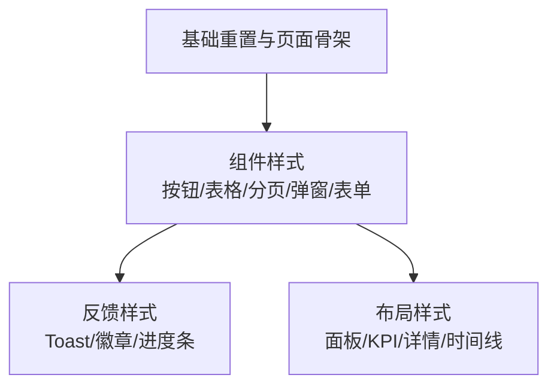
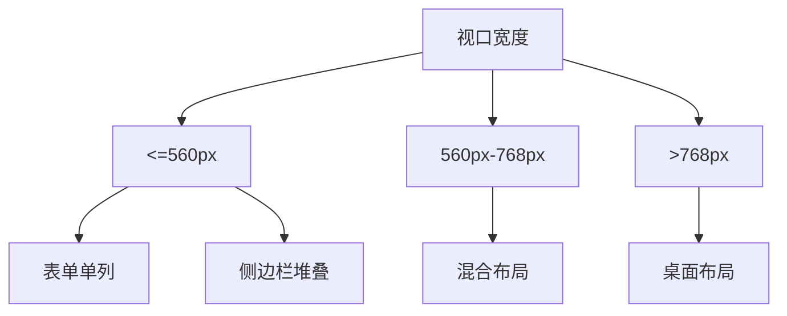

# UI组件架构

<cite>
**本文引用的文件**   
- [tms-ui.js](file://tms-ui.js)
- [tms-ui.css](file://tms-ui.css)
- [tms-store.js](file://tms-store.js)
- [tms-index.html](file://tms-index.html)
</cite>

## 目录
1. [引言](#引言)
2. [项目结构](#项目结构)
3. [核心组件](#核心组件)
4. [架构总览](#架构总览)
5. [详细组件分析](#详细组件分析)
6. [依赖关系分析](#依赖关系分析)
7. [性能与可扩展性](#性能与可扩展性)
8. [样式系统与主题定制](#样式系统与主题定制)
9. [响应式设计策略](#响应式设计策略)
10. [使用示例与最佳实践](#使用示例与最佳实践)
11. [故障排查指南](#故障排查指南)
12. [结论](#结论)

## 引言
本设计文档面向 TMS 系统的 UI 组件库，目标是系统化说明 TmsUI 的整体架构、分层职责、关键组件实现机制以及扩展方式。TmsUI 提供表格、搜索/筛选/分页、表单弹窗、确认框、Toast 通知、SVG 图表、KPI 卡片、详情展示与页面外壳等能力；所有组件类名统一以 `tms-` 前缀命名，避免与业务页面样式冲突。数据层由 TmsStore 提供，UI 层通过 TmsUI 暴露 API，页面通过 HTML 模板组合使用。

## 项目结构
TMS 前端采用“页面 + 共享 UI 库 + 共享数据层”的轻量架构：
- 页面文件：如 tms-index.html，负责页面骨架、导航、业务脚本调用。
- UI 库：tms-ui.js（逻辑）、tms-ui.css（样式），提供通用组件。
- 数据层：tms-store.js，基于 localStorage 提供种子数据、增删改查、统计聚合与事件订阅。

**图示来源**
- [tms-index.html:290-434](file://tms-index.html#L290-L434)
- [tms-ui.js:756-780](file://tms-ui.js#L756-L780)
- [tms-store.js:1-12](file://tms-store.js#L1-L12)

**章节来源**
- [tms-index.html:290-434](file://tms-index.html#L290-L434)
- [tms-ui.js:1-10](file://tms-ui.js#L1-L10)
- [tms-store.js:1-12](file://tms-store.js#L1-L12)

## 核心组件
TmsUI 的核心能力包括：
- 基础工具：字符串转义、日期时间格式化、金额/数字/百分比格式化、状态徽章、唯一ID生成。
- Toast 通知：成功、错误、警告、信息提示。
- 弹窗系统：模态框、确认框、表单弹窗。
- 列表与表格：搜索、筛选、排序、分页、行操作、空状态。
- KPI 与图表：折线图、柱状图、环形图。
- 详情展示：详情网格、时间线。
- 页面外壳：导航高亮、子菜单展开、异常角标、退出登录。

这些能力通过全局对象 `TmsUI` 暴露给页面使用。

**章节来源**
- [tms-ui.js:10-82](file://tms-ui.js#L10-L82)
- [tms-ui.js:84-103](file://tms-ui.js#L84-L103)
- [tms-ui.js:105-285](file://tms-ui.js#L105-L285)
- [tms-ui.js:287-542](file://tms-ui.js#L287-L542)
- [tms-ui.js:544-678](file://tms-ui.js#L544-L678)
- [tms-ui.js:680-754](file://tms-ui.js#L680-L754)
- [tms-ui.js:756-780](file://tms-ui.js#L756-L780)

## 架构总览
TmsUI 采用函数式组件模式，每个功能模块以独立函数实现，并通过配置对象驱动渲染与交互。数据源支持三种模式：
- 直接数组：适合静态或本地小数据集。
- 函数返回：适合动态计算的数据集。
- TmsStore 实体：适合跨页面共享、实时联动的大数据集。

**图示来源**
- [tms-ui.js:756-780](file://tms-ui.js#L756-L780)
- [tms-store.js:1-12](file://tms-store.js#L1-L12)

**章节来源**
- [tms-ui.js:287-542](file://tms-ui.js#L287-L542)
- [tms-store.js:1-12](file://tms-store.js#L1-L12)

## 详细组件分析

### 表格组件（Search / Filter / Sort / Pagination）
表格组件是 TmsUI 最复杂的组件之一，支持：
- 搜索：按指定字段模糊匹配，带防抖。
- 筛选：下拉选择器按字段精确过滤。
- 排序：表头点击切换升序/降序，支持数值与字符串比较。
- 分页：根据 pageSize 自动分页，显示页码与总数。
- 行操作：每行动作按钮，可条件显示。
- 空状态：无数据时显示占位文本。
- 实时联动：当使用 TmsStore 实体时，监听数据变化自动刷新。

**图示来源**
- [tms-ui.js:301-542](file://tms-ui.js#L301-L542)

**章节来源**
- [tms-ui.js:287-542](file://tms-ui.js#L287-L542)

### 弹窗组件（Modal / Confirm / Form）
弹窗系统提供统一的模态框容器，并在此基础上构建确认框与表单弹窗：
- 模态框：支持标题、内容、底部按钮、ESC关闭、点击遮罩关闭。
- 确认框：Promise 风格，返回布尔值表示用户选择。
- 表单弹窗：声明式字段定义，内置必填校验、异步提交、错误提示、保存成功反馈。

**图示来源**
- [tms-ui.js:105-285](file://tms-ui.js#L105-L285)

**章节来源**
- [tms-ui.js:105-285](file://tms-ui.js#L105-L285)

### 图表组件（Line / Bar / Donut）
图表组件基于 SVG 绘制，封装了折线图、柱状图、环形图：
- 折线图：支持多系列、面积填充、坐标轴刻度、图例。
- 柱状图：支持分组柱状、自适应宽度、图例。
- 环形图：支持多段占比、中心总计、右侧图例。

**图示来源**
- [tms-ui.js:573-678](file://tms-ui.js#L573-L678)

**章节来源**
- [tms-ui.js:544-678](file://tms-ui.js#L544-L678)

### Toast 通知系统
Toast 提供右上角浮动通知，支持多种类型（成功、错误、警告、信息），自动显示/隐藏动画，避免阻塞用户操作。

**图示来源**
- [tms-ui.js:84-103](file://tms-ui.js#L84-L103)

**章节来源**
- [tms-ui.js:84-103](file://tms-ui.js#L84-L103)

### 页面外壳与导航
页面外壳负责：
- 当前页面导航高亮。
- 子菜单展开/收起。
- 退出登录按钮绑定。
- 异常待办角标更新。

**图示来源**
- [tms-ui.js:699-744](file://tms-ui.js#L699-L744)

**章节来源**
- [tms-ui.js:699-744](file://tms-ui.js#L699-L744)

## 依赖关系分析
TmsUI 与 TmsStore 的耦合点主要在表格组件与页面外壳：
- 表格组件在 entity 模式下调用 TmsStore.list 获取数据，并订阅数据变更。
- 页面外壳在 initShell 中读取异常待办数量，用于导航角标。

**图示来源**
- [tms-ui.js:301-542](file://tms-ui.js#L301-L542)
- [tms-ui.js:699-744](file://tms-ui.js#L699-L744)

**章节来源**
- [tms-ui.js:301-542](file://tms-ui.js#L301-L542)
- [tms-ui.js:699-744](file://tms-ui.js#L699-L744)

## 性能与可扩展性
- 表格组件对搜索输入使用防抖（约220ms），减少频繁重绘。
- 表格组件在 TmsStore 模式下仅在有焦点不在输入控件时刷新，避免编辑干扰。
- 图表组件使用 SVG 原生绘制，避免引入第三方库，降低体积与复杂度。
- 扩展新组件建议遵循以下原则：
  - 新增函数并挂载到 TmsUI 对象。
  - 使用 tms- 前缀的 CSS 类名。
  - 提供配置对象驱动的渲染接口。
  - 如需数据联动，优先使用 TmsStore 的 list 与 subscribe。

**章节来源**
- [tms-ui.js:452-464](file://tms-ui.js#L452-L464)
- [tms-ui.js:523-535](file://tms-ui.js#L523-L535)
- [tms-ui.js:573-678](file://tms-ui.js#L573-L678)

## 样式系统与主题定制
TmsUI 样式集中在 tms-ui.css，特点如下：
- 所有类名以 `tms-` 前缀，避免与页面样式冲突。
- 使用现代布局：Flexbox、Grid。
- 提供按钮、表格、分页、弹窗、表单、图表、Toast、进度条等完整组件样式。
- 主题定制可通过覆盖 CSS 变量或直接重写类名实现，例如主色、圆角、阴影等。

**图示来源**
- [tms-ui.css:1-795](file://tms-ui.css#L1-L795)

**章节来源**
- [tms-ui.css:1-795](file://tms-ui.css#L1-L795)

## 响应式设计策略
- 页面骨架使用 Flexbox 与 Grid，适配不同屏幕尺寸。
- 表单在小屏下自动切换为单列布局。
- 表格容器支持横向滚动，避免在小屏下挤压。
- 侧边栏与内容区在移动端堆叠排列。

**图示来源**
- [tms-ui.css:611-615](file://tms-ui.css#L611-L615)
- [tms-index.html:176-220](file://tms-index.html#L176-L220)

**章节来源**
- [tms-ui.css:611-615](file://tms-ui.css#L611-L615)
- [tms-index.html:176-220](file://tms-index.html#L176-L220)

## 使用示例与最佳实践
- 运营总览页面展示了 TmsUI 的综合用法：KPI 卡片、折线图、环形图、空状态、表单弹窗、Toast 通知。
- 推荐实践：
  - 使用 TmsUI.kpis 渲染指标卡片。
  - 使用 TmsUI.charts.line/bar/donut 渲染图表。
  - 使用 TmsUI.table 配置 columns、actions、filters、pageSize 等。
  - 使用 TmsUI.formModal 声明式构建表单，并在 onSubmit 中调用 TmsStore 创建数据。
  - 使用 TmsUI.toast 提供操作反馈。

**章节来源**
- [tms-index.html:469-577](file://tms-index.html#L469-L577)
- [tms-ui.js:544-678](file://tms-ui.js#L544-L678)
- [tms-ui.js:756-780](file://tms-ui.js#L756-L780)

## 故障排查指南
- 表格不刷新：检查是否正确使用 TmsStore 的 list 与 subscribe，并确保 state.pageSize 与 total 计算正确。
- 弹窗无法关闭：确认 ESC 键与遮罩点击事件已绑定，且 close 方法被调用。
- 表单校验失败：检查 fields.required 与 onSubmit 返回值，确保错误提示区域显示。
- Toast 不显示：确认 DOM 中存在 tms-toast-container，或首次调用时会创建。
- 样式冲突：确保使用 tms- 前缀的类名，避免与页面自有样式冲突。

**章节来源**
- [tms-ui.js:301-542](file://tms-ui.js#L301-L542)
- [tms-ui.js:105-285](file://tms-ui.js#L105-L285)
- [tms-ui.js:84-103](file://tms-ui.js#L84-L103)
- [tms-ui.css:1-795](file://tms-ui.css#L1-L795)

## 结论
TmsUI 以轻量函数式组件为核心，结合 TmsStore 数据层与统一样式规范，提供了完整的 TMS 前端 UI 能力。其设计强调可配置、可复用、可扩展，适用于复杂业务场景下的快速开发与维护。通过本文档的结构化说明，开发者可以快速理解组件职责、实现机制与扩展方式，从而高效构建一致的 TMS 用户界面。