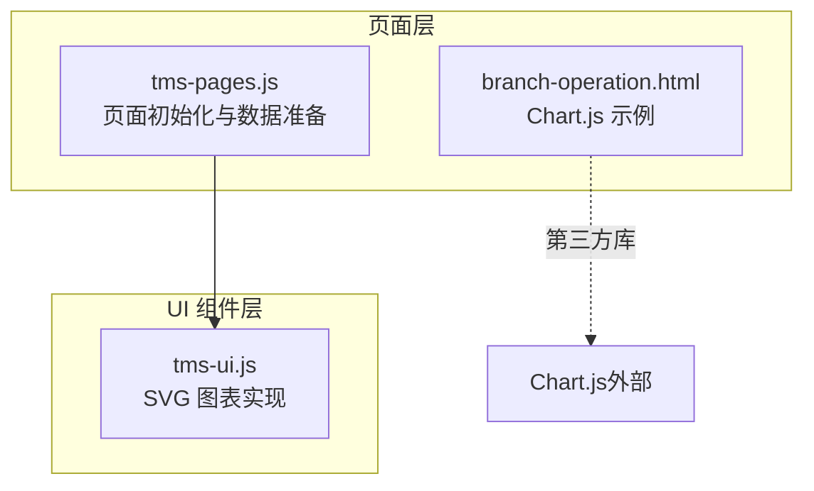
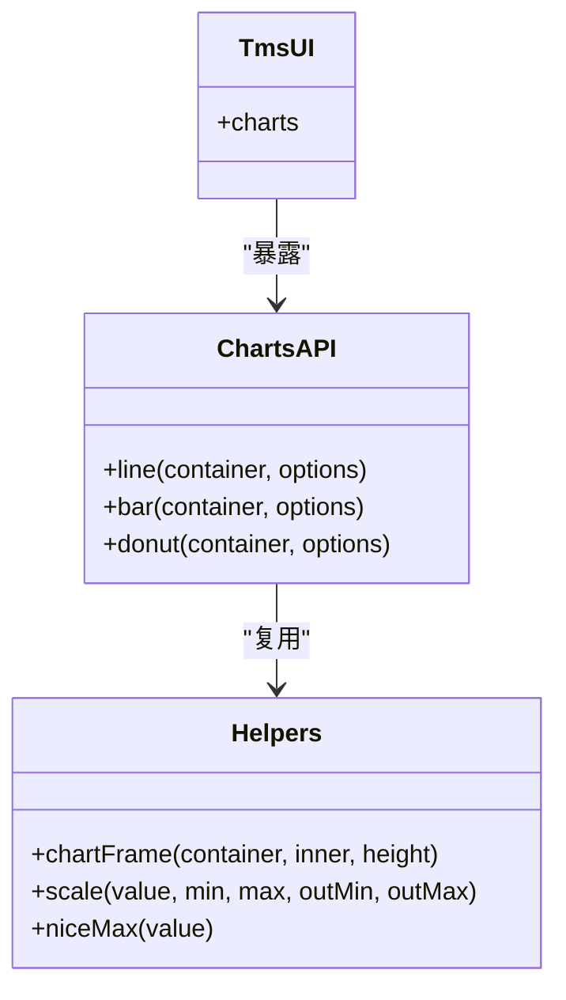
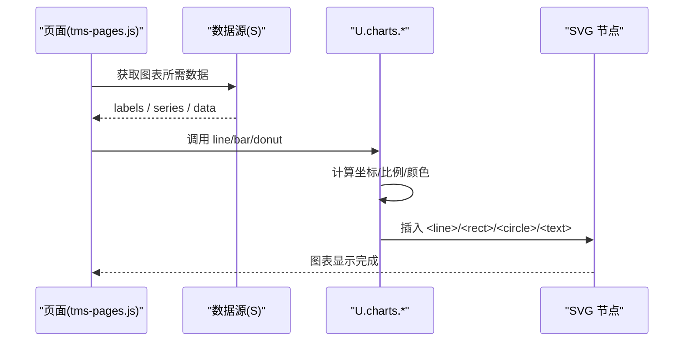
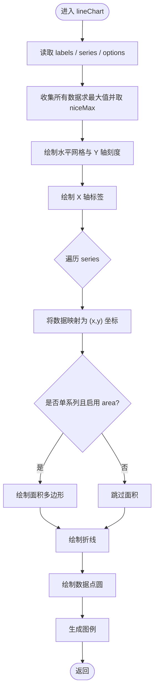
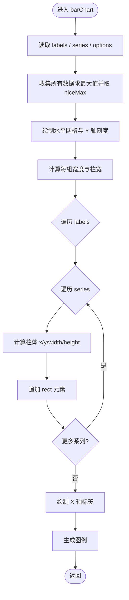
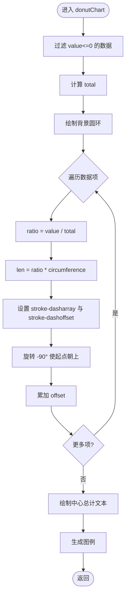
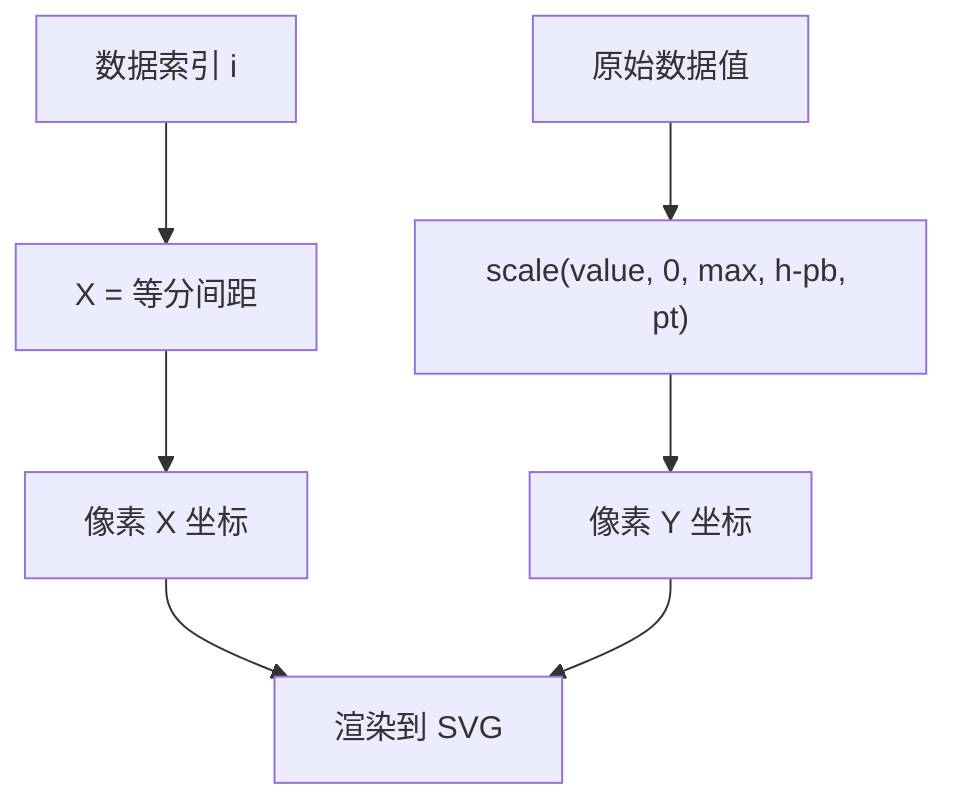
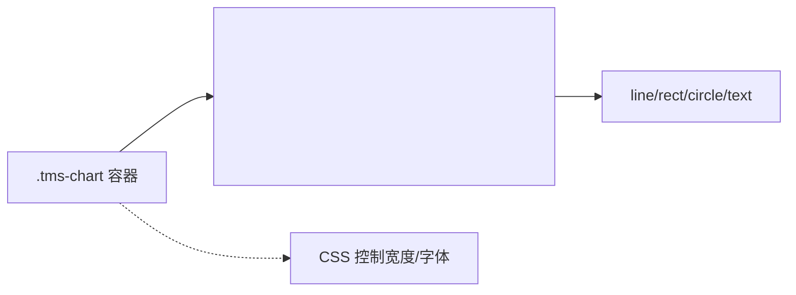
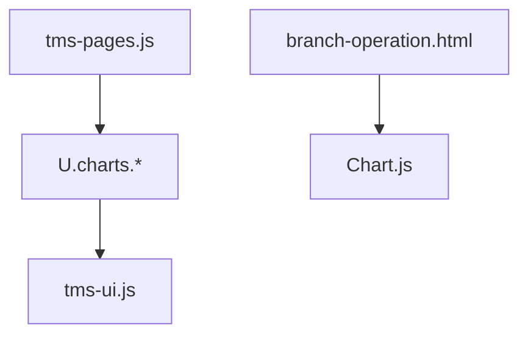

# 图表组件

<cite>
**本文引用的文件**   
- [tms-ui.js](file://tms-ui.js)
- [tms-pages.js](file://tms-pages.js)
- [branch-operation.html](file://branch-operation.html)
</cite>

## 目录
1. [引言](#引言)
2. [项目结构](#项目结构)
3. [核心组件](#核心组件)
4. [架构总览](#架构总览)
5. [详细组件分析](#详细组件分析)
6. [依赖关系分析](#依赖关系分析)
7. [性能与优化](#性能与优化)
8. [故障排查指南](#故障排查指南)
9. [结论](#结论)
10. [附录：使用示例与配置说明](#附录使用示例与配置说明)

## 引言
本技术文档聚焦 TMS 系统中的图表组件，系统性地解析 SVG 图表的实现原理与工程实践。内容涵盖坐标系转换、数据映射、渲染策略、折线图/柱状图/环形图的算法实现、响应式适配、配置项规范、使用示例以及大数据量与实时更新场景下的性能优化建议。读者无需深入前端图形库即可理解并扩展该图表体系。

## 项目结构
TMS 的图表能力集中在共享 UI 库中，并通过页面脚本按需调用。整体组织方式如下：
- tms-ui.js：提供通用 UI 能力，包括 KPI、表格、弹窗、Toast 以及 SVG 图表（折线、柱状、环形）。
- tms-pages.js：业务页面初始化逻辑，负责准备数据并调用 U.charts.* 渲染图表。
- branch-operation.html：在特定页面中使用第三方 Canvas 图表库 Chart.js 进行对比与补充。

**图示来源**
- [tms-ui.js:559-680](file://tms-ui.js#L559-L680)
- [tms-pages.js:937-947](file://tms-pages.js#L937-L947)
- [branch-operation.html:1014-1049](file://branch-operation.html#L1014-L1049)

**章节来源**
- [tms-ui.js:559-680](file://tms-ui.js#L559-L680)
- [tms-pages.js:937-947](file://tms-pages.js#L937-L947)
- [branch-operation.html:1014-1049](file://branch-operation.html#L1014-L1049)

## 核心组件
TMS 图表组件以函数式 API 暴露，统一挂载到全局对象上，便于页面直接调用。

- 公共工具
  - chartFrame：创建 SVG 容器与 viewBox，统一尺寸与缩放策略。
  - scale：数值线性缩放，用于将数据值映射到像素坐标。
  - niceMax：计算“友好”的最大刻度值，使坐标轴更美观。
- 图表类型
  - lineChart：折线图，支持多系列、面积填充、数据点、网格与图例。
  - barChart：柱状图，支持分组柱体、圆角、网格与图例。
  - donutChart：环形图，基于 stroke-dasharray 分段绘制比例段，并生成图例。

**图示来源**
- [tms-ui.js:559-680](file://tms-ui.js#L559-L680)
- [tms-ui.js:758-781](file://tms-ui.js#L758-L781)

**章节来源**
- [tms-ui.js:559-680](file://tms-ui.js#L559-L680)
- [tms-ui.js:758-781](file://tms-ui.js#L758-L781)

## 架构总览
下图展示从页面到图表渲染的完整调用链，以及 SVG 内部元素构成。

**图示来源**
- [tms-pages.js:937-947](file://tms-pages.js#L937-L947)
- [tms-pages.js:1204-1211](file://tms-pages.js#L1204-L1211)
- [tms-pages.js:1800-1804](file://tms-pages.js#L1800-L1804)
- [tms-ui.js:559-680](file://tms-ui.js#L559-L680)

## 详细组件分析

### 折线图（Line Chart）
折线图用于展示时间序列或有序分类的趋势变化，具备以下特性：
- 数据点绘制：为每个数据点生成圆形标记。
- 线条连接：使用 polyline 连接所有点。
- 面积填充：当仅单系列且开启 area 时，自动生成闭合多边形区域。
- 图例显示：根据 series 名称与颜色生成图例。
- 坐标轴标注：固定 5 条水平网格线与对应数值标签；X 轴按 labels 均匀分布。

核心流程如下：

**图示来源**
- [tms-ui.js:575-618](file://tms-ui.js#L575-L618)

关键实现要点：
- 坐标系转换
  - X 轴：按索引等分区间，首尾对齐绘图区左右边距。
  - Y 轴：通过 scale 将数据值映射到绘图区高度范围。
- 数据映射
  - 将所有 series 的数据合并求最大值，确保多系列共用同一 Y 轴尺度。
- 渲染优化
  - 使用 polyline 一次性绘制折线，减少 DOM 节点数量。
  - 仅在单系列且开启 area 时绘制面积，避免多余开销。
- 错误处理
  - 空数据或单点情况下对 X 坐标做特殊处理，避免除零。

**章节来源**
- [tms-ui.js:575-618](file://tms-ui.js#L575-L618)

### 柱状图（Bar Chart）
柱状图用于比较不同类别下的数值大小，支持多系列分组显示：
- 柱体绘制：为每个类别在每个系列下绘制一个矩形柱体。
- 分组显示：按类别中心位置对称排列多个系列柱体。
- 颜色配置：series.color 决定柱体颜色，未设置时使用默认色。
- 高度计算：基于 niceMax 计算的 Y 轴最大值按比例换算柱高。

核心流程如下：

**图示来源**
- [tms-ui.js:620-653](file://tms-ui.js#L620-L653)

关键实现要点：
- 分组布局
  - groupWidth = 绘图区宽度 / 类别数。
  - 每组的中心 cx 作为基准，按 series.length 均分柱宽。
- 高度计算
  - bh = (h - pt - pb) * v / max，保证柱体底部对齐基线。
- 视觉细节
  - 使用 rx 圆角提升可读性；柱间留白 barW - 3。

**章节来源**
- [tms-ui.js:620-653](file://tms-ui.js#L620-L653)

### 环形图（Donut Chart）
环形图通过 SVG circle 的 stroke-dasharray 与 stroke-dashoffset 实现分段圆弧：
- 圆弧计算：周长 circumference = 2πr。
- 角度分配：每项占比 ratio = value / total，对应弧长 len = ratio × circumference。
- 比例显示：通过 dasharray 控制可见弧长与间隔，dashoffset 控制起始偏移。
- 图例生成：按数据项顺序生成图例，包含颜色、标签与数值。

核心流程如下：

**图示来源**
- [tms-ui.js:655-680](file://tms-ui.js#L655-L680)

关键实现要点：
- 数学基础
  - 使用周长与比例精确控制每段弧长。
- 视觉一致性
  - 默认颜色数组循环使用，支持自定义 d.color。
- 可访问性与可读性
  - 中心显示总计值，图例同时展示标签与数值。

**章节来源**
- [tms-ui.js:655-680](file://tms-ui.js#L655-L680)

### 坐标系与数据映射
- 视图框
  - 折线/柱状图使用 viewBox="0 0 720 260"，环形图使用 viewBox="0 0 520 260"。
- 边距
  - pl/pr/pt/pb 分别表示左/右/上/下边距，确保文字与网格不溢出。
- 缩放
  - scale(value, min, max, outMin, outMax) 将数据域映射到像素域，避免负值或越界。
- 刻度
  - niceMax 将最大值向上取整到“友好”刻度，提高可读性。

**图示来源**
- [tms-ui.js:563-573](file://tms-ui.js#L563-L573)
- [tms-ui.js:575-618](file://tms-ui.js#L575-L618)
- [tms-ui.js:620-653](file://tms-ui.js#L620-L653)

**章节来源**
- [tms-ui.js:563-573](file://tms-ui.js#L563-L573)
- [tms-ui.js:575-618](file://tms-ui.js#L575-L618)
- [tms-ui.js:620-653](file://tms-ui.js#L620-L653)

### 响应式设计
- 容器高度
  - chartFrame 接受可选 height 参数，默认 240px，允许页面按需调整。
- 缩放策略
  - 使用 preserveAspectRatio="none" 让 SVG 自适应容器宽高。
- 移动端适配
  - 通过 CSS 控制 .tms-chart 容器宽度与字体大小，配合 viewBox 自动缩放。
- 交互增强
  - 当前实现为静态 SVG，如需悬停提示、缩放平移等交互，可在外层包裹交互层或使用事件委托。

**图示来源**
- [tms-ui.js:559-561](file://tms-ui.js#L559-L561)
- [tms-ui.js:678-679](file://tms-ui.js#L678-L679)

**章节来源**
- [tms-ui.js:559-561](file://tms-ui.js#L559-L561)
- [tms-ui.js:678-679](file://tms-ui.js#L678-L679)

## 依赖关系分析
- 页面层依赖 UI 层
  - tms-pages.js 通过 U.charts.bar/line/donut 调用 tms-ui.js 中的图表函数。
- 第三方库对比
  - branch-operation.html 使用 Chart.js 渲染折线图，展示了 Canvas 方案与 TMS 自研 SVG 方案的差异。

**图示来源**
- [tms-pages.js:937-947](file://tms-pages.js#L937-L947)
- [tms-pages.js:1204-1211](file://tms-pages.js#L1204-L1211)
- [tms-pages.js:1800-1804](file://tms-pages.js#L1800-L1804)
- [branch-operation.html:1014-1049](file://branch-operation.html#L1014-L1049)

**章节来源**
- [tms-pages.js:937-947](file://tms-pages.js#L937-L947)
- [tms-pages.js:1204-1211](file://tms-pages.js#L1204-L1211)
- [tms-pages.js:1800-1804](file://tms-pages.js#L1800-L1804)
- [branch-operation.html:1014-1049](file://branch-operation.html#L1014-L1049)

## 性能与优化
- 大数据量处理
  - 折线图使用 polyline 批量绘制线条，减少 DOM 操作次数。
  - 柱状图按组计算布局，避免重复测量。
  - 对于超大数据集，建议分页或聚合后再渲染，或在数据层做降采样。
- 实时更新
  - 建议在数据更新后仅重绘必要元素，而非全量 innerHTML 替换。
  - 可使用 requestAnimationFrame 分批渲染，避免阻塞主线程。
- 内存管理
  - 避免频繁创建大量临时字符串拼接，可改用 DocumentFragment 或模板缓存。
  - 销毁旧图表实例时清理事件监听器与定时器。
- 动画效果
  - 当前实现为静态渲染，如需入场动画，可通过 CSS transition 或 SMIL 动画逐步改变 stroke-dashoffset。
- Canvas vs SVG
  - Canvas 适合高频绘制与复杂像素级操作（如热力图、粒子），但交互与可访问性较弱。
  - SVG 适合矢量图形、可缩放、易交互与可访问性要求高的场景（如仪表盘、报表）。

[本节为通用指导，不直接分析具体文件]

## 故障排查指南
- 图表不显示
  - 检查容器是否存在且可见，确认传入的 container 非空。
  - 检查 viewBox 与容器尺寸是否匹配，避免被隐藏。
- 数据异常
  - 确认 labels 与 series.data 长度一致。
  - 检查数值是否为有效数字，避免 NaN 导致坐标计算失败。
- 样式错乱
  - 检查 CSS 是否覆盖 .tms-chart 或 .tms-legend 样式。
  - 确认颜色值合法，避免无效 hex 导致渲染异常。
- 交互失效
  - 若在外层添加交互，需确保事件冒泡未被阻止。
  - 注意 SVG 元素的 pointer-events 属性。

[本节为通用指导，不直接分析具体文件]

## 结论
TMS 图表组件以轻量、可控的 SVG 实现为核心，提供了折线、柱状、环形三类常用图表。其优势在于无第三方依赖、易于定制与集成，适用于 TMS 系统的报表与监控场景。通过合理的坐标系转换、数据映射与渲染优化，能够在中等数据规模下保持良好性能。对于需要强交互或海量数据的场景，可结合 Canvas 方案或引入专业图表库进行扩展。

[本节为总结性内容，不直接分析具体文件]

## 附录：使用示例与配置说明

### 折线图使用示例
- 页面侧准备数据
  - 从数据源获取 labels 与 series，其中 series 包含 name、color、data。
- 调用渲染
  - 使用 U.charts.line(container, options)，options 可包含 area、height 等。
- 典型用法参考
  - [tms-pages.js:937-947](file://tms-pages.js#L937-L947)

**章节来源**
- [tms-pages.js:937-947](file://tms-pages.js#L937-L947)

### 柱状图使用示例
- 页面侧准备数据
  - 从数据源获取 labels 与 series，其中 series 包含 name、color、data。
- 调用渲染
  - 使用 U.charts.bar(container, options)，options 可包含 height。
- 典型用法参考
  - [tms-pages.js:1204-1211](file://tms-pages.js#L1204-L1211)
  - [tms-pages.js:1958-1965](file://tms-pages.js#L1958-L1965)

**章节来源**
- [tms-pages.js:1204-1211](file://tms-pages.js#L1204-L1211)
- [tms-pages.js:1958-1965](file://tms-pages.js#L1958-L1965)

### 环形图使用示例
- 页面侧准备数据
  - 从数据源获取 data，每项包含 label、value，可选 color。
- 调用渲染
  - 使用 U.charts.donut(container, options)，options 可包含 height。
- 典型用法参考
  - [tms-pages.js:1800-1804](file://tms-pages.js#L1800-L1804)

**章节来源**
- [tms-pages.js:1800-1804](file://tms-pages.js#L1800-L1804)

### 配置选项说明
- 通用选项
  - height：图表容器高度（像素），默认由 chartFrame 提供。
- 折线图
  - labels：X 轴标签数组。
  - series：系列数组，每项含 name、color、data。
  - area：布尔值，是否绘制面积填充（仅单系列生效）。
- 柱状图
  - labels：X 轴标签数组。
  - series：系列数组，每项含 name、color、data。
- 环形图
  - data：数据数组，每项含 label、value，可选 color。

[本节为配置说明，不直接分析具体文件]

### 与 Chart.js 的对比
- 实现差异
  - TMS 自研 SVG 图表：轻量、无依赖、易定制，适合常规报表。
  - Chart.js（Canvas）：功能丰富、交互强大，适合复杂可视化需求。
- 选择建议
  - 若仅需基础趋势与分布展示，优先使用 TMS 自研 SVG 图表。
  - 若需要丰富的交互（缩放、拖拽、动态更新）、复杂图表类型，考虑 Chart.js。

**章节来源**
- [branch-operation.html:1014-1049](file://branch-operation.html#L1014-L1049)