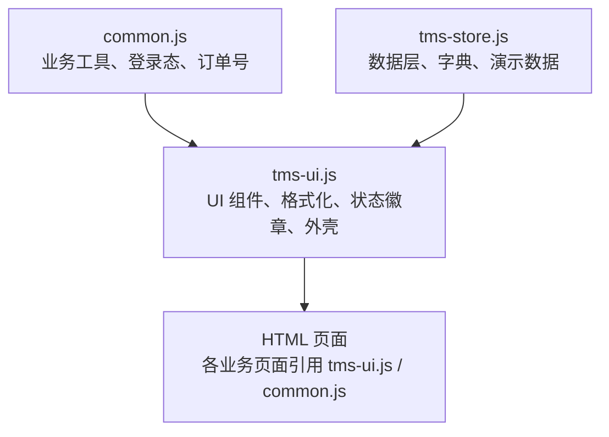
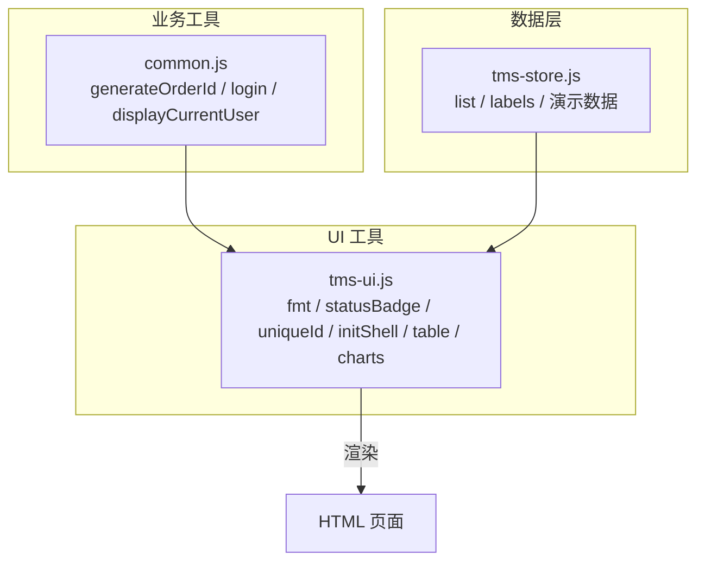
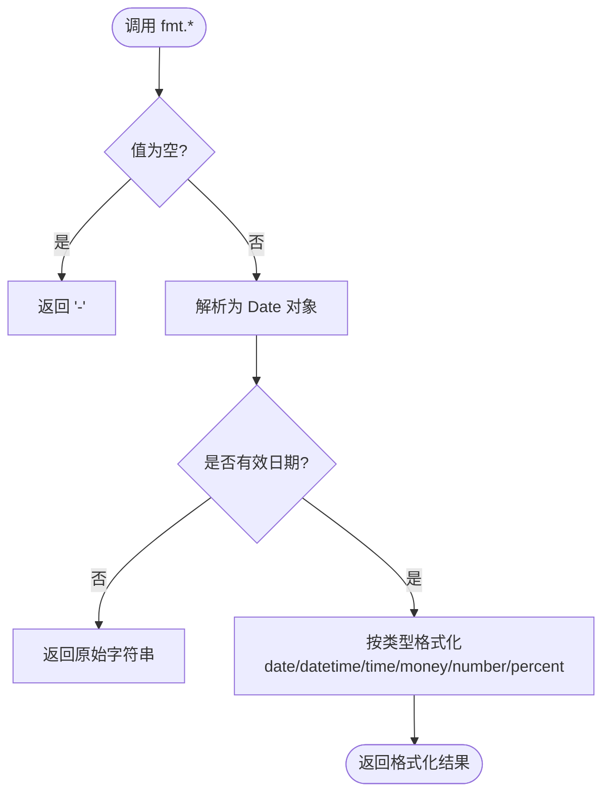
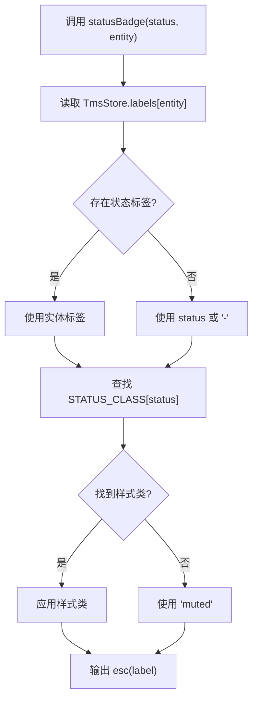
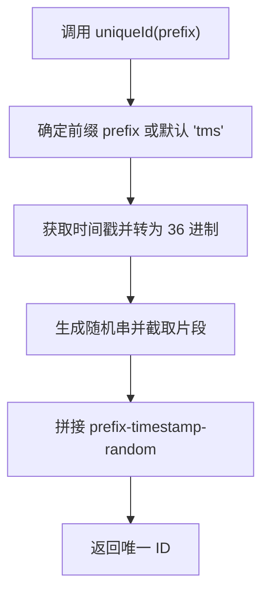
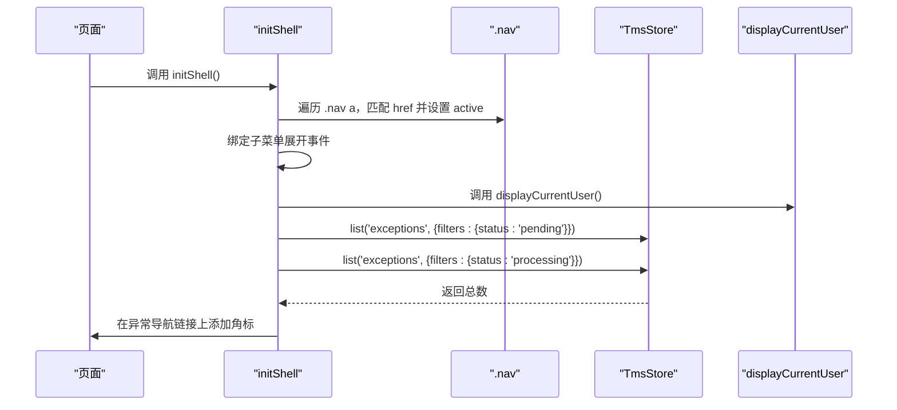
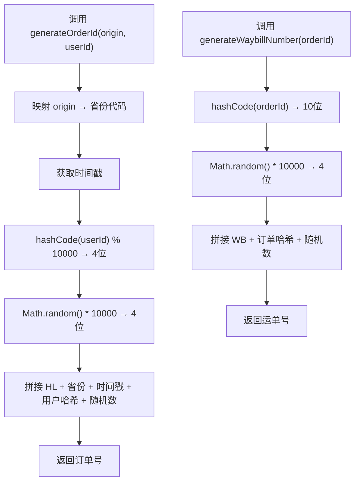
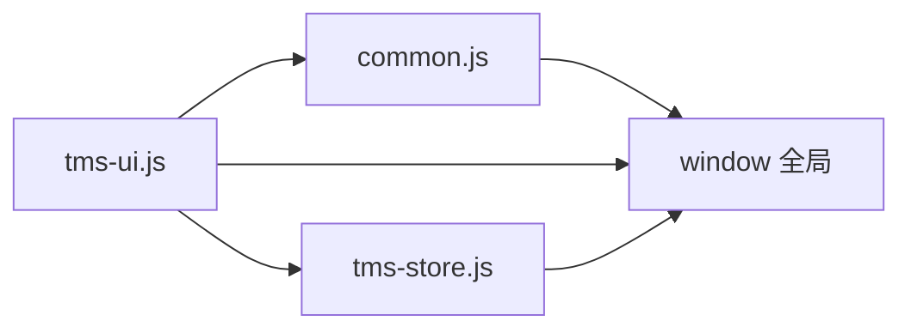

# 工具函数库

<cite>
**本文引用的文件**   
- [common.js](file://common.js)
- [tms-ui.js](file://tms-ui.js)
- [tms-store.js](file://tms-store.js)
</cite>

## 目录
1. [简介](#简介)
2. [项目结构](#项目结构)
3. [核心组件](#核心组件)
4. [架构总览](#架构总览)
5. [详细组件分析](#详细组件分析)
6. [依赖关系分析](#依赖关系分析)
7. [性能与可维护性](#性能与可维护性)
8. [故障排查指南](#故障排查指南)
9. [结论](#结论)
10. [附录：API 参考与使用示例](#附录api-参考与使用示例)

## 简介
本技术文档聚焦 TMS 系统的 UI 工具函数库，围绕以下目标展开：
- 格式化函数：日期、时间、金额、数字、百分比等常用格式化工具的实现与用法。
- 状态徽章：状态到样式分类、标签显示、实体字典映射的生成逻辑。
- 唯一 ID 生成器：时间戳编码、随机数生成、前缀管理等策略。
- HTML 转义与安全：XSS 防护、特殊字符处理、内容净化机制。
- 页面外壳初始化：导航高亮、菜单展开、用户信息显示、异常待办角标等。
- API 参考：函数签名、参数说明、返回值描述、典型使用场景。

该工具库由两个主要模块组成：
- common.js：通用业务工具（订单号/运单号生成、按钮样式注入、登录与用户信息、积分等）。
- tms-ui.js：共享 UI 组件库（格式化、状态徽章、弹窗、表格、图表、页面外壳等）。
- tms-store.js：数据层与演示数据生成（提供列表、字典、随机数种子等，供 UI 层消费）。

## 项目结构
TMS 前端采用多页面静态 HTML + JS 的方式组织，UI 工具函数集中在两个文件中：
- common.js：面向业务与登录态的工具函数。
- tms-ui.js：面向展示与交互的 UI 组件与工具函数。
- tms-store.js：数据模型、字典与演示数据生成。



**图示来源**
- [common.js:1-383](file://common.js#L1-L383)
- [tms-ui.js:1-783](file://tms-ui.js#L1-L783)
- [tms-store.js:33-80](file://tms-store.js#L33-L80)

**章节来源**
- [common.js:1-383](file://common.js#L1-L383)
- [tms-ui.js:1-783](file://tms-ui.js#L1-L783)
- [tms-store.js:33-80](file://tms-store.js#L33-L80)

## 核心组件
本节概述工具库的核心能力：
- 格式化函数集 fmt：date、dateTime、time、money、number、percent。
- 状态徽章 statusBadge：基于 STATUS_CLASS 映射与 TmsStore.labels 实体字典。
- 通用 badge：自由文本徽章。
- 唯一 ID uniqueId：时间戳 + 随机串 + 可选前缀。
- HTML 转义 esc：基础安全函数，防止 XSS。
- 页面外壳 initShell：导航高亮、菜单展开、用户信息显示、异常待办角标。
- 其他 UI 能力：toast、modal、confirmDialog、formModal、table、charts、detailModal、timeline 等。

**章节来源**
- [tms-ui.js:12-84](file://tms-ui.js#L12-L84)
- [tms-ui.js:701-746](file://tms-ui.js#L701-L746)

## 架构总览
下图展示了工具库在系统中的职责边界与交互关系：
- common.js 暴露全局业务工具（如 generateOrderId、login、displayCurrentUser）。
- tms-ui.js 暴露 UI 工具（fmt、statusBadge、uniqueId、initShell 等），并依赖 TmsStore 进行数据查询。
- tms-store.js 提供数据源、字典与演示数据，被 UI 层用于渲染与交互。



**图示来源**
- [common.js:22-50](file://common.js#L22-L50)
- [tms-ui.js:71-84](file://tms-ui.js#L71-L84)
- [tms-ui.js:701-746](file://tms-ui.js#L701-L746)
- [tms-store.js:33-80](file://tms-store.js#L33-L80)

## 详细组件分析

### 格式化函数（fmt）
- date(value)：将输入解析为日期对象，输出“YYYY-MM-DD”；空值返回“-”，无效日期回退为原始字符串。
- dateTime(value)：日期+时分，输出“YYYY-MM-DD HH:mm”。
- time(value)：仅时分，输出“HH:mm”。
- money(value)：以人民币符号和两位小数格式化，使用本地化千分位分隔。
- number(value)：纯数字本地化千分位格式化。
- percent(value, digits)：百分比格式化，默认保留一位小数，可通过 digits 指定精度。

实现要点：
- 所有日期函数均对空值和非法日期做防御处理。
- 金额与数字格式化使用 toLocaleString('zh-CN') 确保中文环境下的显示一致性。
- 百分比通过 toFixed(digits) 控制小数位数。



**图示来源**
- [tms-ui.js:25-55](file://tms-ui.js#L25-L55)

**章节来源**
- [tms-ui.js:25-55](file://tms-ui.js#L25-L55)

### 状态徽章（statusBadge 与 STATUS_CLASS）
- STATUS_CLASS：定义状态码到样式类名的映射，如 pending→warn、resolved→success、cancelled→muted 等。
- statusBadge(status, entity)：根据状态查找对应标签（优先从 TmsStore.labels[entity] 中取），若不存在则回退到状态本身或“-”；同时根据 STATUS_CLASS 选择样式类名，输出带样式的 span 标签。
- badge(text, tone)：通用徽章，支持自定义文本与色调。

关键点：
- 标签来源：TmsStore.labels[entity] 允许按实体维度定制状态标签。
- 样式来源：STATUS_CLASS 统一样式分类，保证视觉一致性。
- 安全性：标签文本通过 esc 转义，避免 XSS。



**图示来源**
- [tms-ui.js:57-76](file://tms-ui.js#L57-L76)

**章节来源**
- [tms-ui.js:57-76](file://tms-ui.js#L57-L76)

### 唯一 ID 生成器（uniqueId）
- uniqueId(prefix)：组合可选前缀、当前时间戳（36进制）、随机串（Math.random().toString(36) 截取片段），形成短小且相对唯一的标识符。
- 适用场景：DOM 元素 ID、临时表单字段、表格行标识等。

注意：
- 该实现并非严格单调递增，但具备足够区分度。
- 如需更高确定性，可在业务层结合业务键（如 orderId）与哈希。



**图示来源**
- [tms-ui.js:82-84](file://tms-ui.js#L82-L84)

**章节来源**
- [tms-ui.js:82-84](file://tms-ui.js#L82-L84)

### HTML 转义与安全（esc）
- esc(value)：将 null/undefined 转为空字符串，并对 &、<、>、"、' 进行替换，输出安全的 HTML 文本。
- 作用范围：所有动态插入 DOM 的文本内容（标题、消息、表格单元格、图表标签等）都应通过 esc 处理。
- 安全策略：
  - 防 XSS：阻止恶意脚本注入。
  - 特殊字符处理：确保 HTML 结构不被破坏。
  - 内容净化：不信任外部输入，一律转义后再渲染。

```mermaid
flowchart TD
E0["调用 esc(value)"] --> E1["null/undefined → ''"]
E1 --> E2["替换 & → &amp;"]
E2 --> E3["替换 < → &lt;"]
E3 --> E4["替换 > → &gt;"]
E4 --> E5["替换 \" → &quot;"]
E5 --> E6["替换 ' → &#39;"]
E6 --> E7["返回安全字符串"]
```

**图示来源**
- [tms-ui.js:12-19](file://tms-ui.js#L12-L19)

**章节来源**
- [tms-ui.js:12-19](file://tms-ui.js#L12-L19)

### 页面外壳初始化（initShell）
initShell(options) 负责页面级初始化工作：
- 导航高亮：根据当前 URL 文件名匹配 .nav a 的 href，设置 active 类。
- 菜单展开：为 .has-submenu > a 绑定点击事件，切换子菜单展开状态。
- 退出登录：为 #logout-btn 绑定全局 logout 函数（若存在）。
- 用户信息显示：调用全局 displayCurrentUser() 更新用户名显示。
- 异常待办角标：通过 TmsStore.list('exceptions', ...) 统计 pending 与 processing 数量，并在导航链接上显示角标。



**图示来源**
- [tms-ui.js:701-746](file://tms-ui.js#L701-L746)

**章节来源**
- [tms-ui.js:701-746](file://tms-ui.js#L701-L746)

### 订单号与运单号生成（common.js）
- generateOrderId(origin, userId)：组合省份代码、时间戳、用户ID哈希、随机数，生成 HL 开头的订单号。
- generateWaybillNumber(orderId)：基于订单号哈希与随机数生成 WB 开头的运单号。
- hashCode(str)：简单字符串哈希，用于生成固定长度的标识片段。



**图示来源**
- [common.js:22-50](file://common.js#L22-L50)

**章节来源**
- [common.js:22-50](file://common.js#L22-L50)

## 依赖关系分析
- tms-ui.js 依赖：
  - global.TmsStore：用于列表查询、实体标签字典。
  - global.displayCurrentUser / global.logout：由 common.js 暴露。
- common.js 暴露：
  - 全局业务工具（订单号、运单号、登录、用户信息等）。
- tms-store.js 提供：
  - 演示数据、字典、随机数种子、辅助函数（hash、money、nowIso、at 等）。



**图示来源**
- [common.js:365-383](file://common.js#L365-L383)
- [tms-ui.js:758-781](file://tms-ui.js#L758-L781)
- [tms-store.js:33-80](file://tms-store.js#L33-L80)

**章节来源**
- [common.js:365-383](file://common.js#L365-L383)
- [tms-ui.js:758-781](file://tms-ui.js#L758-L781)
- [tms-store.js:33-80](file://tms-store.js#L33-L80)

## 性能与可维护性
- 格式化函数：
  - 避免重复创建 Date 对象，尽量复用已解析对象。
  - 金额与数字格式化使用原生 toLocaleString，性能良好且跨浏览器一致。
- 状态徽章：
  - STATUS_CLASS 映射为常量表，查找复杂度 O(1)。
  - 标签字典 TmsStore.labels 应保持稳定，避免频繁变更导致重绘。
- 唯一 ID：
  - 使用 36 进制时间戳与随机串，长度短且可读性较好。
  - 在高并发场景下，建议结合业务键与哈希提升唯一性。
- HTML 转义：
  - 所有动态文本均应经过 esc，避免 XSS 风险。
  - 对于富文本，建议使用更严格的白名单净化方案（如 DOMPurify），但需权衡性能。
- 页面外壳：
  - 导航高亮与菜单展开为轻量 DOM 操作，影响较小。
  - 异常待办角标查询 TmsStore，应避免在高频事件中重复调用。

[本节为通用指导，不涉及具体文件分析]

## 故障排查指南
- 状态徽章未显示或样式错误：
  - 检查 STATUS_CLASS 是否包含对应状态码。
  - 确认 TmsStore.labels[entity] 是否正确配置。
- 用户信息未显示：
  - 确认 localStorage 中存在 tmsUser。
  - 检查 displayCurrentUser 是否被调用。
- 异常待办角标不更新：
  - 检查 TmsStore.list('exceptions', ...) 是否能正确返回数据。
  - 确认导航链接 href 是否为 tms-exception.html。
- 格式化结果为“-”或原始字符串：
  - 检查传入值是否为空或非法日期。
  - 金额与数字格式化需确保传入值为可转换的数字。

**章节来源**
- [tms-ui.js:57-76](file://tms-ui.js#L57-L76)
- [tms-ui.js:701-746](file://tms-ui.js#L701-L746)
- [tms-ui.js:25-55](file://tms-ui.js#L25-L55)

## 结论
TMS 工具函数库通过 common.js 与 tms-ui.js 提供了完整的业务与 UI 工具能力：
- 格式化函数覆盖常见展示需求，具备健壮的错误处理。
- 状态徽章机制灵活可扩展，支持实体维度的标签定制。
- 唯一 ID 生成器简洁高效，适用于前端临时标识。
- HTML 转义函数保障基本的安全底线，防止 XSS。
- 页面外壳初始化简化了导航、菜单、用户信息与异常角标的初始化流程。

建议在后续迭代中：
- 扩展 fmt 支持更多日期格式与货币区域。
- 完善 STATUS_CLASS 与 TmsStore.labels 的文档与维护规范。
- 引入更严格的富文本净化策略，平衡安全与功能。
- 优化 initShell 的异常处理与日志记录，便于问题定位。

[本节为总结性内容，不涉及具体文件分析]

## 附录：API 参考与使用示例

### 格式化函数（fmt）
- fmt.date(value)
  - 参数：value（日期字符串或时间戳）
  - 返回：字符串（YYYY-MM-DD 或“-”）
  - 场景：订单创建时间、入库时间等日期展示
- fmt.dateTime(value)
  - 参数：value（日期字符串或时间戳）
  - 返回：字符串（YYYY-MM-DD HH:mm 或“-”）
  - 场景：轨迹节点时间、操作时间
- fmt.time(value)
  - 参数：value（日期字符串或时间戳）
  - 返回：字符串（HH:mm 或“-”）
  - 场景：班次时间、预约时间
- fmt.money(value)
  - 参数：value（数字或数字字符串）
  - 返回：字符串（¥xxx.xx）
  - 场景：运费、结算金额
- fmt.number(value)
  - 参数：value（数字或数字字符串）
  - 返回：字符串（本地化千分位）
  - 场景：件数、重量、体积
- fmt.percent(value, digits)
  - 参数：value（数字或数字字符串），digits（可选，小数位数）
  - 返回：字符串（xx.x%）
  - 场景：完成率、占比

**章节来源**
- [tms-ui.js:25-55](file://tms-ui.js#L25-L55)

### 状态徽章
- statusBadge(status, entity)
  - 参数：status（状态码），entity（实体名，用于标签字典）
  - 返回：HTML 字符串（带样式的 span）
  - 场景：订单状态、异常状态、人员状态
- badge(text, tone)
  - 参数：text（文本），tone（色调，如 success/warn/info/danger/muted）
  - 返回：HTML 字符串（带样式的 span）
  - 场景：自定义标签、提示标签

**章节来源**
- [tms-ui.js:57-80](file://tms-ui.js#L57-L80)

### 唯一 ID
- uniqueId(prefix)
  - 参数：prefix（可选前缀，默认 tms）
  - 返回：字符串（如 tms-xxxxx-xxxxx）
  - 场景：DOM 元素 ID、临时表单字段、表格行标识

**章节来源**
- [tms-ui.js:82-84](file://tms-ui.js#L82-L84)

### HTML 转义
- esc(value)
  - 参数：value（任意值）
  - 返回：字符串（安全文本）
  - 场景：所有动态文本插入 DOM 前

**章节来源**
- [tms-ui.js:12-19](file://tms-ui.js#L12-L19)

### 页面外壳
- initShell(options)
  - 参数：options（可选，预留扩展）
  - 行为：导航高亮、菜单展开、用户信息显示、异常待办角标
  - 场景：每个管理页面加载时调用一次

**章节来源**
- [tms-ui.js:701-746](file://tms-ui.js#L701-L746)

### 业务工具（common.js）
- generateOrderId(origin, userId)
  - 参数：origin（发货省份），userId（用户ID，默认 guest）
  - 返回：字符串（HL 开头订单号）
  - 场景：下单流程
- generateWaybillNumber(orderId)
  - 参数：orderId（订单号）
  - 返回：字符串（WB 开头运单号）
  - 场景：打印面单、物流跟踪
- login()
  - 行为：读取表单、保存用户信息、跳转角色页面
  - 场景：登录页
- checkLoginStatus(requiredRole)
  - 参数：requiredRole（必需角色）
  - 行为：校验登录态与角色，未通过则跳转登录页
  - 场景：页面权限控制
- logout()
  - 行为：清除用户信息并跳转登录页
  - 场景：退出登录
- getCurrentUser()
  - 返回：用户对象或 null
  - 场景：获取当前用户信息
- displayCurrentUser()
  - 行为：更新页面中的用户名显示元素
  - 场景：页面头部用户信息展示

**章节来源**
- [common.js:22-50](file://common.js#L22-L50)
- [common.js:136-218](file://common.js#L136-L218)
- [common.js:220-270](file://common.js#L220-L270)