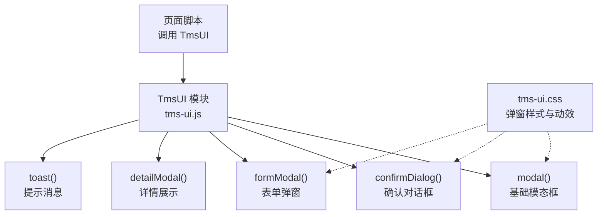
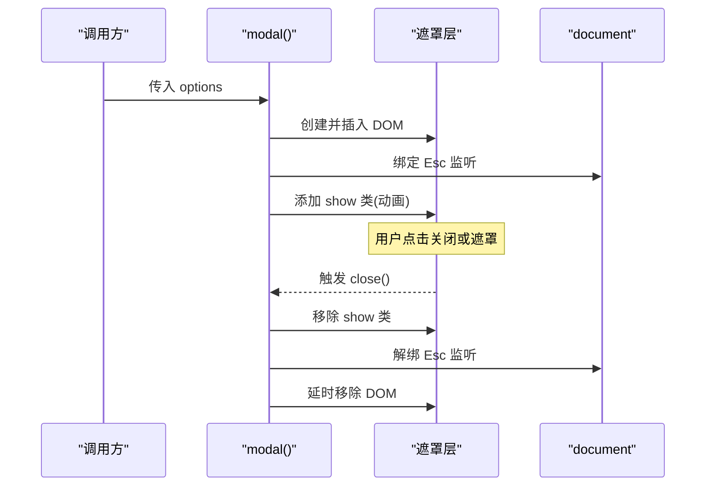
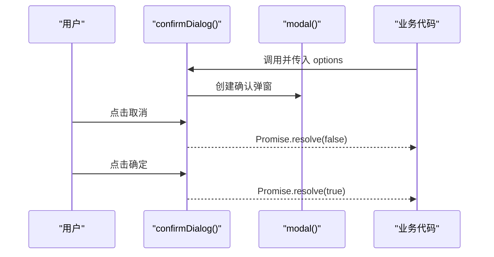
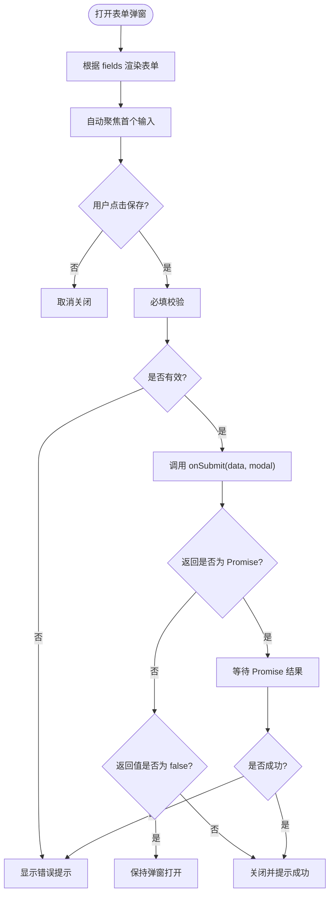
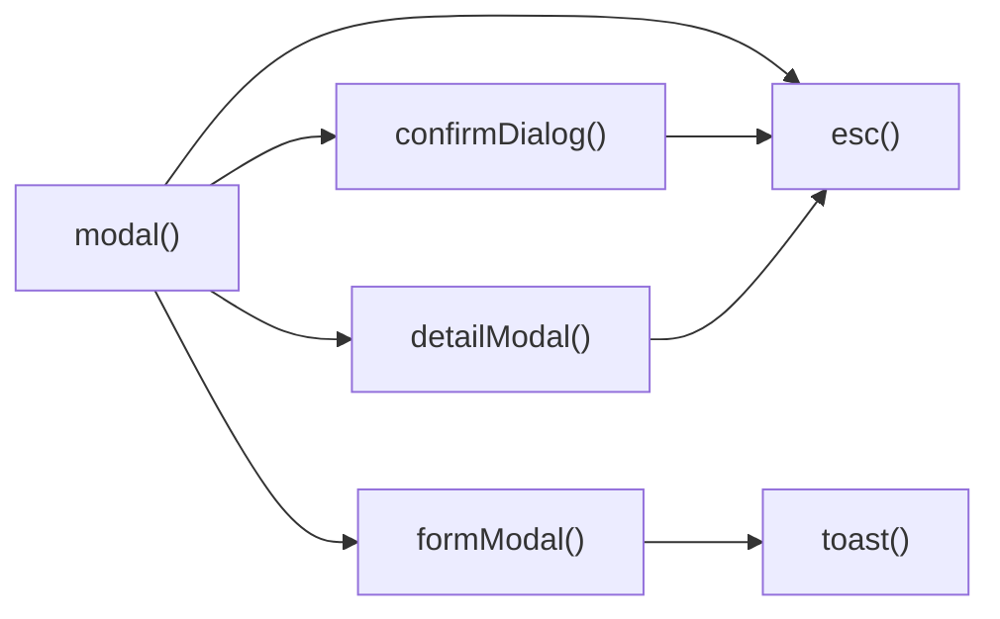

# 弹窗组件

<cite>
**本文引用的文件**   
- [tms-ui.js](file://tms-ui.js)
- [tms-ui.css](file://tms-ui.css)
</cite>

## 目录
1. [简介](#简介)
2. [项目结构](#项目结构)
3. [核心组件](#核心组件)
4. [架构总览](#架构总览)
5. [详细组件分析](#详细组件分析)
6. [依赖关系分析](#依赖关系分析)
7. [性能与可访问性](#性能与可访问性)
8. [使用示例与最佳实践](#使用示例与最佳实践)
9. [故障排查](#故障排查)
10. [结论](#结论)

## 简介
本技术文档聚焦 TMS 系统中的弹窗组件体系，围绕模态框、确认对话框与表单弹窗三大能力展开。内容涵盖 DOM 结构生成、遮罩层处理、键盘事件监听、焦点管理、Promise 封装、异步操作支持、回调处理、用户体验优化、生命周期管理（打开/关闭动画、内存清理、事件解绑）、配置项说明以及完整的使用示例与最佳实践。目标是帮助开发者快速理解并高质量复用弹窗组件。

## 项目结构
弹窗相关实现集中在共享 UI 库中：
- JavaScript 逻辑与 API 暴露：[tms-ui.js](file://tms-ui.js)
- 弹窗样式与动效：[tms-ui.css](file://tms-ui.css)



**图表来源**
- [tms-ui.js:109-137](file://tms-ui.js#L109-L137)
- [tms-ui.js:139-158](file://tms-ui.js#L139-L158)
- [tms-ui.js:165-287](file://tms-ui.js#L165-L287)
- [tms-ui.js:684-686](file://tms-ui.js#L684-L686)
- [tms-ui.js:88-105](file://tms-ui.js#L88-L105)
- [tms-ui.css:457-537](file://tms-ui.css#L457-L537)

**章节来源**
- [tms-ui.js:1-10](file://tms-ui.js#L1-L10)
- [tms-ui.css:1-10](file://tms-ui.css#L1-L10)

## 核心组件
- 基础模态框 modal(options)
  - 负责创建遮罩层、模态容器、头部标题、关闭按钮、内容区域与底部按钮区。
  - 提供 close() 方法、body 引用与 el 引用，用于后续扩展。
- 确认对话框 confirmDialog(options)
  - 基于 modal 构建，返回 Promise，支持自定义文案、危险操作样式等。
- 表单弹窗 formModal(options)
  - 根据 fields 动态生成表单，内置必填校验、错误提示、数据收集、提交回调、异步支持。
- 详情展示 detailModal(title, html, width)
  - 轻量级只读详情弹窗，便于复用 modal 的交互与样式。

**章节来源**
- [tms-ui.js:109-137](file://tms-ui.js#L109-L137)
- [tms-ui.js:139-158](file://tms-ui.js#L139-L158)
- [tms-ui.js:165-287](file://tms-ui.js#L165-L287)
- [tms-ui.js:684-686](file://tms-ui.js#L684-L686)

## 架构总览
弹窗组件采用“基础模态框 + 场景化封装”的分层设计：
- 基础层：modal 提供通用 DOM 结构与交互（遮罩、关闭、Esc、点击外部关闭）。
- 场景层：confirmDialog、formModal、detailModal 在 modal 之上组合业务语义。
- 样式层：统一通过 tms-modal-* 类名控制外观与过渡动画。
- 辅助层：toast 提供成功/失败反馈；esc 提供 XSS 防护。

```mermaid
classDiagram
class TmsUI {
+modal(options)
+confirmDialog(options)
+formModal(options)
+detailModal(title, html, width)
+toast(message, type, duration)
}
class ModalInstance {
+el
+close()
+body
}
class ConfirmDialog {
+Promise resolve(true|false)
}
class FormModal {
+fields[]
+values{}
+onSubmit(data, modal)
+successText
}
TmsUI --> ModalInstance : "创建"
TmsUI --> ConfirmDialog : "封装"
TmsUI --> FormModal : "封装"
```

**图表来源**
- [tms-ui.js:109-137](file://tms-ui.js#L109-L137)
- [tms-ui.js:139-158](file://tms-ui.js#L139-L158)
- [tms-ui.js:165-287](file://tms-ui.js#L165-L287)
- [tms-ui.js:684-686](file://tms-ui.js#L684-L686)

## 详细组件分析

### 基础模态框 modal(options)
- DOM 结构生成
  - 创建遮罩层 overlay，内部包含模态容器、头部（标题+关闭按钮）、内容区 body、底部 foot。
  - 通过 style.maxWidth 控制宽度，title/body/footer 由 options 注入。
- 遮罩层处理
  - 点击遮罩层空白处触发关闭。
- 键盘事件监听
  - 监听 document keydown，当按下 Escape 时关闭。
- 焦点管理
  - 当前未自动聚焦到首个输入控件；如需增强可在打开后设置 focus。
- 生命周期管理
  - 打开：延迟添加 show 类以触发 CSS 过渡动画。
  - 关闭：移除 show 类，延时移除 DOM，并解绑 Esc 监听。
- 返回值
  - 返回对象包含 el、close、body，供上层扩展。



**图表来源**
- [tms-ui.js:109-137](file://tms-ui.js#L109-L137)
- [tms-ui.css:457-537](file://tms-ui.css#L457-L537)

**章节来源**
- [tms-ui.js:109-137](file://tms-ui.js#L109-L137)
- [tms-ui.css:457-537](file://tms-ui.css#L457-L537)

### 确认对话框 confirmDialog(options)
- Promise 封装
  - 返回 Promise，resolve(true) 表示确认，resolve(false) 表示取消。
- 异步操作支持
  - 调用方可在 then/catch 中执行异步流程，结合 toast 反馈结果。
- 回调处理
  - 内部为确定/取消按钮绑定点击事件，分别解析 Promise。
- 用户体验优化
  - 默认宽度较窄，适合简短确认；danger 选项可将主按钮渲染为危险样式。
  - 所有文本通过 esc 转义，避免 XSS。



**图表来源**
- [tms-ui.js:139-158](file://tms-ui.js#L139-L158)

**章节来源**
- [tms-ui.js:139-158](file://tms-ui.js#L139-L158)

### 表单弹窗 formModal(options)
- 动态表单生成
  - 根据 fields 数组渲染不同控件：text、number、select、textarea、checkbox。
  - 支持 placeholder、help、min/max/step、rows、full 等字段属性。
- 字段验证
  - 必填校验：required 字段为空时阻止提交并显示错误提示。
  - 错误提示：统一在表单下方显示错误信息区域。
- 数据收集
  - collect() 函数遍历 fields，按类型收集值（checkbox 取 checked，number 转换数值）。
- 提交处理
  - 若未提供 onSubmit，则直接关闭弹窗。
  - 若提供 onSubmit，先禁用提交按钮，再执行回调。
  - 支持同步返回 false 保持弹窗打开；支持返回 Promise，成功则关闭并提示成功，失败则显示错误。
- 用户体验优化
  - 打开后自动聚焦第一个输入控件。
  - 成功时通过 toast 提示 successText。
  - 所有文本通过 esc 转义，避免 XSS。



**图表来源**
- [tms-ui.js:165-287](file://tms-ui.js#L165-L287)

**章节来源**
- [tms-ui.js:165-287](file://tms-ui.js#L165-L287)

### 详情展示 detailModal(title, html, width)
- 轻量封装 modal，用于只读详情展示。
- 提供关闭按钮，便于快速关闭。

**章节来源**
- [tms-ui.js:684-686](file://tms-ui.js#L684-L686)

## 依赖关系分析
- 组件内聚性
  - modal 作为基础组件被 confirmDialog、formModal、detailModal 复用，耦合度低、内聚度高。
- 外部依赖
  - 依赖全局 TmsStore（表格组件），但弹窗本身不直接依赖。
  - 依赖 toast 进行成功/失败反馈。
  - 依赖 esc 进行字符串转义，防止 XSS。
- 样式依赖
  - 所有弹窗样式通过 tms-modal-* 类名隔离，避免与页面样式冲突。



**图表来源**
- [tms-ui.js:109-137](file://tms-ui.js#L109-L137)
- [tms-ui.js:139-158](file://tms-ui.js#L139-L158)
- [tms-ui.js:165-287](file://tms-ui.js#L165-L287)
- [tms-ui.js:684-686](file://tms-ui.js#L684-L686)
- [tms-ui.js:88-105](file://tms-ui.js#L88-L105)
- [tms-ui.js:12-19](file://tms-ui.js#L12-L19)

**章节来源**
- [tms-ui.js:12-19](file://tms-ui.js#L12-L19)
- [tms-ui.js:88-105](file://tms-ui.js#L88-L105)
- [tms-ui.js:109-137](file://tms-ui.js#L109-L137)
- [tms-ui.js:139-158](file://tms-ui.js#L139-L158)
- [tms-ui.js:165-287](file://tms-ui.js#L165-L287)
- [tms-ui.js:684-686](file://tms-ui.js#L684-L686)

## 性能与可访问性
- 性能
  - 弹窗 DOM 仅在需要时创建与销毁，避免常驻开销。
  - 关闭时延时移除 DOM，保证动画完成后再释放资源。
  - 键盘事件监听在关闭时解绑，避免泄漏。
- 可访问性
  - 模态容器设置 role="dialog" 与 aria-modal="true"，提升无障碍体验。
  - 关闭按钮具备 aria-label，便于屏幕阅读器识别。
- 动画
  - 使用 CSS transition 实现淡入与缩放位移，视觉流畅且不阻塞主线程。

**章节来源**
- [tms-ui.js:109-137](file://tms-ui.js#L109-L137)
- [tms-ui.css:457-537](file://tms-ui.css#L457-L537)

## 使用示例与最佳实践

### 基础用法
- 打开一个简单模态框，设置标题、内容与宽度。
- 推荐在业务逻辑中通过 TmsUI.modal 获取实例，必要时调用 close()。

参考路径
- [tms-ui.js:109-137](file://tms-ui.js#L109-L137)

### 确认对话框
- 使用 TmsUI.confirm 弹出确认框，then 分支处理确认逻辑，catch 分支处理异常。
- 对危险操作可使用 danger 选项将主按钮渲染为危险样式。

参考路径
- [tms-ui.js:139-158](file://tms-ui.js#L139-L158)

### 表单验证与提交
- 定义 fields 数组，指定 key、label、type、required、placeholder、help 等。
- 在 onSubmit 中实现数据收集后的业务逻辑，返回 Promise 以支持异步。
- 若需保持弹窗打开，返回 false 或抛出错误。

参考路径
- [tms-ui.js:165-287](file://tms-ui.js#L165-L287)

### 异步操作与反馈
- 在 confirm/formModal 的回调中使用 toast 提示成功或失败。
- 对于耗时操作，建议在 then 中更新状态并刷新列表。

参考路径
- [tms-ui.js:88-105](file://tms-ui.js#L88-L105)

### 样式定制
- 通过覆盖 tms-modal-* 类名调整外观。
- 注意保持 z-index 层级合理，避免被其他浮层遮挡。

参考路径
- [tms-ui.css:457-537](file://tms-ui.css#L457-L537)

### 最佳实践清单
- 始终使用 esc 转义用户输入，避免 XSS。
- 在表单弹窗中明确 required 字段并提供 help 提示。
- 对异步提交禁用提交按钮，避免重复提交。
- 在关闭弹窗前确保已解绑事件监听（组件已内置）。
- 使用 detailModal 展示只读详情，避免误编辑。

**章节来源**
- [tms-ui.js:12-19](file://tms-ui.js#L12-L19)
- [tms-ui.js:88-105](file://tms-ui.js#L88-L105)
- [tms-ui.js:109-137](file://tms-ui.js#L109-L137)
- [tms-ui.js:139-158](file://tms-ui.js#L139-L158)
- [tms-ui.js:165-287](file://tms-ui.js#L165-L287)
- [tms-ui.css:457-537](file://tms-ui.css#L457-L537)

## 故障排查
- 弹窗无法关闭
  - 检查是否手动调用了 close()，或 ESC 键是否被其他逻辑拦截。
  - 确认遮罩层点击事件未被 preventDefault 阻断。
- 表单提交无效
  - 检查 fields.required 是否正确设置。
  - 确认 onSubmit 返回值为非 false 且未抛出异常。
- 样式错乱
  - 检查是否覆盖了 tms-modal-* 类名导致布局异常。
  - 确认 z-index 层级未被其他元素覆盖。
- 内存泄漏
  - 确认弹窗关闭后 DOM 已被移除，键盘事件已解绑。

**章节来源**
- [tms-ui.js:109-137](file://tms-ui.js#L109-L137)
- [tms-ui.js:165-287](file://tms-ui.js#L165-L287)
- [tms-ui.css:457-537](file://tms-ui.css#L457-L537)

## 结论
TMS 弹窗组件以 modal 为基础，向上提供 confirmDialog、formModal、detailModal 等场景化封装，配合统一的样式与动画，形成高内聚、低耦合、易扩展的弹窗体系。其关键优势包括：
- 清晰的职责分层与复用机制
- 完善的生命周期管理与内存清理
- 丰富的配置项与良好的可扩展性
- 安全的 XSS 防护与可访问性支持
- 友好的用户体验与一致的交互规范

建议在实际项目中优先使用 TmsUI 提供的弹窗 API，遵循最佳实践，以获得稳定、一致且易维护的用户界面。