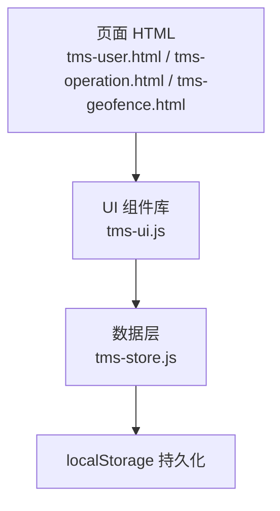
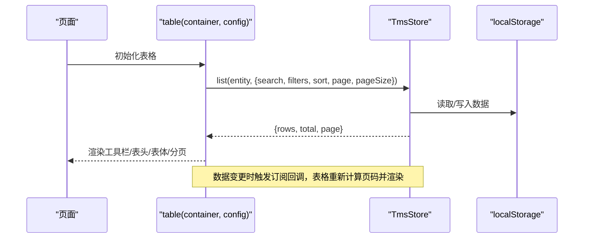
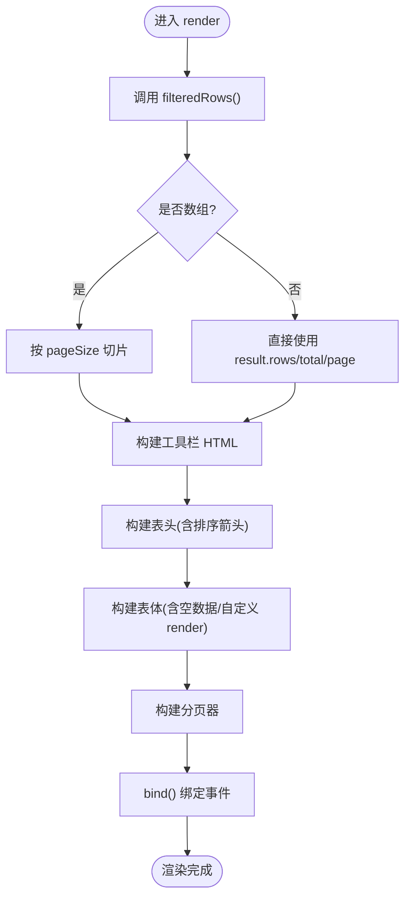
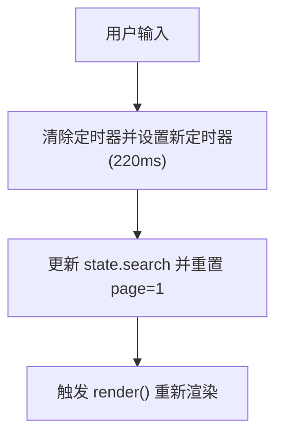
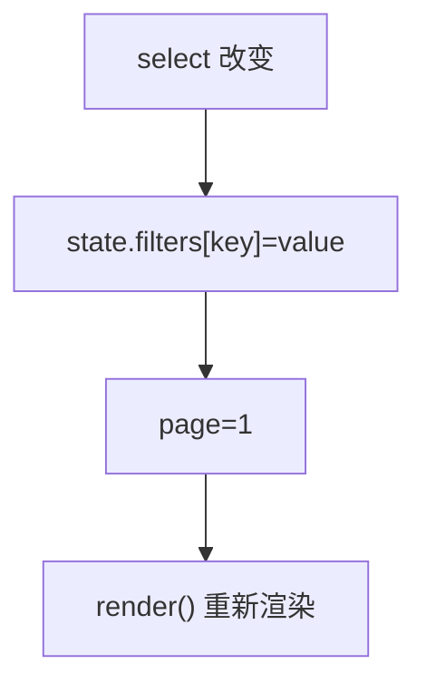
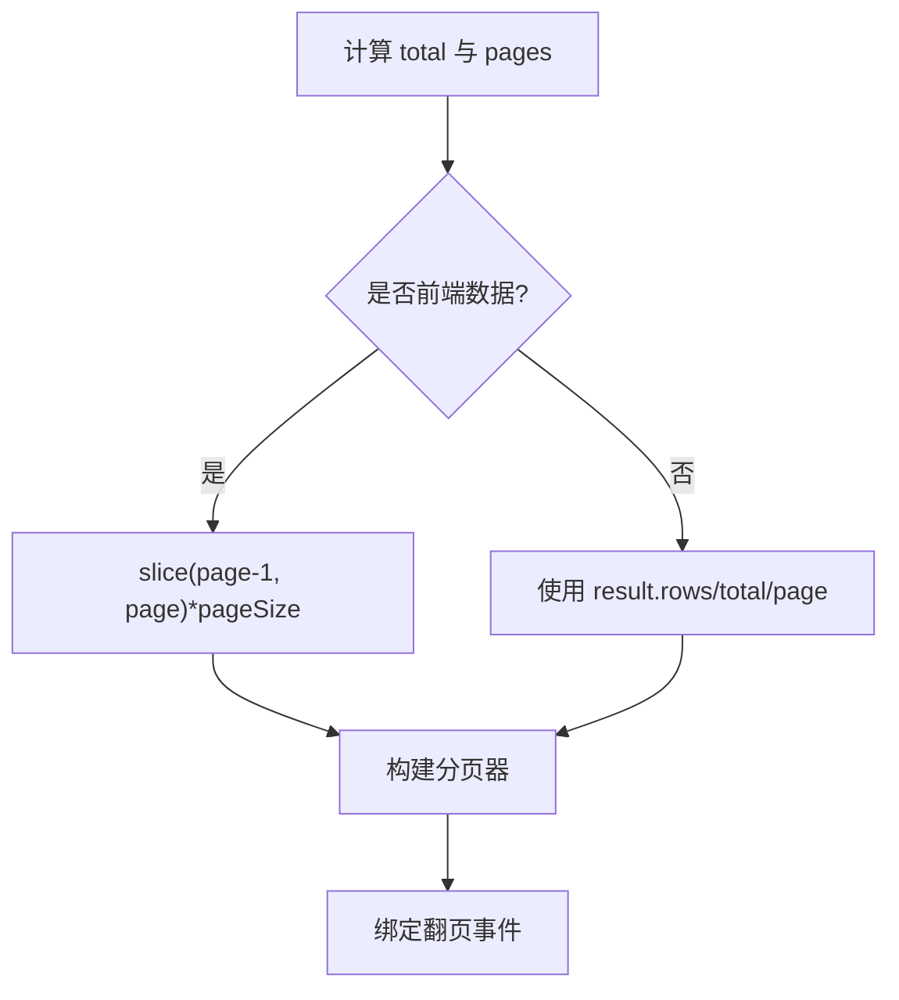
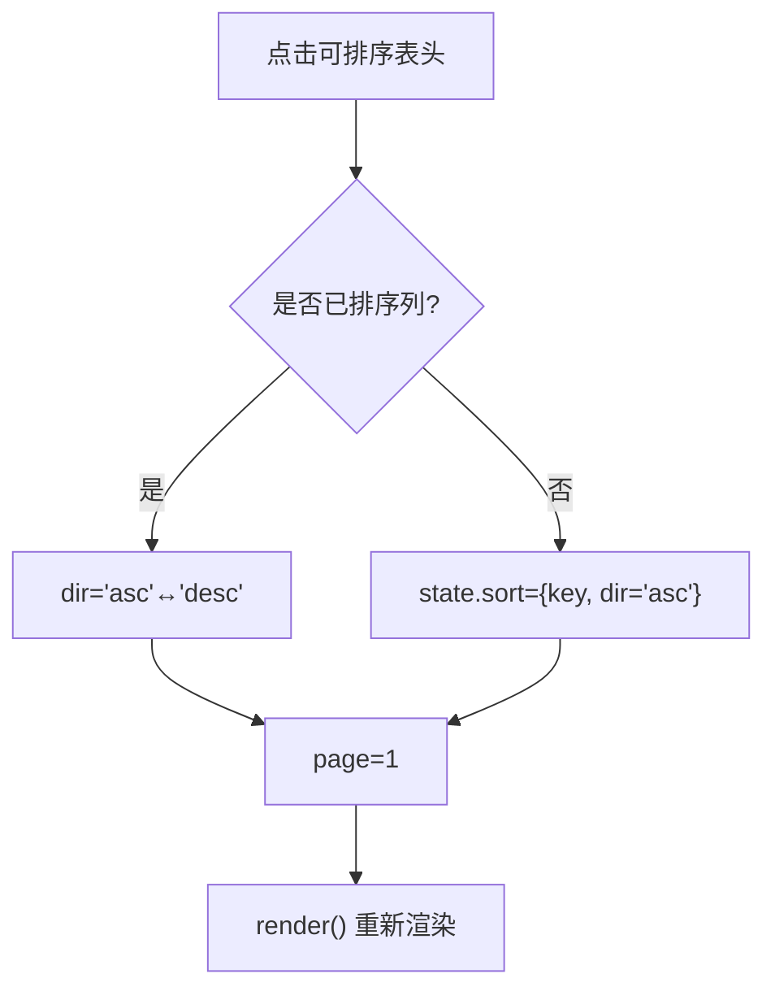

# 表格组件

<cite>
**本文引用的文件**   
- [tms-ui.js](file://tms-ui.js)
- [tms-store.js](file://tms-store.js)
- [tms-user.html](file://tms-user.html)
- [tms-operation.html](file://tms-operation.html)
- [tms-geofence.html](file://tms-geofence.html)
</cite>

## 目录
1. [简介](#简介)
2. [项目结构](#项目结构)
3. [核心组件](#核心组件)
4. [架构总览](#架构总览)
5. [详细组件分析](#详细组件分析)
6. [依赖关系分析](#依赖关系分析)
7. [性能与优化](#性能与优化)
8. [故障排查](#故障排查)
9. [结论](#结论)
10. [附录：API 参考与示例](#附录api-参考与示例)

## 简介
本技术文档围绕 TMS 系统中的通用数据表格组件展开，系统性说明其实现原理、配置项、数据源绑定、列定义、操作按钮、搜索、筛选、分页、排序、渲染机制以及事件处理。该表格组件位于共享 UI 库中，可被多个业务页面复用，既能做前端本地过滤/排序/分页，也能与后端数据层（TmsStore）联动，实现服务端分页与状态同步。

## 项目结构
表格组件及相关使用点主要分布在以下文件中：
- tms-ui.js：提供通用表格函数 table() 及工具方法。
- tms-store.js：提供统一数据层，支持增删改查、搜索、筛选、排序、分页与订阅更新。
- tms-user.html、tms-operation.html、tms-geofence.html：展示表格在不同业务场景中的用法。

图表来源
- [tms-ui.js:303-544](file://tms-ui.js#L303-L544)
- [tms-store.js:1-12](file://tms-store.js#L1-L12)

章节来源
- [tms-ui.js:1-10](file://tms-ui.js#L1-L10)
- [tms-store.js:1-12](file://tms-store.js#L1-L12)

## 核心组件
- 表格组件 table(container, config)：负责渲染工具栏、表头、表体、分页器，并绑定交互事件；支持前端或后端数据模式。
- 数据层 TmsStore：提供 list(entity, options) 等接口，返回包含 rows、total、page 的结构，支持 search、searchFields、filters、sort、page、pageSize。
- 页面集成：通过传入 entity 或 rows 两种方式绑定数据源；通过 columns、actions、toolbar、filters、search 等配置控制显示与行为。

章节来源
- [tms-ui.js:291-302](file://tms-ui.js#L291-L302)
- [tms-store.js:1-12](file://tms-store.js#L1-L12)

## 架构总览
表格组件在“页面 → UI 组件 → 数据层”的链路中工作：
- 当配置了 entity 且存在 TmsStore 时，表格将把搜索、筛选、排序、分页参数传递给 TmsStore.list，由数据层完成服务端式查询并返回分页结果。
- 当配置了 rows 数组或 rows 函数时，表格在前端进行关键字搜索、多条件筛选、排序和分页。
- 当 entity 存在时，表格订阅 TmsStore 的数据变更事件，自动刷新视图并修正页码。

图表来源
- [tms-ui.js:316-363](file://tms-ui.js#L316-L363)
- [tms-ui.js:525-537](file://tms-ui.js#L525-L537)
- [tms-store.js:220-244](file://tms-store.js#L220-L244)

## 详细组件分析

### 数据源绑定与渲染流程
- sourceRows()：优先从 cfg.rows 函数或数组获取数据；若未提供则从 TmsStore.list(entity, {sort}) 获取基础行数据。
- filteredRows()：根据当前 state.search、state.filters、state.sort 对数据进行过滤与排序；若为 entity 模式，则直接调用 TmsStore.list 并透传所有查询参数。
- render()：计算 total、page、pages，并在前端模式下执行 slice 分页；生成工具栏、表头、表体、分页器 HTML，并调用 bind() 绑定事件。

图表来源
- [tms-ui.js:365-451](file://tms-ui.js#L365-L451)

章节来源
- [tms-ui.js:316-363](file://tms-ui.js#L316-L363)
- [tms-ui.js:365-451](file://tms-ui.js#L365-L451)

### 搜索功能
- 关键字搜索：当 state.search 非空时，遍历 searchFields（默认取首行对象的所有键），对字段值进行小写匹配。
- 防抖处理：输入框 input 事件监听内使用 setTimeout 延迟 220ms 更新 state.search 并重置页码到第 1 页，避免频繁重渲染。
- 搜索开关：search 配置为 false 时隐藏搜索框；searchPlaceholder 可自定义提示文案。

图表来源
- [tms-ui.js:454-467](file://tms-ui.js#L454-L467)
- [tms-ui.js:325-334](file://tms-ui.js#L325-L334)

章节来源
- [tms-ui.js:454-467](file://tms-ui.js#L454-L467)
- [tms-ui.js:325-334](file://tms-ui.js#L325-L334)

### 筛选功能
- 下拉筛选器：filters 配置项定义多个筛选项，每个筛选项包含 key、label、options；渲染为 select 元素，value 为空表示“全部”。
- 多条件筛选：state.filters 为对象，key 为筛选项 key，值为选中值；filteredRows() 会依次应用所有非空筛选条件。
- 状态管理：每次筛选变化都会重置 page=1 并触发 render()。

图表来源
- [tms-ui.js:468-474](file://tms-ui.js#L468-L474)
- [tms-ui.js:335-339](file://tms-ui.js#L335-L339)

章节来源
- [tms-ui.js:468-474](file://tms-ui.js#L468-L474)
- [tms-ui.js:335-339](file://tms-ui.js#L335-L339)

### 分页功能
- 前端分页：当 rows 为数组或函数时，render() 使用 Math.ceil(total/pageSize) 计算总页数，并对 rows 进行 slice 分页。
- 后端分页：当 entity 模式时，result 来自 TmsStore.list，包含 rows、total、page；表格直接使用这些字段，不重复切片。
- 页码计算：pagerHtml 生成上一页/下一页按钮与中间页码区间，并显示“第 x/y 页”。
- 性能优化：当 entity 模式且数据发生变化时，表格会先计算新的 total，再校正当前页码不超过最大页码，避免越界。

图表来源
- [tms-ui.js:365-373](file://tms-ui.js#L365-L373)
- [tms-ui.js:434-449](file://tms-ui.js#L434-L449)
- [tms-ui.js:493-500](file://tms-ui.js#L493-L500)
- [tms-ui.js:525-537](file://tms-ui.js#L525-L537)

章节来源
- [tms-ui.js:365-373](file://tms-ui.js#L365-L373)
- [tms-ui.js:434-449](file://tms-ui.js#L434-L449)
- [tms-ui.js:493-500](file://tms-ui.js#L493-L500)
- [tms-ui.js:525-537](file://tms-ui.js#L525-L537)

### 排序功能
- 单列排序：点击表头时切换升序/降序；state.sort 保存 {key, dir}。
- 默认排序：defaultSort 可在初始化时指定。
- 排序算法：数值类型直接比较差值；字符串类型使用 localeCompare('zh-CN') 进行中文排序；null 值排在末尾。
- 后端排序：entity 模式下，sort 会传给 TmsStore.list，由数据层处理排序逻辑。

图表来源
- [tms-ui.js:481-491](file://tms-ui.js#L481-L491)
- [tms-ui.js:340-350](file://tms-ui.js#L340-L350)

章节来源
- [tms-ui.js:481-491](file://tms-ui.js#L481-L491)
- [tms-ui.js:340-350](file://tms-ui.js#L340-L350)

### 列定义与单元格渲染
- 列定义 columns：每项包含 key、label、width、align、sortable、render。
- 动态列生成：表头根据 columns 动态生成，支持宽度样式与排序箭头。
- 单元格渲染：若列定义了 render(row)，则使用返回值作为单元格内容；否则显示 row[key] 或“-”。
- 空数据处理：当 rows 为空时，显示 emptyText 或默认“暂无数据”，并跨列合并。

章节来源
- [tms-ui.js:400-432](file://tms-ui.js#L400-L432)

### 操作按钮与行事件
- 行操作 actions：每行右侧渲染一组按钮，支持 show(row) 条件显示；onClick(row) 接收完整行数据。
- 行点击 onRowClick：为 tbody tr 添加可点击样式，并触发回调。
- 工具栏 toolbar：页面级按钮，如“新增”“导出”，通过 onClick 自定义逻辑。

章节来源
- [tms-ui.js:421-430](file://tms-ui.js#L421-L430)
- [tms-ui.js:502-520](file://tms-ui.js#L502-L520)
- [tms-ui.js:475-480](file://tms-ui.js#L475-L480)

### 与 TmsStore 的协作
- 列表查询：TmsStore.list(entity, options) 返回 {rows, total, page}，支持 search、searchFields、filters、sort、page、pageSize。
- 订阅更新：当 entity 存在时，表格订阅 TmsStore 的数据变更事件，自动刷新视图并修正页码。
- 数据持久化：TmsStore 基于 localStorage 存储，变更时派发事件供 UI 响应。

章节来源
- [tms-ui.js:316-323](file://tms-ui.js#L316-L323)
- [tms-ui.js:351-363](file://tms-ui.js#L351-L363)
- [tms-ui.js:525-537](file://tms-ui.js#L525-L537)
- [tms-store.js:220-244](file://tms-store.js#L220-L244)

## 依赖关系分析
- 表格组件依赖 TmsStore 提供的数据能力；当 entity 存在时，表格完全依赖 TmsStore.list 的结果结构与分页语义。
- 页面通过 TmsUI.table 实例化表格，并通过配置项注入业务逻辑（columns、actions、toolbar、filters）。
- 数据层与 UI 层通过事件解耦：TmsStore 变更触发订阅回调，表格仅负责渲染与交互。

图表来源
- [tms-ui.js:303-544](file://tms-ui.js#L303-L544)
- [tms-store.js:220-244](file://tms-store.js#L220-L244)

章节来源
- [tms-ui.js:303-544](file://tms-ui.js#L303-L544)
- [tms-store.js:220-244](file://tms-store.js#L220-L244)

## 性能与优化
- 搜索防抖：220ms 延迟减少频繁渲染。
- 前端分页：对大数据集使用前端的 slice 分页，避免一次性渲染过多 DOM。
- 后端分页：entity 模式下由 TmsStore 返回分页结果，减少前端计算压力。
- 订阅更新优化：当用户在输入框/选择框聚焦时，跳过不必要的刷新；同时根据新的 total 校正页码，避免越界。
- 建议：
  - 对于超大数据集，优先使用 entity 模式并结合后端分页。
  - 合理设置 pageSize，平衡用户体验与渲染开销。
  - 对复杂列渲染尽量使用轻量函数，避免重型计算。

[本节为通用指导，无需具体文件引用]

## 故障排查
- 搜索无结果：检查 searchFields 是否正确配置；确认数据字段是否存在且可匹配。
- 筛选无效：确认 filters 的 key 与数据字段一致；确保 options 的 value 与数据值类型一致。
- 分页异常：检查 pageSize 是否为 0（禁用分页）；确认 TmsStore.list 返回的 total 与 page 是否符合预期。
- 排序异常：确认 sortable 未被禁用；检查数据字段类型是否与排序逻辑匹配。
- 操作按钮不生效：检查 actions.show 条件与 onClick 回调是否正确绑定。

章节来源
- [tms-ui.js:325-339](file://tms-ui.js#L325-L339)
- [tms-ui.js:468-474](file://tms-ui.js#L468-L474)
- [tms-ui.js:493-500](file://tms-ui.js#L493-L500)
- [tms-ui.js:502-520](file://tms-ui.js#L502-L520)

## 结论
TMS 表格组件以简洁的配置驱动强大的数据展示与交互能力，既支持前端本地处理，也支持与 TmsStore 的后端式协作。通过搜索防抖、多条件筛选、灵活排序、前后端分页与订阅更新机制，组件在保证易用性的同时兼顾性能与可扩展性。结合列渲染与操作按钮，可满足大多数业务页面的表格需求。

[本节为总结，无需具体文件引用]

## 附录：API 参考与示例

### 表格 API 概览
- 初始化：TmsUI.table(container, config)
- 返回对象：{ refresh(), state, destroy() }
- 关键配置项：
  - entity：数据实体名（与 TmsStore 配合）
  - rows：数组或函数，覆盖 entity 查询
  - columns：列定义数组
  - actions：行操作按钮数组
  - search：是否启用搜索（false 关闭）
  - searchFields：搜索字段数组
  - searchPlaceholder：搜索框占位符
  - filters：下拉筛选器数组
  - pageSize：每页条数（0 表示禁用分页）
  - defaultSort：默认排序 {key, dir}
  - toolbar：工具栏按钮数组
  - emptyText：空数据提示文本
  - onRowClick：行点击回调
  - rowClass：行样式类名回调

章节来源
- [tms-ui.js:291-302](file://tms-ui.js#L291-L302)
- [tms-ui.js:303-544](file://tms-ui.js#L303-L544)

### 使用示例

#### 基础用法（前端数据）
- 使用 rows 数组或函数提供数据。
- 配置 columns、actions、toolbar。
- 可选开启 search、filters、pageSize。

章节来源
- [tms-operation.html:657-682](file://tms-operation.html#L657-L682)

#### 高级配置（后端数据）
- 使用 entity 绑定 TmsStore 数据。
- 配置 searchFields、filters、defaultSort。
- 利用 actions 与 toolbar 实现编辑、删除、新增等操作。

章节来源
- [tms-user.html:566-601](file://tms-user.html#L566-L601)
- [tms-operation.html:617-655](file://tms-operation.html#L617-L655)
- [tms-geofence.html:627-677](file://tms-geofence.html#L627-L677)

#### 事件处理
- onRowClick：行点击回调。
- actions.onClick：行操作按钮回调。
- toolbar.onClick：工具栏按钮回调。

章节来源
- [tms-ui.js:502-520](file://tms-ui.js#L502-L520)
- [tms-ui.js:475-480](file://tms-ui.js#L475-L480)
- [tms-geofence.html:676-677](file://tms-geofence.html#L676-L677)