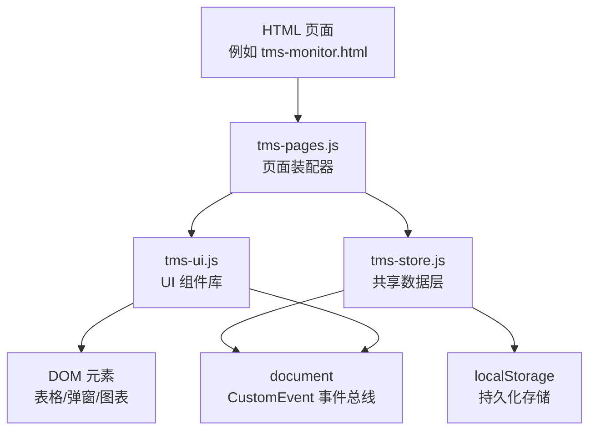
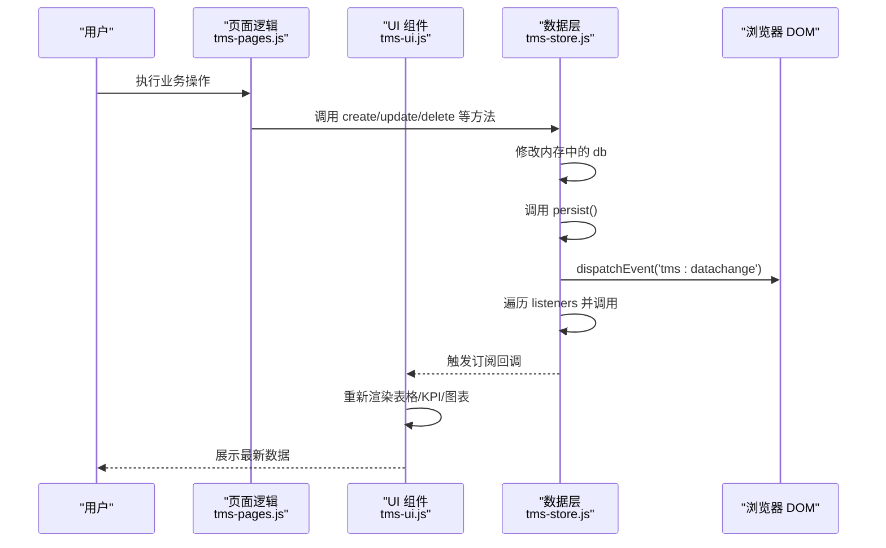
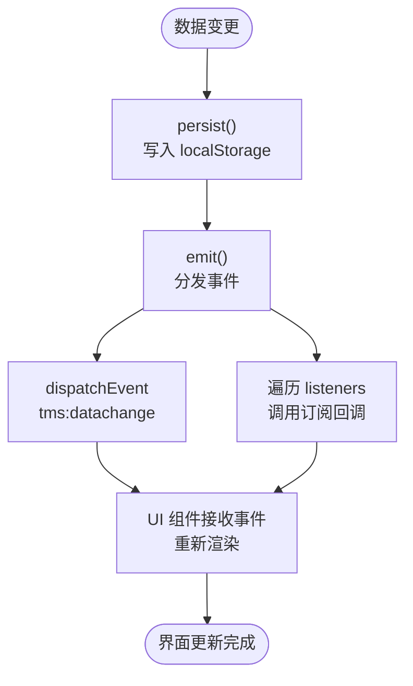
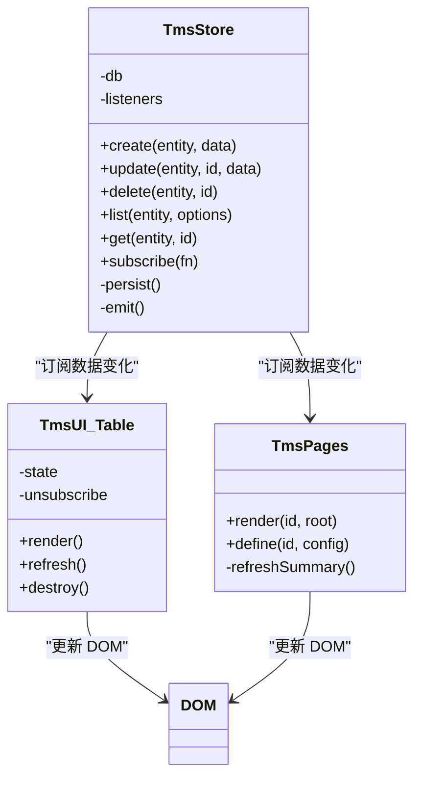
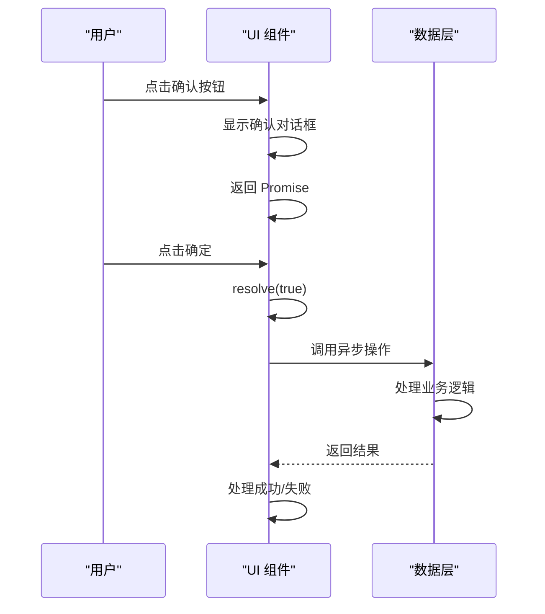
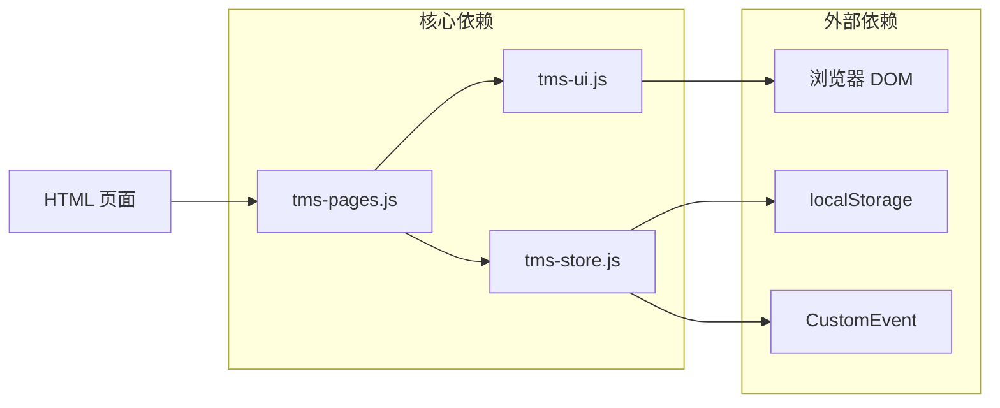
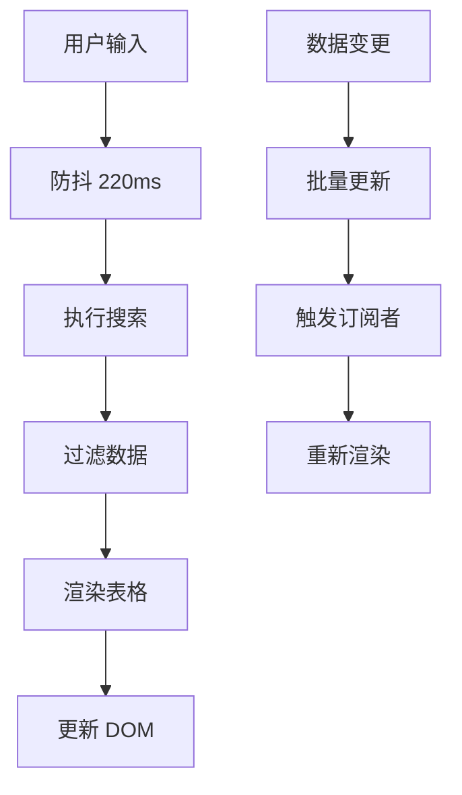
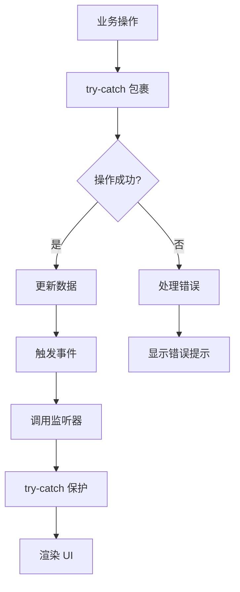

# 事件驱动架构

<cite>
**本文引用的文件**   
- [tms-store.js](file://tms-store.js)
- [tms-ui.js](file://tms-ui.js)
- [tms-pages.js](file://tms-pages.js)
- [common.js](file://common.js)
</cite>

## 目录
1. [引言](#引言)
2. [项目结构](#项目结构)
3. [核心组件](#核心组件)
4. [架构总览](#架构总览)
5. [详细组件分析](#详细组件分析)
6. [依赖关系分析](#依赖关系分析)
7. [性能与优化](#性能与优化)
8. [错误处理与异常捕获](#错误处理与异常捕获)
9. [异步操作与回调处理](#异步操作与回调处理)
10. [最佳实践与常见问题](#最佳实践与常见问题)
11. [结论](#结论)

## 引言
本设计文档围绕 TMS 系统的事件驱动架构展开，重点解释以下方面：
- 自定义事件 CustomEvent 的使用方式与事件传播机制
- 数据变更通知的实现原理与自动 UI 更新流程
- 组件间松耦合通信模式
- 应用状态管理模式
- 异步操作的 Promise 与回调处理
- 错误处理与异常捕获策略
- 性能优化手段，包括事件节流、防抖与批量更新
- 事件驱动开发的最佳实践与常见问题解决方案

该系统的核心思想是：所有业务数据由共享数据层统一维护，任何数据变更都会通过事件广播出去；UI 组件只负责订阅事件并刷新视图，从而形成“数据驱动 + 事件驱动”的解耦架构。

## 项目结构
TMS 前端采用多页面 HTML 配合少量全局 JavaScript 模块的组织方式。与事件驱动架构直接相关的核心文件如下：
- tms-store.js：共享数据层，提供增删改查、统计聚合、订单状态流转，并在数据变更后触发事件
- tms-ui.js：共享 UI 组件库，提供表格、弹窗、图表等能力，内部使用事件监听与 DOM 交互
- tms-pages.js：管理员端页面装配器，将各业务页统一装配为 KPI + 图表 + 表格结构，并订阅数据变化
- common.js：通用工具函数，包含登录、用户信息、积分等基础能力

**图示来源**
- [tms-pages.js:108-134](file://tms-pages.js#L108-L134)
- [tms-ui.js:303-543](file://tms-ui.js#L303-L543)
- [tms-store.js:217-244](file://tms-store.js#L217-L244)

**章节来源**
- [tms-store.js:1-12](file://tms-store.js#L1-L12)
- [tms-ui.js:1-10](file://tms-ui.js#L1-L10)
- [tms-pages.js:1-12](file://tms-pages.js#L1-L12)
- [common.js:1-10](file://common.js#L1-L10)

## 核心组件
### 共享数据层 TmsStore
TmsStore 是 TMS 系统的单一事实源，职责包括：
- 初始化并生成种子数据
- 提供统一的增删改查接口
- 维护订单生命周期状态流转
- 计算运费、路由计划、轨迹明细
- 在数据变更后触发 tms:datachange 事件
- 提供 subscribe/unsubscribe 订阅机制

关键实现点：
- 使用 localStorage 作为轻量数据库
- 维护 listeners 数组用于同步回调
- emit 方法同时派发 CustomEvent 和调用本地监听器
- persist 方法在写入后触发 emit

**章节来源**
- [tms-store.js:1-12](file://tms-store.js#L1-L12)
- [tms-store.js:217-244](file://tms-store.js#L217-L244)
- [tms-store.js:232-244](file://tms-store.js#L232-L244)

### 共享 UI 组件库 TmsUI
TmsUI 提供可复用的 UI 能力，包括：
- Toast 提示
- Modal 弹窗
- FormModal 表单弹窗
- Table 通用数据表格
- KPI 与图表渲染
- 页面外壳初始化

其中 table 组件是最典型的事件驱动 UI 组件：它支持从 TmsStore 订阅数据变化，并在数据更新时自动重新渲染。

**章节来源**
- [tms-ui.js:86-158](file://tms-ui.js#L86-L158)
- [tms-ui.js:160-287](file://tms-ui.js#L160-L287)
- [tms-ui.js:303-543](file://tms-ui.js#L303-L543)

### 页面装配器 TmsPages
TmsPages 负责将业务页面统一装配为“KPI + 图表 + 表格 + CRUD”的结构。每个页面只需定义配置对象，然后调用 render 即可。

关键点：
- 页面初始化时渲染 KPI、图表、表格
- 订阅 TmsStore 的数据变化，自动刷新摘要和链接绑定
- 通过 U.table 创建表格，并通过 S.subscribe 订阅数据变更

**章节来源**
- [tms-pages.js:108-134](file://tms-pages.js#L108-L134)

### 通用工具 common.js
common.js 提供登录、用户信息、积分等基础功能，虽然不直接参与事件驱动架构，但为系统提供了用户上下文和数据持久化能力。

**章节来源**
- [common.js:136-218](file://common.js#L136-L218)
- [common.js:275-363](file://common.js#L275-L363)

## 架构总览
下图展示了 TMS 系统的事件驱动架构总览：

**图示来源**
- [tms-store.js:232-244](file://tms-store.js#L232-L244)
- [tms-ui.js:525-543](file://tms-ui.js#L525-L543)
- [tms-pages.js:131-134](file://tms-pages.js#L131-L134)

## 详细组件分析

### 自定义事件与事件传播机制
TMS 系统使用原生 CustomEvent 作为事件总线。数据层在每次数据变更后触发名为 `tms:datachange` 的事件，事件 detail 中包含时间戳，便于调试和追踪。

事件传播路径：
1. 数据层修改内存数据
2. 调用 persist() 写入 localStorage
3. 调用 emit() 分发事件
4. emit() 先通过 document.dispatchEvent 派发 CustomEvent
5. 然后遍历 listeners 数组，逐个调用订阅者回调
6. UI 组件在订阅回调中重新渲染

**图示来源**
- [tms-store.js:232-244](file://tms-store.js#L232-L244)

**章节来源**
- [tms-store.js:237-244](file://tms-store.js#L237-L244)

### 数据变更通知与自动 UI 更新
TmsStore 提供 subscribe 方法，允许任意组件订阅数据变化。当数据变更时，所有订阅者都会收到回调，回调参数是当前完整的数据库对象。

TmsUI 的 table 组件是典型的订阅者：
- 在创建表格时，如果配置了 entity 且存在 TmsStore，则自动订阅数据变化
- 订阅回调中会重新计算分页总数并重新渲染表格
- 返回 unsubscribe 函数，用于销毁时取消订阅

TmsPages 的页面装配器也订阅数据变化：
- 在页面渲染完成后订阅数据变化
- 回调中刷新 KPI 和图表，并重新绑定订单链接

**图示来源**
- [tms-store.js:217-244](file://tms-store.js#L217-L244)
- [tms-ui.js:525-543](file://tms-ui.js#L525-L543)
- [tms-pages.js:131-134](file://tms-pages.js#L131-L134)

**章节来源**
- [tms-ui.js:525-543](file://tms-ui.js#L525-L543)
- [tms-pages.js:131-134](file://tms-pages.js#L131-L134)

### 组件间通信模式
TMS 系统通过事件实现了松耦合的组件通信：
- 数据层作为发布者，不关心谁在消费数据
- UI 组件作为订阅者，只关心数据变化后的渲染逻辑
- 页面装配器作为协调者，组织多个 UI 组件并订阅数据变化

这种模式的优势：
- 组件之间没有直接依赖
- 新增订阅者无需修改现有代码
- 易于测试和维护
- 支持跨页面通信（通过 document 事件）

**章节来源**
- [tms-store.js:237-244](file://tms-store.js#L237-L244)
- [tms-ui.js:525-543](file://tms-ui.js#L525-L543)
- [tms-pages.js:131-134](file://tms-pages.js#L131-L134)

### 状态管理模式
TMS 系统采用集中式状态管理：
- 所有业务数据集中在 TmsStore 的 db 对象中
- 通过 localStorage 持久化状态
- 提供统一的 API 访问和修改状态
- 状态变更通过事件通知所有订阅者

状态类型包括：
- 订单、运单、运输任务
- 仓库、库存、物资
- 车辆、运力、员工
- 异常、工单、理赔
- 财务、账单、应收应付

**章节来源**
- [tms-store.js:1-12](file://tms-store.js#L1-L12)
- [tms-store.js:217-244](file://tms-store.js#L217-L244)

### 异步操作与回调处理
TMS 系统中的异步操作主要通过以下方式处理：

1. **Promise 模式**：
   - 确认对话框返回 Promise，成功或失败时 resolve
   - 表单提交支持返回 Promise，异步成功后关闭弹窗

2. **回调模式**：
   - 订阅回调函数
   - 按钮点击事件回调
   - 定时器回调

3. **异步函数**：
   - 使用 async/await 处理用户确认操作
   - 结合 Promise 进行错误处理

**图示来源**
- [tms-ui.js:139-158](file://tms-ui.js#L139-L158)
- [tms-ui.js:254-280](file://tms-ui.js#L254-L280)

**章节来源**
- [tms-ui.js:139-158](file://tms-ui.js#L139-L158)
- [tms-ui.js:254-280](file://tms-ui.js#L254-L280)

## 依赖关系分析
TMS 系统的依赖关系清晰明确：

**图示来源**
- [tms-pages.js:10-12](file://tms-pages.js#L10-L12)
- [tms-ui.js:758-781](file://tms-ui.js#L758-L781)
- [tms-store.js:217-244](file://tms-store.js#L217-L244)

**章节来源**
- [tms-pages.js:10-12](file://tms-pages.js#L10-L12)
- [tms-ui.js:758-781](file://tms-ui.js#L758-L781)
- [tms-store.js:217-244](file://tms-store.js#L217-L244)

## 性能与优化
TMS 系统在事件驱动架构中采用了多种性能优化策略：

### 事件节流与防抖
- 搜索输入框使用防抖：220ms 延迟触发搜索，避免频繁重渲染
- 表格渲染时使用状态缓存，减少不必要的计算

### 批量更新
- 数据变更时一次性触发所有订阅者，避免多次 DOM 操作
- 表格组件在订阅回调中批量更新分页和渲染

### 条件渲染
- 只在必要时重新渲染表格
- 检查当前活动元素，避免输入框失焦时的不必要更新

### 内存管理
- 提供 destroy 方法清理事件监听器
- 及时释放不再使用的订阅者

**图示来源**
- [tms-ui.js:458-466](file://tms-ui.js#L458-L466)
- [tms-ui.js:525-543](file://tms-ui.js#L525-L543)

**章节来源**
- [tms-ui.js:458-466](file://tms-ui.js#L458-L466)
- [tms-ui.js:525-543](file://tms-ui.js#L525-L543)

## 错误处理与异常捕获
TMS 系统在多个层面实现了健壮的错误处理：

### 数据层错误处理
- localStorage 读写使用 try-catch 包裹
- 监听器调用使用 try-catch 保护，单个监听器失败不影响其他监听器
- 事件派发使用 try-catch 兼容不同浏览器环境

### UI 层错误处理
- 表单提交支持 try-catch 捕获验证错误
- Promise 链使用 catch 处理异步错误
- 弹窗关闭时清理事件监听器，防止内存泄漏

### 页面级错误处理
- 初始化外壳时捕获异常，确保角标显示失败不影响页面
- 各种业务操作都有适当的错误提示和用户反馈

**图示来源**
- [tms-store.js:220-244](file://tms-store.js#L220-L244)
- [tms-ui.js:254-280](file://tms-ui.js#L254-L280)
- [tms-ui.js:730-745](file://tms-ui.js#L730-L745)

**章节来源**
- [tms-store.js:220-244](file://tms-store.js#L220-L244)
- [tms-ui.js:254-280](file://tms-ui.js#L254-L280)
- [tms-ui.js:730-745](file://tms-ui.js#L730-L745)

## 异步操作与回调处理
TMS 系统对异步操作的处理遵循以下模式：

### Promise 模式
- 确认对话框返回 Promise，支持 then/catch 链式调用
- 表单提交支持返回 Promise，异步成功后自动关闭弹窗
- 用户确认操作使用 async/await 语法

### 回调模式
- 订阅回调函数处理数据变化
- 事件监听器处理用户交互
- 定时器回调处理延迟操作

### 错误处理
- Promise 链使用 catch 捕获异步错误
- 回调函数使用 try-catch 包裹
- 异步操作失败时提供用户友好的错误提示

**章节来源**
- [tms-ui.js:139-158](file://tms-ui.js#L139-L158)
- [tms-ui.js:254-280](file://tms-ui.js#L254-L280)

## 最佳实践与常见问题

### 最佳实践
1. **单一数据源**：所有业务数据集中在 TmsStore 中管理
2. **事件驱动**：使用 CustomEvent 实现组件间松耦合通信
3. **订阅模式**：UI 组件订阅数据变化，自动更新界面
4. **错误隔离**：单个组件错误不影响其他组件运行
5. **内存管理**：及时清理事件监听器和订阅者
6. **性能优化**：使用防抖、节流和批量更新技术

### 常见问题与解决方案
1. **事件丢失问题**：确保在数据变更前正确触发事件
2. **内存泄漏**：在组件销毁时清理事件监听器
3. **性能瓶颈**：合理使用防抖和批量更新
4. **状态不一致**：确保所有数据变更都通过 TmsStore 进行
5. **异步竞态**：使用 Promise 和 async/await 正确处理异步操作

### 自定义事件设计指南
1. **命名规范**：使用有意义的命名空间，如 `tms:datachange`
2. **事件载荷**：包含必要的上下文信息，如时间戳、操作类型
3. **错误处理**：在事件处理器中妥善处理异常情况
4. **性能考虑**：避免在事件处理器中执行耗时操作
5. **向后兼容**：保持事件接口的稳定性

**章节来源**
- [tms-store.js:237-244](file://tms-store.js#L237-L244)
- [tms-ui.js:525-543](file://tms-ui.js#L525-L543)

## 结论
TMS 系统的事件驱动架构通过 CustomEvent 和订阅模式实现了高度解耦的系统设计。数据层作为单一事实源，统一管理所有业务数据；UI 组件作为订阅者，自动响应数据变化并更新界面。这种架构具有以下优势：

- **松耦合**：组件之间通过事件通信，降低依赖关系
- **可维护性**：清晰的职责分离，便于维护和扩展
- **可扩展性**：新增功能只需添加新的订阅者
- **健壮性**：完善的错误处理和异常捕获机制
- **高性能**：合理的性能优化策略，保证用户体验

通过合理运用事件驱动架构，TMS 系统成功实现了复杂业务逻辑的优雅解耦，为后续功能扩展和维护奠定了坚实基础。