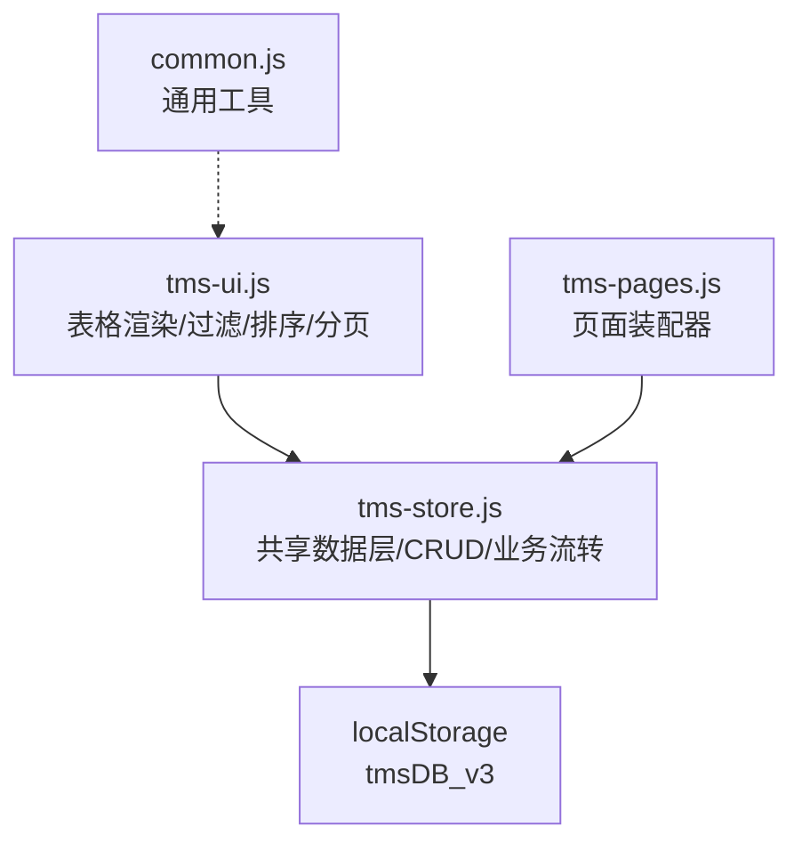
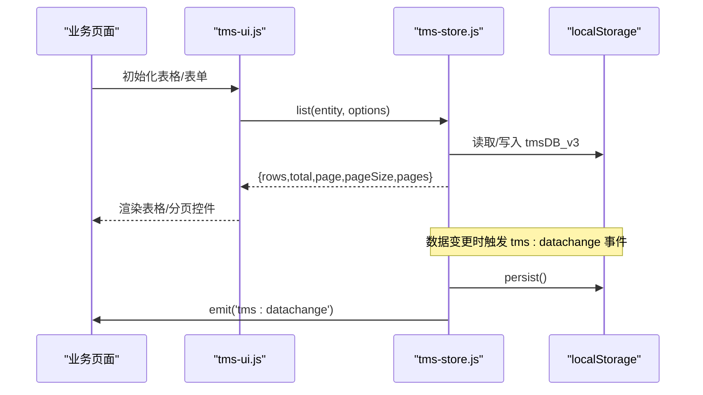
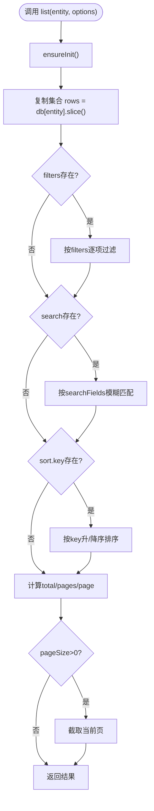
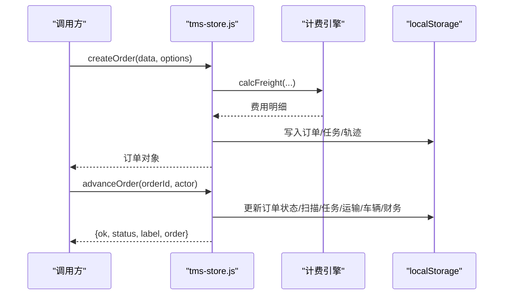
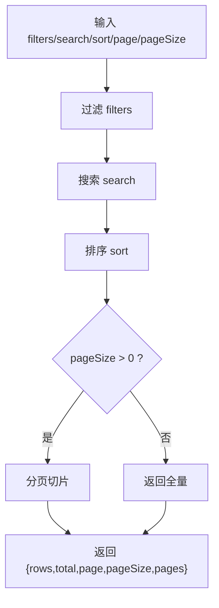
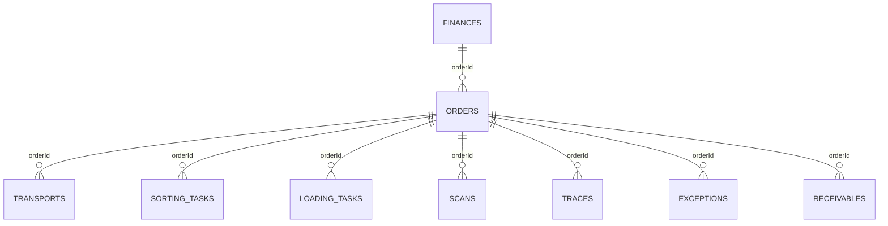
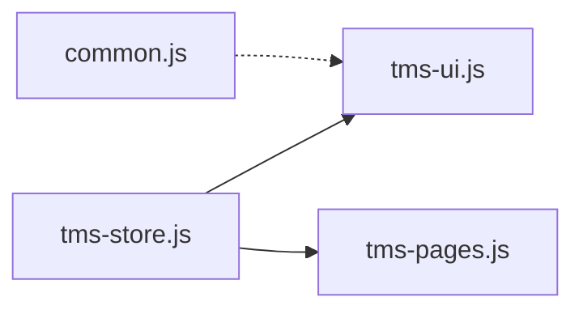

# CRUD操作接口

<cite>
**本文引用的文件**   
- [tms-store.js](file://tms-store.js)
- [tms-ui.js](file://tms-ui.js)
- [tms-pages.js](file://tms-pages.js)
- [common.js](file://common.js)
</cite>

## 目录
1. [引言](#引言)
2. [项目结构](#项目结构)
3. [核心组件](#核心组件)
4. [架构总览](#架构总览)
5. [详细组件分析](#详细组件分析)
6. [依赖关系分析](#依赖关系分析)
7. [性能与批量优化](#性能与批量优化)
8. [事务与一致性](#事务与一致性)
9. [并发控制与数据锁定](#并发控制与数据锁定)
10. [错误处理与异常场景](#错误处理与异常场景)
11. [API调用示例](#api调用示例)
12. [故障排查指南](#故障排查指南)
13. [结论](#结论)

## 引言
本文件面向TMS系统的CRUD操作接口，聚焦以下目标：
- 解释通用增删改查方法 get、list（对应 getAll）、create、update、remove（对应 delete）的实现原理。
- 说明查询过滤、排序、分页能力，包括多条件筛选、结果排序和分页返回结构。
- 阐述基于浏览器存储的数据持久化机制，以及跨标签页同步策略。
- 给出业务级CRUD扩展（如订单创建、状态推进、改单、取消、退货等）的调用方式与影响面。
- 提供批量操作的性能优化建议与实现思路。
- 说明事务性、一致性与并发控制的现状与改进方向。
- 汇总错误处理机制与常见异常场景的处理方案。

## 项目结构
该仓库为前端演示型TMS系统，核心数据层与UI交互集中在若干JS文件中：
- tms-store.js：共享数据层，封装本地数据库、CRUD、业务流转、统计聚合与对外API。
- tms-ui.js：表格渲染、搜索/过滤/排序/分页的前端逻辑，消费 TmsStore.list。
- tms-pages.js：管理员端页面装配器，统一组织KPI、图表、可筛选分页表格与CRUD入口。
- common.js：通用工具函数（登录、用户信息、按钮样式等），不直接参与CRUD。

图示来源
- [tms-store.js:1-12](file://tms-store.js#L1-L12)
- [tms-ui.js:310-339](file://tms-ui.js#L310-L339)
- [tms-pages.js:1-38](file://tms-pages.js#L1-L38)

章节来源
- [tms-store.js:1-12](file://tms-store.js#L1-L12)
- [tms-ui.js:310-339](file://tms-ui.js#L310-L339)
- [tms-pages.js:1-38](file://tms-pages.js#L1-L38)

## 核心组件
- 共享数据层（TmsStore）
  - 提供统一的 list、get、create、update、remove 等基础CRUD。
  - 维护种子数据、业务实体（订单、运输、异常、财务等）及状态流转。
  - 暴露统计聚合与计费试算能力。
- 表格渲染层（TmsUI）
  - 根据配置从 TmsStore.list 获取数据，支持前端搜索、过滤、排序、分页。
- 页面装配层（TmsPages）
  - 将各业务页统一装配为“KPI + 图表 + 可筛选分页表格 + CRUD 操作”的结构。

章节来源
- [tms-store.js:1197-1320](file://tms-store.js#L1197-L1320)
- [tms-ui.js:310-339](file://tms-ui.js#L310-L339)
- [tms-pages.js:1-38](file://tms-pages.js#L1-L38)

## 架构总览
TMS系统采用“前端数据层 + 浏览器存储”的轻量架构：
- 数据层通过 localStorage 持久化，避免后端依赖，适合演示与原型。
- 所有页面通过 window.TmsStore 访问数据；数据变更触发 tms:datachange 事件，供订阅者刷新视图。
- 跨标签页通过 storage 事件监听保持数据一致性。

图示来源
- [tms-store.js:220-244](file://tms-store.js#L220-L244)
- [tms-store.js:1197-1320](file://tms-store.js#L1197-L1320)
- [tms-ui.js:310-339](file://tms-ui.js#L310-L339)

## 详细组件分析

### 通用CRUD接口
- get(entity, id)
  - 功能：按id查找实体记录。
  - 行为：确保数据已初始化，在指定集合中查找匹配id的记录，未找到返回null。
  - 复杂度：O(n)，n为集合长度。
- list(entity, options)
  - 功能：查询列表，支持过滤、搜索、排序、分页。
  - 参数：
    - filters：对象，键为字段名，值为字符串或数组（多选）。空值跳过过滤。
    - search：全局搜索关键字，默认在所有字段上模糊匹配。
    - searchFields：指定搜索字段数组。
    - sort：{key, dir}，支持数字与字符串比较，中文localeCompare。
    - page/pageSize：分页参数，未传pageSize则不分页。
  - 返回：{rows,total,page,pageSize,pages}。
  - 复杂度：过滤O(n)、排序O(nlogn)、分页O(1)。
- create(entity, data)
  - 功能：插入新记录，自动分配id、createdAt、updatedAt。
  - 行为：若集合不存在则创建；根据实体前缀生成ID；插入到数组头部；持久化并触发事件。
  - 复杂度：O(1)插入（unshift）。
- update(entity, id, patch)
  - 功能：按id更新记录，合并patch并更新时间戳。
  - 行为：先get再Object.assign，最后persist。
  - 复杂度：O(n)查找+O(k)合并。
- remove(entity, id)
  - 功能：删除记录，返回是否成功。
  - 行为：findIndex定位后splice移除，然后persist。
  - 复杂度：O(n)。

图示来源
- [tms-store.js:1210-1258](file://tms-store.js#L1210-L1258)

章节来源
- [tms-store.js:1210-1306](file://tms-store.js#L1210-L1306)

### 业务级CRUD扩展（以订单为例）
- createOrder(data, options)
  - 功能：创建订单，自动生成运单号、计费明细、路由计划、轨迹节点，并可自动入库。
  - 关键流程：
    - 生成订单ID与运单号。
    - 未显式传入运费则调用计费引擎 calcFreight。
    - 写入订单主记录，创建分拣任务，规划路线，追加轨迹。
    - 可选 autoInbound 自动推进至入库。
  - 返回值：创建的订单对象。
- advanceOrder(orderId, actor)
  - 功能：按订单状态流推进一个阶段，联动扫描、任务、运输、车辆状态与财务应收。
  - 校验：订单存在、非取消、非已签收。
  - 返回：{ok, status, label, order}。
- cancelOrder(orderId, reason)
  - 功能：取消订单，标记拦截或退回，作废应收、冲销收入、释放车辆。
  - 返回：布尔值。
- changeOrder(orderId, patch, options)
  - 功能：改单（地址、时间、重量、目的地、服务等级、付款方式），必要时重算运费并留痕。
  - 返回：{ok, order, change}。
- createReverseOrder(orderId, reason)
  - 功能：拒收/退货，正向单置退回，生成逆向订单。
  - 返回：{ok, reverse, forward}。
- removeOrder(orderId)
  - 功能：删除订单，并级联清理关联表（运输、分拣、装卸、异常、扫描、轨迹、应收）。
  - 返回：布尔值。

图示来源
- [tms-store.js:1574-1638](file://tms-store.js#L1574-L1638)
- [tms-store.js:1561-1572](file://tms-store.js#L1561-L1572)
- [tms-store.js:1640-1738](file://tms-store.js#L1640-L1738)

章节来源
- [tms-store.js:1561-1738](file://tms-store.js#L1561-L1738)

### 查询过滤与排序
- 多条件筛选
  - filters支持字符串与数组（多选），空值跳过。
  - search支持全局模糊匹配，可通过searchFields限定字段。
- 排序
  - 支持数值与字符串比较，中文使用localeCompare。
  - 支持升序/降序。
- 分页
  - 当pageSize>0时，返回当前页数据与总页数。
  - 未传pageSize则返回全量数据。

图示来源
- [tms-store.js:1210-1258](file://tms-store.js#L1210-L1258)

章节来源
- [tms-store.js:1210-1258](file://tms-store.js#L1210-L1258)

### 数据模型概览
TmsStore维护多个实体集合，包括但不限于：
- orders：订单主数据
- transports：运输任务
- sortingTasks：分拣任务
- loadingTasks：装卸任务
- scans：扫描记录
- traces：轨迹明细
- exceptions：异常记录
- finances：财务流水
- receivables/payables/bills：应收应付账单
- users/roles/permissions/departments：权限与组织
- vehicles/warehouses/inventory/capacities/geofences/devices：资源与设施
- policies/routingRules/deliveryAddresses/timingRules/changeRecords/evalMetrics/evaluations/performance/adminRecords：运营策略与行政记录

图示来源
- [tms-store.js:1113-1153](file://tms-store.js#L1113-L1153)

## 依赖关系分析
- TmsStore对外暴露API，被tms-ui.js与tms-pages.js共同消费。
- tms-ui.js通过TmsStore.list获取数据源，并在前端完成搜索、过滤、排序、分页。
- tms-pages.js负责页面装配，调用TmsStore进行数据绑定与CRUD入口组织。
- common.js提供通用工具，不直接耦合CRUD。

图示来源
- [tms-store.js:2299-2367](file://tms-store.js#L2299-L2367)
- [tms-ui.js:310-339](file://tms-ui.js#L310-L339)
- [tms-pages.js:1-38](file://tms-pages.js#L1-L38)

章节来源
- [tms-store.js:2299-2367](file://tms-store.js#L2299-L2367)
- [tms-ui.js:310-339](file://tms-ui.js#L310-L339)
- [tms-pages.js:1-38](file://tms-pages.js#L1-L38)

## 性能与批量优化
- 现有批量能力
  - 通用create/update/remove为单条操作，无内置批量接口。
  - 业务层removeOrder支持级联清理，但仍是单条删除。
- 优化建议
  - 批量插入：封装batchCreate(entities, records[])，内部循环调用create，减少多次persist开销；或在内存中构建数组后一次性写入localStorage。
  - 批量更新：封装batchUpdate(entities, updates[])，合并patch后统一持久化。
  - 批量删除：封装batchRemove(entities, ids[])，使用filter或splice批量移除后再持久化。
  - 索引优化：对高频查询字段（如orderId、status、createdAt）建立内存索引，降低list过滤成本。
  - 分页前置：在服务端或数据层对大数据集先分页再过滤/排序，减少前端处理压力。
  - 防抖与节流：前端搜索与过滤增加防抖，避免频繁触发list。
  - 增量更新：仅对变更字段进行diff与持久化，减少localStorage序列化开销。

[本节为通用指导，不涉及具体代码片段]

## 事务与一致性
- 现状
  - 数据持久化通过localStorage，每次写操作调用persist()写入并触发事件。
  - 无数据库事务语义，无法保证跨实体的原子性回滚。
  - 业务动作（如advanceOrder、cancelOrder、changeOrder）会同时修改多个集合，需调用方保证顺序与正确性。
- 改进建议
  - 引入内存事务：在执行多步写之前，保存快照；成功后提交，失败时回滚。
  - 操作幂等：为每条写操作生成唯一opId，避免重复提交导致数据不一致。
  - 审计日志：对所有写操作记录审计条目，便于追踪与恢复。
  - 版本控制：db.meta.version递增，迁移时保证向后兼容。

章节来源
- [tms-store.js:220-244](file://tms-store.js#L220-L244)
- [tms-store.js:1561-1738](file://tms-store.js#L1561-L1738)

## 并发控制与数据锁定
- 现状
  - 单线程执行模型，无锁机制。
  - 跨标签页通过storage事件同步数据，但不具备分布式锁或乐观锁。
- 风险
  - 多标签页同时写可能产生覆盖竞争。
  - 长耗时操作（如批量导入）期间其他标签页可能读到中间态。
- 改进建议
  - 乐观锁：为每条记录添加version字段，更新时检查版本号，冲突时重试或提示。
  - 读写锁：对写操作加锁，读操作可并行；或使用队列串行化写操作。
  - 消息队列：将写请求入队，单消费者顺序执行，保证一致性。
  - 冲突检测：在persist前检测是否有其他标签页变更，必要时合并或拒绝。

[本节为通用指导，不涉及具体代码片段]

## 错误处理与异常场景
- 通用CRUD
  - get：未找到返回null。
  - remove：未找到返回false。
  - update：未找到返回null。
- 业务CRUD
  - advanceOrder：订单不存在/已取消/已签收时返回失败信息。
  - cancelOrder：已签收不可取消。
  - changeOrder：已签收/已取消不可改单；改单时重算运费并留痕。
  - createReverseOrder：原订单不存在返回失败。
- 事件与监听
  - tms:datachange事件用于通知订阅者刷新视图。
  - storage事件用于跨标签页同步数据。

章节来源
- [tms-store.js:1260-1306](file://tms-store.js#L1260-L1306)
- [tms-store.js:1561-1738](file://tms-store.js#L1561-L1738)
- [tms-store.js:2369-2375](file://tms-store.js#L2369-L2375)

## API调用示例
以下为典型调用模式（不展示具体代码内容，仅提供调用路径与参数说明）：

- 查询列表（getAll）
  - 调用：TmsStore.list('orders', { filters: {...}, search: '关键词', sort: {key:'createdAt', dir:'desc'}, page: 1, pageSize: 10 })
  - 返回：{rows:[...], total: N, page: 1, pageSize: 10, pages: M}
  - 适用：订单列表、运输任务、异常记录等任意实体。

- 按ID查询（getById）
  - 调用：TmsStore.get('orders', orderId)
  - 返回：订单对象或null

- 新增（create）
  - 调用：TmsStore.create('exceptions', { type: '延迟送达', description: '...', occurredAt: nowIso(), level: '二级' })
  - 返回：新建记录对象（含自动生成的id、createdAt、updatedAt）

- 更新（update）
  - 调用：TmsStore.update('serviceTickets', ticketId, { status: 'processing', assignee: '客服专员' })
  - 返回：更新后的记录对象或null

- 删除（delete）
  - 调用：TmsStore.remove('transports', transportId)
  - 返回：true/false

- 业务级创建订单
  - 调用：TmsStore.createOrder({ origin: '北京', destination: '上海', weight: 5, service: '标准', paymentMethod: '现付' }, { autoInbound: false })
  - 返回：订单对象

- 业务级推进订单状态
  - 调用：TmsStore.advanceOrder(orderId, '运营管理员')
  - 返回：{ok, status, label, order}

- 业务级取消订单
  - 调用：TmsStore.cancelOrder(orderId, '客户原因取消')
  - 返回：true/false

- 业务级改单
  - 调用：TmsStore.changeOrder(orderId, { receiverAddress: '新地址', expectedAt: new Date(...).toISOString(), weight: 8 }, { actor: '运营管理员' })
  - 返回：{ok, order, change}

- 业务级退货
  - 调用：TmsStore.createReverseOrder(orderId, '客户拒收')
  - 返回：{ok, reverse, forward}

章节来源
- [tms-store.js:1210-1306](file://tms-store.js#L1210-L1306)
- [tms-store.js:1574-1738](file://tms-store.js#L1574-L1738)

## 故障排查指南
- 数据未加载
  - 检查localStorage是否存在tmsDB_v3，或是否被清空。
  - 确认init是否被调用，reset是否误用。
- 列表为空
  - 检查filters/search是否正确；确认searchFields是否遗漏关键字段。
  - 检查sort.key是否存在于实体字段。
- 分页异常
  - 确认pageSize>0；检查page是否在有效范围内。
- 业务操作失败
  - advanceOrder：确认订单状态与生命周期；检查是否已签收或取消。
  - cancelOrder：确认订单未签收；检查是否已有运输记录。
  - changeOrder：确认订单未签收/取消；检查改单字段是否合法。
- 跨标签页不同步
  - 检查storage事件监听是否生效；确认DB_KEY一致。

章节来源
- [tms-store.js:220-244](file://tms-store.js#L220-L244)
- [tms-store.js:1187-1195](file://tms-store.js#L1187-L1195)
- [tms-store.js:1561-1738](file://tms-store.js#L1561-L1738)

## 结论
- TmsStore提供了完整的通用CRUD与丰富的业务级操作，满足演示与原型阶段的CRUD需求。
- 查询过滤、排序、分页能力完善，适合前端快速构建管理界面。
- 当前架构基于localStorage，无事务与并发锁，适合单进程演示；生产环境需引入后端服务与数据库事务。
- 批量操作尚未内置，建议封装批量接口并优化持久化策略。
- 建议在后续迭代中引入乐观锁、操作幂等、审计日志与事务沙箱，以提升一致性与可追溯性。