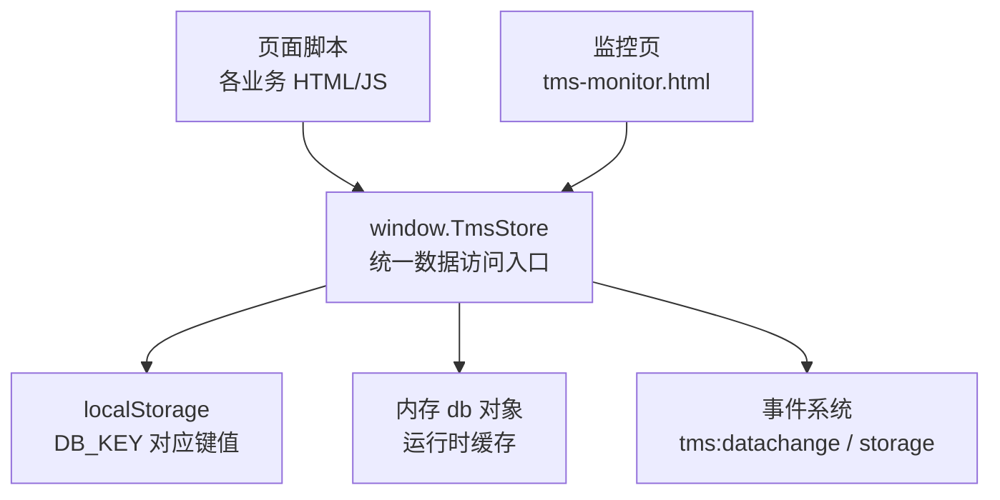
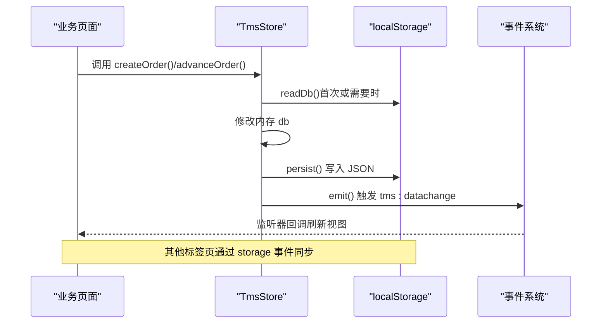
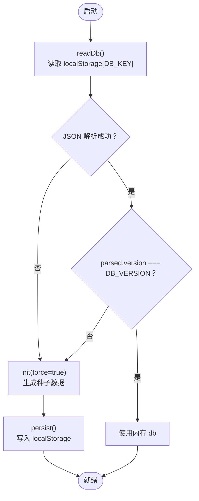
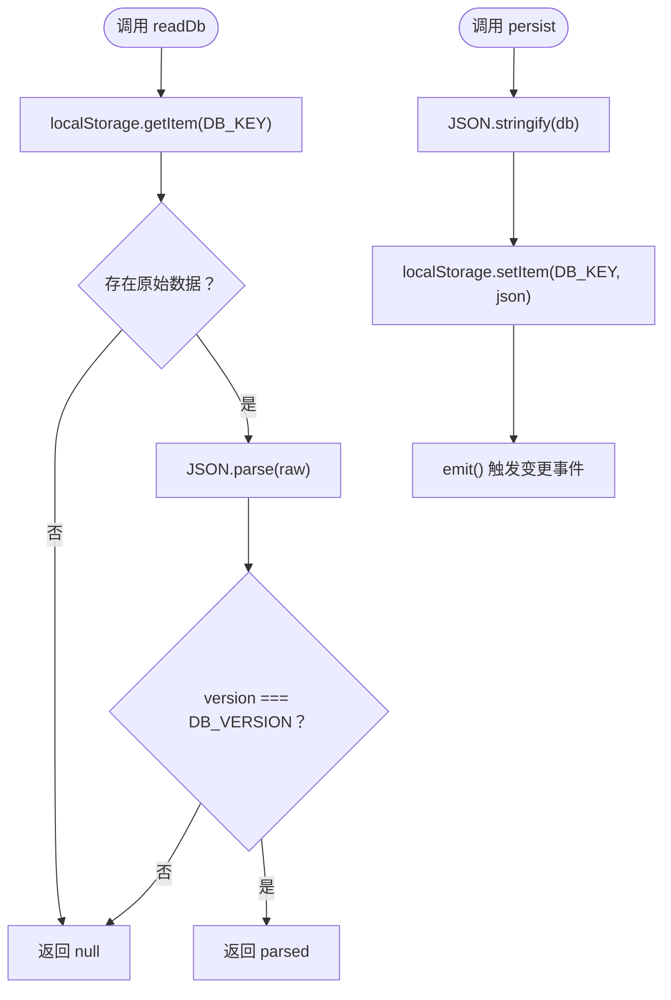
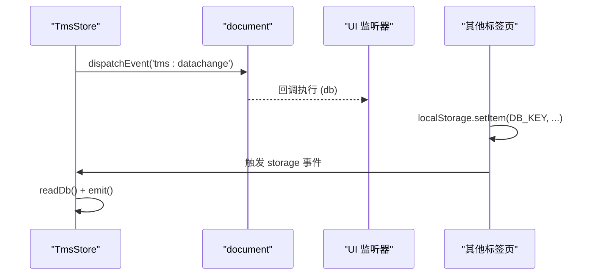
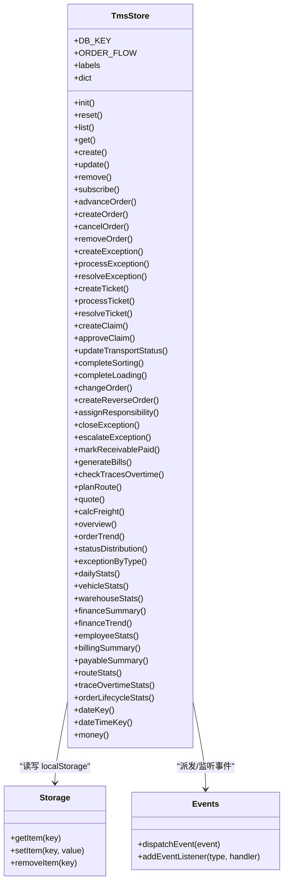

# 存储机制设计

<cite>
**本文引用的文件**   
- [tms-store.js](file://tms-store.js)
- [tms-monitor.html](file://tms-monitor.html)
</cite>

## 目录
1. [引言](#引言)
2. [项目结构](#项目结构)
3. [核心组件](#核心组件)
4. [架构总览](#架构总览)
5. [详细组件分析](#详细组件分析)
6. [依赖关系分析](#依赖关系分析)
7. [性能与优化建议](#性能与优化建议)
8. [故障排查指南](#故障排查指南)
9. [结论](#结论)

## 引言
本文件面向 TMS 系统中基于 localStorage 的轻量级业务数据库实现，系统性说明其数据存储结构、版本管理机制、持久化策略、事件驱动的数据变更通知机制、安全与敏感信息处理思路，以及使用 TmsStore 进行数据读写和状态流转的实践方式。文档同时给出性能优化建议，帮助在浏览器端以较低成本获得接近“本地数据库”的体验。

## 项目结构
TMS 的共享数据层由单一模块 tms-store.js 提供，所有管理员端页面通过 window.TmsStore 访问统一数据源；监控页 tms-monitor.html 会读取 DB_KEY 用于展示数据库键名与占用大小。

图表来源
- [tms-store.js:2299-2378](file://tms-store.js#L2299-L2378)
- [tms-monitor.html:517-521](file://tms-monitor.html#L517-L521)

章节来源
- [tms-store.js:1-18](file://tms-store.js#L1-L18)
- [tms-monitor.html:517-521](file://tms-monitor.html#L517-L521)

## 核心组件
- 数据键与版本：DB_KEY 与 DB_VERSION 定义在模块顶部，作为 localStorage 中的唯一键与数据结构版本标识。
- 数据读取与持久化：readDb() 负责从 localStorage 解析并校验版本；persist() 将内存 db 序列化后写回 localStorage，并触发变更事件。
- 事件驱动变更通知：emit() 派发 CustomEvent('tms:datachange')，并通过 listeners 数组调用订阅者；同时监听全局 storage 事件实现跨标签页同步。
- 通用 CRUD：list/get/create/update/remove 提供集合级查询、单条获取、新增、更新、删除能力，并在写入时自动更新时间戳与 ID。
- 业务领域模型：订单、运单、运输、分拣、装卸、扫描、异常、财务、应收应付、账单、轨迹等实体在 seed() 中生成，并由一系列业务方法维护生命周期与关联一致性。
- 对外 API：模块末尾将 api 对象挂载到 global.TmsStore，暴露初始化、重置、CRUD、业务动作、统计聚合、工具函数等接口。

章节来源
- [tms-store.js:16-17](file://tms-store.js#L16-L17)
- [tms-store.js:220-244](file://tms-store.js#L220-L244)
- [tms-store.js:1199-1320](file://tms-store.js#L1199-L1320)
- [tms-store.js:2299-2378](file://tms-store.js#L2299-L2378)

## 架构总览
下图展示了 TmsStore 在浏览器端的整体交互：页面通过 TmsStore 调用业务方法，内部维护内存 db，必要时从 localStorage 加载或写回；变更通过事件通知 UI 刷新，跨标签页通过 storage 事件保持数据一致。

图表来源
- [tms-store.js:220-244](file://tms-store.js#L220-L244)
- [tms-store.js:1187-1195](file://tms-store.js#L1187-L1195)
- [tms-store.js:2369-2375](file://tms-store.js#L2369-L2375)

## 详细组件分析

### 数据存储结构与版本管理
- 存储键：DB_KEY 为 'tmsDB_v3'，作为 localStorage 的唯一键。
- 版本字段：每个持久化的 db 对象包含 version 字段，且与 DB_VERSION 比较，不匹配则视为无效数据，触发重新初始化。
- 数据结构：seed() 返回包含 meta、users、orders、transports、scans、exceptions、finances、receivables、payables、bills、traces 等集合的对象，涵盖订单全生命周期与运营、财务、资源等维度。

图表来源
- [tms-store.js:16-17](file://tms-store.js#L16-L17)
- [tms-store.js:220-235](file://tms-store.js#L220-L235)
- [tms-store.js:1113-1153](file://tms-store.js#L1113-L1153)
- [tms-store.js:1187-1195](file://tms-store.js#L1187-L1195)

章节来源
- [tms-store.js:16-17](file://tms-store.js#L16-L17)
- [tms-store.js:220-235](file://tms-store.js#L220-L235)
- [tms-store.js:1113-1153](file://tms-store.js#L1113-L1153)
- [tms-store.js:1187-1195](file://tms-store.js#L1187-L1195)

### 数据读取 readDb() 与持久化 persist()
- readDb()：
  - 从 localStorage 读取 DB_KEY 对应的字符串。
  - JSON.parse 解析后检查是否存在且 version 等于 DB_VERSION。
  - 捕获异常，失败时返回 null，促使 init() 生成种子数据。
- persist()：
  - 将内存 db 对象 JSON.stringify 后写入 localStorage。
  - 调用 emit() 触发变更事件，通知 UI 与订阅者。

图表来源
- [tms-store.js:220-235](file://tms-store.js#L220-L235)

章节来源
- [tms-store.js:220-235](file://tms-store.js#L220-L235)

### 事件驱动的数据变更通知机制
- 自定义事件：emit() 通过 document.dispatchEvent(new CustomEvent('tms:datachange', { detail: { at: Date.now() } })) 广播数据变更时间戳。
- 监听器模式：listeners 数组保存订阅函数，每次 persist() 后依次调用，传入当前 db 供 UI 刷新。
- 跨标签页同步：全局监听 storage 事件，当 e.key 等于 DB_KEY 时，重新读取 localStorage 并触发 emit()，确保多标签页数据一致。

图表来源
- [tms-store.js:237-244](file://tms-store.js#L237-L244)
- [tms-store.js:1308-1313](file://tms-store.js#L1308-L1313)
- [tms-store.js:2369-2375](file://tms-store.js#L2369-L2375)

章节来源
- [tms-store.js:237-244](file://tms-store.js#L237-L244)
- [tms-store.js:1308-1313](file://tms-store.js#L1308-L1313)
- [tms-store.js:2369-2375](file://tms-store.js#L2369-L2375)

### 数据加密与安全考虑
- 明文存储：当前实现直接使用 JSON.stringify 写入 localStorage，未对数据进行加密或签名。
- 敏感信息处理：用户信息与联系方式等敏感字段随业务数据一同持久化，未做脱敏或隔离。
- 访问控制：TmsStore 本身不提供权限校验；权限控制由上层角色/权限体系与页面逻辑承担。
- 建议：
  - 对敏感字段进行前端脱敏显示，后端校验与加密存储。
  - 如需本地加密，可在 persist() 前对关键字段进行对称加密，并在 readDb() 后解密。
  - 结合浏览器安全策略（如 SameSite Cookie、CSP）降低 XSS 风险。

章节来源
- [tms-store.js:232-235](file://tms-store.js#L232-L235)
- [tms-store.js:1078-1088](file://tms-store.js#L1078-L1088)

### 使用示例：通过 TmsStore 进行数据存取与状态流转
以下示例仅描述调用流程与参数要点，不直接粘贴代码内容。

- 初始化与基础 CRUD
  - 初始化：调用 TmsStore.init() 或首次调用任意业务方法时自动初始化。
  - 列表查询：TmsStore.list(entity, options)，支持 filters/search/sort/page/pageSize。
  - 单条获取：TmsStore.get(entity, id)。
  - 新增记录：TmsStore.create(entity, data)，自动生成 id 与 updatedAt。
  - 更新记录：TmsStore.update(entity, id, patch)。
  - 删除记录：TmsStore.remove(entity, id)。

- 订单创建与推进
  - 创建订单：TmsStore.createOrder(data, options)，可自动计费、生成运单号、计划路由与轨迹节点。
  - 推进状态：TmsStore.advanceOrder(orderId, actor)，按 ORDER_FLOW 顺序推进，联动扫描、任务、运输、财务等。
  - 取消订单：TmsStore.cancelOrder(orderId, reason)，联动作废应收、冲销收入、释放车辆。
  - 改单：TmsStore.changeOrder(orderId, patch, options)，重算运费、更新路由与变更记录。
  - 退货逆向：TmsStore.createReverseOrder(orderId, reason)，生成逆向订单。

- 异常与工单
  - 创建异常：TmsStore.createException(data)。
  - 处理异常：TmsStore.processException(id, handler)。
  - 定责与扣款：TmsStore.assignResponsibility(id, data)。
  - 闭环处理：TmsStore.closeException(id, data)，可选联动理赔。
  - 升级异常：TmsStore.escalateException(id)。

- 统计与聚合
  - 概览指标：TmsStore.overview()。
  - 趋势与分布：TmsStore.orderTrend(days)、TmsStore.statusDistribution()。
  - 日度统计：TmsStore.dailyStats(days)。
  - 财务汇总：TmsStore.financeSummary(days)、TmsStore.financeTrend(days)。
  - 应收应付：TmsStore.billingSummary()、TmsStore.payableSummary(period)。

章节来源
- [tms-store.js:1199-1320](file://tms-store.js#L1199-L1320)
- [tms-store.js:1561-1738](file://tms-store.js#L1561-L1738)
- [tms-store.js:1740-1837](file://tms-store.js#L1740-L1837)
- [tms-store.js:2008-2295](file://tms-store.js#L2008-L2295)
- [tms-store.js:2299-2365](file://tms-store.js#L2299-L2365)

## 依赖关系分析
TmsStore 内部依赖关系如下：

图表来源
- [tms-store.js:2299-2378](file://tms-store.js#L2299-L2378)

章节来源
- [tms-store.js:2299-2378](file://tms-store.js#L2299-L2378)

## 性能与优化建议
- 批量操作
  - 合并多次 update：尽量在一次业务操作中完成多条记录的更新，减少多次 persist() 导致的 localStorage 写入与事件触发。
  - 批量创建：封装批量 create 接口，内部一次性写入并触发一次事件。
- 缓存策略
  - 内存缓存：已采用内存 db 缓存，避免频繁读取 localStorage；建议在高频查询场景下增加局部缓存（如按 entity 的 Map）。
  - 分页与过滤：list() 已支持 filters/search/sort/page/pageSize，优先在服务端或前端计算后进行分页，避免全量渲染。
- 数据裁剪
  - 限制大集合长度：如 scans/traces 已在写入时限制最大长度，防止 localStorage 膨胀。
  - 清理历史：定期归档或清理过期数据（如旧账单、历史轨迹），降低存储压力。
- 事件节流
  - 在高并发写入场景下，可对 emit() 进行节流或合并，减少 UI 重绘次数。
- 序列化开销
  - 大数据集 JSON.stringify/parse 有开销，建议拆分实体、按需加载，或使用结构化存储（如 IndexedDB）替代 localStorage。

[本节为通用指导，不直接分析具体文件]

## 故障排查指南
- 数据无法加载或为空
  - 检查 DB_KEY 是否被其他脚本覆盖或清除。
  - 检查浏览器 localStorage 配额与可用性。
  - 确认 parsed.version 是否与 DB_VERSION 一致，不一致将触发重建。
- 多标签页数据不同步
  - 确认 storage 事件监听是否生效，检查 e.key 是否为 DB_KEY。
  - 检查是否有第三方脚本拦截或重写 localStorage。
- 事件未触发 UI 刷新
  - 检查 subscribe(fn) 是否正确注册，监听器是否在 emit() 后被调用。
  - 检查页面是否在 tms:datachange 事件中正确更新视图。
- 监控页显示异常
  - 确认 tms-monitor.html 正确读取 TmsStore.DB_KEY 并计算存储大小。

章节来源
- [tms-store.js:220-244](file://tms-store.js#L220-L244)
- [tms-store.js:1308-1313](file://tms-store.js#L1308-L1313)
- [tms-store.js:2369-2375](file://tms-store.js#L2369-L2375)
- [tms-monitor.html:517-521](file://tms-monitor.html#L517-L521)

## 结论
TmsStore 以 localStorage 为底层存储，通过内存缓存、版本校验与事件驱动机制，提供了轻量但完整的业务数据库体验。它覆盖了订单全生命周期、异常闭环、财务结算与多维统计，适合演示与小型业务场景。对于更大规模或更高安全要求的应用，建议引入服务端存储、权限校验与数据加密，并结合 IndexedDB 提升性能与容量上限。