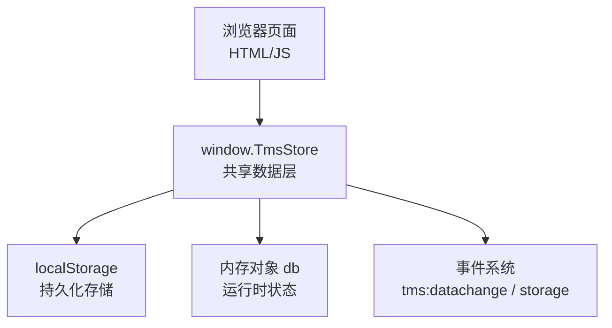
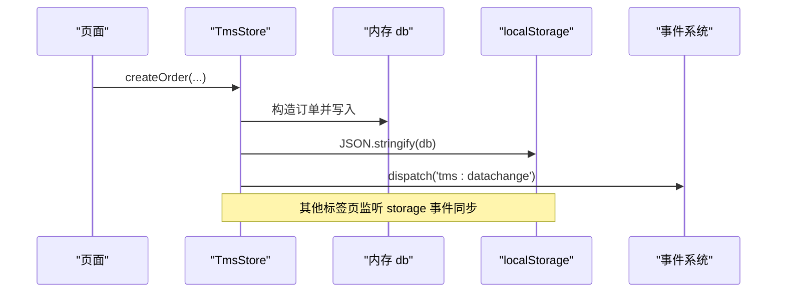
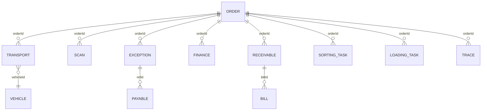
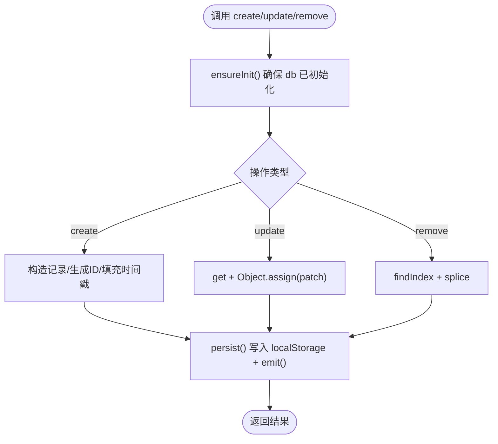
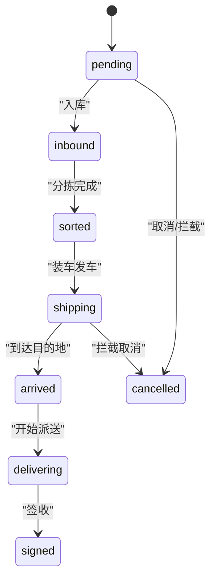
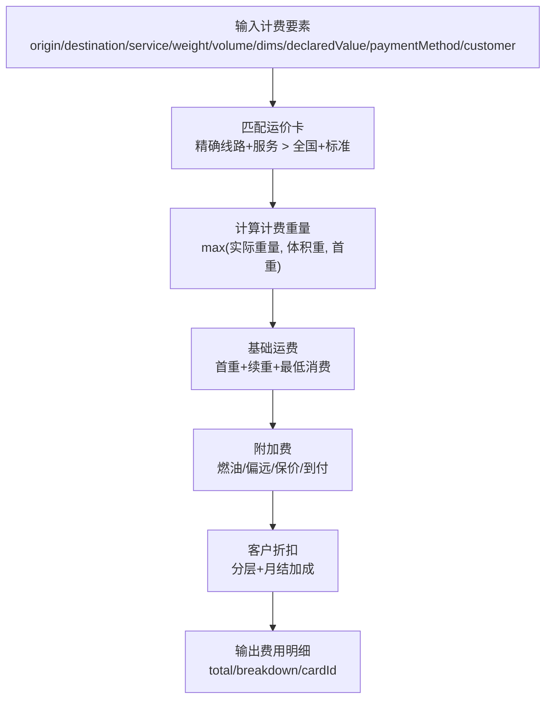
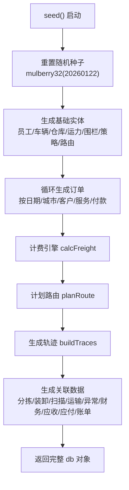
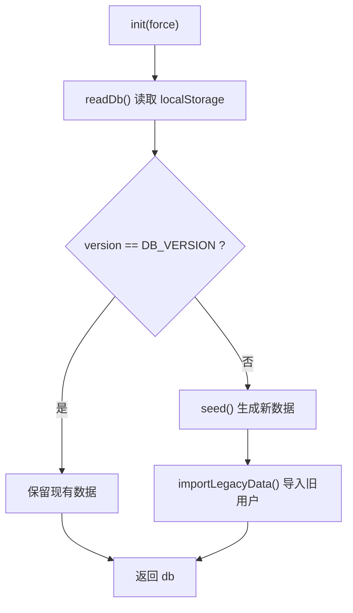
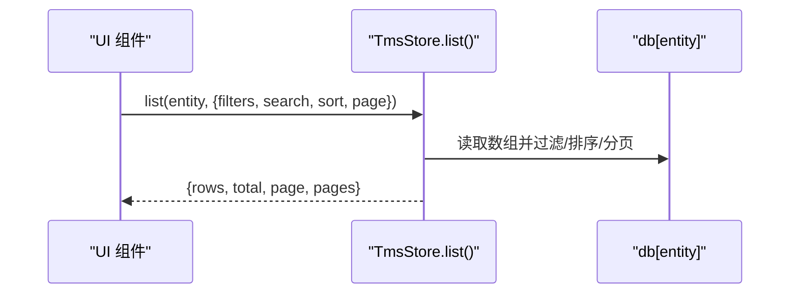
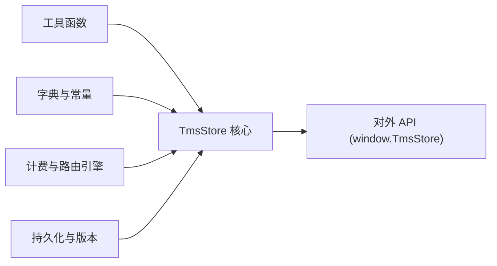

# 数据层设计

<cite>
**本文引用的文件 **
- [tms-store.js](file://tms-store.js)
</cite>

## 目录
1. [引言](#引言)
2. [项目结构](#项目结构)
3. [核心组件](#核心组件)
4. [架构总览](#架构总览)
5. [详细组件分析](#详细组件分析)
6. [依赖关系分析](#依赖关系分析)
7. [性能与缓存策略](#性能与缓存策略)
8. [安全性考虑](#安全性考虑)
9. [故障排查指南](#故障排查指南)
10. [结论](#结论)
11. [附录：TmsStore API 速查](#附录tmsstore-api-速查)

## 引言
本设计文档面向 TMS（运输管理系统）的数据层，重点阐述基于 localStorage 的轻量级业务数据库实现。该数据层以 TmsStore 为核心，提供统一的数据模型、CRUD 接口、订单生命周期流转、种子数据生成、统计聚合、版本迁移与跨标签页同步等能力。读者可据此理解系统如何在不依赖后端数据库的情况下，在浏览器端完成完整的物流业务演示与交互。

## 项目结构
TMS 前端采用多页面 HTML + JS 的组织方式，其中 tms-store.js 是共享数据层模块，被管理员端各页面通过 window.TmsStore 引用。其他页面如 tms-index.html、tms-administration.html 等通过调用 TmsStore 暴露的方法进行数据操作与展示。

图表来源
- [tms-store.js:1-12](file://tms-store.js#L1-L12)
- [tms-store.js:2296-2369](file://tms-store.js#L2296-L2369)

章节来源
- [tms-store.js:1-12](file://tms-store.js#L1-L12)

## 核心组件
TmsStore 的核心职责包括：
- 初始化与版本管理：首次访问时生成种子数据，维护 DB_VERSION 与迁移逻辑。
- 通用 CRUD：list/get/create/update/remove 提供统一的集合操作。
- 业务动作：advanceOrder/cancelOrder/changeOrder/createReverseOrder 等驱动订单全生命周期。
- 关联实体：自动创建或更新扫描、分拣、装卸、运输、异常、财务、应收应付、账单等记录。
- 计费引擎：根据运价卡、服务等级、重量体积、保价、到付、客户折扣计算运费明细。
- 统计聚合：overview/orderTrend/statusDistribution/dailyStats/financeSummary/billingSummary 等。
- 事件订阅：subscribe 监听数据变更；storage 事件实现跨标签页同步。

章节来源
- [tms-store.js:1-12](file://tms-store.js#L1-L12)
- [tms-store.js:2296-2357](file://tms-store.js#L2296-L2357)

## 架构总览
TmsStore 采用“内存对象 + localStorage 持久化”的双层结构。所有写操作先更新内存中的 db 对象，再序列化写入 localStorage，并触发 tms:datachange 事件通知订阅者。跨标签页通过 storage 事件保持数据一致性。

图表来源
- [tms-store.js:232-244](file://tms-store.js#L232-L244)
- [tms-store.js:1571-1634](file://tms-store.js#L1571-L1634)
- [tms-store.js:2361-2369](file://tms-store.js#L2361-L2369)

## 详细组件分析

### 数据模型定义与关系映射
TmsStore 在 seed() 中生成大量演示数据，形成以下核心实体及关系：
- Order（订单）：包含运单号、客户、收发地址、重量体积、服务等级、付款方式、运费明细、状态、时间线、轨迹、SLA 截止等字段。
- Transport（运输任务）：关联订单、承运商、车辆、司机、起止时间、进度。
- Exception（异常）：关联订单、类型、处理流程、责任方、扣款金额、SLA、升级标记。
- User（用户）、Employee（员工）：用户用于登录与权限，员工用于运营、仓储、运输等岗位信息。
- 其他实体：SortingTask、LoadingTask、Scan、Finance、Receivable、Payable、Bill、Vehicle、Warehouse、Inventory、Capacity、Geofence、Device、Policy、RoutingRule、RateCard、Route、ServiceTicket、Claim 等。

图表来源
- [tms-store.js:464-1151](file://tms-store.js#L464-L1151)
- [tms-store.js:1326-1462](file://tms-store.js#L1326-L1462)
- [tms-store.js:1836-1873](file://tms-store.js#L1836-L1873)

章节来源
- [tms-store.js:464-1151](file://tms-store.js#L464-L1151)

### 通用 CRUD 与事务机制
- list(entity, options)：支持 filters/search/sort/page/pageSize，返回 rows/total/page/pages。
- get(entity, id)：按 id 查找实体。
- create(entity, data)：自动生成 id（带前缀映射），设置 createdAt/updatedAt，插入数组头部。
- update(entity, id, patch)：合并补丁并更新时间戳。
- remove(entity, id)：按 id 删除并持久化。
- 事务机制：当前为单条记录的原子写入（Object.assign/splice + persist）。复杂业务动作（如 advanceOrder/cancelOrder/changeOrder）内部组合多次写操作，但并未使用显式事务回滚；若中途失败可能产生部分一致状态，建议后续引入事务包装与错误恢复。

图表来源
- [tms-store.js:1197-1318](file://tms-store.js#L1197-L1318)

章节来源
- [tms-store.js:1197-1318](file://tms-store.js#L1197-L1318)

### 订单生命周期与关联数据联动
订单状态机由 ORDER_FLOW 定义，applyOrderStatus 负责状态推进时的副作用：
- inbound：入库扫描、创建分拣任务、任务置 processing。
- sorted：分拣完成、出库扫描、创建装卸任务。
- shipping：装车完成、创建运输任务、分配车辆、轨迹节点 DEPARTURE。
- arrived：到达扫描、运输任务置 arrived。
- delivering：派送扫描、运输任务置 delivering。
- signed：签收扫描、运输任务 completed、结算（月结挂应收或现付确认收入）、释放车辆。

图表来源
- [tms-store.js:88-96](file://tms-store.js#L88-L96)
- [tms-store.js:1494-1556](file://tms-store.js#L1494-L1556)

章节来源
- [tms-store.js:1494-1556](file://tms-store.js#L1494-L1556)

### 计费引擎与报价
calcFreight 根据运价卡与服务等级计算费用明细：
- 首重/续重、体积重（尺寸或体积换算）、最低消费、燃油附加费、偏远附加费、保价费、到付手续费。
- 客户协议折扣（KA/A/B/C 分层，月结额外优惠）。
- 返回 total、breakdown、cardId/service/chargeableWeight 等字段供订单与改单重算使用。

图表来源
- [tms-store.js:278-383](file://tms-store.js#L278-L383)
- [tms-store.js:1584-1615](file://tms-store.js#L1584-L1615)

章节来源
- [tms-store.js:278-383](file://tms-store.js#L278-L383)

### 种子数据生成算法
seed() 使用固定随机种子 mulberry32(20260122) 保证演示数据稳定。生成内容包括：
- 员工、车辆、仓库库存、运力资源、电子围栏、策略、路由规则、配送地址、时效规则、改单记录、考核指标。
- 订单主数据：近 14 天，每天随机数量，按城市/客户/商品/服务等级/付款方式生成真实感数据。
- 关联数据：分拣/装卸/扫描/运输/异常/财务/应收/应付/账单/工单/理赔/行政记录/绩效等。
- 汇总 tracePool 供轨迹中心检索。

图表来源
- [tms-store.js:44-54](file://tms-store.js#L44-L54)
- [tms-store.js:464-1151](file://tms-store.js#L464-L1151)

章节来源
- [tms-store.js:464-1151](file://tms-store.js#L464-L1151)

### 数据版本管理与迁移策略
- DB_KEY = 'tmsDB_v3'，DB_VERSION = 3。
- readDb() 校验 parsed.version === DB_VERSION，否则视为无效数据并重新初始化。
- init(force)：若无数据或强制初始化则 seed()，并尝试 importLegacyData 导入旧用户数据。
- reset()：清除 localStorage 并重建数据。

图表来源
- [tms-store.js:220-235](file://tms-store.js#L220-L235)
- [tms-store.js:1164-1193](file://tms-store.js#L1164-L1193)
- [tms-store.js:1313-1318](file://tms-store.js#L1313-L1318)

章节来源
- [tms-store.js:220-235](file://tms-store.js#L220-L235)
- [tms-store.js:1164-1193](file://tms-store.js#L1164-L1193)
- [tms-store.js:1313-1318](file://tms-store.js#L1313-L1318)

### 数据访问模式与缓存策略
- 访问模式：所有读操作通过 ensureInit() 确保 db 存在；写操作后调用 persist() 写入 localStorage 并 emit() 触发事件。
- 缓存策略：db 作为内存缓存，避免频繁解析 localStorage；跨标签页通过 storage 事件同步。
- 列表查询：list() 在内存中对数组进行 filter/sort/slice，适合中小规模演示数据。

图表来源
- [tms-store.js:1208-1256](file://tms-store.js#L1208-L1256)

章节来源
- [tms-store.js:1208-1256](file://tms-store.js#L1208-L1256)

### 代码示例路径（不直接粘贴代码）
- 创建订单：参考 [tms-store.js:1571-1634](file://tms-store.js#L1571-L1634)
- 推进订单状态：参考 [tms-store.js:1558-1569](file://tms-store.js#L1558-L1569)
- 改单并重算运费：参考 [tms-store.js:1666-1700](file://tms-store.js#L1666-L1700)
- 取消订单与联动作废应收/冲销收入：参考 [tms-store.js:1637-1663](file://tms-store.js#L1637-L1663)
- 创建异常与闭环：参考 [tms-store.js:1737-1816](file://tms-store.js#L1737-L1816)
- 标记应收已回款：参考 [tms-store.js:1838-1849](file://tms-store.js#L1838-L1849)
- 生成月度账单：参考 [tms-store.js:1852-1873](file://tms-store.js#L1852-L1873)
- 轨迹超时检查与自动预警：参考 [tms-store.js:1877-1893](file://tms-store.js#L1877-L1893)
- 统计概览与趋势：参考 [tms-store.js:2012-2041](file://tms-store.js#L2012-L2041)、[tms-store.js:2043-2059](file://tms-store.js#L2043-L2059)

## 依赖关系分析
TmsStore 内部模块耦合度较高，主要依赖关系如下：
- 工具函数：pad/dateKey/dateTimeKey/hash/mulberry32/pick/randInt/money/nowIso/at。
- 字典与常量：ORDER_FLOW/STATUS_LABELS/CITY_PROVINCE/CITIES/CUSTOMERS/GOODS/CARRIERS/NAMES/DEPARTMENTS/PERMISSIONS/ROLES/AREAS/SERVICE_LEVELS/PAYMENT_METHODS/CUSTOMER_LEVELS/TRACE_NODES。
- 业务引擎：calcFreight/buildRateCards/pickRateCard/buildRoutes/findRoute/planRoute/buildTraces。
- 数据持久化：readDb/persist/emit/counterNext/counterSeed/importLegacyData/init/reset。
- 对外 API：api 对象导出所有方法至 window.TmsStore。

图表来源
- [tms-store.js:19-77](file://tms-store.js#L19-L77)
- [tms-store.js:79-214](file://tms-store.js#L79-L214)
- [tms-store.js:263-460](file://tms-store.js#L263-L460)
- [tms-store.js:220-244](file://tms-store.js#L220-L244)
- [tms-store.js:2296-2357](file://tms-store.js#L2296-L2357)

章节来源
- [tms-store.js:19-77](file://tms-store.js#L19-L77)
- [tms-store.js:79-214](file://tms-store.js#L79-L214)
- [tms-store.js:263-460](file://tms-store.js#L263-L460)
- [tms-store.js:220-244](file://tms-store.js#L220-L244)
- [tms-store.js:2296-2357](file://tms-store.js#L2296-L2357)

## 性能与缓存策略
- 内存缓存：db 对象常驻内存，减少 localStorage 解析开销。
- 列表查询：filter/sort/slice 在内存中进行，适合演示规模；若数据量增长，应考虑索引与分页优化。
- 轨迹与扫描上限：db.traces 限制 2000 条，db.scans 限制 500 条，防止无限增长。
- 事件广播：emit() 遍历 listeners，应避免过多订阅者造成性能瓶颈。
- 跨标签页同步：storage 事件仅在 key 变化时触发，开销较低。

章节来源
- [tms-store.js:1444-1462](file://tms-store.js#L1444-L1462)
- [tms-store.js:1326-1346](file://tms-store.js#L1326-L1346)
- [tms-store.js:237-244](file://tms-store.js#L237-L244)
- [tms-store.js:2361-2369](file://tms-store.js#L2361-L2369)

## 安全性考虑
- 数据加密：当前未对 localStorage 内容进行加密，敏感信息（如手机号、邮箱）以明文存储。建议在持久化前对敏感字段进行加密，并在读取后解密。
- 访问控制：用户角色与权限存在于 ROLES/PERMISSIONS/DEPARTMENTS 中，但 TmsStore 未内置鉴权中间件。应在页面层或 API 层结合用户会话进行权限校验。
- 数据完整性：无显式事务与校验约束，建议在关键业务动作中加入参数校验与幂等性保护。
- 防注入：list() 的 searchFields 直接使用 Object.keys(rows[0])，需确保传入字段名安全，避免原型链污染。

章节来源
- [tms-store.js:144-164](file://tms-store.js#L144-L164)
- [tms-store.js:1224-1233](file://tms-store.js#L1224-L1233)

## 故障排查指南
- 数据未初始化：检查 DB_KEY 与 DB_VERSION 是否匹配；确认 localStorage 中是否存在有效数据。
- 列表为空：确认 entity 名称是否正确；检查 filters/search 条件是否过于严格。
- 订单状态无法推进：检查 order.status 是否已达到最终状态或被取消；确认 actor 与时间戳是否传递正确。
- 轨迹超时未报警：检查 checkTracesOvertime 是否被调用；确认 deadline 与 isOvertime 标记逻辑。
- 跨标签页不同步：确认 storage 事件监听器是否生效；检查 DB_KEY 是否一致。

章节来源
- [tms-store.js:220-235](file://tms-store.js#L220-L235)
- [tms-store.js:1208-1256](file://tms-store.js#L1208-L1256)
- [tms-store.js:1558-1569](file://tms-store.js#L1558-L1569)
- [tms-store.js:1877-1893](file://tms-store.js#L1877-L1893)
- [tms-store.js:2361-2369](file://tms-store.js#L2361-L2369)

## 结论
TmsStore 以简洁的架构实现了 TMS 数据层的完整功能，涵盖数据模型、CRUD、订单生命周期、计费引擎、种子数据、统计聚合与版本迁移。其优势在于轻量、易部署、便于演示；不足在于缺乏强事务、加密与高级索引。未来可在不破坏现有 API 的前提下，逐步引入事务封装、敏感字段加密、索引优化与更严格的参数校验，以提升系统的健壮性与安全性。

## 附录：TmsStore API 速查
- 初始化与重置：init(force), reset()
- 通用 CRUD：list(entity, options), get(entity, id), create(entity, data), update(entity, id, patch), remove(entity, id)
- 订阅与事件：subscribe(fn)
- 订单业务：advanceOrder(orderId, actor), createOrder(data, options), cancelOrder(orderId, reason), removeOrder(orderId), changeOrder(orderId, patch, options), createReverseOrder(orderId, reason)
- 异常与工单：createException(data), processException(id, handler), resolveException(id, resolution, options), createTicket(data), processTicket(id, assignee), resolveTicket(id, result)
- 理赔与财务：createClaim(data), approveClaim(id), markReceivablePaid(id), generateBills(period, customer)
- 运输与作业：updateTransportStatus(id, nextStatus), completeSorting(id), completeLoading(id)
- 计费与报价：quote(params), calcFreight(params, cards)
- 统计聚合：overview(), orderTrend(days), statusDistribution(), exceptionByType(), dailyStats(days), vehicleStats(), warehouseStats(), financeSummary(days), financeTrend(days), employeeStats(), billingSummary(), payableSummary(period), routeStats(), traceOvertimeStats(), orderLifecycleStats()
- 工具函数：dateKey(d), dateTimeKey(d), money(n)

章节来源
- [tms-store.js:2296-2357](file://tms-store.js#L2296-L2357)