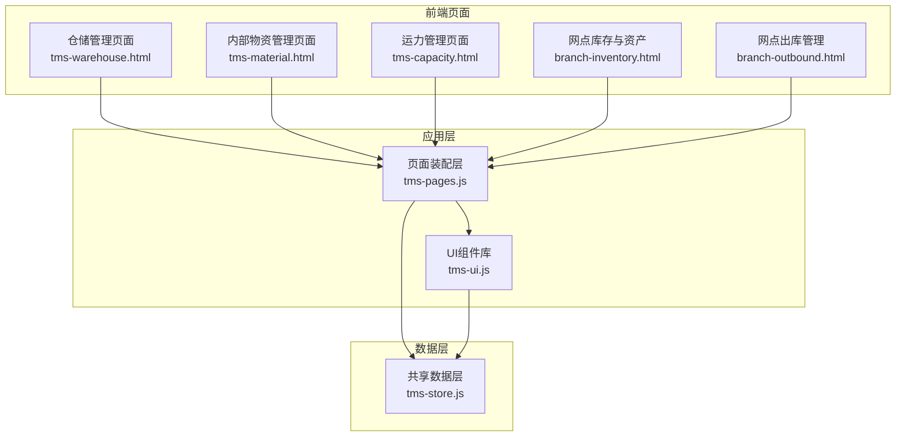
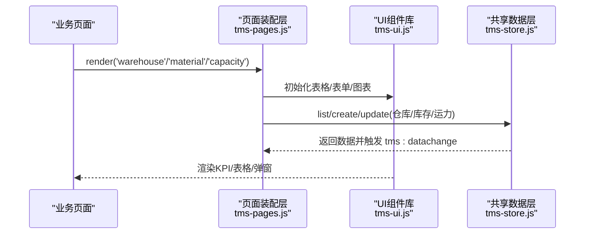
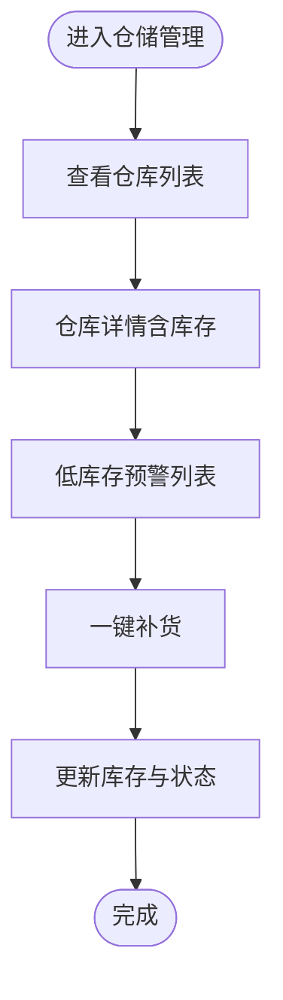
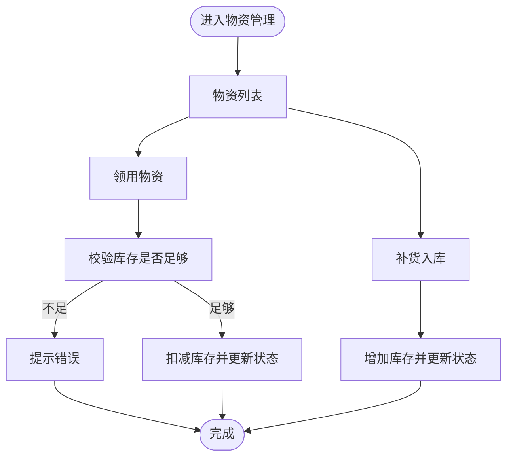
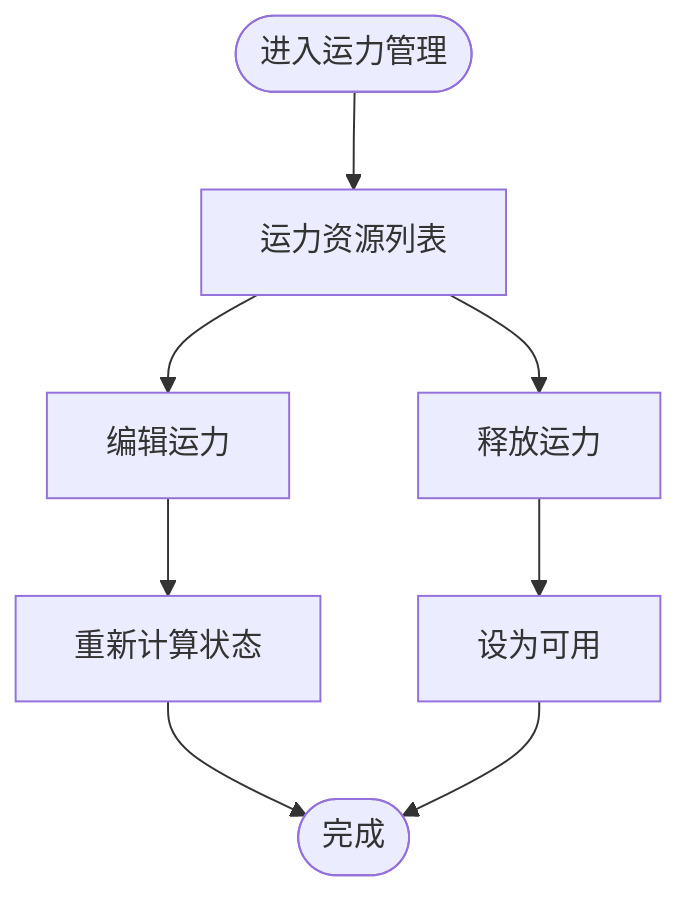
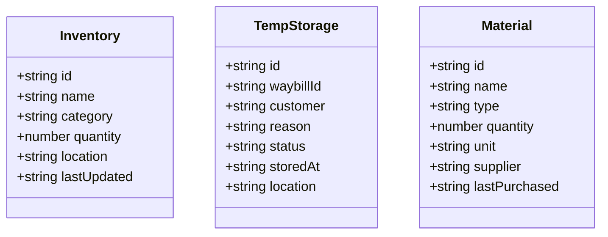
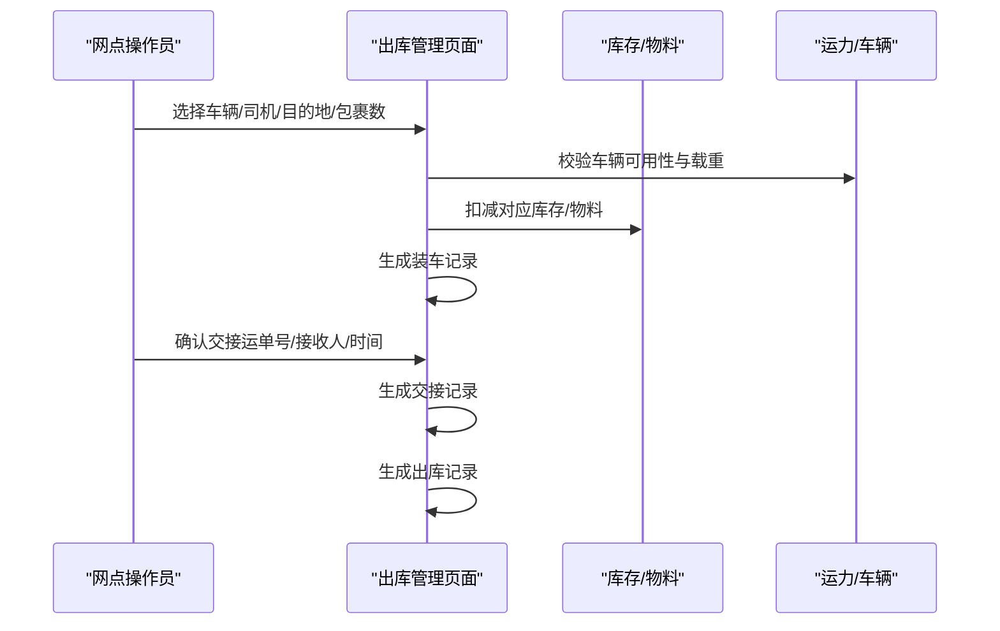
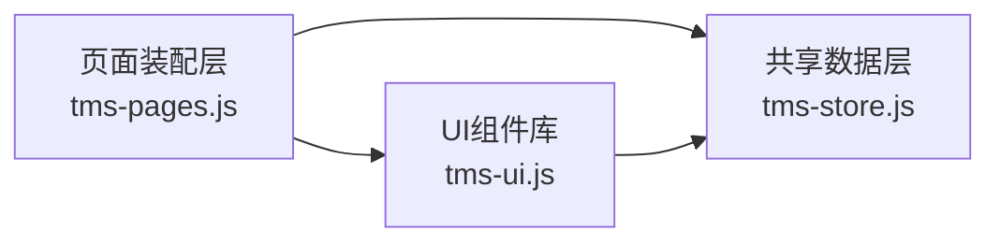

# 仓储物流模型

<cite>
**本文引用的文件**   
- [tms-store.js](file://tms-store.js)
- [tms-pages.js](file://tms-pages.js)
- [tms-ui.js](file://tms-ui.js)
- [tms-warehouse.html](file://tms-warehouse.html)
- [tms-material.html](file://tms-material.html)
- [tms-capacity.html](file://tms-capacity.html)
- [branch-inventory.html](file://branch-inventory.html)
- [branch-outbound.html](file://branch-outbound.html)
</cite>

## 目录
1. [引言](#引言)
2. [项目结构](#项目结构)
3. [核心实体与数据定义](#核心实体与数据定义)
4. [系统架构总览](#系统架构总览)
5. [详细组件分析](#详细组件分析)
6. [依赖关系分析](#依赖关系分析)
7. [性能与扩展性考虑](#性能与扩展性考虑)
8. [故障排查指南](#故障排查指南)
9. [结论](#结论)
10. [附录：示例数据与字段字典](#附录示例数据与字段字典)

## 引言
本文件面向TMS系统的仓储物流模块，聚焦仓库、库存、物料、运力等核心实体的数据定义与业务逻辑，梳理入库、出库、盘点等作业流程的数据流向，并给出运力调度（车辆管理、路线规划、装载优化）所需的数据支撑。文档同时提供实体关系图、业务流程图与数据流图，帮助开发者快速理解仓储物流模块的整体架构与实现要点。

## 项目结构
仓储物流相关能力由以下部分协同实现：
- 共享数据层：基于 localStorage 的轻量数据库，负责种子数据生成、CRUD、状态流转、统计聚合与事件通知。
- 页面装配层：统一渲染 KPI、图表、可筛选分页表格与表单弹窗，驱动仓储、物资、运力等业务页。
- UI 组件库：提供列表、搜索/筛选/分页、表单弹窗、确认框、Toast、SVG 图表等通用能力。
- 业务页面：仓储管理、内部物资管理、运力管理、网点库存与资产、网点出库管理等前端页面。

**图示来源**
- [tms-warehouse.html:340-544](file://tms-warehouse.html#L340-L544)
- [tms-material.html:262-385](file://tms-material.html#L262-L385)
- [tms-capacity.html:345-543](file://tms-capacity.html#L345-L543)
- [branch-inventory.html:337-458](file://branch-inventory.html#L337-L458)
- [branch-outbound.html:376-439](file://branch-outbound.html#L376-L439)
- [tms-pages.js:108-135](file://tms-pages.js#L108-L135)
- [tms-ui.js:303-544](file://tms-ui.js#L303-L544)
- [tms-store.js:220-244](file://tms-store.js#L220-L244)

**章节来源**
- [tms-store.js:1-12](file://tms-store.js#L1-L12)
- [tms-pages.js:1-16](file://tms-pages.js#L1-L16)
- [tms-ui.js:1-10](file://tms-ui.js#L1-L10)

## 核心实体与数据定义
本节围绕仓库、库存、物料、运力四大实体展开，说明字段含义、取值范围与业务规则。

### 仓库（Warehouse）
- id：仓库唯一标识，如 WH-01。
- name：仓库名称，如“北京中心仓”。
- city：所在城市，用于区域划分与路由匹配。
- manager：负责人。
- area：面积（㎡），用于容量与利用率计算。
- usedRate：使用率（%），超过阈值（如 85%）时仓库状态为繁忙。
- inboundToday/outboundToday：当日入库/出库量，用于运营统计。
- status：状态，normal/busy。

业务规则
- 使用率 > 85% → busy；否则 normal。
- 仓库详情可查看其库存明细与安全库存预警。

**章节来源**
- [tms-store.js:542-554](file://tms-store.js#L542-L554)
- [tms-pages.js:361-449](file://tms-pages.js#L361-L449)

### 库存（Inventory）
- id：库存记录ID，如 INV-001。
- name：物资名称。
- spec：规格型号。
- warehouse：所属仓库。
- location：库位编码，如“A区-01”。
- stock：当前库存数量。
- safetyStock：安全库存阈值。
- unit：计量单位，如个/卷/包。
- status：库存健康状态，normal/low/out。
- updatedAt：最后更新时间。

业务规则
- stock < safetyStock → low；stock ≤ 0 → out；否则 normal。
- 支持领用、补货操作，自动更新状态与时间戳。
- 低库存预警在仓储管理页展示，并提供一键补货入口。

**章节来源**
- [tms-store.js:520-540](file://tms-store.js#L520-L540)
- [tms-pages.js:662-742](file://tms-pages.js#L662-L742)
- [tms-warehouse.html:446-527](file://tms-warehouse.html#L446-L527)

### 物料（Material）
在本项目中，“物料”通常以库存项形式存在，即 inventory 表中的包装耗材与作业物资。此外，网点侧也有独立的物料管理视图，字段包括：
- id/name/type/quantity/unit/supplier/lastPurchased 等。

业务规则
- 与库存一致，按安全库存判断状态。
- 支持领用、采购、更新库存等操作。

**章节来源**
- [tms-material.html:459-534](file://tms-material.html#L459-L534)
- [branch-inventory.html:589-644](file://branch-inventory.html#L589-L644)

### 运力（Capacity）
- id：运力资源ID，如 CAP-001。
- type：资源类型，自有车辆/外协车辆/临时仓/航空仓位。
- name：资源名称，如“上海线路运力”。
- supplier：供应商。
- capacity：可承载总量。
- remaining：剩余承载量。
- status：可用/满载（available/busy）。
- validUntil：有效期。

业务规则
- remaining < capacity × 0.15 → busy；否则 available。
- 支持释放、编辑，联动运输任务占用与预警。

**章节来源**
- [tms-store.js:556-571](file://tms-store.js#L556-L571)
- [tms-pages.js:579-658](file://tms-pages.js#L579-L658)
- [tms-capacity.html:451-525](file://tms-capacity.html#L451-L525)

## 系统架构总览
仓储物流模块采用“页面装配 + UI组件 + 共享数据层”的分层架构：
- 页面装配层（tms-pages.js）：定义各业务页的KPI、图表、表格与CRUD动作，调用数据层API。
- UI组件库（tms-ui.js）：提供通用交互能力（表单、弹窗、列表、图表）。
- 共享数据层（tms-store.js）：维护仓库、库存、运力、车辆、订单等数据，提供增删改查、统计聚合与事件广播。

**图示来源**
- [tms-pages.js:108-135](file://tms-pages.js#L108-L135)
- [tms-ui.js:303-544](file://tms-ui.js#L303-L544)
- [tms-store.js:220-244](file://tms-store.js#L220-L244)

## 详细组件分析

### 仓库与库存管理
- 仓库维度：展示仓库基本信息、使用率、当日出入库量；支持新增/编辑仓库。
- 库存维度：按仓库过滤查看物资清单；支持领用、补货；低库存预警列表与一键补货。

**图示来源**
- [tms-pages.js:361-472](file://tms-pages.js#L361-L472)
- [tms-store.js:520-554](file://tms-store.js#L520-L554)

**章节来源**
- [tms-pages.js:361-472](file://tms-pages.js#L361-L472)
- [tms-store.js:520-554](file://tms-store.js#L520-L554)

### 内部物资管理
- 物资维度：展示物资种类、库存总量、低库存数量；支持新增、领用、补货。
- 安全库存策略：根据 stock 与 safetyStock 比较自动判定状态。

**图示来源**
- [tms-pages.js:662-742](file://tms-pages.js#L662-L742)
- [tms-material.html:459-634](file://tms-material.html#L459-L634)

**章节来源**
- [tms-pages.js:662-742](file://tms-pages.js#L662-L742)
- [tms-material.html:459-634](file://tms-material.html#L459-L634)

### 运力资源管理
- 运力维度：展示资源类型、供应商、可承载量与剩余量；支持新增、编辑、释放。
- 满载预警：remaining/capacity 比例低于阈值标记为满载。

**图示来源**
- [tms-pages.js:579-658](file://tms-pages.js#L579-L658)
- [tms-capacity.html:451-525](file://tms-capacity.html#L451-L525)

**章节来源**
- [tms-pages.js:579-658](file://tms-pages.js#L579-L658)
- [tms-capacity.html:451-525](file://tms-capacity.html#L451-L525)

### 网点库存与资产
- 功能标签：库存管理、暂存件管理、物料管理。
- 数据结构：库存包含id/name/category/quantity/location/lastUpdated；暂存件包含waybillId/customer/reason/status/storedAt/location；物料包含type/unit/supplier/lastPurchased。

**图示来源**
- [branch-inventory.html:482-644](file://branch-inventory.html#L482-L644)

**章节来源**
- [branch-inventory.html:437-726](file://branch-inventory.html#L437-L726)

### 网点出库管理
- 功能标签：装车发运、交接确认、车辆管理、出库记录。
- 数据结构：装车记录包含vehicle/driver/destination/packageCount/notes/loadingTime/status；交接记录包含waybillNumber/vehicle/receiver/handoverTime/operator；出库记录包含vehicle/driver/destination/packageCount/outboundTime/status。

**图示来源**
- [branch-outbound.html:432-656](file://branch-outbound.html#L432-L656)
- [branch-outbound.html:716-800](file://branch-outbound.html#L716-L800)

**章节来源**
- [branch-outbound.html:432-656](file://branch-outbound.html#L432-L656)
- [branch-outbound.html:716-800](file://branch-outbound.html#L716-L800)

## 依赖关系分析
- 页面装配层依赖UI组件库进行渲染与交互，依赖共享数据层进行数据读写。
- 共享数据层维护多类实体（仓库、库存、运力、车辆、订单等），并通过事件机制通知订阅者刷新界面。
- 业务页面通过页面装配层间接访问数据层，避免直接耦合。

**图示来源**
- [tms-pages.js:10-16](file://tms-pages.js#L10-L16)
- [tms-ui.js:758-782](file://tms-ui.js#L758-L782)
- [tms-store.js:220-244](file://tms-store.js#L220-L244)

**章节来源**
- [tms-pages.js:108-135](file://tms-pages.js#L108-L135)
- [tms-ui.js:303-544](file://tms-ui.js#L303-L544)
- [tms-store.js:220-244](file://tms-store.js#L220-L244)

## 性能与扩展性考虑
- 数据持久化：localStorage 适合演示与轻量场景；生产环境建议迁移至后端数据库与REST/GraphQL接口。
- 列表与分页：UI组件已内置分页与排序；大数据量时应结合服务端分页与索引优化。
- 事件驱动：数据变更通过 tms:datachange 事件广播，避免全量刷新；注意监听器数量与复杂度控制。
- 扩展点：
  - 新增实体：在共享数据层添加种子数据与CRUD方法，在页面装配层注册表格与表单。
  - 业务规则：将状态判定逻辑集中到数据层，便于复用与测试。
  - 可视化：利用UI组件库的图表能力扩展KPI与趋势分析。

[本节为通用指导，不直接分析具体文件]

## 故障排查指南
常见问题与定位思路
- 数据未刷新：检查是否订阅了 tms:datachange 事件；确认数据层 persist() 被调用。
- 状态异常：核对状态映射与阈值逻辑（如库存安全库存、运力满载阈值）。
- 表单提交失败：检查必填字段校验与 onSubmit 返回值；必要时捕获异常并显示错误信息。
- 列表为空：确认 entity 名称与数据层键名一致；检查 filters/searchFields 配置。

**章节来源**
- [tms-store.js:220-244](file://tms-store.js#L220-L244)
- [tms-ui.js:165-287](file://tms-ui.js#L165-L287)
- [tms-pages.js:361-472](file://tms-pages.js#L361-L472)

## 结论
本仓储物流模型以仓库、库存、物料、运力为核心实体，通过页面装配层与UI组件库构建统一的业务界面，并由共享数据层提供稳定的数据服务。安全库存、库存预警、库位管理与运力调度等关键业务逻辑均已在数据层与页面装配层中体现。建议在后续迭代中完善盘点流程、装载优化算法与轨迹追踪，并将数据存储迁移至后端以提升可扩展性与可靠性。

[本节为总结性内容，不直接分析具体文件]

## 附录：示例数据与字段字典
- 仓库示例：WH-01 / 北京中心仓 / 北京 / 张三 / 3000㎡ / 使用率 64% / 今日入库 120 / 今日出库 90 / normal。
- 库存示例：INV-001 / 纸箱 / 中号 400×300×250mm / 北京中心仓 / A区-01 / 库存 200 / 安全库存 300 / 个 / low。
- 运力示例：CAP-001 / 自有车辆 / 上海线路运力 / 顺丰物流 / 可承载 20吨 / 剩余 5吨 / busy / 有效期至 2026-12-31。
- 网点库存示例：INV-001 / 电子产品 / 电子产品 / 150 / A区货架1 / 2024-01-01。
- 网点暂存件示例：TEMP-001 / WB-12345 / 张三 / 客户不在 / 暂存中 / 2024-01-01 10:00 / 暂存区A1。
- 网点物料示例：MAT-001 / 快递袋 / 包装材料 / 500 / 个 / 供应商A / 2024-01-01。

**章节来源**
- [tms-store.js:520-571](file://tms-store.js#L520-L571)
- [branch-inventory.html:482-644](file://branch-inventory.html#L482-L644)