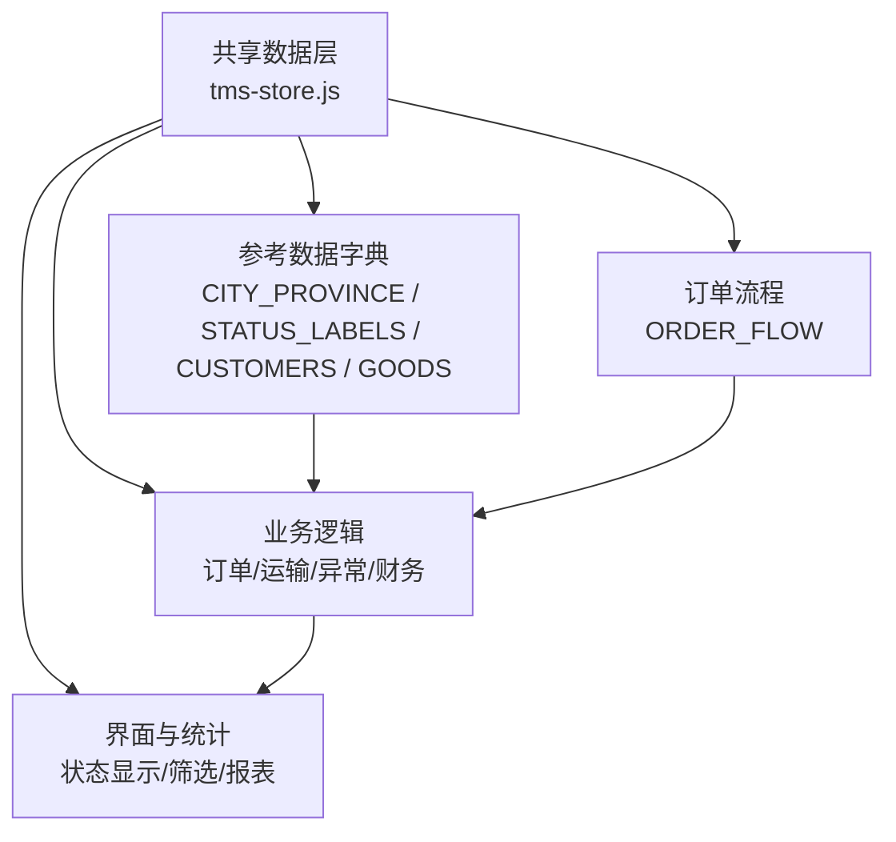
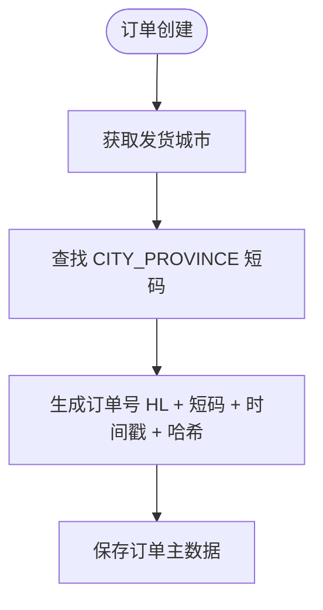
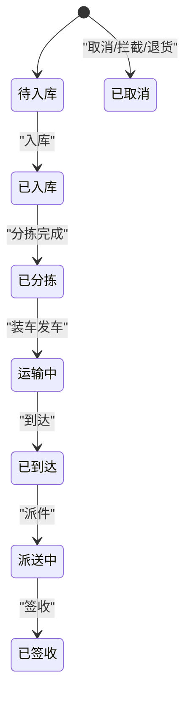
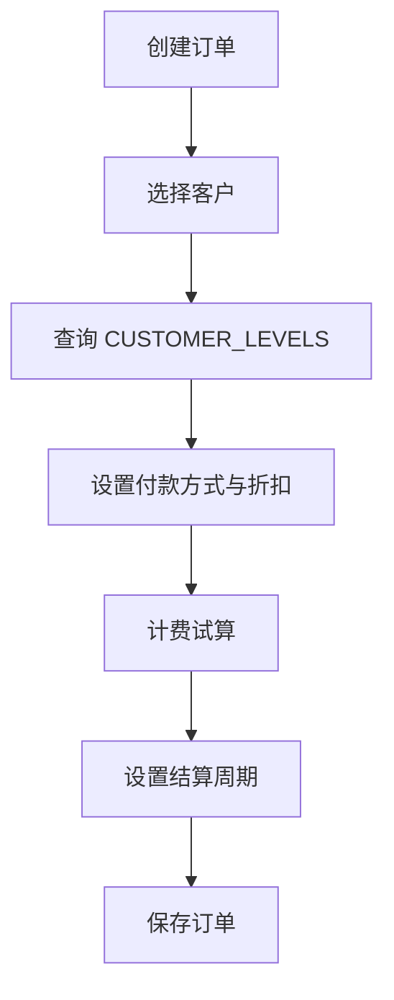
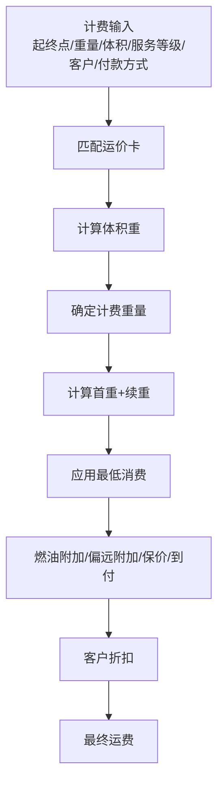
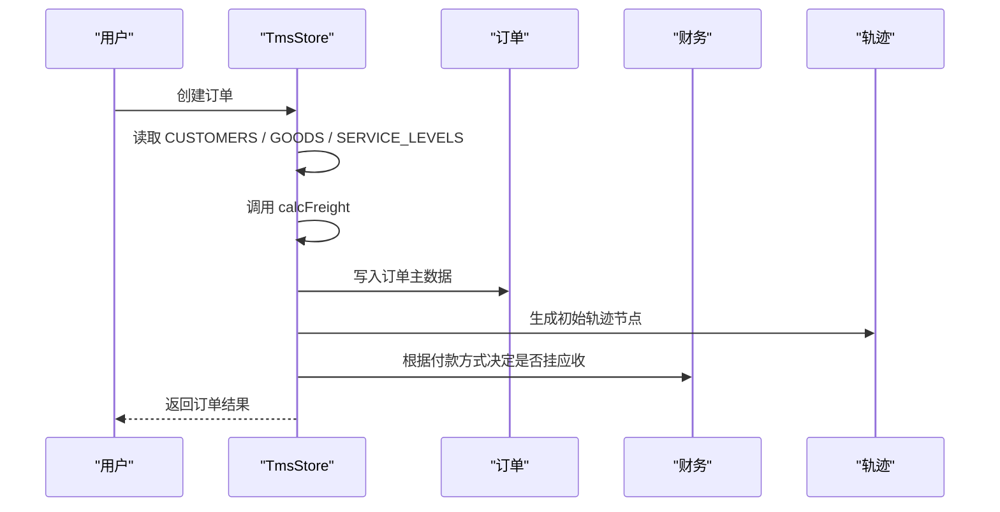
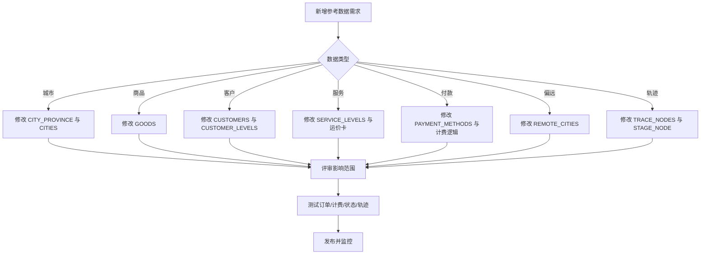
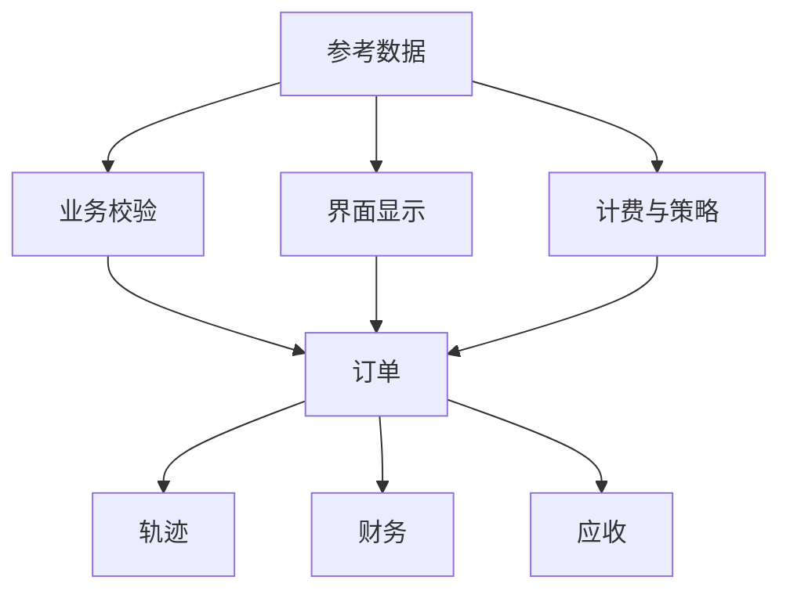

# 参考数据字典

<cite>
**本文引用的文件**   
- [tms-store.js](file://tms-store.js)
</cite>

## 目录
1. [引言](#引言)
2. [项目结构与参考数据定位](#项目结构与参考数据定位)
3. [核心参考数据总览](#核心参考数据总览)
4. [城市与省份代码映射 CITY_PROVINCE](#城市与省份代码映射-city_province)
5. [状态标签 STATUS_LABELS 与订单流程 ORDER_FLOW](#状态标签-status_labels-与订单流程-order_flow)
6. [客户列表 CUSTOMERS 与客户分层 CUSTOMER_LEVELS](#客户列表-customers-与客户分层-customer_levels)
7. [商品分类 GOODS、承运商 CARRIERS 与服务等级 SERVICE_LEVELS](#商品分类-goods承运商-carriers-与服务等级-service_levels)
8. [其他重要参考数据](#其他重要参考数据)
9. [参考数据在业务中的使用方式](#参考数据在业务中的使用方式)
10. [维护规则与扩展策略](#维护规则与扩展策略)
11. [一致性保证机制](#一致性保证机制)
12. [常见问题与排错建议](#常见问题与排错建议)
13. [结论](#结论)

## 引言
本文件为 TMS 系统的参考数据字典，重点解释以下参考数据的结构、含义、使用场景和维护规则：
- 城市与省份代码映射：CITY_PROVINCE
- 状态标签：STATUS_LABELS
- 订单流程：ORDER_FLOW
- 客户列表：CUSTOMERS
- 商品分类：GOODS
- 其他关键参考数据：服务等级、付款方式、偏远城市、轨迹节点等

这些参考数据由共享数据层集中定义，并在订单创建、计费试算、状态流转、轨迹生成、应收账单等业务逻辑中被广泛引用。理解本字典有助于正确配置系统、扩展业务枚举值，并保证多页面、多实体之间的数据一致性。

## 项目结构与参考数据定位
TMS 的参考数据集中在共享数据层中，对外通过统一接口暴露。参考数据既用于前端展示（如状态标签、下拉选项），也用于后端式业务计算（如计费折扣、偏远附加费、轨迹标准时限）。

**图表来源**
- [tms-store.js:79-128](file://tms-store.js#L79-L128)
- [tms-store.js:2299-2307](file://tms-store.js#L2299-L2307)

**章节来源**
- [tms-store.js:1-12](file://tms-store.js#L1-L12)
- [tms-store.js:2299-2307](file://tms-store.js#L2299-L2307)

## 核心参考数据总览
| 参考数据 | 数据结构 | 主要用途 | 是否对外暴露 |
|---|---|---|---|
| CITY_PROVINCE | 城市名到短码的映射对象 | 订单号编码、车辆归属网点、地址生成 | 否，但通过 CITIES 间接暴露 |
| CITIES | 城市名数组 | 随机生成起终点、网点名称、围栏位置 | 是，通过 dict.cities |
| ORDER_FLOW | 有序的状态键值数组 | 订单生命周期、进度推进、统计分布 | 是，通过 ORDER_FLOW 和 dict.orderFlow |
| STATUS_LABELS | 按实体分组的键到中文标签映射 | 时间线、表格列、状态筛选、提示文案 | 是，通过 labels |
| CUSTOMERS | 客户名称数组 | 订单客户、应收账单、协议折扣 | 是，通过 dict.customers |
| CUSTOMER_LEVELS | 客户名到分层、折扣、账期的映射 | 折扣率、结算周期、月结大客户策略 | 是，通过 dict.customerLevels |
| GOODS | 商品分类字符串数组 | 订单货物类型、统计分类 | 是，通过 dict.goods |
| CARRIERS | 承运商名称数组 | 运输任务承运商、种子运力供应商 | 是，通过 dict.carriers |
| SERVICE_LEVELS | 服务等级数组 | 运价卡、路由时效、计费参数 | 是，通过 dict.serviceLevels |
| PAYMENT_METHODS | 付款方式数组 | 订单收款方式、到付附加费 | 是，通过 dict.paymentMethods |
| REMOTE_CITIES | 偏远城市数组 | 偏远附加费判断 | 是，通过 dict.remoteCities |
| TRACE_NODES | 轨迹节点数组 | 轨迹节点、标准时限、节点名称 | 是，通过 dict.traceNodes |

**章节来源**
- [tms-store.js:81-128](file://tms-store.js#L81-L128)
- [tms-store.js:173-213](file://tms-store.js#L173-L213)
- [tms-store.js:2299-2307](file://tms-store.js#L2299-L2307)

## 城市与省份代码映射 CITY_PROVINCE
CITY_PROVINCE 将中文城市名映射为两位短码，用于订单号编码、车辆归属、地址片段生成等。CITIES 是其键集合，供随机选择城市和构建网点名称。

| 城市 | 短码 | 典型使用场景 |
|---|---|---|
| 北京 | BJ | 订单号前缀、车辆归属、路由起点或终点 |
| 上海 | SH | 订单号前缀、路由高优先级线路 |
| 广州 | GZ | 订单号前缀、华南区域网点 |
| 深圳 | SZ | 订单号前缀、华南科技客户覆盖 |
| 杭州 | HZ | 电商客户集中城市 |
| 南京 | NJ | 华东区域补充城市 |
| 成都 | CD | 西南区域城市，同时属于偏远城市 |
| 武汉 | WH | 华中枢纽城市，同时属于偏远城市 |
| 西安 | XA | 西北枢纽城市，同时属于偏远城市 |
| 苏州 | SU | 长三角制造与商贸城市 |

### 业务影响
- 订单号编码：订单号包含城市短码，便于从单号识别发货地。
- 车辆归属：车辆记录中的 branch 字段常以“城市+网点”形式出现。
- 地址生成：种子数据中常用城市名拼接区名、路名，形成真实感地址。
- 路由匹配：部分路由定义使用具体城市作为起终点。

**图表来源**
- [tms-store.js:81-86](file://tms-store.js#L81-L86)
- [tms-store.js:252-257](file://tms-store.js#L252-L257)
- [tms-store.js:680-700](file://tms-store.js#L680-L700)

**章节来源**
- [tms-store.js:81-86](file://tms-store.js#L81-L86)
- [tms-store.js:252-257](file://tms-store.js#L252-L257)
- [tms-store.js:500-517](file://tms-store.js#L500-L517)
- [tms-store.js:680-700](file://tms-store.js#L680-L700)

## 状态标签 STATUS_LABELS 与订单流程 ORDER_FLOW
STATUS_LABELS 是所有实体的状态键到中文标签的统一映射；ORDER_FLOW 是订单生命周期的有序状态序列。两者配合，使订单状态既能向前推进，又能显示友好中文标签。

### 订单流程 ORDER_FLOW
| 顺序 | 键 | 中文标签 | 业务含义 | 典型触发点 |
|---|---|---|---|---|
| 1 | pending | 待入库 | 订单已创建，尚未进入仓库作业 | 创建订单 |
| 2 | inbound | 已入库 | 仓库完成入库扫描，分拣任务开始 | 入库扫描、分拣任务处理 |
| 3 | sorted | 已分拣 | 分拣完成，准备装车出库 | 分拣完成、出库扫描 |
| 4 | shipping | 运输中 | 已装车发车，进入干线或支线运输 | 装车完成、运输任务启动 |
| 5 | arrived | 已到达 | 到达目的地区域或目的地分拨 | 到达扫描 |
| 6 | delivering | 派送中 | 分配给末端网点或派送员 | 到达后派件 |
| 7 | signed | 已签收 | 客户签收，订单闭环 | 签收扫描 |
| 取消态 | cancelled | 已取消 | 订单被取消或拦截退货 | 取消订单、拒收退货 |

**图表来源**
- [tms-store.js:88-96](file://tms-store.js#L88-L96)
- [tms-store.js:1497-1559](file://tms-store.js#L1497-L1559)
- [tms-store.js:1561-1572](file://tms-store.js#L1561-L1572)

### 其他实体状态 STATUS_LABELS
| 实体 | 状态键 | 中文标签 | 说明 |
|---|---|---|---|
| exception | pending | 待处理 | 异常刚上报，未受理 |
| exception | processing | 处理中 | 已受理，正在处理 |
| exception | resolved | 已解决 | 已闭环处理 |
| exception | closed | 已关闭 | 异常归档关闭 |
| transport | pending | 待发车 | 运输任务已创建但未发车 |
| transport | shipping | 运输中 | 已在途 |
| transport | arrived | 已到达 | 到达目的地 |
| transport | delivering | 派送中 | 末端派件阶段 |
| transport | completed | 已完成 | 运输闭环 |
| transport | cancelled | 已取消 | 运输取消 |
| task | pending | 待处理 | 任务未开始 |
| task | processing | 进行中 | 任务执行中 |
| task | done | 已完成 | 任务完成 |
| task | cancelled | 已取消 | 任务取消 |
| ticket | pending | 待受理 | 客服工单未处理 |
| ticket | processing | 处理中 | 客服处理中 |
| ticket | resolved | 已解决 | 工单解决 |
| ticket | closed | 已关闭 | 工单关闭 |
| claim | pending | 待审核 | 理赔申请待审 |
| claim | processing | 审核中 | 理赔审核中 |
| claim | approved | 已通过 | 理赔通过 |
| claim | rejected | 已驳回 | 理赔拒绝 |
| claim | paid | 已赔付 | 理赔已付款 |
| finance | pending | 待结算 | 财务记录未结算 |
| finance | settled | 已结算 | 财务记录已结算 |
| finance | void | 已作废 | 财务记录作废 |
| employee | active | 在职 | 员工正常在岗 |
| employee | on_leave | 休假 | 员工请假 |
| employee | resigned | 离职 | 员工已离职 |
| vehicle | online | 在线 | 车辆在线可用 |
| vehicle | transporting | 运输中 | 车辆在执行运输 |
| vehicle | maintenance | 维修中 | 车辆保养维修 |
| vehicle | offline | 离线 | 车辆离线不可用 |
| inventory | normal | 正常 | 库存充足 |
| inventory | low | 库存偏低 | 库存低于安全库存 |
| inventory | out | 缺货 | 库存为零或极低 |
| capacity | available | 可用 | 运力可用 |
| capacity | busy | 满载 | 运力紧张 |
| capacity | expired | 已失效 | 运力过期 |
| policy | active | 生效中 | 策略生效 |
| policy | suspended | 已暂停 | 策略暂停 |
| policy | expired | 已失效 | 策略过期 |
| gateway | active | 启用 | 网关启用 |
| gateway | inactive | 停用 | 网关停用 |
| receivable | unpaid | 未回款 | 应收未收款 |
| receivable | partial | 部分回款 | 部分收款 |
| receivable | paid | 已回款 | 应收已结清 |
| receivable | overdue | 已逾期 | 超过账期未收款 |
| receivable | void | 已作废 | 应收作废 |
| bill | draft | 草稿 | 账单未确认 |
| bill | confirmed | 已确认 | 账单已确认 |
| bill | settled | 已结清 | 账单已结清 |
| bill | disputed | 争议中 | 账单存在争议 |
| payable | pending | 待结算 | 应付未结算 |
| payable | settled | 已结算 | 应付已结算 |
| rate | active | 生效中 | 运价卡生效 |
| rate | inactive | 已停用 | 运价卡停用 |
| route | active | 启用 | 路由启用 |
| route | inactive | 停用 | 路由停用 |

**章节来源**
- [tms-store.js:98-120](file://tms-store.js#L98-L120)
- [tms-store.js:1497-1559](file://tms-store.js#L1497-L1559)
- [tms-store.js:2064-2077](file://tms-store.js#L2064-L2077)

## 客户列表 CUSTOMERS 与客户分层 CUSTOMER_LEVELS
CUSTOMERS 是系统演示用的客户名称集合；CUSTOMER_LEVELS 则定义每个客户的分层、协议折扣和结算周期。大客户通常享受更高折扣和更长账期，且更可能使用月结。

| 客户 | 分层 | 折扣率 | 结算周期 | 典型业务行为 |
|---|---|---:|---:|---|
| 杭州云帆电商 | KA | 0.12 | 30天 | 大客户优先、月结为主 |
| 上海优选商贸 | KA | 0.10 | 30天 | 大客户优先、月结为主 |
| 北京恒通科技 | A | 0.06 | 45天 | 中等折扣、较长账期 |
| 广州南粤百货 | A | 0.06 | 30天 | 中等折扣、标准账期 |
| 深圳蓝海数码 | B | 0.03 | 30天 | 小折扣、标准账期 |
| 南京金陵食品 | B | 0.03 | 30天 | 小折扣、标准账期 |
| 成都天府家居 | B | 0.02 | 60天 | 小折扣、长账期 |
| 武汉长江医药 | A | 0.05 | 45天 | 中等折扣、中长账期 |
| 西安丝路文化 | C | 0 | 30天 | 无协议折扣、标准账期 |
| 苏州锦绣纺织 | C | 0 | 30天 | 无协议折扣、标准账期 |

### 使用场景
- 订单创建时根据客户选择付款方式：KA/A 客户更倾向月结。
- 计费折扣：客户分层决定基础折扣，月结可叠加额外折扣。
- 应收账期：结算周期影响到期日、逾期判断和账单聚合。
- 统计与报表：客户分层可用于收入分析、回款率分析。

**图表来源**
- [tms-store.js:122-128](file://tms-store.js#L122-L128)
- [tms-store.js:180-192](file://tms-store.js#L180-L192)
- [tms-store.js:265-276](file://tms-store.js#L265-L276)
- [tms-store.js:680-706](file://tms-store.js#L680-L706)

**章节来源**
- [tms-store.js:122-128](file://tms-store.js#L122-L128)
- [tms-store.js:180-192](file://tms-store.js#L180-L192)
- [tms-store.js:265-276](file://tms-store.js#L265-L276)
- [tms-store.js:680-706](file://tms-store.js#L680-L706)

## 商品分类 GOODS、承运商 CARRIERS 与服务等级 SERVICE_LEVELS
GOODS 是商品分类枚举，用于订单货物类型描述和统计；CARRIERS 是承运商名称枚举，用于运输任务承运商；SERVICE_LEVELS 是服务等级枚举，用于运价卡和服务时效。

| 分类 | 示例值 | 业务含义 |
|---|---|---|
| 商品分类 GOODS | 服装鞋帽、电子数码、日用百货、图书文具、食品饮料、医疗器械、家居配件、汽车配件、美妆个护、办公设备 | 描述订单货物类型，便于统计和分析 |
| 承运商 CARRIERS | 顺丰物流、中通快递、申通快递、圆通速递、德邦物流、京东物流 | 干线或末端承运商，影响运输任务和成本 |
| 服务等级 SERVICE_LEVELS | 标准、加急、经济、冷链 | 影响首重价格、续重价格、抛比、燃油附加、最低消费、偏远附加 |

### 服务等级对计费的影响
- 标准：基础服务，适合普通电商订单。
- 加急：更快时效，更高首重和续重价格，更高燃油附加。
- 经济：更低价格，适合低价值、非紧急货物。
- 冷链：高保价、高最低消费和高偏远附加，适用于温控货物。

**图表来源**
- [tms-store.js:176-178](file://tms-store.js#L176-L178)
- [tms-store.js:278-383](file://tms-store.js#L278-L383)

**章节来源**
- [tms-store.js:125-128](file://tms-store.js#L125-L128)
- [tms-store.js:176-178](file://tms-store.js#L176-L178)
- [tms-store.js:278-383](file://tms-store.js#L278-L383)

## 其他重要参考数据
| 参考数据 | 结构 | 用途 |
|---|---|---|
| REMOTE_CITIES | 城市数组 | 判断是否收取偏远附加费 |
| TRACE_NODES | 节点数组 | 定义轨迹节点、标准时限、节点名称 |
| STAGE_NODE | 阶段节点数组 | 订单阶段到轨迹节点的映射 |
| SERVICE_LEVELS | 服务等级数组 | 定价、时效、策略 |
| PAYMENT_METHODS | 付款方式数组 | 现付、到付、月结 |
| DEPARTMENTS | 部门数组 | 组织管理、用户归属 |
| PERMISSIONS | 权限数组 | 角色权限控制 |
| ROLES | 角色数组 | 用户角色与权限绑定 |
| AREAS | 区域数组 | 用户区域权限、配送区域 |
| NAMES | 姓名数组 | 种子数据中的联系人、操作员、司机等 |

### 轨迹节点与订单阶段
TRACE_NODES 定义了揽收、入库、分拣、装车、发车、干线在途、到达、派送、签收、退回、拦截、超区、问题件等节点及其标准时限；STAGE_NODE 将订单阶段映射到轨迹节点，用于生成轨迹明细。

| 轨迹节点 | 标准时限 | 对应订单阶段 |
|---|---:|---|
| GOT | 4小时 | pending → inbound |
| INBOUND | 6小时 | inbound |
| SORTING | 8小时 | sorted |
| LOADING | 4小时 | shipping 前准备 |
| DEPARTURE | 2小时 | shipping |
| TRANSIT | 24小时 | shipping 在途 |
| ARRIVED | 6小时 | arrived |
| DELIVERING | 12小时 | delivering |
| SIGNED | 0小时 | signed |
| RETURNED | 0小时 | 退货 |
| INTERCEPT | 0小时 | 拦截 |
| OVERAREA | 0小时 | 超区 |
| PROBLEM | 0小时 | 问题件 |

**章节来源**
- [tms-store.js:173-174](file://tms-store.js#L173-L174)
- [tms-store.js:194-213](file://tms-store.js#L194-L213)
- [tms-store.js:442-460](file://tms-store.js#L442-L460)
- [tms-store.js:1436-1465](file://tms-store.js#L1436-L1465)

## 参考数据在业务中的使用方式
### 订单创建与计费
- 订单创建时使用 CUSTOMERS、GOODS、SERVICE_LEVELS、PAYMENT_METHODS。
- 计费引擎使用 SERVICE_LEVELS、REMOTE_CITIES、CUSTOMER_LEVELS、PAYMENT_METHODS。
- 订单号使用 CITY_PROVINCE 和城市短码。

### 状态流转与轨迹
- 订单状态推进使用 ORDER_FLOW 和 STATUS_LABELS。
- 轨迹生成使用 TRACE_NODES、STAGE_NODE、STATUS_NODE。
- 扫描记录使用固定扫描类型，与订单阶段对应。

### 应收与账单
- 月结客户使用 CUSTOMER_LEVELS 的结算周期。
- 应收状态使用 STATUS_LABELS.receivable。
- 账单状态使用 STATUS_LABELS.bill。

**图表来源**
- [tms-store.js:680-706](file://tms-store.js#L680-L706)
- [tms-store.js:1574-1638](file://tms-store.js#L1574-L1638)
- [tms-store.js:1467-1495](file://tms-store.js#L1467-L1495)

**章节来源**
- [tms-store.js:680-706](file://tms-store.js#L680-L706)
- [tms-store.js:1467-1495](file://tms-store.js#L1467-L1495)
- [tms-store.js:1574-1638](file://tms-store.js#L1574-L1638)

## 维护规则与扩展策略
### 新增城市
- 在 CITY_PROVINCE 中添加城市名到短码的映射。
- 如需参与随机生成，确保 CITIES 能反映新城市；当前 CITIES 由 CITY_PROVINCE 的键生成，因此新增映射后会自动纳入。
- 注意订单号编码依赖短码，短码应保持唯一且稳定。

### 新增商品分类
- 在 GOODS 数组中添加新分类。
- 若需影响计费或策略，应同步检查是否有基于 goods 的业务逻辑；当前计费不直接依赖 goods，但统计和展示会使用该枚举。

### 新增客户类型或客户分层
- 在 CUSTOMERS 中添加新客户名称。
- 在 CUSTOMER_LEVELS 中为该客户配置 level、discount、settleCycle。
- 若新增分层，需要评估对折扣计算、月结策略、应收账期的影响。

### 新增服务等级
- 在 SERVICE_LEVELS 中添加新服务等级。
- 在 buildRateCards 中为新服务等级添加定价参数：首重、续重、抛比、燃油附加、最低消费、偏远附加。
- 在服务选择、路由时效、策略配置中同步支持新服务等级。

### 新增付款方式
- 在 PAYMENT_METHODS 中添加新付款方式。
- 在计费引擎中处理到付附加费或其他特殊费用。
- 在应收逻辑中处理新付款方式的结算规则。

### 新增偏远城市
- 在 REMOTE_CITIES 中添加新城市。
- 确认该城市是否应收取偏远附加费，并检查路由、定价、策略是否一致。

### 新增轨迹节点
- 在 TRACE_NODES 中添加节点 code、name、stdHours。
- 更新 STAGE_NODE 或 STATUS_NODE，确保订单阶段与轨迹节点映射正确。
- 检查轨迹超时判断、自动异常生成逻辑是否覆盖新节点。

**图表来源**
- [tms-store.js:81-86](file://tms-store.js#L81-L86)
- [tms-store.js:122-128](file://tms-store.js#L122-L128)
- [tms-store.js:173-178](file://tms-store.js#L173-L178)
- [tms-store.js:180-192](file://tms-store.js#L180-L192)
- [tms-store.js:194-213](file://tms-store.js#L194-L213)
- [tms-store.js:278-383](file://tms-store.js#L278-L383)

**章节来源**
- [tms-store.js:81-86](file://tms-store.js#L81-L86)
- [tms-store.js:122-128](file://tms-store.js#L122-L128)
- [tms-store.js:173-178](file://tms-store.js#L173-L178)
- [tms-store.js:180-192](file://tms-store.js#L180-L192)
- [tms-store.js:194-213](file://tms-store.js#L194-L213)
- [tms-store.js:278-383](file://tms-store.js#L278-L383)

## 一致性保证机制
### 参考数据与业务实体关联
- 订单 customer 字段必须来自有效客户；当前种子数据使用 CUSTOMERS，运行时可通过 createOrder 传入任意客户，但折扣和账期依赖 CUSTOMER_LEVELS。
- 订单 goods 字段来自 GOODS；当前主要用于展示和统计。
- 订单 service 字段来自 SERVICE_LEVELS；计费引擎依赖该值匹配运价卡。
- 订单 paymentMethod 来自 PAYMENT_METHODS；影响计费附加费和应收逻辑。
- 订单 origin/destination 来自 CITIES；影响订单号、路由、轨迹地点。

### 数据一致性保障
- 状态一致性：applyOrderStatus 使用 ORDER_FLOW 的顺序校验，防止非法状态跳转。
- 标签一致性：时间线和状态显示使用 STATUS_LABELS，避免硬编码中文。
- 轨迹一致性：轨迹节点使用 TRACE_NODE_MAP，标准时限与节点名称保持一致。
- 计费一致性：calcFreight 使用统一的运价卡匹配逻辑，折扣和附加费计算集中处理。
- 持久化一致性：所有写操作通过 persist 写入 localStorage，并通过事件通知监听者。

**图表来源**
- [tms-store.js:98-120](file://tms-store.js#L98-L120)
- [tms-store.js:1497-1559](file://tms-store.js#L1497-L1559)
- [tms-store.js:2299-2307](file://tms-store.js#L2299-L2307)

**章节来源**
- [tms-store.js:98-120](file://tms-store.js#L98-L120)
- [tms-store.js:1497-1559](file://tms-store.js#L1497-L1559)
- [tms-store.js:2299-2307](file://tms-store.js#L2299-L2307)

## 常见问题与排错建议
| 问题 | 可能原因 | 排查建议 |
|---|---|---|
| 订单状态无法推进 | 使用了不在 ORDER_FLOW 中的状态，或状态倒退 | 检查 nextStatus 是否在 ORDER_FLOW 中，并确保索引递增 |
| 状态标签显示为空 | STATUS_LABELS 中缺少对应实体和状态键 | 检查 STATUS_LABELS 是否包含该实体和状态 |
| 城市短码缺失导致订单号异常 | CITY_PROVINCE 中没有该城市 | 检查 origin 是否在 CITY_PROVINCE 中，必要时增加映射 |
| 偏远附加费未生效 | 目的地不在 REMOTE_CITIES | 检查 destination 是否在 REMOTE_CITIES 中 |
| 客户折扣未生效 | CUSTOMER_LEVELS 中没有该客户 | 检查 customer 是否在 CUSTOMER_LEVELS 中 |
| 服务等级未匹配运价卡 | SERVICE_LEVELS 新增但未在运价卡中配置 | 检查 buildRateCards 是否包含新服务等级 |
| 轨迹节点标准时限异常 | TRACE_NODES 或 STAGE_NODE 配置错误 | 检查 TRACE_NODE_MAP 和 STAGE_NODE 映射 |
| 应收未生成 | 付款方式不是月结或已存在应收 | 检查 paymentMethod 和 receivables 是否已有记录 |

**章节来源**
- [tms-store.js:81-86](file://tms-store.js#L81-L86)
- [tms-store.js:98-120](file://tms-store.js#L98-L120)
- [tms-store.js:173-174](file://tms-store.js#L173-L174)
- [tms-store.js:180-192](file://tms-store.js#L180-L192)
- [tms-store.js:194-213](file://tms-store.js#L194-L213)
- [tms-store.js:1467-1495](file://tms-store.js#L1467-L1495)

## 结论
TMS 的参考数据字典是系统业务逻辑的基础设施。CITY_PROVINCE、STATUS_LABELS、CUSTOMERS、GOODS 等参考数据不仅用于界面展示，还深度参与订单号生成、计费试算、状态流转、轨迹生成、应收账单等核心流程。维护这些参考数据时，应遵循以下原则：
- 保持枚举值的稳定性和唯一性。
- 新增枚举值时同步检查所有依赖它的业务逻辑。
- 使用统一的标签映射，避免硬编码中文。
- 通过对外暴露的 dict 和 labels 访问参考数据，保证前后端一致。
- 在扩展服务等级、付款方式、偏远城市、轨迹节点时，进行端到端测试，确保计费、状态、轨迹、财务的一致性。