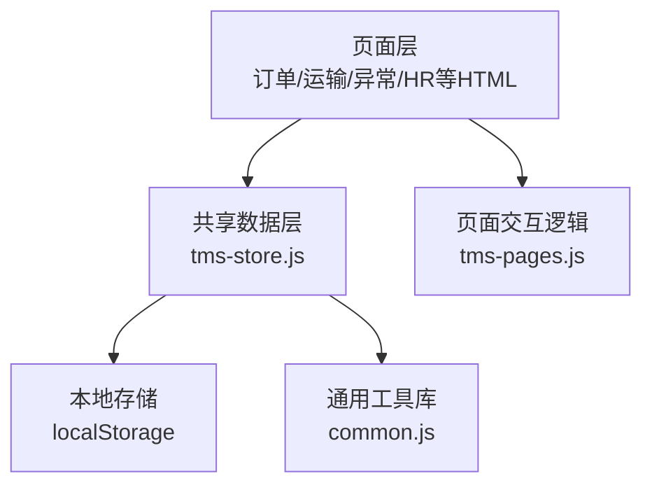
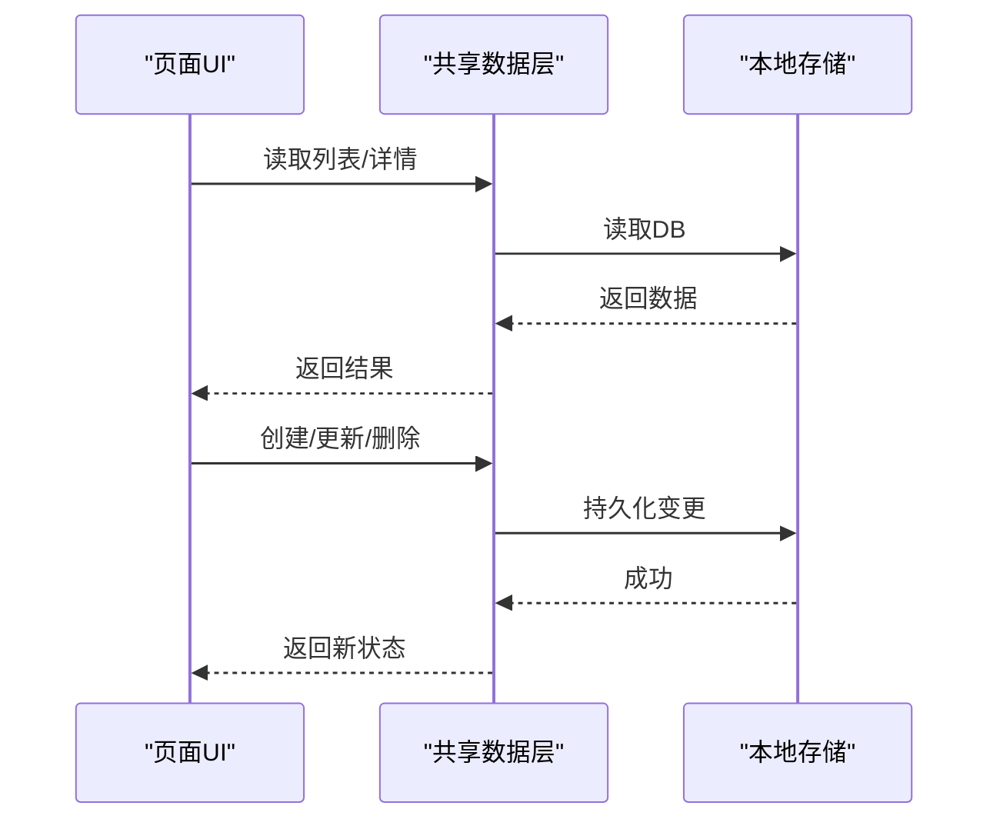
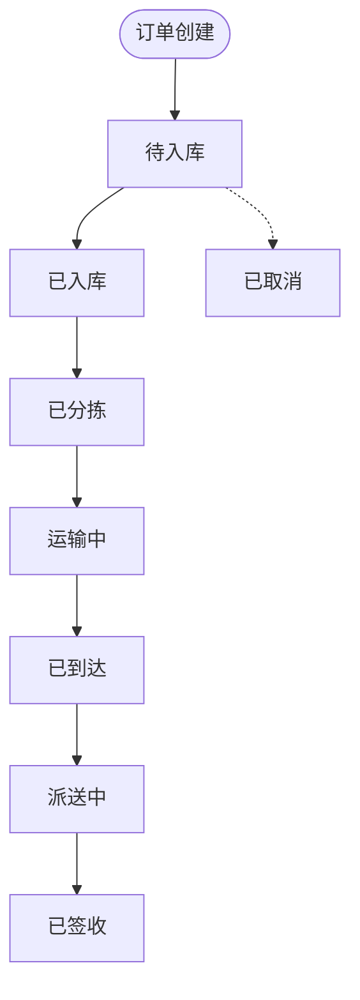
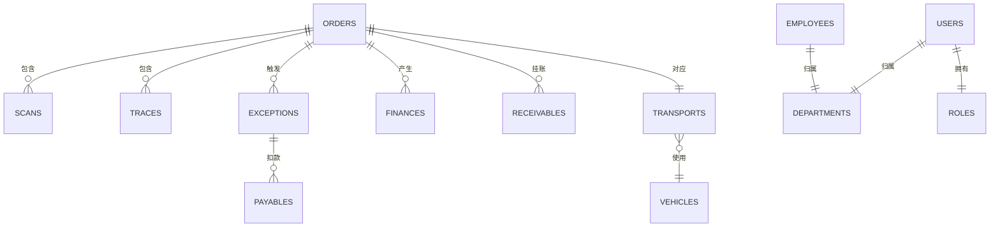

# 数据模型定义

<cite>
**本文引用的文件**   
- [tms-store.js](file://tms-store.js)
- [common.js](file://common.js)
- [tms-pages.js](file://tms-pages.js)
- [tms-transport.html](file://tms-transport.html)
- [tms-exception.html](file://tms-exception.html)
- [deliveryman-exception.html](file://deliveryman-exception.html)
</cite>

## 目录
1. [引言](#引言)
2. [项目结构](#项目结构)
3. [核心数据模型总览](#核心数据模型总览)
4. [架构与数据流概览](#架构与数据流概览)
5. [关键实体详细定义](#关键实体详细定义)
6. [状态机与枚举设计](#状态机与枚举设计)
7. [数据验证与约束规则](#数据验证与约束规则)
8. [依赖关系分析](#依赖关系分析)
9. [性能与一致性考虑](#性能与一致性考虑)
10. [故障排查指南](#故障排查指南)
11. [结论](#结论)
12. [附录：示例数据与使用场景](#附录示例数据与使用场景)

## 引言
本文件面向TMS系统的数据模型，聚焦订单、运输、异常、用户、员工等核心实体的字段定义、数据类型、业务含义、关联关系、状态机、约束条件、生命周期操作以及示例数据。文档以仓库中的共享数据层为核心依据，结合页面展示逻辑，给出可落地的建模说明和可视化图示，帮助开发者与业务人员统一理解数据语义与流转规则。

## 项目结构
TMS前端采用多页面HTML + JavaScript的模式，核心数据模型与业务逻辑集中在共享数据层中，其他页面通过该数据层进行查询、创建、更新、删除等操作。

**图表来源**
- [tms-store.js:1-12](file://tms-store.js#L1-L12)
- [common.js:1-10](file://common.js#L1-L10)
- [tms-pages.js:234-249](file://tms-pages.js#L234-L249)

**章节来源**
- [tms-store.js:1-12](file://tms-store.js#L1-L12)
- [common.js:1-10](file://common.js#L1-L10)

## 核心数据模型总览
TMS的核心数据模型由以下主要集合组成（均位于共享数据层）：
- 订单 orders
- 运单号 waybillNo（与订单一对一）
- 运输 transports
- 异常 exceptions
- 用户 users
- 员工 employees
- 扫描 scans
- 轨迹 traces
- 分拣任务 sortingTasks
- 装卸任务 loadingTasks
- 财务 finances
- 应收 receivables
- 应付 payables
- 账单 bills
- 服务工单 serviceTickets
- 理赔 claims
- 车辆 vehicles
- 仓库 warehouses
- 库存 inventory
- 运力 capacities
- 电子围栏 geofences
- 设备 devices
- 策略 policies
- 路由规则 routingRules
- 运价卡 rateCards
- 路线 routes
- 配送地址 deliveryAddresses
- 时效规则 timingRules
- 改单记录 changeRecords
- 考核指标 evalMetrics
- 评估 evaluations
- 绩效 performance
- 行政记录 adminRecords

这些集合在初始化时生成种子数据，并提供统一的CRUD接口供各页面调用。

**章节来源**
- [tms-store.js:462-1153](file://tms-store.js#L462-L1153)
- [tms-store.js:1113-1153](file://tms-store.js#L1113-L1153)

## 架构与数据流概览
共享数据层负责：
- 首次访问生成真实感种子数据
- 提供增删改查、搜索、筛选、排序、分页能力
- 维护订单全生命周期状态流转，并自动写入扫描、运输、财务等关联记录
- 提供统计聚合（KPI、趋势、分布、日报）

**图表来源**
- [tms-store.js:220-244](file://tms-store.js#L220-L244)
- [tms-store.js:1187-1195](file://tms-store.js#L1187-L1195)
- [tms-store.js:1265-1306](file://tms-store.js#L1265-L1306)

**章节来源**
- [tms-store.js:1-12](file://tms-store.js#L1-L12)
- [tms-store.js:220-244](file://tms-store.js#L220-L244)
- [tms-store.js:1187-1195](file://tms-store.js#L1187-L1195)
- [tms-store.js:1265-1306](file://tms-store.js#L1265-L1306)

## 关键实体详细定义

### 订单 Order
订单是TMS的核心主数据，承载客户、货物、计费、物流、结算等关键信息。

关键字段与业务含义：
- id：订单唯一标识，按发货地+时间戳+用户哈希+随机数生成
- waybillNo：运单号，基于订单号哈希生成
- customer：客户名称
- contact/phone：联系人及电话
- goods：货物品类
- weight/pieces：重量与件数
- service：服务等级（标准/加急/经济/冷链）
- orderType：订单类型（正向为主）
- dims/volume/volumetricWeight/chargeableWeight：尺寸、体积、体积重、计费重
- declaredValue/isInsured：保价金额与是否保价
- paymentMethod/settleCycle/freight/freightBreakdown/rateCardId：付款方式、账期、运费、费用明细、运价卡ID
- origin/destination/senderAddress/receiverAddress：起讫点与收发地址
- status：订单状态（待入库/已入库/已分拣/运输中/已到达/派送中/已签收/已取消）
- createdAt/expectedAt/signedAt/updatedAt/timeline：时间线与审计
- remark：备注
- receivableStatus：应收状态（未回款/部分回款/已回款/已逾期/已作废）
- routeId/planSegments/traces/slaDeadline：路由计划、分段计划、轨迹、SLA截止时间

数据关系：
- 一对多：订单 → 扫描 scans、轨迹 traces、异常 exceptions、财务 finances、应收 receivables
- 一对一：订单 → 运单 waybillNo、运输 transports（当进入运输阶段）
- 多对一：订单 ← 客户 customers（字典）、运价卡 rateCards、路线 routes

复杂度与性能：
- 订单创建时会计算体积重、选择运价卡、生成路由计划与轨迹节点，属于较重逻辑
- 建议对常用查询字段建立索引（如status、customer、createdAt）

错误处理：
- 若订单被取消，不再继续生成后续流程（如运输、轨迹）
- 计费引擎失败时应回退或提示

生命周期操作：
- 创建：createOrder(data, options)
- 推进状态：advanceOrder(orderId, actor)
- 更新：update('orders', id, patch)
- 删除：remove('orders', id)

**章节来源**
- [tms-store.js:88-120](file://tms-store.js#L88-L120)
- [tms-store.js:252-261](file://tms-store.js#L252-L261)
- [tms-store.js:327-383](file://tms-store.js#L327-L383)
- [tms-store.js:426-460](file://tms-store.js#L426-L460)
- [tms-store.js:680-792](file://tms-store.js#L680-L792)
- [tms-store.js:1436-1559](file://tms-store.js#L1436-L1559)
- [tms-store.js:1561-1600](file://tms-store.js#L1561-L1600)

### 运输 Transport
运输记录描述订单从发货到签收的干线运输过程，包含承运商、车辆、司机、预计到达与实际到达等信息。

关键字段与业务含义：
- id：运输唯一标识
- orderId/waybillNo：关联订单与运单
- origin/destination：起讫城市
- carrier：承运商
- vehicleId/driver：车辆与司机
- departAt/eta/arrivedAt：发车时间、预计到达、实际到达
- status：运输状态（待发车/运输中/已到达/派送中/已完成/已取消）
- progress：进度百分比

数据关系：
- 多对一：运输 → 订单 orders
- 多对一：运输 → 车辆 vehicles
- 一对多：运输 ← 扫描 scans、轨迹 traces

生命周期操作：
- 确保存在：ensureTransport(order)
- 随订单状态推进自动更新状态与时间

**章节来源**
- [tms-store.js:844-873](file://tms-store.js#L844-L873)
- [tms-store.js:1394-1417](file://tms-store.js#L1394-L1417)
- [tms-store.js:1527-1557](file://tms-store.js#L1527-L1557)

### 异常 Exception
异常记录用于跟踪物流过程中的问题事件，包括延迟、损坏、信息不符、丢件、拒收等。

关键字段与业务含义：
- id：异常唯一标识
- orderId/waybillNo：关联订单与运单
- type：异常类型
- description：详细描述
- occurredAt/status/handler/resolution/resolvedAt：发生时间、状态、处理人、解决方案、解决时间
- level：严重级别（一级/二级/三级）
- slaDeadline：SLA截止时间
- escalated：是否升级
- responsibleParty/responsible：责任方与责任人
- solution/rootCause：解决方案与根因
- deductionAmount：扣款金额
- linkedClaimId/linkedTicketId：关联理赔与工单
- flow：处理流程记录

数据关系：
- 多对一：异常 → 订单 orders
- 一对多：异常 → 应付 payables（定责扣款）
- 一对多：异常 → 理赔 claims（可选）

生命周期操作：
- 创建：create('exceptions', data)
- 解决：resolveException(id, resolution, options)
- 更新：update('exceptions', id, patch)
- 删除：remove('exceptions', id)

**章节来源**
- [tms-store.js:875-917](file://tms-store.js#L875-L917)
- [tms-pages.js:234-249](file://tms-pages.js#L234-L249)

### 用户 User
用户是系统登录与权限控制的基础实体，关联部门、角色、区域等。

关键字段与业务含义：
- id/name/email/phone：基本信息
- departmentId：所属部门
- roleId：角色ID
- status：用户状态（在职/休假/离职）
- areaId：负责区域

数据关系：
- 多对一：用户 → 部门 departments
- 多对一：用户 → 角色 roles
- 多对一：用户 → 区域 areas

生命周期操作：
- 创建：create('users', data)
- 更新：update('users', id, patch)
- 删除：remove('users', id)

**章节来源**
- [tms-store.js:1078-1088](file://tms-store.js#L1078-L1088)
- [tms-store.js:1166-1185](file://tms-store.js#L1166-L1185)

### 员工 Employee
员工代表企业内部人员，用于运营、仓储、运输、财务、人事等业务岗位。

关键字段与业务含义：
- id/name/department/position/email/phone：基本信息
- hireDate/status/salary：入职日期、状态、薪资

数据关系：
- 多对一：员工 → 部门 departments
- 一对多：员工 ← 评估 evaluations、绩效 performance

生命周期操作：
- 创建：create('employees', data)
- 更新：update('employees', id, patch)
- 删除：remove('employees', id)

**章节来源**
- [tms-store.js:483-498](file://tms-store.js#L483-L498)
- [tms-store.js:1039-1076](file://tms-store.js#L1039-L1076)

## 状态机与枚举设计
TMS使用集中式状态枚举与标签映射来保证状态一致性与显示友好性。

- ORDER_FLOW：订单状态机顺序，包含待入库→已入库→已分拣→运输中→已到达→派送中→已签收
- STATUS_LABELS：各类实体的状态键到中文标签的映射，涵盖订单、异常、运输、任务、工单、理赔、财务、员工、车辆、库存、运力、策略、网关、应收、账单、应付、运价、路线等

**图表来源**
- [tms-store.js:88-96](file://tms-store.js#L88-L96)
- [tms-store.js:98-120](file://tms-store.js#L98-L120)
- [tms-store.js:1497-1559](file://tms-store.js#L1497-L1559)

**章节来源**
- [tms-store.js:88-120](file://tms-store.js#L88-L120)
- [tms-store.js:1497-1559](file://tms-store.js#L1497-L1559)

## 数据验证与约束规则
- 订单号与运单号生成规则：
  - 订单号：HL+发货省份首字母+时间戳+用户ID哈希(4位)+随机数(4位)
  - 运单号：WB+订单号哈希(10位)+随机数(4位)
- 计费重与体积重：
  - 优先使用尺寸(LxWxH cm)计算体积重；否则使用体积(m³)
  - 计费重取实际重量、体积重、首重的最大值
- 最低收费与燃油附加费：
  - 基础运费低于最低收费时应用最低收费
  - 燃油附加费=基础运费×燃油费率
- 偏远附加费：
  - 目的地为特定城市时收取偏远附加费
- 保价与到付附加费：
  - 保价费=保价金额×保价费率
  - 到付附加费=基础运费×到付费率
- 折扣与月结账期：
  - 根据客户分层与付款方式计算折扣率
  - 月结大客户享受协议价与更长账期
- 状态校验：
  - 订单状态只能按ORDER_FLOW顺序推进
  - 取消订单不可继续推进
- 外键引用完整性：
  - 运输记录需关联有效车辆与承运商
  - 异常扣款需关联责任方与责任人
  - 应收/应付需关联订单与客户/供应商

**章节来源**
- [common.js:22-50](file://common.js#L22-L50)
- [tms-store.js:327-383](file://tms-store.js#L327-L383)
- [tms-store.js:1497-1559](file://tms-store.js#L1497-L1559)

## 依赖关系分析

**图表来源**
- [tms-store.js:462-1153](file://tms-store.js#L462-L1153)
- [tms-store.js:1113-1153](file://tms-store.js#L1113-L1153)

**章节来源**
- [tms-store.js:462-1153](file://tms-store.js#L462-L1153)

## 性能与一致性考虑
- 本地存储读写：
  - 所有变更通过persist()写入localStorage，并触发tms:datachange事件通知订阅者
- 列表查询优化：
  - list()支持filters/search/sort/page/pageSize，避免前端重复过滤
- 轨迹与扫描上限：
  - db.traces长度限制为2000，db.scans长度限制为500，防止无限增长
- 状态推进原子性：
  - applyOrderStatus()在推进状态时同步更新扫描、任务、运输、车辆状态，保证一致性
- 计费引擎复用：
  - calcFreight()统一计算运费，避免分散逻辑导致不一致

**章节来源**
- [tms-store.js:232-244](file://tms-store.js#L232-L244)
- [tms-store.js:1210-1258](file://tms-store.js#L1210-L1258)
- [tms-store.js:1337-1348](file://tms-store.js#L1337-L1348)
- [tms-store.js:1446-1465](file://tms-store.js#L1446-L1465)
- [tms-store.js:1497-1559](file://tms-store.js#L1497-L1559)

## 故障排查指南
- 订单无法推进：
  - 检查order.status是否为cancelled或已达最终状态
  - 确认nextStatus在ORDER_FLOW中存在且大于当前状态
- 异常无法解决：
  - 检查异常是否存在且状态允许解决
  - 确认resolution与联动理赔/扣款逻辑正确
- 运输状态不同步：
  - 检查applyOrderStatus()是否正确更新transports与vehicles
- 计费不一致：
  - 核对calcFreight()输入参数与服务等级、运价卡匹配
- 本地存储异常：
  - 检查localStorage是否可用，DB_KEY与DB_VERSION是否匹配

**章节来源**
- [tms-store.js:1561-1572](file://tms-store.js#L1561-L1572)
- [tms-store.js:1497-1559](file://tms-store.js#L1497-L1559)
- [tms-store.js:327-383](file://tms-store.js#L327-L383)

## 结论
TMS的数据模型围绕订单主线展开，贯穿仓储、分拣、运输、派送、签收与结算全流程。通过集中式状态枚举与标签映射，保证了状态的一致性与可读性；通过共享数据层提供的CRUD与业务流转函数，实现了跨页面的数据一致与联动更新。建议在扩展新业务时遵循现有模式，新增枚举与标签映射，并在共享数据层实现相应的生命周期函数。

## 附录：示例数据与使用场景
- 订单创建示例：
  - 传入origin、destination、customer、weight、dims、service、paymentMethod、declaredValue、isInsured等参数
  - 系统自动生成id、waybillNo、计费重与运费，并写入相关关联数据
- 订单推进示例：
  - 调用advanceOrder(orderId, actor)按ORDER_FLOW顺序推进
  - 系统自动写入扫描、任务、运输、轨迹与财务记录
- 异常解决示例：
  - 调用resolveException(id, resolution, {createClaim, claimAmount})
  - 系统可联动创建理赔申请与应付扣款

**章节来源**
- [tms-store.js:1574-1600](file://tms-store.js#L1574-L1600)
- [tms-store.js:1561-1572](file://tms-store.js#L1561-L1572)
- [tms-pages.js:234-249](file://tms-pages.js#L234-L249)