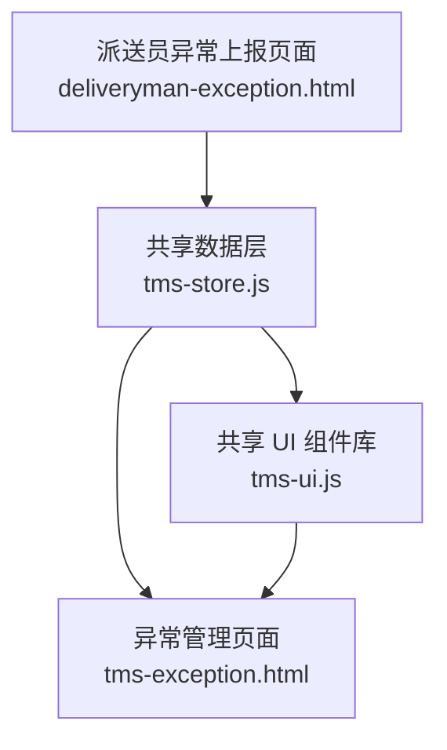
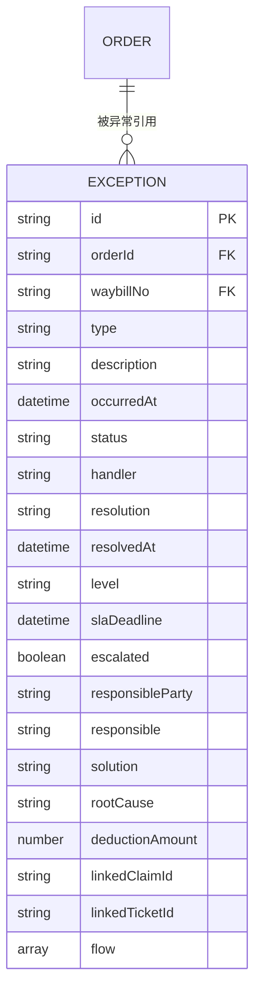
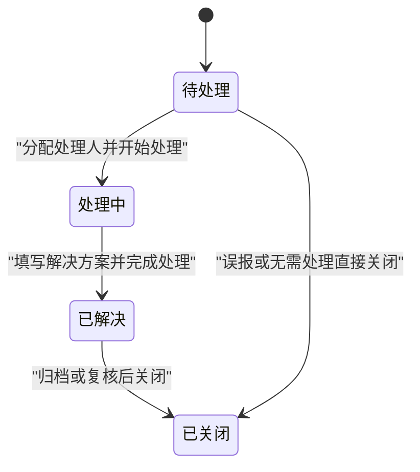
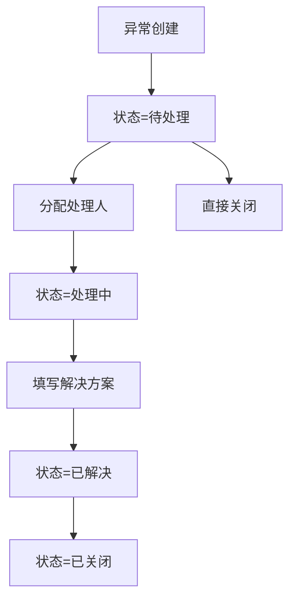
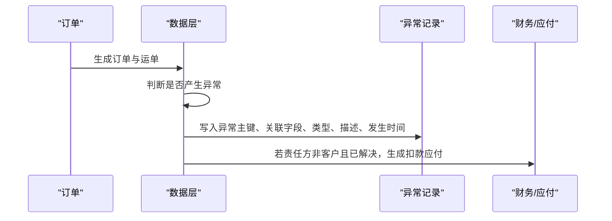
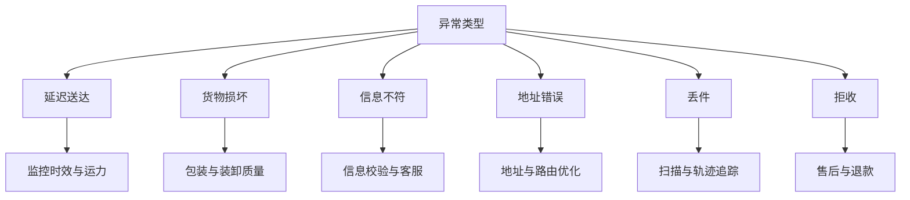
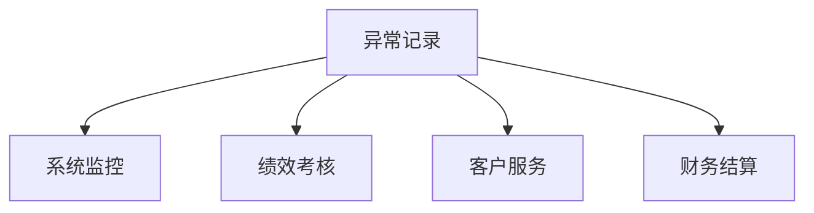

# 异常记录实体（Exception）

<cite>
**本文引用的文件**   
- [tms-store.js](file://tms-store.js)
- [tms-ui.js](file://tms-ui.js)
- [tms-exception.html](file://tms-exception.html)
- [deliveryman-exception.html](file://deliveryman-exception.html)
</cite>

## 目录
1. [引言](#引言)
2. [项目结构定位](#项目结构定位)
3. [核心数据模型总览](#核心数据模型总览)
4. [字段定义与业务规则](#字段定义与业务规则)
5. [状态管理与流转规则](#状态管理与流转规则)
6. [处理人员与管理字段规范](#处理人员与管理字段规范)
7. [与订单的关联机制及影响](#与订单的关联机制及影响)
8. [完整 Schema 定义与示例数据](#完整-schema-定义与示例数据)
9. [典型异常类型处理流程](#典型异常类型处理流程)
10. [在监控、绩效、客服中的应用](#在监控绩效客服中的应用)
11. [依赖关系分析](#依赖关系分析)
12. [性能与可维护性建议](#性能与可维护性建议)
13. [常见问题排查](#常见问题排查)
14. [结论](#结论)

## 引言
本文围绕 TMS 系统中的“异常记录”核心业务实体，给出面向产品、运营、研发和数据分析人员的结构化文档。重点包括：
- 异常记录的完整字段定义与生成规则；
- 异常类型、描述、发生时间等关键字段含义；
- 待处理、处理中、已解决、已关闭的状态流转；
- 处理人、解决方案、解决时间等管理字段的填写规范；
- 异常与订单、运单的关联方式及对订单状态的影响；
- 完整的 Schema 定义与示例数据；
- 异常在系统监控、绩效考核、客户服务等业务场景中的使用方式。

## 项目结构定位
异常记录在系统中由共享数据层生成并统一提供查询能力，前端通过页面展示异常列表、角标统计和操作入口。



**图表来源**
- [tms-store.js:875-916](file://tms-store.js#L875-L916)
- [tms-ui.js:729-745](file://tms-ui.js#L729-L745)
- [tms-exception.html:382-436](file://tms-exception.html#L382-L436)
- [deliveryman-exception.html:375-413](file://deliveryman-exception.html#L375-L413)

**章节来源**
- [tms-store.js:875-916](file://tms-store.js#L875-L916)
- [tms-ui.js:729-745](file://tms-ui.js#L729-L745)
- [tms-exception.html:382-436](file://tms-exception.html#L382-L436)
- [deliveryman-exception.html:375-413](file://deliveryman-exception.html#L375-L413)

## 核心数据模型总览
异常记录实体的核心目标是记录运输过程中出现的异常事件，并贯穿从上报、处理到结案的全生命周期。其关键维度包括：
- 主键与关联：id、orderId、waybillNo；
- 异常语义：type、description、occurredAt；
- 状态与时效：status、slaDeadline、escalated；
- 处理与管理：handler、resolution、resolvedAt、level、responsibleParty、responsible、solution、rootCause；
- 财务与关联单：deductionAmount、linkedClaimId、linkedTicketId、flow。



**图表来源**
- [tms-store.js:881-906](file://tms-store.js#L881-L906)

**章节来源**
- [tms-store.js:881-906](file://tms-store.js#L881-L906)

## 字段定义与业务规则
以下字段均来源于种子数据构造逻辑与页面展示约定。

| 字段 | 类型 | 是否必填 | 默认值或生成规则 | 业务含义与规则 |
|---|---|---:|---|---|
| id | 字符串 | 是 | `EX-YYYYMMDDNNN` 格式，按日期+序号递增 | 异常记录主键，用于唯一标识一条异常。 |
| orderId | 字符串 | 是 | 继承自订单主键 | 关联订单，便于从订单视角查看异常。 |
| waybillNo | 字符串 | 是 | 继承自运单号 | 关联运单，便于从物流轨迹视角追踪。 |
| type | 枚举 | 是 | 延迟送达、货物损坏、信息不符、地址错误、丢件、拒收 | 异常分类，决定后续处理策略与考核口径。 |
| description | 字符串 | 是 | 系统根据 type 选择典型描述 | 对异常现象的具体说明，要求清晰可追溯。 |
| occurredAt | 时间戳 | 是 | 取订单当前阶段对应时间或创建时间 | 异常实际发生时间，用于时效计算与排序。 |
| status | 枚举 | 是 | pending、processing、resolved、closed | 异常处理状态，驱动界面操作按钮与统计。 |
| handler | 字符串 | 否 | 非 pending 时填写处理人姓名 | 当前负责处理异常的人员。 |
| resolution | 字符串 | 否 | resolved 时填写解决方案摘要 | 最终处理结果的文字说明。 |
| resolvedAt | 时间戳 | 否 | resolved 时填写解决时间 | 异常被标记为已解决的完成时间。 |
| level | 枚举 | 否 | 一级、二级、三级 | 异常等级，用于优先级与升级策略。 |
| slaDeadline | 时间戳 | 是 | 发生时间 + 4 小时 | SLA 截止时间，超时可触发升级。 |
| escalated | 布尔 | 否 | 未解决且随机概率触发 | 是否已升级至更高管理层级。 |
| responsibleParty | 字符串 | 否 | 承运商、网点、司机、仓库、客户 | 责任方，用于定责与扣款。 |
| responsible | 字符串 | 否 | 责任方对应责任人姓名 | 具体责任人。 |
| solution | 字符串 | 否 | 补发、改派、理赔、退回 | 已解决时的处置方案。 |
| rootCause | 字符串 | 否 | 操作不规范、系统对接异常、天气原因、客户原因、包装不合格 | 根因分析，用于改进与复盘。 |
| deductionAmount | 数字 | 否 | 责任方非客户且已解决时生成扣款金额 | 异常扣款金额，联动应付结算。 |
| linkedClaimId | 字符串 | 否 | 空或理赔单 ID | 关联理赔申请。 |
| linkedTicketId | 字符串 | 否 | 空或服务工单 ID | 关联服务工单。 |
| flow | 数组 | 是 | 至少包含上报与受理定责两条记录 | 异常处理过程审计日志。 |

**章节来源**
- [tms-store.js:875-916](file://tms-store.js#L875-L916)
- [tms-exception.html:382-436](file://tms-exception.html#L382-L436)

## 状态管理与流转规则
异常状态遵循四态模型：待处理、处理中、已解决、已关闭。



状态标签与样式映射由 UI 层统一管理，异常待办数量会在导航栏显示角标。



**图表来源**
- [tms-store.js:103](file://tms-store.js#L103)
- [tms-ui.js:57-69](file://tms-ui.js#L57-L69)
- [tms-ui.js:729-745](file://tms-ui.js#L729-L745)

**章节来源**
- [tms-store.js:103](file://tms-store.js#L103)
- [tms-ui.js:57-69](file://tms-ui.js#L57-L69)
- [tms-ui.js:729-745](file://tms-ui.js#L729-L745)

## 处理人员与管理字段规范
- handler：当异常从待处理进入处理中时必须填写，表示当前处理责任人；若仍为待处理，该字段可为空。
- resolution：仅在状态为已解决时填写，需简明描述最终处理结果，避免模糊表述。
- resolvedAt：与 resolution 同时生效，记录解决完成时间，用于 SLA 达成率统计。
- level：用于区分异常严重度，一级通常代表高影响或高赔付风险，需要优先处理。
- responsibleParty / responsible：定责字段，用于明确责任归属，支撑扣款与绩效考核。
- solution / rootCause：已解决异常应补充处置方案与根因分析，便于后续改进。
- deductionAmount：当责任方不是客户且异常已解决时，系统自动生成扣款金额，并生成应付记录。
- flow：必须保留异常处理全过程的操作记录，包括上报、受理、定责、处理、解决、关闭等节点。

**章节来源**
- [tms-store.js:881-916](file://tms-store.js#L881-L916)

## 与订单的关联机制及影响
异常记录通过 orderId 和 waybillNo 与订单、运单建立强关联。种子数据中，异常会基于订单当前阶段的时间点生成 occurredAt，并在部分情况下联动应收应付与财务记录。



**图表来源**
- [tms-store.js:875-916](file://tms-store.js#L875-L916)

异常对订单状态的直接影响主要体现在：
- 异常本身不直接改变订单主状态，但会影响订单的异常统计、SLA 达成率、签收体验与赔付流程；
- 当异常导致退货、拒收或丢失时，可能间接影响订单最终状态（例如取消或退回），这需要在更高层的业务流程中实现；
- 异常扣款会生成应付记录，影响财务结算与成本核算。

**章节来源**
- [tms-store.js:875-916](file://tms-store.js#L875-L916)

## 完整 Schema 定义与示例数据
### Schema 定义
- 表名：exceptions
- 主键：id
- 外键：orderId → orders.id，waybillNo → orders.waybillNo
- 枚举字段：type、status、level
- 时间字段：occurredAt、resolvedAt、slaDeadline
- 数值字段：deductionAmount
- 文本字段：description、resolution、solution、rootCause、responsibleParty、responsible、handler
- 关联字段：linkedClaimId、linkedTicketId
- 审计字段：flow

### 示例数据
以下示例数据来自种子数据构造逻辑，展示不同类型异常的数据结构变化。

| 示例 | id | orderId | waybillNo | type | description | occurredAt | status | handler | resolution | resolvedAt | level | slaDeadline | escalated | responsibleParty | responsible | solution | rootCause | deductionAmount | linkedClaimId | linkedTicketId | flow |
|---|---|---|---|---|---|---|---|---|---|---|---|---|---|---|---|---|---|---|---|---|---|
| 延迟送达 | EX-20260120001 | HLBJ... | WB... | 延迟送达 | 运输途中车辆故障导致延误 | 订单当前阶段时间 | pending | - | - | - | 二级 | 发生时间+4小时 | false | - | - | - | - | 0 | "" | "" | 上报、受理定责 |
| 货物损坏 | EX-20260120002 | HLSJ... | WB... | 货物损坏 | 外包装破损，内件疑似受损 | 订单当前阶段时间 | processing | 张三 | - | - | 一级 | 发生时间+4小时 | true | 承运商 | 李四 | - | 包装不合格 | 0 | "" | "" | 上报、受理定责 |
| 信息不符 | EX-20260119003 | HLGZ... | WB... | 信息不符 | 收件人信息与订单不一致 | 订单当前阶段时间 | resolved | 李四 | 已与客户协商完成处理 | 次日16:00 | 三级 | 发生时间+4小时 | false | 客户 | 王五 | 改派 | 客户原因 | 0 | "" | "" | 上报、受理定责 |

**图表来源**
- [tms-store.js:875-916](file://tms-store.js#L875-L916)

**章节来源**
- [tms-store.js:875-916](file://tms-store.js#L875-L916)

## 典型异常类型处理流程
不同异常类型在系统中具有不同的处理侧重点：

- 延迟送达：重点关注 SLA 达成率、运力调度与路线优化；
- 货物损坏：关注包装质量、装卸规范与理赔流程；
- 信息不符：关注下单校验、地址库准确性与客服沟通；
- 地址错误：关注地址解析、电子围栏与派送区域；
- 丢件：关注扫描完整性、分拣准确率与轨迹追踪；
- 拒收：关注客户满意度、售后政策与退款流程。



**图表来源**
- [tms-store.js:875-916](file://tms-store.js#L875-L916)

**章节来源**
- [tms-store.js:875-916](file://tms-store.js#L875-L916)

## 在监控、绩效、客服中的应用
- 系统监控：异常待办角标聚合 pending 与 processing 数量，帮助运营快速发现积压；
- 绩效考核：异常次数、解决时效、责任归属可用于员工与部门考核；
- 客户服务：异常与工单、理赔联动，提升问题件处理效率与客户满意度；
- 财务结算：异常扣款生成应付记录，影响成本核算与供应商结算。



**图表来源**
- [tms-ui.js:729-745](file://tms-ui.js#L729-L745)
- [tms-store.js:907-916](file://tms-store.js#L907-L916)

**章节来源**
- [tms-ui.js:729-745](file://tms-ui.js#L729-L745)
- [tms-store.js:907-916](file://tms-store.js#L907-L916)

## 依赖关系分析
异常记录依赖以下模块与数据：
- 订单与运单：提供 orderId、waybillNo 与基础业务上下文；
- 用户与员工：提供 handler、responsible 等人员信息；
- 财务模块：承接异常扣款生成的应付记录；
- UI 层：提供状态标签、角标统计与页面交互。

```mermaid
graph LR
Orders["订单"] --> Exceptions["异常记录"]
Waybills["运单"] --> Exceptions
Users["用户/员工"] --> Exceptions
Finance["财务应付"] <-- Exceptions
UI["UI 组件"] --> Exceptions
```

**图表来源**
- [tms-store.js:875-916](file://tms-store.js#L875-L916)
- [tms-ui.js:729-745](file://tms-ui.js#L729-L745)

**章节来源**
- [tms-store.js:875-916](file://tms-store.js#L875-L916)
- [tms-ui.js:729-745](file://tms-ui.js#L729-L745)

## 性能与可维护性建议
- 索引设计：对 orderId、waybillNo、status、occurredAt、slaDeadline 建立索引，提升查询与超时检测性能；
- 分页与筛选：前端列表支持按状态、类型、时间范围筛选，后端应返回分页结果；
- 状态机约束：在后端实现状态流转校验，防止非法状态跳转；
- 审计日志：flow 字段应追加不可变记录，确保异常处理过程可追溯；
- 数据一致性：异常扣款与应付记录应保持事务一致性，避免金额不一致。

[本节为通用建议，不直接分析具体文件]

## 常见问题排查
- 异常未显示角标：检查 UI 层是否正确读取 exceptions 列表并统计 pending 与 processing；
- 状态显示异常：确认 STATUS_CLASS 与 STATUS_LABELS 配置是否一致；
- 扣款金额缺失：检查责任方是否为非客户且状态是否为已解决；
- 解决时间为空：确认 resolution 填写后是否同步更新 resolvedAt；
- 关联单未联动：检查 linkedClaimId、linkedTicketId 是否在业务流程中正确赋值。

**章节来源**
- [tms-ui.js:57-69](file://tms-ui.js#L57-L69)
- [tms-ui.js:729-745](file://tms-ui.js#L729-L745)
- [tms-store.js:875-916](file://tms-store.js#L875-L916)

## 结论
异常记录是 TMS 系统中连接订单、运单、财务与服务的关键枢纽。通过明确的字段定义、严格的状态流转与完善的审计日志，系统能够实现对异常事件的全面追踪、高效处理与持续改进。建议在后续迭代中强化状态机约束、审计日志扩展与跨模块一致性保障，以提升整体运营效率与客户体验。

[本节为总结性内容，不直接分析具体文件]