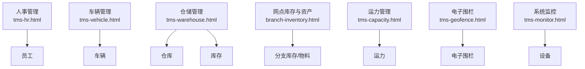
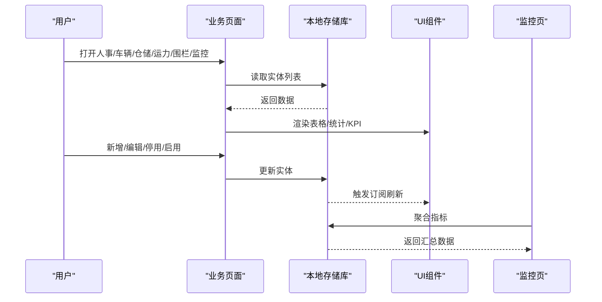
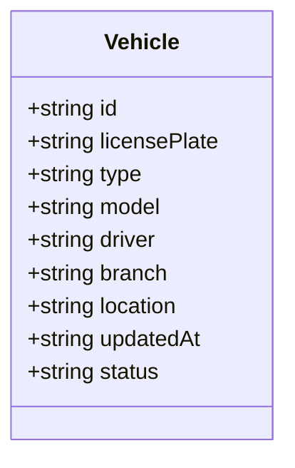
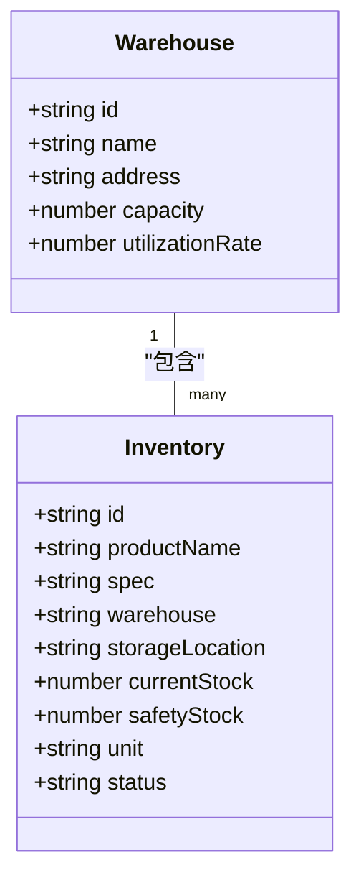
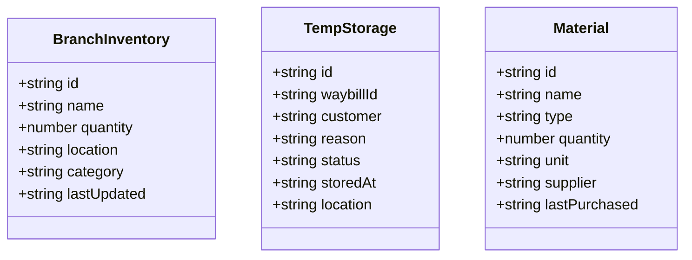
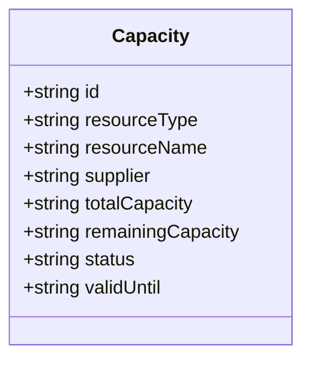
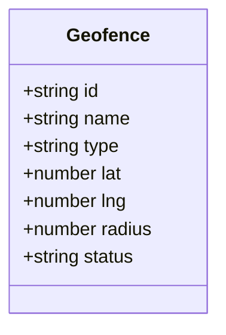
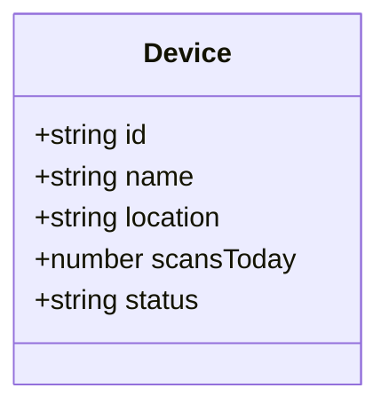
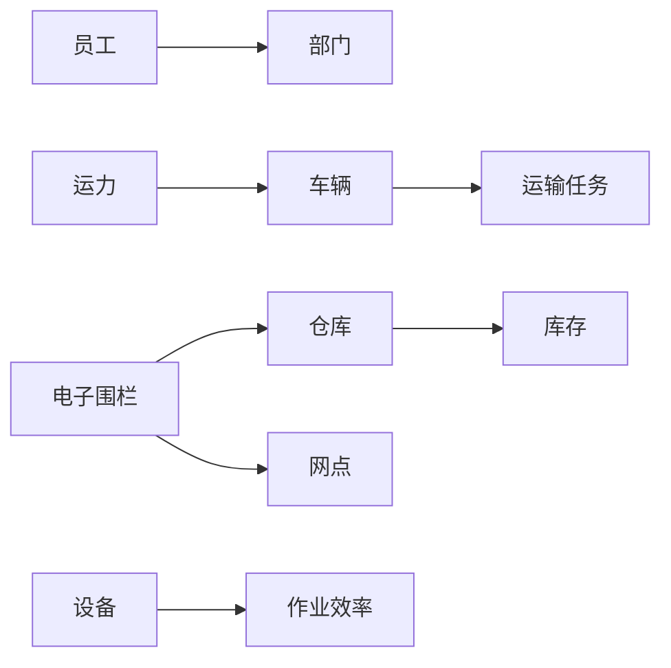
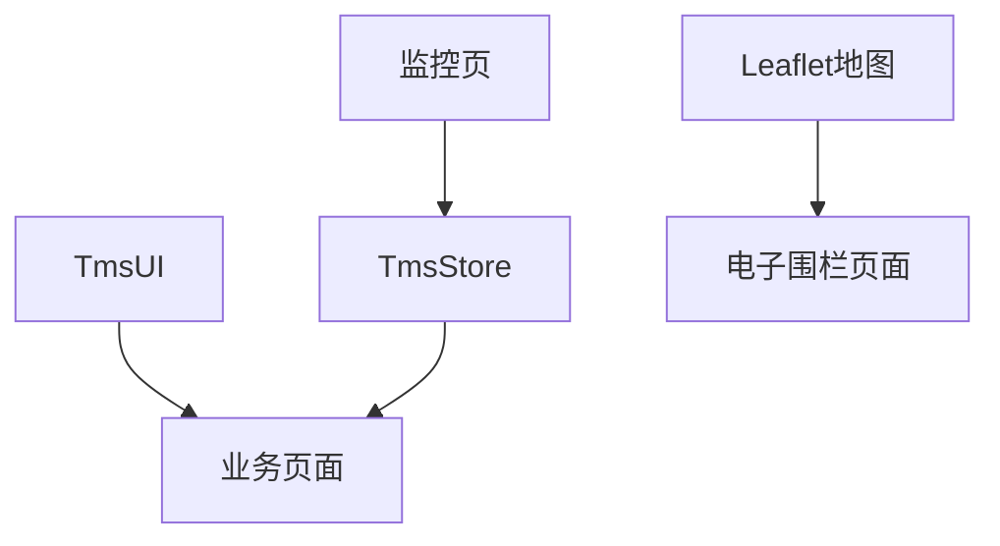

# 支撑业务实体

<cite>
**本文引用的文件**   
- [tms-hr.html](file://tms-hr.html)
- [tms-vehicle.html](file://tms-vehicle.html)
- [tms-warehouse.html](file://tms-warehouse.html)
- [branch-inventory.html](file://branch-inventory.html)
- [tms-capacity.html](file://tms-capacity.html)
- [tms-geofence.html](file://tms-geofence.html)
- [tms-monitor.html](file://tms-monitor.html)
</cite>

## 目录
1. [引言](#引言)
2. [项目结构](#项目结构)
3. [核心实体总览](#核心实体总览)
4. [架构与数据流总览](#架构与数据流总览)
5. [详细实体模型](#详细实体模型)
6. [实体关联关系](#实体关联关系)
7. [依赖分析](#依赖分析)
8. [性能与扩展建议](#性能与扩展建议)
9. [故障排查指南](#故障排查指南)
10. [结论](#结论)

## 引言
本文件面向TMS系统的支撑业务实体，聚焦员工、车辆、仓库、库存、运力、电子围栏和设备等基础数据模型。文档从字段定义、主键命名规范、状态机、关联关系、示例数据以及在各业务流程中的作用进行系统化说明，帮助读者快速理解这些实体如何为订单、运输、异常等核心业务提供基础数据与服务保障。

## 项目结构
本项目以多个HTML页面承载不同业务模块的界面与前端逻辑，支撑实体通过页面表格、表单和监控面板展示，并通过统一的本地存储库进行数据读写。关键页面与实体的对应关系如下：
- 人事管理页面承载员工实体
- 车辆管理页面承载车辆实体
- 仓储管理页面承载仓库与库存实体
- 网点库存与资产页面承载分支级库存与物料
- 运力管理页面承载运力资源
- 电子围栏页面承载地理围栏
- 系统监控页面汇总设备在线状态与运行指标

**图表来源**
- [tms-hr.html:459-538](file://tms-hr.html#L459-L538)
- [tms-vehicle.html:492-553](file://tms-vehicle.html#L492-L553)
- [tms-warehouse.html:465-524](file://tms-warehouse.html#L465-L524)
- [branch-inventory.html:485-491](file://branch-inventory.html#L485-L491)
- [tms-capacity.html:469-524](file://tms-capacity.html#L469-L524)
- [tms-geofence.html:611-623](file://tms-geofence.html#L611-L623)
- [tms-monitor.html:452-468](file://tms-monitor.html#L452-L468)

**章节来源**
- [tms-hr.html:459-538](file://tms-hr.html#L459-L538)
- [tms-vehicle.html:492-553](file://tms-vehicle.html#L492-L553)
- [tms-warehouse.html:465-524](file://tms-warehouse.html#L465-L524)
- [branch-inventory.html:485-491](file://branch-inventory.html#L485-L491)
- [tms-capacity.html:469-524](file://tms-capacity.html#L469-L524)
- [tms-geofence.html:611-623](file://tms-geofence.html#L611-L623)
- [tms-monitor.html:452-468](file://tms-monitor.html#L452-L468)

## 核心实体总览
以下表格概述各支撑实体的主键前缀、关键字段、状态值及主要用途。

| 实体 | 主键前缀 | 关键字段 | 状态值 | 主要用途 |
|---|---|---|---|---|
| 员工 | EMP-XXX | 姓名、部门、职位、邮箱、电话、入职日期、角色、描述 | active、on_leave、inactive | 组织人员、权限与考核的基础 |
| 车辆 | VEH-XXX | 车牌号、类型、车型、司机、所属网点、当前位置、更新时间 | online、transporting、maintenance、offline | 运输资源管理与调度 |
| 仓库 | WH-XX | 仓库名称、地址、容量、利用率 | in-stock、low-stock、out-of-stock（用于库存） | 货物存储与空间管理 |
| 库存 | INV-YYYYMMDDNNN | 商品名、规格、仓库、位置、当前库存、安全库存、单位 | normal、low、out（业务语义） | 库存水位与安全库存预警 |
| 运力 | CAP-YYYYMMDDNNN | 资源类型、资源名称、供应商、可承载量、剩余量、有效期 | available、occupied、locked、unavailable | 运力池与分配锁定 |
| 电子围栏 | 无固定前缀（ID由系统生成） | 名称、类型、中心经纬度、半径、状态 | active、inactive | 地理范围规则与告警 |
| 设备 | 无固定前缀（ID由系统生成） | 名称、位置、扫描次数、状态 | online、maintenance、offline | 扫描设备与作业终端监控 |

**章节来源**
- [tms-hr.html:459-538](file://tms-hr.html#L459-L538)
- [tms-vehicle.html:492-553](file://tms-vehicle.html#L492-L553)
- [tms-warehouse.html:465-524](file://tms-warehouse.html#L465-L524)
- [branch-inventory.html:485-491](file://branch-inventory.html#L485-L491)
- [tms-capacity.html:469-524](file://tms-capacity.html#L469-L524)
- [tms-geofence.html:611-623](file://tms-geofence.html#L611-L623)
- [tms-monitor.html:452-468](file://tms-monitor.html#L452-L468)

## 架构与数据流总览
支撑实体在系统中的数据流遵循“页面交互 → 本地存储库 → 视图渲染”的模式：
- 页面加载时初始化UI壳层并渲染对应模块
- 用户操作触发增删改查，写入本地存储库
- 订阅机制使其他页面或组件同步刷新
- 监控页聚合多实体指标，形成全局健康视图

**图表来源**
- [tms-hr.html:437-441](file://tms-hr.html#L437-L441)
- [tms-geofence.html:577-589](file://tms-geofence.html#L577-L589)
- [tms-monitor.html:423-436](file://tms-monitor.html#L423-L436)

**章节来源**
- [tms-hr.html:437-441](file://tms-hr.html#L437-L441)
- [tms-geofence.html:577-589](file://tms-geofence.html#L577-L589)
- [tms-monitor.html:423-436](file://tms-monitor.html#L423-L436)

## 详细实体模型

### 员工（Employee）
- 主键设计：EMP-XXX，三位数字递增，便于识别与管理
- 关键字段：id、name、department、position、email、phone、hireDate、status、role、description
- 状态管理：
  - active：在职
  - on_leave：休假
  - inactive：离职
- 业务含义：作为组织与权限的基础，支持按部门与角色进行任务分配与考核
- 示例数据：见[模拟员工数据:465-538](file://tms-hr.html#L465-L538)

**图表来源**
- [tms-hr.html:459-538](file://tms-hr.html#L459-L538)

**章节来源**
- [tms-hr.html:459-538](file://tms-hr.html#L459-L538)

### 车辆（Vehicle）
- 主键设计：VEH-XXX，三位数字递增，便于车队管理
- 关键字段：id、licensePlate、type、model、driver、branch、location、updatedAt、status
- 状态管理：
  - online：在线
  - transporting：运输中
  - maintenance：维修中
  - offline：离线
- 业务含义：作为运输执行的核心资源，与运输任务、路线、轨迹联动
- 示例数据：见[车辆列表:492-553](file://tms-vehicle.html#L492-L553)

**图表来源**
- [tms-vehicle.html:492-553](file://tms-vehicle.html#L492-L553)

**章节来源**
- [tms-vehicle.html:492-553](file://tms-vehicle.html#L492-L553)

### 仓库（Warehouse）与库存（Inventory）
- 仓库主键：WH-XX，两位数字递增，标识仓库节点
- 库存主键：INV-YYYYMMDDNNN，带日期的流水号，便于追溯
- 关键字段（仓库）：id、name、address、capacity、utilizationRate
- 关键字段（库存）：id、productName、spec、warehouse、storageLocation、currentStock、safetyStock、unit、status
- 状态管理（库存）：
  - normal：充足
  - low：不足
  - out：缺货
- 业务含义：仓库是物理存储单元，库存记录具体商品的存量与安全水位，驱动补货与采购流程
- 示例数据：见[仓库库存表:465-524](file://tms-warehouse.html#L465-L524)

**图表来源**
- [tms-warehouse.html:465-524](file://tms-warehouse.html#L465-L524)

**章节来源**
- [tms-warehouse.html:465-524](file://tms-warehouse.html#L465-L524)

### 分支库存与物料（Branch Inventory & Materials）
- 主键设计：
  - 库存：INV-XXX（分支级简写）
  - 暂存件：TEMP-XXX
  - 物料：MAT-XXX
- 关键字段（库存）：id、name、quantity、location、category、lastUpdated
- 关键字段（暂存件）：id、waybillId、customer、reason、status、storedAt、location
- 关键字段（物料）：id、name、type、quantity、unit、supplier、lastPurchased
- 业务含义：支撑网点层面的库存盘点、暂存处理与物料领用
- 示例数据：见[分支库存与物料:485-491](file://branch-inventory.html#L485-L491)、[暂存件:540-547](file://branch-inventory.html#L540-L547)、[物料:592-598](file://branch-inventory.html#L592-L598)

**图表来源**
- [branch-inventory.html:485-491](file://branch-inventory.html#L485-L491)
- [branch-inventory.html:540-547](file://branch-inventory.html#L540-L547)
- [branch-inventory.html:592-598](file://branch-inventory.html#L592-L598)

**章节来源**
- [branch-inventory.html:485-491](file://branch-inventory.html#L485-L491)
- [branch-inventory.html:540-547](file://branch-inventory.html#L540-L547)
- [branch-inventory.html:592-598](file://branch-inventory.html#L592-L598)

### 运力（Capacity）
- 主键设计：CAP-YYYYMMDDNNN，带日期的流水号，便于追踪运力合同与周期
- 关键字段：id、resourceType、resourceName、supplier、totalCapacity、remainingCapacity、status、validUntil
- 状态管理：
  - available：可用
  - occupied：已占用
  - locked：锁定
  - unavailable：不可用
- 业务含义：抽象运力池，支持自有车队与外部承运商，驱动运力分配与锁定
- 示例数据：见[运力资源表:469-524](file://tms-capacity.html#L469-L524)

**图表来源**
- [tms-capacity.html:469-524](file://tms-capacity.html#L469-L524)

**章节来源**
- [tms-capacity.html:469-524](file://tms-capacity.html#L469-L524)

### 电子围栏（Geofence）
- 主键设计：无固定前缀，ID由系统生成；类型与中心坐标决定围栏几何
- 关键字段：id、name、type、lat、lng、radius、status
- 状态管理：
  - active：生效中
  - inactive：已停用
- 类型：仓储围栏、网点围栏、禁行区域、派送围栏、到货围栏、派送员围栏
- 业务含义：基于地图的地理规则，用于出入仓校验、禁行管控与轨迹异常检测
- 示例数据：见[围栏KPI与列表:611-623](file://tms-geofence.html#L611-L623)

**图表来源**
- [tms-geofence.html:611-623](file://tms-geofence.html#L611-L623)

**章节来源**
- [tms-geofence.html:611-623](file://tms-geofence.html#L611-L623)

### 设备（Device）
- 主键设计：无固定前缀，ID由系统生成
- 关键字段：id、name、location、scansToday、status
- 状态管理：
  - online：在线
  - maintenance：维修中
  - offline：离线
- 业务含义：扫描设备与作业终端的状态监控，支撑作业效率与异常发现
- 示例数据：见[设备状态监控:505-516](file://tms-monitor.html#L505-L516)

**图表来源**
- [tms-monitor.html:505-516](file://tms-monitor.html#L505-L516)

**章节来源**
- [tms-monitor.html:505-516](file://tms-monitor.html#L505-L516)

## 实体关联关系
- 员工与部门：员工记录包含department与role，用于组织与权限划分
- 车辆与运输任务：车辆状态transporting表示正在执行运输任务，结合路线与轨迹中心使用
- 仓库与库存：仓库作为容器，库存记录具体商品与位置，驱动补货与采购
- 运力与车辆：运力资源可为车辆或外部承运商，通过resourceType区分
- 电子围栏与仓库/网点：仓储围栏与网点围栏用于出入仓与到达校验
- 设备与作业：设备状态影响扫描率与作业效率，监控页聚合显示

**图表来源**
- [tms-hr.html:459-538](file://tms-hr.html#L459-L538)
- [tms-vehicle.html:492-553](file://tms-vehicle.html#L492-L553)
- [tms-warehouse.html:465-524](file://tms-warehouse.html#L465-L524)
- [tms-capacity.html:469-524](file://tms-capacity.html#L469-L524)
- [tms-geofence.html:611-623](file://tms-geofence.html#L611-L623)
- [tms-monitor.html:505-516](file://tms-monitor.html#L505-L516)

**章节来源**
- [tms-hr.html:459-538](file://tms-hr.html#L459-L538)
- [tms-vehicle.html:492-553](file://tms-vehicle.html#L492-L553)
- [tms-warehouse.html:465-524](file://tms-warehouse.html#L465-L524)
- [tms-capacity.html:469-524](file://tms-capacity.html#L469-L524)
- [tms-geofence.html:611-623](file://tms-geofence.html#L611-L623)
- [tms-monitor.html:505-516](file://tms-monitor.html#L505-L516)

## 依赖分析
- 页面依赖统一UI与存储库：所有页面通过TmsUI与TmsStore进行数据绑定与渲染
- 电子围栏依赖地图组件：Leaflet与leaflet-draw用于绘制与展示围栏
- 监控页依赖多实体聚合：订单、设备、异常等指标来自本地存储库
- 人事与车辆页面提供基础数据入口，供其他业务模块引用

**图表来源**
- [tms-geofence.html:563-569](file://tms-geofence.html#L563-L569)
- [tms-monitor.html:415-418](file://tms-monitor.html#L415-L418)

**章节来源**
- [tms-geofence.html:563-569](file://tms-geofence.html#L563-L569)
- [tms-monitor.html:415-418](file://tms-monitor.html#L415-L418)

## 性能与扩展建议
- 分页与过滤：对大列表（如库存、运力、围栏）采用分页与搜索过滤，减少DOM渲染压力
- 状态缓存：将常用状态映射（如active/inactive）缓存到常量对象，避免重复计算
- 地图优化：围栏数量较多时，按需加载图层与延迟渲染，提升地图交互流畅度
- 监控刷新：监控页定时刷新间隔合理设置，避免频繁请求导致卡顿
- 数据一致性：在跨页面共享数据时，使用订阅机制确保视图一致

[本节为通用指导，不直接分析具体文件]

## 故障排查指南
- 地图组件加载失败：电子围栏页面会提示地图组件加载失败，但围栏列表仍可正常使用
- 状态不一致：检查页面是否调用TmsStore.update或remove后触发订阅刷新
- 设备状态异常：监控页显示设备在线/维修/离线，若长时间离线需检查设备连接与网络
- 库存低水位：当库存状态为low或out时，触发补货或采购流程

**章节来源**
- [tms-geofence.html:600-609](file://tms-geofence.html#L600-L609)
- [tms-monitor.html:505-516](file://tms-monitor.html#L505-L516)

## 结论
支撑业务实体构成了TMS系统的数据基石。员工、车辆、仓库、库存、运力、电子围栏与设备通过清晰的字段定义、主键命名与状态管理，为订单、运输、异常等核心业务提供了稳定可靠的基础数据与服务保障。通过统一的UI与存储库，这些实体在不同页面间协同工作，形成完整的数据流转闭环。

[本节为总结性内容，不直接分析具体文件]