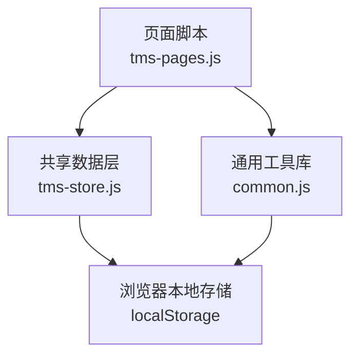
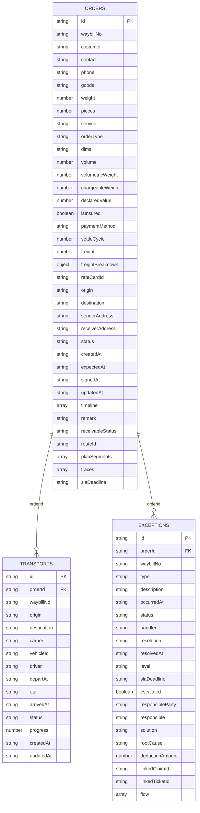
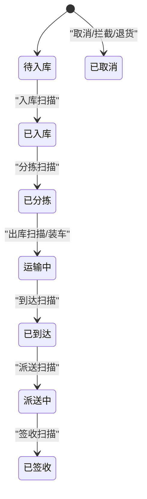
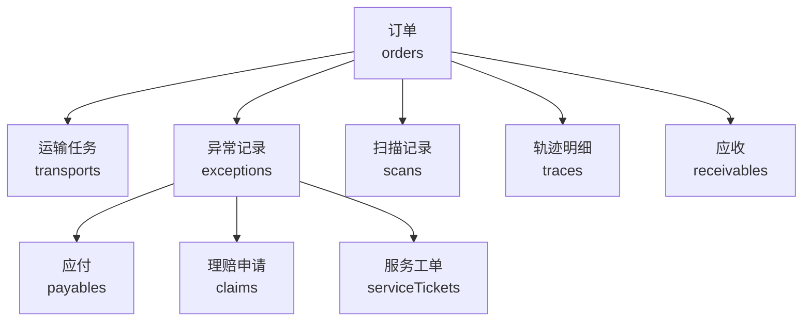
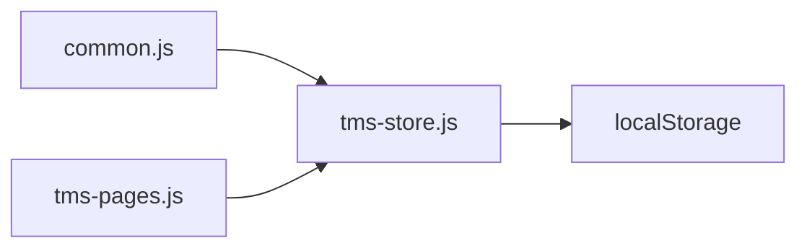

# 核心业务实体

<cite>
**本文引用的文件**   
- [tms-store.js](file://tms-store.js)
- [common.js](file://common.js)
- [tms-pages.js](file://tms-pages.js)
</cite>

## 目录
1. [引言](#引言)
2. [项目结构](#项目结构)
3. [核心数据模型总览](#核心数据模型总览)
4. [订单 Order 实体](#订单-order-实体)
5. [运输任务 Transport 实体](#运输任务-transport-实体)
6. [异常记录 Exception 实体](#异常记录-exception-实体)
7. [主键、外键与引用完整性](#主键外键与引用完整性)
8. [订单生命周期与状态流转](#订单生命周期与状态流转)
9. [关键字段业务规则](#关键字段业务规则)
10. [实体关联关系图](#实体关联关系图)
11. [示例数据与使用方式](#示例数据与使用方式)
12. [依赖分析](#依赖分析)
13. [性能与一致性考虑](#性能与一致性考虑)
14. [故障排查指南](#故障排查指南)
15. [结论](#结论)

## 引言
本文件面向 TMS（运输管理系统）前端演示系统，聚焦三个核心业务实体：订单、运输任务、异常记录。文档从字段定义、数据类型、业务含义、主外键设计、引用完整性、状态流转、编号生成算法、时间格式规范、Schema 说明和示例数据等维度展开，帮助开发者与业务人员理解系统在浏览器本地存储中的数据结构与运行逻辑。

TMS 的核心数据层由共享存储模块提供，所有页面通过统一接口访问订单、运输、异常等集合；数据变更会触发全局事件，驱动界面更新与跨标签页同步。

**章节来源**
- [tms-store.js:1-12](file://tms-store.js#L1-L12)

## 项目结构
TMS 前端采用多 HTML 页面 + 共享 JavaScript 模块的架构：
- 共享数据层与业务逻辑集中在一个大型脚本中，负责种子数据生成、CRUD、状态机、轨迹、计费、应收应付、统计聚合等。
- 通用工具函数库提供订单号、运单号、登录、用户信息等通用能力。
- 页面脚本负责 UI 交互、表单提交、调用共享数据层 API。

**图表来源**
- [tms-store.js:1-12](file://tms-store.js#L1-L12)
- [common.js:1-10](file://common.js#L1-L10)
- [tms-pages.js:250-310](file://tms-pages.js#L250-L310)

**章节来源**
- [tms-store.js:1-12](file://tms-store.js#L1-L12)
- [common.js:1-10](file://common.js#L1-L10)
- [tms-pages.js:250-310](file://tms-pages.js#L250-L310)

## 核心数据模型总览
TMS 的核心实体包括：
- 订单 Order：正向或逆向物流订单，承载客户、货物、计费、地址、时效、状态、轨迹等信息。
- 运输任务 Transport：对应订单的干线运输任务，包含承运商、车辆、司机、出发到达时间、进度、状态等。
- 异常记录 Exception：记录延迟、破损、信息不符、丢件、拒收等业务异常，包含处理流程、责任方、扣款、理赔联动等。

此外，系统还维护扫描记录、分拣任务、装卸任务、轨迹节点、应收应付、账单、服务工单、理赔申请等辅助实体，用于支撑完整业务闭环。

| 实体 | 主要用途 | 关键标识 | 典型关联 |
|---|---|---|---|
| 订单 | 正向/逆向物流订单主数据 | id、waybillNo | 运输任务、异常记录、扫描记录、轨迹、应收应付 |
| 运输任务 | 订单在途执行载体 | id、orderId、waybillNo | 订单、车辆、司机、承运商 |
| 异常记录 | 业务异常处理闭环 | id、orderId、waybillNo | 订单、理赔、服务工单、成本应付 |

**章节来源**
- [tms-store.js:88-120](file://tms-store.js#L88-L120)
- [tms-store.js:680-950](file://tms-store.js#L680-L950)

## 订单 Order 实体
订单是 TMS 的主业务实体，描述一次发货或退货请求，贯穿入库、分拣、装车、发运、到达、派送、签收全流程。

### 字段定义与业务含义
- id：订单唯一标识，由系统按规则生成。
- waybillNo：运单号，与订单绑定，便于面单打印与追踪。
- customer：客户名称。
- contact、phone：联系人及电话。
- goods：货物品类。
- weight、pieces：重量与件数。
- service：服务等级，如标准、加急、经济、冷链。
- orderType：订单类型，forward 表示正向订单，reverse 表示逆向退货。
- dims、volume、volumetricWeight、chargeableWeight：尺寸、体积、体积重、计费重。
- declaredValue、isInsured：保价金额与是否投保。
- paymentMethod、settleCycle：付款方式与账期。
- freight、freightBreakdown、rateCardId：运费总额、费用明细、匹配运价卡。
- origin、destination、senderAddress、receiverAddress：起终点与收发地址。
- status：订单状态，遵循 ORDER_FLOW 七阶段。
- createdAt、expectedAt、signedAt、updatedAt：创建时间、约定送达时间、签收时间、更新时间。
- timeline：状态变更历史。
- remark：备注。
- receivableStatus：应收状态，如未回款、部分回款、已回款、逾期、作废。
- routeId、planSegments：路由计划与分段计划。
- traces：轨迹明细。
- slaDeadline：SLA 截止时间。

### 主键设计
- 主键为 id，类型为字符串，由 buildOrderId 生成，保证全局唯一且具备业务可读性。

### 外键与引用
- 订单不直接作为其他实体的强外键，但多个子实体通过 orderId 引用订单，形成逻辑外键关系。
- 运输任务、异常记录、扫描记录、轨迹、应收应付均通过 orderId 与订单关联。

### 生命周期状态
订单状态遵循 ORDER_FLOW，共七个阶段：待入库、已入库、已分拣、运输中、已到达、派送中、已签收。另有取消态 cancelled，用于拦截或退货场景。

**章节来源**
- [tms-store.js:88-96](file://tms-store.js#L88-L96)
- [tms-store.js:739-777](file://tms-store.js#L739-L777)
- [tms-store.js:1574-1638](file://tms-store.js#L1574-L1638)

## 运输任务 Transport 实体
运输任务是对应订单的干线运输执行单元，承载承运商、车辆、司机、发车与到达时间、预计到达、进度与状态等信息。

### 字段定义与业务含义
- id：运输任务唯一标识。
- orderId：关联订单。
- waybillNo：关联运单号。
- origin、destination：起止城市。
- carrier：承运商名称。
- vehicleId、driver：车辆与司机。
- departAt、arrivedAt：实际发车与到达时间。
- eta：预计到达时间。
- status：运输状态，如待发车、运输中、已到达、派送中、已完成、已取消。
- progress：运输进度百分比。
- createdAt、updatedAt：创建与更新时间。

### 主键设计
- 主键为 id，由计数器生成，前缀为 TR，结合日期与序列号。

### 外键与引用
- 通过 orderId 与订单建立逻辑外键关系。
- 当订单推进到 shipping 时，系统自动确保存在运输任务并设置状态。
- 当订单签收时，运输任务状态置为 completed。

### 状态联动
- 运输任务状态与订单状态联动：
  - 运输中 → 订单状态 shipping。
  - 已到达 → 订单状态 arrived。
  - 派送中 → 订单状态 delivering。
  - 已完成 → 订单状态 signed。

**章节来源**
- [tms-store.js:844-873](file://tms-store.js#L844-L873)
- [tms-store.js:1394-1417](file://tms-store.js#L1394-L1417)
- [tms-store.js:1527-1557](file://tms-store.js#L1527-L1557)
- [tms-store.js:1953-1977](file://tms-store.js#L1953-L1977)

## 异常记录 Exception 实体
异常记录用于记录物流过程中的异常情况，支持分派、定责、扣款、闭环、升级、理赔联动等完整处理流程。

### 字段定义与业务含义
- id：异常记录唯一标识。
- orderId：关联订单。
- waybillNo：关联运单号。
- type：异常类型，如延迟送达、货物损坏、信息不符、地址错误、丢件、拒收。
- description：异常描述。
- occurredAt：异常发生时间。
- status：异常状态，如待处理、处理中、已解决、已关闭。
- handler：处理人。
- resolution：处理结果。
- resolvedAt：解决时间。
- level：异常级别，如一级、二级、三级。
- slaDeadline：SLA 截止时间。
- escalated：是否已升级。
- responsibleParty、responsible：责任方与责任人。
- solution、rootCause：解决方案与根因。
- deductionAmount：扣款金额。
- linkedClaimId、linkedTicketId：联动理赔与服务工单 ID。
- flow：异常处理流水，记录每次动作的时间、操作人与动作内容。

### 主键设计
- 主键为 id，由计数器生成，前缀为 EX，结合日期与序列号。

### 外键与引用
- 通过 orderId 与订单建立逻辑外键关系。
- 可联动理赔申请与客服工单，分别通过 linkedClaimId 与 linkedTicketId 关联。
- 定责扣款会生成成本应付 payables，通过 refId 与异常或订单关联。

### 处理流程
- 创建异常：默认状态 pending，写入初始流水。
- 受理分派：状态变为 processing，记录处理人。
- 定责扣款：指定责任方与扣款金额，必要时生成应付。
- 闭环解决：填写解决方案与根因，可选联动理赔。
- 超时升级：超过 SLA 自动升级为一级异常。

**章节来源**
- [tms-store.js:875-917](file://tms-store.js#L875-L917)
- [tms-store.js:1740-1837](file://tms-store.js#L1740-L1837)
- [tms-store.js:1890-1893](file://tms-store.js#L1890-L1893)

## 主键、外键与引用完整性
TMS 前端数据层基于 localStorage，没有数据库级约束，因此“主键”“外键”“引用完整性”以逻辑方式实现：

- 主键：
  - 订单 id：buildOrderId 生成，HL+省份代码+时间戳+用户哈希+随机数。
  - 运输任务 id：counterNext 生成，TR+日期+序列。
  - 异常记录 id：counterNext 生成，EX+日期+序列。
  - 其他实体 id：统一由 counterNext 与前缀映射生成。

- 外键：
  - 运输任务、异常记录、扫描记录、轨迹、应收应付等均通过 orderId 指向订单。
  - 理赔与服务工单通过 linkedClaimId、linkedTicketId 指向相应实体。
  - 成本应付通过 refId 指向订单或异常。

- 引用完整性：
  - 删除订单时会级联清理相关子实体：transports、sortingTasks、loadingTasks、exceptions、scans、traces、receivables。
  - 创建异常时若传入 orderId，会自动读取订单的 waybillNo，保持数据一致。
  - 订单状态推进时，自动创建或更新运输任务、扫描记录、轨迹、财务记录等。

**图表来源**
- [tms-store.js:739-777](file://tms-store.js#L739-L777)
- [tms-store.js:844-873](file://tms-store.js#L844-L873)
- [tms-store.js:875-917](file://tms-store.js#L875-L917)
- [tms-store.js:1728-1738](file://tms-store.js#L1728-L1738)

**章节来源**
- [tms-store.js:246-261](file://tms-store.js#L246-L261)
- [tms-store.js:1156-1164](file://tms-store.js#L1156-L1164)
- [tms-store.js:1265-1287](file://tms-store.js#L1265-L1287)
- [tms-store.js:1728-1738](file://tms-store.js#L1728-L1738)

## 订单生命周期与状态流转
ORDER_FLOW 定义了订单的七个核心状态变化：

| 序号 | 状态键 | 中文标签 | 业务含义 |
|---|---|---|---|
| 1 | pending | 待入库 | 订单创建后等待仓库接收 |
| 2 | inbound | 已入库 | 仓库完成入库作业 |
| 3 | sorted | 已分拣 | 仓库完成分拣作业 |
| 4 | shipping | 运输中 | 订单已装车并发车 |
| 5 | arrived | 已到达 | 货物到达目的地网点 |
| 6 | delivering | 派送中 | 末端配送进行中 |
| 7 | signed | 已签收 | 客户签收完成 |

状态推进由 applyOrderStatus 控制，禁止回退，仅允许向前推进；取消态 cancelled 为独立终态，用于拦截或退货。

**图表来源**
- [tms-store.js:88-96](file://tms-store.js#L88-L96)
- [tms-store.js:1497-1559](file://tms-store.js#L1497-L1559)
- [tms-store.js:1640-1666](file://tms-store.js#L1640-L1666)

**章节来源**
- [tms-store.js:88-96](file://tms-store.js#L88-L96)
- [tms-store.js:1497-1559](file://tms-store.js#L1497-L1559)
- [tms-store.js:1640-1666](file://tms-store.js#L1640-L1666)

## 关键字段业务规则

### orderId 生成算法
- 规则：HL + 发货省份首字母 + 时间戳 + 4位用户ID哈希 + 4位随机数字。
- 实现位置：
  - 共享数据层：buildOrderId。
  - 通用工具库：generateOrderId。
- 目的：保证订单号具备地域标识、时间顺序、用户区分与随机性，避免冲突。

**章节来源**
- [tms-store.js:252-257](file://tms-store.js#L252-L257)
- [common.js:22-38](file://common.js#L22-L38)

### waybillNo 编码规则
- 规则：WB + 10位订单号哈希值 + 4位随机数。
- 实现位置：
  - 共享数据层：buildWaybill。
  - 通用工具库：generateWaybillNumber。
- 目的：运单号与订单号强关联，便于面单打印、扫码追踪与对账。

**章节来源**
- [tms-store.js:259-261](file://tms-store.js#L259-L261)
- [common.js:40-50](file://common.js#L40-L50)

### 时间字段格式规范
- 日期键：YYYY-MM-DD，由 dateKey 生成。
- 日期时间键：YYYY-MM-DD HH:mm，由 dateTimeKey 生成。
- ISO 时间：new Date().toISOString()，用于 createdAt、updatedAt、slaDeadline、occurredAt、eta 等。
- 业务时间：createdAt、expectedAt、signedAt、departAt、arrivedAt、resolvedAt 等均采用 ISO 字符串。

**章节来源**
- [tms-store.js:25-33](file://tms-store.js#L25-L33)
- [tms-store.js:68-77](file://tms-store.js#L68-L77)
- [tms-store.js:1740-1756](file://tms-store.js#L1740-L1756)

## 实体关联关系图
订单、运输任务、异常记录之间的关联如下：

**图表来源**
- [tms-store.js:844-873](file://tms-store.js#L844-L873)
- [tms-store.js:875-917](file://tms-store.js#L875-L917)
- [tms-store.js:1740-1837](file://tms-store.js#L1740-L1837)
- [tms-store.js:1921-1951](file://tms-store.js#L1921-L1951)

## 示例数据与使用方式
以下示例展示各实体在实际业务场景中的使用方式，字段取值来源于种子数据生成逻辑与业务动作函数。

### 订单示例
- 创建订单：createOrder 自动生成 id、waybillNo、计费、路由计划与轨迹。
- 推进状态：advanceOrder 或 applyOrderStatus 逐步推进至已签收。
- 改单：changeOrder 修改收货地址、重量、目的地、服务等级，并重算运费。
- 取消/退货：cancelOrder 或 createReverseOrder 生成拦截或逆向订单。

参考路径：
- [tms-store.js:1574-1638](file://tms-store.js#L1574-L1638)
- [tms-store.js:1668-1726](file://tms-store.js#L1668-L1726)

### 运输任务示例
- 调度发车：tms-pages.js 中运输管理页面选择待发运订单、承运商与车辆，调用 S.create('transports')。
- 状态更新：updateTransportStatus 将运输任务状态推进，并联动订单状态。

参考路径：
- [tms-pages.js:290-310](file://tms-pages.js#L290-L310)
- [tms-store.js:1953-1977](file://tms-store.js#L1953-L1977)

### 异常记录示例
- 创建异常：createException 传入 orderId、type、description，默认 pending。
- 分派处理：processException 指定 handler，状态变为 processing。
- 定责扣款：assignResponsibility 指定责任方与扣款金额，生成应付。
- 闭环解决：closeException 填写解决方案与根因，可选联动理赔。
- 超时升级：escalateException 自动升级至一级异常。

参考路径：
- [tms-store.js:1740-1837](file://tms-store.js#L1740-L1837)
- [tms-pages.js:211-250](file://tms-pages.js#L211-L250)

**章节来源**
- [tms-store.js:1574-1638](file://tms-store.js#L1574-L1638)
- [tms-store.js:1668-1726](file://tms-store.js#L1668-L1726)
- [tms-store.js:1740-1837](file://tms-store.js#L1740-L1837)
- [tms-pages.js:211-250](file://tms-pages.js#L211-L250)
- [tms-pages.js:290-310](file://tms-pages.js#L290-L310)

## 依赖分析
- tms-store.js 依赖 common.js 的 hashCode 与 generateWaybillNumber 等工具函数。
- tms-pages.js 依赖 tms-store.js 提供的 API，如 create、list、get、update、remove、createException、processException、resolveException、updateTransportStatus 等。
- 数据持久化依赖 localStorage，跨标签页通过 storage 事件同步。

**图表来源**
- [common.js:3-50](file://common.js#L3-L50)
- [tms-store.js:2299-2367](file://tms-store.js#L2299-L2367)
- [tms-pages.js:250-310](file://tms-pages.js#L250-L310)

**章节来源**
- [common.js:3-50](file://common.js#L3-L50)
- [tms-store.js:2299-2367](file://tms-store.js#L2299-L2367)
- [tms-pages.js:250-310](file://tms-pages.js#L250-L310)

## 性能与一致性考虑
- 数据量控制：扫描记录限制最多 500 条，轨迹记录限制最多 2000 条，避免 localStorage 过大导致性能问题。
- 批量初始化：种子数据一次性生成 orders、transports、exceptions、finances 等集合，减少运行时计算。
- 事件驱动：数据变更触发 tms:datachange 事件，UI 订阅后局部刷新，避免全量重绘。
- 跨标签页同步：监听 storage 事件，保证多标签页数据一致。

**章节来源**
- [tms-store.js:1337-1348](file://tms-store.js#L1337-L1348)
- [tms-store.js:1456-1465](file://tms-store.js#L1456-L1465)
- [tms-store.js:2369-2378](file://tms-store.js#L2369-L2378)

## 故障排查指南
- 订单无法推进：检查当前状态是否为已签收或已取消；确认 nextStatus 是否在 ORDER_FLOW 中且索引大于当前状态。
- 运输任务未联动：确认订单状态是否推进到 shipping；检查 updateTransportStatus 是否正确调用。
- 异常未闭环：检查 processException 与 closeException 是否被调用；确认 flow 流水是否记录。
- 扣款未生成应付：检查 assignResponsibility 与 closeException 中 deductionAmount 是否大于 0 且责任方非客户。
- 数据不一致：检查 removeOrder 是否级联清理子实体；确认 createException 是否传入有效 orderId。

**章节来源**
- [tms-store.js:1497-1559](file://tms-store.js#L1497-L1559)
- [tms-store.js:1953-1977](file://tms-store.js#L1953-L1977)
- [tms-store.js:1740-1837](file://tms-store.js#L1740-L1837)
- [tms-store.js:1728-1738](file://tms-store.js#L1728-L1738)

## 结论
TMS 的核心业务实体围绕订单、运输任务、异常记录构建，通过共享数据层实现统一的增删改查、状态机、轨迹、计费、应收应付与统计聚合。订单状态遵循 ORDER_FLOW 七阶段，运输任务与异常记录通过 orderId 与订单建立逻辑外键关系，并在业务流程中联动更新。编号生成算法与时间格式规范保证了数据的可读性与一致性。尽管前端数据层无数据库约束，但通过逻辑外键、级联清理与事件驱动机制，实现了较为完整的业务闭环与数据一致性保障。