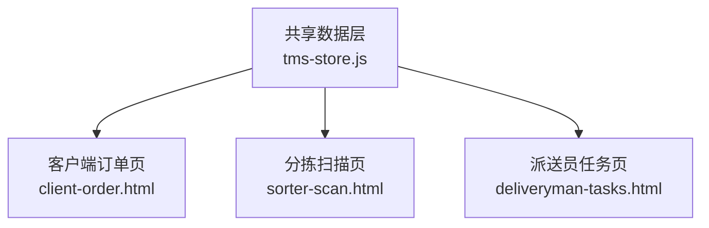
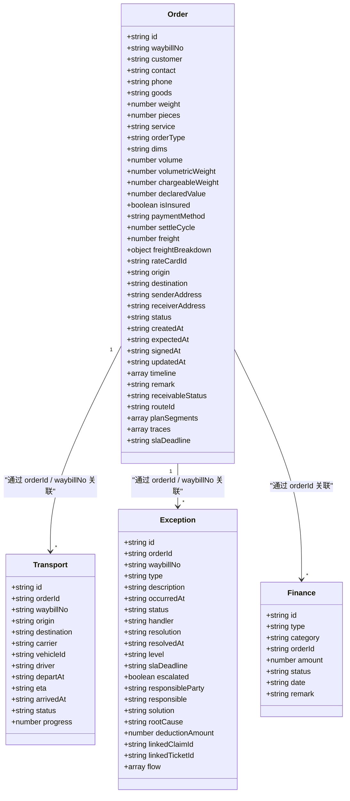
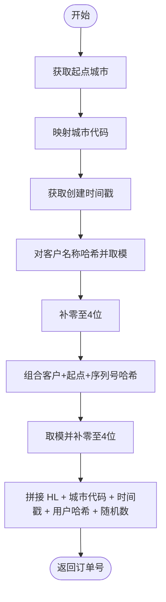
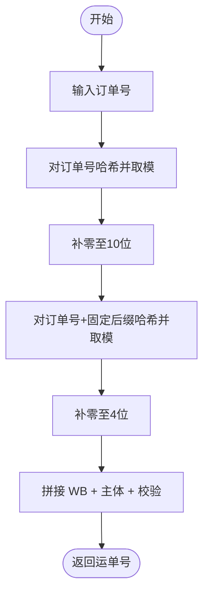
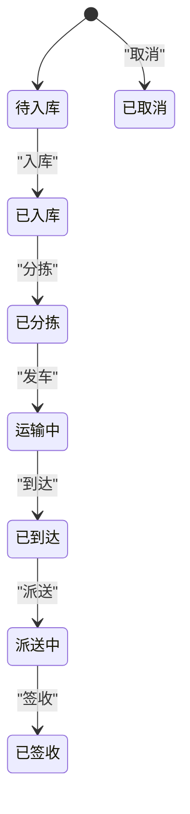
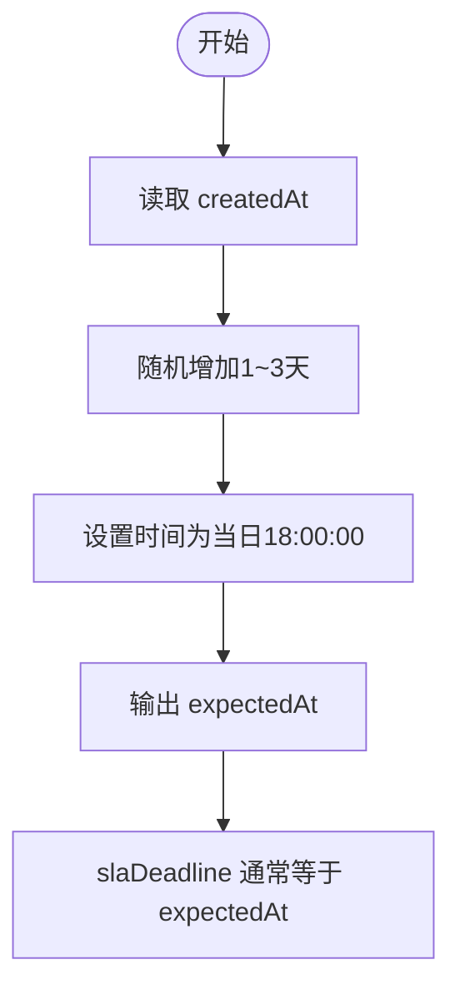
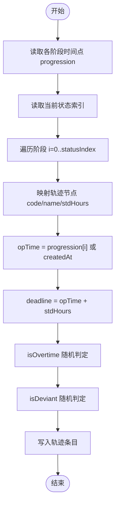
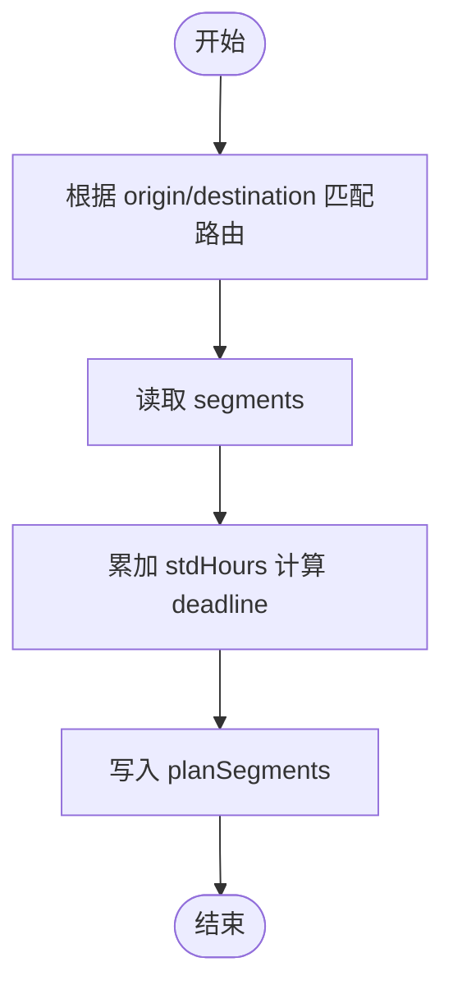
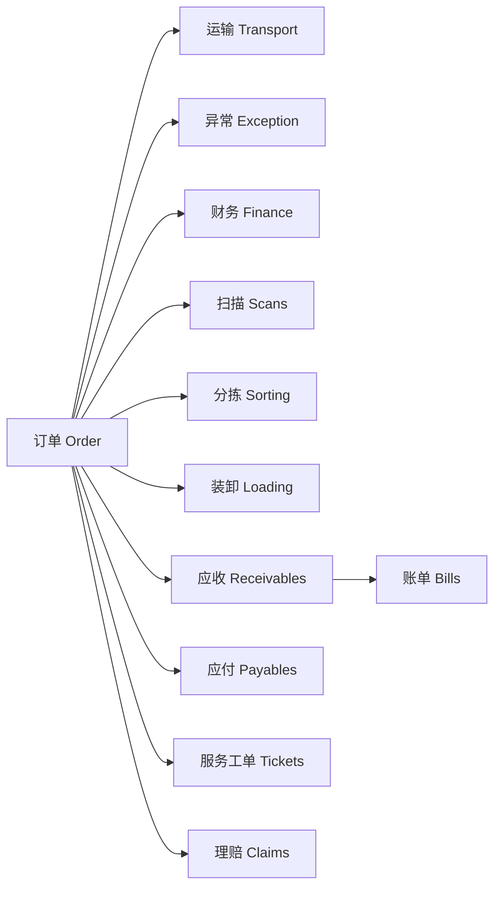
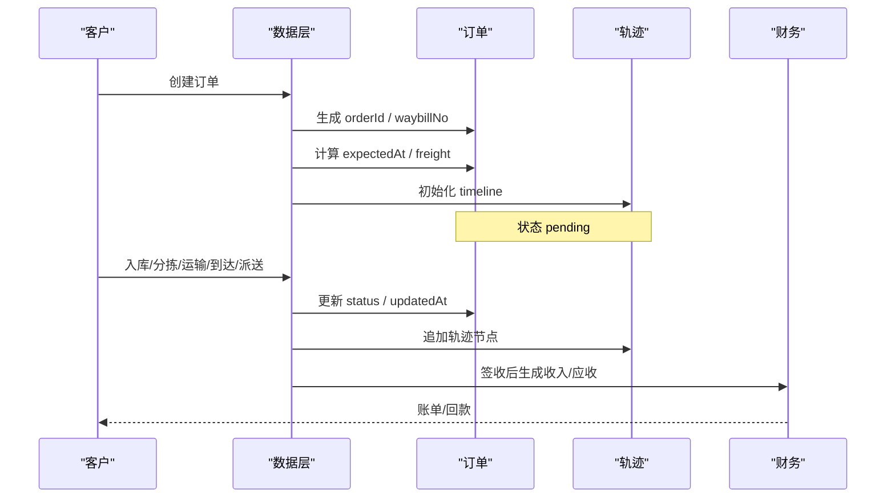

# 订单实体(Order)

<cite>
**本文引用的文件**   
- [tms-store.js](file://tms-store.js)
- [client-order.html](file://client-order.html)
- [sorter-scan.html](file://sorter-scan.html)
- [deliveryman-tasks.html](file://deliveryman-tasks.html)
</cite>

## 目录
1. [引言](#引言)
2. [项目结构定位](#项目结构定位)
3. [核心数据模型总览](#核心数据模型总览)
4. [订单字段完整定义](#订单字段完整定义)
5. [订单号与运单号生成规则](#订单号与运单号生成规则)
6. [订单状态流转机制](#订单状态流转机制)
7. [时间字段与预计送达逻辑](#时间字段与预计送达逻辑)
8. [轨迹与计划分段](#轨迹与计划分段)
9. [与其他实体的关联关系](#与其他实体的关联关系)
10. [典型业务场景下的数据结构变化](#典型业务场景下的数据结构变化)
11. [约束规则与校验建议](#约束规则与校验建议)
12. [性能与可维护性建议](#性能与可维护性建议)
13. [常见问题排查](#常见问题排查)
14. [结论](#结论)

## 引言
本文件聚焦 TMS 系统中的订单核心业务实体，基于仓库中的共享数据层实现，系统化梳理订单的数据结构、编号算法、状态机、时间语义、轨迹维护方式，以及与运输、异常、财务等实体的关联关系。文档目标是为产品、研发、运营提供一份可直接用于建模、接口设计、测试用例和排障参考的权威说明。

## 项目结构定位
TMS 系统采用前端本地存储模拟数据库的方式组织业务数据，订单主数据、扫描记录、轨迹、运输任务、异常、应收应付及账单等均由统一的数据层生成并对外暴露。订单相关逻辑集中在共享数据层中，包括：
- 订单状态字典与标签映射
- 订单号与运单号生成函数
- 计费引擎与重量体积换算
- 路由匹配与计划分段
- 轨迹节点构建
- 种子数据构造（含订单、扫描、运输、异常、财务流水等）

**图表来源**
- [tms-store.js:1-12](file://tms-store.js#L1-L12)
- [client-order.html:869-1044](file://client-order.html#L869-L1044)
- [sorter-scan.html:429-563](file://sorter-scan.html#L429-L563)
- [deliveryman-tasks.html:452-634](file://deliveryman-tasks.html#L452-L634)

**章节来源**
- [tms-store.js:1-12](file://tms-store.js#L1-L12)

## 核心数据模型总览
订单实体是物流履约的主键实体，承载客户信息、货物描述、物理属性、费用、起讫地址、时效承诺、状态与轨迹等核心信息。同时作为其他业务对象的锚点，被扫描记录、分拣/装卸任务、运输任务、异常记录、应收应付、账单、服务工单、理赔申请等引用。

**图表来源**
- [tms-store.js:739-777](file://tms-store.js#L739-L777)
- [tms-store.js:848-862](file://tms-store.js#L848-L862)
- [tms-store.js:881-906](file://tms-store.js#L881-L906)
- [tms-store.js:934-947](file://tms-store.js#L934-L947)

**章节来源**
- [tms-store.js:739-777](file://tms-store.js#L739-L777)
- [tms-store.js:848-862](file://tms-store.js#L848-L862)
- [tms-store.js:881-906](file://tms-store.js#L881-L906)
- [tms-store.js:934-947](file://tms-store.js#L934-L947)

## 订单字段完整定义
以下按业务维度对订单字段进行分组说明，字段类型以实际数据层构造为准。

| 分类 | 字段名 | 类型 | 含义与约束 | 示例或取值范围 |
|---|---|---|---|---|
| 标识 | id | string | 订单唯一标识，由编号算法生成 | HL+城市代码+时间戳+用户哈希+随机数 |
| 标识 | waybillNo | string | 运单号，由订单号派生 | WB+10位哈希+4位校验 |
| 客户 | customer | string | 下单客户名称 | 杭州云帆电商、上海优选商贸等 |
| 联系人 | contact | string | 收货联系人姓名 | 张三、李四等 |
| 联系方式 | phone | string | 收货联系电话 | 1开头9位数字 |
| 货物 | goods | string | 货物大类描述 | 服装鞋帽、电子数码等 |
| 重量 | weight | number | 实际重量，单位通常为千克 | 0.5~20kg区间常见 |
| 件数 | pieces | number | 包裹件数 | 1~6件常见 |
| 服务等级 | service | string | 物流服务等级 | 标准、加急、经济、冷链 |
| 订单类型 | orderType | string | 正向发货为主 | forward |
| 尺寸 | dims | string | 长宽高尺寸字符串 | LxWxH，如 40x30x25 |
| 体积 | volume | number | 计算体积，单位通常为立方米 | 由尺寸换算 |
| 体积重 | volumetricWeight | number | 体积重量，参与计费 | 由尺寸或体积换算 |
| 计费重 | chargeableWeight | number | 最终计费重量 | max(实际重量, 体积重, 首重) |
| 声明价值 | declaredValue | number | 保价金额 | 0或非负数 |
| 是否保价 | isInsured | boolean | 是否购买保价 | true/false |
| 付款方式 | paymentMethod | string | 现付、到付、月结 | 影响折扣与结算 |
| 账期 | settleCycle | number | 月结账期天数 | 30/45/60等 |
| 运费 | freight | number | 订单运费总额 | 非负数 |
| 费用明细 | freightBreakdown | object | 计费拆解对象 | 包含首重、续重、燃油、偏远、保价、到付、折扣、总计等 |
| 运价卡 | rateCardId | string | 使用的运价卡ID | RC-xxx |
| 起点 | origin | string | 揽收城市 | 北京、上海、广州等 |
| 终点 | destination | string | 目的城市 | 北京、上海、广州等 |
| 寄件地址 | senderAddress | string | 寄件人详细地址 | 城市+区县+路名+门牌 |
| 收件地址 | receiverAddress | string | 收件人详细地址 | 城市+区县+路名+门牌 |
| 状态 | status | string | 订单生命周期状态 | pending/inbound/sorted/shipping/arrived/delivering/signed/cancelled |
| 创建时间 | createdAt | string | ISO 8601 时间字符串 | 订单创建时刻 |
| 预计送达 | expectedAt | string | ISO 8601 时间字符串 | 通常创建后1~3天固定时段 |
| 签收时间 | signedAt | string | ISO 8601 时间字符串 | 已签收时填写，否则为空 |
| 更新时间 | updatedAt | string | ISO 8601 时间字符串 | 最后一条轨迹时间 |
| 轨迹 | timeline | array | 订单状态变更历史 | 每条含status/label/time/actor |
| 备注 | remark | string | 人工备注 | 可为空 |
| 应收状态 | receivableStatus | string | 回款状态 | unpaid/partial/paid/overdue |
| 路由 | routeId | string | 匹配的路由ID | ROUTE-xxx |
| 计划分段 | planSegments | array | 路由分段与截止时间 | seq/from/to/mode/stdHours/deadline |
| 轨迹明细 | traces | array | 节点级轨迹 | node/nodeName/location/opTime/deadline/isOvertime/isDeviant |
| SLA截止 | slaDeadline | string | ISO 8601 时间字符串 | 通常等于expectedAt |

**章节来源**
- [tms-store.js:739-777](file://tms-store.js#L739-L777)
- [tms-store.js:327-383](file://tms-store.js#L327-L383)
- [tms-store.js:427-460](file://tms-store.js#L427-L460)

## 订单号与运单号生成规则
### 订单号生成算法
订单号由以下部分拼接而成：
- 前缀：HL
- 城市代码：根据起点城市映射为两字母代码，如北京→BJ、上海→SH、广州→GZ、深圳→SZ、杭州→HZ、南京→NJ、成都→CD、武汉→WH、西安→XA、苏州→SU；若未命中则使用默认XX
- 时间戳：订单创建时间的毫秒时间戳
- 用户哈希：对客户名称做简单哈希后取模并补零至4位
- 随机数：对客户、起点、序列号组合哈希后取模并补零至4位

该算法保证同一城市同一天内不同客户与序列号的订单号具备区分度，同时保留业务可读性。

**图表来源**
- [tms-store.js:81-86](file://tms-store.js#L81-L86)
- [tms-store.js:35-41](file://tms-store.js#L35-L41)
- [tms-store.js:252-257](file://tms-store.js#L252-L257)

### 运单号编码规则
运单号由订单号派生：
- 前缀：WB
- 主体：对订单号哈希后取模得到10位数字
- 校验段：对订单号追加固定后缀再哈希取模，补零至4位

该规则确保运单号与订单号一一对应，且具备一定随机性与不可猜测性。

**图表来源**
- [tms-store.js:259-261](file://tms-store.js#L259-L261)

**章节来源**
- [tms-store.js:81-86](file://tms-store.js#L81-L86)
- [tms-store.js:35-41](file://tms-store.js#L35-L41)
- [tms-store.js:252-261](file://tms-store.js#L252-L261)

## 订单状态流转机制
订单状态遵循 ORDER_FLOW 定义的7个主流程状态，外加取消状态 cancelled。

| 序号 | 状态键 | 中文标签 | 业务含义 | 典型触发动作 |
|---|---|---|---|---|
| 1 | pending | 待入库 | 订单已创建，尚未入库 | 客户下单 |
| 2 | inbound | 已入库 | 仓库完成入库作业 | 入库扫描 |
| 3 | sorted | 已分拣 | 分拨中心完成分拣 | 分拣扫描 |
| 4 | shipping | 运输中 | 干线运输进行中 | 装车发车 |
| 5 | arrived | 已到达 | 到达目的中转或网点 | 到达扫描 |
| 6 | delivering | 派送中 | 末端派送进行中 | 派送扫描 |
| 7 | signed | 已签收 | 收件人签收完成 | 签收扫描 |
| - | cancelled | 已取消 | 订单取消 | 客户取消或系统拦截 |

**图表来源**
- [tms-store.js:88-101](file://tms-store.js#L88-L101)

**章节来源**
- [tms-store.js:88-101](file://tms-store.js#L88-L101)

## 时间字段与预计送达逻辑
### 时间字段格式规范
- createdAt：ISO 8601 字符串，表示订单创建时间
- updatedAt：ISO 8601 字符串，表示最后一条轨迹的时间
- signedAt：ISO 8601 字符串，仅在已签收时填写，否则为空
- expectedAt：ISO 8601 字符串，表示预计送达时间
- slaDeadline：ISO 8601 字符串，通常与 expectedAt 一致

所有时间字段在种子数据构造中使用统一的 nowIso/at 工具生成，保证跨页面一致性。

### 预计送达时间计算逻辑
预计送达时间基于订单创建时间，向后偏移1~3天，并将小时固定为当日傍晚时段，从而形成合理的SLA承诺窗口。

**图表来源**
- [tms-store.js:68-77](file://tms-store.js#L68-L77)
- [tms-store.js:709-711](file://tms-store.js#L709-L711)
- [tms-store.js:767-776](file://tms-store.js#L767-L776)

**章节来源**
- [tms-store.js:68-77](file://tms-store.js#L68-L77)
- [tms-store.js:709-711](file://tms-store.js#L709-L711)
- [tms-store.js:767-776](file://tms-store.js#L767-L776)

## 轨迹与计划分段
### 轨迹节点与阶段映射
系统定义了更细粒度的轨迹节点，并与订单阶段索引对应：
- GOT：揽收
- INBOUND：入库
- SORTING：分拣
- LOADING：装车
- DEPARTURE：发车
- TRANSIT：干线在途
- ARRIVED：到达
- DELIVERING：派送
- SIGNED：签收
- RETURNED：退回
- INTERCEPT：拦截
- OVERAREA：超区
- PROBLEM：问题件

订单阶段索引与轨迹节点映射如下：
- 0 → GOT
- 1 → INBOUND
- 2 → SORTING
- 3 → DEPARTURE
- 4 → ARRIVED
- 5 → DELIVERING
- 6 → SIGNED

### 轨迹构建规则
轨迹构建依据订单当前进度与状态索引，逐阶段生成节点、地点、操作时间、截止时间，并随机标记超时与偏差概率，用于模拟真实运营波动。

**图表来源**
- [tms-store.js:194-213](file://tms-store.js#L194-L213)
- [tms-store.js:442-460](file://tms-store.js#L442-L460)

### 计划分段
计划分段由路由匹配结果生成，包含每段的起止地点、运输方式、标准耗时与截止时间。截止时间从订单创建时间累加各段标准耗时计算得出。

**图表来源**
- [tms-store.js:387-414](file://tms-store.js#L387-L414)
- [tms-store.js:427-440](file://tms-store.js#L427-L440)

**章节来源**
- [tms-store.js:194-213](file://tms-store.js#L194-L213)
- [tms-store.js:387-414](file://tms-store.js#L387-L414)
- [tms-store.js:427-440](file://tms-store.js#L427-L440)
- [tms-store.js:442-460](file://tms-store.js#L442-L460)

## 与其他实体的关联关系
订单作为主键实体，与以下实体存在明确关联：

| 关联实体 | 关联字段 | 关联含义 | 关键行为 |
|---|---|---|---|
| 运输任务 | orderId、waybillNo | 订单对应的干线运输 | 当订单进入运输中及以上状态时生成运输任务，并同步承运商、车辆、司机、发车时间、ETA、到达时间、进度 |
| 异常记录 | orderId、waybillNo | 订单履约过程中的异常事件 | 随机生成异常，记录发生时间、处理人、解决策略、责任方、扣款金额、升级标志等 |
| 财务流水 | orderId | 订单收入或支出记录 | 签收后根据付款方式生成收入流水；月结挂应收，现付/到付直接结算 |
| 扫描记录 | orderId、waybillNo | 各节点扫描凭证 | 按状态推进生成入库、分拣、出库、到达、派送、签收扫描 |
| 分拣任务 | orderId、waybillNo | 分拨中心分拣作业 | 当订单达到已分拣及以上状态时生成分拣任务 |
| 装卸任务 | orderId、waybillNo | 装车/卸车作业 | 当订单进入运输阶段时生成装卸任务 |
| 应收应付 | orderId | 回款与成本结算 | 月结生成应收，干线运费生成应付；异常定责可能产生扣款应付 |
| 账单 | 间接通过应收聚合 | 月度账单汇总 | 按客户+账期聚合应收生成账单，并回写 billId |
| 服务工单 | orderId | 客户服务请求 | 工单可引用订单，用于查询、改派、投诉、催件、理赔咨询 |
| 理赔申请 | orderId | 货损/丢件/延误赔付 | 理赔金额常与订单运费倍数相关 |

**图表来源**
- [tms-store.js:796-827](file://tms-store.js#L796-L827)
- [tms-store.js:829-842](file://tms-store.js#L829-L842)
- [tms-store.js:844-873](file://tms-store.js#L844-L873)
- [tms-store.js:875-917](file://tms-store.js#L875-L917)
- [tms-store.js:919-949](file://tms-store.js#L919-L949)
- [tms-store.js:963-988](file://tms-store.js#L963-L988)
- [tms-store.js:990-1022](file://tms-store.js#L990-L1022)

**章节来源**
- [tms-store.js:796-827](file://tms-store.js#L796-L827)
- [tms-store.js:829-842](file://tms-store.js#L829-L842)
- [tms-store.js:844-873](file://tms-store.js#L844-L873)
- [tms-store.js:875-917](file://tms-store.js#L875-L917)
- [tms-store.js:919-949](file://tms-store.js#L919-L949)
- [tms-store.js:963-988](file://tms-store.js#L963-L988)
- [tms-store.js:990-1022](file://tms-store.js#L990-L1022)

## 典型业务场景下的数据结构变化
### 场景一：正常签收订单
- 状态变化：pending → inbound → sorted → shipping → arrived → delivering → signed
- 时间字段：createdAt 最早，updatedAt 随轨迹更新，signedAt 在签收时填充，expectedAt 在创建时确定
- 轨迹：traces 包含各节点，planSegments 包含路由分段与截止时间
- 财务：签收后根据付款方式生成收入流水；月结挂应收，现付/到付直接结算
- 关联：生成扫描、分拣、装卸、运输任务；可能伴随异常与扣款

### 场景二：取消订单
- 状态：cancelled
- 轨迹：不生成计划分段与轨迹明细
- 财务：不生成收入流水
- 关联：不生成后续作业任务

### 场景三：异常订单
- 状态：可能在任一阶段出现异常
- 异常记录：type、description、occurredAt、handler、resolution、resolvedAt、level、slaDeadline、escalated、responsibleParty、responsible、solution、rootCause、deductionAmount
- 财务：若定责扣款，生成应付记录

### 场景四：月结大客户
- 付款方式：月结
- 应收：生成应收记录，受账期影响可能出现逾期
- 账单：按月聚合生成账单，状态可能为草稿、已确认、已结清、争议中

**图表来源**
- [tms-store.js:700-777](file://tms-store.js#L700-L777)
- [tms-store.js:779-791](file://tms-store.js#L779-L791)
- [tms-store.js:919-949](file://tms-store.js#L919-L949)

**章节来源**
- [tms-store.js:700-777](file://tms-store.js#L700-L777)
- [tms-store.js:779-791](file://tms-store.js#L779-L791)
- [tms-store.js:919-949](file://tms-store.js#L919-L949)

## 约束规则与校验建议
- 订单号唯一性：基于城市代码、时间戳、用户哈希与随机数组合，建议在入库前校验重复
- 运单号与订单号一对一：运单号由订单号派生，禁止手工修改
- 重量与体积一致性：weight、dims、volume、volumetricWeight、chargeableWeight 需保持一致性校验
- 状态合法性：status 必须属于 ORDER_FLOW 或 cancelled，且变更顺序符合业务规则
- 时间顺序性：createdAt ≤ updatedAt；signedAt 仅在 signed 状态下有效；expectedAt 不得早于 createdAt
- 地址完整性：senderAddress、receiverAddress 需包含城市与详细地址
- 费用合理性：freightBreakdown 各项之和应等于 freight；minimumApplied 与 minimum 字段需一致
- 路由有效性：routeId 必须存在于路由表；planSegments 的 deadline 不得早于上一段
- 轨迹完整性：traces 的 node 必须在 TRACE_NODE_MAP 中；isOvertime/isDeviant 应与 deadline 比较逻辑一致
- 财务一致性：receivableStatus 与付款方式和签收时间一致；月结应收的 dueDate 与 settleCycle 一致

**章节来源**
- [tms-store.js:88-101](file://tms-store.js#L88-L101)
- [tms-store.js:327-383](file://tms-store.js#L327-L383)
- [tms-store.js:427-460](file://tms-store.js#L427-L460)
- [tms-store.js:709-711](file://tms-store.js#L709-L711)
- [tms-store.js:919-949](file://tms-store.js#L919-L949)

## 性能与可维护性建议
- 编号算法复杂度低，但哈希与字符串拼接频繁，建议在批量生成时缓存城市代码映射
- 轨迹构建循环依赖状态索引与阶段数组，建议将 STAGE_NODE 与 TRACE_NODE_MAP 解耦配置
- 路由匹配优先精确线路，其次全国兜底，建议在高频查询时建立索引
- 财务流水与应收应付聚合逻辑复杂，建议拆分为独立模块并增加单元测试
- 种子数据规模较大，建议在演示环境启用惰性加载或分页渲染

[本节为通用建议，不直接分析具体文件]

## 常见问题排查
- 订单号重复：检查城市代码映射是否正确，时间戳是否冲突，用户哈希与随机数是否足够分散
- 运单号无法反查订单：确认运单号生成是否基于正确订单号，避免手工篡改
- 预计送达时间异常：检查 createdAt 与偏移天数逻辑，确认 expectedAt 设置是否在创建时执行
- 轨迹缺失：检查状态推进是否完整，planRoute 与 buildTraces 是否调用
- 财务不一致：核对付款方式、签收时间、账期与应收状态；检查月结与现付/到付分支
- 异常扣款未生成应付：检查异常定责逻辑与责任方判断，确认 deductionAmount 是否大于0

**章节来源**
- [tms-store.js:252-261](file://tms-store.js#L252-L261)
- [tms-store.js:709-711](file://tms-store.js#L709-L711)
- [tms-store.js:779-791](file://tms-store.js#L779-L791)
- [tms-store.js:919-949](file://tms-store.js#L919-L949)
- [tms-store.js:875-917](file://tms-store.js#L875-L917)

## 结论
订单实体是 TMS 系统的核心主数据，其字段定义涵盖标识、客户、货物、物理属性、费用、地址、时效、状态与轨迹等全维度信息。订单号与运单号生成规则保证了唯一性与可追溯性；ORDER_FLOW 状态机驱动了完整的履约流程；时间字段与预计送达逻辑提供了明确的 SLA 承诺；轨迹与计划分段支撑了可视化追踪与时效监控。通过与运输、异常、财务等实体的强关联，订单成为贯穿仓储、运输、客服、财务的业务中枢。建议在后续迭代中强化字段校验、状态机约束与财务一致性保障，以提升系统稳健性与可维护性。